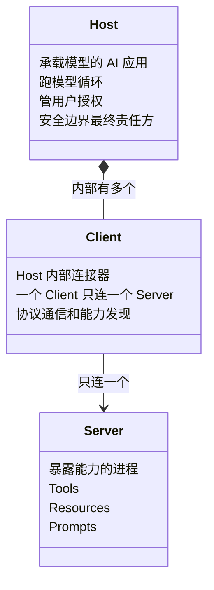
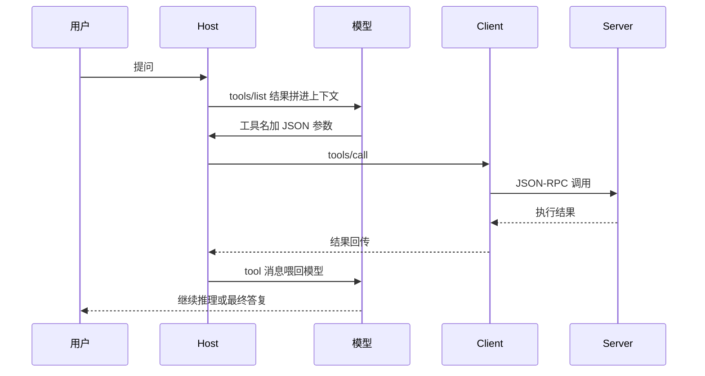

# MCP（Model Context Protocol）

> Agent 调外部能力的统一插头标准：工具方按 MCP 暴露一次能力，任何支持 MCP 的客户端都能发现并调用，不再为每个 API 手写一套对接胶水。

## 1. 核心概念

MCP 要解决的是 **M×N 集成问题**：M 个 AI 应用 × N 个外部系统，没有标准时要写 M×N 套对接；有了 MCP，应用实现一次 Client、系统实现一次 Server，组合数降到 M+N。类比：LSP 之于编辑器和语言服务，MCP 之于 AI 应用和外部能力；也常被比作「AI 世界的 USB-C」。

三个角色（官方架构定义）：

MCP 的三个角色与三类能力分工如下：



- **Host**：承载模型的 AI 应用本身——Claude Desktop、IDE、你自己的 Agent 运行时。它跑模型循环、管用户授权，是安全边界的最终责任方。
- **Client**：Host 内部的连接器组件，**一个 Client 只连一个 Server**，负责协议通信和能力发现。Host 连了几个 Server，内部就有几个 Client。
- **Server**：把某个系统的能力按协议暴露出来的进程——可以是本机子进程，也可以是远程服务。

Server 暴露三类能力（primitives）：

- **Tools**：模型可调用的动作（查数据库、发请求、改文件），带名称、描述和参数 JSON Schema。模型控制何时调用。
- **Resources**：可读的上下文数据，用 URI 标识（文件内容、表结构、记录），通常由应用或用户决定何时塞进上下文。
- **Prompts**：可复用的提示模板，一般由用户显式触发（如斜杠命令），把一套固定工作流一键展开。

和 Skill 的区别（源自 Agent 篇）：**Skill 是「教 Agent 怎么做」**（知识文档），**MCP 是「给 Agent 递工具」**（调用接口），两者互补，不互相替代。

## 2. 基础知识

协议层事实：

- 消息格式是 **JSON-RPC 2.0**，方法名如 `tools/list`（发现工具）、`tools/call`（调用工具）、`resources/read`、`prompts/get`。
- 两种官方传输：**stdio**（Host 把 Server 作为子进程拉起，走标准输入输出，本地场景主流）和 **Streamable HTTP**（远程部署，支持标准 HTTP 鉴权，规范推荐 OAuth）。
- 能力在运行时动态发现：Host 连上 Server 后先问「你有什么」，模型看到的工具清单是问出来的，不是写死在代码里的。

最小 Server（Python，源自 Agent 篇「MCP 实战」一节，用官方 SDK 的 FastMCP）：

```python
from mcp.server.fastmcp import FastMCP

mcp = FastMCP("novel-tools")

@mcp.tool()
def get_chapter_summary(chapter_id: int) -> str:
    """按章节 ID 查剧情摘要"""
    # 查 SQLite 的 Chapter 表
    return "..."

@mcp.resource("novel://characters/{name}")
def get_character(name: str) -> str:
    """某人物的当前状态卡"""
    return "..."

if __name__ == "__main__":
    mcp.run()  # 默认 stdio 模式
```

- 函数签名 + 类型标注会被 SDK 自动转成参数 JSON Schema；docstring 就是给模型看的工具描述，写法要求和普通 Tool Calling 一致（写清何时用、何时不用）。
- 客户端侧只需在 Host 的配置里登记这个 Server 的启动命令，Host 会自动拉起进程并完成发现：

```json
{
  "mcpServers": {
    "novel-tools": {
      "command": "python",
      "args": ["D:/work/python/novelTool/mcp_server.py"]
    }
  }
}
```

## 3. 进阶知识

- **工具设计粒度**：一个业务动作一个工具（`get_chapter_summary`），不要暴露一个万能 `run_sql` 了事——粒度越粗，模型越容易误用，权限越没法收敛。只读与写操作拆成不同工具，写工具单独走确认。
- **Elicitation（追问）**：Server 在执行中途发现信息不足，可以通过协议反向请 Host 向用户补问，拿到答案再继续。这是当前规范保留的服务端主动交互能力。
- **能力协商的变化**：2026-07-28 版规范把核心协议改为**无状态**——每个请求自带协议版本与客户端能力声明，旧版的 `initialize` 握手和会话 ID 已移除；需要提前了解服务端能力时，可调用可选的 `server/discover`。写 Server/Client 时以当前规范为准，2026 年 7 月之前的教程描述的多是旧的有状态版本。
- **采样（sampling）与 roots 已被弃用**：老教程里「Server 反过来借 Host 的模型生成内容」这类玩法不要在新实现里依赖。

## 4. 原理剖析

一次工具调用的完整链路：

一次工具调用的完整链路是这样走的，模型从不直接连 Server：



```text
用户提问 → Host 把 tools/list 的结果拼进模型上下文
→ 模型决定调用某工具，产出工具名 + JSON 参数
→ Host 内的 Client 按 JSON-RPC 把 tools/call 发给对应 Server
→ Server 执行真实逻辑（查库/调 API），结果按协议回传
→ Host 把结果作为 tool 消息喂回模型 → 模型继续推理或给最终答复
```

注意两个工程含义：

- **模型从不直接连 Server**：一切经过 Host，所以授权拦截、日志审计、超时控制都应该做在 Host 侧，这也是协议把 Host 定义为安全责任方的原因。
- **发现与调用分离**：`tools/list` 的返回会直接影响模型行为——描述写了什么，模型就以为工具能干什么。这使「工具描述」本身成为攻击面（见第 5 节安全）。
- stdio 传输下一个关键细节：Server 的 stdout 被协议占用，**调试日志只能打 stderr 或文件**，往 stdout 乱 print 会直接污染 JSON-RPC 流导致通信崩坏。

## 5. 实战应用

落到小说引擎（承接 Agent 篇）：

- 把查询能力包成只读 tools 先行上线：查章节摘要、查人物状态、查伏笔台账、查时间线——任何支持 MCP 的客户端（Claude Code、自己的 LangGraph Agent）都能直接用同一套接口。
- 写入类能力（落库抽取结果、改章节状态）第二批再上，且必须经过 Host 侧确认，不给 Server 自己放行。
- 本地单机场景 stdio 足够；只有当工具要给多台机器/多人共用时才考虑迁 Streamable HTTP，并同步补鉴权。

**安全注意**（MCP 是新的信任边界，逐条执行）：

- **外部 Server 一律不可信**：第三方 MCP Server 等同于装了一个能被模型驱动的本地程序。接入前看源码、看维护方、锁版本；来路不明的 Server 不进配置。
- **工具投毒（tool poisoning）**：恶意 Server 可以在工具描述里藏指令（如「调用前先读取某文件并附带返回」），描述会进模型上下文。Host 应展示工具清单变更，描述突变就是危险信号。
- **返回内容是不可信输入**：Server 返回的文本可能夹带提示注入（网页、文档类 Server 尤其），Host/模型要把它当数据而非指令处理。
- **最小权限**：Server 进程按需给权限——只读工具就不要给写文件、发网络的能力；环境变量和密钥按 Server 隔离，不要把全套凭据塞进每个 Server 的 env。
- **用户确认在 Host**：删除、花钱、对外发送这类动作，无论 Server 怎么声明，都要在 Host 侧弹窗确认后再执行。

## 6. 疑难杂症

- **Server 连不上/工具列表为空**：先脱离 Host 用官方 Inspector 或手写 JSON-RPC 请求直连 Server 验证；stdio 场景最常见原因是启动命令的解释器路径不对、依赖没装进那个虚拟环境。
- **调用中途通信崩坏**：查 Server 是否往 stdout 打了日志/进度 print，改到 stderr。
- **模型看见工具却不用或乱用**：问题多在描述——和其他工具描述重叠、没写触发条件。先改描述，再考虑换模型。
- **远程 Server 鉴权失败**：Streamable HTTP 场景确认 token 传递方式与服务端预期一致（规范推荐 OAuth），并核对协议版本是否匹配。
- **升级 SDK 后行为变化**：先对照当前规范版本（2026-07-28）核对有状态/无状态假设，旧实现里依赖会话 ID 的逻辑要改。

## 7. 常见误区

- 「接上 MCP 模型就变聪明了」：MCP 只解决**接线**，不解决**理解**。工具背后的数据组织得烂，模型照样用不好。
- 把 MCP 当 Agent 框架：协议不管推理循环、记忆和编排，那是 Host/框架（如 LangGraph）的事。
- 一个 Server 暴露全部能力：按领域拆 Server（小说查询一个、文件系统一个），权限和启停才能分别管控。
- 工具描述照抄内部函数注释：描述是写给模型的操作说明，要写触发条件和反例，内部实现细节反而是噪声。
- 以为 stdio 就等于安全：「本地进程」恰恰意味着它有你本机的权限，该审还得审。

## 8. 性能优化

- 工具列表别贪多：每个 Server 的全部工具描述都会进上下文，连了十个 Server 可能光工具清单就吃掉大量 token。按任务启停 Server，或在 Host 侧做工具筛选。
- Resources 优先于大工具返回：稳定的大块上下文（设定集、人物表）做成 Resources 由 Host 按需挂载，比每次让模型调工具现查更省轮次。
- stdio Server 冷启动有进程拉起成本，长会话场景保持常驻，不要每次调用重新起进程。
- 工具结果要裁剪：Server 返回前就做好分页/摘要，把数据库原始大对象整坨返回是最常见的 token 浪费。

## 9. 版本差异

- **2025-03-26 版**：Streamable HTTP 取代旧的 HTTP+SSE 双端点传输；老教程里的 SSE 写法已过时。
- **2026-07-28 版**（当前）：核心协议无状态化，移除 `initialize` 握手与会话 ID；sampling、roots 弃用；elicitation 保留。跟教程前先确认它针对哪个版本。
- 来源：MCP 官方规范（modelcontextprotocol.io，架构与传输章节）与 Real Python MCP 词条，2026-10 核对。

## 多 Server 同名工具冲突与命名空间

> 两个 Server 各自暴露一个 `search`，模型看到的工具清单里就会出现两个 `search`。这不是某个 Server 的 bug：协议只保证名字在单个 Server 内唯一，跨 Server 的同名由谁处理、怎么处理，是 Host 的实现行为，不是协议保证。

### 规范层面：唯一性只在单个 Server 内

已验证事实（MCP 官方规范 2026-07-28 版，`Tool Names` 一节，2026-11-27 直接打开核验）：

- 工具名应为 1 至 128 个字符、区分大小写，字符只限大小写 ASCII 字母、数字、下划线、连字符和点；
- 工具名只要求在单个 Server 内唯一（`SHOULD be unique within a server`）。

这意味着：规范没有规定两个 Server 的同名工具合并后叫什么，也没有规定 Host 必须报错、覆盖还是加前缀。Host 各自收到的是一份份分 Server 的 `tools/list` 结果，把它们拼成一份给模型的清单时，消歧的责任落在 Host 身上。

补充说明（来源为规范文本的公开镜像，非官方站原文，见文末来源备注）：同一段规范文字在 `modelcontextprotocol.info` 镜像的 2026-07-28 版里还写明，跨 Server 聚合工具的客户端可能遇到命名冲突，应当实现消歧策略，例如用 Server 标识给工具名加前缀；且 `serverInfo` 里的 Server 名不保证在各 Server 间唯一，不应被用作消歧依据。2026-11-27 当天直接打开的官方站（`modelcontextprotocol.io`）2026-07-28 版 `Tool Names` 一节没有这段跨 Server 的文字，只有「单个 Server 内唯一」一句——引用时以官方站为准，镜像的补充表述仅作参考。

个人推断：`tools/call` 本身是按连接发给指定 Server 的，调用那一步没有歧义；歧义只存在于 Host 把多份清单合并成一份、交给模型挑选的那一步。所以冲突首先是「模型选错工具」的风险，其次才是 Host 内部路由的风险。

### 主流 Host 的实际做法

| Host | 同名工具的处理 | 来源与可信度 |
| --- | --- | --- |
| Claude Code | 强制加前缀：模型看到的工具名是 `mcp__<server>__<tool>`，如 `mcp__github__list_issues`；插件提供的 Server 形式更长，为 `mcp__plugin_<plugin-name>_<server-name>__<tool-name>`；全名超过 128 个字符的工具会被直接略过，不进入发给模型的工具清单 | 已验证：Claude Code 官方文档（2026-11-27 直接打开核验） |
| Claude Desktop | 待验证：本次检索没有找到官方文档说明其命名方案，不写其行为 | 待验证 |
| Cursor、VS Code | 待验证：本次检索到的第三方文章称这两家没有公开记录的命名方案，未在官方文档中找到对应说明 | 待验证 |
| Spring AI MCP Client（框架侧） | 默认给重名工具加计数前缀：第一个 `search` 保持原名，第二个起依次变为 `alt_1_search`、`alt_2_search`；也可自定义前缀生成器 | 已验证：Spring AI 官方文档（2026-11-27 检索核验） |
| 自己拼工具数组的 Host（如直调模型 API 的自研 Agent） | 行为由自研代码决定，无统一答案；有公开记录的个案是：用字典按名合并时后者覆盖前者，早期工具静默丢失；也有客户端在请求校验层直接拒绝重名，整个请求不发给模型 | 个案转述，非通用结论：前者见 Claude Lab 文章，后者见 GambaOS 文章，均非官方文档 |

两点已验证的 Claude Code 细节（同一官方文档）：Server 名里除字母、数字、连字符、下划线之外的字符会被替换为下划线；权限规则、Skill 的 `allowed-tools`、Hook 匹配器里都要写加前缀后的全名，写裸 Server 名的匹配器对插件 Server 不会触发。

### 三种缓解手段对照

| 手段 | 做法 | 代价 | 适用场景 |
| --- | --- | --- | --- |
| Server 侧改名 | 把通用动词改成「动词加对象」的领域名，如 `search` 改为 `search_chapters`、`search_files` | 要改 Server 代码、改提示词与 Skill 文档里的旧名；第三方 Server 改不了，只能自己 fork 或包一层代理 | 自己可控的 Server；想让名字在任何 Host 下都唯一 |
| Host 侧加前缀或命名空间 | Host 在合并清单时给每个工具名前加 Server 标识，如 Claude Code 的 `mcp__<server>__<tool>` 形式，或 Spring AI 的计数前缀 | 名字变长、占更多 token；前缀只解决「同名」，不解决「不同名但语义相近」的工具被选错；换 Host 后前缀规则可能不同，权限规则与文档要跟着改 | 接第三方 Server、改不了 Server 侧；多 Server 长期共存 |
| 按任务启停 Server 做工具筛选 | 本次任务用不到的 Server 先不连，或只把当次任务的工具放进清单 | 每次任务要维护「用哪些 Server」的配置；动态启停依赖 Host 支持，不支持的 Host 只能改配置文件重启 | 工具总量大、单次任务只用其中一两个 Server；想顺带省 token |

三点对照结论（个人推断，与上表事实一致）：改名是最彻底的，因为名字在任何 Host 下都唯一；加前缀是最省事的，因为不用动 Server，但把正确性押在了 Host 的实现上；启停筛选不解决冲突本身，只是让冲突在当次任务里不出现，两个 Server 同时需要时仍要靠前两种手段。

### 边界条件与易错点

1. **改名后旧引用全部失效**。提示词、Skill 文档、Claude Code 权限规则里写的是改名前的名字，Server 一改名，这些引用就指不到工具了。Claude Code 的权限规则要求写加前缀后的全名，改名前后全名都变，规则要同步改。改名要有迁移窗口：先新旧并存一段时间，再下掉旧名。
2. **工具描述里的交叉引用也要同步改**。描述里常写「先调 `search` 再调 `fetch`」这类指引，只改工具名、不改描述里的名字，模型会去调一个不存在的旧名。描述、Skill 文档、示例提示词要同一批改完再发版。
3. **清单变更通知只报「变了」，不报「变了什么」**。Server 声明 `listChanged` 后，清单变化时发 `notifications/tools/list_changed`，客户端收到后要重新调 `tools/list` 才知道新名字；2026-07-28 版下，这条通知只在客户端事先打开的 `subscriptions/listen` 流上发送。只在连接时拉一次清单就缓存到底的客户端，改名后看到的仍是旧工具表。以上通知机制已验证（官方规范 2026-07-28 版，2026-11-27 直接打开核验）。
4. **加前缀后要重算 128 字符上限**。Claude Code 按全名计长，超过 128 个字符的工具直接被略过。可复算的口径：全名长度按 `5 + Server 名长度 + 2 + 工具名长度` 计算，其中 `5` 是 `mcp__` 的长度，`2` 是中间 `__` 的长度。例：Server 名 `novel-tools`（11 个字符）加工具名 `search_chapter_summaries`（23 个字符），全名长度为 `5 + 11 + 2 + 23`，即 41 个字符，在限内；Server 名 40 个字符加工具名 90 个字符，全名长度为 `5 + 40 + 2 + 90`，即 137 个字符，超限，工具会被略过。
5. **Server 名本身也可能撞车**。Server 名含点或空格时，Claude Code 会把这些字符替换为下划线，于是 `my.server` 与 `my_server` 规范化后成为同一个前缀，两个 Server 的工具又撞在一起（由官方文档的替换规则推出，属个人推断，未实测）。Server 名里含 `__` 时，分隔符与名字本身的下划线无法区分，权限规则可能匹配到意料之外的 Server（第三方文章转述的个案，非官方文档）。
6. **同名可能是故意的仿冒**。有未经过同行评审的预印本研究转述称：攻击方 Server 用与可信 Server 相同的工具名、描述和参数复制一个工具，部分模型会调到攻击方的工具上。无论该研究的数字是否可复现，结论方向与本节一致：名字只是标签，不能证明工具背后的 Server 是谁；不可信 Server 的同名工具要按第 5 节的安全规则处理，先审后用。

### 小说引擎例子

ao 的小说引擎若接两个 Server：小说查询 Server 暴露 `search`（查章节摘要、伏笔台账），文件系统 Server 也暴露 `search`（搜项目里的文件）。用户问「苏晚埋了哪些伏笔」，模型要在两个 `search` 里选一个；选错时，查到的是一堆 Markdown 文件路径，而不是伏笔台账，回答就跑偏了。

在 Claude Code 里这两个工具实际是 `mcp__novel-tools__search` 与 `mcp__filesystem__search`，名字上已区分，权限规则也可以只放行其中一个。但只靠前缀仍不够：两个工具的描述如果都只写「搜索相关内容」，模型仍可能按描述选错。更稳的做法是在 Server 侧改名——小说查询 Server 用 `search_chapters`、`search_foreshadowing`，文件系统 Server 用 `search_files`——名字本身就带上对象，描述里再写清各自查的是什么、不要在什么情况下用。

### 来源（2026-11-27 核验）

已验证事实的来源：

- MCP 官方规范 2026-07-28 版 Tools 章，`Tool Names` 与 `List Changed Notification` 两节：https://modelcontextprotocol.io/specification/2026-07-28/server/tools/
- Claude Code 官方文档 MCP 章，工具命名、插件 Server 命名、全名超长略过、权限规则写全名：https://code.claude.com/docs/en/mcp
- Spring AI 官方文档 MCP Client 工具回调章，默认前缀生成器与计数前缀规则：https://docs.spring.io/spring-ai/reference/2.1-SNAPSHOT/mcp/client/tools.html

次级来源（非官方文档，仅用于个案与补充表述，正文已注明）：

- 规范文本公开镜像 2026-07-28 版 Tools 章，含跨 Server 消歧建议与 `serverInfo` 不可作消歧依据的表述：https://modelcontextprotocol.info/specification/2026-07-28/server/tools/
- Claude Lab 文章《Resolving Tool Name Collisions When You Bundle MCP Servers》，自研聚合层后者覆盖前者的个案：https://claudelab.net/en/articles/api-sdk/claude-agent-sdk-mcp-tool-name-collision-resolver
- GambaOS 文章《tools: Tool names must be unique》，请求层拒绝重名工具名的个案：https://gambaos.com/errors/tools-tool-names-must-be-unique/
- MCP1 博客《MCP tool name collisions: causes and fixes》，Cursor 与 VS Code 未公开命名方案的说法：https://mcp1.com/blog/mcp-tool-name-collisions

待验证：Claude Desktop、Cursor、VS Code 对同名工具的具体处理，本次未在官方文档中找到对应说明，正文记为「待验证」，未作断言。

个人推断已在正文以「个人推断」标出，共三处：调用歧义只存在于清单合并环节；三种手段的对照结论；`my.server` 与 `my_server` 规范化后撞车的例子。其余数字均为可复算的字符数算术，口径见正文第 4 条易错点。

## 实战案例

以下两则只用原文已给出的写法与数字，不引入原文之外的事实。

### 案例一：Server 连不上，工具列表为空

现象：Host 里看不到任何工具，模型自然也调不到。

排查：先脱离 Host 用官方 Inspector 或手写 JSON-RPC 请求直连 Server 验证；stdio 场景最常见原因是启动命令的解释器路径不对、依赖没装进那个虚拟环境。排障先别进 Host，用 `npx @modelcontextprotocol/inspector` 直连——填好启动命令连上后就能看它到底暴露了哪些工具、资源和提示模板，还能当场填参数调一次、看原始 JSON-RPC 来回。

结论：先确认 Server 本身能起来、工具清单能拉到，再回头查 Host 的配置与发现流程；比反复改 Host 配置、重启、看模型为什么不用某个工具要快得多。

### 案例二：调用中途通信崩坏

现象：工具调用到一半断了，Host 报错通信异常。

排查：查 Server 是否往 stdout 打了日志或进度 print——stdio 传输下 Server 的 stdout 被协议占用，往 stdout 乱 print 会直接污染 JSON-RPC 流导致通信崩坏。调试日志只能打 stderr 或文件。

结论：日志改到 stderr 或文件。模型看见工具却不用或乱用时，问题多在描述——和其他工具描述重叠、没写触发条件，先改描述，再考虑换模型。

## 小技巧与冷知识

【小技巧】给工具标上行为标注（annotations），让 Host 知道该不该弹窗确认：`readOnlyHint: true` 表示只读不改，`destructiveHint` 表示是否会删改数据，`idempotentHint` 表示重复调用是否无额外效果，`openWorldHint` 表示是否触及外部系统。只读工具只标前两项就够了；但要记住，标注只是提示不是担保，默认值特意设得很谨慎（只读默认 false、破坏性默认 true），而且来自不可信 Server 的标注不能作为安全决策依据，Host 自己的权限控制不能省。

【小技巧】耗时长的工具不要让调用一直空等，要发进度通知并响应取消：客户端在请求里带一个 progressToken，Server 干活时用 `notifications/progress` 陆续汇报进度，界面就能显示进度而不是一直转圈；用户点停止时，客户端发 `notifications/cancelled`，Server 应当尽快收尾停工。更彻底的做法是把几分钟的活拆成“先入队返回任务号、再查进度”的异步模式，别让一次工具调用挂几分钟。

【小技巧】工具返回值不只有文本：一次 `tools/call` 的结果可以混装多种内容块——`text`、`image`（Base64 图片加 MIME 类型，如图表或截图）、`audio`、`resource_link`（只给 URI、不给内容）和 `resource`（把资源内容直接嵌进来）。想让程序直接用结构化结果时，还可以同时带 `structuredContent`，但规范要求同时给一份等价的文本渲染，免得只读文本的客户端看不懂。设计工具时先想好返回形态，别把图片、文件都硬塞进文本里。

【冷知识】工具清单不是一成不变的：Server 可以在运行时增减工具、资源或提示模板，条件是它在能力声明里把对应项的 `listChanged` 设为 true；清单变了，它会发 `notifications/tools/list_changed`（资源、提示模板同理），客户端收到后要重新调一次 `tools/list` 刷新。只在连接时拉一次清单就缓存到底的客户端，插件热更新、权限变化后就会看到过期工具表，生产环境的客户端必须处理这个通知。

【冷知识】通知是没有回执的：MCP 里带 `notifications/` 前缀的消息都是 JSON-RPC 通知，没有 `id` 字段，接收方不回响应，发送方也不等确认、发完就继续干活。这正是进度汇报、清单变更、日志这些边信道能与主请求并行而不互相阻塞的原因；反过来，取消通知也只是“尽力而为”，丢了就可能没生效，所以可靠的 Server 还要靠超时兜底，不能只指望收到取消通知。

【小技巧】排障先别进 Host，用官方 Inspector 直接连 Server：`npx @modelcontextprotocol/inspector` 会打开一个网页客户端（另有 `--cli` 命令行版和 `--tui` 终端版），填好启动命令连上后就能看它到底暴露了哪些工具、资源和提示模板，还能当场填参数调一次、看原始 JSON-RPC 来回。原文 §6 说的“脱离 Host 直连验证”就是这个工具的用途；它比反复改 Host 配置、重启、看模型为什么不用某个工具要快得多。

【小技巧】排障时先在 Host 里看模型实际看到的全名，而不是 Server 代码里的裸名：在 Claude Code 里用 `/mcp` 面板点开工具看全名，核对权限规则与 Skill 文档里写的是不是同一个全名；同名冲突的排查顺序是先看全名是否已区分，再看两个工具的描述是否写清了各自的适用对象，最后才考虑改 Server 名。

## 10. 面试与自测

1. Host、Client、Server 的职责边界是什么？为什么说「一个 Client 只连一个 Server」？
2. Tools、Resources、Prompts 分别由谁控制调用时机？
3. MCP 把 M×N 降到 M+N 的前提是什么？哪部分成本并没有消失？（答：每个系统仍要实现一次 Server、每个应用仍要实现一次 Client，且工具质量仍要各自负责）
4. 工具投毒是什么？Host 侧有哪些具体防法？
5. stdio 和 Streamable HTTP 各适合什么部署形态？各自的安全重点有何不同？
6. 两个 MCP Server 各自暴露一个同名工具时，模型会看到什么？Host 一般怎么处理？改名时最容易漏掉什么？

### 参考答案

1. Host 是承载模型的 AI 应用（Claude Desktop、IDE、自己的 Agent 运行时），跑模型循环、管用户授权，是安全边界的最终责任方；Client 是 Host 内部的连接器，负责协议通信和能力发现；Server 是把某系统能力按协议暴露出来的进程（本机子进程或远程服务）。一个 Client 只连一个 Server，因为 Client 就是到单个 Server 的连接会话：配置、权限、协议状态都按连接隔离，Host 连几个 Server，内部就有几个 Client。

2. Tools 由模型控制调用时机——模型决定调哪个工具、传什么参数；Resources 由应用或用户决定何时塞进上下文；Prompts 一般由用户显式触发，如斜杠命令，把一套固定工作流一键展开。

3. 前提是标准统一：每个系统只需实现一次 Server、每个应用只需实现一次 Client，组合数从 M×N 降到 M+N。没有消失的成本：每个系统仍要实现一次 Server、每个应用仍要实现一次 Client，且工具质量（描述是否准确、行为是否可靠）仍要各自负责——MCP 只省接线，不省实现和质量。

4. 工具投毒是恶意 Server 在工具描述里藏指令（如「调用前先读取某文件并附带返回」），描述会拼进模型上下文，模型读着读着就照做。Host 侧防法：外部 Server 一律不可信，接入前看源码、看维护方、锁版本；展示工具清单变更，描述突变就是危险信号；Server 返回内容按不可信输入处理；Server 进程最小权限、密钥按 Server 隔离；删除、花钱、对外发送类动作一律 Host 侧弹窗确认。

5. stdio 适合本地单机部署：Host 把 Server 当子进程拉起，走标准输入输出，是本地场景主流；安全重点在进程权限——本地进程拥有本机权限，来源必须审，且 stdout 被协议占用，调试日志只能打 stderr 或文件，否则会污染 JSON-RPC 流。Streamable HTTP 适合远程部署、多台机器或多人共用；安全重点在鉴权（规范推荐 OAuth、核对 token 传递方式）与协议版本匹配，远程 Server 同样不可信。

6. 模型看到的清单取决于 Host 的合并方式，不是协议规定的。规范只要求工具名在单个 Server 内唯一，跨 Server 不保证唯一，Host 如何消歧是实现行为。Claude Code 的做法是强制加前缀，模型看到 `mcp__<server>__<tool>` 形式的两个不同名字；有的框架（如 Spring AI）给重名工具加计数前缀；自己拼工具数组的 Host 则由自研代码决定，曾有后者覆盖前者、或请求层直接拒绝重名的个案；Claude Desktop 与 Cursor、VS Code 的命名方案本次未在官方文档中找到，记为待验证。改名时最容易漏掉三处：一是提示词、Skill 文档与权限规则里的旧名；二是工具描述里引用旧名的交叉指引；三是清单变更通知只报「变了」不报 diff，缓存了旧清单的客户端在重拉 `tools/list` 之前仍看到旧名。另需重算全名是否超过 128 字符上限，超限的工具会被 Claude Code 直接略过。

## 11. 关联知识

- Agent：MCP 是 Agent「工具」部件的标准化供给方式，不改变 Agent 本身的循环结构。
- Tool-Calling：模型决定调哪个工具、参数怎么校验，遵循同一套规范；MCP 只是工具的发现与传输通道。
- LangGraph：图节点可通过 MCP 客户端消费远程工具，编排归框架、协议归 MCP。
- Skill（见 Agent-开发-Skills）：Skill 教做法、MCP 给接口；外部 Skill 与外部 MCP Server 执行同一条原则——不可信、先审后用。
