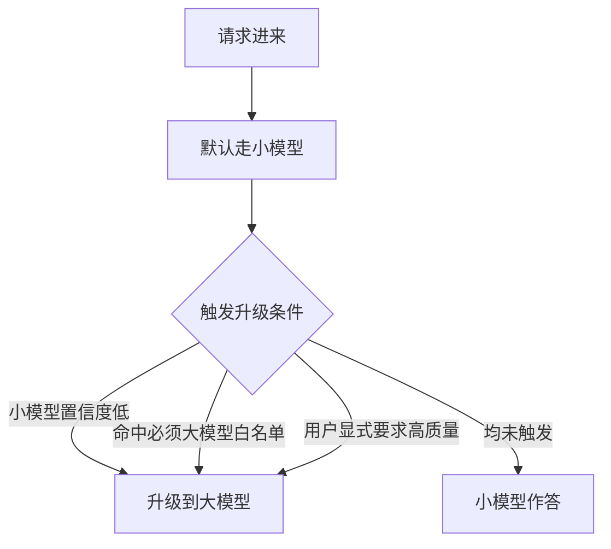
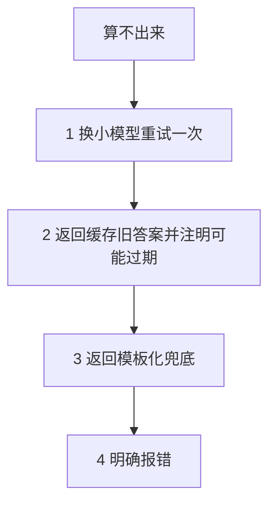

# LLM生产化与推理优化

## 1. 核心概念：生产化是三条约束一起算

Demo 跑通只证明“模型能答”，生产化要同时满足三条约束：

- 成本：单次请求多少钱、月度总账多少。
- 延迟：P50 够不够快、P99 会不会炸。
- 可靠性：模型挂了、超时了、答案离谱了，系统怎么兜底。

推理优化的层次（本篇只讲应用层三件套，引擎层见关联篇）：

- 路由：让合适的请求去合适的模型。
- 缓存：重复问题不重复算。
- 降级：算不出来时体面地失败。

三者的共同前提：先有指标。没有命中率、降级率、P99 延迟的基线，一切优化都是凭感觉。

## 2. 模型路由：按任务分流，不是按模型分流

### 2.1 分流维度

- 任务难度：分类、抽取、格式转换 → 小模型；开放推理、终裁、长文生成 → 大模型。
- 成本敏感度：高频低价值请求 → 小模型优先；低频高价值请求 → 可以上大模型。
- 延迟要求：实时交互 → 小模型或流式；离线批处理 → 大模型也无妨。

### 2.2 小模型优先 + 大模型兜底

常见模式：默认走小模型，触发以下任一条件时升级到大模型：

小模型优先、大模型兜底的路由是这样分流的：



- 小模型置信度低（输出自评分数、logprob、规则校验失败）。
- 任务命中“必须大模型”白名单（如终裁、矛盾检测）。
- 用户显式要求高质量。

兜底不是免费午餐：升级路径本身要限流、要记账，否则一次流量尖峰会把成本打穿。

### 2.3 路由策略对照

- 规则路由：按任务类型、关键词、用户等级硬编码。简单、可解释，适合早期；规则一多就难维护。
- 分类器路由：训一个小分类器预测“这个问题需要多大模型”。效果好，但分类器本身要评测、要维护。
- 成本预算路由：给每类请求定预算，预算内尽量用小模型。适合成本敏感场景。

路由本身也要评测：误路由率（本该大模型却给了小模型）是核心指标，定期抽样人工复核。

## 3. 语义缓存：重复问题不重复算

### 3.1 原理

把历史问答存起来：问题 → embedding 向量。新问题算向量后找相似度最高的缓存项，相似度超过阈值就直接返回缓存答案，跳过模型调用。

```python
import math

def cosine(a, b):
    dot = sum(x * y for x, y in zip(a, b))
    na = math.sqrt(sum(x * x for x in a))
    nb = math.sqrt(sum(y * y for y in b))
    return dot / (na * nb) if na and nb else 0.0

cache = [([1.0, 0.0], "缓存答案：退货流程说明")]
query = [0.98, 0.20]
sim = cosine(query, cache[0][0])
print(f"相似度={sim:.3f}", "命中" if sim >= 0.9 else "未命中")
```

### 3.2 阈值与失效

- 阈值太低：误命中，答非所问，比不缓存更糟。
- 阈值太高：命中率低，缓存白建。
- 阈值没有通用值：先在历史问答上离线测“不同阈值下的误命中率”，再定。

失效策略缺一不可：

- TTL：时效性内容到期自动失效。
- 版本失效：模型、知识库、业务规则变了，相关缓存整批失效。
- 用户隔离：带个人信息的问答不得跨用户命中，缓存键必须含用户或会话维度。

### 3.3 适用与不适用

- 适用：高频重复问答、模板化查询、固定口径的解释（如“退货流程”“接口报错含义”）。
- 不适用：时效性问题（价格、库存、新闻）、个性化问题（我的订单、我的数据）、长尾问题（命中率天然低）、隐私敏感问题。

## 4. 降级策略：算不出来时体面地失败

降级要分级，不要只有“成功 / 报错”两档：

降级分四档，从轻到重依次走：



1. 换小模型重试（一次，有超时上限）。
2. 返回缓存中的旧答案并注明“可能过期”。
3. 返回模板化兜底（“这个问题我暂时无法确认，建议走人工渠道”）。
4. 明确报错（可重试、有错误码、有日志）。

三条铁律：

- 降级必须可观测：每次降级记一条，降级率是核心告警指标。
- 降级不得静默撒谎：缓存旧答案、模板回答都要让用户看得出这不是新鲜答案。
- 降级路径本身要演练：只在故障时才第一次走降级链路，等于没有降级。

## 5. 成本与延迟权衡

### 5.1 成本模型

单次请求成本 ≈ 输入 token 数 × 输入单价 + 输出 token 数 × 输出单价。

- 输入侧：上下文越长越贵，长上下文要先做检索裁剪（见 RAG 相关篇），不要把整库塞进提示词。
- 输出侧：让模型“先给结论再展开”、限制最大 token 数，是最直接的省钱手段。
- 单价以实际账单为准：不同厂商、不同模型的单价随时会变，本篇不列具体价格。

### 5.2 延迟构成

总延迟 ≈ 排队 + 首 token 时间 + 生成时间（输出 token 数 ÷ 生成速度）。

- 流式输出改善的是体感延迟，不是总延迟；P99 看的是最慢的那批请求。
- 只看平均延迟会掩盖问题：平均 1 秒、P99 20 秒的系统，用户体验由 P99 决定。

### 5.3 权衡表

| 手段 | 省成本 | 降延迟 | 代价 |
| --- | --- | --- | --- |
| 小模型优先 | 是 | 是 | 质量下限要守住 |
| 语义缓存 | 是 | 是 | 误命中、失效管理 |
| 流式输出 | 否 | 体感 | 客户端要适配 |
| 批处理 | 是 | 否（单次变慢） | 不适合实时场景 |
| 缩短上下文 | 是 | 是 | 检索质量要跟上 |

## 6. 可观测指标：上线前先把表建好

| 指标 | 说明 | 告警思路 |
| --- | --- | --- |
| 缓存命中率 | 命中请求 / 总请求 | 骤降说明阈值、数据分布或失效策略出了问题 |
| 误命中率 | 抽样复核中答错的命中占比 | 高于业务容忍线就收紧阈值 |
| 降级率 | 降级请求 / 总请求 | 持续高于基线说明上游或模型有问题 |
| P99 延迟 | 最慢 1% 的延迟 | 只看平均数等于看不见故障 |
| 单请求成本 | token 成本 / 请求数 | 突增先查上下文长度和升级率 |
| 误路由率 | 抽样中分流错误的占比 | 高了就回炉路由规则或分类器 |

告警阈值没有通用数：先跑两周攒基线，再按基线定阈值。

## 7. 成本定量：路由分流与语义缓存的账

§5.1 给了单次请求成本的算式，本节把 §2 路由和 §3 语义缓存的定性结论换算成数字。
本节所有数字均为假设值与相对单位，只用于演示算式，不代表任何厂商的真实单价；
单价与账单以实际结算为准。本节公式均为 §5.1 成本模型的直接推导，未引入外部资料。

### 7.1 路由分流：升级率决定混合成本

设小模型单次成本为相对单位 1，大模型为相对单位 10（相对单位，不是真实单价）。
升级率 f 指升级到大模型的请求占比，混合成本的算式是：

混合成本 = (1 − f) × 1 + f × 10 = 1 + 9 × f

| 升级率 f | 混合成本（相对单位） | 占全走大模型的比例 | 比全走大模型节省 |
| --- | --- | --- | --- |
| 5% | 1.45 | 约 14% | 85.5% |
| 15% | 2.35 | 约 24% | 76.5% |
| 30% | 3.70 | 约 37% | 63.0% |

三点读法：f = 15% 时混合成本 2.35，只有全走大模型（10）的约四分之一，省下 76.5%；
f 从 15% 翻倍到 30%，混合成本从 2.35 涨到 3.70，增加 1.35，涨幅约 57%；
f 从 5% 升到 15%，混合成本从 1.45 涨到 2.35，增加 0.90。
升级率每提高 1 个百分点，混合成本增加 0.09（即 0.01 × (10 − 1)），斜率 9 来自大小模型的成本差：
模型之间价差越大，升级率这根杠杆越重。所以 §2.2 的升级触发条件（小模型置信度低、白名单、
用户显式要求）不是纯质量问题，每放宽一条触发条件，都是在给 f 加码，也就是直接给账单加码。

复算口径（本地 Python 实测，与上表一致）：

```python
def mixed_cost(f, c_small=1, c_large=10):
    return (1 - f) * c_small + f * c_large

for f in [0.05, 0.15, 0.30]:
    m = mixed_cost(f)
    print(round(m, 2), str(round((10 - m) / 10 * 100, 1)) + "%")
```

### 7.2 语义缓存：节省由可缓存占比与命中率相乘决定

设可缓存请求占比为 s，缓存命中率为 h（分母只算可缓存请求，与小技巧节的口径一致），则：

有效成本 = (1 − s × h) × 原成本

取 s = 0.6（即六成请求是可缓存的重复问答，假设值）：

| 缓存命中率 h | s × h | 有效成本系数 | 节省比例 |
| --- | --- | --- | --- |
| 0.5 | 0.30 | 0.70 | 30% |
| 0.8 | 0.48 | 0.52 | 48% |

两点读法：h 从 0.5 提升到 0.8，节省从 30% 升到 48%，多省 18 个百分点；
s 是节省的天花板，s = 0.6 时即使 h = 1.0，最多也只能省 60%，剩下的四成请求本来就不进缓存。

延迟侧也一样算。命中请求跳过模型调用，只花检索与返回的时间。
设一次模型调用的延迟为 1 个相对单位，缓存命中延迟约为 0.05 个相对单位（假设值），则
平均延迟系数 = (1 − s × h) × 1 + s × h × 0.05。
s = 0.6、h = 0.5 时平均延迟系数约 0.715，节省约 28.5%；
s = 0.6、h = 0.8 时约 0.544，节省约 45.6%；
只看可缓存请求本身：h = 0.5 时延迟系数约 0.525，h = 0.8 时约 0.240。
一句话总结：平均延迟的节省与 s × h 成正比，命中率每提高一档，省下的延迟是线性增加的；
想让缓存对延迟有体感，要么提高 s（多沉淀模板化问答），要么提高 h（调阈值，见 §3.2），
只盯其中一个会很快撞上天花板。

### 7.3 边界条件：这张账在什么情况下会算错

- 升级率是实测值，不是设定值。f 不是配置里写一个数就等于这个数，§2.2 三条触发条件在真实流量下的触发频次才是 f；小模型误判一多、误路由率一高，f 会被悄悄推上去，混合成本跟着涨。算账时 f 必须取路由日志的实测值，并和 §6 的误路由率一起看。
- 缓存命中率的分母口径要固定。h 的分母只算可缓存请求（见 §7.2 与小技巧节），不能拿总请求数当分母；否则时效性、个性化、长尾请求一多，h 会被长期压低，省多少钱、省多少延迟都会被低估，阈值调优的方向也会看错。
- 相对单位换算成真实账单要乘实际单价与请求量。真实月度成本约等于混合成本（相对单位）× 小模型单次真实成本 × 月请求量；缓存节省的真实金额约等于原成本 × s × h。相对单位里的 1 和 10 只是比值，换成哪家厂商、哪个模型都要用实际账单里的单价重算，不确定的以实际账单为准。
- 缓存只对可缓存请求生效。§3.3 列出的不适用场景（时效性、个性化、长尾、隐私敏感）不进 s 的分子，s 定得过高会把节省比例算得过于乐观；s 应取历史问答中真正可缓存的占比，而不是总请求量。

### 7.4 怎么用这张账

- 先跑两周攒基线再算：§6 指标表里的缓存命中率、误路由率、单请求成本三行，就是本节算式的输入；没有基线，f、s、h 全是猜数，算出来的账也没有意义。
- 优化先看杠杆大小：f 每降 1 个百分点省 0.09 个相对单位，h 每提高 0.1 省 s × 0.1 的成本；两边都算一下，优先做单位投入省得多的那一边。
- 阈值与触发条件改动后要重算：§3.2 的阈值一动，h 就变；§2.2 的触发条件一动，f 就变；每次改动后用新测到的 f、h 重跑一遍 §7.1 和 §7.2 的算式，再决定改动值不值。

## 8. 常见误区

- 缓存万能：缓存只对重复问题有效，长尾场景命中率天然低，硬上缓存等于白维护。
- 路由越复杂越好：规则路由能覆盖 80% 场景时，别急着上分类器路由。
- 只看平均延迟：P99 才是用户体验的决定项。
- 降级 = 返回错误：好的降级是“差一点的答案”，不是直接报错。
- 为省成本把大模型全换小模型：质量下限失守后，省下的成本会在客诉和返工里还回来。

## 小技巧与冷知识

【小技巧】语义缓存的阈值不要全库只定一个数，按意图分组定。不同类问题的相似度分布本来就不一样，固定口径的问答相似度普遍偏高，开放问答偏低；一个全局阈值要么在前一类上误命中，要么在后一类上几乎不命中。做法是先按意图或模板分组离线测误命中率，每组各定各的阈值，命中率和误命中率也分组合计。

【小技巧】缓存命中率的分母只算“可缓存请求”，别拿总请求数当分母。时效性、个性化、长尾问题本来就不该进缓存，把它们也算进来会把命中率长期压得很低，看不出缓存本身是变好了还是变差了。分母收窄后，命中率骤降才真正说明阈值、数据分布或失效策略出了问题。

【小技巧】缓存键里除了用户维度，还要把提示词模板版本和 embedding 模型版本也编进去。原文只讲了模型、知识库、业务规则变了要整批失效，但提示词改一个字、embedding 模型一换，旧缓存的答案和向量都可能不再可比。把这两个版本放进键里，升级时旧缓存自然不再命中，比事后手动清一批缓存更不容易漏。

【小技巧】给升级路径同时设“必须升级”白名单和“不许升级”黑名单。原文只讲了触发升级的条件，但高频低价值请求一旦被误判就会成批涌向大模型，成本立刻打穿。黑名单把那些明确低价值的请求锁死在小模型上，白名单只放终裁、矛盾检测这类必须大模型的任务，两头一卡，升级率才有上限。

【小技巧】每月拿账单反推一次升级率，再和路由日志里的 f 对照。做法是拿当月实际账单除以请求量，得到真实单请求成本，再按 §7.1 的算式反推实际 f；如果反推的 f 比日志里的高，说明有未记账的升级路径在偷偷走大模型，先查白名单和兜底分支有没有漏记账，再谈优化。账对不上时先补记账，再调阈值。

【冷知识】语义缓存里，误命中比漏命中贵得多。漏命中只是多花一次模型调用的钱，误命中是把错误答案直接交给用户，之后还要花客服、返工和信任成本去收拾。原文讲阈值太低会答非所问，这正是它比不缓存更糟的原因；所以调阈值时应优先保精确率，而不是一味追命中率。

【冷知识】P99 延迟的大头常常不在模型生成，而在排队。原文把总延迟拆成排队加首 token 时间加生成时间，但很多人只盯着生成速度优化；流量一上来，请求先在队列里等，P99 照样炸。看到 P99 恶化时，先查并发和排队长度，再决定是加副本、限流还是降级，方向别一开始就搞错。

【冷知识】降级链路里最容易被忽略的一环是“缓存旧答案”的过期标注。原文要求降级不得静默撒谎，但实践中旧答案经常只在日志里注明过期，前端照常展示，用户根本看不出来。正确做法是把“可能过期”写进返回给用户的正文里，和答案一起展示，否则一次过期答案造成的误解，比一次明确报错更难收拾。

## 9. 面试与自测

1. 为什么“小模型优先 + 大模型兜底”需要给升级路径限流和记账？
2. 语义缓存的阈值定得太低和太高分别有什么后果？失效策略为什么缺一不可？
3. 只看平均延迟有什么问题？P99 延迟为什么是生产化必看指标？
4. 小模型成本为 1、大模型成本为 10（相对单位）时，升级率从 15% 升到 30%，混合成本怎么变？为什么说升级率是成本的第一杠杆？

### 参考答案

1. 升级路径没有限流时，一次流量尖峰或一次小模型批量误判会把大量请求瞬间推给大模型，成本打穿；没有记账则事后无法归因、无法定预算。限流保上限，记账保可复盘。
2. 阈值太低会误命中（答非所问，比不缓存更糟），太高则命中率低（缓存白建）。失效策略缺一不可：TTL 管时效性，版本失效管模型/知识/规则变更，用户隔离防跨用户泄露个人信息。
3. 平均延迟掩盖长尾：平均 1 秒、P99 20 秒的系统，大部分请求快、少数请求极慢，而用户记住的正是那次极慢的体验；P99 直接度量最慢 1%，是故障和体验劣化的第一信号。
4. 混合成本从 2.35 涨到 3.70，增加 1.35，涨幅约 57%。算式是混合成本 = 1 + 9 × f，f 每提高 1 个百分点成本增加 0.09，斜率 9 就是大小模型的成本差；价差越大，f 的一小点波动对账单的影响越大，所以控 f（收紧触发条件、修误路由）比单纯换更便宜的模型更先见效。

## 10. 关联知识

- [推理框架对比](AI与大模型/推理框架对比.md)：引擎层选型（vLLM、SGLang 等），本篇的应用层优化建立在它之上
- [本地部署与Ollama](AI与大模型/本地部署与Ollama.md)：本地模型的显存与上下文账，决定路由分流时谁有资格当小模型
