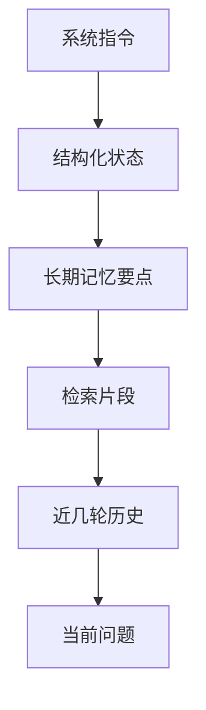
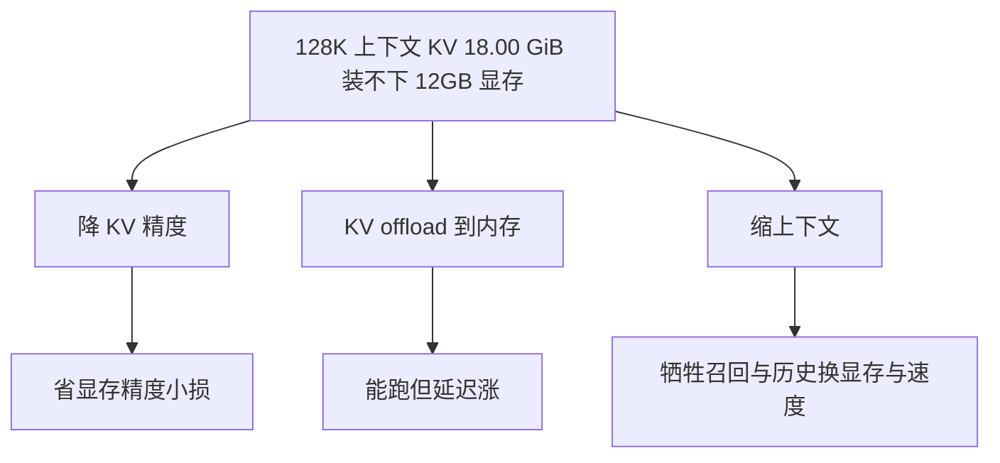

# 上下文工程

> [Prompt 工程](AI与大模型/Prompt-工程.md) 解决「这一句提示怎么写」，上下文工程解决「这一整次调用，到底给模型看什么」。当任务从一问一答变成长链路 Agent，效果的瓶颈通常不在提示词文采，而在上下文的**组成、排序与取舍**——给错了、给多了、给乱了，模型再强也救不回来。

## 1. 核心概念：与 Prompt 工程的区别

| 维度 | Prompt 工程 | 上下文工程 |
|---|---|---|
| 对象 | 单条提示词的文本 | 一次调用的全部输入 |
| 典型问题 | 角色怎么设定、格式怎么约束、示例给几个 | 记忆取哪些、检索结果放多少、历史压缩到什么程度、工具结果怎么回填 |
| 失效方式 | 输出格式不稳、风格跑偏 | 关键信息被淹没、过期状态干扰、成本与延迟爆炸 |
| 优化手段 | 改措辞、加示例 | 分层、筛选、压缩、结构化注入 |

上下文（context）是模型单次推理能看到的全部内容，由五部分拼成：

1. **系统指令**：角色、规则、硬约束。每轮都在，变化最少，应最稳定。
2. **长期记忆**：从记忆库取出的事实与状态，是「副本」不是数据源，原则见 [Agent-记忆系统](AI与大模型/Agent/Agent-记忆系统.md)。
3. **检索结果**：RAG 召回的片段，本质是「临时证据」，要带出处、要能被模型区分于事实。
4. **工具结果**：本轮或近几轮工具调用的返回值，时效性强，旧结果要及时清理。
5. **对话历史**：用户与模型的往来原文，越往前价值衰减越快，是压缩的主要对象。

工程的含义就在于：这五部分不是「有什么塞什么」，而是每部分都有预算、来源和淘汰规则。

## 2. 长上下文的失效模式

窗口变大（本地模型常见 32K–128K 标称）不等于问题解决，把东西塞满会触发四类失效：

- **中段丢失（lost in the middle）**：模型对上下文首尾的注意力天然强于中段，关键信息埋在长文本中间时，召回率明显下降。这是多项公开评测反复观察到的现象；具体幅度见第 7 节定量：GPT-3.5-Turbo 在 20 篇文档问答中、答案放中段时准确率 52.9%，比闭卷还低。
- **注意力稀释**：无关内容越多，有关内容的权重被摊得越薄。塞 50 个检索片段进去答一个问题，通常不如塞最相关的 5 个——噪声本身就是一种伤害。
- **过期信息干扰**：世界状态已变，旧状态的副本还留在历史里，模型分不清哪份是当前值。这与记忆污染同源：上下文不是档案馆，旧副本该撤就撤。
- **成本与延迟爆炸**：本地推理同样有账算——prefill 要逐 token 处理全部输入，上下文翻倍，首 token 延迟和显存（KV Cache）占用近似线性上涨。12GB 显存上把窗口从 8K 拉到 64K，慢的不是一点半点。

结论：**上下文是每轮都要重新组装的产物，不是越攒越长的日志。**

## 3. 组织与压缩策略

### 分层组装

按稳定性分层，稳定的在前、易变的在后（也利于 KV Cache 复用）：系统指令 → 结构化状态 → 长期记忆要点 → 检索片段 → 近几轮历史 → 当前问题。每一层设 token 预算，超额时从价值最低的层开始砍，而不是整体截断尾巴。

上下文按稳定性分层组装，稳定的在前、易变的在后：



### 摘要 + 原文双轨

长历史不整段保留：压缩成结构化摘要（已确认事实、未决问题、当前目标）常驻上下文，原始对话退到库里，需要时按需取回。注意摘要是有损通道，让模型自由复述再当事实用会逐轮失真（见 [Agent-记忆系统](AI与大模型/Agent/Agent-记忆系统.md) 的「模型复述即更新」）；摘要应优先由程序从结构化状态生成，模型生成的只作参考轨。

### 滑动窗口 + 置顶信息

最近 N 轮对话保留原文（细节最全、指代最密），更早的部分只留摘要；同时把「无论多旧都不能丢」的信息（当前任务目标、关键约束、未回收的伏笔）置顶到状态层，不随窗口滑走。

### 重要性筛选

进入上下文前先过一道筛选：与当前任务/当前章节的相关性、时效性（当前版本优先）、信息密度（一段话里事实多不多）。检索结果尤其要过：召回分数低的片段宁可不塞，塞错的代价大于漏塞。

### 结构化状态注入

能结构化就不要给散文。把世界状态组织成字段明确的 JSON 或表格（实体当前状态、关系、未决事项）注入上下文：模型解析无歧义、程序可以 diff 和审计、token 还省。要输出同理，要求模型回结构化增量而非自由文本，约束办法见 [结构化输出与JSON约束](AI与大模型/结构化输出与JSON约束.md)。

## 4. 实战应用：小说引擎的世界状态上下文

小说创作引擎是这套方法的现成样本。它写每章前不靠「把前面几十章原文塞进上下文」，而是由 ChapterContextService 聚合出结构化世界状态：人物实体的当前状态（EntityState）、关系网（Relation）、时间线与近期事件、故事规则（StoryRule），再加上伏笔台账里处于 planted/developed 状态的未回收伏笔清单。

这套做法对应到本篇的每条策略：

- **结构化状态替代纯文本历史**：几百章的剧情事实存在 SQLite 里（状态外置），每轮只注入与本章相关的切片，窗口再小也够用，且天然避开中段丢失——关键事实永远在状态层，不在长文中间。
- **伏笔台账就是「置顶信息」**：未回收伏笔不会随章节滑动被冲走，每章生成前强制出场，回收后状态变更为 paid_off 才撤下。
- **摘要双轨**：已写章节留全文（原文轨，供检索与核对）+ 章节摘要（摘要轨，供快速组装上下文），摘要轨错了可以回原文轨纠正，不至于一路错下去。
- **写回走结构化通道**：新章分析出的实体变化、关系变化、事件，以结构化 JSON 回写数据库，经过程序校验才生效——模型没有直接改世界状态的权力。

当前痛点（多章连贯性、伏笔追踪）在这套框架下的定位很明确：不是模型不行，而是聚合策略问题——哪些状态该进本章上下文、伏笔提醒的强度、支线长期不出现时如何防遗忘，都要在组装层持续调，并用评测验证，评测方法见 [RAG-评测与分块策略](AI与大模型/RAG/RAG-评测与分块策略.md)。

## 5. 常见误区

- **窗口有多大就塞多满**：失效模式见第 2 节，塞满是偷懒不是利用。
- **把检索结果原样堆在问题前面**：不标出处、不排序、不截断，等于让模型在垃圾堆里找答案。
- **历史只进不出**：对话越长越舍不得删，最后当前问题只剩角落一点位置。
- **系统指令里堆全部规则**：规则冲突时模型随机执行一半；规则应短、硬、可枚举，长说明放文档层按需检索。

## 6. KV Cache 显存定量：上下文到底占多少显存

第 2 节说过上下文翻倍、KV Cache 占用近似线性上涨，这里的账可以算得更具体：**KV 显存与 token 数严格线性**，每多一个 token，就多一份固定大小的 K 和 V。

### 公式与 Qwen3-8B 的数

每 token 字节数 = 2（K+V）× 层数 × KV 头数 × head_dim × 每参数字节数（bf16 = 2）。

Qwen3-8B 官方结构：36 层、hidden 4096、32 个注意力头、8 个 KV 头、head_dim 128、bf16。代入公式：

2 × 36 × 8 × 128 × 2 = **147456 字节 = 144 KiB / token**

### 不同上下文长度的 KV 显存（bf16）

| 上下文长度 | KV 显存 |
|---|---|
| 8K | 1.12 GiB |
| 32K（原生窗口） | 4.50 GiB |
| 64K | 9.00 GiB |
| 128K（需 YaRN 扩展） | 18.00 GiB |

注意 32K 是 Qwen3-8B 的原生窗口，128K 不是原生支持的，需要 YaRN 这类扩展手段才能开到。

### GQA 对照：为什么长上下文能落地

同结构若用 MHA（32 个 KV 头），每 token 字节数是 2 × 36 × 32 × 128 × 2 = 576 KiB，是 GQA 的 **4 倍**。32K 上下文在 MHA 下光 KV 就要约 18 GiB，GQA 只需 4.50 GiB。**GQA 是长上下文能落地的结构原因之一**——KV 头数砍下来，KV 显存跟着成倍降。

### 落到 ao 的机器（12GB 显存）

Qwen3-8B 权重 Q4_K_M 约 5GB，32K 上下文 KV 占 4.50 GiB，两者相加约 9.5GB，**尚可共存**；128K 上下文光 KV 就要 18.00 GiB，**单放 KV 就装不下** 12GB 显存。这时只有三条路，各有取舍：

- **降 KV 精度**：FP8、KIVI 类 KV 量化，把每 token 的字节数压下来，省显存、精度小损。

128K 上下文光 KV 就要 18.00 GiB，12GB 显存装不下时只有三条路：


- **KV offload 到内存**：KV 放到 48GB 内存里，能跑，但每次注意力计算都要走内存，延迟涨。
- **缩上下文**：分层裁剪、少塞历史与检索结果，牺牲召回与历史，换显存与速度。

### 边界条件

- 公式只算 KV，不含权重、激活与 CUDA 碎片，实测以 nvidia-smi 为准。
- 固定开销先占预算：系统指令、工具定义这些每轮不变的内容先占位置，剩下的才是状态、检索、历史可分的，呼应第 3 节与冷知识。

来源：Qwen3-8B config.json（huggingface.co/Qwen/Qwen3-8B，2026-11-04 核验）。

## 7. Lost in the Middle 定量：关键信息放哪，模型找得到吗

### 核心结论：U 形曲线

2023 年 7 月，Liu 等人的论文《Lost in the Middle: How Language Models Use Long Contexts》（arXiv:2307.03172）用控制实验测了模型到底怎么用长上下文：多文档问答任务里，上下文由 k 篇维基百科段落组成，其中恰好 1 篇含答案、其余是干扰文档；实验只改变两件事——文档总数 k（10、20、30 篇）和含答案文档的位置。结果是一条明显的 **U 形曲线**：关键信息放在上下文**开头或结尾**时模型利用得最好，放在**中间**时最差。论文摘要的原话是：性能往往在相关信息出现在开头或结尾时最高，在中间时显著下降。

这个结论不是某一个模型的偶然：GPT-3.5-Turbo、GPT-3.5-Turbo-16K、Claude-1.3、Claude-1.3-100K、MPT-30B-Instruct、LongChat-13B-16K 六个模型都测了，U 形在各模型上都出现；连只做精确匹配的合成键值检索任务（给一串 JSON 键值对、按 key 取 value）也出现同样的 U 形。也就是说，问题不只出在「理解」，连「找到」这一步都会在中间打折。

### 可核验的数字：GPT-3.5-Turbo 多文档问答

下表数字全部来自论文正文 §3.3 与附录 D 表 1，2026-11-26 对照 arXiv 原文核验过（链接见节末）。任务是多文档问答，指标为准确率（答案是否出现在输出中）。

| 设定 | 准确率 | 出处 |
|---|---|---|
| 闭卷（不给任何文档，纯凭参数记忆） | 56.1% | 附录 D 表 1 |
| Oracle（只给含答案的那 1 篇文档，上限） | 88.3% | 附录 D 表 1 |
| 20 篇文档，答案在第 10 位（中段最低点） | 52.9% | §3.3 正文 |
| 30 篇文档（16K 版），答案在第 10 位（中段最低点） | 49.5% | §3.3 正文 |

读这张表要抓住三点：

1. **中段比不给文档还差**。20 篇文档、答案放中间时准确率 52.9%，比闭卷的 56.1% 还低 3.2 个百分点；30 篇时 49.5%，比闭卷低 6.6 个百分点。给模型塞了 20 篇文档、其中 1 篇就是答案，效果反而不如 1 篇都不给——中间位置的信息不仅没被用上，干扰文档还起了反作用。
2. **论文自己的说法是「下降超过 20%」**。§3.3 原文：GPT-3.5-Turbo 的多文档问答性能「can drop by more than 20%」，最低点出现在 20 篇与 30 篇设定。注意这里的 20% 是论文原文的表述，未写明是百分点还是相对比例，引用时照录原文、不自行换算。
3. **窗口更大不等于用得更好**。30 篇文档已超出 GPT-3.5-Turbo（4K 窗口）的容量，换 16K 版重测，中段最低点仍只有 49.5%；在两版模型窗口都装得下的设定里，两条曲线几乎重合。论文的结论是：长窗口模型未必更善于使用窗口内的信息。

还有一个与 RAG 直接相关的数字，来自论文 §6 的开放域问答案例研究（用 Contriever 从维基百科检索、再由模型作答）：检索文档超过 20 篇后，模型准确率几乎不再提升——GPT-3.5-Turbo 只提高约 1.5%，Claude-1.3 只提高约 1%，而检索召回率还在继续上升。多塞文档的边际收益在 20 篇附近就见顶了。

**待验证**：论文图 5 只以曲线形式给出「开头位置」与「结尾位置」的逐位置准确率，正文没有列出这些点的具体数值，因此本节不引用「开头位置准确率是百分之多少」这类数字；如需引用，应从图 5 读数并标注为估读值。

### 有效上下文利用率：可复算的口径

上面数字的绝对值只在该论文的实验设定下成立，换模型、换任务就变了。更值得带走的是一个可复算的口径：**有效上下文利用率**。

定义：以 Oracle 准确率（只给含答案的 1 篇文档，信息利用的上限）为 100%，某位置的利用率等于该位置准确率除以 Oracle 准确率。它回答的问题是：「同样一份关键信息，放在这个位置，模型发挥出了几成？」

以 GPT-3.5-Turbo、20 篇文档、答案在第 10 位为例：

- 绝对下降：88.3% 减 52.9% 等于 35.4 个百分点。
- 有效利用率：52.9% 除以 88.3% 等于 59.9%，即关键信息只发挥了约六成。
- 相对下降：100% 减 59.9% 等于 40.1%。
- 对照闭卷：52.9% 减 56.1% 等于负 3.2 个百分点，低于不给文档。

30 篇文档（16K 版）、答案在第 10 位时，利用率进一步降到 56.1%（49.5% 除以 88.3%），相对下降 43.9%，比闭卷低 6.6 个百分点。上下文越长，中段的信息利用率越低。

下面是一段可执行的 Python 复算代码，只做算术复算，不依赖外部模型与网络；输入数字即上表已核验的四个值。

```python
# 复算：Lost in the Middle 有效上下文利用率
# 来源数字：Liu et al. 2023, arXiv:2307.03172, §3.3 与附录 D 表 1（2026-11-26 核验）
oracle = 88.3  # GPT-3.5-Turbo oracle（只给含答案的 1 篇文档）
closed_book = 56.1  # GPT-3.5-Turbo 闭卷（不给任何文档）
nadir_20 = 52.9  # 20 篇文档、答案在第 10 位时的最低准确率
nadir_30_16k = 49.5  # GPT-3.5-Turbo-16K，30 篇文档、答案在第 10 位

def util(acc, base=oracle):
    return acc / base * 100

print("20 篇中段最低 52.9%：绝对下降 =", round(oracle - nadir_20, 1), "百分点")
print("20 篇中段最低 52.9%：有效利用率 =", round(util(nadir_20), 1), "%")
print("20 篇中段最低 52.9%：相对下降 =", round(100 - util(nadir_20), 1), "%")
print("20 篇中段 vs 闭卷：", round(nadir_20 - closed_book, 1), "百分点")
print("30 篇中段最低 49.5%：绝对下降 =", round(oracle - nadir_30_16k, 1), "百分点")
print("30 篇中段最低 49.5%：有效利用率 =", round(util(nadir_30_16k), 1), "%")
print("30 篇中段最低 49.5%：相对下降 =", round(100 - util(nadir_30_16k), 1), "%")
print("30 篇中段 vs 闭卷：", round(nadir_30_16k - closed_book, 1), "百分点")
```

复算输出（2026-11-26 实跑通过）：

```text
20 篇中段最低 52.9%：绝对下降 = 35.4 百分点
20 篇中段最低 52.9%：有效利用率 = 59.9 %
20 篇中段最低 52.9%：相对下降 = 40.1 %
20 篇中段 vs 闭卷： -3.2 百分点
30 篇中段最低 49.5%：绝对下降 = 38.8 百分点
30 篇中段最低 49.5%：有效利用率 = 56.1 %
30 篇中段最低 49.5%：相对下降 = 43.9 %
30 篇中段 vs 闭卷： -6.6 百分点
```

### 边界条件

1. **结论来自问答类与检索类任务，未必直接推广到代码与摘要任务**。论文的两个控制实验是多文档问答与键值检索，另有一个开放域问答案例研究；代码生成、长文摘要、多轮对话等任务里，关键信息的分布与模型的利用方式可能不同，U 形的深浅要实测，不能直接把 52.9% 这类数字搬到别的任务上。
2. **模型版本与上下文长度都会改变量级，改不了方向**。2023 年 7 月测的是 GPT-3.5-Turbo（0613 版）、Claude-1.3、MPT-30B-Instruct、LongChat-13B-16K 等当时的模型；论文附录也测了 GPT-4 的子集，趋势相似、U 形仍在。也就是说，新模型可能把曲线整体抬高、把谷底抬浅，但「中间最差」的形状在当时测过的所有模型上都成立；本地模型（例如 Qwen3、lfm2.5）的位置效应要按自己的评测集实测。
3. **检索前置会减弱位置效应，但不会消除它**。论文的设定本身就是 RAG 的抽象：干扰文档按检索相关度降序排列，含答案文档被人工移到指定位置。现实中检索排序越准，关键文档越可能自然落在前排，位置效应看起来就越小；但只要一次召回几十篇、关键片段落在中间，U 形就会回来。缓解办法是第 3 节的排序与筛选（只塞最相关的几条、关键事实放状态层），而不是指望模型自己克服。
4. **编码器-解码器架构相对稳健，但只在训练长度内**。论文 §5.1 发现 Flan-UL2、Flan-T5-XXL 在训练时见过的序列长度内对位置变化相对不敏感，可一旦序列超过训练长度，U 形同样出现。架构能换来的是「在舒适区内稳健」，不是「任意长度都稳健」。
5. **把问题同时放在文档前后有帮助，但只对检索任务明显**。论文 §5.2 的「查询感知上下文」（问题既放在文档前、也放在文档后）能让键值检索任务做到近乎完美，但对多文档问答只在开头位置略有提升、其余位置略有下降。把它当作廉价的缓解手段可以，别当作根治办法。
6. **「下降超过 20%」是论文原文表述，口径未写明**。引用时照录原文，不自行换算成百分点或相对比例；本节其余数字（52.9%、49.5%、56.1%、88.3%）均为附录与正文明确给出的准确率，可直接引用。

### 落到 ao 的场景：小说引擎多章上下文组装

小说引擎每章生成前的上下文组装，正好是这篇论文的现实版：检索召回的章节摘要、伏笔清单、人物状态、关系网拼在一起，关键设定很容易被埋进中间。按本节的数字，一条关键伏笔如果落在几十条检索结果中间，模型利用它的效果可能只剩六成左右，甚至不如不给——这正是第 4 节「伏笔台账就是置顶信息」做法的定量依据。

**可执行的做法（一条）**：组装上下文时，把「本章必须用到的关键设定」抽出来放两处——状态层开头一份、当前问题（本章写作要求）里复述一份；中间只放检索片段与历史摘要。程序上就是在 `ChapterContextService` 组装完成后加一道检查：关键设定清单（人物关系、未回收伏笔、本章直接相关的故事规则）是否同时出现在上下文前 10% 与后 10% 的位置上，不在就调整顺序或复述一遍；检查本身只是字符串位置比对，不需要调模型。

### 来源与核验说明

- 核心来源：Nelson F. Liu 等，《Lost in the Middle: How Language Models Use Long Contexts》，arXiv:2307.03172（2023 年 7 月），核验日期 2026-11-26，对照 arXiv 全文 HTML 版（`https://arxiv.org/html/2307.03172v1`）§3.3、§5.1、§5.2、§6 与附录 D。
- **已验证事实**：U 形曲线结论；闭卷 56.1%、Oracle 88.3%（附录 D 表 1）；20 篇中段最低 52.9%、30 篇（16K）中段最低 49.5%（§3.3）；「下降超过 20%」（§3.3 原文表述）；超 20 篇后准确率仅提高约 1.5%（GPT-3.5-Turbo）与约 1%（Claude-1.3）（§6）；六个受测模型名单与 10/20/30 篇的实验设定（§3.1–3.3）。
- **个人推断**：「有效上下文利用率」口径是本节自定的换算方法（Oracle 为 100% 基线），不是论文原生的指标；把它用到小说引擎组装上的建议是工程推断，需按自有评测集实测验证。
- **待验证**：图 5 曲线上开头/结尾位置的逐点准确率，正文未给数值，本节未引用；如需引用应从图 5 读数并标注为估读值。
- 另注意：§3.3 正文中闭卷与 Oracle 在一处被约写为 55% 与 88%，附录 D 表 1 的精确值是 56.1% 与 88.3%，本节统一用表 1 的精确值。

## 小技巧与冷知识

【小技巧】关键信息不要只放在一处：置顶到状态层之后，再在当前问题里复述一遍关键约束。状态层在前、问题在后，首尾各一份就是双保险，中间塞再多检索片段也不怕关键信息被淹没；只放一处时，一旦那层被截断或被稀释，模型就等于没看到这条约束。

【小技巧】组装完先用 tokenizer 实测 token 数，再调各层预算，别凭字数估。中文、英文、代码、JSON 的 token 密度差别很大，凭感觉估预算要么留太多余量浪费窗口，要么超了才被截断；实测一次就知道哪层真正占地方，砍的时候也有数。

【小技巧】每轮各层实际占了多少 token，记下来再调预算。只记“总共用了多少”不够，要分层记——系统指令、状态、检索、历史各占多少；调过几次之后就知道哪层最容易膨胀、哪层砍了也不影响效果，预算分配从凭感觉变成凭数据。

【小技巧】工具结果回填时只带结果摘要加关键字段，别把原始返回整段塞回去。一段几千字的 JSON 或 HTML 原文塞进上下文，模型真正要用的往往只有其中两三个字段；先给摘要和字段，模型说要细节再按需取回，预算和注意力都省在刀刃上。

【小技巧】摘要轨要定期回原文对账，别等失真扩散了才发现。摘要是有损通道，错一次就会被下一轮当事实接着用；隔几轮拿摘要和原文抽查一次，对不上就立即重生成摘要，成本比事后翻几轮历史找错要低得多。

【冷知识】“中段丢失”这个现象有明确出处：2023 年 7 月 Liu 等人的论文《Lost in the Middle: How Language Models Use Long Contexts》（arXiv:2307.03172）。论文的结论是模型在长上下文里找答案时，关键信息在开头和结尾最容易被利用，埋在中间最容易被忽略；原文只说“多项公开评测反复观察到”，这篇就是其中最常被引用的一篇。

【冷知识】前缀缓存只在前缀完全相同时才命中，动态内容别插到系统指令前面。系统指令每轮不变、放在最前面，KV Cache 才能复用；如果每轮先插一段变化的日期、状态或用户摘要再接系统指令，前缀一变，缓存就失效，每轮都要重新算一遍，首 token 延迟和算力都白白涨上去。

【冷知识】窗口的标称值不等于实际能用的预算。系统指令、工具定义、输出格式约束这些固定内容每轮都要先占位置，剩下的才是状态、检索、历史能分的预算；组装时先扣掉固定开销再分层，否则预算表看着没超，实际一跑就被截断。

关键信息放两头，别只放中间：按 Liu 等人 2023 年论文的实测，关键文档放上下文中间时模型利用率只剩约六成，甚至不如不给文档。组装上下文时把本章必须用的设定（人物关系、未回收伏笔）同时放在开头状态层和结尾的当前问题里复述一遍，中间只放检索片段与历史摘要；程序上检查关键设定是否落在上下文前 10% 与后 10% 的位置上，不在就调顺序。

## 8. 面试与自测

1. Prompt 工程和上下文工程各解决什么问题？给一个「提示词没写错但效果差」的上下文侧原因。
2. 中段丢失是什么现象？工程上有哪些缓解办法？
3. 为什么摘要不能替代原文长期单独存在？双轨制各轨的职责是什么？
4. 工具结果在上下文里应该保留多久？不清会出什么问题？
5. 本地 14B、显存有限，系统指令/状态/检索/历史四层怎么分配 token 预算？依据是什么？

6. 本地 12GB 显存跑 Qwen3-8B（Q4，权重约 5GB），想把上下文开到 128K，为什么单 KV 这一项就装不下？给出三种解法与取舍。

7. 论文《Lost in the Middle》里，GPT-3.5-Turbo 在 20 篇文档问答中、答案放中间时准确率是多少？比闭卷高还是低？这对 RAG 检索结果排序有什么启示？

### 参考答案

1. Prompt 工程解决「这一句提示怎么写」（角色设定、格式约束、示例个数）；上下文工程解决「这一整次调用到底给模型看什么」（记忆取哪些、检索结果放多少、历史压缩到什么程度、工具结果怎么回填）。提示词没写错但效果差的上下文侧原因举例：关键信息埋在长文本中段，被中段丢失淹没；或无关检索片段塞太多，注意力被稀释；或旧状态副本没撤，过期信息干扰当前判断。

2. 中段丢失是模型对上下文首尾的注意力天然强于中段，关键信息埋在长文本中间时召回率明显下降的现象。缓解办法：关键事实放状态层/置顶，不随窗口滑走；进入上下文前做重要性筛选，只塞最相关的几条；分层组装（稳定的在前、易变的在后）；结构化状态注入，让关键事实永远在状态层而不在长文中间；长历史用摘要+原文双轨，摘要错了可回原文纠正。

3. 摘要是有损通道：让模型自由复述再当事实用，会逐轮失真；长期只靠摘要单独存在，错误会一路放大、无法纠正。双轨制分工：原文轨保留已写章节全文，供检索与核对，是纠错的基准；摘要轨保留章节摘要，供快速组装上下文。摘要轨错了可以回原文轨纠正；且摘要应优先由程序从结构化状态生成，模型生成的只作参考轨。

4. 工具结果时效性强，只保留本轮或近几轮，任务推进后就应及时清理。不清的后果有三：过期信息干扰——世界状态已变，旧副本还留在历史里，模型分不清哪份是当前值；挤占预算——每轮 prefill 和 KV Cache 都要为旧结果付账；注意力稀释——无关旧结果摊薄了关键内容的权重。上下文不是档案馆，旧副本该撤就撤。

5. 分配优先级：系统指令最稳定、每轮都在，要短、硬、可枚举，不可砍但也不宜堆；结构化状态层优先保障，关键事实放这里可避开中段丢失；检索片段按重要性筛选，只塞最相关的几条，塞 50 条不如最相关的 5 条；历史压缩最狠，只留最近 N 轮原文、更早部分只留摘要，超额时从价值最低的层开始砍。依据有三：稳定性分层（稳定的在前、易变的在后，也利于 KV Cache 复用）；价值密度（相关性、时效性、信息密度）；成本账——本地推理 prefill 与 KV Cache 占用随上下文近似线性上涨，12GB 显存下把窗口从 8K 拉到 64K，慢的不只一点。

6. Qwen3-8B 每 token KV 占 144 KiB，128K 上下文 KV 显存 = 128K × 144 KiB = 18.00 GiB，已经超过整块 12GB 显存，权重还没算就装不下。三种解法与取舍：① KV 量化（FP8、KIVI 类）：降 KV 精度，省显存、精度小损；② KV offload 到内存：KV 放到内存里，能跑、延迟涨；③ 缩上下文/分层裁剪：少塞历史与检索结果，牺牲召回与历史，换显存与速度。

准确率是 52.9%，比闭卷的 56.1% 还低 3.2 个百分点——塞了 20 篇文档、其中 1 篇就是答案，效果反而不如 1 篇都不给。以 Oracle（只给含答案的 1 篇文档）的 88.3% 为 100% 基线换算，中段的有效利用率只有约 59.9%。启示有三：检索结果不能只拼数量，超过 20 篇后准确率几乎不再提升（论文 §6：GPT-3.5-Turbo 仅提高约 1.5%）；关键文档要靠排序推到前排或复述到结尾，不能任其落在中间；更稳妥的做法是把关键事实抽到结构化状态层置顶，而不是指望模型在几十篇检索结果中间把它捞出来。

## 9. 关联知识

- [Prompt-工程](AI与大模型/Prompt-工程.md)：单条提示的写法，本篇是它的上层
- [Agent-记忆系统](AI与大模型/Agent/Agent-记忆系统.md)：长期记忆的分层与淘汰，本篇讲它怎么进上下文
- [结构化输出与JSON约束](AI与大模型/结构化输出与JSON约束.md)：状态注入与增量回写的格式约束
- [混合检索与Rerank](AI与大模型/RAG/混合检索与Rerank.md)：检索结果进上下文之前的最后一道筛选
