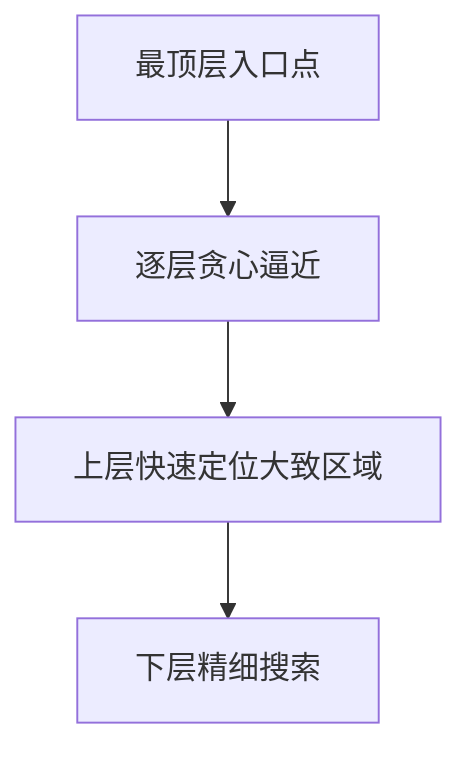
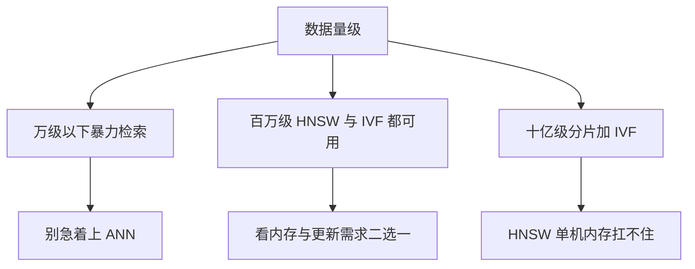

# 向量检索深水

## 1. 核心概念：为什么需要近似检索

暴力检索是把查询向量和库里每条向量算一遍相似度、取 Top-K，复杂度约 O(库大小 × 维度)。库到百万、千万量级时，单次查询的算力与延迟都扛不住。

近似最近邻（ANN）检索的思路：事先建索引结构，用“可能漏掉少量真邻居”换“查询快几个数量级”。衡量标准是召回率：

- 召回率 = ANN 找回的真 Top-K / 暴力算出的真 Top-K。
- 召回率 100% 意味着退化成暴力；生产上通常在召回率与延迟之间取一个平衡点。

本篇讲两种主流索引：HNSW（图结构）与 IVF（聚类结构）。选型之前先确认：换 embedding 模型必须重建整个库，索引结构与向量是一一绑定的。

## 2. HNSW：分层小世界图

### 2.1 结构

HNSW 把所有向量组织成一张多层图：

- 底层含全部向量，越往上层向量越稀疏（按概率逐层抽样）。
- 每层内部按“小世界”方式连边：每个节点连向它的一部分近邻，图上任意两点间的跳数很小。
- 查询时从最顶层入口点开始，逐层贪心逼近：上层快速定位大致区域，下层精细搜索。

HNSW 查询从最顶层入口点开始，逐层贪心逼近：



### 2.2 插入过程

新向量插入时：

1. 随机决定它最高到哪一层（层数服从指数衰减：高层节点少）。
2. 从顶层开始贪心搜索，逐层找到离它最近的入口。
3. 在每一层为它挑选邻居：不是简单取最近的 M 个，而是启发式剪枝——优先保留“方向分散”的邻居，避免邻居全挤在同一个方向上。
4. 邻居数超过上限 M 时剪掉最远的边。

### 2.3 搜索过程与参数

搜索时维护一个候选队列，参数 ef 控制队列规模：

- ef_search：搜索时候选队列的大小。越大，搜得越仔细，召回越高，延迟也越高。
- ef_construction：建索引时的候选规模。越大，图质量越好，构建越慢。
- M：每个节点的最大边数。越大，图越连通，内存占用越大。

经验关系（定性，不依赖具体数值）：ef_search 是线上调召回-延迟权衡的第一旋钮；M 和 ef_construction 在建库时定，线上改不了。

### 2.4 优缺点

- 优点：召回高、延迟低、增量插入天然支持，读多写少的场景表现好。
- 缺点：内存占用大（图结构本身要存边）；删除是标记删除，真删除要定期重建；构建慢，大库建索引是离线活。

## 3. IVF：倒排聚类

### 3.1 结构

IVF 先把向量空间切成 nlist 个簇（Voronoi 单元）：

1. 用训练集跑 k-means，得到 nlist 个聚类中心。
2. 每个向量归属到最近的中心，倒排表记录“簇 → 向量列表”。
3. 查询时先找最近的 nprobe 个簇，只在这些簇内暴力算相似度、取 Top-K。

```python
import math

def nearest_centroid(q, centroids):
    def dist(a, b):
        return math.sqrt(sum((x - y) ** 2 for x, y in zip(a, b)))
    return min(range(len(centroids)), key=lambda i: dist(q, centroids[i]))

centroids = [[0.0, 0.0], [10.0, 10.0]]
docs = {0: [[0.1, 0.2], [0.5, 0.4]], 1: [[9.8, 10.1], [10.3, 9.7]]}
query = [0.3, 0.3]
cluster = nearest_centroid(query, centroids)
sims = sorted(docs[cluster], key=lambda v: -sum(x * y for x, y in zip(query, v)))
print("命中簇:", cluster, "簇内最佳:", sims[0])
```

### 3.2 参数

- nlist：簇数。越大，每个簇越小、簇内暴力越快，但找簇的成本和训练成本上升。
- nprobe：查询时扫几个簇。越大，召回越高，延迟也越高，是线上调权衡的第一旋钮。
- 训练集：必须与实际数据同分布；训练样本量一般要求远大于 nlist，具体倍数以所用库的官方文档为准。

常见经验法则（启发式，不是精确公式）：nlist 取库大小的平方根附近起步，再按实测召回调。

### 3.3 优缺点

- 优点：内存友好（可配合量化压缩）、构建相对快、适合超大库与分片部署。
- 缺点：聚类边界会丢邻居（真邻居落在相邻簇里，nprobe 没扫到就漏了）；数据分布漂移后聚类中心过时，需要定期重训。

## 4. 对比表

| 维度 | HNSW | IVF |
| --- | --- | --- |
| 召回-延迟曲线 | 同等延迟下通常召回更高 | 靠 nprobe 追赶召回，延迟随之涨 |
| 内存 | 大（存图边） | 小（可叠加量化压缩） |
| 构建成本 | 高（逐点插图） | 低（一次聚类） |
| 增量更新 | 插入友好，删除需标记 | 追加友好，漂移后需重训 |
| 实现复杂度 | 高（图维护、剪枝） | 低（聚类 + 倒排） |

## 5. 选型建议

索引选型先看数据量级，再看内存与更新需求：



- 数据量级：
  - 万级以下：暴力检索 often 够用，别急着上 ANN。
  - 百万级：HNSW 与 IVF 都可用，看内存与更新需求二选一。
  - 十亿级：分片 + IVF（或磁盘索引）是常见路线，HNSW 单机内存扛不住。
- 更新频率：
  - 频繁增量写入：HNSW 插入友好；IVF 追加也行，但要监控分布漂移、定期重训。
  - 几乎静态：两者都行，优先看召回-延迟实测。
- 内存约束紧：IVF + 量化；内存充足且要极致延迟：HNSW。
- 无论选哪个：上线前必须在自己的数据上实测召回-延迟曲线，公开基准的曲线不代表你的数据分布。

## 6. 量化与索引内存的账：INT8、PQ 与 HNSW 图边

### 6.1 概念：三种压缩手段，先分清省的是什么

- **fp16（半精度）**：每维从 4 字节降到 2 字节，存储减半；距离计算仍是逐维浮点运算，只是精度降了一档。无须训练、无须校准，是改动最小的压缩。
- **int8（标量量化 / SQ8）**：每维独立映射到 0–255 的一个整数，存 1 字节，存储是 fp32 的四分之一。需要事先从训练样本学出每维的取值范围（或缩放因子），查询时按查表/反量化算距离。Faiss 里对应 `SQ8`。
- **PQ（乘积量化）**：把 768 维向量切成 m 段子向量，每段用一个 256 个质心的码本近似，存的只是每段质心的编号（每段 1 字节）。m = 96 时每条向量只存 96 字节，是 fp32 的 1/32。Jégou 等人 2011 年的原论文把 m = 8、每段 256 个质心称为"常可取的合理选择"，并用非对称距离计算（ADC：查询向量不量化，只与码本质心算距离）降低误差；该方法在 20 亿条向量规模上验证过可扩展性。
- **三者与索引结构正交**：量化只决定"每条向量怎么存、距离怎么算"，HNSW / IVF 决定"候选怎么找"。PQ 常与 IVF 联用（IVF-PQ：先聚类圈范围，再对簇内残差做 PQ），也可以挂在 HNSW 下面；换量化方式不改变检索流程，但要重建整个库（见 6.5）。

### 6.2 存储算术：768 维向量，fp32 / fp16 / int8 / PQ

算术口径：768 维 × 每维字节数；PQ 按 m = 96 个子量化器、每段 8 bit 码本（256 个质心），每条 96 字节。只计向量/编码本身，不含元数据、HNSW 图边与码本（码本见 6.3 末）。

| 编码 | 单条字节 | 2.4 万条（约 600 章 × 40 chunk） | 100 万条 | 相对 fp32 |
| --- | --- | --- | --- | --- |
| fp32 | 3072 B | 70.31 MiB | 2929.69 MiB（2.86 GiB） | 1× |
| fp16 | 1536 B | 35.16 MiB | 1464.84 MiB（1.43 GiB） | 2× |
| int8 | 768 B | 17.58 MiB | 732.42 MiB（0.72 GiB） | 4× |
| PQ（m=96） | 96 B | 2.20 MiB | 91.55 MiB（0.09 GiB） | 32× |

（本地 Python 复算，复算代码见 6.6；fp32 行与关联篇《Embedding与向量数据库》"维度定量"一节的 70.3 MiB 一致。）

读法：小说引擎当前量级（2.4 万条）下，fp32 纯向量也只有约 70 MiB，量化省下来的绝对值很小——这个量级上量化不是必选项；到 100 万条时 fp32 接近 2.9 GiB，PQ 压到约 92 MiB，差距才变成选型因素。先算量级再决定要不要量化，别为省几十 MiB 引入重建与精度成本。

### 6.3 HNSW 图边内存：M=16 时的估算

估算口径（本节全部数字都是估算，不是实测）：

- 每条边存一个 4 字节邻居 id；M = 16 是每层每个节点的最大出边数。
- 第 0 层含全部节点，上限是 2M 条边（双向边都记在节点上，hnswlib 的 `Mmax0 = 2M`），即每节点第 0 层最多 2 × 16 × 4 = 128 字节；上层节点稀疏、边数少，另计。
- 口径（a）只计第 0 层：每节点 128 字节，是下限式估算。
- 口径（b）OpenSearch Faiss PQ 文档给出的 HNSW 内存公式：每向量 `(PQ 编码字节 + 24 + 8 × hnsw_m)` 再乘 1.1，其中 `8 × M` 即图边部分、24 字节是每向量固定开销、1.1 是余量系数。M = 16 时图边加开销部分为 (24 + 128) × 1.1 = 167.2 字节/节点，可作交叉校验。注意：此处只把 1.1 余量套在图边与固定开销上；若按 OpenSearch 公式原样把 1.1 套在向量本身上，总数再高约一成，量级不变。

| 估算口径 | 每节点 | 2.4 万条 | 100 万条 |
| --- | --- | --- | --- |
| （a）仅第 0 层边 | 128 B | 2.93 MiB | 122.07 MiB |
| （b）OpenSearch 公式口径（含 24 B 开销与 1.1 余量） | 167.2 B | 3.83 MiB | 159.45 MiB |

（本地 Python 复算；两个口径只差一个每向量开销与余量系数，量级一致，可互相印证。）

合计（向量/编码 + 图边，仍不含元数据；PQ 合计另加码本，见下）：

| 组合 | 2.4 万条 | 100 万条 |
| --- | --- | --- |
| fp32 + HNSW 图边 | 约 73.24–74.14 MiB | 约 3051.76–3089.14 MiB（约 2.98–3.02 GiB） |
| PQ（m=96）+ HNSW 图边 | 约 5.13–6.77 MiB（含码本） | 约 213.62–251.76 MiB（含码本） |

PQ 码本本身是与库大小无关的固定开销：m = 96 个子量化器 × 每段 256 个质心 × 每段 8 维 × 4 字节 = 786432 字节 ≈ 0.75 MiB。库越大，码本占比越可以忽略；库很小时它反而是 PQ 总开销里不可忽略的一笔。

明确标注：以上是估算口径。不同实现（hnswlib / Faiss / Chroma 底层）的常数不同：边的上限、是否存双向边、层级开销、是否把向量与图分开存，都会让实测数字偏离本表。**本表只用于选型前估量级，真实内存以所用库的实测为准。**

### 6.4 召回-内存权衡：有出处的只写定性结论

本节不写任何未核实的召回率数字。公开基准上的具体召回数字（如 SIFT / GIST 上的 PQ 召回）来自图像描述子，与中文叙事文本的 embedding 分布不同，不能直接搬到小说引擎上；本次核查未找到可直接引用的中文叙事语料召回数字，故一律不写，改为以下有出处的定性结论：

- **压缩越狠，距离越失真**：PQ 把每段子向量坍缩成最近质心的编号，距离只能从编码近似算出，近似误差随 m 减小而增大；int8 每维独立量化，误差比 PQ 小、压缩比也小；fp16 几乎不引入可感知的排序变化。方向上是单调的：省得越多，召回潜在损失越大——但具体损失多少，待在小说引擎语料上实测。
- **m 是 PQ 的主旋钮**：m 越大，每条编码越长、越接近原向量，召回越高、内存越大；Jégou 等人原论文以 m = 8 为常用选择，Faiss / OpenSearch 文档建议 `code_size = 8`（每段 8 bit）起步再调 m。m 与 `code_size` 在建库时定，线上改不了，改 m 等于重建库。
- **HNSW 的图边是"花钱买召回"的另一笔账**：M 越大图越连通、召回越高，图边内存随 M 线性涨（每节点约 8 × M 字节，见 6.3 口径 b）；ef_search 是线上旋钮，M 是建库旋钮。内存紧张时降 M 不如先降向量精度——降 M 伤的是图连通性，降精度伤的是距离，两者都要实测。
- **组合策略**：内存紧张 + 超大库时，IVF-PQ 是 Faiss 文档与原论文共同指向的经典组合（IVF 先圈簇、PQ 再压单条）；内存充足 + 要极致延迟时，HNSW + fp32/fp16 更直接。小说引擎当前 2.4 万条量级下，fp32 + HNSW 的合计约 74 MiB，量化省下的内存不到 70 MiB，**不值得为这点内存付出重建与精度成本**；量级到百万条再重新评估。
- **上线前必须在自己的数据上实测召回-延迟曲线**（与本篇 §5 同一要求）：公开基准的曲线不代表小说语料分布；量化前后的召回对比、ef_search / nprobe 扫描，都按《RAG-评测与分块策略》的评测集做，**待在小说引擎语料上实测**。

### 6.5 边界条件

1. **量化只省存储与距离计算，不省 embedding 计算**：embedding 模型推理仍输出满 768 维 fp32 向量，量化发生在出向量之后；入库速度不会因此变快，省的是落盘体积与检索时扫向量的带宽。
2. **换量化方式 = 重建库**：fp32、int8、PQ 编码之间互不兼容，码本与缩放因子也各不相同；切换编码等于新建集合、全部文档重新向量化并重新编码入库（与换 embedding 模型、换截断维度同一条操作规程），不能混写。
3. **PQ 码本需与数据同分布训练，漂移后过时**：码本用训练样本的 k-means 训出；小说新增章节改变分布后，旧码本对新文本的近似误差会变大，召回滑落时先重训码本再测，与 IVF 聚类中心过时是同一个毛病。OpenSearch 文档建议 HNSW + PQ 的训练样本量为 `2^code_size × 1000`（code_size = 8 时即 256000 条）——小说引擎当前 2.4 万条全量都不够这个数，**PQ 在当前量级下连训练样本都不达标**，是暂缓 PQ 的又一条理由。
4. **INT8 需校准/缩放因子，且与归一化有关**：int8 把每维映射到 0–255，依赖事先学出的每维取值范围（或每向量缩放因子）；范围学偏了，距离系统性失真。余弦度量下还要注意：量化前是否归一化、量化后是否重新归一化，都会改变排序；入库与查询必须用同一套规则（见关联篇 §3 的归一化讨论）。
5. **PQ 的 m 必须整除维度**：768 维切 m 段要求 m 整除 768（如 m = 96 时每段 8 维、m = 64 时每段 12 维）；m 取值受维度约束，不能任意取。另注意 IVF-PQ 编的是"残差"（向量减去所属簇中心），不是原始向量，残差分布更集中、量化更准——直接对原始向量做 PQ 与 IVF-PQ 的精度不是一回事。
6. **fp16 不是"免费午餐"**：存储减半的同时，极小量级（如接近 0 的分量）在 fp16 下相对误差更大；余弦度量对模长不敏感，fp16 的影响通常小于内积/欧氏度量，但仍需在评测集上验证，不能默认无损。

### 6.6 复算口径（Python，可直接运行复现 6.2–6.3 全部数字）

```python
D = 768          # 向量维度
M = 16           # HNSW 每层最大出边数
N_SMALL = 24000  # 小说引擎量级: 约 600 章 x 40 chunk
N_LARGE = 1_000_000

def mib(n_bytes):
    return n_bytes / 1024 ** 2

# --- 6.2 存储算术: 每维字节数 x 维度 ---
encodings = {"fp32": D * 4, "fp16": D * 2, "int8": D * 1, "PQ m=96": 96}
for name, per_vec in encodings.items():
    for n in (N_SMALL, N_LARGE):
        print(f"{name}: 单条 {per_vec} B, {n} 条 = {mib(n * per_vec):.2f} MiB")
print(f"PQ 相对 fp32 压缩比: {encodings['fp32'] / encodings['PQ m=96']:.1f}x")

# --- 6.3 HNSW 图边: 口径(a)仅第 0 层, 口径(b)OpenSearch 公式 ---
graph_a = 2 * M * 4            # 第 0 层上限 2M 条边, 每条 4 字节邻居 id
graph_b = (24 + 8 * M) * 1.1   # OpenSearch 公式: (24 + 8*M) x 1.1
for n in (N_SMALL, N_LARGE):
    print(f"N={n}: 图边(a) {mib(n * graph_a):.2f} MiB, 图边(b) {mib(n * graph_b):.2f} MiB")

# --- PQ 码本: 与库大小无关的固定开销 ---
sub_dim = D // 96
codebook = 96 * 256 * sub_dim * 4
print(f"PQ 码本: {codebook} B = {mib(codebook):.2f} MiB")

# --- 合计: fp32+HNSW 与 PQ+HNSW ---
for n in (N_SMALL, N_LARGE):
    fp32_total = mib(n * encodings["fp32"] + n * graph_a)
    fp32_total_b = mib(n * encodings["fp32"] + n * graph_b)
    pq_total = mib(n * encodings["PQ m=96"] + n * graph_a)
    pq_total_b = mib(n * encodings["PQ m=96"] + n * graph_b + codebook)
    print(f"N={n}: fp32+HNSW {fp32_total:.2f}-{fp32_total_b:.2f} MiB, "
        f"PQ+HNSW {pq_total:.2f}-{pq_total_b:.2f} MiB (含码本)")
```

### 来源

- Jégou, Douze & Schmid, "Product quantization for nearest neighbor search", IEEE TPAMI 33(1):117–128, 2011, DOI: 10.1109/TPAMI.2010.57（PQ 定义、m = 8 / 每段 256 质心为常用选择、非对称距离计算、20 亿条向量规模验证）。
- Malkov & Yashunin, "Efficient and robust approximate nearest neighbor search using Hierarchical Navigable Small World graphs", arXiv:1603.09320（HNSW 结构、层级指数衰减抽样、启发式邻居选择）。
- OpenSearch 文档 "Faiss product quantization"（PQ 编码为 `m × code_size` bit、建议 `code_size = 8` 再调 m、HNSW + PQ 内存估计公式 `1.1 × ((pq_code_size/8 × pq_m + 24 + 8 × hnsw_m) × num_vectors + …)`、HNSW + PQ 训练样本建议 `2^code_size × 1000`），核验日期 2026-11-28。
- 存储与图边全部数字为本地 Python 复算（复算代码见 6.6），核验日期 2026-11-28；召回率具体数字本次未找到可直接引用的中文叙事语料来源，故未写入，待在小说引擎语料上实测。


## 7. 常见误区

- 召回率必须 100%：那等于暴力检索，ANN 的意义就是用可接受的召回损失换延迟。
- nprobe / ef 越大越好：越大延迟越高，超过业务延迟预算的召回没有意义。
- 索引建好就不用管：数据漂移、删除积累、embedding 模型升级都会让索引劣化，重建是常规运维。
- 换 embedding 模型不用重建：向量空间变了，旧索引全部作废，必须重建（见关联篇）。

## 小技巧与冷知识

【冷知识】HNSW 是“小世界图 + 跳表”的合体：2016 年 Malkov 与 Yashunin 的论文（arXiv:1603.09320）把 NSW 图和跳表的分层思想结合起来，顶层节点稀疏、边跨得远，像跳表的快速通道，先定位大致区域再逐层精细化。理解这一点就明白为什么 HNSW 插入时层数要按指数衰减随机抽——它就是跳表里“每层节点越来越少”的翻版。

【冷知识】“小世界”这个名字来自社会学：Milgram 在 1960 年代的信件传递实验里发现，陌生人之间平均只隔约六个人传递，由此有了“六度分隔”的说法；Watts 与 Strogatz 在 1998 年的 Nature 论文里给出数学模型——局部聚团、再加少量长程边，任意两点间的跳数就很小。HNSW 的贪心搜索几步就能逼近目标，靠的正是这种结构：邻居大多是近邻，偶尔几条长边帮你跨区。

【小技巧】调 ef_search、nprobe 时先定延迟预算再找召回：先测出业务能接受的 P99 延迟上限，在这个预算内把旋钮往上拧，拧到召回不再涨就停。不要反过来先定一个召回目标、再回头看延迟是否超标——超过预算的召回没有意义，原文的“线上第一旋钮”也是在这个前提下才成立的。

【小技巧】上线前把旋钮从小到大扫一遍，画出召回-延迟曲线：ef_search 或 nprobe 各取五六档，同一批查询、同一批数据测下来，曲线拐点之后召回涨得很少、延迟涨得很快，拐点就是线上默认值。只测一个点看不出这条曲线，调参时也分不清“再往上拧还有没有收益”。

【小技巧】HNSW 建库前先算内存再动手：内存大头是向量本身加上 M 决定的边，M 越大图越连通、内存越大。按维度、数量、M 粗算一遍再建库，别等 OOM 才想起来降 M——M 是建库时定的，线上改不了，降 M 意味着整个库重建。

【小技巧】IVF 的 nprobe 别设成 1：查询落在聚类边界附近时，真邻居常常在相邻簇里，nprobe=1 时边界查询最容易漏。nprobe 从 1 往上加，召回提升最明显的一段往往在开头几档；如果 nprobe 拧到很大召回还上不去，问题多半在聚类中心本身过时了，而不是扫得不够多。

【小技巧】量化（PQ）掉召回先查码本，别先怪索引：PQ 的码本也要用与实际数据同分布的样本训，分布漂移后码本过时，和 IVF 聚类中心过时是同一个毛病。IVF-PQ 召回滑落时，先用新数据重训码本再测一次，码本没问题再去动 nprobe 或换索引结构。

【小技巧】HNSW 标记删除攒多了就重建：被标记删除的向量仍占内存、仍参与搜索路径，删得越多，图里“死节点”积得越多，搜索要绕的弯也越多。定期重建是常规运维，别等召回滑落才动手；删除比例可以当作触发重建的指标之一，和数据漂移一起监控。

量化之前先算"省下的绝对值"再动手：2.4 万条 768 维向量，fp32 纯向量约 70 MiB，PQ 压到约 2 MiB，省下的不到 70 MiB——还不够一次模型权重的零头，却要付出重建库、训码本、召回实测三笔成本。量化是百万条量级才划算的手段；万级库先把这笔账算清楚，算完多半会发现不值得，省下的不是内存，是折腾。
## 8. 面试与自测

1. HNSW 的 ef_search 和 IVF 的 nprobe 在调参上有什么共同点？为什么说它们是“线上第一旋钮”？
2. 数据分布漂移后，HNSW 和 IVF 各自会出什么问题？分别怎么处理？
3. 内存紧张、数据量十亿级、更新不频繁时，你倾向选 HNSW 还是 IVF + 量化？为什么？

4. 768 维向量、2.4 万条规模下，fp32 纯向量约 70 MiB，PQ（m=96）能压到约 2 MiB，为什么本篇仍建议小说引擎当前量级暂缓上 PQ？至少说出两条理由，并指出 PQ 码本训练样本量上有什么硬约束。

### 参考答案

1. 共同点：两者都是“查询时多看多少候选”的旋钮——ef_search 控制 HNSW 搜索候选队列规模，nprobe 控制 IVF 扫几个簇；调大都提高召回、同时提高延迟，且都不用重建索引，所以是线上调召回-延迟权衡的第一旋钮（M、ef_construction、nlist 建库时定，线上改不了）。
2. HNSW：漂移本身不破坏图结构，但新数据分布与旧图不匹配时召回会滑落，处理是重建或定期重建；删除积累则靠标记删除 + 定期重建。IVF：聚类中心过时，查询找错簇导致系统性漏邻居，处理是定期用新数据重训聚类中心并重建倒排。
3. 倾向 IVF + 量化：十亿级下 HNSW 的图边内存单机扛不住，IVF 内存友好且可分片，量化进一步压缩；更新不频繁则 IVF 重训成本可接受。HNSW 的优势（极致延迟、增量插入友好）在这个场景下不是瓶颈。

4. ① 绝对收益太小：2.4 万条下量化省下的不到 70 MiB，相对一次模型权重微不足道，却要付出重建库、训码本、召回实测三笔成本，性价比不划算；到 100 万条（fp32 约 2.86 GiB、PQ 约 92 MiB）时再评估。② 训练样本不达标：PQ 码本需与数据同分布训练，OpenSearch 文档建议 HNSW + PQ 的训练样本量为 `2^code_size × 1000`，code_size = 8 时即 256000 条，小说引擎当前 2.4 万条全量都不够这个数；且分布漂移后码本会过时，需重训。③ 换量化方式等于重建库（编码互不兼容），且具体召回损失未在小说语料上实测，不能凭压缩比拍板。

## 9. 关联知识

- [Embedding与向量数据库](AI与大模型/RAG/Embedding与向量数据库.md)：向量与索引的基础概念、换模型必须重建的结论
- [RAG-评测与分块策略](AI与大模型/RAG/RAG-评测与分块策略.md)：检索段指标（召回率等）怎么测，索引选型的评测依据
- [混合检索与Rerank](AI与大模型/RAG/混合检索与Rerank.md)：向量检索只是检索手段之一，与 BM25 融合、两阶段 Rerank 的配合
