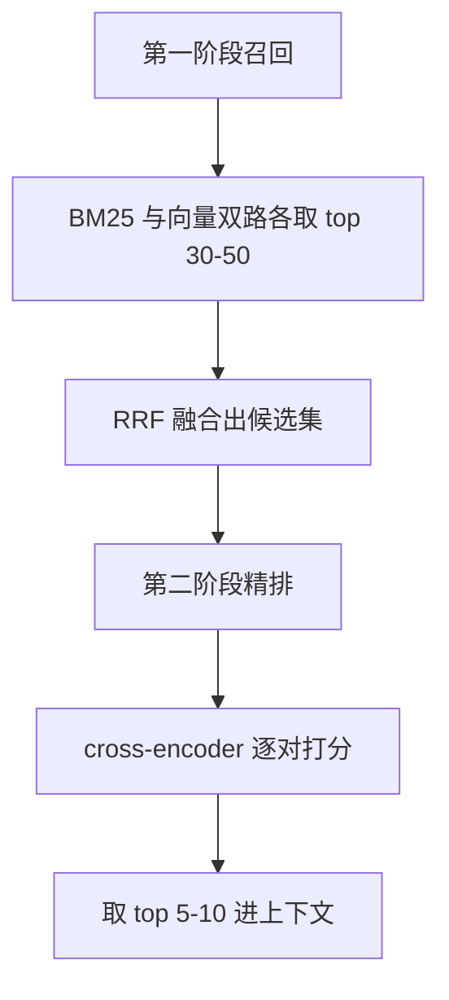
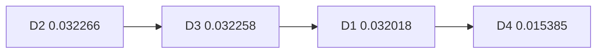

# 混合检索与 Rerank

> 纯向量检索擅长「意思像」，不擅长「字对得上」。真实查询里两者都要：问「苏晚的信物是什么」靠语义，问「源石第二次易主在第几章」靠的是专名和精确字面。本篇讲把稀疏检索、稠密向量和重排三者拼成一条流水线：**混合召回保底线，Rerank 定座次**。

## 1. 核心概念：为什么纯向量不够

向量检索（原理见 [Embedding与向量数据库](AI与大模型/RAG/Embedding与向量数据库.md)）把文本压成一个稠密向量比语义距离，这带来三个结构性短板：

- **专名与稀有词不敏感**：人名、地名、编号、术语在语料里出现少，embedding 对它们的区分度有限，「江衡」和「白言」在向量空间里可能比和各自出场段落还近。
- **精确约束会丢失**：查询里的否定、时间、数字条件（「决裂之前」「第三次」）在向量化时被平均掉，语义相近但条件不符的片段照样高分。
- **块内平均效应**：一个块混了多个主题，向量是平均像，谁都不够像，关键片段反而排不上。

反过来，传统的 BM25 精确、便宜、对专名极其友好，却完全不懂同义改写。两边短板正好互补，这就是混合检索（hybrid search）的出发点。

## 2. 基础知识：BM25 与向量检索的互补

| 维度 | BM25（稀疏检索） | 稠密向量检索 |
|---|---|---|
| 匹配依据 | 词项出现与稀有度（TF-IDF 的进化版） | 语义向量距离 |
| 擅长 | 专名、术语、编号、原文短语 | 同义改写、跨表述的概念查询 |
| 不擅长 | 换个说法就找不到 | 精确字面、否定与数字条件 |
| 成本 | 倒排索引，极便宜 | 需 embedding 模型 + 向量索引 |

落地形态通常是同一语料建两套索引（或一套支持双路的引擎）：查询进来，两路并行各召回 top N，再融合。Chroma 本身以向量为主，做混合时一般在应用层自建 BM25 一路（如用 rank_bm25 或把文本同步进 SQLite FTS5——小说引擎语料本来就在 SQLite 里，FTS5 是零新增依赖的选择），融合与重排都在应用层完成。

## 3. 进阶知识：融合与 RRF

两路结果的分数不在一个量纲（BM25 分数无上界、余弦相似度在 0–1），直接加权相加很脆弱。主流做法是 **RRF（Reciprocal Rank Fusion，倒数排名融合）**——不用原始分数，只用名次：

```
score(doc) = Σ  1 / (k + rank_i(doc))    # 对每路结果求和，k 常取 60
```

只在某一路出现的文档，缺失路按 0 计。RRF 的好处是不用调分数量纲、不用归一化，对两路质量差异不敏感，鲁棒性好；代价是丢掉了分数本身的信息（一路里断崖式领先的第一名和险胜的第一名，在 RRF 眼里只差一名）。实践口径：先上 RRF 做基线，有评测数据证明加权融合更好时再换，不要一上来就调权重。

融合解决「两路怎么合」，还没解决「合出来的顺序够不够准」——那是 Rerank 的活。

## 4. 原理剖析：两阶段检索与 cross-encoder

**第一阶段（召回）**：双路各取 top 30–50，RRF 融合出候选集。这一阶段只求不漏（Recall 优先），排序粗糙没关系。

两阶段检索是便宜的先筛、贵的后精排：



**第二阶段（精排）**：用 **cross-encoder** 对「查询 × 候选片段」逐对打分。向量检索的双塔结构是查询和文档各编各的、最后比距离；cross-encoder 把查询和文档拼在一起进同一个模型，让注意力在两边充分交互，打分精度高一个档次。代价是不能预计算——每个候选都要过一遍模型，所以只能用在几十个候选的小集上，这正是分两阶段的原因：便宜的先筛，贵的后精排。

精排后的取舍：一般取 top 5–10 进上下文，并可设分数阈值，低于阈值的宁可不给（给错片段比不给更容易诱导编造），衔接见 [上下文工程](AI与大模型/RAG/上下文工程.md) 的重要性筛选。

**本地可跑的 Rerank 选项**（口径说明：以下为模型类别与公开定位，未在本人机器与小说语料上实测，效果结论一律待验证）：

- BGE 系列 reranker（如 bge-reranker-v2-m3）：多语言、中文友好，是本地部署最常见的选择；其 base/large 不同体量，显存与速度按体量换精度。
- 走 sentence-transformers 的 CrossEncoder 接口加载，或用 TEI（Text Embeddings Inference）等推理服务托管；Ollama 本身不提供 rerank 接口，需要单独进程，这点要在架构里预留。
- 量化与显存：reranker 模型普遍不大（百兆到数 GB 级），12GB 显存与 14B 主模型共存一般可行，但并发与延迟要实测——待验证。

## 5. 实战应用：小说引擎为什么必须做混合

小说语料的查询分布和百科问答很不一样，专名密度极高：

- **找伏笔**：「哪一章第一次提到断掉的玉佩」——「玉佩」是精确词，BM25 一路直接命中；纯向量可能把一切「信物/首饰」段落都召回来排在前面。
- **查人物前史**：「江衡入伙之前在哪」——「江衡」必须字面命中，向量负责把「他早年流落码头」这类没出现名字的段落也捞回来。
- **查状态变化**：「源石现在在谁手里」——这类问题最终应走结构化查询（EntityState），检索只是兜底；混合检索的定位是给结构化查不到的部分补位，不要指望它替代状态库。

改造顺序建议：在现有向量原型（Chroma + embeddinggemma-2）上先加 FTS5 一路 + RRF，跑 [RAG-评测与分块策略](AI与大模型/RAG/RAG-评测与分块策略.md) 的评测集看 Recall@k 变化；确认召回底线抬高后，再加 reranker 看 MRR / nDCG。**待验证**：混合与 Rerank 在《残契者》评测集上的实际增益幅度、reranker 对 14B 本地链路的延迟影响，都等评测集跑出数据后回填本篇。

## 6. 疑难杂症

- **加了 BM25，效果反而降**：多半是融合方式问题——原始分数直接相加时 BM25 的大量纲会碾压向量一路；先换 RRF 再判断。
- **Rerank 后好答案被刷掉**：精排模型与语料领域不匹配，或候选集本身没召回（精排救不了召回的漏）。先分段看指标：Recall 没变、MRR 降了，才是 reranker 的锅。
- **专名还是召不回**：查分词——BM25 依赖分词质量，中文人名被切碎时给专名建词典或做精确匹配旁路。

## 7. 常见误区

- 一步到位上全套：没有评测集时，混合、融合、精排一起上，出了问题不知道是哪层的锅。按第 5 节顺序逐层加、逐层测。
- 候选集开得过大：精排 200 个候选，延迟爆炸且尾部全是噪声；候选规模由召回评测决定，不是越大越好。
- 把 Rerank 当召回用：它只重排已有候选，漏召回的片段永远不会被它「发现」。

## 8. RRF 手算一例：融合分到底怎么出来

公式重申（与第 3 节口径一致）：

```
score(doc) = Σ  1 / (k + rank)    # 对每路结果求和，k = 60，rank 从 1 开始
```

**实现提醒：有的库 rank 从 0 开始，公式里要 +1 补偿。** 用前先确认所用库的 rank 起点，否则同一份结果算出两套分。

### 手算例：双路各取 top 5，k=60

手算例的最终排序是 D2、D3、D1、D4：



| 文档 | BM25 名次 | 向量名次 | 计算 | 融合分 |
|---|---|---|---|---|
| D1 | 第 1 | 第 4 | 1/61 + 1/64 = 0.016393 + 0.015625 | 0.032018 |
| D2 | 第 3 | 向量第 1 | 1/63 + 1/61 = 0.015873 + 0.016393 | 0.032266 |
| D3 | 第 2 | 第 2 | 1/62 + 1/62 = 0.016129 + 0.016129 | 0.032258 |
| D4 | 第 5 | 缺失 | 1/65 = 0.015385（缺失路按 0 计） | 0.015385 |

**最终排序：D2（0.032266）> D3（0.032258）> D1（0.032018）> D4（0.015385）。**

### 从算例提炼三点

- **① 两路都进榜的文档天然占优。** D4 单路第 5 只有双路文档一半不到的分（0.015385，不到 D2 的一半）。RRF 的第一偏好是「两路都认」，而不是「一路特别强」。
- **② 名次差距被压缩。** 单路第 1 与第 10 只差 1/61 = 0.016393 vs 1/70 = 0.014286（约 1.15 倍），第 1 与第 2 只差 0.000264。**RRF 鲁棒的代价，就是分不出“断崖领先”和“险胜”**——D2 与 D3 只差 0.000008，几乎可以忽略。
- **③ 融合分只宜做排序，不要拿它当质量分数。** 不要跨查询比较融合分，更不要拿它设全局阈值。这与 cross-encoder 分数不可跨查询比是同一个道理（见小技巧节）：分数只在同一次查询的候选集内部有排序意义。

### 小说引擎一例

查「断掉的玉佩在哪一章」：标题含玉佩的章节 BM25 第 1、向量第 4（D1 型），另一章两路都排第 2 / 第 3（D3 / D2 型）会反超它。**想让标题命中赢回来，靠的应是第 2 节的标题列加权或 FTS5 列权重，而不是调 k。** k 只决定排名靠后的文档衰减多快，对结果影响有限（见小技巧节）。

来源：RRF 原论文 Cormack、Clarke 与 Büttcher 2009 年 SIGIR《Reciprocal Rank Fusion outperforms Condorcet and individual Rank Learning Methods》，k=60 为论文默认值；手算数字 2026-11-04 经 Python 独立复算。

## §9 BM25 手算一例：词频、文档长度归一化到底怎么算分

§8 算的是融合分，本节算的是融合之前那一路：BM25 的分数本身到底怎么出来。第 2 节只给了 BM25 一张定性对照表，这里把公式摊开、手算一遍——知道分母里每一项在干什么，下次调参、排障才有抓手。

### 9.1 公式：Robertson & Zaragoza 2009 经典形式

对查询 `Q` 与文档 `D`，BM25 得分是各查询词贡献之和：

```
score(D, Q) = Σ IDF(qi) * [ f(qi, D) * (k1 + 1) / ( f(qi, D) + k1 * (1 - b + b * |D| / avgdl))]
```

其中：

- `f(qi, D)`：查询词 `qi` 在文档 `D` 中出现的次数（词频 TF）。
- `|D|`：文档 `D` 的长度（词数）；`avgdl`：全库文档平均长度。
- `N`：全库文档总数；`n(qi)`：包含 `qi` 的文档数。
- `IDF(qi)`：逆文档频率，取自然对数口径（ln），本篇用含 `+1` 平滑的常用形式：

```
IDF(qi) = ln( (N - n(qi) + 0.5) / (n(qi) + 0.5) + 1)
```

- `k1`：词频饱和参数；`b`：长度归一化参数。

**参数取值（已验证事实）**：取 `k1` 为 1.2、`b` 为 0.75，这是 Lucene 与 Elasticsearch 的默认值，也是 Robertson & Zaragoza 推荐的常用取值——Wikipedia 词条称 `k1` 通常取 1.2 到 2.0、`b` 通常取 0.75；Lucene 与 Elasticsearch 的默认值即 `k1` 为 1.2、`b` 为 0.75。

**来源**：Robertson 与 Zaragoza 2009 年《The Probabilistic Relevance Framework: BM25 and Beyond》（Foundations and Trends in Information Retrieval, vol. 3, no. 4）；公式与参数口径另据 Wikipedia「Okapi BM25」词条核对，核验日期 2026-11-26。链接：`https://en.wikipedia.org/wiki/Probabilistic_relevance_model_(BM25)`。

**IDF 口径说明**：本篇用 `+1` 平滑形式。去掉 `+1` 的原始形式是 `ln((N - n + 0.5) / (n + 0.5))`，当一个词出现在超过半数文档时它会算出负值（见 9.2 末尾的对照）；`+1` 平滑保证 IDF 恒为正，是 Lucene、Elasticsearch 与 Wikipedia 词条采用的形式。两个口径算出的相对排序在本例中一致，但绝对分值不同——跨工具对照分数时先确认 IDF 口径。

### 9.2 手算例：3 篇文档、1 个查询词

**分词口径（先说清，否则数字无法复算）**：本例用英文短句，按空白切分、统一小写、去掉句末标点；查询词取 `yuanshi`（源石的拼音转写，作一个专名token 看待）。中文语料实操时分词口径换成所用分词器（见 9.4），但算式本身不变。

三篇文档（每篇 1–2 句）：

- D1：`Lin Su found the yuanshi in the old house.`（9 个词，`yuanshi` 出现 1 次）
- D2：`The yuanshi changed hands twice, and the yuanshi vanished again.`（10 个词，`yuanshi` 出现 2 次）
- D3：`Shen Xing waited at the pier all night.`（8 个词，`yuanshi` 出现 0 次）

查询词：`yuanshi`。参数：`k1` 为 1.2，`b` 为 0.75。

**第一步：平均文档长度 avgdl**

```
avgdl = (9 + 10 + 8) / 3 = 9
```

**第二步：IDF**

`N` 为 3，含 `yuanshi` 的文档数 `n` 为 2（D1、D2）：

```
IDF = ln( (3 - 2 + 0.5) / (2 + 0.5) + 1) = ln(1.5 / 2.5 + 1) = ln(1.6) = 0.470004
```

**第三步：逐篇算 TF 归一化项与得分**

TF 归一化项 = `f * (k1 + 1) / (f + k1 * (1 - b + b * |D| / avgdl))`，得分 = IDF × 该项。

| 文档 | 长度 | 词频 f | 长度因子 | TF 归一化项 | 得分 |
|---|---|---|---|---|---|
| D1 | 9 | 1 | 1.000000 | 1.000000 | 0.470004 |
| D2 | 10 | 2 | 1.083333 | 1.333333 | 0.626672 |
| D3 | 8 | 0 | 0.916667 | 0.000000 | 0.000000 |

逐项验算（D1 与 D2，D3 因词频为 0 直接得 0）：

- D1：长度因子 = 0.25 + 0.75 × 9 / 9 = 1.0；TF 项 = 1 × 2.2 / (1 + 1.2 × 1.0) = 2.2 / 2.2 = 1.0；得分 = 0.470004 × 1.0 = 0.470004。
- D2：长度因子 = 0.25 + 0.75 × 10 / 9 = 1.083333；TF 项 = 2 × 2.2 / (2 + 1.2 × 1.083333) = 4.4 / 3.3 = 1.333333；得分 = 0.470004 × 1.333333 = 0.626672。

**排序：D2（0.626672）> D1（0.470004）> D3（0）。**

**对照：去掉 `+1` 的 IDF 口径**：`ln((3 - 2 + 0.5) / (2 + 0.5)) = ln(0.6) = -0.510826`，是负数——因为 `yuanshi` 出现在 3 篇文档中的 2 篇，超过半数，原始 IDF 判定它「太常见、不具区分度」。此时 D1、D2 得分同为负值，排序仍是 D2 高于 D1，但分数符号反直觉。这正是 `+1` 平滑被广泛采用的原因：它不改变排序，只把分数平移到正值区间。

### 9.3 对比：词频翻倍与文档长度翻倍

同一查询词 `yuanshi`，看两个机制各自如何拉动分数。

**对比一：词频翻倍——D1 中 `yuanshi` 从 1 次变 2 次（长度仍为 9，avgdl 仍为 9）**

```
TF 项 = 2 × 2.2 / (2 + 1.2 × 1.0) = 4.4 / 3.2 = 1.375000
得分 = 0.470004 × 1.375000 = 0.646255
```

词频翻了一倍（1 次到 2 次），得分只从 0.470004 涨到 0.646255，是原来的 1.375 倍——远不到 2 倍。这就是**词频饱和**：TF 项有上界，词频趋近无穷时 TF 项趋近 `k1 + 1`，即 2.2，对应得分上限为 0.470004 × 2.2 = 1.034008。再往上加词频，收益一路递减：

| D1 中词频 f | TF 归一化项 | 得分 |
|---|---|---|
| 1 | 1.000000 | 0.470004 |
| 2 | 1.375000 | 0.646255 |
| 3 | 1.571429 | 0.738577 |
| 5 | 1.774194 | 0.833877 |
| 10 | 1.964286 | 0.923221 |
| 100 | 2.173913 | 1.021747 |

词频从 10 次堆到 100 次（10 倍），得分只从 0.923221 涨到 1.021747。**结论：靠堆词频刷 BM25 分是刷不动的**，这正是 BM25 相对朴素 TF-IDF 的关键改进——TF-IDF 里词频是线性加分，BM25 里是饱和加分。

**对比二：文档长度翻倍——D2 从 10 个词扩到 20 个词，`yuanshi` 仍出现 2 次**

长度变化会同时拉动 avgdl：新 avgdl = (9 + 20 + 8) / 3 = 12.333333。按重算后的 avgdl 计：

```
长度因子 = 0.25 + 0.75 × 20 / 12.333333 = 1.466216
TF 项 = 2 × 2.2 / (2 + 1.2 × 1.466216) = 4.4 / 3.759459 = 1.170381
得分 = 0.470004 × 1.170381 = 0.550083
```

得分从 0.626672 降到 0.550083，跌了 12.2%。这就是**长度归一化**：同样出现 2 次，在 20 词的长文档里比在 10 词的短文档里「含金量」低——长文档偶然提到一次的概率更高，所以要打折。顺带一提：若把 avgdl 固定在 9 不重算，得分会跌到 0.480934，跌幅更大；严谨口径应重算 avgdl（本例按重算口径报告 0.550083，固定 avgdl 的 0.480934 只作近似对照）。

**两个机制一句话**：词频饱和防「堆词刷分」，长度归一化防「长文占便宜」；两者合起来，BM25 奖励的是「短文档里反复出现的稀有词」。

### 9.4 边界条件：四条红线

- **① BM25 不理解语义，同义词查不到。** 查 `yuanshi` 命中不了只写「源石碎片」「那块石头」的段落，也分不清「江衡」与「白言」谁是谁——它只认字面 token。换个说法就找不到，这正是第 1 节说它必须与向量路互补的原因；不要指望调参解决语义问题。
- **② 短查询配长文档时区分度会塌。** 查询只有一个词、文档又长又杂时，大量长文档都含该词一次，IDF 相同、TF 项又被长度归一化压扁，分数挤成一团、排序近乎随机。短查询要配短分块（见 [RAG-评测与分块策略](AI与大模型/RAG/RAG-评测与分块策略.md)），或靠标题加权、结构化字段先筛一轮。
- **③ 中文分词质量决定效果上限。** 同一个词被切碎（人名「沈星」切成「沈」「星」）或切错，BM25 眼里就是另一个词：该命中的命中不了，不该命中的反而高分。中文场景下分词器选型与专名词典（第 6 节的别名归一）比调 `k1`、`b` 重要一个量级。
- **④ `k1`、`b` 的取值影响排序方向，但别指望它们救召回。** `k1` 越大，词频饱和越慢（高频词占优，接近 TF-IDF）；`k1` 越小，第一次出现就接近封顶（出现与否比出现几次重要）。`b` 越大，长度惩罚越狠（短文档占优）；`b` 为 0 时长度归一化完全关闭，长文档系统性占优。两个参数只在「已召回的候选内部」微调座次，漏召回的片段调参也调不回来——先查分词与分块，再动参数；改参数后用评测集看 Recall@k 而不是凭感觉。

### 9.5 落到小说引擎 RAG：BM25 路的定位与一条可执行做法

小说语料专名密度极高（人名、地名、信物名、章节编号），这正是 BM25 路的主场：第 5 节的三类查询里，「找伏笔」「查人物前史」都依赖专名字面命中。向量路负责把「没出现名字但意思相关」的段落捞回来，两路分工不是重叠，是各补对方的盲区。

**可执行的做法（方法论，未实测，待验证）**：查询改写阶段先做一次专名识别——查询词里含人名、信物名、章节编号等专名时，在 RRF 融合前给 BM25 路加权（例如把 BM25 路取回的候选在融合时按专名命中数提权，或把专名列的 FTS5 权重抬高，做法见「小技巧与冷知识」节的列加权），再进第 3 节的 RRF。反之，查询全是通用描述词（「他为什么离开」「两人关系何时决裂」）时不加权，让向量路主导。**效果结论待验证**：该做法在《残契者》评测集上的实际增益、以及加权后对 Recall@k 与 MRR 的影响，都等评测集跑出数据后回填本篇；此处不编造任何实测数字。

**口径说明**：公式、参数默认值与 IDF 两种口径为已验证事实（来源见 9.1，核验日期 2026-11-26）；手算例数字为 Python 独立复算（脚本与输出见本节末尾）；9.4 的排序影响方向为公式的直接推论（个人推断，基于公式单调性）；9.5 的加权做法为方法论建议，效果待验证。

### 附：复算脚本与输出

复算脚本（Python 3 标准库，无第三方依赖；公式逐项重跑、手算例逐项对数）：

```python
import math

k1, b = 1.2, 0.75
# 文档：(词数, 查询词 yuanshi 出现次数)
docs = {"D1": (9, 1), "D2": (10, 2), "D3": (8, 0)}
N = 3
n = 2  # 含 yuanshi 的文档数
avgdl = sum(l for l, _ in docs.values()) / N

idf_plus1 = math.log((N - n + 0.5) / (n + 0.5) + 1)
idf_noplus = math.log((N - n + 0.5) / (n + 0.5))

def tf_term(f, dl, avg):
    return f * (k1 + 1) / (f + k1 * (1 - b + b * dl / avg))

def score(f, dl, avg):
    return idf_plus1 * tf_term(f, dl, avg)

print("avgdl =", avgdl)
print("IDF(+1) =", round(idf_plus1, 6), " IDF(no +1) =", round(idf_noplus, 6))
for d, (dl, f) in docs.items():
    print(d, "TF =", round(tf_term(f, dl, avgdl), 6),
          "score =", round(score(f, dl, avgdl), 6))
# 对比一：D1 词频 1 -> 2，以及饱和序列
for f in (2, 3, 5, 10, 100):
    print("D1 f =", f, "TF =", round(tf_term(f, 9, avgdl), 6),
          "score =", round(score(f, 9, avgdl), 6))
print("limit score =", round(idf_plus1 * (k1 + 1), 6))
# 对比二：D2 长度 10 -> 20，avgdl 重算
avg2 = (9 + 20 + 8) / 3
print("D2 len 20 score =", round(score(2, 20, avg2), 6),
      "change =", round((score(2, 20, avg2) / score(2, 10, avgdl) - 1) * 100, 1), "%")
print("D2 len 20 fixed-avgdl score =", round(score(2, 20, avgdl), 6))
```

输出（实测通过，与 9.2、9.3 表格逐项一致）：

```
avgdl = 9.0
IDF(+1) = 0.470004 IDF(no +1) = -0.510826
D1 TF = 1.0 score = 0.470004
D2 TF = 1.333333 score = 0.626672
D3 TF = 0.0 score = 0.0
D1 f = 2 TF = 1.375 score = 0.646255
D1 f = 3 TF = 1.571429 score = 0.738577
D1 f = 5 TF = 1.774194 score = 0.833877
D1 f = 10 TF = 1.964286 score = 0.923221
D1 f = 100 TF = 2.173913 score = 1.021747
limit score = 1.034008
D2 len 20 score = 0.550083 change = -12.2 %
D2 len 20 fixed-avgdl score = 0.480934
```

## 小技巧与冷知识

【冷知识】RRF 里的 k=60 不是调参调出来的魔法数字，而是论文原作者随手定的平滑常数：Cormack、Clarke 与 Büttcher 在 2009 年 SIGIR 论文《Reciprocal Rank Fusion outperforms Condorcet and individual Rank Learning Methods》里就用 k=60，此后成了默认约定。它只决定排名靠后的文档衰减多快，对结果影响有限；融合效果不好时，先查两路召回质量，别在 k 上反复微调。

【小技巧】FTS5 的 bm25() 返回的是负数，越小越好，千万别当成普通分数取大值：`ORDER BY bm25(fts)` 升序就是最佳在前，直接拿它当分数阈值或加权融合前要先取反，否则排序全反。而且 FTS5 的 k1=1.2、b=0.75 是写死在实现里的、调不了；换成 rank_bm25 时默认是 k1=1.5、b=0.75，两边分数不是同一把尺子，迁移时别直接比较数值。

【小技巧】bm25() 可以按列加权：`bm25(fts, 10.0, 1.0)` 的意思是第一列权重 10、第二列权重 1。小说语料里章节标题、人名所在的列命中比正文命中更值钱，把标题列权重抬高，查「断掉的玉佩在哪一章」时标题含「玉佩」的章节会先浮上来；权重按列声明顺序给，别数错列。

【小技巧】BM25 查专名前先做别名归一：同一人多个称呼（「林溯」「阿溯」）在 BM25 眼里是完全不同的词，只查一个别名会漏掉另一批段落。做法是在查询前查一张别名表，把查询里的专名展开成 OR（`林溯 OR 阿溯`），或者入库时就把别名也写进可检索字段；向量一路不怕别名，BM25 一路怕，这是混合检索里容易漏的细节。

【冷知识】BM25 的 IDF 会随语料一起变：一个词在全库越常见，权重越低。小说写到后期，「源石」满篇都是，它的 IDF 会被压得很低，靠它一路召回的区分度自然下降；这不是索引坏了，是词本身变「不稀有」了。高频词查不准时，靠的应是结构化字段或标题加权，而不是反复调 BM25 参数。

【小技巧】RRF 融合前先让两路取一样多的 top N：只在某一路出现的文档，缺失那路按 0 计；如果 BM25 只取 top 10、向量取 top 50，RRF 会系统性偏向取多的那一路。两路各取 top 30–50 再融合是对齐过的基线，改 N 时两路一起改，改完用评测集看 Recall@k 而不是凭感觉。

【小技巧】精排前先按文档 id 给候选集去重：同一片段被 BM25 和向量两路同时召回，RRF 融合后它可能以两条记录进候选集，cross-encoder 会对同一段话打两次分，白白烧一次模型调用。融合后、精排前按 id 合并，分数取 RRF 融合分，候选数少了，精排延迟也跟着降。

【冷知识】cross-encoder 的分数不是跨查询可比的相似度：它把查询和文档拼在一起打分，分数只在同一次查询的候选集内部有排序意义，换一个查询、0.8 分就不再是同一个门槛。所以阈值不能写死一个全局数，要按本次候选集的分数分布来定——比如取前几名分数断崖下跌的位置，或者干脆只取固定 top N 不设阈值。

手算 BM25 时先拿「长度恰为 avgdl、词频为 1」的文档当锚点：它的 TF 项恰好是 1.0，得分就等于 IDF 本身。本例 D1 正好是这个锚点（长度 9 等于 avgdl、词频 1，得分 0.470004 就是 IDF）。排障时先算锚点，再看其他文档相对锚点高了还是低了——高了看词频贡献，低了看长度惩罚，比直接啃绝对分数快得多。

## 10. 面试与自测

1. 向量检索在哪三类查询上结构性吃亏？BM25 各补哪一刀？
2. RRF 为什么只用名次不用分数？它丢掉了什么信息？
3. cross-encoder 为什么不能替代向量检索单独用？
4. 评测发现 Recall@30 不变但最终回答变差，你先查哪一段？

5. 两路召回结果如下——A 文档 BM25 第 1、向量第 4；B 文档 BM25 第 3、向量第 1；C 文档只在 BM25 第 5。k=60 时谁排第一、谁排最后？这说明 RRF 的什么特性？

6. 手算：3 篇文档、查询词只出现于其中 2 篇，`k1` 为 1.2、`b` 为 0.75，D1（9 词、出现 1 次）、D2（10 词、出现 2 次）、D3（8 词、出现 0 次），谁得分最高？若 D1 中该词出现次数翻倍、D2 长度翻倍，得分各如何变化？这说明 BM25 的哪两个机制？

### 参考答案

1. 三类：①专名与稀有词不敏感——人名、地名、编号、术语在语料里出现少，embedding 区分度有限，「江衡」和「白言」在向量空间里可能比和各自出场段落还近；②精确约束丢失——否定、时间、数字条件（「决裂之前」「第三次」）在向量化时被平均掉，条件不符的片段照样高分；③块内平均效应——一个块混多个主题，向量是平均像，谁都不够像。BM25 各补一刀：它按词项出现与稀有度匹配，对专名、术语、编号、原文短语极其友好且极便宜；代价是完全不懂同义改写，正好与向量互补。

2. 两路分数不在一个量纲：BM25 分数无上界，余弦相似度在 0–1，直接加权相加时 BM25 的大量纲会碾压向量一路，非常脆弱。RRF 只用名次：score(doc)=Σ1/(k+rank)，k 常取 60，只在某一路出现的文档缺失路按 0 计——不用调分数量纲、不用归一化，对两路质量差异不敏感。丢掉的信息是分数本身的差距：一路里断崖式领先的第一名和险胜的第一名，在 RRF 眼里只差一名。

3. cross-encoder 把查询和文档拼在一起进同一个模型，让注意力在两边充分交互，打分精度比双塔结构高一个档次；但代价是不能预计算——每个候选都要过一遍模型。所以它只能用在几十个候选的小集上：便宜的召回（双路各取 top 30–50、RRF 融合）先筛出候选集，贵的精排后上。单独用等于对全库逐对打分，成本上不可行；它也只重排已有候选，漏召回的片段永远不会被它发现。

4. 先查精排段，再查生成段。Recall@30 不变说明召回没变、候选集没漏，问题不在召回。分段看指标：若 MRR/nDCG 降了，是 reranker 的锅（精排模型与语料领域不匹配）；若精排指标也没变，则查生成段：提示词有没有「只依据上下文回答、无依据就说不知道」的硬约束，以及拼进上下文的片段顺序与截断策略（低于阈值的片段误入比不给更容易诱导编造）。

5. 三档分数：**B 0.032266 > A 0.032018 > C 0.015385**。计算：B 为 1/63 + 1/61 = 0.015873 + 0.016393 = 0.032266，排第一；A 为 1/61 + 1/64 = 0.016393 + 0.015625 = 0.032018，排第二；C 只有 BM25 一路，1/65 = 0.015385，缺失路按 0 计，排最后。结论有两点：**① 双路都上榜的文档占优，单路文档被腰斩**——C 只有 B 的一半不到；**② 名次差距被压缩，断崖领先与险胜在 RRF 眼里几乎无差**——B 与 A 只差 0.000248，单路第 1 与第 2 的差距也只有 0.000264。这正是 RRF 鲁棒的代价：它只看名次不看分数差距，融合分只宜做同一次查询内的排序，不要跨查询比、不要设全局阈值。

最高是 D2。先算 avgdl = (9 + 10 + 8) / 3 = 9；IDF = ln(1.6) = 0.470004（`+1` 平滑口径，自然对数）。D1 长度等于 avgdl、词频 1，TF 项恰为 1.0，得分 0.470004；D2 长度因子 1.083333，TF 项 4.4 / 3.3 = 1.333333，得分 0.626672；D3 词频为 0，得 0 分。排序为 D2 > D1 > D3。

D1 词频翻倍（1 次到 2 次）：TF 项变为 4.4 / 3.2 = 1.375，得分 0.646255，只涨到原来的 1.375 倍——词频翻倍、得分远不到翻倍，说明**词频饱和**：TF 项上界为 `k1 + 1`，即 2.2，词频从 10 次堆到 100 次得分也只从 0.923221 涨到 1.021747。

D2 长度翻倍（10 词到 20 词，词频仍为 2 次，avgdl 重算为 12.333333）：TF 项变为 1.170381，得分 0.550083，比原来跌 12.2%——说明**长度归一化**：同样出现 2 次，长文档里的命中含金量更低，要打折。两个机制合起来：BM25 奖励「短文档里反复出现的稀有词」，防堆词刷分、防长文占便宜。

## 11. 关联知识

- [Embedding与向量数据库](AI与大模型/RAG/Embedding与向量数据库.md)：稠密一路的原理与选型
- [RAG-评测与分块策略](AI与大模型/RAG/RAG-评测与分块策略.md)：每加一层都靠它验收（Recall/MRR/nDCG）
- [上下文工程](AI与大模型/RAG/上下文工程.md)：精排结果进上下文前的预算与筛选
- [Agent-记忆系统](AI与大模型/Agent/Agent-记忆系统.md)：长期记忆的检索同样走「结构化为主、语义为辅」的混合路线
