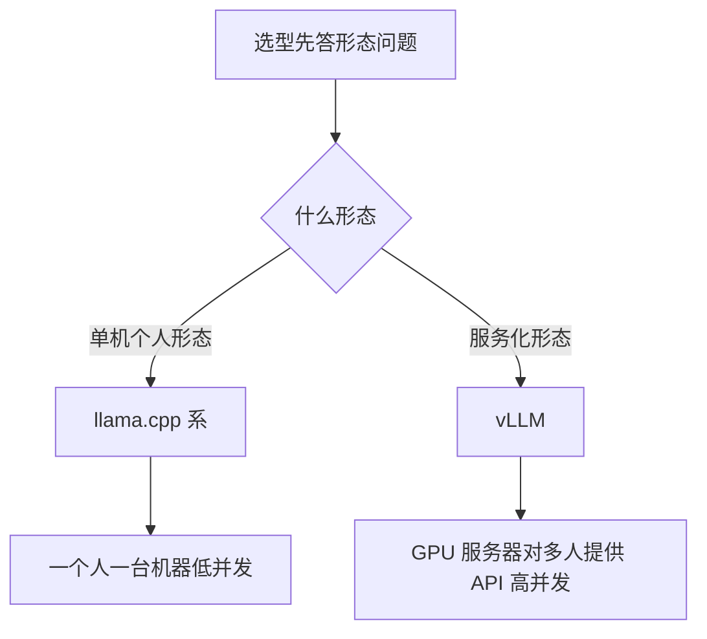
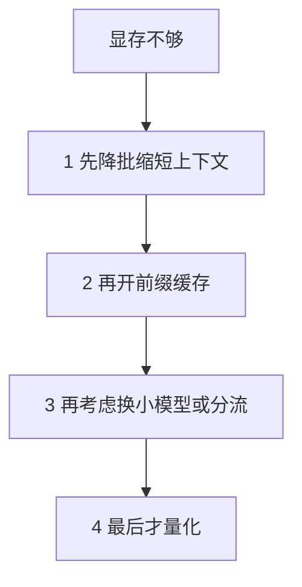

# 推理框架对比

> 推理框架不是模型：它负责**加载权重、调度请求、执行采样、暴露接口**。同一份权重在不同框架里跑，输出质量基本一致（差异来自采样参数与对话模板，不是框架本身），真正不同的是**使用形态**：给谁用、几个人用、在什么硬件上用。本篇按定位与分工对比 Ollama、llama.cpp、vLLM、LM Studio、SGLang、TensorRT-LLM 六者，性能只给测法不给数字——具体跑速必须本机实测，未测的标「待验证」。显存估算方法见 [本地部署与Ollama](AI与大模型/本地部署与Ollama.md)，本篇不重复。

## 1. 核心概念：先分清两种形态

- **单机个人形态**：一个人、一台机器、低并发（同时 1~几个请求），诉求是装得快、切模型方便、接口够用。llama.cpp 系（llama.cpp 本体、Ollama、LM Studio）的主场。
- **服务化形态**：一台 GPU 服务器对多人/多系统提供 API，高并发，诉求是吞吐、调度公平、稳定性。vLLM 的主场。

选型先答形态问题，再谈框架；在单机形态里纠结服务化框架的吞吐指标，是方向性错误（反之亦然）。

选型先答形态问题，再谈框架：



## 2. 六者定位

| 框架 | 定位 | 权重格式 | 典型使用者 | 一句话特征 |
|---|---|---|---|---|
| llama.cpp | 底层推理引擎 | GGUF（本生态发源地） | 愿意自己管文件与参数的人 | 能力最新最全：新架构、新量化通常先在这里落地；`llama-server` 提供 HTTP 服务 |
| Ollama | llama.cpp 之上的本地运行时封装 | GGUF（打包为模型标签） | 个人开发者 | 模型仓库 + 一键拉取/切换 + 双 API（原生与 OpenAI 兼容），上手成本最低 |
| LM Studio | 桌面 GUI 应用 | GGUF | 偏好图形界面的人 | 可视化浏览/下载/试聊，自带本地服务开关；自动化与脚本化不是其重心 |
| vLLM | 服务化推理引擎 | HF 格式为主（GGUF 为实验性支持，以官方文档为准） | 团队/生产服务 | 为高并发设计：PagedAttention 管理 KV 缓存、连续批处理（continuous batching）攒批提吞吐；V1 已为默认引擎（统一调度、chunked prefill、前缀缓存，best_of 等旧特性已移除） |
| SGLang | 服务化推理引擎 | HF 格式为主 | 团队/生产服务 | 前缀共享重的工作负载：RadixAttention 把 KV 缓存组织成基数树，共享前缀只算一次，多轮对话、Agent、RAG 场景的首 token 延迟与吞吐占优；无共享前缀时与 vLLM 大致相当；另带结构化生成（JSON Schema/正则约束输出） |
| TensorRT-LLM | NVIDIA 专用编译型服务引擎 | HF 格式 | 已有 NVIDIA 基础设施的团队 | 为 NVIDIA GPU 深度优化：定制 kernel、in-flight batching、量化与推测解码，极限延迟/吞吐取向；代价是锁定 NVIDIA 硬件、部署与调优成本高 |

几点展开：

- **Ollama 与 LM Studio 定位重叠**，都是个人桌面工具，区别在交互方式（命令行/服务 vs GUI）和生态习惯，二选一看顺手，不必都装。
- **Ollama 封装的代价**：方便来自抽象，抽象会挡住底层参数。需要精细控制（指定某个新量化文件、特殊采样、直接用最新 GGUF）时，绕过封装直连 llama.cpp 是常规操作，不是背叛。
- **vLLM 的主场是 Linux + NVIDIA GPU 服务器**：它面向数据中心部署设计，在 Windows 消费级机器上折腾它属于逆形态使用，环境问题会吃掉大量时间（支持范围以官方文档为准）。
- **SGLang 与 vLLM 的取舍看前缀共享程度**：共享前缀多（同一系统提示、多轮对话、RAG 共享文档）选 SGLang 收益明显；前缀基本不重合时两者大致相当，不必为榜单数字换引擎。TensorRT-LLM 只有已上 NVIDIA 栈、且对延迟/吞吐有硬指标时才值得付出编译与调优成本。

（SGLang、vLLM V1、TensorRT-LLM 三行按 2026-10 公开资料核实，具体版本行为以各自官方文档为准。）

## 3. GGUF 与服务化：格式决定工具链

- GGUF 是 llama.cpp 生态的单文件权重格式：量化档位、对话模板元数据都封在一个文件里，分发与切换都简单，所以个人生态（Ollama、LM Studio、llama-server）全员通用——同一个 GGUF 文件可以跨这三者使用。
- 服务化生态的通用货币是 HuggingFace 格式权重（safetensors 等）配各框架自己的量化方案（如 AWQ/GPTQ 一类），vLLM 围绕它做服务优化。
- 所以「框架之争」很大程度是「格式与分工之争」：本地单机囤的是 GGUF，将来真要上服务，同一模型通常能找到 HF 格式版本重新部署，不存在被某个框架锁死的问题。微调产物的回流路径（LoRA 合并 → 转 GGUF → 本地框架加载）见 [微调入门-LoRA](AI与大模型/微调入门-LoRA.md)。

## 4. 并发与批处理差异

- 单机形态的实际并发就是个位数请求，llama.cpp 系的并行靠多序列槽位（如 llama-server/Ollama 的并行请求数参数，具体名称与上限以各自官方文档为准），够用；瓶颈通常先出现在显存（多一份并发多一份 KV）而不是调度。
- 服务化形态下，请求到达时间参差，**连续批处理**（不等一整批跑完，新请求随时插入正在执行的批次）是吞吐的关键机制，配合 PagedAttention 把 KV 缓存按页管理、减少碎片浪费——这是 vLLM 区别于个人工具的核心，不是「跑得更快一点」的小优化。
- 判读框架宣传数字时的纪律：吞吐数字必须连同模型、量化、并发数、输入/输出长度一起看，缺任何一项都不可比；落到自己场景，按 [模型评测方法](AI与大模型/模型评测方法.md) 的流程实测（同模型同量化同提示，测首 token 延迟与生成速度及不同并发下的变化），未测前一律待验证。


## 显存与吞吐量化权衡

### 1. 显存三部分：先算账，再谈批大小

推理时一块 GPU 显存主要被三部分占住：

- **权重**：参数量 × 精度字节数。模型一加载就固定占住，不随请求数变化；量化首先省的就是这一部分（档位与质量取舍见大模型基础）。
- **KV Cache**：随请求数和序列长度一起涨，是唯一“越用越涨”的部分，也是批大小调优时最先撞墙的一项。单序列的 KV 开销公式见大模型基础（K 和 V 各一份：`2 × 层数 × hidden × 序列长度 × 精度字节`），本节补总量关系：
  - **总量 ≈ 批大小 × 平均序列长度 × 单 token KV 开销**。批大小翻倍，或平均序列长度翻倍，KV 总量都跟着翻倍——两者是乘积关系，不是加法。
  - 序列长度取的是“提示 + 已生成”的全长：长对话、多轮 Agent 任务里，已生成 token 越攒越多，KV 也跟着涨，跑着跑着 OOM 的常见根源就在这里。
  - 共享前缀不重复算：多轮对话共用系统提示、RAG 共用文档片段时，前缀缓存让这部分 KV 只存一份，等效于把平均序列长度里的共享段打了折（共享程度越高，折扣越大）。
- **激活值**：单步计算的中间结果，随批大小和序列长度变化，但推理时（不存反向梯度）通常是小头；大批 + 长序列时才需要把它算进账。
- **账外两项**：框架预留与碎片。PagedAttention 这类页式管理把碎片压得很低，但不等于零；估算时给总量留一成左右的余量，比算到小数点后一位再超更有用。

一句话口径：**权重是定值，KV 是变量，批大小和序列长度是 KV 的两个乘数**。显存不够时先看 KV 账本，而不是先怀疑权重。

### 2. 批大小与延迟：吞吐曲线先升后平，延迟曲线先缓后陡

批大小是服务化推理最核心的旋钮，两个方向的变化规律相反：

- **吞吐（单位时间产出的 token 总数）随批增大而上升，但边际递减**。批越大，GPU 越不容易空转，单位 token 分摊的开销越低；但涨到显存带宽或算力上限附近后，曲线趋平——再加批，吞吐几乎不涨，只涨风险。
- **单请求延迟随批增大而上升，且接近上限后陡增**。原因分两段：
  - 预填充段：新请求的提示要一次性算完，批越大，单次预填充的算量越大，排队和计算时间都变长。
  - 解码段：每生成一个 token 都要把整批的 KV 读一遍，批越大，每步读的数据越多，token 间延迟越高。
  - 接近上限时陡增的推手是排队、换页与 OOM 风险：批一满，新请求只能排队等上一批腾出 KV 空间，等待时间直接计入延迟。

所以不存在“批越大越好”：**吞吐曲线找平顶、延迟曲线找陡增点，两条曲线的夹缝就是可用批大小区间**。这个区间没有通用数，必须按模型评测方法的流程实测：固定模型、量化、提示长度，扫一批批大小，记录吞吐、首 token 延迟、token 间延迟、P99，画出自家的曲线再定。

### 3. TTFT 与 TPOT：两个延迟指标，对应两种场景

- **TTFT（Time To First Token）**：从请求发出到第一个 token 输出的时间 ≈ 排队 + 预填充。决定“点下去多久才开始动”。
- **TPOT（Time Per Output Token）**：每输出一个后续 token 的平均间隔，是解码速度的倒数。决定“开始动之后吐得快不快”。
- **总延迟 ≈ TTFT +（输出 token 数 − 1）× TPOT**。输出越长，TPOT 的权重越大；输出越短，TTFT 越主导体感。

两种场景的优化目标正好相反：

| 场景 | 优先保的指标 | 典型手段 | 可以牺牲的 |
|---|---|---|---|
| 交互场景（聊天、Agent 单步、工具调用） | TTFT | 短提示、前缀缓存、流式输出、小模型、限流保 P99 | 总吞吐、单批大小 |
| 批量场景（离线批量生成、评测、长文档摘要） | 总吞吐（等效于平均 TPOT） | 大批、连续批处理、高吞吐配置 | TTFT、单个请求的延迟 |

注意两点：

- 流式输出改善的是体感（TTFT 到了就先吐），不是总延迟；批量场景不开流式没有损失，交互场景不开流式体感直接降档。
- 只看平均 TTFT／TPOT 会掩盖长尾：交互场景真正要守的是 P99（见 LLM生产化与推理优化），一批长提示插队就能把 P99 抬上去。

### 4. 连续批处理下的权衡：新请求插队，在途请求买单

连续批处理（新请求随时插入正在执行的批次，本篇第 4 节）把吞吐做上去的代价，是在途请求的延迟稳定性：

- **插队要算预填充**：新请求进来先要做一次预填充，这次计算会抢占在途请求的解码步骤。chunked prefill 把预填充拆成小块、与解码混合调度，缓解但不消除这种抢占——在途请求的 TPOT 仍会被抬高，表现为偶发卡顿。
- **批内长短不一时，短请求被长请求拖慢**：一批里混着短问答和长生成，短请求的 TPOT 会被长请求的 KV 读取量拖高；极端情况下，短请求等一批长生成跑完才算真正“结束”，体感上等于被队头阻塞。
- **共享前缀的插队代价小**：新请求与在途请求共享系统提示或文档前缀时，预填充可复用已算好的 KV，插队成本低；前缀基本不重合时，每次插队都是一次全额预填充。
- **调度策略决定 P99，不决定平均值**：先来先服务最公平但长请求会挡路；优先级调度保交互请求但低优先级请求可能饿死；抢占式调度（暂停低优先级、腾出 KV）保高优先级但被抢占的请求要重算或换出 KV。选哪种，看场景的 P99 容忍度，而不是看平均延迟。

一句话：**连续批处理不是免费午餐，它把“等一整批跑完”的等待换成了“在途请求偶发变慢”的抖动**；交互场景要配限流和优先级，批量场景可以放开批、接受抖动。

### 5. 选型口径：显存不够时先动谁，延迟敏感时先保谁

**显存不够时，按这个顺序动（从代价最小到最大）：**

显存不够时按代价从小到大动，量化永远是最后一步：



1. **先降批、缩短上下文**：不碰质量。降批直接砍 KV 总量（乘积关系，立竿见影）；RAG 裁剪、摘要、截断历史都是缩短序列长度的等价手段。代价只是吞吐下降。
2. **再开前缀缓存**：共享前缀多的场景（多轮对话、Agent、RAG）几乎是白捡的显存，优先确认框架是否已开启。
3. **再考虑换小模型或分流**：按 LLM生产化与推理优化的路由思路，高频低价值请求走小模型，等于把 KV 账本分到两个池子。
4. **最后才量化**：量化省的是权重部分，对 KV 总量没有直接帮助（除非连 KV 也量化，那是另一档方案），而且质量代价不可逆——长推理、精确计算类任务的质量下滑最先出现。动量化之前，必须拿自己的任务实测质量下滑是否可接受，不能只看榜单。

**延迟敏感时，先保的指标按场景分：**

- 交互场景：保 TTFT 和 P99——前缀缓存、短提示、流式输出、限流，批大小宁小勿大。
- 批量场景：保总吞吐——放开批、开连续批处理，接受单个请求 TTFT 变长和 TPOT 抖动。

**一句话收口**：显存账先算 KV 的乘积关系，批大小在吞吐平顶和延迟陡增的夹缝里取，TTFT 与 TPOT 按场景取舍，连续批处理的代价是抖动不是免费，动量化永远是最后一步且必须实测。

## 5. 推理延迟与吞吐定量：TTFT、TPOT 与 KV Cache 算账

前文「显存与吞吐量化权衡」讲的是关系：KV 是变量、批大小是乘数、TTFT 与 TPOT 按场景取舍。这一节把关系变成算式：一个模型每个 token 的 KV 占多少、一个 batch 能装多少请求、一次请求的延迟由哪几段组成，全部手算一遍。算账的目的不是背数字——数字随模型、量化、硬件全变——而是拿到一把任何时候都能用的尺子。

> 本节只给算账方法与公式，不判断任何具体配置能否装进某一张卡。能不能跑，永远以你自己机器上的实测为准。

生活类比：推理服务是一家面馆。预填充（prefill）是接到订单后一次性把所有食材切好备齐，费的是刀工（算力）；解码（decode）是一碗一碗下面条，每碗都要回头去冰柜里翻一遍所有客人的存货（读 KV 缓存），费的是跑腿（显存带宽）。批大小就是同时接几桌：桌数越多，后厨越忙、单桌等得越久，但每碗面的平均成本越低。

### 5.1 概念：TTFT 与 TPOT 的定义

- **TTFT（Time To First Token，首 token 延迟）**：从请求发出到第一个 token 输出的时间，约等于「排队等待 + 预填充」。决定「点下去多久才开始动」。
- **TPOT（Time Per Output Token，每输出 token 平均时间）**：每输出一个后续 token 的平均间隔，是解码速度的倒数。决定「开始动之后吐得快不快」。
- **总延迟约等于 TTFT +（输出 token 数 - 1）× TPOT**。输出越长，TPOT 的权重越大；输出越短，TTFT 越主导体感。

两个指标对应两种瓶颈：预填充阶段是一次性算完整个提示，算力密集，提示越长、TTFT 越大；解码阶段每步只产一个 token，但每步都要把权重和全部 KV 缓存从显存读一遍，显存带宽密集，批越大、序列越长，TPOT 越大。

### 5.2 原理：prefill 与 decode 的延迟分解

一次请求的延迟可以拆成四段：

```text
总延迟 = 排队等待 + 预填充 +（输出 token 数 - 1）× 单步解码
```

- **排队等待**：批满了或 KV 池满了，新请求只能等上一批腾出位置。显存越紧张，这段越长；它是 TTFT 里最不稳定的一段，也是 P99 抖动的主要来源。
- **预填充**：把提示的全部 token 一次算完，生成第一个 token 用的 KV。算量正比于提示长度；共享前缀命中缓存时，这段只算没命中的后缀，见 5.5 节。
- **单步解码**：每生成一个 token 做一次前向：读一遍权重、读一遍该请求全部历史 token 的 KV、算一个新 token 的 KV 写回去。读的量正比于「权重 + 批内全部请求的 KV 总量」，所以批越大、单步越慢。
- **采样与输出**：采样本身通常是小头；流式输出把第一个 token 到达的时间提前，但不改变总延迟。

由此得到两条定性规律，后面手算时反复用到：预填充时间随提示长度线性涨，解码单步时间随批大小与序列长度线性涨；想压 TTFT 就缩短提示、命中前缀缓存、减少排队，想压 TPOT 就控制批大小与序列长度。

### 5.3 KV Cache 公式与手算例：以 Qwen3-8B 为例

先给公式。设模型有 L 层、KV 头数为 Hkv、每头维度为 d、每个 KV 元素占 b 字节、序列长度为 S，则单个 token 的 KV 缓存是：

```text
单 token KV 字节数 = 2 × L × Hkv × d × b
```

其中 2 是 K 与 V 各一份。序列总长 S 个 token 时，单个请求的 KV 总量是单 token 值再乘以 S；B 个并发请求时，总量再乘以 B。

注意一个容易算错的点：**不要拿注意力头总数当 KV 头数。** 分组查询注意力（GQA）下 KV 头数远小于查询头数，拿查询头数算会把 KV 高估好几倍。正确做法是读模型 `config.json` 里的 `num_hidden_layers`、`num_key_value_heads`、`head_dim` 三个字段；如果只有 `hidden_size` 与查询头数，可由「头维 = hidden_size ÷ 查询头数」推导头维，但 KV 头数仍须从 `num_key_value_heads` 读。多头注意力（MHA）是特例：KV 头数等于查询头数，此时公式退化为 2 × L × hidden_size × S × b（这就是前文「显存三部分」里引用的公式的完整写法）。

**手算例：Qwen3-8B。** 该模型 `config.json` 核验值：36 层，hidden_size 4096，查询头 32 个、KV 头 8 个，头维 128，参数量约 8.19B。

- BF16/FP16 缓存（每个元素 2 字节）：2 × 36 × 8 × 128 × 2 = 147456 字节，即 **144 KiB 每 token**。
- 8192 token 的单请求 KV：147456 × 8192 = 1207959552 字节，约 **1.21 GB（十进制）/ 1.13 GiB（二进制）**。
- 32768 token（原生上下文）：1.21 × 4 = **4.83 GB**。
- KV 缓存改用 FP8（每个元素 1 字节）：每 token 73728 字节，即 72 KiB，8192 token 时约 0.60 GB，直接减半。
- 对照：如果是 MHA（KV 头 32 个），每 token 是 2 × 36 × 32 × 128 × 2 = 589824 字节，即 576 KiB，是 GQA 的 4 倍——GQA 把 KV 砍到原来的四分之一，这就是 8 KV 头的价值。
- 权重对照（BF16）：8.19B 参数 × 2 字节 = 约 16.4 GB。权重是定值，KV 是变量，两者相加再留一成余量，就是一张卡上跑这个模型的显存账本。

### 5.4 batch size 对吞吐与延迟的影响：先算池子，再定批

KV 池是批大小的硬天花板。vLLM 的账本是这样算的：引擎先按 `gpu_memory_utilization` 占住一部分显存（该默认值因版本而异，0.90 与 0.92 都出现过，以你所用版本的 `vllm serve --help` 为准），扣掉权重、激活峰值与其他开销，剩下的才是 KV 池；启动日志会直接打印 KV 池能装多少 token，那是全服务最重要的一个数。

```text
KV 池能装的 token 数 = KV 池字节数 ÷ 单 token KV 字节数
并发请求上限约等于 KV 池 token 数 ÷ 单请求平均 token 数
```

**手算例（服务器场景，非个人机器）：** 一张 80 GiB 显存的卡，`gpu_memory_utilization` 取 0.90，则预算为 72 GiB；Qwen3-8B 的 BF16 权重约 16.4 GB，即 15.26 GiB；再假设预留 3 GiB 给激活峰值与运行开销（假设值，以启动日志的实测 profile 为准），KV 池约 72 - 15.26 - 3 = 53.74 GiB。53.74 GiB 除以每 token 147456 字节，约 39.1 万 token。若单请求平均 8192 token，并发上限约 391000 ÷ 8192 = 47 个请求。批再往上加，KV 池装不下，新请求要么排队、要么触发抢占重算，延迟直接陡增。

三家引擎里与批大小直接相关的默认参数（2026-11-18 核验，版本差异以各引擎官方文档与所用版本为准）：

| 引擎 | 相关默认参数 | 核验到的值 |
| --- | --- | --- |
| vLLM V1 | 前缀缓存 | 默认开启 |
| vLLM V1 | 分块预填充 | 恒开启，不可关闭 |
| vLLM V1 | KV 块大小 | 16 token 每块 |
| vLLM V1 | 每步 token 预算 | 常见为 8192，以启动日志为准 |
| vLLM | 最大并发序列数 | 因版本而异，待验证，以 `--help` 为准 |
| SGLang | 前缀树页大小 | 默认 1，即按单个 token 精确匹配 |
| SGLang | 前缀树淘汰策略 | 默认 LRU |
| SGLang | 等待队列调度策略 | 默认 FCFS，可选 LPM（最长前缀匹配优先） |
| llama.cpp（llama-server） | 并行槽位数 | 默认 1 |
| llama.cpp（llama-server） | 逻辑批大小 | 默认 2048 |
| llama.cpp（llama-server） | 物理微批大小 | 默认 512 |
| llama.cpp（llama-server） | KV 缓存精度 | 默认 f16 |
| llama.cpp（llama-server） | 上下文大小 | 默认值因版本而异，旧版为 4096，新版为 0 即取模型值 |

批大小的调优方法只有一种：固定模型、量化与提示长度，从小到大扫一批批大小，记录吞吐、TTFT、TPOT 与 P99，画出自家的曲线。吞吐曲线先升后平、延迟曲线先缓后陡，两条曲线的夹缝就是可用批大小区间——这个区间没有通用数，任何不给模型与提示长度的「推荐批大小」都不可直接采用。

### 5.5 TTFT 与 TPOT 手算：前缀缓存省的是哪一段

**手算例一：无缓存时的总延迟。** 以下速率是为演示算式而设的假设值，不是任何机器的实测结果：假设某服务上实测预填充速度为每秒 2000 token，TPOT 为 40 毫秒；请求提示 2048 token，输出 100 token，排队为 0。

- 预填充时间：2048 ÷ 2000 = 1.024 秒，即 TTFT 约 1.02 秒
- 解码时间：（100 - 1）× 0.04 = 3.96 秒
- 总延迟：1.024 + 3.96 = 4.98 秒，约 5 秒

**手算例二：前缀缓存命中时的 TTFT。** 同一请求，2048 token 的提示里有 1800 token 与之前请求的系统提示完全相同且已缓存：

- 只需预填充的后缀：2048 - 1800 = 248 token
- 预填充时间：248 ÷ 2000 = 0.124 秒，即 TTFT 约 0.12 秒
- 总延迟：0.124 + 3.96 = 4.08 秒

对比可见：前缀缓存省的是 TTFT 里「预填充」那一段，对 TPOT 与总延迟里的解码部分没有帮助；提示越长、共享前缀占比越高，省得越多；输出越长，TTFT 的节省在总延迟里的占比越小。SGLang 的 RadixAttention 把已算过的 KV 按前缀树（radix tree）组织，共享前缀只算一次，命中可精确到单个 token；vLLM V1 的前缀缓存默认开启、按 16 token 的块做哈希匹配，块内有一个 token 不同、整块都要重算——两种实现的差距在「共享前缀长度不是 16 的倍数」时才会显现。

**读数纪律：** 只看平均 TTFT 与 TPOT 会掩盖长尾。交互场景真正要守的是 P99：一个长提示插队做预填充，就能把在途请求的 TPOT 抬上去；一次 KV 池打满后的抢占重算，能把某个请求的 TTFT 抬上天。报延迟时平均值与 P99 一起报，只报平均值等于没报。

### 5.6 常见问题

- **问：显存明明够，为什么并发一高就排队？** 先看 KV 池的 token 预算：权重只占定值，KV 池才是并发的天花板；再看 `max_num_seqs` 这类并发上限参数有没有卡住；最后看是不是长提示把每步的 token 预算占满了。
- **问：TTFT 很低，但用户感觉还是慢？** TTFT 只量到第一个 token，输出 100 token 时解码占了总延迟的大头；先看 TPOT 与输出长度，再决定是优化预填充还是优化解码。
- **问：前缀缓存开了，为什么 TTFT 没降？** 先确认共享前缀是不是真的在提示的最前面——前缀缓存只认「从第一个 token 开始连续相同」的部分，中间插一句不同的话，后面再相同也命中不了；再确认缓存有没有被逐出（KV 池满了会按 LRU 淘汰）。
- **问：批大小翻倍，吞吐翻倍吗？** 不会。KV 总量随批线性涨，但吞吐受显存带宽与算力上限封顶，翻倍只在远离上限时接近成立；接近上限后吞吐趋平、TPOT 陡增，再加批只有延迟没有收益。

### 5.7 生产实践

- 上线前先做 5.3 节的手算：权重加 KV 加一成余量，算出 KV 池的 token 预算，再反推并发上限；预算与启动日志打印的数字对不上，先查是不是有别的进程占了显存。
- 交互场景保 TTFT 与 P99：短提示、前缀缓存、流式输出、限流，批大小宁小勿大；批量场景保总吞吐：放开批、开连续批处理，接受单个请求 TTFT 变长与 TPOT 抖动。
- 多轮对话与 Agent 场景优先确认前缀缓存真的开着：vLLM V1 默认已开，SGLang 的前缀树默认就启用；部署完先看一次缓存命中率，再信延迟数字。
- 动量化之前先算 KV 账：量化省的是权重，对 KV 总量没有直接帮助（除非连 KV 也量化，那是另一档方案）；显存不够时先降批、缩短上下文、开前缀缓存，最后才量化，顺序见「显存与吞吐量化权衡」一节。

> 来源：vLLM 官方文档「Performance and Tuning」与 V1 引擎说明、SGLang 官方文档与 RadixAttention 论文、llama.cpp 仓库 server 文档、Qwen/Qwen3-8B `config.json`；核验日期 2026-11-18。本节所有速率示例均为标注的假设值，用于演示算式，不代表任何硬件的实测性能；三家引擎的默认值随版本变化，部署前以所用版本的 `--help` 与启动日志为准。

## 6. 选型建议（按场景对照）

| 场景 | 选择 | 理由 |
|---|---|---|
| 本地单机日常使用（小说引擎现状） | Ollama | 已有部署与兼容 API，零迁移成本；常驻+按需的双层分工已跑通 |
| 尝鲜新模型/新量化，Ollama 库里还没有 | llama.cpp（llama-server） | GGUF 通常最先可得，手动指定文件与参数，不等封装更新 |
| 只想可视化试几个模型 | LM Studio | GUI 浏览下载最省事 |
| 团队内部共用一台 GPU 机器对外提供 API | vLLM | 并发与吞吐是设计目标，个人工具在此形态下是短板 |
| 桌面 GUI 与脚本自动化都要 | Ollama 为主 | GUI 试聊不是刚需时，服务+API 更好接进代码 |

## 7. 常见误区

- **以为换框架能提质量**：同权重、同量化、同采样参数下，各框架输出应基本一致；觉得「换了框架变笨/变聪明」，先查对话模板（chat template）是否对上、采样参数是否被默认值改了——模板错位是输出变怪的头号原因。
- **拿服务化框架的吞吐数字要求个人工具**：形态不同，指标不可比（第 4 节）。
- **在 Ollama 里找不到模型就断定本地跑不了**：Ollama 库没有 ≠ GGUF 不存在，下沉到 llama.cpp 往往就能跑。
- **先纠结框架、后算显存账**：顺序反了。先按 [本地部署与Ollama](AI与大模型/本地部署与Ollama.md) 的三笔账确认模型装得下，再在能装下的框架里挑。

## 小技巧与冷知识

【小技巧】Ollama 的常驻模型别让它悄悄卸载：默认 5 分钟没请求就把模型从显存卸掉，下一次请求要重新加载，首 token 明显变慢。想让它常驻，用 OLLAMA_KEEP_ALIVE=-1 启动服务，或在请求里带 keep_alive=-1；查当前状态用 ollama ps，看 UNTIL 列就知道模型还能留多久。

【小技巧】输出变怪时先查模板，不用先换框架：ollama show --modelfile 能直接看到当前模型实际用的对话模板。Ollama 封装的模型模板来自 GGUF 文件自带的元数据，自定义模型可以在 Modelfile 里用 TEMPLATE 指令自己写；模板错了，换哪个框架都一样怪，查模板比换框架快得多。

【小技巧】长对话先确认上下文窗口够不够：Ollama 的 num_ctx 默认只有 2048 个 token，章节加历史一长就容易被截断。按任务把 num_ctx 设到够用的大小再跑，调完记得看显存账本——窗口越大，KV 缓存占得越多，原文的乘积关系在这里照样适用。

【冷知识】GGUF 是 2023 年 8 月才取代 GGML 的新格式：llama.cpp 早期用的 GGML 格式把超参数硬编码在加载器里，加一个新架构就要改代码；GGUF 改成键值元数据，架构、tokenizer、对话模板都封在文件里自己描述自己。这也是同一份 GGUF 能跨 llama.cpp、Ollama、LM Studio 通用的原因，老的 GGML 文件现在已经跑不了了。

【小技巧】GGUF 文件名里的 K_M、K_S 不是版本号，是量化档位的大小：K 是 K-quant 系列，S 是 small、M 是 medium，同档位下 M 比 S 大一点、质量也高一点。选档位时别只看 Q4、Q5 的数字，后缀同样决定文件大小和效果；纠结档位时按原文的办法——同模型同提示实测，不要凭名字猜。

【冷知识】vLLM 的 PagedAttention 出自一篇论文：2023 年加州伯克利团队的《Efficient Memory Management for Large Language Model Serving with PagedAttention》，发表在 OSDI '23 上。论文的思路是把 KV 缓存像操作系统的虚拟内存一样按页管理，碎片少了、批才能攒大；原文讲的连续批处理和页式管理，源头就是这里。

【小技巧】前缀缓存先确认开了没有：vLLM V1 默认已开启自动前缀缓存，多轮对话、RAG 共享文档的场景不用额外配置；llama.cpp 一侧也有对应的缓存复用开关。原文说前缀缓存是“几乎白捡的显存”，但前提是它真的开着——部署完先确认一次，比事后查为什么显存涨得快要省事。

【小技巧】TensorRT-LLM 的引擎不能跨卡复用：编译出的 engine 绑定具体的 GPU 型号与配置，换一张卡就要重新编译。这就是原文说的“锁定 NVIDIA 硬件”在落地时的具体代价——上它之前，先确认目标机器的卡型已经定下来，不会在部署中途换卡。

【小技巧】- 先读启动日志里的 KV token 预算再调批大小：vLLM 启动时会打印 KV 池能装多少 token，用这个数除以你单请求的平均 token 数，就是并发上限的理论值；批大小调到这个值附近还排队，先查是不是长提示占满了每步的 token 预算，而不是先加卡。

## 面试与自测

1. 选推理框架时为什么要先答“形态问题”？拿服务化框架的吞吐数字要求个人工具错在哪里？
2. 换了框架后输出变了，第一怀疑对象应该是什么？为什么不是框架本身？
3. 显存不够时应该按什么顺序动手？为什么量化是最后一步？
4. Qwen3-8B（36 层、8 个 KV 头、头维 128）在 BF16 KV 缓存下，每个 token 的 KV 占多少？一个 8192 token 的请求要多少 KV？为什么算 KV 时要用 KV 头数而不是注意力头总数？

### 参考答案

1. 要先分清单机个人形态（一个人、一台机器、低并发，诉求是装得快、切模型方便）还是服务化形态（一台 GPU 服务器对多人提供 API，诉求是吞吐、调度公平、稳定性）。形态不同，指标不可比：在单机形态里纠结服务化框架的吞吐指标是方向性错误，反之亦然。
2. 先查对话模板（chat template）是否对上、采样参数是否被默认值改了。同权重、同量化、同采样参数下，各框架输出应基本一致，差异来自采样参数与对话模板，不是框架本身；模板错位是输出变怪的头号原因。
3. 顺序是：先降批、缩短上下文（不碰质量，降批直接砍 KV 总量）；再开前缀缓存（共享前缀多的场景几乎是白捡的显存）；再考虑换小模型或分流；最后才量化。因为量化省的是权重部分，对 KV 总量没有直接帮助（除非连 KV 也量化，那是另一档方案），而且质量代价不可逆——长推理、精确计算类任务的质量下滑最先出现，动量化之前必须拿自己的任务实测。
4. 每 token 是 2 × 36 × 8 × 128 × 2 = 147456 字节，即 144 KiB；8192 token 是 147456 × 8192 = 1207959552 字节，约 1.21 GB。公式里的 2 是 K 与 V 各一份，头数必须用 `config.json` 里的 `num_key_value_heads`（Qwen3-8B 是 8 个）；该模型用分组查询注意力，32 个查询头共享 8 个 KV 头，拿 32 个查询头算会把结果高估 4 倍，变成每 token 576 KiB。

## 8. 关联知识

- [本地部署与Ollama](AI与大模型/本地部署与Ollama.md)：Ollama 的命令、量化读法与显存估算，本篇的默认落地框架
- [模型评测方法](AI与大模型/模型评测方法.md)：框架/配置对比的统一测法与留痕纪律
- [微调入门-LoRA](AI与大模型/微调入门-LoRA.md)：微调产物转 GGUF 回流本地框架的路径
- [大模型基础](AI与大模型/大模型基础.md)：KV 缓存、采样等基础概念
