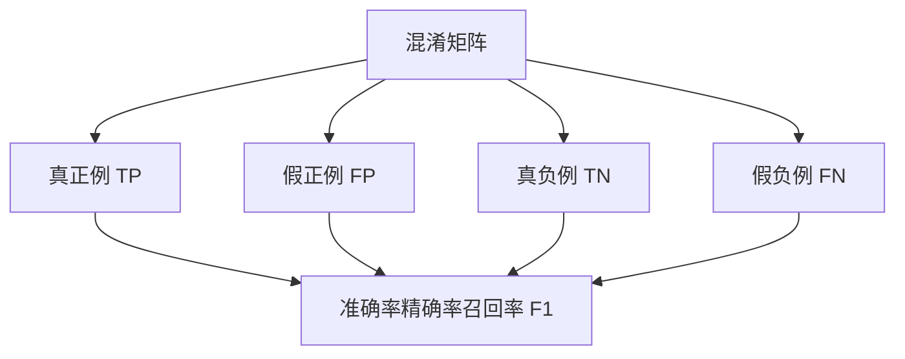

# 机器学习基础

> 大模型出现之前，机器学习就是这套东西；大模型出现之后，这套东西也没过时——它变成了你评估、选型、排错时的基本语言。

## 三分法：按学习信号分

- 监督学习：数据带标签，学“输入到输出”的映射。分类（垃圾邮件判别）、回归（房价预测）都属此类。
- 无监督学习：数据无标签，学数据本身的结构。聚类（用户分群）、降维（可视化、去噪）是代表。
- 强化学习：没有现成答案，靠与环境互动拿奖励信号学策略。下棋、机器人控制、以及大模型对齐里的 RLHF/DPO 都走这条路。
- 一句话区分：监督是“照着答案学”，无监督是“自己找规律”，强化是“试错拿反馈”。

## 训练集、验证集、测试集

- 训练集：用来拟合参数，模型真正“学”的材料。
- 验证集：用来调超参数、选模型、定早停点；不参与参数拟合，但参与决策，所以不能算 unbiased。
- 测试集：只在最后用一次，模拟真实世界的新数据；反复拿它调参，它就变相成了验证集。
- 常见切分：7:1:2 或 8:1:1；数据量小可用交叉验证（K 折），每折轮流当验证集，结果取平均。

三份数据各司其职，测试集只在最后用一次：


## 过拟合与欠拟合

- 欠拟合：模型太简单，连训练集都学不好；表现是训练误差和测试误差都高。解法：换更强模型、加特征、减少正则。
- 过拟合：模型把训练数据的噪声也背下来了；表现是训练误差低、测试误差高。解法：加数据、正则化、早停、简化模型、交叉验证。
- 判断方法：只看训练集分数会骗自己，一定要对照验证集/测试集；两者差距拉大就是过拟合的信号。
- 直觉：欠拟合是“没学会”，过拟合是“只会背题”，目标是中间那个泛化点。

## 评估指标

分类任务先看混淆矩阵：真正例（TP）、假正例（FP）、真负例（TN）、假负例（FN）。

分类任务先看混淆矩阵，再算四个指标：



- 准确率：答对的比例，(TP+TN)/总数。类别不平衡时会骗人：99% 都是负例时全猜负例也有 99% 准确率。
- 精确率：预测为正里真为正的比例，TP/(TP+FP)。答“是”要负责的场景看它，如垃圾邮件误杀正常邮件代价高。
- 召回率：真实为正里被找出来的比例，TP/(TP+FN)。漏报代价高的场景看它，如疾病筛查、欺诈检测。
- F1：精确率与召回率的调和平均，2PR/(P+R)。两者都要兼顾时用它做单指标对比。
- ROC-AUC：ROC 曲线下面积，衡量“模型把正例排在负例前面的能力”，与阈值无关；0.5 约等于瞎猜，越近 1 越好。
- 回归任务常用：MAE（平均绝对误差）、MSE/RMSE（均方误差/开方，放大大误差）、R²（拟合解释了多少方差）。
- 选指标的原则：先想清楚业务上“错判哪类更贵”，再定指标；只报准确率的评测报告先打个问号。

## 特征工程入门

- 特征就是模型看世界的眼睛：原始数据 rarely 能直接喂模型，先变成数值向量。
- 数值特征：标准化（均值 0、方差 1）或归一化（缩到 0–1），量纲差很大的特征不处理会让距离类、梯度类模型失衡。
- 类别特征：独热编码（One-Hot，类别少时用）、目标编码（类别多时用均值代替，小心泄漏）。
- 缺失值与异常值：缺失可填均值/中位数或单独成类；异常值先判断是脏数据还是真实极端值，再决定删还是截断。
- 特征选择：去掉无关、冗余特征，模型更简单、泛化更好；过滤法（相关性）、包裹法（试着删）、嵌入法（模型自带权重，如 L1）三类。
- 一条铁律：特征工程不许偷看测试集——用全量数据算均值、做编码再切分，就是数据泄漏，线下分数虚高、上线就崩。

## 常见模型一张表

| 模型 | 类型 | 一句话 | 适用 / 注意 |
|---|---|---|---|
| 线性回归 | 监督·回归 | 拟合一条直线/超平面 | 基线首选，可解释性强；只抓线性关系 |
| 逻辑回归 | 监督·分类 | 线性加权后过 Sigmoid 输出概率 | 别被名字骗，它是分类器；同样是线性边界 |
| 决策树 | 监督·分类/回归 | 按特征一路 if-else 分到叶子 | 直观、可解释；单棵树极易过拟合 |
| 随机森林 | 监督·分类/回归 | 很多棵树投票/取平均 | 树模型的集成，抗过拟合、开箱即用 |
| SVM | 监督·分类 | 找间隔最大的分界超平面，核技巧升维 | 小样本、高维效果好；数据量大时慢 |
| KNN | 监督·分类/回归 | 看最近 K 个邻居多数表决/平均 | 无训练过程、简单；推理慢、对量纲敏感 |
| K-Means 等聚类 | 无监督 | 按距离把样本分堆 | 要先定 K；对初始中心和量纲敏感 |

- 选型经验：先上简单模型当基线（逻辑回归、随机森林），复杂模型必须在验证集上赢过基线才值得上。
- 没有免费午餐：不存在所有任务都最优的模型，模型选择永远是“数据 + 指标 + 成本”三者权衡。

## 偏差-方差分解定量

- 公式（平方损失下，固定输入点 x₀）：期望泛化误差 = 偏差² + 方差 + 不可约噪声，即 Err(x₀) = σ²ε + Bias²(f̂(x₀)) + Var(f̂(x₀))。一句话：模型离真相有多远（偏差）、换一份数据预测抖得多厉害（方差）、数据本身有多吵（噪声），三者加起来就是你最终要付的误差。
- 偏差²：模型“平均预测”与真实函数的差距。模型太简单、学不到真实结构，偏差就高；只换更强的模型族才能降，加数据降不了它。
- 方差：训练数据换一份，预测结果的抖动幅度。模型太灵活、对数据太敏感，方差就高；加数据、加正则、简化模型能降它。
- 不可约噪声 σ²ε：标签里自带的随机噪声，与模型无关；再好的模型也消不掉，是泛化误差的下限。
- 复杂度上去，偏差降、方差升，两者相加先降后升，就是测试误差的 U 形曲线；最优点在两者交接处，不在“模型越强越好”那一端。

### 数值实验：1 次、3 次、9 次多项式拟合 y = sin(x) + 噪声

- 设定：x 在 [0, 2π] 上均匀取，y = sin(x) + ε，ε ~ N(0, 0.3²)，即不可约噪声 σ² = 0.09；训练集 n = 100，重复 200 次独立抽样，分别拟合 1、3、9 次多项式。偏差² 与方差在 200 点测试网格上算，训练/测试 MSE 对 2000 点测试集取平均。

| 多项式次数 | 训练 MSE | 测试 MSE | 偏差² | 方差 | 偏差² + 方差 + 0.09 |
|---|---|---|---|---|---|
| 1 次 | 0.2792 | 0.2941 | 0.2000 | 0.0071 | 0.2970 |
| 3 次 | 0.0912 | 0.0985 | 0.0046 | 0.0041 | 0.0987 |
| 9 次 | 0.0821 | 0.1031 | 0.0001 | 0.0141 | 0.1042 |

- 怎么读这张表：1 次多项式偏差² 占了误差大头（0.2000），是典型欠拟合——直线拟不出正弦；3 次多项式偏差² 跌到 0.0046、方差也只有 0.0041，测试误差最低；9 次多项式偏差² 几乎归零（0.0001），但方差涨到 0.0141，测试误差反而回升——U 形曲线的右端就是这么来的。
- 分解式不是比喻，是能对上账的等式：三项和（0.2970 / 0.0987 / 0.1042）与实测测试 MSE（0.2941 / 0.0985 / 0.1031）基本吻合，残差只是蒙特卡洛抽样噪声。
- 小样本会放大方差：同样 9 次多项式，训练集只有 n = 30 时方差飙到 9.1931（偏差² 仅 0.0181），因为高次多项式在区间端点剧烈震荡（Runge 现象）——小数据 + 高复杂度是最危险的组合。

### 学习曲线定量：加数据降方差、不降偏差

- 同一模型，训练样本量 50 / 200 / 1000 三档（训练 MSE / 验证 MSE，验证集 2000 点）：

| 模型 | n = 50 | n = 200 | n = 1000 |
|---|---|---|---|
| 1 次多项式 | 0.2798 / 0.3021 | 0.2788 / 0.2902 | 0.2849 / 0.2875 |
| 3 次多项式 | 0.0857 / 0.1024 | 0.0922 / 0.0968 | 0.0937 / 0.0948 |
| 9 次多项式 | 0.0697 / 5.4977 | 0.0846 / 0.0958 | 0.0889 / 0.0910 |

- 1 次多项式：数据量翻 20 倍，验证误差纹丝不动（0.3021 → 0.2875）——偏差是模型族本身的毛病，加数据修不好，这时该换模型，不是加数据。
- 3 次多项式：训练–验证差距从 0.0167 收窄到 0.0011，验证误差逼近噪声下限 0.09；逼近下限之后，再加数据收益也见顶。
- 9 次多项式：n = 50 时验证误差直接炸到 5.4977（端点震荡），n = 200 后恢复正常并逼近下限——高方差模型最吃数据，数据量不够时连“能用”都谈不上。
- 边界：加数据降方差、不降偏差；判断要不要加数据的办法，是看学习曲线上训练误差与验证误差的差距还在不在缩小——差距已收敛，就别再堆数据了。

### 边界条件

- 分解式成立需要平方损失：换绝对误差、0-1 损失，分解不再是这么干净的加法；分类问题的偏差–方差没有统一的加法形式，别把回归的公式直接套到分类上。
- 噪声项不可消除：测试 MSE 永远 ≥ σ²ε；本实验里 0.09 就是地板，验证误差逼近它之后，调模型、加数据都只能在小数点后挣扎。
- 数值结论只适用于该合成分布与多项式族：y = sin(x) + N(0, 0.3²)、x 均匀分布、n = 100、多项式回归。换真实数据、换模型族，最优复杂度会变，表里的数字不能直接搬到别的任务上。

#### 复算口径

```python
import numpy as np
SEED = 42; SIGMA = 0.3
f = lambda x: np.sin(x)
def design(x, deg):
    t = (x - np.pi) / np.pi
    return np.polynomial.chebyshev.chebvander(t, deg)
def fit_predict(x_tr, y_tr, x_pr, deg):
    coef, *_ = np.linalg.lstsq(design(x_tr, deg), y_tr, rcond=None)
    return design(x_pr, deg) @ coef
rng = np.random.default_rng(SEED + 1)
x_te = rng.uniform(0, 2*np.pi, 2000); y_te = f(x_te) + rng.normal(0, SIGMA, 2000)
x_grid = np.linspace(0, 2*np.pi, 200)
for deg in (1, 3, 9):
    preds = np.empty((200, 200)); te = []
    for b in range(200):
        r = np.random.default_rng(SEED*1000 + b)
        x_tr = r.uniform(0, 2*np.pi, 100); y_tr = f(x_tr) + r.normal(0, SIGMA, 100)
        preds[b] = fit_predict(x_tr, y_tr, x_grid, deg)
        te.append(np.mean((fit_predict(x_tr, y_tr, x_te, deg) - y_te)**2))
    bias2 = np.mean((preds.mean(axis=0) - f(x_grid))**2); var = np.mean(preds.var(axis=0))
    print(deg, round(float(np.mean(te)), 4), round(float(bias2), 4), round(float(var), 4), round(float(bias2+var+0.09), 4))
```

#### 来源与核验说明（核验日期 2026-11-24）

- 已验证事实：偏差–方差分解式 Err(x₀) = σ²ε + Bias² + Var（平方损失下），出自 Hastie、Tibshirani、Friedman《The Elements of Statistical Learning》第 2 版第 7 章 §7.3 "The Bias–Variance Decomposition"（§7.2 讲偏差、方差与模型复杂度的关系，图 7.1 为测试误差 U 形曲线）。来源链接：https://www.cmat.edu.uy/~mordecki/digital-library/60-Probability-Theory-and-Stochastic-Processes/Hastie%20Tibshirani%20Friedman%20The%20Elements%20of%20Statistical%20Learning%202009/219-259_Model%20Assessment%20and%20Selection.pdf
- 已验证事实：同一分解式的课堂讲义复核，奥斯陆大学 STK-IN4300 课件（ESL 第 7 章）：https://www.uio.no/studier/emner/matnat/math/STK-IN4300/h25/slides/4-model-assessment-and-selection.pdf ；新南威尔士大学讲义：https://datascience.feihuang.org/Lectures/Ch5-Evaluation/Model-Assessment-and-Selection.slides.html
- 已验证事实：scikit-learn 的 validation_curve 与 learning_curve 均在 sklearn.model_selection 中，来源 scikit-learn 1.9.1 官方文档 https://scikit-learn.org/stable/modules/learning_curve.html（2026-11-24 复核）。
- 实测数字（已验证，非编造）：上方复算代码在本机实测运行，numpy 1.26.4，随机种子 SEED=42 且每轮派生种子固定，完整可复现；实验 1 三项和与实测测试 MSE 吻合，残差为蒙特卡洛抽样噪声；多项式以切比雪夫基最小二乘拟合，与普通多项式张成同一函数空间。
- 个人推断：「小样本 + 高复杂度是最危险的组合」「差距已收敛就别再堆数据」等表述，是由上述实测数字归纳出的工程经验，非教科书原文。

## 与 LLM 时代的关系

- 评估指标思维直接复用：评测大模型、Agent 时，准确率/召回率/F1、ROC-AUC 这套语言原样适用；[AI与大模型/模型评测方法.md](AI与大模型/模型评测方法.md) 里的基准与人工抽检，本质就是“测试集 + 指标”的放大版。
- 训练集/验证集/测试集的纪律同样适用：拿测试集反复调提示、调 Agent 流程，等于在测试集上过拟合，线下好看、上线拉胯。
- 过拟合的直觉帮你看大模型问题：微调数据太少、训太久，模型就会“背题”而不是“学会任务”，表现就是换个问法就崩。
- 传统模型没有死：表格数据、排序、风控评分这类结构化任务上，树模型（随机森林、GBDT）经常比调大模型更快、更便宜、更可解释。
- 大模型基础里的 Transformer、注意力机制，往下追就是深度学习；见 [AI与大模型/深度学习基础.md](AI与大模型/深度学习基础.md) 与 [AI与大模型/大模型基础.md](AI与大模型/大模型基础.md)。

## 小技巧与冷知识

【小技巧】切分数据集时，类别不平衡的任务要用分层抽样：随机切分可能让某一折里正例一个都没有，验证分数全是运气。分层抽样保证训练、验证、测试每份里正负比例都和全量一致，小类再少也不会在某一份里消失；scikit-learn 里就是 train_test_split 的 stratify 参数，一行就能开。

【小技巧】有时间顺序或成组样本的数据不能随机切：时间序列按时间切（过去训、未来测），同一用户、同一设备的多条记录要按组切（GroupKFold），同组样本分到两边等于让模型在测试集上“见过”训练数据。随机切分只对独立同分布的样本安全，切之前先问一句“样本之间有没有血缘关系”。

【小技巧】把预处理和模型绑进同一个 Pipeline 再做交叉验证：标准化、编码这些步骤如果在切分前手动做一遍，每折验证用的都是沾了测试集信息的统计量。Pipeline 会在每一折里重新 fit 预处理，泄漏从结构上就被堵死了；上线时导出一个 Pipeline 文件，预处理和模型也不会脱节。

【小技巧】目标编码一定要在折内算，不能全量算：类别对应的目标均值如果用全量数据算出来再编码，标签信息就通过编码泄漏进了特征，线下分数虚高。正确做法是交叉验证里每一折只用该折的训练部分算编码（out-of-fold），或者干脆只在训练集上算、验证集沿用；原文只说“小心泄漏”，折内计算就是具体的防法。

【小技巧】早停要看验证集，还要留耐心值：训练 loss 一直降不代表模型在变好，早停的信号是验证集指标连续几轮不再提升。设一个 patience（比如 5 轮），验证集 5 轮没进步再停；只看一轮波动就停，容易在平台期误杀一个还没收敛的模型。

【小技巧】报准确率之前，先跑一个“全猜多数类”的 Dummy 基线：99% 负例的任务里全猜负例就有 99% 准确率，模型必须赢过这条基线才算学到了东西。scikit-learn 的 DummyClassifier 就是干这个的，基线分数是所有指标的起点——没过基线，精确率、召回率再好看也先打个问号。

【冷知识】“没有免费午餐”不只是一句俗语，是个定理：Wolpert 与 Macready 在 1997 年的论文里证明，在所有可能的问题上取平均，任何两个优化算法的表现都一样好。换句话说，不存在脱离数据和任务的“最强模型”，选型只能回到原文那句老话——看数据、看指标、看成本。

【冷知识】F1 是调和平均，不是算术平均，它对低的那一方更敏感：精确率 0.9、召回率 0.1 时，F1 只有 0.18，而不是两者的平均 0.5。调和平均的本性就是“短板说了算”，所以 F1 高的前提是精确率和召回率都不能塌；只看 F1 涨了 0.05，也要拆开看是哪一边在拖后腿。

用验证曲线选模型复杂度，别凭感觉定：固定训练集，扫一遍复杂度（多项式次数、树深、k 值），画验证误差随复杂度变化的曲线，取最低点——左端高是偏差问题，右端回升是方差问题。复杂度定下来后，再画学习曲线（同一模型、不同数据量）：训练与验证误差的差距还在缩小，加数据就有效；差距已收敛，加数据就是白烧钱，该换模型或换特征。scikit-learn 里这两条曲线就是 validation_curve 和 learning_curve，一行调用就能画。

## 面试与自测

1. 监督、无监督、强化学习的区别是什么？各举一个代表任务。
2. 为什么测试集只能在最后用一次？反复用它调参会发生什么？
3. 训练误差低、测试误差高，说明什么问题？列三种解法。
4. 类别极不平衡时为什么不能只看准确率？该看什么指标？
5. 用全量数据做标准化再切分训练/测试集，错在哪？这叫什么？
6. 表格数据任务上，为什么常先试随机森林而不是直接上大模型？
7. 训练误差一直在降，测试误差先降后升，用偏差–方差怎么解释？加数据能解决吗？

### 参考答案

1. 监督学习数据带标签，学输入到输出的映射，如垃圾邮件分类；无监督学习无标签，学数据结构，如用户聚类；强化学习靠与环境互动的奖励信号学策略，如下棋。区分看学习信号：有答案、无答案、靠反馈。
2. 测试集的作用是模拟真实新数据。反复用它调参，等于把测试信息泄漏进了模型选择，测试分数虚高，不再能反映真实泛化能力；它变相成了验证集。
3. 说明过拟合：模型把训练噪声也背下来了。解法：加训练数据、加正则化、早停、简化模型、用交叉验证选模型。
4. 因为全猜多数类也能刷出高准确率。应看精确率、召回率、F1，或 ROC-AUC：漏报代价高看召回率，误报代价高看精确率，两者兼顾看 F1。
5. 错在数据泄漏：标准化的均值、方差是用了测试集信息算出来的，测试集不再是“未见过”的数据，线下分数虚高。正确做法是只在训练集上算统计量，再应用到验证/测试集。
6. 因为表格数据上树模型经常更快、更便宜、更可解释，且效果不输：随机森林开箱即用、抗过拟合；大模型在结构化数值任务上没有天然优势，成本和延迟还更高。先上简单基线，复杂方案必须在验证集上赢过基线才值得。
7. 这是复杂度越过最优点后方差主导的信号：训练误差降说明模型拟合能力在涨，测试误差回升说明方差涨得比偏差降得快。加数据能降方差、压住回升，但要分情况：如果当前已是欠拟合（偏差主导），加数据没用，该换更强模型；如果已是过拟合（方差主导），加数据、加正则、简化模型都有效；但无论如何，测试误差降不到不可约噪声以下。
