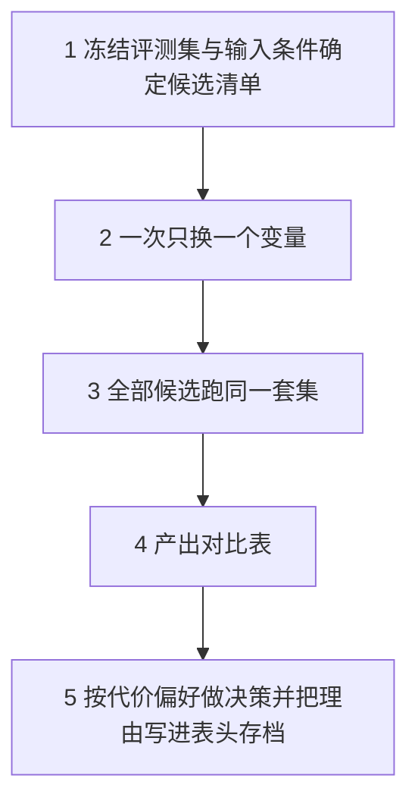
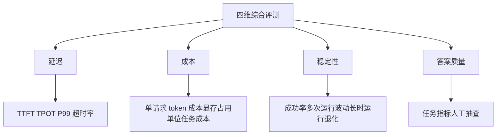

# 模型评测方法

> 选模型不能靠「聊了几句感觉不错」。本篇给出一套可复用的评测流程：**建集 → 定口径 → 判读 → 对比 → 回归**，适用于任何「同一任务、多个候选模型/配置」的选型。与 [RAG-评测与分块策略](AI与大模型/RAG/RAG-评测与分块策略.md) 的分工：那篇评 RAG 链路的检索与生成段，本篇评模型本身在任务上的表现；评测集纪律（样本量、逐题明细、一次只动一个变量）相通。
>
> 本篇只写方法不写结论：「某模型在某任务上更好」必须由这套流程跑出数据才成立，未跑的一律待验证。

## 1. 核心概念

- **评测集**：从真实任务中抽出的固定样本集，每条含输入、期望输出（金标）和元数据（类别、难度、来源）。选型、换量化、改提示词，都在同一套集上回归，分数才可比。
- **标注口径**：判定「什么算对」的成文标准。口径不清，标注就是掷骰子，后面的分数全是噪声。
- **判读**：把模型输出与金标对照出分数的环节。能自动判的先自动判，判不了的才上人工或模型裁判。
- **回归**：评测集长期保留，任何变更（换模型、换量化档位、改提示词、改上下文拼法）后重跑，防止「改好一个任务、改坏另一个」。

评测的产出不是一个总分，而是一张**逐题明细 + 分类别指标**的表，总分只用来扫一眼趋势。

## 2. 评测集怎么建

1. **从真实任务抽样，不凭空编题**。以小说引擎的矛盾检测为例，样本是「章节上下文 + 待检正文」，来源两种：真实章节切片（代表日常分布）和人工埋了已知矛盾的测试章节（矛盾点可控、可定位）。编的题分布不对，就是自欺。
2. **按任务类型配比**。判断类（有没有矛盾）、定位类（矛盾在哪、与哪条已确立事实冲突）、抽取类（提取实体状态变化）各占份额；只测一类，选出的模型会在其他类上翻车。
3. **样本量有底线**。二三十条的指标波动极大，起步不少于 50 条，关键对比拉到 100 条以上再下结论（与 RAG 篇口径一致）；报指标必须带样本量。
4. **配足负样本**。放足量「没有矛盾」的正常章节专门量误报——只放正样本，测不出模型是不是无中生有。
5. **输入条件冻结**。同一轮对比中，提示词模板、上下文拼法、采样参数（选型阶段用低温）对所有候选完全一致；要变就作为单独变量单独测。样本连同冻结条件一起版本化存档，结果才可复现。
6. **金标由人定**。让模型生成「标准答案」再拿去评模型是自问自答；标注时顺手把口径写下来（下一节）。

## 3. 标注口径：先写判读标准，再标样本

口径要细到「另一个人照着标，结果基本一致」。以矛盾检测为例，一条可执行的口径长这样：

- 判「检出」：须同时满足——指出存在矛盾、说清冲突双方（如「正文说苏晚在场」vs「已确立事实：该时段苏晚在外地」）。只说「有问题」不给双方，记未检出。
- 判「定位正确」：冲突双方至少一方与金标事实条目对得上；都对上记全对，只对上一方记半对（折算方式事先写明）。
- 判「误报」：对无矛盾样本输出明确矛盾结论；输出「疑似/建议人工确认」是否算误报，事先约定，不要判读时临时决定。
- 结构性失败单独记：输出不是约定 JSON、字段缺失、解析失败——不算「答错」，单列统计（指向格式合规问题，解法在 [结构化输出与JSON约束](AI与大模型/结构化输出与JSON约束.md)，与判断能力分开看）。

口径写下来还有附带收益：换人标注、或让模型做初筛判读时有据可依。

## 4. 判读方式：从便宜到贵，分层使用

| 方式 | 怎么做 | 适合 | 注意 |
|---|---|---|---|
| 精确/字段级自动判读 | 结构化输出按字段与金标比对（枚举、布尔、ID 列表的交并） | 抽取类、判断类的结论字段 | 前提是输出格式稳定；解析失败按第 3 节单列 |
| 规则判读 | 关键词、正则、数值范围校验 | 含固定标记的输出 | 规则要随口径一起版本化 |
| 模型当裁判（LLM-as-judge） | 用一个较强模型按口径打分/判定 | 开放式文本、定位类说明 | 已知偏差：偏好更长、更像自己风格的答案，对同源模型可能偏袒；只作参考，关键对比要人工抽检复核 |
| 人工判读 | 按口径逐条看 | 口径校准期、裁判结果抽检、争议样本 | 最贵，只用在刀刃上：建集初期全量人工，流程跑顺后降为抽检 |

实操顺序：自动判读跑全量出趋势，再人工抽检一部分（每类约 10 条）核对自动判读与口径是否一致——自动判读本身也要被评测。

## 5. 指标怎么报

- **判断类**：准确率之外，**检出率与误报率分开报**。矛盾检测里两者代价不对称：漏报放过硬伤，误报浪费人工复核；只看总准确率会把两者抵消掉。
- **抽取类**：按字段算查准/查全（多抽了什么、漏抽了什么），逐字段报。
- **定位/说明类**：按口径的全对/半对/错三档分布报。
- **成本维度同等重要**：每条的耗时、输出长度、结构性失败率一并记录。本地选型的现实约束是 [本地部署与Ollama](AI与大模型/本地部署与Ollama.md) 的显存账：分数高一点但慢几倍、装不进显存的模型，对常驻任务就是不可选；指标表没有成本列，选型结论落不了地。
- **逐题明细必须留档**：均值告诉你好不好，明细才告诉你坏在哪类样本上，补样本、改口径都靠它。

## 6. A/B 对比流程（选型时照着跑）

A/B 对比按这五步跑，一次只换一个变量：



1. 冻结评测集与输入条件（第 2 节），确定候选清单（如：现役模型、候选模型、同一模型的不同量化档位）。
2. **一次只换一个变量**：换模型就别同时改提示词；要测提示词改动，固定模型单独跑一轮。两个变量一起换，分数变了不知道是谁的功劳——这是评测的基本纪律（RAG 篇同理）。
3. 全部候选跑同一套集，采样参数一致；生成类任务同一配置可跑两遍看波动，波动大的类别结论要打折。
4. 产出对比表：一行一个候选，列为各类别指标 + 成本列 + 结构性失败率，附逐题明细链接。
5. 按代价偏好做决策并把理由写进表头存档（如「终裁位优先检出率，常驻位优先耗时与合规率」），将来换模型时能直接对照复测，不用重建流程。

落到矛盾检测选型上这套流程直接可用：维度就是检出率/误报率/JSON 合规率/单条耗时。跑出数据之前不预设任何模型胜出——「大模型一定更强」「高量化一定更准」这类直觉都只是待验证假设。


## 四维综合评测框架

前文 §5 讲了每类任务的指标怎么报、§6 讲了 A/B 对比按什么流程跑，本节把散在两节里的维度收成一张框架：一个候选能不能上，只看答案分数不够，要同时看延迟、成本、稳定性、答案质量四维。**A/B 跑的就是这四维，不只跑答案分数**——§6 第 4 步的对比表，每行候选都应有四维的列，缺一维的对比表不算跑完。

### 四维定义与可执行指标

一个候选能不能上，要同时看延迟、成本、稳定性、答案质量四维：



- **延迟：用户等多久**（§5 只记了“每条耗时”，这里拆成四项）：
  - TTFT（首 token 延迟）：从请求发出到第一个 token 输出的时间，决定“点下去多久才开始动”。
  - TPOT（平均每输出 token 间隔）：决定“开始动之后吐得快不快”。
  - P99 延迟：排在后 1% 的慢请求耗时，比平均值更能暴露长尾；交互场景真正要守的是 P99，不是平均。
  - 超时率：超过限定时间仍未完成的请求占比；超时要单独计，不并入平均耗时，否则平均数会把超时藏起来。
  - TTFT/TPOT 与批大小、场景的取舍展开，见 [推理框架对比](AI与大模型/推理框架对比.md)的显存与吞吐一节。
- **成本：跑一个任务花多少资源**（§5 的成本列是起点，这里补成三项）：
  - 单请求 token 成本：输入 + 输出 token 量乘单价（本地部署则按算力占用折算）；只看“输出长度”不够，输入侧的上下文拼法同样烧 token。
  - 显存占用：峰值显存与常驻可行性——装不进显存的模型分数再高也进不了候选清单，账法见 [本地部署与Ollama](AI与大模型/本地部署与Ollama.md)。
  - 单位任务成本：完成一个完整任务（不是一次调用）的总成本；多步 Agent 任务要按任务合计，不能只报单次调用。
- **稳定性：同一配置跑多次、跑久了还稳不稳**（本篇此前没有成维度的稳定性口径）：
  - 成功率：请求正常完成并返回可用输出的比例；结构性失败已在 §3/§5 单列，成功率看的是除此之外的完成情况（超时、崩溃、中断都算失败）。
  - 多次运行波动：同一配置、同一评测集跑两遍以上，看指标波动范围——§6 第 3 步已要求生成类任务跑两遍看波动，本维把它定为必报项；波动大于方案间差异时，结论写“未见显著差异”，不写“微优”。
  - 长时运行退化：连续跑一批任务后，延迟与质量是否下滑（如上下文累积、显存增长导致的越跑越慢）；只跑几条看不出来，回归时要有一轮“长序列”跑法。
- **答案质量：任务本身答得好不好**（沿用 §5，不另起指标）：
  - 任务指标：判断类检出率/误报率、抽取类查准/查全、定位类三档分布，按 §5 口径报；不因为加了三维就把质量维压成一个总分。
  - 人工抽查口径：沿用 §4 的分层判读——自动判读跑全量，人工每类约 10 条抽检核对；抽查发现自动判读与口径不一致，先修口径再谈分数。

### 四维对照表

| 维度 | 核心指标 | 量法要点 | 先看什么 |
|---|---|---|---|
| 延迟 | TTFT、TPOT、P99、超时率 | 与答案同一轮跑出，超时单列 | 交互场景先看 P99 与超时率，批量场景先看平均 TPOT |
| 成本 | 单请求 token 成本、显存占用、单位任务成本 | 按任务合计，不只按调用 | 本地常驻先看显存占用能不能进候选清单 |
| 稳定性 | 成功率、多次运行波动、长时运行退化 | 多跑几遍 + 一轮长序列 | 波动大于差异时结论降级为“未见显著差异” |
| 答案质量 | 任务指标（§5）、人工抽查 | 分类别报，明细留档 | 关键类别先看，平均分后看 |

### 综合判定规则

- **短板否决**：任一维跌破门禁，整体不采纳——答案分最高但 P99 失控、或显存装不进、或成功率不达标，都不能靠其他维度的高分找补。门禁不拍绝对数：以现役方案在同一评测集上的实测为基线，跌破基线波动范围即否决。
- **场景权重**：四维权重按场景定，不搞通用权重。交互场景（聊天、单步工具调用）延迟与稳定性权重高；批量场景（离线生成、评测、长文档摘要）成本与总吞吐权重高，单个请求延迟可放宽。权重写进 §6 第 5 步的决策表头存档，换场景要重定权重，不是沿用旧表。
- **回归门禁**：任何变更（换模型、换量化档位、改提示词、改上下文拼法）上线前，四维与基线各跑一遍对比；任一维显著退化（超出基线波动范围）即拦截，先定位退化原因再谈其他维度的提升。回归只跑答案分，等于没设门禁。
- **决策句式**：四维各一句话（指标、与基线比的方向、是否过门禁）+ 是否采纳 + 理由一句话。单项指标涨但任务指标不涨、或答案涨但延迟/成本显著退化的改动不采纳（与 [RAG-评测与分块策略](AI与大模型/RAG/RAG-评测与分块策略.md)的消融结论口径同理）。

## 7. 污染与泄漏：分数虚高的两个来源

- **训练数据污染**：公开 benchmark 的题目可能已进入候选模型的训练数据，模型是在「背答案」，榜单名次不能直接换算成本地任务表现。这正是要自建私有评测集的原因——自己的章节样本没人提前背过。
- **评测集泄漏到调优环节**：把评测样本写进 few-shot 示例、或照着评测集反复改提示词直到全对，都是变相作弊。对策：调试用一批样本，验收用另一批从未参与调试的，分开保管。
- **裁判泄漏**：用候选之一当裁判评全部候选有同源偏袒风险（第 4 节）；要么用与候选无关的裁判并人工抽检，要么关键类别全人工。

## 8. 常见误区

- 靠公开榜单选本地模型：榜单任务分布与真实任务（中文长篇叙事、矛盾检测）差很远，榜单只作粗筛入围，决赛必须在自己的评测集上跑。
- 只比一个总分：掩盖类别间此消彼长，选出「平均最好、关键类别最差」的模型。
- 样本全是正样本：测不出误报，模型学会「逢检必报」反而分数好看。
- 口径边判边改：中途改口径又不重判旧样本，整轮对比作废。评完删明细只留总分，下次回归无从对比坏在哪。

## 9. 2026-10 新模型速记

本节只记已公开的发布与榜单点位，不作选型结论；分数口径见第 5 节，选型仍以自己的评测集为准。

- Kimi K3.1 Pro（月之暗面，2026-10-24 发布）：总参数 2.8 万亿、单次激活 1040 亿，上下文最高 100 万 token；Terminal-Bench 4.0 得 65.7 分。
- 同榜对照（Terminal-Bench 4.0）：GPT-6 Astra 58.2 分，Claude Opus 5.5 66.4 分。K3.1 Pro 高于前者、接近后者。
- 提醒：这是 2026-10-25 简报转引的公开榜单分，不是本篇评测集上的实测；榜单任务分布与真实任务（中文长篇叙事、矛盾检测）差很远，只作粗筛入围（见第 8 节）。

## 10. 差异显著吗：Wilson 区间与 McNemar 配对检验

§5 讲了指标怎么报，四维框架的稳定性维又定了一条口径：波动大于方案间差异时，结论降级为“未见显著差异”。本节把这条口径落成两个可执行的工具——“分数高几分”不等于“真的更好”，高几分可能是样本量太小带来的噪声。报差异时，分数、样本量、区间或检验结果三者缺一不可。

### Wilson 95% 置信区间：一个分数对应一段范围

准确率是二项比例，样本量有限时点估计（82%）本身就有波动。Wilson 区间把这种波动量化出来，报分数时同时报区间，读者一眼能看出“82%”到底有多稳。公式（z 取 1.96 对应 95% 置信水平）：

$$\hat{p} = \frac{k}{n}, \quad \text{区间} = \frac{\hat{p} + \frac{z^2}{2n} \pm z\sqrt{\frac{\hat{p}(1-\hat{p})}{n} + \frac{z^2}{4n^2}}}{1 + \frac{z^2}{n}}$$

其中 k 为答对条数，n 为样本量。相对正态近似区间，Wilson 区间在小样本或比例接近 0/1 时更稳，是报准确率时的默认选择。

**手算例子**：模型 A 在 100 条上答对 82 条（$\hat{p}=0.82$），模型 B 答对 76 条（$\hat{p}=0.76$）。代入公式（Python 实算）：

- A 的 Wilson 95% 区间：**[0.733, 0.883]**，即真实准确率大概率落在 73.3%～88.3% 之间。
- B 的 Wilson 95% 区间：**[0.668, 0.833]**，即真实准确率大概率落在 66.8%～83.3% 之间。

A 的点估计高 6 个百分点，但两条区间在 0.733～0.833 的大段上重叠。注意：**区间重叠时不能直接判“无差异”，只能说“本样本量下证据不足”**——重叠只是说明现有数据分辨不出两者，真相可能是 A 确实更好、也可能是两者没区别；要分清只能加样本（见本节末尾的实操规则），而不是把“证据不足”写成“两者等价”。反过来，区间完全不重叠时，才有底气说差异超出了抽样噪声。

### McNemar 配对检验：同一批样本上的配对比较

Wilson 区间是给单个模型报不确定性；要直接比较两个模型，用 McNemar 配对检验。它只看“不一致对”：

- b：A 对、B 错的条数；
- c：A 错、B 对的条数。

两个模型都对、都错的条数不进入计算——它们对“谁更好”没有信息量。带连续性校正的统计量（自由度 1）：

$$\chi^2 = \frac{(|b - c| - 1)^2}{b + c}$$

**手算例子**：b = 12、c = 6，即 A 独对 12 条、B 独对 6 条。代入公式：$\chi^2 = (|12-6|-1)^2 / 18 = 25/18 \approx 1.389$。自由度 1 时对应的 p 值（Python 按 $\chi^2$ 分布公式实算）：**p ≈ 0.239**。p > 0.05，差异不显著——虽然 A 独对条数是 B 的两倍，但不一致对一共只有 18 对，样本量撑不起“显著更好”的结论。

**何时该用它**：同一评测集、同一批样本的配对比较，即两个候选在同一套题上逐题对打（§6 的 A/B 对比正是这种情形）。两个模型跑的是不同样本集、或样本无法一一对应，就不能用 McNemar。另外注意：不一致对太少时（如 b + c < 25）检验功效很低，即使真实有差异也很难检出——这时结论同样是“证据不足”，而不是“没有差异”。

### 两条实操规则

1. **报差异必须同时报样本量与区间/检验结果**。只写“A 82%、B 76%，A 更好”是无效结论；完整写法是“A 82%（n=100，Wilson 95% 区间 [0.733, 0.883]）、B 76%（n=100，区间 [0.668, 0.833]），区间重叠，McNemar 检验 p ≈ 0.239，本样本量下未见显著差异”。样本量、区间、检验结果三者缺一不可。
2. **样本量不足时先加样本再下结论**。想分辨 6 个百分点的差距，100 条不够就把关键对比拉到几百条（§2 已要求关键对比 100 条以上起步）；不要靠“多跑一遍取最高分”凑显著——挑最高分是选择性报告，分数虚高、区间失效，跑出来的“显著”只是自欺（与 §7 泄漏、§8 误区的口径同理）。

## 10.1 要多少样本才够：从误差棒反推样本量

§10 给了两个工具：Wilson 区间报单个分数的不确定性，McNemar 检验直接比较两个模型。但两个工具都留了一个实际问题没答：**到底要多少样本，才分得清几个百分点的差距？** 本节把 §10 的公式倒过来用——先定你能接受的误差棒，再反推样本量。结论先说：**分辨 6 个百分点的差距，100 条远远不够；想把单个分数的误差棒压到 ±3 个百分点，p=0.8 时约需 683 条**。样本量不是越多越好，而是先算再采。

### 误差棒随样本量怎么缩：p=0.8 时的 Wilson 半宽

固定真实准确率 p=0.8（即每 100 条答对 80 条的水平），95% Wilson 区间的半宽（区间上下限到中心点的距离）随样本量 n 的变化（Python 实算，复算代码见本节末尾）：

| 样本量 n | Wilson 95% 区间 | 半宽 | 全宽 |
| --- | --- | --- | --- |
| 50 | [0.670, 0.888] | 10.90pp | 21.79pp |
| 100 | [0.711, 0.867] | 7.77pp | 15.55pp |
| 200 | [0.739, 0.850] | 5.52pp | 11.04pp |
| 500 | [0.763, 0.833] | 3.50pp | 7.00pp |
| 1000 | [0.774, 0.824] | 2.48pp | 4.95pp |

三点读法：

- **半宽大约按 $1/\sqrt{n}$ 缩**：n 从 50 翻两番到 200，半宽从 10.90pp 降到 5.52pp，约减半；n 再翻两番到 1000，半宽降到 2.48pp。再往上加样本，收益递减得很快——从 500 加到 1000 条，半宽只少了约 1pp。
- **100 条的误差棒是 ±7.77pp**：§10 里 A 82%、B 76% 的 6pp 差距，掉进这个误差棒里是毫不奇怪的事。这就是 §10 手算例里两条区间大段重叠的数值原因。
- **即使 1000 条，单个分数仍有 ±2.48pp 的晃动**：所以"1000 条就够精确"的直觉也是错的；要不要继续加样本，取决于你要分辨的差距有多小（下一小节）。

### 反推公式：给定误差棒 E，需要多少样本

Wilson 区间没有"解出 n"的闭式反推，实务上先用正态近似（Wald）口径估算，再用 Wilson 口径校验。反推公式是对误差棒公式 $E = z\sqrt{p(1-p)/n}$ 移项：

$$n \approx \frac{z^2 \cdot p(1-p)}{E^2}$$

其中 z=1.96 对应 95% 置信水平，E 是目标半宽（以小数计，如 5% 记 0.05），p 是事前估计的准确率。**注意：这是正态近似口径**，它假设抽样分布近似正态；Wilson 口径的精确值见下表后的校验注。Python 实算（E 取 5%/3%/1% 三档）：

| 目标半宽 E | p=0.8 所需 n | p=0.5 所需 n |
| --- | --- | --- |
| ±5pp | 246 | 385 |
| ±3pp | 683 | 1068 |
| ±1pp | 6147 | 9604 |

读法：

- **E 减半，n 约翻四倍**：因为 n 与 $1/E^2$ 成正比。±5pp 到 ±3pp，n 从 246 涨到 683；±3pp 到 ±1pp，n 从 683 涨到 6147。想要 ±1pp 的精度，样本量直接上六千条——人工标注为主的评测集基本做不到，这就是"±1pp 级别的榜单差距不值得追"的数量级依据。
- **p=0.5 是最保守的规划值**：p(1−p) 在 p=0.5 时取最大值 0.25，所需 n 最大。事前不知道模型大概多少分时，按 p=0.5 规划样本量；已有先验（如预期 80% 左右）时，可按 p=0.8 一档规划，能省约三分之一的样本。
- **与 §2 的口径衔接**：§2 要求"起步不少于 50 条，关键对比 100 条以上"，对照上表只是底线——50 条的半宽是 ±10.90pp，只能分出 20pp 以上的悬殊差距；100 条 ±7.77pp，分 6pp 的差距仍不够。关键对比真正要的量级是几百条。

**Wilson 口径校验（Python 二分搜索实算）**：直接求"Wilson 半宽 ≤ E 的最小 n"，p=0.8 时为 245/682/6145 条，p=0.5 时为 381/1064/9601 条。**与正态近似几乎相同（只少 1~4 条），而不是更大**——在本篇的 p 取值范围（0.5~0.8）内，正态近似没有低估不确定性，可以放心用上表规划。Wilson 口径需要更大 n 的情形出现在比例接近 0 或 1 的极端处（例如检出率 98% 以上），那里正态近似会失真，须直接用 Wilson 口径求解（见边界条件第 4 条）。

### McNemar 视角：分辨 6pp 差距需要多少不一致对

上面的 n 回答的是"单个分数报多准"，比较两个模型还要看配对结构。McNemar 检验只用不一致对 m=b+c（见 §10），所以真正决定功效的是 m，不是总样本 N。设要分辨的真实差距为 d=6pp（以总样本计），不一致对占总样本的比例为 r=m/N，要求 80% 功效（即真实有差异时有 80% 的概率检出，z 取 1.96+0.84=2.80），量级估算公式为：

$$m \gtrsim \left(\frac{2.80 \cdot r}{d}\right)^2$$

代入 d=0.06（Python 实算）：

| 不一致对占比 r | 所需不一致对 m（80% 功效） | 对应总样本 N ≈ m/r |
| --- | --- | --- |
| 10% | 约 22 对 | 约 220 条 |
| 18%（§10 手算例的比例） | 约 71 对 | 约 395 条 |
| 25% | 约 137 对 | 约 548 条 |

用 §10 的手算例验算：b=12、c=6，m=18、r=18%。按 2:1 的比例把不一致对等比放大，χ² 的变化是：m=36（b=24、c=12）时 χ²=3.36，仍不显著；m=45（b=30、c=15）时 χ²=4.36，刚过 3.84 的显著门槛；要达到 80% 功效则需 m≈71 对（按 2:1 比例取整即 b=48、c=24，共 72 对），此时 χ²=7.35。也就是说，§10 那组 18 对不一致对，离"分清 6pp 差距"还差约 4 倍。

**为什么"不一致对太少时，加总样本也没用"**：McNemar 的统计量 χ²=(|b−c|−1)²/(b+c) 里只有 b 和 c，两个模型都对、都错的条数根本不进公式。加进来的样本如果大多是两个模型都答对的简单题，b、c、m 全都不变，χ² 纹丝不动，p 值也纹丝不动——总样本从 100 加到 1000，结论还是"证据不足"。只有加进**能让两个模型产生分歧的样本**（难例、边界例、口径模糊的样本）时，m 才会涨，检验才有机会显著。反过来说，两个模型越相似（r 越小），分辨它们所需的总样本反而越大：r=10% 时 m 只要约 22 对，但那 22 对要从约 220 条里"等"出来；如果新增样本全是简单题，m 不涨，220 条这个数就永远够不着。**加样本要加在分歧上，不是加在总量上**。

### 边界条件

1. **公式假设独立同分布抽样**：n 条样本须相互独立、来自同一分布。同一章节切片换个问法重复采样、或样本集中来自同一批高度相似的章节，独立性不成立，有效样本量小于名义 n，上面所有 n 都要打折。先保证样本多样性，再谈样本量。
2. **反推公式里的 p 是规划值，不是实测值**：用事前估计的 p 代入公式，跑完之后实测 p 不同，实际半宽也会不同。不知道 p 时按 p=0.5（最保守）规划；事后复核时用实测 p̂ 重新算一遍 Wilson 区间，不要拿规划时的 n 反推"精度达标了"。
3. **pass@k、多轮平均的样本量口径不同**：pass@k 是"同一题采样 k 次、至少一次答对"的概率，k 是每题的采样次数、不是评测集的题数，不能把 k 套进本节的 n 里；多轮平均（同一批题跑多遍取平均）降的是估计方差，但题间相关性没变，等效样本量不是 n×k。换口径时先说清 n 指的是题数还是采样次数。
4. **小样本与极端比例下正态近似失真**：n<30、或 p 接近 0/1（如检出率 98% 以上、误报率 1% 以下）时，正态近似的区间会失真（甚至给出超过 [0,1] 的界），此时反推公式只能作粗估，须直接用 Wilson 口径数值求解最小 n。本节的校验注只覆盖 p=0.5~0.8 的情形。
5. **置信水平换了，n 跟着变**：本节全部按 95%（z=1.96）算。改报 99% 区间（z=2.576）时，n 约为 95% 时的 1.73 倍（(2.576/1.96)²≈1.73）；只报 90%（z=1.645）时，n 约为 95% 时的 0.70 倍。报 n 时必须同时报置信水平，否则数字没法比较。
6. **单个分数的误差棒不等于比较两个模型的分辨能力**：把单个分数的半宽压到 ±3pp，不等于能分辨 6pp 的模型差距——后者还要看配对结构与不一致对的数量（上一小节）。规划样本量时先问清目标：是"报准一个分数"还是"分清两个模型"，两者要的 n 不一样。

来源：Wilson 区间公式与样本量公式 n=z²·p(1−p)/E² 的标准表述，已用 browser.search 核对（Wilson score interval 公式：(p̂ + z²/2n ± z·√(p̂(1−p̂)/n + z²/4n²))/(1 + z²/n)；样本量公式：n=z²·p(1−p)/E²，p=0.5 时 ±5pp 需 385、±3pp 需 1068，与本节实算一致；来源：globalcalcs.com Wilson Score Interval 计算器页、proportionscalculator.com《What Is a Proportion in Statistics?》、bellstatistics.com Proportion CI 计算器页；核验日期 2026-11-28）。McNemar 功效估算式 m≳((z_α+z_β)·r/d)² 由 §10 的 χ² 统计量与标准功效分析推导，属近似口径（未计连续性校正，数量级正确、个位数不保证）。本节全部数字均为 Python 实算，无外部基准测试数据。

### 复算口径（Python，可直接运行复现本节全部数字）

```python
import math

z = 1.96  # 95% 置信水平


def wilson(p_hat, n, z=1.96):
    """Wilson 95% 区间，返回 (下限, 上限, 半宽)。"""
    denom = 1 + z ** 2 / n
    center = (p_hat + z ** 2 / (2 * n)) / denom
    half = z * math.sqrt(p_hat * (1 - p_hat) / n + z ** 2 / (4 * n ** 2)) / denom
    return center - half, center + half, half


def n_normal(p, E, z=1.96):
    """正态近似口径：目标半宽 E 时所需样本量（向上取整）。"""
    return math.ceil(z ** 2 * p * (1 - p) / E ** 2)


def n_wilson(p, E, z=1.96):
    """Wilson 口径：半宽 <= E 的最小 n（二分搜索）。"""
    lo, hi = 1, 100000
    while lo < hi:
        mid = (lo + hi) // 2
        if wilson(p, mid, z)[2] <= E:
            hi = mid
        else:
            lo = mid + 1
    return lo


def mcnemar_chi2(b, c):
    """带连续性校正的 McNemar 统计量（自由度 1）。"""
    return (abs(b - c) - 1) ** 2 / (b + c)


# 表 1：p=0.8 时 Wilson 半宽随 n 的变化
for n in [50, 100, 200, 500, 1000]:
    lo, hi, half = wilson(0.8, n)
    print(f"n={n}: [{lo:.3f}, {hi:.3f}] 半宽={half * 100:.2f}pp")

# 表 2：反推样本量（正态近似口径）
for p in [0.8, 0.5]:
    for E in [0.05, 0.03, 0.01]:
        print(f"p={p}, E={E * 100:.0f}%: 正态近似 n={n_normal(p, E)}, "
              f"Wilson 口径 n={n_wilson(p, E)}")

# McNemar：分辨 6pp 差距所需不一致对（80% 功效，z=1.96+0.84=2.80）
d = 0.06
for r in [0.10, 0.18, 0.25]:
    m = math.ceil((2.80 * r / d) ** 2)
    print(f"r={r * 100:.0f}%: m 约 {m} 对, 对应总样本约 {math.ceil(m / r)} 条")

# §10 手算例按比例放大
for b, c in [(12, 6), (24, 12), (30, 15), (48, 24)]:
    print(f"b={b}, c={c}, m={b + c}: chi2={mcnemar_chi2(b, c):.2f}")
```

## 小技巧与冷知识

【小技巧】全量开跑之前，先拿 5–10 条样本把整条判读流水线跑通：格式解析、字段比对、裁判调用、分数落表都走一遍。格式不对、字段缺失、解析失败这类问题在小样本上几分钟就暴露，等 100 条全跑完才发现判读本身坏了，等于白烧一轮；流水线跑通后再谈样本量和指标。

【小技巧】"疑似/建议人工确认"这类模棱两可的输出单独建一档"待人工"，既不算检出也不算误报。原文只约定了它是否算误报要事先说好，更进一步的做法是三档分开记：模棱两可的输出并进对错任何一档，都会把检出率或误报率人为地压低或抬高，类别指标就失真了；"待人工"单独一档，复核时也有明确的清单可查。

【冷知识】裁判模型偏爱长答案：Zheng 等人 2023 年的论文《Judging LLM-as-a-Judge with MT-Bench and Chatbot Arena》（arXiv:2306.05685）用"重复列表"攻击验证过——把同一份列表啰嗦地重说一遍、不加任何新信息，裁判仍会给更长的版本更高分。判定位类说明时，先把候选输出截到同等长度再判，或在口径里写明"按信息点计分、不按篇幅计分"，否则分数量的是篇幅不是定位能力。

【小技巧】跑 A/B 对比时把候选交错着跑，别一个跑完再跑下一个：同一时段内服务负载、缓存状态不同，会给先跑的候选和后跑的候选带来系统性偏差。同一批样本轮流发给各候选，时段效应就被摊平了；原文只要求采样参数一致，跑的顺序本身也是一个要控制的变量。

【冷知识】指标一旦变成优化目标，就不再是好指标：这是古德哈特定律（Goodhart's law）。把评测集分数当 KPI 压，提示词和模型会朝着分数优化，而不是朝着任务本身优化——这正是原文第 7 节泄漏的深层原因：照着评测集反复改提示改到全对，分数量的就不再是模型能力，而是调参的手艺；验收集与调试集分开保管，就是给这条定律留的刹车。

【小技巧】长时退化测试里每隔 20 条插一条"锚点样本"：锚点是已知答案的固定题，难度不变、答案不变。跑久了锚点分数下滑，说明退化与样本难度无关，是系统本身在衰减（上下文累积、显存增长）；锚点稳但后段分数掉，问题更可能在样本分布或长上下文处理上。没有锚点，退化原因只能靠猜。

【冷知识】标注一致性本身也要先测再开标：口径写得再细，两个人标同一批样本仍可能分歧很大。先让两人独立标同一批 20 条，算一致率（如 Cohen's kappa），一致率低说明口径本身有歧义——先修口径再开标，否则金标里的噪声会直接变成分数里的噪声，之后再怎么调模型都救不回来。

【小技巧】结构性失败率单独画一张趋势图，别只记在指标表里：JSON 解析失败率突然上升，先查最近的变更记录（提示词、模型版本、量化档位），而不是先怀疑模型能力变差。格式问题多半是变更带来的，能力问题才体现在判断类指标上；趋势图能一眼看出失败率的跳变点对应哪次变更，定位比翻逐题明细快得多。

【小技巧】定样本量之前先反推一次：拿本篇 §10.1 的公式算一算——p=0.8 时想把误差棒压到 ±3pp 要 683 条，±5pp 只要 246 条。先定你要分辨的差距，再定样本量；反过来，先定了 100 条的预算，就要接受 ±7.77pp 的误差棒、写结论时只敢说 15pp 以上的差距。样本量是预算问题，不是越多越好，算过再采才不浪费标注人力。
## 面试与自测

1. 为什么评测的产出不能只是一个总分？只比总分会选出什么样的模型？
2. 换模型的同时又改了提示词，为什么这轮对比作废？正确的做法是什么？
3. 四维综合评测框架里，什么情况下即使答案分最高也不能采纳？门禁怎么定？

4. 模型 A 82%、模型 B 76%，两者的 Wilson 95% 区间重叠，这时能判“两者无差异”吗？McNemar 配对检验适用于什么场景？

5. 模型 A 82%、模型 B 76%，你想确认 A 真的比 B 好 6 个百分点，评测集要多少条？为什么光加总样本不一定有用？

### 参考答案

1. 评测的产出不是一个总分，而是一张逐题明细 + 分类别指标的表，总分只用来扫一眼趋势。只比一个总分会掩盖类别间此消彼长，选出“平均最好、关键类别最差”的模型；均值告诉你好不好，明细才告诉你坏在哪类样本上，补样本、改口径都靠它。
2. 两个变量一起换，分数变了不知道是谁的功劳，这是评测的基本纪律。正确做法是一次只换一个变量：换模型就别同时改提示词；要测提示词改动，固定模型单独跑一轮。
3. 短板否决：任一维跌破门禁，整体不采纳——答案分最高但 P99 失控、或显存装不进、或成功率不达标，都不能靠其他维度的高分找补。门禁不拍绝对数，以现役方案在同一评测集上的实测为基线，跌破基线波动范围即否决。

4. 不能。区间重叠只能说“本样本量下证据不足”，不能判“无差异”——真相可能是 A 确实更好、也可能是两者没区别，要分清只能加样本，而不是把“证据不足”写成“两者等价”。McNemar 配对检验适用于同一评测集、同一批样本的配对比较：它只看不一致对（A 对 B 错、A 错 B 对），统计量 χ² = (|b − c| − 1)² / (b + c)，自由度 1；两个模型跑不同样本集、或样本无法一一对应时不能用。

5. 分两层算。单个分数的精度：p=0.8 时 100 条的 Wilson 半宽是 ±7.77pp，6pp 的差距掉进误差棒里；按 n≈z²·p(1−p)/E² 反推，±3pp 要约 683 条（p=0.5 保守规划要 1068 条）。比较两个模型还要看配对结构：McNemar 检验只用不一致对 m=b+c，80% 功效下分辨 6pp 差距约需 71 对不一致对（按 §10 手算例 18% 的不一致占比，约合 395 条总样本）。光加总样本不一定有用，因为 χ²=(|b−c|−1)²/(b+c) 里只有 b、c——加进来的样本如果都是两模型都答对的简单题，b、c、m 全都不变，检验结果纹丝不动；加样本要加在能产生分歧的难例、边界例上。

## 11. 关联知识

- [RAG-评测与分块策略](AI与大模型/RAG/RAG-评测与分块策略.md)：RAG 链路的评测（检索段/生成段指标、golden set 建法），与本篇互为补充
- [本地部署与Ollama](AI与大模型/本地部署与Ollama.md)：候选模型的显存/上下文账，决定谁有资格进候选清单
- [结构化输出与JSON约束](AI与大模型/结构化输出与JSON约束.md)：结构性失败的成因与解法，本篇只负责把它单独计数
- [大模型基础](AI与大模型/大模型基础.md)：采样参数、上下文等基础概念
- [小说创作引擎](项目沉淀/小说创作引擎.md)：矛盾检测任务的来源场景，本篇流程的首个落地对象（实测数据待回填）
