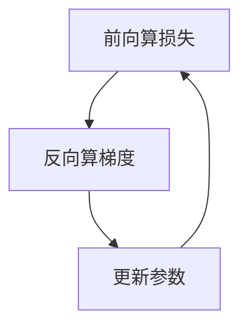
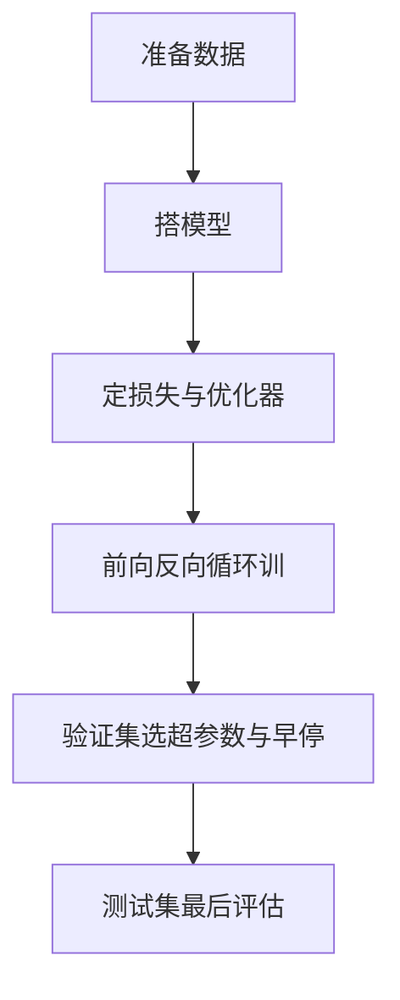

# 深度学习基础

> 大模型就是深度学习堆到极致的产物：这篇讲它底下那套通用机制，读完再看 Transformer 和微调，就知道它们在解决什么。

## 神经网络基本结构

- 神经元：做一次“加权求和再过一个非线性函数”，即 y = f(w·x + b)；w 是权重，b 是偏置，f 是激活函数。
- 层：大量神经元排成一层，前一层的输出是后一层的输入；输入层接数据，输出层给结果，中间都叫隐藏层。
- 深度：隐藏层越多，网络越“深”，能组合出的特征越抽象；浅层学边缘纹理，深层学物体语义，这是深度学习名字的来源。
- 全连接层：上一层每个神经元都连到下一层每个神经元，参数量大，小网络和分类头常用；大模型里已被注意力层接管了大部分活。

## 前向与反向传播

- 前向传播：数据从输入层一路算到输出层，得到预测值；推理时只有这一步。
- 损失：预测值与真实答案的差距，用一个数表示（见下节损失函数）。
- 反向传播：从损失出发，用链式法则把“每个参数对损失的责任”逐层往回算，得到每个参数的梯度；本质是高效的求导流水线，不是玄学。
- 参数更新：按梯度方向挪参数，让损失变小；挪多大由学习率定。训练就是“前向算损失、反向算梯度、更新参数”循环成千上万次。

训练就是前向、反向、更新三步循环成千上万次：


- 一句话：前向是做题，反向是复盘错在哪，更新是改错题本。

## 激活函数

- 没有非线性激活，多层网络叠加起来等价于一层线性变换，深了也白深；激活函数就是那个“非线性”。
- Sigmoid：把数值压到 0–1，像概率；缺点是两端梯度接近 0，深层网络容易梯度消失，现多用于输出层二分类。
- Tanh：压到 -1–1，以 0 为中心，比 Sigmoid 好一点，同样有饱和问题。
- ReLU：max(0, x)，正数原样通过、负数归零；计算便宜、缓解梯度消失，是很长一段时间内的默认选择；缺点是神经元可能“死掉”（恒输出 0）。
- GELU / Swish：ReLU 的平滑版，Transformer 里常见；直觉是“小幅负值也留一点活路”，效果通常略好。
- 选型经验：隐藏层默认 ReLU 或 GELU，别在隐藏层用 Sigmoid；输出层按任务定（二分类 Sigmoid、多分类 Softmax、回归不激活）。

## 损失函数与优化器

- 损失函数按任务选：回归常用 MSE（均方误差，大误差惩罚更重）；二分类常用交叉熵；多分类用 Softmax + 交叉熵。
- 梯度下降：参数 -= 学习率 × 梯度；学习率太大震荡发散，太小训不动。
- SGD：每次用一小批样本（mini-batch）估梯度再更新；带噪声反而有助于跳出浅的局部最优，省显存、跑得快。
- Adam：给每个参数自适应学习率（结合动量 + 梯度平方的滑动平均），开箱即用、收敛快，是目前最常用的默认优化器；代价是后期泛化有时略逊于调好的 SGD。
- 学习率调度：训练后期把学习率调小（如余弦衰减），前期大步探索、后期小步收敛，是训大模型的标配。
- 梯度消失与爆炸：链式连乘会让梯度逐层缩小到 0 或放大到无穷；残差连接、归一化、合适的初始化就是为了解决它。

## 正则化

- 目标：压住过拟合，让模型在新数据上也好使（过拟合见 [AI与大模型/机器学习基础.md](AI与大模型/机器学习基础.md)）。
- 权重衰减（L2 正则）：损失里加一项“权重平方和”，逼权重别长太大；等价于告诉模型“别太相信任何一个特征”。
- Dropout：训练时随机“关掉”一部分神经元，逼网络不依赖个别神经元；推理时全开并按比例缩放。简单有效，几乎零成本。
- 早停：验证集分数不再提升就停训；既是正则化，也是省算力的办法。
- 数据增强：对训练数据做变换（图像翻转裁剪、文本同义替换），等于变相加数据；大模型时代对应的是 SFT 数据配比与去重。
- 注意：正则化是“刹车”，不是“油门”；模型欠拟合时加正则只会更差，先确认是过拟合再上。

## CNN、RNN、Transformer 一句话定位

- CNN（卷积神经网络）：用卷积核扫局部区域，专治图像——平移不变、参数共享，图像分类、检测的老底子。
- RNN（循环神经网络）：按顺序一步步处理，前一步的状态传给后一步，专治序列；缺点是长序列梯度消失、无法并行，基本已被 Transformer 取代。
- Transformer：用自注意力一次性看全句，谁跟谁相关当场算出来；可并行、能堆很深，是当下大模型的骨架，细节见 [AI与大模型/大模型基础.md](AI与大模型/大模型基础.md)。
- 演进线：CNN 管空间局部、RNN 管时间顺序、Transformer 管全局关系；大模型选 Transformer，是因为它同时解决了并行训练和长程依赖。

## 反向传播手算与参数量定量

- 一句话：反向传播不是玄学，是链式法则的流水线；下面用一个 9 参数小网络把每个数字都算出来，再把同一套算术放大到 8B 模型。

### 微型网络手算：2 输入 → 2 隐藏 → 1 输出

- 结构：输入 x = [0.5, 0.3]；隐藏层 2 个神经元，全用 Sigmoid；输出 1 个神经元，Sigmoid；损失 L = ½(ŷ − y)²，目标 y = 1.0；学习率 0.5。
- 参数：W1 = [[0.4, −0.2], [0.3, 0.5]]，b1 = [0.1, −0.1]，W2 = [0.6, −0.4]，b2 = 0.2。

**前向：**

- z1 = [0.24, 0.20]，a1 = [0.5597, 0.5498]；z2 = 0.3159，ŷ = 0.5783；损失 L = 0.0889。

**反向（链式法则，Sigmoid 导数 σ′ = σ(1 − σ)）：**

- 输出层误差信号 δ2 = (ŷ − y)·ŷ(1 − ŷ) = −0.1028。
- 隐藏层误差信号 δ1 = [−0.0152, +0.0102]（δ2 沿 W2 传回，再乘各隐藏神经元的 Sigmoid 导数）。
- 梯度：∂L/∂W2 = [−0.0576, −0.0565]，∂L/∂b2 = −0.1028；∂L/∂W1 = [[−0.0076, −0.0046], [0.0051, 0.0031]]，∂L/∂b1 = [−0.0152, 0.0102]。
- 规律：越靠近输出，梯度越大；传回隐藏层要再乘一轮权重和激活导数，所以数值逐层缩小——梯度消失就是这个连乘的放大版。

**一次 SGD 更新（学习率 0.5）：**

- W1 新 = [[0.4038, −0.1977], [0.2975, 0.4985]]，b1 新 = [0.1076, −0.1051]；W2 新 = [0.6288, −0.3717]，b2 新 = 0.2514。
- 更新后 ŷ 从 0.5783 升到 0.5990，损失 0.0889 → 0.0804，下降 0.0085：只走一步、只降一点，训练就是把这一步重复成千上万次。
- 验算：数值微分（中心差分）与解析梯度逐项对比，9 个参数最大误差 1.54e-12，说明上面手推的链式求导没错；做法见本节小技巧。

### 参数量：12·L·d² 近似公式

- 公式：N ≈ 12·L·d²（L 是层数，d 是隐藏维度）。口径：每层 4d² 注意力（Q/K/V/O 各 d²）+ 8d² MLP（两块 d×4d），忽略 embedding、偏置、Norm；只适用于经典结构（FFN 4d、标准多头注意力）的量级估算。
- Qwen3-8B 实算：L = 36，d = 4096，公式给 12×36×4096² ≈ 7.25B；逐项实算非 embedding 部分是 6.95B（注意力 1.51B + MLP 5.44B：GQA 压小了 K/V、SwiGLU 三矩阵拉大了 MLP），公式法高估约 4.3%；再加两份 embedding（词表 151936×4096×2）1.24B，合计 8.19B，与官方参数量 8,190,735,360 一致。
- 结论：公式给的是量级不是精确值，差 5% 以内正常；大词表模型的 embedding 占约 15%，不能忽略。

### 训练 FLOPs：C ≈ 6·N·D

- 前向约 2ND（每个参数每次前向约 2 次浮点运算：一次乘、一次加），反向约 4ND（对激活和参数各求一次导），合计 6ND；出处是 Chinchilla（Hoffmann et al. 2022）。
- Qwen3-8B：N = 8.19B，D = 36T tokens，C ≈ 6×8.19×10⁹×36×10¹² ≈ 1.77×10²⁴ FLOPs（按 8B 计约 1.7×10²⁴）。
- 对照 Chinchilla 最优配比约 20 tokens/参数：8.19B 模型最优约 164B tokens；36T 相当于约 4396 tokens/参数，超配约 220 倍。Chinchilla 最优是“训练算力最优”，实际模型为摊薄推理成本会大幅超配，这是取舍，不是错误。

### 7B 模型 bf16 混合精度显存分项

- 口径：bf16 参数与梯度各 2 字节/参数；Adam 状态按正文口径计（m、v 各 2 字节），与正文「Adam 28GB」一致。
- 分项（7B）：参数 14GB + 梯度 14GB + Adam 状态 28GB = 模型态 56GB，激活另计。
- 激活示例（Llama-2-7B 形态：32 层、hidden 4096、batch 1、序列 4096，用 FlashAttention）：每层约 34·B·S·H 字节，合计约 18.3GB；整机约 74.3GB。不用 FlashAttention 时注意力分数矩阵另加约 85.9GB，激活涨到约 104.2GB。
- 严格记账对照：Adam 动量若按 fp32 存（m、v 各 4 字节）为 56GB，另加 fp32 主权重 28GB，模型态合计 16 字节/参数 ≈ 112GB。正文的 28GB 是 bf16 口径的简化记账，两种口径差在动量与主权重的精度，不冲突。
- 结论：一块 80GB 显存训 7B 全参数，bf16 口径下模型态加激活约 74.3GB、勉强能塞；fp32 严格口径下模型态 alone 就 112GB，必须分片。所以 7B 全参数训练通常要多卡并行或 ZeRO 分片，单卡只够推理或 LoRA。

### 边界条件

1. 手算例的全部数值只适用于该微型网络：换一组权重、换 ReLU、换损失函数，梯度数值全变；方法是通用的，数字不是。
2. 6ND 不含 attention 的序列长度二次项：短序列（4K）下约占 4.9%，可忽略；32K 长序列下可达约 39.3%，公式会明显低估，长序列还要另算 KV 显存。
3. 显存分项不含显存碎片、框架缓存（PyTorch caching allocator 预留）、通信 buffer 与临时张量：实测常比估算高 10%–20%，按估算卡着显存上限排任务会爆。

#### 复算口径

```python
# Python 3 本地复算（2026-11-24）：微型网络手算 + 参数量 / FLOPs / 显存
import math
def sigmoid(z): return 1.0 / (1.0 + math.exp(-z))
x = [0.5, 0.3]; W1 = [[0.4, -0.2], [0.3, 0.5]]; b1 = [0.1, -0.1]
W2 = [0.6, -0.4]; b2 = 0.2; y = 1.0
z1 = [W1[j][0]*x[0] + W1[j][1]*x[1] + b1[j] for j in range(2)]
a1 = [sigmoid(z) for z in z1]
y_hat = sigmoid(W2[0]*a1[0] + W2[1]*a1[1] + b2)
print(round(y_hat, 4), round(0.5*(y_hat-y)**2, 4)) # 0.5783 0.0889
d2 = (y_hat-y)*y_hat*(1-y_hat)
print(round(d2, 4)) # -0.1028
print([round(d2*W2[j]*a1[j]*(1-a1[j]), 4) for j in range(2)]) # [-0.0152, 0.0102]
print(round(12*36*4096**2/1e9, 3)) # 7.248
print(6*8.19e9*36e12) # 1.769e+24
print(7e9*2/1e9, 7e9*2*2/1e9) # 14.0 28.0
print(round(34*1*4096*4096*32/1e9, 1)) # 18.3
# 完整版（含梯度数值检查 9 参数最大误差 1.54e-12、逐项参数量实算）见夜任务记录
```

#### 来源与核验说明（核验日期 2026-11-24）

- 已验证事实：Qwen3-8B 配置（36 层、hidden 4096、intermediate 12288、词表 151936、参数量 8,190,735,360），来源 Qwen/Qwen3-8B 官方 config.json（Hugging Face 模型卡，2026-11-24 复核），逐项加总 8.191B 与官方值一致；另见 https://milankacar.github.io/ai/software%20engineering/blog127_qwen3-8b-architecture/
- 已验证事实：训练 FLOPs 公式 C ≈ 6ND（前向 2ND + 反向 4ND），来源 Hoffmann et al. 2022《Training Compute-Optimal Large Language Models》（Chinchilla），arXiv:2203.15556。
- 已验证事实：参数量公式 12·L·d²（非 embedding 部分近似：每层 4d² 注意力 + 8d² MLP，另加 2·vocab·d 的 embedding），来源 https://www.hsmuniversity.org/us/course/ai-480-distributed-training-and-ai-hardware/lesson-5-memory-parameters-optimizer-state-and-activations
- 已验证事实：Qwen3 预训练 36T tokens，来源 Qwen3 Technical Report（arXiv:2505.09388），“pre-trained on 36 trillion tokens”。
- 已验证事实：Adam 混合精度 16 字节/参数（bf16 参数 2 + 梯度 2 + fp32 主权重 4 + m/v 各 4），来源同上 hsmuniversity 课程；正文「Adam 28GB」是 bf16 口径简化记账（m、v 各 2 字节），两种口径已在正文中对照说明，不冲突。
- 已验证事实：激活每层约 34·B·S·H 字节（FlashAttention 下）、不用 FlashAttention 时每层另加 5·A·S² 字节，来源 Korthikanti et al. 2022《Reducing Activation Recomputation in Large Transformer Models》的逐层记账方法。
- 个人推断：“36T tokens 相对 Chinchilla 最优超配约 220 倍”是算术推论（4396 ÷ 20）；其解释（为摊薄推理成本而超配）是行业共识性推断，非论文原话；激活 18.3GB、整机 74.3GB 是在给定假设下的估算，非实测；“实测常比估算高 10%–20%”是工程经验值。

## 训练流程与算力直觉

- 标准流程：准备数据（清洗、切分、编码）→ 搭模型 → 定损失与优化器 → 前向/反向循环训 → 验证集选超参数与早停 → 测试集最后评估。

标准训练流程是这六步：


- 算力直觉：训练成本 ≈ 参数量 × 数据量 × 常数；参数翻倍、数据翻倍，成本都跟着翻倍，这就是大模型烧钱的算术来源。
- 显存直觉：参数本身 + 梯度 + 优化器状态（Adam 要存两份动量，约等于参数量的 2 倍）+ 激活值；Adam 训 7B 模型，单靠参数 14GB 远远不够，优化器状态就要再吃 28GB 起。
- 推理与训练的区别：推理只做前向、不存梯度、不用优化器，所以推理便宜得多；微调卡在中间，只训小部分参数就能省大头，见 [AI与大模型/微调入门-LoRA.md](AI与大模型/微调入门-LoRA.md)。
- 训不动时先查三处：学习率是不是离谱、数据有没有泄漏或标签错、损失是不是一开始就不降；三处都没问题再怀疑模型结构。

## 小技巧与冷知识

【小技巧】梯度爆炸先裁剪、别先降学习率：反向传播里梯度是逐层连乘的，某一步梯度突然飙到几百上千，整个更新就被它带偏了。做法是在更新前把梯度向量的范数截到一个上限（常见做法是按全局范数裁剪到 1.0 左右），超过就按比例缩小，方向不变、幅度受控。原文只说链式连乘会让梯度放大到无穷，裁剪就是最直接的急救措施，训大模型时基本是标配。

【小技巧】学习率别一上来就拉满，先热身再衰减：训练开始时权重还是随机状态，大步更新很容易把刚起步的模型推歪。先用较小的学习率跑几百步热身（warmup），再升到目标值，最后按余弦衰减慢慢收尾。原文只讲了后期用余弦衰减，热身补的是另一头——开头稳住了，后面衰减才有意义。

【小技巧】权重初始化别全零，也别凭感觉乱设：全零初始化会让同一层的神经元永远学到一模一样的东西（对称性破不了），必须用随机初始化打破对称。ReLU 网络常用 He 初始化（按输入维度缩放方差），Sigmoid/Tanh 网络常用 Xavier 初始化，初始化和激活函数要配对选，错配等于一开始就让一半神经元处在饱和区。

【小技巧】推理前记得切到评估模式，不然 BatchNorm 和 Dropout 还在按训练时的行为跑：BatchNorm 训练时用当前 batch 的均值方差，推理时要用训练中攒下的全局统计量；Dropout 训练时随机关闭神经元，推理时要全开。忘了切模式，验证集分数和线上表现会莫名其妙对不上，查半天模型其实没问题，问题在模式开关上。

【小技巧】ReLU 神经元“死掉”是可以监控的：训练中统计每层有多少神经元在所有样本上输出恒为 0，比例持续升高就是死神经元在扩散。发现得早可以调小学习率或换成 Leaky ReLU、GELU 这类留一点负值活路的激活函数；等到整层都死了再换，前面训的就白费了。

【冷知识】反向传播不是 1986 年才被发明的，但 1986 年才真正出圈：Rumelhart、Hinton 和 Williams 当年 10 月在 Nature 上发表《Learning representations by back-propagating errors》，用几层网络演示了隐藏单元能自己学出有用的内部表示。此前链式法则求导的想法早已有之（Werbos 等人 1970 年代就提过），这篇论文的功劳是把它变成一套可复现、可推广的训练方法，从此反向传播成了所有深度学习模型的标配。

【冷知识】BatchNorm 帮上忙的真正原因，可能不是它最初声称的那个：2015 年 Ioffe 和 Szegedy 提出它时，说它能减少“内部协变量偏移”；但 Santurkar 等人在 2018 年 NeurIPS 的论文里做了对照实验，故意往网络里加噪声让分布偏移更严重，BatchNorm 照样加速训练——真正起作用的是它把损失面变得更平滑，梯度更稳定、学习率可以开得更大。这个结论不影响“BatchNorm 好用”，但说明教科书里的解释也可能被后来的实验证伪。

【冷知识】ReLU 能成默认选择，是因为 AlexNet 在 2012 年用它把训练速度提了上去：Krizhevsky 等人的 AlexNet 用 ReLU 替代 tanh，达到同样的训练误差只花了约六分之一的时间。没有这个速度，八层卷积网络在当年的硬件上根本训不动。换句话说，ReLU 不只是“计算便宜”，它直接决定了深层网络在 2012 年能不能训得动。

手写反向传播先用数值微分验算，再信解析梯度：对每个参数加减一个极小量 ε（如 1e-5），用中心差分 (L(θ+ε) − L(θ−ε)) / 2ε 算数值梯度，与手推的解析梯度逐项对比；误差小于 1e-7 即通过。本节手算例 9 个参数的最大误差是 1.54e-12，说明链式推导没错。真实模型参数太多时抽查几十个随机参数即可；ε 别太小（浮点舍入会淹没信号），也别太大（截断误差上来）。

## 面试与自测

1. 没有激活函数时，多层网络为什么等价于一层？ReLU 相比 Sigmoid 好在哪？
2. 前向传播、反向传播、参数更新三步各是干什么的？推理时需要哪几步？
3. Adam 为什么是默认优化器？它比 SGD 多存了什么？
4. Dropout、权重衰减、早停分别从什么角度防过拟合？
5. CNN、RNN、Transformer 各自最适合处理什么结构的数据？为什么大模型选 Transformer？
6. 训 7B 模型时，显存除了参数本身还被哪几部分吃掉？哪部分最大？
7. 给一个 2→2→1 的 Sigmoid 小网络，损失对输出层权重 W2 的梯度由哪几项链式相乘得到？训练 8B 模型 36T tokens 大约需要多少 FLOPs，又该怎么估？

### 参考答案

1. 因为纯线性变换叠加仍是线性变换，再多层也只能表示线性关系。ReLU 计算便宜、正数区梯度恒为 1，缓解了 Sigmoid 两端饱和导致的梯度消失；代价是神经元可能“死掉”（恒输出 0）。
2. 前向传播是数据从输入算到输出得到预测；反向传播是用链式法则把每个参数对损失的梯度逐层算回来；参数更新是按梯度挪参数、让损失变小。推理时只要前向传播，不算梯度、不更新参数。
3. Adam 给每个参数自适应学习率，结合动量与梯度平方的滑动平均，开箱即用、收敛快。它比 SGD 多存两份动量（梯度均值与平方均值），优化器状态约等于参数量的 2 倍，显存开销也因此更大。
4. Dropout 是训练时随机关闭神经元，逼网络不依赖个别神经元；权重衰减是在损失里加权重平方和，逼权重别长太大；早停是验证集不再提升就停训，等于限制了训练轮数。三者都是“刹车”，只在过拟合时用。
5. CNN 适合图像这类空间局部结构（卷积核扫局部、参数共享）；RNN 适合序列，但长序列梯度消失且无法并行；Transformer 用自注意力一次性看全句，可并行、能堆深、长程依赖也不丢，所以大模型选它。
6. 除了参数本身，还有梯度、优化器状态、激活值。Adam 下优化器状态最大，约等于参数量的 2 倍；7B 模型光参数 FP16 约 14GB，优化器状态就要再吃 28GB 起，激活值随 batch 与序列长度再涨。
7. δ2 = (ŷ − y)·ŷ(1 − ŷ)，∂L/∂W2_j = δ2·a1_j，即“损失对预测的导数 × Sigmoid 导数 × 上层激活”三项连乘；本节手算例中 δ2 = −0.1028，梯度为 [−0.0576, −0.0565]。训练 FLOPs 用 C ≈ 6ND：6×8.19×10⁹×36×10¹² ≈ 1.77×10²⁴ FLOPs（按 8B 计约 1.7×10²⁴）；其中 6 = 前向 2 + 反向 4，来自 Chinchilla 的经验公式。
