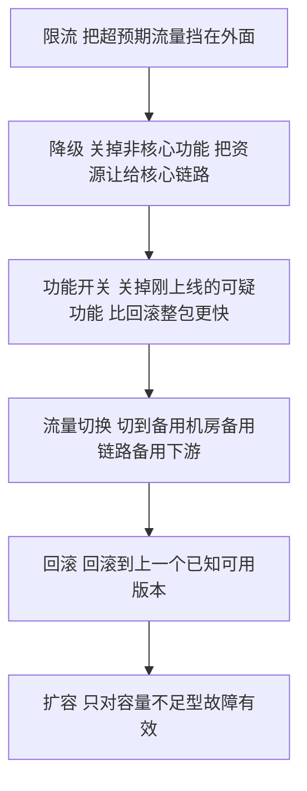

# 故障恢复

## 1. 核心概念

故障恢复的目标不是查清原因再动手，而是先止血、再恢复、最后复盘，顺序不能反。


故障恢复的目标不是“查清原因再动手”，而是**先止血、再恢复、最后复盘**。顺序不能反：用户正在受影响时，花一小时定位根因而不做止血，是失职；止血后不做恢复验证就宣布恢复，是二次事故的来源；恢复了不复盘，同样的故障下个月还会来。

止血、恢复、复盘三件事各有负责人：止血看值班，恢复看验证清单，复盘看改进项有没有落到排期里。

## 2. 故障分级

分级看影响面，不看技术难度。以下划分是直觉标尺，团队要按自己的业务定出成文标准：

| 级别 | 直觉标准 | 响应要求 |
|---|---|---|
| P0 | 核心链路不可用（如下单、审批、支付全断），或大面积用户受影响 | 立即全员响应，先止血 |
| P1 | 核心链路部分受损（部分用户、部分地域、部分功能不可用），或非核心链路全断 | 值班牵头，限时止血 |
| P2 | 非核心功能异常、体验受损、无资金与数据风险 | 按正常工单处理，记入复盘池 |

分级定下就不要在故障中讨价还价：先按高一级响应，确认影响面小于预期再降级。分级扯皮的时间就是用户受影响的时间。

## 3. 止血手段

止血手段按见效快、风险小排序，能用前面的就不要用后面的，做完一件看指标再决定下一件。



止血手段按“见效快、风险小”排序，能用前面的就不要用后面的：

1. **限流**：把超预期流量挡在外面，保住系统不被打垮。阈值按容量估算复核，见限流与降级篇。
2. **降级**：关掉非核心功能（统计、推荐、报表、非关键校验），把资源让给核心链路。降级开关要事先演练过。
3. **功能开关**：关掉刚上线的可疑功能，比回滚整包更快；前提是开关本身经过测试。
4. **流量切换**：切到备用机房、备用链路、备用下游；切换前确认备用侧真的可用，不要从一个故障切到另一个故障。
5. **回滚**：回滚到上一个已知可用版本。回滚要区分代码回滚和数据回滚：数据已经写坏的，回滚代码解决不了问题，要走数据修复流程。
6. **扩容**：只对“容量不足”型故障有效；对死锁、慢 SQL、Bug 导致的故障，扩容只是把故障摊得更开。

止血时不要同时做两件互相影响的事（比如一边回滚一边扩容），做完一件看指标，再决定下一件。

## 4. 恢复验证清单

宣布恢复前，逐项打勾，缺一项都不算恢复：

- [ ] 核心链路成功率回到基线（看监控曲线，不看“我这边能打开了”）。
- [ ] 关键接口 P99 延迟回到基线。
- [ ] 错误日志量回到基线，没有新的异常类型在刷屏。
- [ ] 止血手段已按顺序解除或转为常态（降级关了、开关恢复了、流量切回来了），没有“临时方案”被遗忘在线上。
- [ ] 受影响期间的数据已核对：订单、审批单、账目有没有少、有没有重复，必要时跑对账。
- [ ] 用户侧影响已确认收敛：客诉量回落，客服口径已更新。

## 5. RTO/RPO 定量：恢复时间与数据丢失窗口算一算

前面几节讲的是“该做什么”，这一节是把“要花多久、会丢多少”算出来。RTO 和 RPO 是两个不同的问题，别混在一起：RTO 问的是服务最多能停多久，RPO 问的是数据最多能丢多久。先记住一句话：RTO 向前看，还要停多久；RPO 向后看，丢了多久的数据。两个数字都要业务方点头，不能由运维自己拍脑袋定。

### RTO 手算：四段加起来才是总账

一次故障的恢复耗时，可以拆成四段相加：

```text
RTO 实测耗时 = 发现时间 + 决策与止血时间 + 恢复执行时间 + 验证时间
```

注意时钟从故障发生那一刻起算，不是从有人发现起算。监控 5 分钟后才告警，这 5 分钟已经花掉了，不是免费的。监控告警篇说的 MTTD（平均发现时间）就是这里的第一段，MTTR（平均恢复时间）是从发现到恢复、也就是后三段的另一种说法。

**算例一：P0 故障，45 分钟是怎么来的。** 假设神农 e 贷法人版的审批链路半夜挂了，值班按下面的节奏处理：

- 第一步，发现时间：监控告警加值班确认，一共 5 分钟。
- 第二步，决策与止血：定级 P0、拉人、关掉可疑功能开关，一共 10 分钟。
- 第三步，恢复执行：回滚到上一个可用版本、重启、流量切回来，一共 20 分钟。
- 第四步，验证：按第 4 节的恢复验证清单逐项打勾，一共 10 分钟。
- 合计：5 + 10 + 20 + 10 = 45 分钟。

如果业务定的 RTO 是 1 小时，45 分钟达标，还剩 15 分钟余量；如果业务定的 RTO 是 30 分钟，45 分钟就不达标，超了 15 分钟。想达标先看最长的一段：恢复执行 20 分钟是四段里最长的，优化它最划算；把验证的 10 分钟压缩成 2 分钟是走捷径，清单没打勾就宣布恢复，正是第 4 节警告的假恢复。

**算例二：备份恢复场景，500GB 要恢复多久。** 假设全量备份 500GB，恢复要经过传输、解压、导入三步，但这三步的速度不由最快的一步决定，而由最慢的一步决定。这里假设最慢的是磁盘读速，每秒 50MB（这是用于算账演示的假设值，不是某个产品的实测参数）：

- 第一步，单位换算：500GB = 500 × 1024 = 512000MB。
- 第二步，恢复执行时间：512000 ÷ 50 = 10240 秒。
- 第三步，换算成分钟：10240 ÷ 60 = 170.7 分钟，约 2 小时 51 分钟。
- 第四步，算总账：发现 10 分钟 + 决策 5 分钟 + 恢复执行 170.7 分钟 + 验证 15 分钟 = 200.7 分钟，约 3 小时 21 分钟。

结论很直接：如果业务要求的 RTO 是 2 小时，这套冷备份恢复流程就不达标，单恢复执行一段就占了 170.7 分钟。想达标要么提前把备份预热到离机房更近的地方，要么准备热备和自动化切换脚本，而不是在故障当晚临时想办法。灾备篇的算例用的是每秒 100MB 的传输速度，数字不同、道理相同：先找到最慢的那一步，再谈优化。

### RPO 手算：备份间隔就是丢失窗口

RPO 的算法比 RTO 简单：最坏情况下的数据丢失窗口，约等于两次备份之间的间隔。灾备篇已经算过每小时备份一次、最坏丢 60 分钟，这里换两个角度接着算。

**角度一：把时间窗口换算成业务量。** 时间本身不够直观，笔数才吓人。假设审批系统每小时产生 600 笔审批单：

- 每小时备份一次，最坏丢失 60 分钟的数据，约 600 笔审批单。
- 每 5 分钟增量备份一次，最坏丢失 5 分钟的数据：600 × 5 ÷ 60 = 50 笔。
- 备份间隔从 60 分钟缩到 5 分钟，丢失笔数从约 600 笔降到约 50 笔，代价是备份次数变成原来的 12 倍（60 ÷ 5 = 12）。

**角度二：用 binlog 把窗口压到分钟级。** 全量加增量备份之间，还可以用数据库的 binlog（操作日志）续上：每小时一次全量备份不动，binlog 每 1 分钟同步一次，故障时重放 binlog 追到故障前 1 分钟，丢失窗口就从 60 分钟压到约 1 分钟。注意这里要分清两个时间：binlog 重放本身花的时间算进 RTO，不算进 RPO；RPO 只看数据回到了哪个时间点。

顺带一个平均值的算法：如果故障在两次备份之间均匀发生，平均丢失约等于间隔的一半。每小时备份一次，最坏丢 60 分钟，平均丢约 30 分钟（60 ÷ 2 = 30）。报 RPO 要报最坏值，不要报平均值——业务方签的是“最多能丢多少”，不是“平均丢多少”。

### 可用性换算：99.9% 到底允许停多久

可用性百分比听着都差不多，换算成分钟就看出差别了。先算一个月有多少分钟：30 × 24 × 60 = 43200 分钟。允许宕机分钟数 = 43200 ×（1 − 可用性）。

| 可用性目标 | 算式 | 每月允许宕机（30 天月） |
| --- | --- | --- |
| 99.9% | 43200 × 0.001 | 43.2 分钟，约 43 分 12 秒 |
| 99.95% | 43200 × 0.0005 | 21.6 分钟，约 21 分 36 秒 |
| 99.99% | 43200 × 0.0001 | 4.32 分钟，约 4 分 19 秒 |

每多一个 9，允许宕机的时间就除以 10：从 99.9% 到 99.99%，预算从 43.2 分钟缩到 4.32 分钟，不是“好一点”，是换了一套运维打法。

这张表和前面的算例一连起来看更有感觉：如果可用性目标是 99.9%，上面那次 45 分钟的 P0 故障，一次就把整月 43.2 分钟的预算用完了，还超了 1.8 分钟（45 − 43.2 = 1.8）。所以 99.9% 不是“一个月可以出一次 P0”，而是“一个月出一次 45 分钟的 P0 就已经超标”。目标定多高，先拿这张表和业务方对齐，再去谈值班、演练和热备的投入。

### 边界条件：这三条不写清，数字会骗人

1. **RTO 只算到“服务可用”，不含“数据追平”。** 服务能打开页面、能提交请求，和积压的数据全部追平，是两个时间点。如果 RTO 的定义里没写清“恢复”包不包括数据追平，故障当晚一定会扯皮：运维说服务已经可用了，业务说审批单还没对上。定 RTO 时先写清终点，再算时间。
2. **备份恢复速率看最慢的一环，不是看标称值。** 网络能跑每秒 100MB，磁盘读速只有每秒 50MB，单线程解压更慢，实际恢复速度就是最慢的那一环。算例二用的每秒 50MB 是假设值，落到自己系统上，要用演练实测的速率重算一遍，拿厂商标称速率算出来的 RTO 只是纸面值。
3. **演练测出的 RTO 才是 RTO，纸面值不算。** 纸面加法里没有“等负责人接电话”这一项，真实故障里有。灾备篇的案例一就是例子：纸面算 131 分钟，实测 2 小时 25 分钟，多出来的 14 分钟花在等负责人接电话上。没演练过的 RTO，默认当作不可用；演练一次，就把纸面值改成实测值。

> 来源与核查（核查日期：2026-11-20）：RTO 与 RPO 的定义按 AWS Well-Architected Framework 的 REL13-BP01 条目核对，RTO 是服务中断到恢复服务的最大可接受延迟，RPO 是上一次数据恢复点以来的最大可接受时间；可用性换算表按 30 天月共 43200 分钟手算复核，99.9% 对应 43.2 分钟、99.95% 对应 21.6 分钟、99.99% 对应 4.32 分钟，与公开的 SLA 换算表一致；500GB 恢复算例中的每秒 50MB 为算账演示假设值，未引用任何厂商产品参数。

## 6. 复盘模板

复盘只写事实和改进项，不写检讨书。模板：

- **时间线**：何时发现（谁、通过什么渠道）、何时定级、何时止血、何时恢复，每段写时刻和动作，不要写感受。
- **影响面**：影响了哪些功能、多少用户、多长时间、有没有资金与数据影响，数字以监控和对账为准。
- **根因**：写到“改了哪一处就不会再发生”这一层为止；停在“系统不稳定”这种描述等于没找到根因。
- **改进项**：每项写负责人和截止时间，分三类：止血能力（下次更快止血）、发现能力（下次更早发现）、预防能力（同类不再发生）。没有负责人和截止时间的改进项等于没有改进项。
- **复盘会纪律**：对事不对人；同一根因的重复故障，复盘会要先问上一份改进项为什么没落地。

## 7. 值班交接要点

- **交接内容**：未关闭的告警、正在观察的指标、已知的临时方案（降级、开关、限流阈值）、未落地的复盘改进项。
- **交接方式**：书面交接（值班群或值班文档），不要只靠口头；接班人要能仅凭交接记录接手。
- **交接时机**：故障处理中不交接，除非接班人全程在场；必须交接时，交班人讲完当前止血进度和下一步计划再走。
- **值班禁忌**：值班期间不做大变更；值班手机保持畅通；告警不要静音处理，静音等于放弃发现能力。

## 8. 常见误区

- 先查根因再止血：用户受影响的时间就是故障时间，止血永远优先。
- 凭感觉宣布恢复：没有验证清单的恢复，只是把二次事故的发现时间往后推。
- 复盘写成检讨：复盘的产出是改进项和截止时间，不是责任认定；责任认定会让下次没人敢报故障。
- 临时方案变常态：降级、开关、限流阈值这些止血手段，恢复后要么解除、要么转为正式配置并写进文档，不能悄悄留在原地。

## 小技巧与冷知识

【小技巧】动手止血之前，先把当前指标快照留下来：错误率、P99、QPS 各截一张图，或者把监控链接和时间点记进值班群。原文第 4 节要求“成功率回到基线”才算恢复，没有止血前的快照，恢复时就说不清基线到底是多少、到底回没回来；事后复盘写影响面也一样要靠它，凭记忆报数字站不住。

【小技巧】宣布恢复前，先跑一笔真实业务探活：监控曲线回来了，不等于业务真通了。下单、审批、支付各走一笔端到端的真实请求，确认数据库里真的落了单、 downstream 真的收到了回调，再打勾。只看“我这边能打开了”就宣布恢复，正是原文第 4 节警告的假恢复。

【小技巧】回滚之前先确认数据库迁移能不能逆：代码回滚一键就能做，DDL 已经执行过的表结构回不去——新加的非空字段、删掉的列、改过的枚举值，代码回到旧版反而会因为表结构不匹配直接报错。原文第 3 节说“数据已经写坏的，回滚代码解决不了问题”，落到操作上就是：发布里带了 DDL，先看迁移脚本有没有写 down 脚本，没有就别指望纯回滚能止血。

【小技巧】每做一次止血动作，记一条带时间的变更日志：几点几分开了限流、阈值多少，几点几分关了哪个功能、切了哪条链路。恢复时按这条日志逆序解除，一个一个对勾；没有日志，恢复后最容易漏掉某一项，降级开关就悄悄留在线上，成了原文第 8 节说的“临时方案变常态”。

【小技巧】故障中的群内沟通用固定格式报进度：现在几点、影响面多大、已经做了什么、下一步做什么、预计什么时候有下一条消息。格式固定了，别人才不用在几十条消息里翻“现在到底怎么样了”，值班也不用一边止血一边反复回答同一个问题；报进度的时间点本身也是复盘时间线的一部分。

【小技巧】复盘的时间线别凭记忆写，用告警、日志和监控反推：告警是几点几分触发的、部署是几点几分上线的、错误率曲线是几点几分拐头的，都有据可查。原文第 6 节要求时间线“每段写时刻和动作”，凭记忆写的时刻前后差十分钟，根因分析就会跟着错位——先对表，再写时间线。

【小技巧】值班交接里的“正在观察的指标”要写成数字：比如“错误率已从 12% 回落到 0.8%，基线 0.5%，继续观察到明天 10 点”，而不是“还在观察”。接班人拿到具体数值和阈值，才知道什么情况下算恶化、什么情况下可以收尾；只写“正在观察”等于没交接，原文第 7 节说的“接班人仅凭交接记录就能接手”就落不了地。

【小技巧】每次故障后，把 RTO 的四段实际耗时填进复盘时间线：发现用了几分钟、决策用了几分钟、恢复执行用了几分钟、验证用了几分钟。只记总时长，下次 RTO 超标不知道该优化哪一段；四段分开记，最长的一段一眼就能看出来，复盘改进项也有了落点——原文第 6 节要求复盘写清每段的时刻和动作，四段时间就是这条要求里最值钱的数字。

【冷知识】复盘时追问根因的“五问法”（5 Whys）来自丰田生产方式：由丰田佐吉提出、大野耐一推广，做法是对每一个答案连续问五次“为什么”，直到问到能动手改的那一层为止。原文第 6 节说的“写到改了哪一处就不会再发生为止”，就是五问法的落点——问到第五层还停在“系统不稳定”这种描述，说明前面的问题问得不够具体。

【冷知识】主动制造故障来练恢复能力的做法叫混沌工程，最出名的起点是 Netflix 在 2011 年开源的 Chaos Monkey：它会在生产环境随机杀掉实例，逼着团队把“单台机器挂了能自动恢复”变成常态。原文的止血手段、流量切换、值班演练，练的就是同一件事——故障不是等来的，是平时演出来的；没演练过的止血手段，故障时第一次用就是在赌。

【冷知识】衡量恢复能力有三个常用指标：MTTD（平均发现时间，从故障发生到有人知道）、MTTR（平均恢复时间，从发现到恢复）、MTBF（平均无故障时间，两次故障之间的间隔）。复盘时把这三个数算出来，下次复盘再算一次，就能量化“止血是不是更快了、发现是不是更早了”——原文第 6 节把改进项分成止血、发现、预防三类，正好各对应其中一个指标。

## 9. 面试与自测

1. 故障恢复的正确顺序是什么？为什么不能先查根因再止血？
2. 止血手段为什么按“限流、降级、功能开关、流量切换、回滚、扩容”排序？
3. 复盘模板里，什么样的根因描述算合格？改进项没有负责人和截止时间会怎样？
4. 一次 P0 故障四段耗时分别是发现 5 分钟、决策与止血 10 分钟、恢复执行 20 分钟、验证 10 分钟，业务定的 RTO 是 30 分钟。这次恢复达标吗？最该先优化哪一段？为什么不能靠压缩验证时间来达标？

### 参考答案

1. 先止血、再恢复、最后复盘。用户正在受影响时，花时间定位根因而不止血是失职；止血后不做恢复验证就宣布恢复，是二次事故的来源；恢复了不复盘，同样的故障还会再来。
2. 按“见效快、风险小”排序：限流和降级见效最快且不改代码；功能开关比回滚整包更快；流量切换要先确认备用侧可用；回滚要区分代码回滚和数据回滚，数据已写坏的回滚代码解决不了；扩容只对容量不足型故障有效，对死锁、慢 SQL、Bug 导致的故障只是把故障摊得更开。
3. 根因要写到“改了哪一处就不会再发生”这一层为止，停在“系统不稳定”这种描述等于没找到根因。改进项分止血能力、发现能力、预防能力三类，每项写负责人和截止时间；没有负责人和截止时间的改进项等于没有改进项。
4. 不达标。四段合计 5 + 10 + 20 + 10 = 45 分钟，超过 30 分钟的 RTO 目标 15 分钟。最该先优化最长的恢复执行一段（20 分钟），比如提前预热备份、准备自动化切换脚本；其次看发现时间的 5 分钟能不能靠更灵敏的告警缩短。不能靠压缩验证时间达标，因为验证是按恢复验证清单逐项确认，压缩验证等于跳过清单，没确认成功率、延迟和数据对账就宣布恢复，是假恢复，二次事故的发现时间只是被往后推了。

## 10. 关联知识

- [限流熔断与降级](开发语言/Java/限流熔断与降级.md)：止血手段里限流与降级的细节。
- [监控告警](工程实践/运维/监控告警.md)：发现故障、看基线、确认恢复的指标来源。
- [高并发架构](工程实践/高并发架构.md)：容量与手段的前置设计，减少故障发生的概率。
