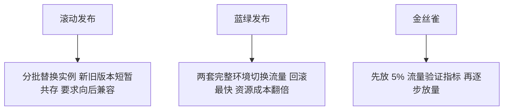
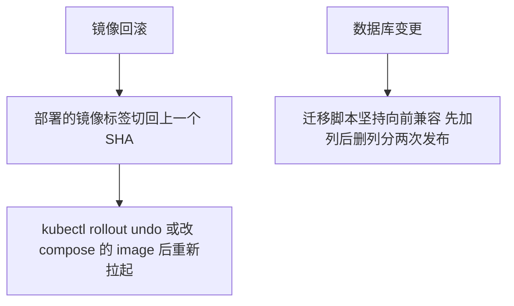

# CI/CD

## 1. 核心概念

- **CI（持续集成）**：代码合入主干后自动完成构建、静态检查、单元测试，让问题在提交后几分钟内暴露，而不是上线前集中爆雷。
- **CD（持续交付/部署）**：流水线产出可发布的制品，自动部署到测试/预发环境；持续交付保留人工批准上线，持续部署则全自动直达生产。

一条流水线解决三件事：**可重复**（每次构建过程一致，不依赖某台机器的手工操作）、**可追溯**（哪个提交产出了哪个制品）、**可回滚**（发布失败能快速退回上一个好版本）。

## 2. 基础知识

### 流水线阶段

流水线七个阶段依次推进：前面失败即终止，部署失败自动回滚，验证失败告警并回滚。


| 阶段 | 做什么 | 失败策略 |
|---|---|---|
| Checkout | 拉取代码、子模块 | 终止 |
| Build | 编译/打包（Maven、npm、Docker build） | 终止 |
| Test | 单元测试、集成测试、覆盖率 | 终止并出报告 |
| Quality | Lint、SonarQube、依赖漏洞扫描 | 视规则拦截或警告 |
| Package | 构建镜像/制品并打版本标签 | 终止 |
| Deploy | 部署到目标环境（滚动/蓝绿/金丝雀） | 自动回滚 |
| Verify | 健康检查、冒烟测试 | 告警并回滚 |

原则：前面的阶段越快越好（目标主干构建 10 分钟内）；慢测试拆到夜间流水线，别堵住每次提交。

### 制品与版本

- 制品（Artifact）是构建的唯一产物：jar、Docker 镜像、前端静态包。**一次构建、处处部署**——同一制品从测试环境晋级到生产，禁止在每个环境重新构建。
- 版本标识 = Git commit SHA 或语义版本 + 构建号；镜像标签用 SHA，不要只用 `latest`（无法定位与回滚）。

## 3. 进阶知识

### GitHub Actions 与 Jenkins 对比

| 维度 | GitHub Actions | Jenkins |
|---|---|---|
| 托管 | GitHub 托管 runner，开箱即用 | 自建 Controller/Agent |
| 配置 | 仓库内 `.github/workflows/*.yml` | Jenkinsfile 或页面配置 |
| 生态 | Marketplace actions 丰富 | 插件极多但质量参差 |
| 成本 | 公共仓库免费；私有仓库按分钟计费 | 服务器与运维成本自担 |
| 适用 | 代码本就在 GitHub、想快速落地 | 内网/合规要求、自有基础设施多 |
| 扩展 | 自托管 runner 可接入内网 | 节点、凭据、网络完全可控 |

选型经验：代码在 GitHub 上优先 Actions（ao 的知识库就在 GitHub，零运维）；银行/内网项目（公司项目环境）大多还是 Jenkins + 内网制品库，因为代码与环境出不了内网。

### 部署策略

三种部署策略各有取舍：滚动简单、蓝绿回滚最快、金丝雀先放少量流量验证指标。



- **滚动发布**：分批替换实例，简单，但新旧版本短暂共存，要求向后兼容。
- **蓝绿发布**：两套完整环境切换流量，回滚最快，资源成本翻倍。
- **金丝雀**：先放 5% 流量验证指标，再逐步放量；依赖监控与自动回滚（见 [[监控告警]]）。

## 4. 原理剖析

流水线本质是 DAG 任务调度：job 之间用 `needs` 声明依赖，可并行的并行（如多模块测试），关键路径决定总时长。制品仓库（Docker Registry、Nexus、GitHub Packages）是流水线与部署之间的解耦层：构建侧只管推，部署侧只管拉指定版本。

凭据管理是安全核心：密钥走平台的 Secrets 注入环境变量，绝不写进仓库；自托管 runner 视为高权限机器，按最小权限管理。

## 5. 实战应用

### GitHub Actions：Spring Boot 项目流水线

```yaml
name: ci
on:
  push:
    branches: [ main ]
  pull_request:
jobs:
  build:
    runs-on: ubuntu-latest
    steps:
      - uses: actions/checkout@v4
      - uses: actions/setup-java@v4
        with:
          distribution: temurin
          java-version: '17'
          cache: maven
      - name: Build & Test
        run: ./mvnw -B verify
      - name: Build Image
        if: github.ref == 'refs/heads/main'
        run: |
          docker build -t ghcr.io/${{ github.repository }}:${{ github.sha }} .
          echo "${{ secrets.GITHUB_TOKEN }}" | docker login ghcr.io -u ${{ github.actor }} --password-stdin
          docker push ghcr.io/${{ github.repository }}:${{ github.sha }}
```

要点：PR 只跑构建+测试（不推镜像）；主干才产出制品；Maven 依赖缓存让构建从几分钟降到几十秒。

### Jenkins 等价骨架（公司内网项目常见）

```groovy
pipeline {
  agent any
  stages {
    stage('Build') { steps { sh './mvnw -B -DskipTests package' } }
    stage('Test')  { steps { sh './mvnw -B verify' } }
    stage('Image') { steps { sh "docker build -t app:${env.GIT_COMMIT} ." } }
    stage('Deploy') {
      steps { sh 'kubectl set image deploy/app app=app:${GIT_COMMIT}' }
    }
  }
  post { failure { echo 'pipeline failed, notify owner' } }
}
```

### 回滚

回滚分两路：镜像回滚是切回上一个 SHA，数据库变更要坚持向前兼容，否则回滚代码也救不回数据结构。



- 镜像回滚：把部署的镜像标签切回上一个 SHA，`kubectl rollout undo` 或改 compose 的 image 后重新拉起。
- 数据库变更是回滚难点：迁移脚本坚持向前兼容（先加列后删列分两次发布），否则回滚代码也救不回数据结构。

## 6. 流水线耗时与发布节奏定量

本节只算数：流水线一次跑多久、发布节奏怎么量、坏发布多久能发现。所有数字都是手算示例，替换成自己流水线的实测耗时再用。

### 流水线耗时拆解：串行求和，并行取关键路径

流水线总耗时不是各阶段简单相加。串行阶段按时间求和，并行阶段只算最慢的那一条（关键路径），再加前后串行的部分。

手算例子：某条流水线四个阶段耗时分别为构建 3 分钟、单测 5 分钟、镜像构建 2 分钟、安全扫描 4 分钟。

- 全部串行：3 + 5 + 2 + 4 = 14 分钟。
- 把单测与安全扫描并行（两者无依赖，可同时跑）：3 + max(5, 4) + 2 = 10 分钟，省下 4 分钟，约 28.6%。
- 再并行也省不到 5 分钟以下：构建和镜像构建仍在关键路径上，瓶颈从单测移到了“构建 + 镜像”这条链。只优化关键路径上的阶段才缩短总耗时，优化非关键路径省下的时间不会体现在总时长上。

### 缓存命中率换算：先拆出“可省的部分”再乘命中率

缓存只能省掉“下载依赖”这类可重复的工作，省不掉编译本身。换算分两步：先算依赖下载占构建时间的比例，再乘命中率。

手算例子：一次构建共 6 分钟，其中下载依赖占 70%，即 4.2 分钟，其余编译打包占 1.8 分钟。

| 缓存命中率 | 省下的时间 | 构建耗时 | 相对原来 |
|---|---|---|---|
| 50% | 2.10 分钟 | 3.90 分钟 | 省 35.0% |
| 90% | 3.78 分钟 | 2.22 分钟 | 省 63.0% |
| 100% | 4.20 分钟 | 1.80 分钟 | 省 70.0% |

算式：省下的时间 = 4.2 分钟 × 命中率；命中率 90% 时省 3.78 分钟，构建从 6 分钟降到 2.22 分钟。

两个推论：

- 命中率从 90% 提到 100%，只多省 0.42 分钟，边际收益很小；命中率从 50% 提到 90% 多省 1.68 分钟。缓存优化的性价比在中段最高，追最后 10% 不划算。另注意命中率是按构建次数统计的长期比例，不是某一次命中了多少：一个月跑 100 次构建、90 次命中，才是 90%。

GitHub Actions 的口径（已验证事实）：缓存是否命中按 key 是否精确匹配判定，精确匹配才算命中；未命中时任务成功后会自动按新 key 保存一份缓存。详见文末来源。

### DORA 四指标：口径与手算

DORA（DevOps Research and Assessment，现属 Google Cloud）用四个指标衡量交付能力：前两个量速度，后两个量稳定性。四个指标的定义与公式如下，基准区间见表后说明。

| 指标 | 口径 | 公式 |
|---|---|---|
| 部署频率 | 单位时间内成功部署到生产的次数 | 部署次数 / 统计周期 |
| 变更前置时间 | 从提交代码到该提交在生产运行的时间 | 上线时间 - 提交时间 |
| 变更失败率 | 导致生产故障、需要回滚或热修复的部署占比 | 失败部署数 / 总部署数 × 100% |
| 恢复时间 | 从故障发生到服务恢复的平均时间 | 各次恢复时间之和 / 故障次数 |

手算例子（同一个团队同一个月的数据）：

- 部署频率：一个月 22 个工作日成功部署 20 次，部署频率 = 20 / 22 ≈ 0.91 次/工作日，约每周 4.5 次。
- 变更前置时间：某次提交 09:00 合入主干，13:30 上线生产，前置时间 = 4.5 小时。注意这是“提交到上线”，不含写代码和评审等待的时间；把评审耗时也算进去是另一种口径，团队内要先统一。
- 变更失败率：20 次部署里 2 次需要回滚，变更失败率 = 2 / 20 × 100% = 10%。只算需要立即干预的失败；上线后发现的小问题、排期修复的不算。
- 恢复时间：当月 3 次故障，恢复耗时分别为 25 分钟、40 分钟、55 分钟，平均恢复时间 = (25 + 40 + 55) / 3 = 40 分钟。单次最长 55 分钟，平均数会掩盖最坏情况，复盘时要同时看最大值。

DORA 报告给出的能力分档（参考区间，不同年份报告的阈值略有差异，不宜当硬标准）：

| 指标 | 精英水平 | 高水平 | 中等水平 | 低水平 |
|---|---|---|---|---|
| 部署频率 | 一天多次、按需部署 | 一天一次到一周一次 | 一周一次到一月一次 | 低于一月一次 |
| 变更前置时间 | 小于 1 天 | 1 天到 1 周 | 1 周到 1 个月 | 超过 1 个月 |
| 变更失败率 | 0% 到 15% | 0% 到 15% | 约 16% 到 30% | 超过 30% |
| 恢复时间 | 小于 1 小时 | 小于 1 天 | 1 天到 1 周 | 超过 1 周 |

对照上例：部署频率约每周 4.5 次、变更失败率 10%、恢复时间 40 分钟、变更前置时间 4.5 小时，四项都落在精英到高水平区间。但分档是横向参考，不是考核线：一个每月只发两次的内部系统，部署频率天然低，不代表交付能力差。

### 回滚窗口定量：金丝雀放量比例决定坏发布的暴露面

回滚窗口由两部分组成：发现坏发布需要的时间，加上执行回滚需要的时间。金丝雀的放量比例同时影响这两部分：比例越小，坏版本接触的用户越少，但采样越稀疏，发现越慢。

手算例子：某服务日请求量 200 万次，金丝雀放 5% 流量，错误率告警阈值为 1%。

- 金丝雀每天承接请求：200 万 × 5% = 10 万次，平均每分钟约 69.4 次。
- 1 分钟窗口只有约 69 次请求，基线错误率 1% 对应约 0.7 个错误——样本太少，1 分钟窗口基本无法触发告警。
- 10 分钟窗口约 694 次请求，基线错误对应约 6.9 个错误；若坏版本错误率升到 5%，10 分钟内约 34.7 个错误，明显高于基线，可以触发告警。
- 结论：5% 金丝雀配 1% 错误率阈值，合理的发现时间约 10 分钟；窗口缩到 1 分钟会误报或漏报，窗口拉到 30 分钟则发现更稳但暴露更久（30 分钟窗口内坏版本约承接 2083 次请求）。

暴露面对比（同样是 10 分钟发现时间）：

- 5% 金丝雀：坏版本约承接 694 次请求。
- 100% 全量发布：坏版本约承接 13889 次请求，是金丝雀的 20 倍。

蓝绿发布的回滚窗口则不取决于采样：流量切换本身以分钟计（本例按 2 分钟估算），发现后切回旧环境即可，回滚时间约等于一次切换时间。代价是两套完整环境，资源成本翻倍（原文 §3 已述）。金丝雀放量节奏的手算：5%、25%、50%、100% 四档，每档观察 30 分钟，全量放完需要 4 × 30 = 120 分钟；档位越多、每档观察越久，发现越稳，但一次发布的总耗时越长。

### 边界条件：这些结论在什么情况下不成立

1. 串行求和与并行取最大只在阶段之间没有共享资源瓶颈时成立。如果并行的两个阶段抢同一台 runner 的 CPU 或同一个制品库的带宽，并行后各自都会变慢，总耗时可能比手算的 10 分钟更长，甚至接近串行的 14 分钟。
2. 缓存换算假设“命中就省掉全部下载时间”。如果缓存本身已过期、依赖版本刚升级、或者缓存恢复耗时接近重新下载，实际省下的时间会小于 3.78 分钟；缓存命中率 90% 不等于每次构建都省 63%，是长期平均值。
3. DORA 四指标只在“部署”和“失败”的口径全团队统一时才可比。把一次多服务联动发布算成 1 次还是 5 次、把回滚算成一次新部署还是失败的延续，都会直接改变部署频率和变更失败率；口径没统一，跨团队对比没有意义。
4. 金丝雀的发现时间换算假设请求量在全天均匀分布。真实流量有早晚高峰：凌晨低峰期每分钟请求远少于 69 次，同样 5% 金丝雀、同样 10 分钟窗口，样本可能只有白天的一半，发现时间要按低峰期的请求量重算。
5. 恢复时间的平均数假设故障相互独立、恢复流程每次相同。如果同一次根因连续触发多次故障，或者恢复依赖人工审批、跨团队协调，平均恢复时间会被个别长尾故障拉高，40 分钟的平均数就不再代表典型情况。

### 来源与核验（核验日期：2026-11-23）

已验证事实：

- DORA 四指标的定义与公式（部署频率、变更前置时间、变更失败率、恢复时间/MTTR），以及精英/高/中/低四档参考区间：Metabase 的 DORA 指标说明（https://www.metabase.com/metrics/dora）与 New Relic 的 DORA 指南（https://newrelic.com/blog/observability/dora-metrics）口径一致；GitMore 的 2026 年指南（https://gitmore.io/blog/dora-metrics-guide）补充了 2023 年后“恢复时间”改称“失败部署恢复时间”的说法。
- GitHub Actions 的 job 默认超时 360 分钟（6 小时），step 超时上限同样为 360 分钟：GitHub 官方工作流语法文档（https://docs.github.com/en/actions/using-workflows/workflow-syntax-for-github-actions）。流水线跑到 6 小时会被平台强制取消，所以“一次构建 10 分钟内”的目标也有平台层面的硬上限兜底。
- GitHub Actions 缓存命中按 key 精确匹配判定，未命中时任务成功后自动保存新缓存：GitHub 官方依赖缓存文档（https://docs.github.com/en/actions/how-tos/writing-workflows/choosing-what-your-workflow-does/caching-dependencies-to-speed-up-workflows#managing-caches）。

个人推断（基于上述事实的手算，非外部数据）：

- 本节全部手算例子（14 分钟串行、10 分钟并行、缓存换算表、DORA 四指标手算、金丝雀发现时间与暴露面）均为假设数字代入公式的结果，公式本身来自已验证来源，数字是为说明方法而设的示例，不是任何真实团队的实测值。
- “蓝绿切换按 2 分钟估算”是我方为举例设定的假设，具体切换耗时取决于流量切换方式与平台实现。

待验证：

- DORA 官方最新年度报告（2025 年版）的各档阈值是否与上表一致：本次只核验了 Metabase、New Relic、GitMore 三家二手整理，未直接打开 DORA 官网或 Google Cloud 的报告原文；不同年份报告的阈值确有调整，引用分档时建议以当年报告原文为准。
- Jenkins 侧的超时与并发默认值：本节未引用 Jenkins 官方文档的默认值，Jenkins 超时需在流水线里显式配置，没有与 GitHub Actions 360 分钟对等的全局默认值可直接对照，写 Jenkins 相关内容时需另行核验。

## 7. 疑难杂症

- **本地能过、CI 挂**：九成是环境差异——时区、JDK 小版本、依赖缓存脏了、测试对执行顺序有依赖。复现方法：在 CI 同款镜像里本地跑一遍。
- **测试不稳定（flaky）**：依赖真实时间、随机数、外部网络的测试要隔离或打桩；flaky 测试先 quarantine 并立单追踪，别直接重试掩盖。
- **流水线越来越慢**：拆并行 job、加依赖缓存、把全量测试分层（PR 跑快测，合并后跑全量）。

## 8. 常见误区

- 把部署脚本和构建脚本混在一起，换环境就重构建，破坏"一次构建处处部署"。
- 密钥写进仓库或打印到日志；日志里 `echo $TOKEN` 是经典事故。
- 只做 CI 不做自动部署验证：部署"成功"但服务起不来，要加健康检查步骤才算闭环。

## 9. 性能优化

- 缓存依赖（Maven/npm/pip）与 Docker 层缓存，通常省时最明显。
- 矩阵构建（多 JDK 版本/多模块）并行跑；大单体按模块变更范围只跑受影响模块的测试。
- 自托管 runner 放在离制品库近的网络里，镜像推拉是常见瓶颈。

## 10. 版本差异

- GitHub Actions 的主流 action 版本滚动更新快，`actions/checkout@v4`、`setup-java@v4` 是当前常用组合，写法上已收敛为声明式缓存参数。
- Jenkins LTS 每年多次小版本，插件兼容性要在升级前在测试 Controller 验证，生产上别开自动更新插件。

## 小技巧与冷知识

【小技巧】`actions/checkout` 默认只拉最新一次提交（fetch-depth 是 1），需要 git 历史的步骤会悄悄失败：打版本号要读 tag、算变更范围要 `git log`、回滚要找上一个提交，这些都得先显式写 `fetch-depth: 0` 拉全量历史。流水线里用到 git 命令先想一层——它手里的仓库是不是完整的，别等报错了才发现只有一层提交。

【小技巧】同一分支连续 push 别让旧构建排队白跑：给 workflow 加 `concurrency` 组，`group: ${{ github.ref }}` 配 `cancel-in-progress: true`，新提交一来就自动取消同一分支还在跑的旧构建。原文只讲了“前面的阶段越快越好”，这招是把“不用跑完的构建”直接省掉，主干频繁提交时省下的 runner 时间最可观；生产部署用的 job 别加自动取消，部署跑一半被取消比慢更危险。

【小技巧】Docker 层缓存失效常败在 COPY 的顺序上：Dockerfile 里先 COPY 依赖描述文件（pom.xml、package.json）并安装依赖，再 COPY 源码，改一行代码只重建最后一层；反过来先 COPY 全量源码，改一行代码就从装依赖开始全部重建。原文第 9 节只说了“缓存 Docker 层”，落到实处就是“不常变的放前面、常变的放最后”，顺序本身就是缓存策略。

【小技巧】缓存的 key 要绑上 lock 文件的哈希：`key: maven-${{ hashFiles('**/pom.xml') }}`，依赖一变 key 跟着变，旧缓存自动失效；只写固定 key，依赖升级后流水线还会命中过期缓存，构建“成功”却跑的是旧依赖。原文的 setup-java 声明式缓存就是按这个思路做的，自己写缓存步骤时照猫画虎，key 里一定要带上能反映依赖变化的东西。

【小技巧】部署后的健康检查别只看 HTTP 200：就绪检查（readiness）要等数据库、缓存这些依赖都通了才放行，存活检查（liveness）只看进程本身活着。两者混用一个接口，滚动发布时流量会打到还没连上数据库的新实例，请求进来先报一轮 500；原文第 2 节的 Verify 阶段要的就是这个区分，健康检查的粒度决定回滚会不会误触发。

【小技巧】Jenkins 里用 `withCredentials` 注入凭据，别在 sh 步骤里自己 `echo $PASSWORD` 拼命令：平台注入的凭据变量在控制台输出里会被自动打码，但一旦把它拼进 URL、文件名或别的变量里，打码就认不出来了。原文第 8 节说的“日志里 echo $TOKEN 是经典事故”就是这个意思——凭据只让平台替你传，别让它经过自己的字符串拼接。

【小技巧】流水线失败的通知只在失败时发：通知步骤写 `if: failure()`，成功跑完不发消息，失败才@到人。每个构建都报一次“成功”，群里三天就没人看了；只报失败，通知才有“出事了”的分量。原文第 2 节的失败策略表只管阶段怎么停，通知的“什么时候报”同样要收敛，否则告警疲劳会把真正的失败也淹掉。

【小技巧】镜像标签别只用 latest，用提交短 SHA 再拼个可读后缀：`app:1.4.2-a1b2c3d` 这种“语义版本 + 短 SHA”既能看出是哪个版本，又能定位到具体哪次提交。原文第 2 节说了镜像标签用 SHA、不要只用 latest，落到实处就是标签要同时回答两个问题——“这是第几个版本”和“这是哪次提交的产物”，缺一个，出了问题都得翻半天流水线记录。

【小技巧】给流水线每个 job 单独设一个比平台默认值更紧的超时：GitHub Actions 的 job 默认超时是 360 分钟（6 小时），不设就等于允许一个挂起的 job 占着 runner 六小时。按 job 的正常耗时留 2 到 3 倍余量设超时，例如正常 10 分钟的构建设 30 分钟，超时即失败告警。原文第 2 节只说了“前面的阶段越快越好”，超时是另一面的保障：快的构建靠缓存和并行，挂起的构建靠超时止损，两者缺一不可。

【冷知识】“持续集成”这个词最早出自 1991 年 Grady Booch 的《面向对象分析与设计》：他在书里提出代码要频繁集成、每次集成都要验证；后来 Kent Beck 在极限编程里把它变成日常实践，才有了今天 CI 的样子。CI 不是 Jenkins 或 GitHub Actions 发明出来的，工具只是把这个 30 多年前的想法自动化了，核心一直是“集成要小步、要频繁、要立刻验证”。

【冷知识】蓝绿部署的名字真的是按颜色来的：Martin Fowler 在 2010 年的博客里正式写下 Blue-Green Deployment，两套环境分别叫蓝环境和绿环境，一次只让一套接流量，另一套闲着待命。名字没有技术隐喻，就是“两套颜色不同的环境轮流上岗”的直白描述；金丝雀的典故则是矿井里用金丝雀探瓦斯，都是借了个生活里的意象。

## 11. 面试与自测

1. CI 与 CD 的区别？持续交付和持续部署差在哪一步？
2. 为什么强调"一次构建、处处部署"？
3. 蓝绿与金丝雀分别适合什么场景？回滚速度与成本如何权衡？
4. 流水线里密钥怎么管？runner 被攻破的影响面是什么？
5. 一条 40 分钟的流水线，你按什么顺序优化？
6. 一条流水线构建 3 分钟、单测 5 分钟、镜像构建 2 分钟、安全扫描 4 分钟，全部串行要多久？把单测和安全扫描并行后呢？为什么不能无限并行省时间？

### 参考答案

1. CI 是代码合入主干后自动完成构建、静态检查、单元测试，让问题在提交后几分钟内暴露；CD 分两档：持续交付是流水线产出可发布制品、自动部署到测试/预发环境，但上线保留人工批准，持续部署则全自动直达生产。两者差在最后一步：持续交付多一次人工批准，持续部署没有。
2. 同一制品从测试环境晋级到生产，禁止在每个环境重新构建。重构建会引入环境差异（依赖版本、编译参数、机器状态），导致测过的东西不等于上线东西，出了问题也无法按制品追溯和回滚；版本标识用 Git commit SHA，不要只用 latest。
3. 蓝绿适合发布风险高、回滚速度优先的场景：两套完整环境切换流量，回滚最快，但资源成本翻倍。金丝雀适合需要灰度观察的场景：先放 5% 流量验证指标，再逐步放量，成本低，但依赖监控与自动回滚。权衡看三点：回滚速度、资源成本、观察能力。
4. 密钥走平台的 Secrets 注入环境变量，绝不写进仓库、不打印到日志（日志里 echo $TOKEN 是经典事故）。自托管 runner 应视为高权限机器：它能触及制品、部署目标和凭据，按最小权限管理；一旦被攻破，影响面就是它能部署、能发版、能读到的全部凭据和环境。
5. 按省时确定性从高到低：先加缓存（Maven/npm 依赖缓存与 Docker 层缓存，通常省时最明显）；再做并行（矩阵构建、多模块并行、只跑受影响模块的测试，流水线本质是 DAG 调度，关键路径决定总时长）；再把测试分层（PR 跑快测、合并后跑全量、慢测试拆到夜间）；最后把自托管 runner 放到离制品库近的网络里，镜像推拉是常见瓶颈。主干构建目标是 10 分钟内。
6. 全部串行：3 + 5 + 2 + 4 = 14 分钟。单测与安全扫描并行后：3 + max(5, 4) + 2 = 10 分钟，省 4 分钟。不能无限并行省时间的原因：总耗时由关键路径决定，构建和镜像构建仍在关键路径上，并行只能省掉被并掉阶段里较短的那一份；而且并行阶段共享 runner 资源或制品库带宽时会互相拖慢，极端情况下并行收益会被资源争用吃掉。优化要先找关键路径，只优化关键路径上的阶段才缩短总耗时。
## 12. 关联知识

- 前置：[[Git-运维与工具]]（分支策略与主干开发）、[[Docker]]（镜像与制品）
- 相关：[[监控告警]]（发布后验证与自动回滚依据）、[[Nginx]]（流量切换实现蓝绿/金丝雀）
- 延伸：GitOps（Argo CD）、制品签名与 SBOM 供应链安全
