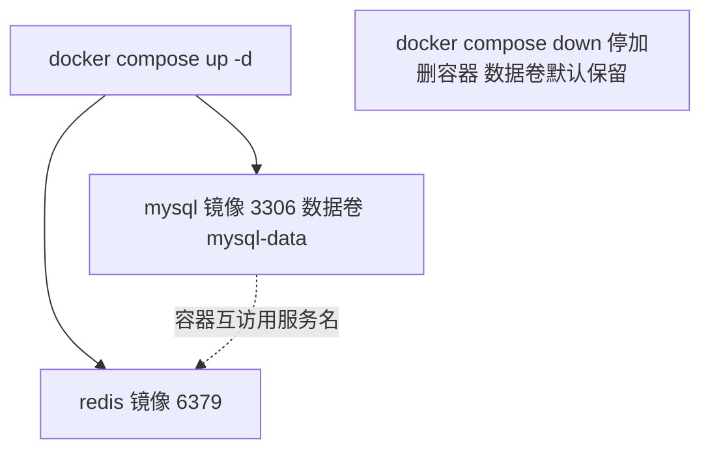
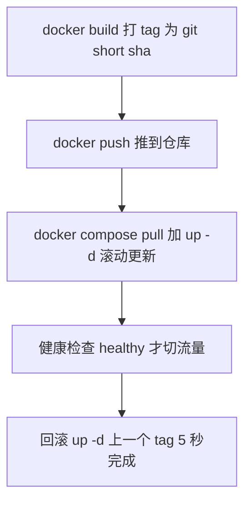
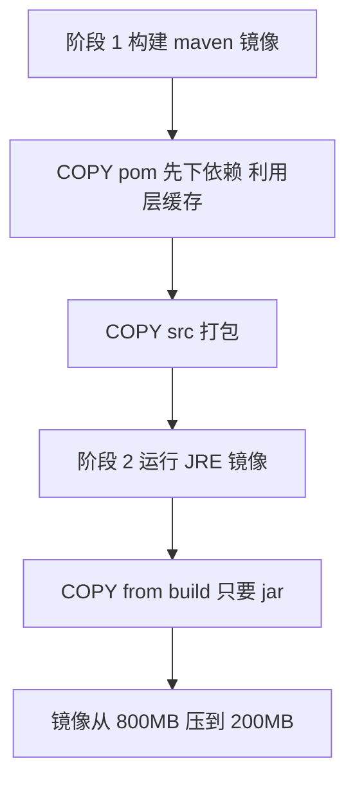

# Docker

> 每晚 20:30 自动补充完善。贴合本地开发（Windows + Docker Desktop）和项目交付场景。

## 常用命令速查

```bash
# 容器
docker ps -a
docker run -d --name redis -p 6379:6379 redis:7
docker exec -it <容器> bash        # 进容器
docker logs -f --tail 100 <容器>   # 看日志
docker stop/start/restart/rm <容器>
docker cp 本地路径 容器:容器路径    # 拷文件

# 镜像
docker images
docker pull nginx:alpine
docker build -t myapp:1.0 .
docker rmi <镜像>
docker system prune -a             # 大扫除（删无用镜像/容器/网络/缓存）

# 信息
docker inspect <容器>              # 看挂载、IP、环境变量
docker stats                       # 实时资源占用
```

## Dockerfile 最佳实践

```dockerfile
# 多阶段构建：编译和运行分离，镜像从几百 MB 降到几十 MB
FROM maven:3.8-openjdk-8 AS build
WORKDIR /app
COPY pom.xml .
RUN mvn dependency:go-offline      # 先下依赖，利用层缓存
COPY src ./src
RUN mvn package -DskipTests

FROM openjdk:8-jre-alpine
WORKDIR /app
COPY --from=build /app/target/*.jar app.jar
EXPOSE 8080
ENTRYPOINT ["java","-jar","app.jar"]
```

要点：
1. **层缓存**：变化少的文件（pom.xml）先 COPY，变化多的（src）后 COPY。
2. **alpine 镜像**：体积小，但注意 glibc 兼容问题（需要装 `gcompat` 或换 slim 版）。
3. **.dockerignore**：把 `target/`、`.git`、`*.md` 排除，别打进镜像。
4. **时区**：Java 容器加 `-e TZ=Asia/Shanghai`，不然日志时间是 UTC。
5. **JVM 内存**：容器里设 `-Xmx` 别超过容器 limit；JDK 8u191+ 才识别 cgroup 内存限制，老版本会按宿主机内存算直接 OOM。

## docker-compose 常用

compose 一条命令拉起整套服务：MySQL 与 Redis 各自挂端口与数据卷，容器互访用服务名。



```yaml
version: "3.8"
services:
  mysql:
    image: mysql:5.7
    ports: ["3306:3306"]
    environment:
      MYSQL_ROOT_PASSWORD: root
    volumes:
      - mysql-data:/var/lib/mysql
  redis:
    image: redis:7
    ports: ["6379:6379"]
volumes:
  mysql-data:
```
```bash
docker compose up -d
docker compose down        # 停+删容器（volume 默认保留）
docker compose down -v    # 连数据卷一起删，慎用
```

## 网络与数据卷

- 默认 bridge 网络，容器互访用**服务名**（compose 里）或 `--link`（已过时，别用）。
- 数据要持久化必须挂 volume，容器删了数据还在；`docker volume ls` 查看。
- 调试网络：`docker network inspect <网络名>` 看容器 IP。

## Windows 下注意点

1. Docker Desktop 吃内存：Settings → Resources 里限制内存/CPU，别让它拖慢 Ollama。
2. 文件挂载慢：代码放 WSL2 文件系统里（`\\wsl$`），别放 Windows 盘，IO 差几倍。
3. 换行符：Windows 的 CRLF 进 Linux 容器跑 shell 脚本会炸，`.gitattributes` 或编辑器统一 LF。

## 常见问题

1. **端口被占**：`docker ps` 看谁占了，或 `netstat -ano | findstr 8080`（Windows）。
2. **容器起不来**：先 `docker logs`，90% 的问题日志里都有。
3. **镜像拉不动**：换国内镜像源（daemon.json 配 `registry-mirrors`）。
4. **磁盘爆了**：`docker system df` 看占用，`docker system prune -a` 清理。
5. **容器内连不上宿主机**：用 `host.docker.internal`（Docker Desktop 支持）。

## 待补充
- 本地 Ollama 进阶：不用 Docker，直接本机跑（已在用）


## 疑难杂症

### 1. 容器内时区不对，日志和定时任务全错乱
- **现象**：容器里 `date` 显示 UTC，日志时间对不上，cron 定时任务跑错时间。
- **原因**：官方镜像默认 UTC 时区，和宿主机不一致。
- **解决**：挂载时区文件 `-v /etc/localtime:/etc/localtime:ro`，或 Dockerfile 里 `ENV TZ=Asia/Shanghai` + 装 tzdata。

### 2. 多阶段构建缓存每次都失效
- **现象**：改一行代码，`docker build` 全量重跑，慢得离谱。
- **原因**：COPY 顺序不对，源代码变动导致后面所有层缓存失效。
- **解决**：先 COPY 依赖描述文件（package.json/pom.xml）并安装依赖，再 COPY 源码；`.dockerignore` 排除无关文件。

### 3. Windows 下文件挂载又慢又报权限错
- **现象**：Docker Desktop 挂载 Windows 目录，读写巨慢，偶发 permission denied。
- **原因**：跨 OS 文件共享走网络文件系统，性能差且权限映射复杂。
- **解决**：代码放 WSL2 文件系统里再挂载；或尽量用 COPY 进镜像而不是挂载；生产环境用 Linux 宿主机。

## 生产发布：tag 规范与滚动更新

生产 tag 用 git short sha，永远别用 latest：回滚就是 up 上一个 tag，5 秒完成。



```bash
# tag 规范：git short sha，永远别用 latest 当生产 tag
docker build -t registry/app:$(git rev-parse --short HEAD) .
docker push registry/app:abc1234

# compose 滚动更新
docker compose pull && docker compose up -d --no-deps app
```

- `latest` 是玄学 tag，多机部署时各机器 pull 到的可能不是同一版，出问题查都查不清。
- 回滚就是 `up -d` 上一个 tag，5 秒完成，所以每个 tag 都要能独立跑（数据库 migration 要向后兼容）。
- 健康检查写上（`healthcheck`），compose 等容器 healthy 才切流量，不然刚启动就接请求直接 500。

## 多阶段构建实战（Java 版）

多阶段构建把编译和运行分离：构建阶段只要 Maven 与源码，运行阶段只要 JRE 与 jar。



```dockerfile
# 阶段1：构建
FROM maven:3.9-eclipse-temurin-17 AS build
WORKDIR /app
COPY pom.xml .
RUN mvn dependency:go-offline          # 先下依赖，利用缓存
COPY src ./src
RUN mvn package -DskipTests
# 阶段2：运行（只要 JRE + jar，镜像从 800MB 压到 200MB）
FROM eclipse-temurin:17-jre
WORKDIR /app
COPY --from=build /app/target/*.jar app.jar
ENTRYPOINT ["java","-jar","app.jar"]
```

- `COPY pom.xml` 先于 `COPY src`：依赖层缓存，只有改 pom 才重下依赖。
- Python 版同理：`python:3.12-slim` 做运行阶段，`pip install` 放构建阶段。

## Dockerfile 安全：别用 root 跑

```dockerfile
FROM eclipse-temurin:17-jre
RUN addgroup --system app && adduser --system --ingroup app app
WORKDIR /app
COPY --chown=app:app app.jar .
USER app
ENTRYPOINT ["java","-jar","app.jar"]
```

- 容器逃逸的新闻年年有，非 root 是最低成本的防线。
- `COPY --chown` 一步到位，别 `RUN chown`（多一层还慢）。
- 只读文件系统更进一步：`docker run --read-only`，写操作走 volume。

## docker-compose 生产示例

```yaml
services:
  app:
    image: registry/app:${TAG:-latest}
    deploy:
      resources: { limits: { cpus: '2', memory: 2G } }
    healthcheck:
      test: ["CMD", "curl", "-f", "http://localhost:8080/actuator/health"]
      interval: 30s; retries: 3
    restart: unless-stopped
    logging: { driver: json-file, options: { max-size: 100m, max-file: "3" } }
```

- `resources.limits` 必加，不加的话一个容器 OOM 能把宿主机拖死。
- 日志 `max-size` 必加，不然 json-file 无限涨（见"磁盘爆了"疑难杂症）。
- `${TAG:-latest}` 让 CI 传 tag，本地默认 latest。

## 镜像、构建与资源定量：分层、缓存与内存预算算一算

本节只算数，不讲新指令。先记住口径，再套算例。凡标“量级估算”的数字都是假设量级、不是实测值，换一台机器、换一个项目就要重算；凡标“官方默认值”的数字都已核对来源，见文末来源。

### 镜像分层定量：最终镜像 200MB 里装了什么

原文多阶段构建 Java 版的结论是：镜像从 800MB 压到 200MB。先把这笔账拆开：

```text
压掉的部分：800MB - 200MB = 600MB，600 / 800 = 75%
```

800MB 是构建阶段的量级：Maven 基础镜像、本地依赖仓库、源码和编译产物都在里面；200MB 是最终镜像的量级（原文给出的数字）：只有 JRE 运行环境加一个 jar。体积口径说明：Docker Hub 上 `17-jre` 的压缩体积约 110MB，`docker images` 显示的是解压后体积、会更大，拉取耗时按压缩体积算、磁盘占用按解压后体积算，两种口径别混着用。压掉的 600MB（约 75%）就是构建工具链和中间产物，不进最终镜像、不跟着部署走。

最终镜像的分层结构（按原文运行阶段 Dockerfile 数）：

| 层 | 指令 | 体积量级 | 说明 |
| --- | --- | --- | --- |
| 基础层组 | `FROM eclipse-temurin:17-jre` | 约 110MB（压缩后传输体积；解压后更大） | 基础镜像自带多层，占最终镜像大头 |
| 工作目录层 | `WORKDIR /app` | 可忽略 | 只改元数据，几乎不占体积 |
| 应用层 | `COPY --from=build /app/target/*.jar app.jar` | 几十 MB 量级 | 以实际 jar 大小为准 |
| 启动层 | `ENTRYPOINT` | 可忽略 | 只改元数据 |

运行阶段新增的层只有 4 层（`FROM`、`WORKDIR`、`COPY`、`ENTRYPOINT` 各一层），最终镜像总层数是基础镜像自带层数加 4。构建阶段的 6 条指令（`FROM`、`WORKDIR`、`COPY pom.xml`、`RUN` 下依赖、`COPY src`、`RUN` 打包）不计入最终镜像，只影响构建速度。

**改一行代码和改依赖，代价差在哪里？** 层缓存的规则只有一条：某一层变了，它之后的所有层全部重建，之前的层全部复用（官方文档原话见来源）。对照原文 Dockerfile：

| 改动 | 失效的层 | 重建的量级 |
| --- | --- | --- |
| 只改一行 Java 代码 | `COPY src` 层及之后（打包层、拷 jar 层） | 只重编译加拷 jar |
| 改 `pom.xml` 加一个依赖 | 下依赖层及之后（打包层、拷 jar 层） | 重下全部依赖再编译打包 |

所以“依赖先行、源码后行”省的不是磁盘，是改代码时不用重下依赖。层数本身不是越少越好：把所有命令并成一个 `RUN` 能减层，但一改就全重建；按变化频率分层才是正解。

**层数上限 127 层，口径核实如下：** 127 层是长期沿用的上限说法，源自早期 AUFS 驱动的限制；Docker 官方 overlay2 文档写的是“原生支持至多 128 个下层”（`overlay2` 驱动，见来源）。两个数字差 1，是因为 128 个下层里要留 1 层给容器自己的可写层。日常 Dockerfile 离这个上限很远：原文最终镜像只有基础层加 4 层新层。真撞上限时构建会报 `max depth exceeded`，解法是合并 `RUN` 或拆多阶段构建，而不是硬加层。

存储驱动口径也一并核实：Linux 上经典的默认存储驱动是 `overlay2`（官方文档原话）；但 Docker Engine 29.0 起全新安装默认改用 containerd 镜像存储，Docker Desktop 4.34 起全新安装同样默认 containerd 镜像存储，老版本升级上来的守护进程继续用原来的驱动。查本机用的是哪个，跑 `docker info` 看 `Storage Driver` 一行。

### 构建缓存定量：COPY 顺序值多少钱

假设一个量级模型（量级估算，不是实测）：下依赖 120 秒、编译 50 秒、拷文件 10 秒，完整构建 180 秒。两种写法改一行代码后的重建耗时对照：

| 写法 | 改一行代码后重建什么 | 重建耗时量级 |
| --- | --- | --- |
| 依赖先行（原文写法） | 只重编译加拷 jar：50 秒加 10 秒 | 约 60 秒 |
| 源码先行（`COPY . .` 在下依赖之前） | 重下依赖再编译打包：120 秒加 50 秒加 10 秒 | 约 180 秒 |

```text
一次改动省下的时间：180 秒 - 60 秒 = 120 秒
一天改 20 次代码：120 秒 × 20 = 2400 秒，约 40 分钟
```

同一天改 20 次代码，顺序写对约省 40 分钟构建等待（量级估算）。这就是原文“`COPY pom.xml` 先于 `COPY src`”一句话背后的账。反过来，改 `pom.xml` 时两种写法都要重下依赖，谁也省不了——缓存只保“没变的部分”，不保“变了的部分”。

BuildKit 缓存挂载是第二层保险：原文小技巧里写的 `RUN --mount=type=cache,target=/root/.m2` 把 Maven 仓库挂成构建缓存，缓存内容不写进镜像层、改了 `pom.xml` 也只下载新增的依赖。层缓存是“整层复用或整层重建”，缓存挂载是“层重建了、依赖目录还在”，两者补的不是同一个窟窿。BuildKit 是当前 Docker 默认的构建器，`docker buildx build` 一定走 BuildKit；老版本回落到传统构建器时 `--mount` 会直接报解析错。

**`.dockerignore` 漏写一个 `target/`，上下文膨胀多少？** 构建上下文是传给构建器的一整份文件拷贝，`.dockerignore` 排除的文件既不传、也不参与缓存校验。假设项目源码加配置文件共 5MB，`target/` 里有 500MB 编译产物，构建器在 100Mbps 远端链路上（换算见下一节，100Mbps 约 12.5MB 每秒）：

```text
漏写时上下文约 505MB：505MB × 8 = 4040Mbit，4040 / 100 = 约 40 秒
写好时上下文约 5MB：5MB × 8 = 40Mbit，40 / 100 = 约 0.4 秒
一次构建多花：约 40 秒 - 约 0.4 秒 = 约 40 秒
一天构建 10 次：约 40 秒 × 10 = 400 秒，约 7 分钟
```

注意两点：一是 jar 文件本身已压缩，传输压缩省不了多少，别指望压缩把 40 秒变 4 秒；二是这 40 秒是按 100Mbps 远端构建算的，本地构建走本机传输会快得多，但上下文越大、缓存校验的活也越多，`COPY . .` 更容易被无关文件改动误伤。所以原文 `.dockerignore` 里排除 `target/`、`.git`、`*.md`，省的不只是传输时间，还有缓存误失效。

### 容器资源预算：512MB 的容器，堆能给多少

先核实两个官方默认值（核验日期 2026-11-22，来源见文末）：

- `docker run` 不设 `--memory` 时容器没有内存上限，能用到宿主机给多少就用多少；设了 `--memory` 就是硬上限，超了由内核 OOM killer 在容器内杀进程。`--memory-swap` 不设时默认是内存的 2 倍（内存加 swap 合计上限），想禁 swap 就把它显式设成与 `--memory` 相等。
- JVM 容器感知：`UseContainerSupport` 在 JDK 10 起默认开启，回 port 到 JDK 8u191 起默认开启；不设 `-Xmx` 时默认最大堆由 `MaxRAMPercentage` 决定，默认值是 25%。但要注意版本坑：cgroup v2 的支持要 JDK 15 起，或回 port 到 JDK 11（回 port 版）、JDK 8u372 加；老 JDK 8u191 只认 cgroup v1，在 cgroup v2 宿主机上可能读不到容器内存上限，又退回按宿主机内存算。

**算例：容器限 512MB，不设 `-Xmx` 时默认堆多大？**

```text
默认最大堆 = 512MB × 25% = 128MB
```

只有 128MB。剩下的 384MB 要留给元空间、线程栈、直接内存和 JVM 自身开销，不是“堆小了可以随便挪给别的用”。显式调大堆的两种写法对照（以 512MB 容器为例）：

| 写法 | 最大堆 | 堆外预留 |
| --- | --- | --- |
| 不设 `-Xmx`（默认 25%） | 512MB × 25% = 128MB | 384MB |
| `MaxRAMPercentage` 设为 75 | 512MB × 75% = 384MB | 128MB |
| `-Xmx384m` 写死 | 384MB | 128MB |

`MaxRAMPercentage` 的好处是跟容器 limit 走：容器从 512MB 扩到 2GB，堆自动从 384MB 变到 1536MB（2048MB × 75% = 1536MB），不用改启动参数；`-Xmx` 写死 384m 的话，容器扩容后堆还是 384MB，白白浪费。反过来，`-Xmx` 的好处是绝对值可控、不随 limit 漂移。生产建议：二选一显式配，别留默认 25%——128MB 堆跑 Spring Boot 应用很容易先满，服务还没压测就先 `OutOfMemoryError`。

**算例：10 个 512MB 容器塞进一台 8GB 机器**

按 1024 换算（`--memory 512m` 里的 `m` 是 1024 进制的 MiB，8GB 机器按 8192MiB 算）：

| 项目 | 算式 | 结果 |
| --- | --- | --- |
| 10 个容器内存上限合计 | 10 × 512MiB | 5120MiB，约 5GB |
| 系统与 Docker 自身预留 | 假设 1024MiB | 约 1GB |
| 已分配合计 | 5120MiB 加 1024MiB | 6144MiB，约 6GB |
| 剩余 headroom | 8192MiB - 6144MiB | 2048MiB，约 2GB |

结论：10 个 512MB 容器加 1GB 系统预留，8GB 机器还剩约 2GB 余量，第 11 个同规格容器（再加 512MiB）理论上还塞得下，但余量只剩约 1.5GB，任何一个容器突发超用都会先顶到 OOM。注意 `--memory` 是上限不是预留：10 个容器平时各用 100MB 时宿主机只用了约 1GB，账面“塞得下”和“同时跑满”是两回事；要按跑满算容量，别按平时用量算。

CPU 也要同理算一笔：`--cpus 0.5` 在 cgroup v2 里等于每 100000 微秒周期内给 50000 微秒配额（0.5 × 100000 = 50000），即半个核。10 个容器各限 0.5 核，合计要 5 个核；宿主机只有 4 核时，10 个容器同时跑满就要排队，CPU 是超配的。内存超配会 OOM 杀进程，CPU 超配只会变慢，两者的失败形态不一样。

### 镜像拉取定量：100MB、500MB、1GB 镜像各要拉多久

先换算带宽：100Mbps 里的小 `b` 是比特，每秒 100Mbit；1 字节是 8 比特，所以：

```text
100Mbps = 100 / 8 = 12.5MB 每秒
```

按镜像标称体积、忽略压缩与并行，拉取耗时是体积除以 12.5MB 每秒：

| 镜像体积 | 算式 | 拉取耗时量级 |
| --- | --- | --- |
| 100MB | 100 / 12.5 | 8 秒 |
| 500MB | 500 / 12.5 | 40 秒 |
| 1GB（按 1024MB 算） | 1024 / 12.5 | 约 82 秒 |

```text
1GB 镜像：1024MB / 12.5MB 每秒 = 81.92 秒，约 82 秒
```

三个修正项，都会让实际时间比上表短：

1. **层并行拉取**：镜像是多层并行拉的，墙钟时间小于各层耗时之和；层越多、并行收益越大，单层大镜像反而拉得慢。
2. **已缓存层不拉**：10 个容器共用同一个基础镜像时，基础层只拉一次；第二个容器拉取时基础层耗时是 0，只拉自己的应用层。
3. **传输的是压缩后的层**：实际传的是 gzip 压缩后的层体积，通常小于镜像标称的解压后体积，上表是按标称体积算的上限量级。

反过来推部署账：原文最终镜像约 200MB，新机器首次拉取约 200 / 12.5 = 16 秒；构建阶段镜像约 800MB，首次拉取约 800 / 12.5 = 64 秒。所以多阶段构建省的不只是磁盘——新节点首次部署时，拉取时间也从约 64 秒降到约 16 秒，省约 48 秒。滚动更新时只要基础层已缓存，实际只拉几十 MB 的应用层，几秒就完事。

### 边界条件

- 层数上限的 127 与 128 差 1，是因为 128 个下层里要留 1 层给容器可写层；且该口径只针对经典 `overlay2` 驱动，containerd 镜像存储走另一套快照器，不套用这个数。
- 构建耗时对照（60 秒对 180 秒、一天省约 40 分钟）是量级估算：假设下依赖 120 秒、编译 50 秒、拷文件 10 秒；真实项目按下依赖体积、编译规模和机器性能重算，结论方向不变、数字会变。
- `.dockerignore` 的约 40 秒是按 100Mbps 远端构建算的；本地构建走本机传输会快得多，但缓存误失效的风险还在。
- 默认堆 25% 只在 `UseContainerSupport` 生效时成立：JDK 8u191 之前、或被显式关掉容器支持时，JVM 按宿主机内存算堆，512MB 容器配 16GB 宿主机时默认堆会算成约 4GB，容器一跑就 OOM；cgroup v2 宿主机还要 JDK 15 加（或回 port 版）才认 v2 上限。
- 拉取耗时表按标称体积除以 12.5MB 每秒算，是上限量级；真实耗时受层并行、已缓存层、压缩率和仓库限速影响，只会比表里短，不会比表里长。
- 10 个 512MB 容器的预算表按“同时跑满”算；平时用量远低于上限时宿主机实际占用小得多，但容量规划必须按上限算，否则一个突发就 OOM。

### 复算口径

下面这段 Python 把本节全部算术重算一遍，直接运行即可复核，数字与正文一致：

```python
# 复算口径：Docker.md 新增定量小节全部算术
# 单位说明：MB 按 1024 进制算 MiB；Mbps 是兆比特每秒，1 字节是 8 比特

# 1. 多阶段构建：800MB 压到 200MB
saved = 800 - 200
print("压掉体积 MB:", saved)
print("压掉比例:", saved / 800)

# 2. 构建缓存：依赖先行改代码约 60 秒，源码先行约 180 秒
dep_first = 50 + 10
src_first = 120 + 50 + 10
print("依赖先行重建秒:", dep_first)
print("源码先行重建秒:", src_first)
print("一次改动省秒:", src_first - dep_first)
print("一天改 20 次省分钟:", (src_first - dep_first) * 20 / 60)

# 3. dockerignore：505MB 上下文对 5MB 上下文，100Mbps 链路
speed_mbps = 100 / 8
print("100Mbps 换算 MB 每秒:", speed_mbps)
print("505MB 上下文传输秒:", 505 * 8 / 100)
print("5MB 上下文传输秒:", 5 * 8 / 100)
print("一天构建 10 次多花分钟:", (505 * 8 / 100 - 5 * 8 / 100) * 10 / 60)

# 4. JVM 默认堆：512MB 容器，默认 25%，调到 75%
print("512MB 容器默认堆 MB:", 512 * 25 / 100)
print("512MB 容器 75% 堆 MB:", 512 * 75 / 100)
print("2GB 容器 75% 堆 MB:", 2048 * 75 / 100)

# 5. 10 个 512MB 容器塞 8GB 机器，预留 1024MiB
total = 10 * 512
reserve = 1024
host = 8 * 1024
print("10 个容器合计 MiB:", total)
print("已分配合计 MiB:", total + reserve)
print("剩余 headroom MiB:", host - total - reserve)

# 6. CPU 配额：0.5 核等于每 100000 微秒周期给多少配额
print("0.5 核配额微秒:", int(0.5 * 100000))
print("10 个 0.5 核容器合计要核数:", 10 * 0.5)

# 7. 镜像拉取：100MB、500MB、1024MB 在 100Mbps 下
for size_mb in [100, 500, 1024, 200, 800]:
    print(size_mb, "MB 镜像拉取秒:", size_mb / speed_mbps)

# 自检：与正文数字逐一对得上才算过
checks = [
abs(saved / 800 - 0.75) < 0.001,
abs((src_first - dep_first) * 20 / 60 - 40) < 1,
abs(512 * 25 / 100 - 128) < 0.01,
abs(host - total - reserve - 2048) < 0.01,
abs(1024 / speed_mbps - 81.92) < 0.01,
]
print("自检全部通过:", all(checks))
```

### 来源

核验日期 2026-11-22，官方默认值以官方文档为准，量级估算已在文中逐处标注：

- 层缓存规则（某一层变了、其后各层全部重建；依赖描述文件先拷、源码后拷；`.dockerignore` 缩小上下文）：`https://docs.docker.com/build/cache/optimize/` 与 `https://docs.docker.com/build/cache/`
- overlay2 原生支持至多 128 个下层：`https://docs.docker.com/engine/storage/drivers/select-storage-driver/`（经典驱动默认 `overlay2`；Engine 29.0 起全新安装默认 containerd 镜像存储，Docker Desktop 4.34 起全新安装同样默认 containerd 镜像存储）
- `--memory` 硬上限与 `--memory-swap` 默认 2 倍、`--cpus` 与 cgroup 配额：`https://docs.docker.com/engine/containers/resource_constraints/`
- JVM 容器感知（JDK 10 默认开启、回 port 到 JDK 8u191；`MaxRAMPercentage` 默认 25%）：`https://www.baeldung.com/java-docker-jvm-heap-size` 与 `https://developers.redhat.com/articles/2024/03/14/how-use-java-container-awareness-openshift-4`
- cgroup v2 支持的 JDK 版本口径（JDK 15 起；回 port 到 JDK 11 与 JDK 8u372 加（11 的具体小版本以发行说明为准））：见上条来源链中的版本说明，写入本节时按该口径表述，未展开实测。

## 基础知识补强

### 核心概念与术语

- **容器（Container）**：把应用和它依赖的环境打包在一起运行的隔离进程。本质是宿主机上的一个进程，只是被隔离了视图和资源，不是虚拟机。
- **容器 vs 虚拟机**：虚拟机虚拟出一整套硬件并运行完整操作系统，启动以分钟计；容器共享宿主机内核，只隔离进程、文件系统和网络，启动以秒计，占用小得多。
- **镜像（Image）**：容器的模板，只读、不可变。打包了应用代码、运行时、依赖库和默认配置。容器是镜像运行起来的实例：一个镜像可以跑出很多个容器。
- **仓库（Registry）**：存放和分发镜像的地方。官方公共仓库是 Docker Hub；公司内部一般有私有仓库。镜像名格式：`仓库地址/命名空间/镜像名:标签`。
- **标签（Tag）**：镜像的版本标记，如 `redis:7`、`nginx:alpine`。不写标签默认是 `latest`，它只是个普通标签，不保证是最新版。
- **Dockerfile**：构建镜像的脚本，一条指令生成一层文件系统变更，按顺序执行。
- **镜像分层（Layer）**：镜像由多层只读层叠加而成，多个镜像可以共享相同的基础层，省磁盘也省拉取时间。容器运行时在最上面加一层可写层，容器内改文件只动这一层。
- **数据卷（Volume）**：由 Docker 管理的持久化存储，独立于容器生命周期，容器删了卷还在。
- **守护进程与客户端**：`docker` 命令是客户端，真正干活的是后台守护进程（daemon）。命令报错先分清是客户端问题还是守护进程没起来。
- **容器 ID 与名称**：每个容器有唯一 ID（一长串哈希），命令里可以用 ID 的前几位代替全串；名称是在 ID 之外给人用的别名，二者都可用来指定容器。
- **构建上下文（Build Context）**：执行 `docker build` 的目录就是上下文，Dockerfile 里的 COPY 只能拷贝这个目录范围内的文件，范围外拷不到。上下文越大构建越慢，这也是要配忽略清单的原因。
- **重启策略（Restart Policy）**：容器退出后要不要自动拉起的规则。`no` 是不拉（默认），`always` 是总是拉，`unless-stopped` 是除非人为停过都拉。长期跑的服务一般选后两者，免得宿主机重启后服务全趴。

### 基础语法与用法

`docker run` 一个参数一个参数拆开看：

```bash
docker run -d --name myredis -p 6380:6379 -e TZ=Asia/Shanghai -v redis-data:/data redis:7
```

- `-d`：后台运行（detached），不加则前台占用当前终端，终端关了容器就退。
- `--name`：给容器起名字，后续命令用名字代替一长串容器 ID，好记必加。
- `-p 6380:6379`：端口映射，冒号前是宿主机端口，后是容器内端口。只写容器端口则宿主机随机分配。
- `-e KEY=VALUE`：给容器传环境变量，应用读配置最常用的方式。
- `-v 卷名:容器内路径`：挂载数据卷到容器内目录，数据写在这里才不丢。
- 最后一截 `redis:7` 是镜像名，镜像后面跟的是传给容器内程序的命令（可选）。

容器生命周期常用操作：

```bash
docker run -d --name demo nginx        # 创建并启动
docker ps                              # 只看运行中的；-a 看全部（含已停止）
docker stop demo                       # 优雅停止：先发终止信号，等进程收尾
docker start demo                      # 启动已停止的容器（配置和数据都还在）
docker restart demo                    # stop + start
docker rm demo                         # 删除已停止的容器；运行中的要先 stop
docker rm -f demo                      # 强制删运行中的容器，慎用：等于直接断电
docker logs demo                       # 看容器主进程的标准输出，不是进容器翻文件
docker exec -it demo sh                # 在运行中的容器里开个 shell 排查问题
docker run --rm -it alpine sh          # 临时容器：退出即自动删除，试命令用
```

构建镜像和管数据卷的最小命令组：

```bash
docker build -t myapp:1.0 .        # 用当前目录的 Dockerfile 构建，-t 给名和标签
docker build -f Dockerfile.dev .   # 指定用哪个 Dockerfile
docker volume ls                   # 看有哪些数据卷
docker volume create mydata        # 手动建卷（不建也行，run 时自动建）
docker rmi myapp:1.0               # 删镜像；还有容器在用它时删不掉
```

- `docker build` 最后的那个点不是笔误，它就是构建上下文路径，漏了命令直接报错。
- 镜像删不掉先查是不是有停止状态的容器还引用着它，先删容器再删镜像，顺序别反。

重新理解几个高频命令：

- `docker pull 镜像`：只下载镜像，不运行。`run` 时本地没有镜像会自动先 pull。
- `docker images` 看的是镜像（模板），`docker ps` 看的是容器（实例），两者别混。
- `docker inspect 容器` 输出完整 JSON：查它实际用的镜像、挂载、网络、环境变量，以这个为准，别靠记忆。

### 关键机制速览

- **容器为什么会自己退出**：容器活着的前提是它的 1 号进程（主进程）活着。主进程结束，容器立即停止。所以让 Web 服务当前台进程跑是对的，用后台方式启动应用容器会秒退。
- **CMD 与 ENTRYPOINT 的区别**：都在 Dockerfile 里定义容器启动时跑什么。`ENTRYPOINT` 是固定入口（程序本体），`CMD` 是默认参数或默认命令；`docker run 镜像 参数` 会覆盖 CMD，但不会覆盖 ENTRYPOINT。简单项目只写 CMD 就够。
- **端口映射的心智模型**：容器有自己独立的网络空间，容器内的 8080 和宿主机的 8080 是两回事。不做 `-p` 映射，外部就访问不到容器里的服务（同一 Docker 网络内的其他容器除外，它们用容器端口互访）。
- **三种挂载方式**：
  - 命名卷（volume）：Docker 管理，适合存数据库数据，正规做法。
  - 绑定挂载（bind mount）：把宿主机某个目录直接映射进容器，适合本地开发时挂代码，改完立即生效。
  - 容器可写层：不挂载直接写。容器一删数据全没，只适合临时文件。
- **镜像构建缓存**：Dockerfile 每条指令对应一层，构建时从上往下比对，没变的层直接用缓存；某一层变了，它之后的层全部重建。这就是依赖文件要先于源码拷贝的原理。
- **compose 的定位**：单容器用 `run`，多容器（一套服务加数据库加缓存）用 compose 一个文件声明，`up` 一键拉起同一网络内的全部服务，服务间用服务名互相访问。
- **默认网络的心智模型**：不指定网络时容器都接在默认的桥接网络上，有各自的内网 IP，可以出网，但默认不能用容器名互相解析。compose 会为一套服务自建网络，在自建网络里容器名就是可解析的主机名，这就是 compose 里能用服务名互访的原因。
- **重启策略何时生效**：策略在容器退出时触发判断。手动 `docker stop` 停掉的容器在 `always` 下不会被立刻拉起（视为人为操作），但宿主机或守护进程重启后会被拉起；`unless-stopped` 则连这种重启也不拉。测试时拿它当自动复活开关会误判。

### 新手易错点

- **把容器当虚拟机用**：在容器里装一堆服务、手动改配置、指望重启还在——全错。容器应该无状态、可随时删了重建；配置靠环境变量和挂载注入，数据靠卷。
- **数据没挂卷就删容器**：数据库容器没挂卷时，数据在可写层里，`docker rm` 之后数据不可恢复。先挂卷，再谈删除。
- **端口映射写反**：`-p 6379:6380` 把宿主机 6379 映射到容器 6380，服务监听的是 6379，当然连不上。记住：左宿主机，右容器。
- **用 latest 上生产**：`latest` 指向会漂移，今天拉的和下个月拉的可能不是同一个镜像。出问题先把标签固定到具体版本。
- **`docker stop` 后以为数据丢了**：stop 只是停进程，容器还在，`docker start` 就能回来；数据丢失发生在 `rm` 且没挂卷时。
- **在容器里改了文件当修复**：`docker exec` 进去改配置当时有效，容器重建后改动消失。正解是改 Dockerfile 或挂载的配置文件后重建。
- **清理命令乱用**：`docker system prune -a` 会删掉所有未被容器使用的镜像和缓存，机器上其他项目的镜像也会没，下次用要重新拉。执行前先用 `docker system df` 看清要清什么，只清确定不要的。
- **分不清删的是镜像还是容器**：`rm` 删容器、`rmi` 删镜像，敲混了要么报不存在，要么删错对象。删之前分别用 `docker ps -a` 和 `docker images` 各看一眼当前列表。

## 小技巧与冷知识

【小技巧】进容器排障用 `docker exec`，别用 `docker attach`：attach 是连到容器的 1 号进程上，看日志可以，但按 Ctrl-C 会把 SIGINT 发给主进程、容器直接停掉；exec 是在容器里另开一个新 shell，退出只关自己的 shell，容器照常跑。原文只写了 `docker exec -it <容器> bash`，记住“attach 是接管主进程、exec 是另开会话”，排障时就不会误杀容器。

【小技巧】日志只看最近一段，用 `--since` 划时间窗：`docker logs --since 1h <容器>` 只看近 1 小时的日志，`--since 2026-10-31T00:00:00 --until 2026-10-31T01:00:00` 能框出故障窗口。原文的 `--tail 100` 是按行数截，--since 是按时间截；半夜出问题要复盘时，时间窗比行数更准，配合 `-f` 还能边跟边看。

【小技巧】镜像不知道哪一层变胖了，用 `docker history`：它按层列出每条指令和这一层占用的大小，某次 COPY 打进几百 MB 大文件、某层装了编译工具没删，一眼就能定位。原文只讲了多阶段构建能压体积，history 是“压完之后验证到底压在哪一层”的工具，镜像瘦身前先跑它再动手。

【小技巧】多阶段构建里只想调试构建阶段，用 `--target`：`docker build --target build -t myapp:build .` 只构建到名为 build 的那个阶段就停，不走到运行阶段。构建阶段装了 Maven、源码都在镜像里，`docker run -it myapp:build bash` 进去能直接看编译产物、跑 mvn 命令复现构建失败，比在完整构建里猜哪一步出错快得多。

【小技巧】构建时反复下载依赖慢，挂 BuildKit 缓存：Dockerfile 开头写 `# syntax=docker/dockerfile:1`，再写 `RUN --mount=type=cache,target=/root/.m2 mvn package -DskipTests`，Maven 仓库会被缓存起来，下次构建直接复用，不用重新下载。原文的“先 COPY pom.xml 再下依赖”是利用层缓存，这招是更进一步——改了 pom 也只下载新增的依赖，缓存不随层失效一起丢。

【小技巧】端口映射默认绑在所有网卡上，本地调试只想本机访问就写死 127.0.0.1：`-p 127.0.0.1:6379:6379` 只监听本机回环地址，局域网其他机器连不上。原文的 `-p 6379:6379` 是 `0.0.0.0:6379` 的简写，等于向整个局域网敞开；本机跑的 Redis、MySQL 没设密码时，这一行就是一道防线。

【小技巧】Java 容器里出现僵尸进程，用 `--init`：容器里 1 号进程是 Java 时，它不会像 init 系统那样回收子进程，子进程退出后变僵尸、越积越多。`docker run --init` 会在容器里塞一个轻量 init（tini）当 1 号进程，专门负责回收孤儿进程；compose 里对应 `init: true`，一行配置解决，不用改代码。

【小技巧】非 root 镜像进不去排障时，用 `-u root` 临时提权：`docker exec -u root -it <容器> bash`，以 root 身份另开一个 shell。原文教了 Dockerfile 里建 app 用户、USER app 跑服务，这招是配套的——平时跑服务是非 root，排障时临时用 root 进去看文件权限、装个调试工具，退出后容器还是按原用户跑，不用改镜像。

【冷知识】Docker 最初是基于 LXC 的：2013 年 3 月，Solomon Hykes 在 dotCloud 内部把 Docker 开源，最早版本就是给 LXC 包了一层更友好的接口，后来才换成自研的 libcontainer。名字 Docker 来自英文 dock worker（码头工人），吉祥物那条驮着集装箱的鲸鱼叫 Moby Dock；容器、镜像、集装箱的比喻，都是从码头装卸那套行话里来的。

【冷知识】`docker compose config` 能先算后跑：它会把 compose 文件里的变量替换、多个 compose 文件合并、默认值填充全部算出来，打印成最终生效的完整配置。CI 里跑 `docker compose config -q` 只做校验不打印，文件写错了在提交阶段就拦住；本地调试 `${TAG:-latest}` 这类变量到底展开成什么，先跑 config 看一眼，比 up 起来再查容器实际镜像快。

【小技巧】构建缓存占了多少磁盘，用 `docker buildx du` 看：它列出 BuildKit 缓存的占用，缓存越攒越大时跑 `docker builder prune` 清理，只清构建缓存、不动镜像和容器。原文只讲了层缓存怎么省时间，没讲缓存本身也要管——CI 机器磁盘告急时，先跑 `docker buildx du` 再决定清不清，比直接 `docker system prune -a` 安全得多，后者会连别的项目镜像一起删。

## 面试与自测

1. 多阶段构建为什么能把 Java 镜像从 800MB 压到 200MB？层缓存的关键顺序是什么？
2. 生产发布为什么永远别用 `latest` 当 tag？规范的做法和回滚办法各是什么？
3. 容器删了之后数据还在的前提是什么？没挂卷的数据库容器被 `rm` 后数据会怎样？`stop` 和 `rm` 对数据的影响有什么区别？

4. 容器限 512MB、不设 `-Xmx` 时，JVM 默认最大堆是多大？为什么生产上建议显式配 `MaxRAMPercentage` 或 `-Xmx`，而不是留默认？

### 参考答案

1. 因为编译和运行分离：构建阶段用带 Maven 的镜像编译打包，运行阶段只要 JRE 加 jar，不再带编译工具链和源码。层缓存的关键是变化少的文件先 COPY、变化多的后 COPY，即 `COPY pom.xml` 并先下依赖，再 `COPY src`，这样只有改 pom 才重下依赖，改代码只重建后面的层。
2. 因为 `latest` 只是个普通标签、指向会漂移，多机部署时各机器 pull 到的可能不是同一版，出问题查都查不清。规范做法是 tag 用 git short sha，构建并推送带该 tag 的镜像；回滚就是 `docker compose up -d` 上一个 tag，几秒完成，前提是每个 tag 都能独立跑、数据库 migration 要向后兼容。
3. 前提是数据挂了 volume，卷独立于容器生命周期，容器删了卷还在。没挂卷的数据库容器数据在可写层里，`docker rm` 之后数据不可恢复；`docker stop` 只是停进程，容器还在，`docker start` 就能回来，数据丢失发生在 `rm` 且没挂卷时。

4. 默认最大堆是 128MB，算式是 512MB × 25% = 128MB。因为 `UseContainerSupport` 默认开启（JDK 10 起、回 port 到 JDK 8u191 起），不设 `-Xmx` 时 JVM 按容器内存上限、依 `MaxRAMPercentage` 默认值 25% 算堆。生产上不建议留默认：25% 对 Spring Boot 这类应用通常偏小，还没压测就容易先满堆；显式配 `MaxRAMPercentage` 设为 75 时，512MB 容器的堆是 384MB、留 128MB 给堆外，且容器扩容后堆跟着自动变大；写死 `-Xmx384m` 也行，但容器扩容后堆不会跟着变。另注意版本坑：JDK 8u191 之前没有容器感知、cgroup v2 宿主机要 JDK 15 加（或回 port 版），否则默认堆可能按宿主机内存算，直接 OOM。
