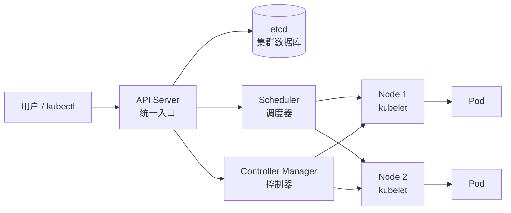
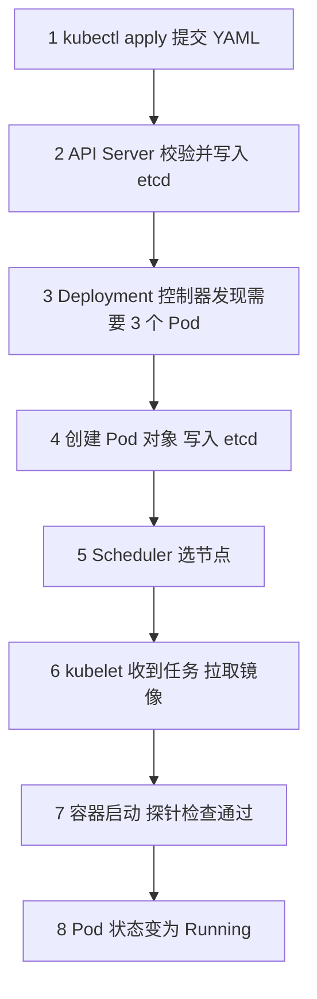

# Kubernetes基础

## 基础知识

### Kubernetes 是什么

Kubernetes（常简称 K8s）是一个容器编排系统：你告诉它“我要 3 个一样的 Web 服务一直跑着”，它负责找机器、启动容器、挂了重启、流量分发、版本升级。

生活类比：开一家连锁奶茶店。以前是你亲自去每家店招人、摆设备、盯着别关门；用了 Kubernetes，就像请了一个总部运营团队——你只下指令“全市开 3 家店，配方是这个”，总部负责选址、开店、店员病了换人、客人太多时加开分店。

它不管你的代码怎么写，只管“容器怎么跑、跑几个、怎么互相找到对方”。

### 集群、节点、Pod：先认三层

- **集群（Cluster）**：一整套 Kubernetes，就是“连锁品牌总部 + 所有门店”。
- **节点（Node）**：集群里的一台机器（物理机或虚拟机），就是“一间门店的铺位”。
- **Pod**：Kubernetes 里最小的部署单位，一个 Pod 里通常装一个主容器，可以再带一两个辅助容器（比如日志收集的边车容器）。

生活类比：Pod 就像一个集装箱。集装箱里可以只装一台奶茶机，也可以再塞一个小冰箱；码头（节点）负责堆放集装箱，调度员决定哪个集装箱放哪个泊位。

一个关键点：Pod 是会“死”的。节点故障、容器崩溃都会让 Pod 消失，所以不要把 Pod 当成一台固定的服务器，要把它当成随时可替换的集装箱。

### 六个核心对象：一句话定位 + 一个小例子

| 对象 | 一句话定位 | 小例子 |
| --- | --- | --- |
| Pod | 最小运行单位，一组共享网络和存储的容器 | 跑一个 Nginx 容器的 Pod，对外提供一个网页 |
| Deployment | 管 Pod 的“店长”，保证指定数量的 Pod 一直在，还负责滚动升级 | 声明“我要 3 个 Web Pod”，挂了一个自动补一个 |
| Service | 给一组 Pod 一个固定不变的访问入口，内部做负载均衡 | 3 个 Web Pod 换来换去，调用方永远只访问 `web-service:80` |
| ConfigMap | 存非敏感配置的“公告栏”，以键值对或文件形式挂进 Pod | 把 `APP_ENV=production`、`LOG_LEVEL=info` 存进去，容器启动时读取 |
| Secret | 存敏感信息的“保险柜”，用法和 ConfigMap 类似，但内容以 Base64 存放、靠 RBAC 权限保护 | 把数据库密码、API 密钥存进去，容器以环境变量读取 |
| Ingress | 集群的“大门迎宾”，按域名和路径把外部流量路由到不同的 Service | `www.example.com` 走 Web 服务，`api.example.com` 走接口服务 |

注意 ConfigMap 和 Secret 的分工：能公开的配置放 ConfigMap，密码、令牌、证书放 Secret。把数据库密码写进 ConfigMap，就像把保险柜密码贴在公告栏上。

### kubectl：你和集群说话的遥控器

`kubectl` 是命令行工具，所有操作都是“发一份期望状态给集群，集群自己想办法达成”。

最常用的六个命令，每个配一个真实场景：

- `kubectl get pods`：早上到岗，先看一眼所有 Pod 是不是都在 Running，相当于查房点名。
- `kubectl describe pod web-abc123`：某个 Pod 一直 Pending 或 CrashLoopBackOff 时，看它的事件和状态找原因，相当于调病历。
- `kubectl logs web-abc123`：用户说“页面 500 了”，先看这个 Pod 的日志里报了什么错，相当于听病人主诉。
- `kubectl exec -it web-abc123 -- /bin/sh`：怀疑容器里缺了某个配置文件，进容器内部亲眼看一眼，相当于进店实地检查。
- `kubectl apply -f deployment.yaml`：改完 YAML 后让集群按新文件执行，相当于把新版装修图交给施工队。
- `kubectl rollout status deployment/web`：刚发布新版本，盯着滚动升级有没有卡住，相当于盯着装修进度表。

> 以下命令输出均为按官方文档给出的典型示例，非真实集群实测输出（本机无集群环境）。

```bash
kubectl get pods
# 典型示例输出：
# NAME                   READY   STATUS    RESTARTS   AGE
# web-7d8f6b4c5d-x2k9p   1/1     Running   0          5m
```

## 原理剖析

### 控制平面：小区的物业管理处

控制平面（Control Plane）就是集群的“大脑 + 物业管理处”，它不直接跑你的业务容器，只负责决策和管理。

生活类比：一个大型小区。物业管理处里有不同岗位：有人接业主电话（API Server）、有人拿着业主名册和规章制度（etcd）、有人决定新住户分到哪栋楼（Scheduler）、有人巡逻发现空房子就安排人入住（Controller Manager）。

下图是控制平面的组件架构，读图时顺着箭头走：所有请求都先到 API Server，再由它分发。



各组件的分工，一句话一个：

- **API Server**：唯一入口。所有 kubectl 命令、所有组件之间的通信都要经过它，就像物业的前台电话总机。
- **etcd**：集群的“房产证档案柜”，保存所有期望状态（比如“Web 服务要 3 个副本”）。数据丢了，集群就失忆了。
- **Scheduler**：调度器。新的 Pod 要出生时，决定把它放到哪个节点上，就像分房办按空房情况分房。
- **Controller Manager**：一组合规巡逻员。Deployment 控制器发现 Pod 少了一个就补一个，ReplicaSet 控制器保证副本数，相当于“发现空铺就招商”。
- **kubelet**：每个节点上的“店长”。接控制平面的指令，在本节点上真正启动、停止容器，并上报状态。
- **kube-proxy**：每个节点上的“交通协管”，负责把 Service 的流量转发到正确的 Pod 上。

### Pod 是怎么出生的：从提交 YAML 到容器跑起来

下面这张图是 Pod 创建调度的完整流程，跟着数字走一遍就明白“声明式”是什么意思。



关键在第 2 步和第 3 步之间：你提交的只是“期望”，真正干活的是控制器在不停地“对账”——现状和期望不一样，就动手把它改成一样。这就是声明式 API 的核心。

### 资源调度算一笔账：request 和 limits

调度器选节点时只看一个数：**request**（申请量），不看 limits（上限）。

先算单位：CPU 里 `500m` 就是 0.5 核（500 ÷ 1000 = 0.5），`250m` 就是 0.25 核；内存里 `512Mi` 是 0.5 Gi（512 ÷ 1024 = 0.5），`128Mi` 是 0.125 Gi。

现在算一笔账。假设集群里只有一个节点，4 核 CPU、8 Gi 内存；你要部署 5 个 Pod，每个 Pod 的 request 都是 1 核 CPU、1 Gi 内存。

- 5 个 Pod 总共申请 CPU：5 × 1 = 5 核，节点只有 4 核，占比 5 ÷ 4 = 125%，超了。
- 5 个 Pod 总共申请内存：5 × 1 = 5 Gi，节点有 8 Gi，占比 5 ÷ 8 = 62.5%，没超。
- 前 4 个 Pod 调度完，节点已用 4 × 1 = 4 核、4 × 1 = 4 Gi，剩余 CPU 是 4 − 4 = 0 核，剩余内存是 8 − 4 = 4 Gi。
- 第 5 个 Pod 还需要 1 核 CPU，剩余 0 核不够，于是它进不了任何节点，状态卡在 **Pending**，事件里会写 `Insufficient cpu`。

结论：CPU 先撞墙，内存还有 4 Gi 空着也没用，调度器是按“最短的那块板”算的。

再算 limits 的超售。假如每个 Pod 的 limits 是 2 核、2 Gi：

- 5 个 Pod 的 limits 总计是 5 × 2 = 10 核、5 × 2 = 10 Gi。
- 对 4 核节点来说，CPU 超售倍数是 10 ÷ 4 = 2.5 倍；内存超售是 10 ÷ 8 = 1.25 倍。
- 超售本身不报错，因为 limits 只是“最多能用多少”，不是“预先占住多少”。但如果 5 个 Pod 同时满负荷跑，节点资源不够用，CPU 会被节流变慢，内存超了会触发 OOM Kill，把最能吃内存的容器杀掉。

所以实战口径是：request 按“平时真实用量”填，保证能调度；limits 按“峰值再留余量”填，防止一个 Pod 把整台节点拖垮。request 填得太小会导致调度上去却跑不动，填得太大会浪费节点、白白让 Pod Pending。

## 进阶知识

### 资源请求、限制与调度定量：节点能装多少 Pod、HPA 何时触发

前文「资源调度算一笔账」只算了一半：调度器按 request 算账没错，但它算的不是节点 Capacity，而是 **Allocatable（可分配量）**；而 Pod 跑起来之后能不能不被节流、不被杀掉、不被驱逐，看的是 limits 和 QoS；流量上来之后副本数变不变，看的是 HPA 的算式。这一节把三笔账一次算全。

生活类比：节点是一间仓库，Capacity 是仓库的建筑面积，Allocatable 是扣掉消防通道、物业办公室和安全余量之后真正能摆货架的面积；request 是你向仓库管理员预订的货架格子，limits 是消防规定的单格最大堆高；HPA 是看到货架快满了就自动加格子的值班员；QoS 是着火时先搬谁的货的优先级。

#### 1. 概念：先分清三组数

**第一组：Capacity 与 Allocatable。** Capacity 是节点物理资源的账面总量；Allocatable 是调度器真正能分给 Pod 的量，公式是：

```text
Allocatable = Capacity - kubeReserved - systemReserved - evictionHard
```

- `kubeReserved`：留给 kubelet、容器运行时等 Kubernetes 自身守护进程的量。
- `systemReserved`：留给 sshd、udev、journald 等操作系统守护进程的量。
- `evictionHard`：硬驱逐阈值，只对内存和临时存储有效，CPU 没有驱逐阈值、所以 CPU 的 Allocatable 里没有这一项。

默认值（Kubernetes 1.37，2026-11-18 核验）：`kubeReserved` 与 `systemReserved` 默认都是空，即默认不预留，全部 Capacity 都算进 Allocatable；`evictionHard` 默认是 `memory.available` 低于 100Mi、`nodefs.available` 低于 10%、`nodefs.inodesFree` 低于 5%、`imagefs.available` 低于 15% 时触发驱逐。也就是说，一个什么都没配的节点，内存 Allocatable 也比 Capacity 少 100Mi——这 100Mi 是硬驱逐阈值占掉的。`enforceNodeAllocatable` 默认只含 `pods` 一项，即 kubelet 只把所有 Pod 一起限制在 Allocatable 以内；想让预留真正约束到系统守护进程，要另外把 `system-reserved`、`kube-reserved` 加进该项。

**第二组：requests 与 limits。** 两组数是给两台不同机器读的：

| 资源 | request 给谁读 | limit 给谁读 | 超过 limit 的后果 |
| --- | --- | --- | --- |
| CPU | 调度器：按它算能不能放下这个 Pod | 内核 cgroup：按它做 CFS quota 节流 | 被节流：变慢，不重启、不报错事件 |
| 内存 | 调度器：按它算能不能放下这个 Pod；kubelet：按它给驱逐排序 | 内核 cgroup：硬上限 | 被 OOM Kill：容器直接被杀，重启后状态里出现 OOMKilled，退出码 137 |

关键区别就一句：**CPU 是可压缩资源**，超了只是慢；**内存是不可压缩资源**，超了就是死。所以内存 limit 必须按实测峰值加余量来定，CPU limit 定错了最多是变慢，内存 limit 定错了是半夜被杀。

两条 API 默认规则也要记住：只写了 limit 没写 request 时，request 会默认等于 limit；内存 limit 写得比 request 还小，API Server 会直接拒绝这个 Pod。

**第三组：HPA 的三个数。** HPA 的目标利用率、`minReplicas`、`maxReplicas`。利用率的分母是 request，不是 limit、也不是节点容量——所以 request 填多少，直接决定了 HPA 的触发基线。

#### 2. 原理：Allocatable 手算例——节点到底能装几个 Pod

沿用前文的节点：4 核 CPU、8 Gi 内存（8 Gi 等于 8192 Mi）。假设 kubelet 配了示例预留（注意：以下 `kubeReserved` 与 `systemReserved` 的取值是示例，不是默认值；默认值是空）：

- `kubeReserved`：CPU 100m、内存 100Mi
- `systemReserved`：CPU 100m、内存 100Mi
- `evictionHard`：`memory.available` 低于 100Mi（默认值）

先算 Allocatable：

- CPU：4 - 0.1 - 0.1 = 3.8 核（CPU 没有 eviction 项）
- 内存：8192 - 100 - 100 - 100 = 7892 Mi，约 7.71 Gi

再算能装几个 Pod。沿用前文 Deployment 里的 Pod 规格：每个 Pod request 是 0.5 核 CPU、512Mi 内存。

- 按 CPU 算：3.8 ÷ 0.5 = 7.6，向下取整是 7 个
- 按内存算：7892 ÷ 512 = 15.4，向下取整是 15 个
- 取最小值：**7 个 Pod，瓶颈是 CPU**

验算第 8 个 Pod 为什么进不来：7 个 Pod 已占 CPU 7 × 0.5 = 3.5 核，剩余 3.8 - 3.5 = 0.3 核，小于一个 Pod 要的 0.5 核，于是第 8 个 Pod 卡在 Pending，事件里写 `Insufficient cpu`。此时内存还剩 7892 - 7 × 512 = 4308 Mi，大把空着也没用——调度器按最短板算。

还有两道天花板要一起看，节点能装的 Pod 数是四者取最小：

- Allocatable 除以单 Pod request（本例是 7 个）
- kubelet 的 `maxPods`，默认 110 个（本例不构成约束）
- CNI 能分配的 IP 数量（取决于具体 CNI 与云厂商实现，无统一数字，待验证）
- DaemonSet 等系统 Pod 已占掉的 request（它们也是普通 Pod，同样吃 Allocatable）

一句话口径：**调度器只认 request 和 Allocatable，不认实际用量。** 节点实际 CPU 只跑了 5%，但 request 已占满时，调度器照样认为它满了。

#### 3. 超卖换算：limits 总和超过节点会怎样

继续上面的例子：7 个 Pod，每个 limits 是 1 核 CPU、1 Gi 内存。

- limits 总计：7 × 1 = 7 核 CPU、7 × 1 = 7 Gi 内存
- CPU 超卖倍数（相对 Capacity）：7 ÷ 4 = 1.75 倍
- CPU 超卖倍数（相对 Allocatable）：7 ÷ 3.8 = 1.84 倍
- 内存 limits 总计 7 Gi，小于内存 Allocatable 7.71 Gi，不超卖

超卖本身不报错，因为 limits 只是「最多能用多少」，不是「预先占住多少」。但 7 个 Pod 如果同时满负荷跑，节点只有 4 核，CPU 会被节流变慢；内存如果同时冲过各自的 limit，超的那个容器会被 OOM Kill。超卖倍数越大，满载时互相挤占得越狠。

所以 request 与 limits 的分工要这样定：request 按「平时真实用量」填，保证能调度、HPA 基线准；limits 按「峰值再留余量」填，防止一个 Pod 把整台节点拖垮。request 填得太小会导致调度上去却跑不动，还会让 HPA 的利用率分母变小、提前触发扩容；填得太大会浪费节点、白白让 Pod Pending。

#### 4. HPA 何时触发：目标利用率的触发算式

HPA 是控制平面里的一个控制循环，默认每 15 秒算一次（由 kube-controller-manager 的同步周期参数控制，默认 15 秒）。核心算式只有一行：

```text
desiredReplicas = ceil(当前副本数 × 当前指标值 ÷ 目标指标值)
```

其中 `ceil` 是向上取整。资源类指标（CPU、内存）的「当前指标值」是各 Pod 利用率的平均值，而利用率 = 实际用量 ÷ 该容器的 request。指标数据来自资源指标 API，一般由 Metrics Server 提供。

手算两例（沿用前文 Deployment：3 副本，每个 Pod request 500m CPU，HPA 目标平均利用率 50%，即目标平均用量是 500 × 50% = 250m）：

- 实测平均用量 400m：算式是 `ceil(3 × 400 ÷ 250)`，等于 `ceil(4.8)`，结果是 **5 副本**，扩容 2 个。
- 实测平均用量 125m：算式是 `ceil(3 × 125 ÷ 250)`，等于 `ceil(1.5)`，结果是 **2 副本**，但不会立刻缩容，原因见下文的稳定窗口。

还有两道刹车，算式算出的数不是直接执行的：

- **容忍度**：当前值与目标值的比值在 1.0 上下 10% 以内（默认 0.1）时，HPA 什么都不做。比如比值是 1.05，算式明明算出要多 0.15 个副本，HPA 也会按兵不动，避免抖动。
- **稳定窗口**：扩容稳定窗口默认 0 秒，即算出来要扩就马上扩；缩容稳定窗口默认 300 秒（5 分钟），即 HPA 取过去 5 分钟里算出的最高副本建议，只有连续 5 分钟都建议缩，才真正缩下去。上面第二例算出的 2 副本，要等 5 分钟持续低负载才会执行。默认的速率策略是：每 15 秒最多扩容 100% 或 4 个 Pod（取较大者），每 15 秒最多缩容 100%。
- `autoscaling/v2` 是当前稳定版 API（自 Kubernetes 1.23 起稳定），`autoscaling/v1` 只支持 CPU 单指标，已不推荐。

一个常见坑：**用内存利用率做 HPA 目标要格外小心。** CPU 用量随负载升降，副本数多了单 Pod 的 CPU 利用率会下来；但内存用量通常不会因为副本多了就降下去——加副本分摊的是请求，不是已占的内存。内存 HPA 一旦触发扩容，利用率可能纹丝不动，HPA 会一路扩到 `maxReplicas`。内存更适合做告警和容量规划，扩容目标优先选 CPU 或自定义指标（如队列深度、每秒请求数）。

#### 5. QoS 三档与驱逐顺序的定量影响

Kubernetes 不用你手动指定 QoS，它完全由 request 和 limits 的填法推导出来：

| QoS 档 | 判定条件 | 节点内存压力下的驱逐顺序 |
| --- | --- | --- |
| Guaranteed | 每个容器的 CPU 与内存 request 都等于 limits | 最后驱逐 |
| Burstable | 至少一个容器设了 request 或 limits，但不符合 Guaranteed | 中间驱逐 |
| BestEffort | 所有容器都没设 request 和 limits | 最先驱逐 |

kubelet 驱逐时的排序规则是：先按 QoS 档（BestEffort、Burstable、Guaranteed），同档内再按 Pod 优先级（低优先级先走），Burstable 同档内按「实际用量超出 request 的比例」从大到小排，公式是（实际内存用量 - 内存 request）÷ 内存 request。

手算一例：节点内存告急，要在两个 Burstable Pod 里挑一个驱逐。

- Pod A：内存 request 512Mi，实际用了 1536Mi，超出比例是（1536 - 512）÷ 512 = 2.0，即超出 200%
- Pod B：内存 request 1024Mi，实际用了 1228.8Mi（1.2 Gi），超出比例是（1228.8 - 1024）÷ 1024 = 0.2，即超出 20%
- 结果：**先驱逐 Pod A**，因为它超出自己预订量的幅度最大。

三点定量推论，填 request 和 limits 时就要想清楚：

- request 填得越小，（用量 - request）÷ request 的比值越大，节点压力一来你越先被驱逐。request 填小省调度、填大保命，这是同一笔账的两面。
- Guaranteed 档的保护是有代价的：request 等于 limits 意味着你按峰值预订了全部资源，调度时最占地方；换来的好处是最后才被驱逐，且内核 OOM  killer 给它的 `oom_score_adj` 最低（Guaranteed 是 -997，BestEffort 是 1000，分越低越不容易被内核选中杀掉）。
- 节点内存真正耗尽、kubelet 来不及驱逐时，动手的是内核 OOM killer，它按 `oom_score_adj` 加实际用量打分，不完全按 QoS 排——极端情况下一个用量巨大的 Guaranteed 容器也可能先于用量小的 Burstable 容器被杀。QoS 保的是 kubelet 驱逐顺序，不是内核杀人的顺序。
- 附带一点：Guaranteed 档且 CPU 为整数核的 Pod，在静态 CPU 管理策略下可获得独占物理核、不走 CFS quota 节流，这是延迟敏感服务选 Guaranteed 的另一个理由。

#### 6. 常见问题

- **问：request 总和没超 Allocatable，Pod 还是 Pending？** 先看是不是撞了 `maxPods` 110 的上限或 CNI 的 IP 上限，再看节点是不是打了污点、Pod 的亲和性规则是不是太苛刻，最后看 DaemonSet 有没有先占掉一大块 request。
- **问：HPA 配了目标 50%，利用率明明 80% 却不扩容？** 先确认 Metrics Server 装了没有（没有它就没有资源指标 API），再确认 Pod 的 request 填了没有（利用率的分母是 request，没填 request 就没有利用率可算），最后看是不是卡在容忍度或 `maxReplicas` 上。
- **问：缩容后负载一回来又扩容，来回抖怎么办？** 先把缩容稳定窗口从默认 300 秒调大，再检查目标利用率是不是定得太低（目标 50% 意味着扩容后利用率要回到 50% 附近才稳住，目标定得越低、扩容后离触发线越近、越容易反复横跳）。
- **问：节点内存压力告警响了，先动谁？** 先看驱逐顺序：BestEffort 的 Pod 是第一批牺牲品，确认它们是不是能丢；再看 Burstable 里超出 request 最多的那个；Guaranteed 的 Pod 最后动，动之前先扩节点或迁移，而不是调低它的 limits。

#### 7. 生产实践

- 给每个容器都填内存 request 和 limits，CPU 至少填 request；延迟敏感服务可以不填 CPU limit，让它用节点空闲 CPU，但内存 limit 一定要有。
- request 按一周实测用量的 P95 附近定，不要按峰值定（峰值留给 limits），也不要按平均值定（平均值定 request 会让 HPA 基线失真、驱逐排序吃亏）。
- HPA 的 `minReplicas` 至少留 2 个做高可用，`maxReplicas` 按节点容量反推：最大副本数 × 单 Pod request 不能超过集群 Allocatable 总和，否则扩容到一半会 Pending。
- 定期跑 `kubectl describe node` 对一遍 Capacity 与 Allocatable 的差，差值突然变大说明有人改了 kubelet 预留或驱逐阈值，先查配置再查应用。

> 来源：Kubernetes 官方文档「Reserve Compute Resources for System Daemons」「Horizontal Pod Autoscaling」「Pod Quality of Service Classes」「Node-pressure Eviction」；核验日期 2026-11-18；版本口径 Kubernetes 1.37（最新补丁 1.37.2，2026-10-27 发布；1.38 预计 2026-12-16 发布）。托管集群（EKS、GKE、AKS）的预留与 Pod 上限各有自己的默认值，数字以各云厂商文档为准。

### Deployment：完整可跑的 YAML，逐字段讲

下面是一份完整可跑的 Deployment 示例，部署 3 个 Nginx 副本。逐字段拆开讲：

```yaml
apiVersion: apps/v1          # Deployment 稳定版 API，写死即可
kind: Deployment             # 对象类型：Deployment
metadata:
  name: web                  # Deployment 的名字，同一命名空间内唯一
  labels:
    app: web                 # 标签，后面 Service 靠它找 Pod
spec:
  replicas: 3                # 期望副本数：3 个 Pod
  strategy:
    type: RollingUpdate      # 默认策略就是滚动更新
    rollingUpdate:
      maxSurge: 1            # 更新期最多比期望多 1 个 Pod
      maxUnavailable: 1      # 更新期最少保持可用 3 − 1 = 2 个 Pod
  selector:
    matchLabels:
      app: web               # 选择器：管哪些 Pod，必须和模板标签一致
  template:                  # Pod 模板：新 Pod 按这个模子造
    metadata:
      labels:
        app: web             # Pod 的标签，和 selector 对上号
    spec:
      containers:
        - name: nginx        # 容器名
          image: nginx:1.27  # 镜像名和版本，写死版本别用 latest
          ports:
            - containerPort: 80   # 容器监听的端口
          resources:
            requests:        # 申请量：调度器按这个算账
              cpu: "500m"    # 0.5 核
              memory: "512Mi"  # 0.5 Gi
            limits:          # 上限：最多能用到这么多
              cpu: "1"       # 1 核
              memory: "1Gi"  # 1 Gi
          livenessProbe:     # 存活探针：判断容器是不是“死了”
            httpGet:
              path: /        # 探针请求路径
              port: 80       # 探针请求端口
            initialDelaySeconds: 10  # 启动后 10 秒再开始探
            periodSeconds: 5         # 每 5 秒探一次
          readinessProbe:    # 就绪探针：判断容器能不能“接客”
            httpGet:
              path: /
              port: 80
            initialDelaySeconds: 5
            periodSeconds: 5
```

字段之间的关系要记牢：`selector.matchLabels` 必须和 `template.metadata.labels` 一致，否则 Deployment 找不到自己管的 Pod；`image` 写死版本号（`nginx:1.27`），不要用 `latest`，否则回滚时不知道当初跑的是哪个版本。

### Service：完整可跑的 YAML，逐字段讲

Deployment 让 Pod 跑起来了，但 Pod 的 IP 随时会变，调用方不能直接记 IP。Service 就是给这组 Pod 一个固定门牌号。

```yaml
apiVersion: v1               # Service 属于核心 API 组 v1
kind: Service                # 对象类型：Service
metadata:
  name: web-service          # Service 的名字，集群内可解析的域名
spec:
  type: ClusterIP            # 类型：只在集群内部可访问
  selector:
    app: web                 # 选择器：把标签是 app=web 的 Pod 纳入
  ports:
    - port: 80               # Service 对外暴露的端口
      targetPort: 80         # 转发到 Pod 的哪个端口
      protocol: TCP          # 协议，默认 TCP
```

逐字段讲：`selector.app: web` 和 Deployment 里 Pod 的标签对上，Service 才能找到那 3 个 Pod；`port` 是调用方访问 Service 时用的端口，`targetPort` 是 Pod 里容器真正监听的端口，两者可以不一样（比如 Service 用 80，对应容器里的 8080）；`type: ClusterIP` 是默认值，只能在集群内部访问，想从集群外访问要换成 NodePort、LoadBalancer，或者配 Ingress。

流量分发算一笔账：3 个副本时，每个 Pod 分到的流量大约是 100 ÷ 3 = 33.3%。Service 会把流量分发到三个 Pod 上（iptables 模式下每次随机选一个后端，不是严格轮询），长期看三个 Pod 的负载大体相当。

### ConfigMap 与 Secret：配置和密码分开放

ConfigMap 的用法是先创建、再引用。创建一个存放应用环境的 ConfigMap：

```bash
kubectl create configmap app-config --from-literal=APP_ENV=production --from-literal=LOG_LEVEL=info
```

然后在 Pod 里以环境变量引用：

```yaml
env:
  - name: APP_ENV
    valueFrom:
      configMapKeyRef:
        name: app-config
        key: APP_ENV
```

Secret 的用法几乎一样，只是创建方式不同，内容以 Base64 存放（注意：Base64 只是编码不是加密，真正的安全靠 RBAC 权限和 etcd 加密）：

```bash
kubectl create secret generic db-pass --from-literal=password='S3cret!2026'
```

引用时把 `configMapKeyRef` 换成 `secretKeyRef` 即可。判断放哪边的标准很简单：泄露了会不会造成损失——会，就放 Secret；不会，就放 ConfigMap。

### Ingress：集群的大门

Service 的 ClusterIP 只能在集群内访问，Ingress 解决“从外面进来按域名分流”的问题：

```yaml
apiVersion: networking.k8s.io/v1
kind: Ingress
metadata:
  name: web-ingress
spec:
  rules:
    - host: www.example.com      # 域名匹配
      http:
        paths:
          - path: /              # 路径匹配
            pathType: Prefix
            backend:
              service:
                name: web-service  # 转发到哪个 Service
                port:
                  number: 80
```

注意：Ingress 本身只是一份“路由规则”，真正干转发活的是 Ingress Controller（比如 Nginx Ingress Controller），集群里没装 Controller，写了 Ingress 规则也不会生效。

## 疑难杂症

### Pod 一直 Pending：先看事件，再看资源

`kubectl describe pod <名字>` 拉到 Events 一节，常见原因就两种：

- `Insufficient cpu` 或 `Insufficient memory`：节点资源不够，算一遍 request 总账，看是不是前面那笔账里的第 5 个 Pod。
- 节点打了污点（Taint）或 Pod 的亲和性规则太苛刻：Pod 要求“必须跑在带 SSD 的节点上”，集群里偏偏没有这种节点。

### CrashLoopBackOff：容器起来就死，起来就死

状态反复在 Running 和 Crash 之间横跳，通常是启动命令错了、配置文件缺了、端口被占了。先 `kubectl logs <Pod 名>` 看报错，再 `kubectl logs <Pod 名> --previous` 看上一次死掉之前的日志。

### 探针配错的后果：liveness 和 readiness 不是一回事

- **livenessProbe（存活探针）**：判断容器“死没死”。失败了，kubelet 就重启容器。
- **readinessProbe（就绪探针）**：判断容器“能不能接客”。失败了，Service 就把这个 Pod 从流量名单里摘掉，但不重启。

配错的后果各不相同：

- 把启动很慢的应用配上很短的 `initialDelaySeconds`，liveness 探针在应用还没启动完时就判定死亡，容器被反复重启，永远起不来。
- 把 readiness 探针错配成 liveness 探针：一个临时过载的 Pod 本来只需要被摘掉几秒等它缓过来，结果被直接重启，重启期间流量全丢。
- 只配 liveness 不配 readiness：新 Pod 刚启动、还没加载完数据就开始接流量，用户拿到一堆 500 错误。

算一笔时间账：`initialDelaySeconds: 10`、`periodSeconds: 5`、`failureThreshold: 3` 时，从启动到判定失败大约是 10 + 5 × 3 = 25 秒（含首次探测），其中连续失败本身占 3 × 5 = 15 秒。启动慢的应用要把 `initialDelaySeconds` 设得比实测启动时间再多留几秒。

### 滚动升级卡住：先看 rollout，再看新 Pod

`kubectl rollout status deployment/web` 卡住时，通常是新镜像拉取失败（镜像名写错、私有仓库没配拉取凭证），或者新 Pod 的 readiness 探针一直不通过。先 `kubectl get pods` 看新 Pod 的状态，再 `kubectl describe` 看事件。

## 实战案例

### 案例：从零发布一个 Web 服务并完成一次升级

场景：一台 4 核 8 Gi 的单节点学习集群，要上线一个 Nginx 静态站，3 副本，集群内可访问。

**第一步：写 Deployment 并提交。**

把进阶知识里的 Deployment YAML 存为 `deployment.yaml`，执行 `kubectl apply -f deployment.yaml`，再用 `kubectl get pods` 确认 3 个 Pod 都 Running。

资源账先算好：每个 Pod request 是 0.5 核、0.5 Gi，3 个 Pod 总共是 3 × 0.5 = 1.5 核、3 × 0.5 = 1.5 Gi，占节点的 1.5 ÷ 4 = 37.5% CPU 和 1.5 ÷ 8 = 18.75% 内存，绰绰有余。

**第二步：写 Service 并验证。**

把进阶知识里的 Service YAML 存为 `service.yaml`，执行 `kubectl apply -f service.yaml`。在集群内用 `kubectl run curl-test --image=curlimages/curl -it --rm -- curl http://web-service/` 验证能拿到 Nginx 欢迎页。

**第三步：升级镜像。**

```bash
kubectl set image deployment/web nginx=nginx:1.28
kubectl rollout status deployment/web
```

升级过程里，默认策略是滚动更新：先起 1 个新 Pod、确认就绪后再停 1 个旧 Pod，逐步替换。本例把 `maxSurge` 与 `maxUnavailable` 都设为 1（见上文 YAML 的 strategy 一节），replicas 是 3，更新期 Pod 总数最多是 3 + 1 = 4 个，最少可用是 3 − 1 = 2 个，服务全程不断。

**第四步：升级出问题就回滚。**

```bash
kubectl rollout undo deployment/web
kubectl rollout status deployment/web
```

回滚不是“重新部署旧镜像”，而是把 Deployment 的 Pod 模板恢复到上一个版本，再走一遍同样的滚动更新流程。

## 面试与自测

1. Pod 和容器是什么关系？为什么说 Pod 是最小部署单位而不是容器？
2. 节点 4 核 8 Gi，5 个 Pod 各 request 1 核 1 Gi，第 5 个 Pod 会发生什么？为什么？
3. livenessProbe 和 readinessProbe 失败后分别会发生什么？把启动很慢的应用配上很短的 initialDelaySeconds 会有什么后果？
4. Deployment 改了镜像后，为什么用户可能不会立刻看到新版本？滚动更新期间 Pod 数量是怎么变化的（replicas=3、maxSurge=1、maxUnavailable=1）？
5. 节点 4 核 8 Gi，kubelet 预留 CPU 各 100m、内存各 100Mi，硬驱逐阈值是内存可用低于 100Mi；Pod 每个 request 0.5 核、512Mi 内存，limits 各 1 核、1 Gi。这个节点能装几个这样的 Pod？CPU 超卖几倍？如果节点内存告急，一个 request 512Mi 实际用了 1536Mi 的 Pod 和一个 request 1024Mi 实际用了 1228.8Mi 的 Pod，谁先被驱逐？

### 参考答案

1. 一个 Pod 里可以装一个或多个容器，这些容器共享同一个网络命名空间和存储卷，生死与共、同进同退。容器不能独立被调度，调度器分配资源、kubelet 启停的最小单位都是 Pod，所以 Pod 是最小部署单位。
2. 第 5 个 Pod 会卡在 Pending，事件里出现 `Insufficient cpu`。前 4 个 Pod 已占 4 × 1 = 4 核，节点只剩 4 − 4 = 0 核，调度器只按 request 算账，CPU 不够就无法调度；内存还剩 8 − 4 = 4 Gi，但按最短板算也没用。
3. liveness 失败会重启容器，readiness 失败只把 Pod 从 Service 的流量名单摘掉、不重启。启动慢的应用配上很短的 initialDelaySeconds 时，liveness 探针会在应用尚未启动完成时判定死亡，容器被反复重启、永远起不来。
4. 因为 Deployment 默认做滚动更新，不是全量替换：先起新 Pod、确认就绪后再停旧 Pod，逐步替换。replicas=3、maxSurge=1、maxUnavailable=1 时，更新期 Pod 总数最多 3 + 1 = 4 个，最少可用 3 − 1 = 2 个，所以用户在一段时间内仍可能访问到旧版本 Pod，这是正常的，不是发布失败。
5. Allocatable 是 CPU 4 - 0.1 - 0.1 = 3.8 核，内存 8192 - 100 - 100 - 100 = 7892 Mi。按 CPU 算 3.8 ÷ 0.5 = 7.6 取整 7 个，按内存算 7892 ÷ 512 = 15.4 取整 15 个，取最小值是 7 个，瓶颈是 CPU；7 个 Pod 的 limits 总计 7 核，相对 Capacity 超卖 7 ÷ 4 = 1.75 倍。两个 Pod 都是 Burstable，同档内按（用量 - request）÷ request 排序：前者（1536 - 512）÷ 512 = 2.0，后者（1228.8 - 1024）÷ 1024 = 0.2，所以 request 512Mi 用了 1536Mi 的那个先被驱逐。

## 小技巧与冷知识

- `kubectl get pods -o wide` 能一次看到 Pod 所在的节点和 IP，排查“流量是不是都跑到同一个节点上”时最快。
- `kubectl get pods --sort-by=.metadata.creationTimestamp` 按创建时间排序，一眼看出哪批 Pod 是刚滚动升级出来的。
- 给 Pod 打标签不是摆设：`kubectl get pods -l app=web` 只列出带这个标签的 Pod，标签选错是 Service 找不到 Pod 的头号原因。
- `kubectl apply` 是声明式提交，可以反复执行同一份 YAML；`kubectl create` 是命令式创建，执行第二次会因为“已存在”而报错。
- Kubernetes 的名字 Kubernetes 源自希腊语“舵手”，图标是一个七边形的船舵；缩写 K8s 是因为 K 和 s 之间正好有 8 个字母。
- Service 的 ClusterIP 是虚拟 IP，节点上并没有真的监听这个 IP 的网卡，流量转发靠 kube-proxy 写 iptables 或 IPVS 规则实现。
- 先算 Allocatable 再报资源不足：`kubectl describe node` 里 Capacity 与 Allocatable 的差就是 kubelet 预留加驱逐阈值，Pod Pending 时先对这笔账，再怀疑应用；只看 Capacity 会以为节点还有余量，实际调度器早就按 Allocatable 判满了。

## 关联知识

- [Linux性能分析](工程实践/运维/Linux性能分析.md)：Pod 出现 CPU 节流或内存 OOM 时，先在节点上用性能分析定位是应用问题还是资源配额问题。
- [监控告警](工程实践/运维/监控告警.md)：Pod 重启次数、Pending 时长和 Service 流量是进监控大盘的第一批指标，异常先告警再排查。
- [灾备备份与恢复演练](工程实践/运维/灾备备份与恢复演练.md)：etcd 是集群的记忆，定期备份 etcd 才能在控制平面损坏后恢复整套期望状态。
- [OpenTelemetry](工程实践/运维/OpenTelemetry.md)：跨多个 Service 调用链路出问题时，用分布式追踪定位是哪一跳变慢，而不是逐个 Pod 翻日志。
