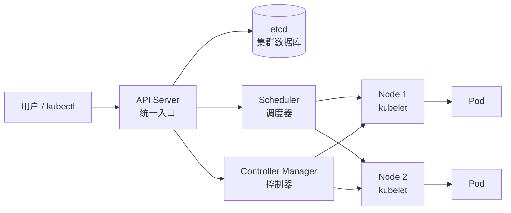
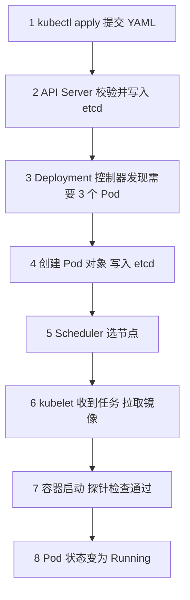

# Kubernetes基础

<!-- TOC -->
- [基础知识](#基础知识)
  - [Kubernetes 是什么](#kubernetes-是什么)
  - [集群、节点、Pod：先认三层](#集群节点pod先认三层)
  - [六个核心对象：一句话定位 + 一个小例子](#六个核心对象一句话定位--一个小例子)
  - [kubectl：你和集群说话的遥控器](#kubectl你和集群说话的遥控器)
- [原理剖析](#原理剖析)
  - [控制平面：小区的物业管理处](#控制平面小区的物业管理处)
  - [Pod 是怎么出生的：从提交 YAML 到容器跑起来](#pod-是怎么出生的从提交-yaml-到容器跑起来)
  - [资源调度算一笔账：request 和 limits](#资源调度算一笔账request-和-limits)
- [进阶知识](#进阶知识)
  - [Deployment：完整可跑的 YAML，逐字段讲](#deployment完整可跑的-yaml逐字段讲)
  - [Service：完整可跑的 YAML，逐字段讲](#service完整可跑的-yaml逐字段讲)
  - [ConfigMap 与 Secret：配置和密码分开放](#configmap-与-secret配置和密码分开放)
  - [Ingress：集群的大门](#ingress集群的大门)
- [疑难杂症](#疑难杂症)
  - [Pod 一直 Pending：先看事件，再看资源](#pod-一直-pending先看事件再看资源)
  - [CrashLoopBackOff：容器起来就死，起来就死](#crashloopbackoff容器起来就死起来就死)
  - [探针配错的后果：liveness 和 readiness 不是一回事](#探针配错的后果liveness-和-readiness-不是一回事)
  - [滚动升级卡住：先看 rollout，再看新 Pod](#滚动升级卡住先看-rollout再看新-pod)
- [实战案例](#实战案例)
  - [案例：从零发布一个 Web 服务并完成一次升级](#案例从零发布一个-web-服务并完成一次升级)
- [面试与自测](#面试与自测)
  - [参考答案](#参考答案)
- [小技巧与冷知识](#小技巧与冷知识)
- [关联知识](#关联知识)
<!-- /TOC -->

## 基础知识

### Kubernetes 是什么

Kubernetes（常简称 K8s）是一个容器编排系统：你告诉它“我要 3 个一样的 Web 服务一直跑着”，它负责找机器、启动容器、挂了重启、流量分发、版本升级。

生活类比：开一家连锁奶茶店。以前是你亲自去每家店招人、摆设备、盯着别关门；用了 Kubernetes，就像请了一个总部运营团队——你只下指令“全市开 3 家店，配方是这个”，总部负责选址、开店、店员病了换人、客人太多时加开分店。

它不管你的代码怎么写，只管“容器怎么跑、跑几个、怎么互相找到对方”。

### 集群、节点、Pod：先认三层

- **集群（Cluster）**：一整套 Kubernetes，就是“连锁品牌总部 + 所有门店”。
- **节点（Node）**：集群里的一台机器（物理机或虚拟机），就是“一间门店的铺位”。
- **Pod**：Kubernetes 里最小的部署单位，一个 Pod 里通常装一个主容器，可以再带一两个辅助容器（比如日志收集的边车容器）。

生活类比：Pod 就像一个集装箱。集装箱里可以只装一台奶茶机，也可以再塞一个小冰箱；码头（节点）负责堆放集装箱，调度员决定哪个集装箱放哪个泊位。

一个关键点：Pod 是会“死”的。节点故障、容器崩溃都会让 Pod 消失，所以不要把 Pod 当成一台固定的服务器，要把它当成随时可替换的集装箱。

### 六个核心对象：一句话定位 + 一个小例子

| 对象 | 一句话定位 | 小例子 |
| --- | --- | --- |
| Pod | 最小运行单位，一组共享网络和存储的容器 | 跑一个 Nginx 容器的 Pod，对外提供一个网页 |
| Deployment | 管 Pod 的“店长”，保证指定数量的 Pod 一直在，还负责滚动升级 | 声明“我要 3 个 Web Pod”，挂了一个自动补一个 |
| Service | 给一组 Pod 一个固定不变的访问入口，内部做负载均衡 | 3 个 Web Pod 换来换去，调用方永远只访问 `web-service:80` |
| ConfigMap | 存非敏感配置的“公告栏”，以键值对或文件形式挂进 Pod | 把 `APP_ENV=production`、`LOG_LEVEL=info` 存进去，容器启动时读取 |
| Secret | 存敏感信息的“保险柜”，用法和 ConfigMap 类似，但内容以 Base64 存放、靠 RBAC 权限保护 | 把数据库密码、API 密钥存进去，容器以环境变量读取 |
| Ingress | 集群的“大门迎宾”，按域名和路径把外部流量路由到不同的 Service | `www.example.com` 走 Web 服务，`api.example.com` 走接口服务 |

注意 ConfigMap 和 Secret 的分工：能公开的配置放 ConfigMap，密码、令牌、证书放 Secret。把数据库密码写进 ConfigMap，就像把保险柜密码贴在公告栏上。

### kubectl：你和集群说话的遥控器

`kubectl` 是命令行工具，所有操作都是“发一份期望状态给集群，集群自己想办法达成”。

最常用的六个命令，每个配一个真实场景：

- `kubectl get pods`：早上到岗，先看一眼所有 Pod 是不是都在 Running，相当于查房点名。
- `kubectl describe pod web-abc123`：某个 Pod 一直 Pending 或 CrashLoopBackOff 时，看它的事件和状态找原因，相当于调病历。
- `kubectl logs web-abc123`：用户说“页面 500 了”，先看这个 Pod 的日志里报了什么错，相当于听病人主诉。
- `kubectl exec -it web-abc123 -- /bin/sh`：怀疑容器里缺了某个配置文件，进容器内部亲眼看一眼，相当于进店实地检查。
- `kubectl apply -f deployment.yaml`：改完 YAML 后让集群按新文件执行，相当于把新版装修图交给施工队。
- `kubectl rollout status deployment/web`：刚发布新版本，盯着滚动升级有没有卡住，相当于盯着装修进度表。

> 以下命令输出均为按官方文档给出的典型示例，非真实集群实测输出（本机无集群环境）。

```bash
kubectl get pods
# 典型示例输出：
# NAME                   READY   STATUS    RESTARTS   AGE
# web-7d8f6b4c5d-x2k9p   1/1     Running   0          5m
```

## 原理剖析

### 控制平面：小区的物业管理处

控制平面（Control Plane）就是集群的“大脑 + 物业管理处”，它不直接跑你的业务容器，只负责决策和管理。

生活类比：一个大型小区。物业管理处里有不同岗位：有人接业主电话（API Server）、有人拿着业主名册和规章制度（etcd）、有人决定新住户分到哪栋楼（Scheduler）、有人巡逻发现空房子就安排人入住（Controller Manager）。

下图是控制平面的组件架构，读图时顺着箭头走：所有请求都先到 API Server，再由它分发。



各组件的分工，一句话一个：

- **API Server**：唯一入口。所有 kubectl 命令、所有组件之间的通信都要经过它，就像物业的前台电话总机。
- **etcd**：集群的“房产证档案柜”，保存所有期望状态（比如“Web 服务要 3 个副本”）。数据丢了，集群就失忆了。
- **Scheduler**：调度器。新的 Pod 要出生时，决定把它放到哪个节点上，就像分房办按空房情况分房。
- **Controller Manager**：一组合规巡逻员。Deployment 控制器发现 Pod 少了一个就补一个，ReplicaSet 控制器保证副本数，相当于“发现空铺就招商”。
- **kubelet**：每个节点上的“店长”。接控制平面的指令，在本节点上真正启动、停止容器，并上报状态。
- **kube-proxy**：每个节点上的“交通协管”，负责把 Service 的流量转发到正确的 Pod 上。

### Pod 是怎么出生的：从提交 YAML 到容器跑起来

下面这张图是 Pod 创建调度的完整流程，跟着数字走一遍就明白“声明式”是什么意思。



关键在第 2 步和第 3 步之间：你提交的只是“期望”，真正干活的是控制器在不停地“对账”——现状和期望不一样，就动手把它改成一样。这就是声明式 API 的核心。

### 资源调度算一笔账：request 和 limits

调度器选节点时只看一个数：**request**（申请量），不看 limits（上限）。

先算单位：CPU 里 `500m` 就是 0.5 核（500 ÷ 1000 = 0.5），`250m` 就是 0.25 核；内存里 `512Mi` 是 0.5 Gi（512 ÷ 1024 = 0.5），`128Mi` 是 0.125 Gi。

现在算一笔账。假设集群里只有一个节点，4 核 CPU、8 Gi 内存；你要部署 5 个 Pod，每个 Pod 的 request 都是 1 核 CPU、1 Gi 内存。

- 5 个 Pod 总共申请 CPU：5 × 1 = 5 核，节点只有 4 核，占比 5 ÷ 4 = 125%，超了。
- 5 个 Pod 总共申请内存：5 × 1 = 5 Gi，节点有 8 Gi，占比 5 ÷ 8 = 62.5%，没超。
- 前 4 个 Pod 调度完，节点已用 4 × 1 = 4 核、4 × 1 = 4 Gi，剩余 CPU 是 4 − 4 = 0 核，剩余内存是 8 − 4 = 4 Gi。
- 第 5 个 Pod 还需要 1 核 CPU，剩余 0 核不够，于是它进不了任何节点，状态卡在 **Pending**，事件里会写 `Insufficient cpu`。

结论：CPU 先撞墙，内存还有 4 Gi 空着也没用，调度器是按“最短的那块板”算的。

再算 limits 的超售。假如每个 Pod 的 limits 是 2 核、2 Gi：

- 5 个 Pod 的 limits 总计是 5 × 2 = 10 核、5 × 2 = 10 Gi。
- 对 4 核节点来说，CPU 超售倍数是 10 ÷ 4 = 2.5 倍；内存超售是 10 ÷ 8 = 1.25 倍。
- 超售本身不报错，因为 limits 只是“最多能用多少”，不是“预先占住多少”。但如果 5 个 Pod 同时满负荷跑，节点资源不够用，CPU 会被节流变慢，内存超了会触发 OOM Kill，把最能吃内存的容器杀掉。

所以实战口径是：request 按“平时真实用量”填，保证能调度；limits 按“峰值再留余量”填，防止一个 Pod 把整台节点拖垮。request 填得太小会导致调度上去却跑不动，填得太大会浪费节点、白白让 Pod Pending。

## 进阶知识

### Deployment：完整可跑的 YAML，逐字段讲

下面是一份完整可跑的 Deployment 示例，部署 3 个 Nginx 副本。逐字段拆开讲：

```yaml
apiVersion: apps/v1          # Deployment 稳定版 API，写死即可
kind: Deployment             # 对象类型：Deployment
metadata:
  name: web                  # Deployment 的名字，同一命名空间内唯一
  labels:
    app: web                 # 标签，后面 Service 靠它找 Pod
spec:
  replicas: 3                # 期望副本数：3 个 Pod
  strategy:
    type: RollingUpdate      # 默认策略就是滚动更新
    rollingUpdate:
      maxSurge: 1            # 更新期最多比期望多 1 个 Pod
      maxUnavailable: 1      # 更新期最少保持可用 3 − 1 = 2 个 Pod
  selector:
    matchLabels:
      app: web               # 选择器：管哪些 Pod，必须和模板标签一致
  template:                  # Pod 模板：新 Pod 按这个模子造
    metadata:
      labels:
        app: web             # Pod 的标签，和 selector 对上号
    spec:
      containers:
        - name: nginx        # 容器名
          image: nginx:1.27  # 镜像名和版本，写死版本别用 latest
          ports:
            - containerPort: 80   # 容器监听的端口
          resources:
            requests:        # 申请量：调度器按这个算账
              cpu: "500m"    # 0.5 核
              memory: "512Mi"  # 0.5 Gi
            limits:          # 上限：最多能用到这么多
              cpu: "1"       # 1 核
              memory: "1Gi"  # 1 Gi
          livenessProbe:     # 存活探针：判断容器是不是“死了”
            httpGet:
              path: /        # 探针请求路径
              port: 80       # 探针请求端口
            initialDelaySeconds: 10  # 启动后 10 秒再开始探
            periodSeconds: 5         # 每 5 秒探一次
          readinessProbe:    # 就绪探针：判断容器能不能“接客”
            httpGet:
              path: /
              port: 80
            initialDelaySeconds: 5
            periodSeconds: 5
```

字段之间的关系要记牢：`selector.matchLabels` 必须和 `template.metadata.labels` 一致，否则 Deployment 找不到自己管的 Pod；`image` 写死版本号（`nginx:1.27`），不要用 `latest`，否则回滚时不知道当初跑的是哪个版本。

### Service：完整可跑的 YAML，逐字段讲

Deployment 让 Pod 跑起来了，但 Pod 的 IP 随时会变，调用方不能直接记 IP。Service 就是给这组 Pod 一个固定门牌号。

```yaml
apiVersion: v1               # Service 属于核心 API 组 v1
kind: Service                # 对象类型：Service
metadata:
  name: web-service          # Service 的名字，集群内可解析的域名
spec:
  type: ClusterIP            # 类型：只在集群内部可访问
  selector:
    app: web                 # 选择器：把标签是 app=web 的 Pod 纳入
  ports:
    - port: 80               # Service 对外暴露的端口
      targetPort: 80         # 转发到 Pod 的哪个端口
      protocol: TCP          # 协议，默认 TCP
```

逐字段讲：`selector.app: web` 和 Deployment 里 Pod 的标签对上，Service 才能找到那 3 个 Pod；`port` 是调用方访问 Service 时用的端口，`targetPort` 是 Pod 里容器真正监听的端口，两者可以不一样（比如 Service 用 80，对应容器里的 8080）；`type: ClusterIP` 是默认值，只能在集群内部访问，想从集群外访问要换成 NodePort、LoadBalancer，或者配 Ingress。

流量分发算一笔账：3 个副本时，每个 Pod 分到的流量大约是 100 ÷ 3 = 33.3%。Service 会把流量分发到三个 Pod 上（iptables 模式下每次随机选一个后端，不是严格轮询），长期看三个 Pod 的负载大体相当。

### ConfigMap 与 Secret：配置和密码分开放

ConfigMap 的用法是先创建、再引用。创建一个存放应用环境的 ConfigMap：

```bash
kubectl create configmap app-config --from-literal=APP_ENV=production --from-literal=LOG_LEVEL=info
```

然后在 Pod 里以环境变量引用：

```yaml
env:
  - name: APP_ENV
    valueFrom:
      configMapKeyRef:
        name: app-config
        key: APP_ENV
```

Secret 的用法几乎一样，只是创建方式不同，内容以 Base64 存放（注意：Base64 只是编码不是加密，真正的安全靠 RBAC 权限和 etcd 加密）：

```bash
kubectl create secret generic db-pass --from-literal=password='S3cret!2026'
```

引用时把 `configMapKeyRef` 换成 `secretKeyRef` 即可。判断放哪边的标准很简单：泄露了会不会造成损失——会，就放 Secret；不会，就放 ConfigMap。

### Ingress：集群的大门

Service 的 ClusterIP 只能在集群内访问，Ingress 解决“从外面进来按域名分流”的问题：

```yaml
apiVersion: networking.k8s.io/v1
kind: Ingress
metadata:
  name: web-ingress
spec:
  rules:
    - host: www.example.com      # 域名匹配
      http:
        paths:
          - path: /              # 路径匹配
            pathType: Prefix
            backend:
              service:
                name: web-service  # 转发到哪个 Service
                port:
                  number: 80
```

注意：Ingress 本身只是一份“路由规则”，真正干转发活的是 Ingress Controller（比如 Nginx Ingress Controller），集群里没装 Controller，写了 Ingress 规则也不会生效。

## 疑难杂症

### Pod 一直 Pending：先看事件，再看资源

`kubectl describe pod <名字>` 拉到 Events 一节，常见原因就两种：

- `Insufficient cpu` 或 `Insufficient memory`：节点资源不够，算一遍 request 总账，看是不是前面那笔账里的第 5 个 Pod。
- 节点打了污点（Taint）或 Pod 的亲和性规则太苛刻：Pod 要求“必须跑在带 SSD 的节点上”，集群里偏偏没有这种节点。

### CrashLoopBackOff：容器起来就死，起来就死

状态反复在 Running 和 Crash 之间横跳，通常是启动命令错了、配置文件缺了、端口被占了。先 `kubectl logs <Pod 名>` 看报错，再 `kubectl logs <Pod 名> --previous` 看上一次死掉之前的日志。

### 探针配错的后果：liveness 和 readiness 不是一回事

- **livenessProbe（存活探针）**：判断容器“死没死”。失败了，kubelet 就重启容器。
- **readinessProbe（就绪探针）**：判断容器“能不能接客”。失败了，Service 就把这个 Pod 从流量名单里摘掉，但不重启。

配错的后果各不相同：

- 把启动很慢的应用配上很短的 `initialDelaySeconds`，liveness 探针在应用还没启动完时就判定死亡，容器被反复重启，永远起不来。
- 把 readiness 探针错配成 liveness 探针：一个临时过载的 Pod 本来只需要被摘掉几秒等它缓过来，结果被直接重启，重启期间流量全丢。
- 只配 liveness 不配 readiness：新 Pod 刚启动、还没加载完数据就开始接流量，用户拿到一堆 500 错误。

算一笔时间账：`initialDelaySeconds: 10`、`periodSeconds: 5`、`failureThreshold: 3` 时，从启动到判定失败大约是 10 + 5 × 3 = 25 秒（含首次探测），其中连续失败本身占 3 × 5 = 15 秒。启动慢的应用要把 `initialDelaySeconds` 设得比实测启动时间再多留几秒。

### 滚动升级卡住：先看 rollout，再看新 Pod

`kubectl rollout status deployment/web` 卡住时，通常是新镜像拉取失败（镜像名写错、私有仓库没配拉取凭证），或者新 Pod 的 readiness 探针一直不通过。先 `kubectl get pods` 看新 Pod 的状态，再 `kubectl describe` 看事件。

## 实战案例

### 案例：从零发布一个 Web 服务并完成一次升级

场景：一台 4 核 8 Gi 的单节点学习集群，要上线一个 Nginx 静态站，3 副本，集群内可访问。

**第一步：写 Deployment 并提交。**

把进阶知识里的 Deployment YAML 存为 `deployment.yaml`，执行 `kubectl apply -f deployment.yaml`，再用 `kubectl get pods` 确认 3 个 Pod 都 Running。

资源账先算好：每个 Pod request 是 0.5 核、0.5 Gi，3 个 Pod 总共是 3 × 0.5 = 1.5 核、3 × 0.5 = 1.5 Gi，占节点的 1.5 ÷ 4 = 37.5% CPU 和 1.5 ÷ 8 = 18.75% 内存，绰绰有余。

**第二步：写 Service 并验证。**

把进阶知识里的 Service YAML 存为 `service.yaml`，执行 `kubectl apply -f service.yaml`。在集群内用 `kubectl run curl-test --image=curlimages/curl -it --rm -- curl http://web-service/` 验证能拿到 Nginx 欢迎页。

**第三步：升级镜像。**

```bash
kubectl set image deployment/web nginx=nginx:1.28
kubectl rollout status deployment/web
```

升级过程里，默认策略是滚动更新：先起 1 个新 Pod、确认就绪后再停 1 个旧 Pod，逐步替换。本例把 `maxSurge` 与 `maxUnavailable` 都设为 1（见上文 YAML 的 strategy 一节），replicas 是 3，更新期 Pod 总数最多是 3 + 1 = 4 个，最少可用是 3 − 1 = 2 个，服务全程不断。

**第四步：升级出问题就回滚。**

```bash
kubectl rollout undo deployment/web
kubectl rollout status deployment/web
```

回滚不是“重新部署旧镜像”，而是把 Deployment 的 Pod 模板恢复到上一个版本，再走一遍同样的滚动更新流程。

## 面试与自测

1. Pod 和容器是什么关系？为什么说 Pod 是最小部署单位而不是容器？
2. 节点 4 核 8 Gi，5 个 Pod 各 request 1 核 1 Gi，第 5 个 Pod 会发生什么？为什么？
3. livenessProbe 和 readinessProbe 失败后分别会发生什么？把启动很慢的应用配上很短的 initialDelaySeconds 会有什么后果？
4. Deployment 改了镜像后，为什么用户可能不会立刻看到新版本？滚动更新期间 Pod 数量是怎么变化的（replicas=3、maxSurge=1、maxUnavailable=1）？

### 参考答案

1. 一个 Pod 里可以装一个或多个容器，这些容器共享同一个网络命名空间和存储卷，生死与共、同进同退。容器不能独立被调度，调度器分配资源、kubelet 启停的最小单位都是 Pod，所以 Pod 是最小部署单位。
2. 第 5 个 Pod 会卡在 Pending，事件里出现 `Insufficient cpu`。前 4 个 Pod 已占 4 × 1 = 4 核，节点只剩 4 − 4 = 0 核，调度器只按 request 算账，CPU 不够就无法调度；内存还剩 8 − 4 = 4 Gi，但按最短板算也没用。
3. liveness 失败会重启容器，readiness 失败只把 Pod 从 Service 的流量名单摘掉、不重启。启动慢的应用配上很短的 initialDelaySeconds 时，liveness 探针会在应用尚未启动完成时判定死亡，容器被反复重启、永远起不来。
4. 因为 Deployment 默认做滚动更新，不是全量替换：先起新 Pod、确认就绪后再停旧 Pod，逐步替换。replicas=3、maxSurge=1、maxUnavailable=1 时，更新期 Pod 总数最多 3 + 1 = 4 个，最少可用 3 − 1 = 2 个，所以用户在一段时间内仍可能访问到旧版本 Pod，这是正常的，不是发布失败。

## 小技巧与冷知识

- `kubectl get pods -o wide` 能一次看到 Pod 所在的节点和 IP，排查“流量是不是都跑到同一个节点上”时最快。
- `kubectl get pods --sort-by=.metadata.creationTimestamp` 按创建时间排序，一眼看出哪批 Pod 是刚滚动升级出来的。
- 给 Pod 打标签不是摆设：`kubectl get pods -l app=web` 只列出带这个标签的 Pod，标签选错是 Service 找不到 Pod 的头号原因。
- `kubectl apply` 是声明式提交，可以反复执行同一份 YAML；`kubectl create` 是命令式创建，执行第二次会因为“已存在”而报错。
- Kubernetes 的名字 Kubernetes 源自希腊语“舵手”，图标是一个七边形的船舵；缩写 K8s 是因为 K 和 s 之间正好有 8 个字母。
- Service 的 ClusterIP 是虚拟 IP，节点上并没有真的监听这个 IP 的网卡，流量转发靠 kube-proxy 写 iptables 或 IPVS 规则实现。

## 关联知识

- [Linux性能分析](工程实践/运维/Linux性能分析.md)：Pod 出现 CPU 节流或内存 OOM 时，先在节点上用性能分析定位是应用问题还是资源配额问题。
- [监控告警](工程实践/运维/监控告警.md)：Pod 重启次数、Pending 时长和 Service 流量是进监控大盘的第一批指标，异常先告警再排查。
- [灾备备份与恢复演练](工程实践/运维/灾备备份与恢复演练.md)：etcd 是集群的记忆，定期备份 etcd 才能在控制平面损坏后恢复整套期望状态。
- [OpenTelemetry](工程实践/运维/OpenTelemetry.md)：跨多个 Service 调用链路出问题时，用分布式追踪定位是哪一跳变慢，而不是逐个 Pod 翻日志。
