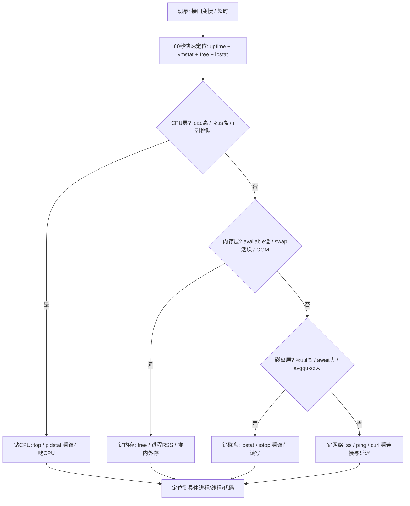
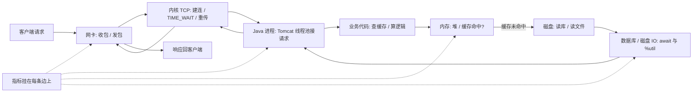

# Linux 性能分析

> 一句话定位：接口变慢先别急着加机器，先问一句——堵在收银台、仓库、仓库门口，还是快递路上？

## 基础知识

本篇只讲一套办法：先定层，再钻指标，最后用数字说话；每个指标配生活案例，每步读数一步步算。读者是 Java 后端开发者，会敲命令，但没系统做过性能排查。

### 四层模型：先定层，再动手

一台 Linux 服务器就像一家超市，请求就是顾客，性能瓶颈只会出在四个地方：

- **CPU：收银台。** 顾客排队结账，收银员就是 CPU 核，排队越长结账越慢。
- **内存：仓库货架。** 商品（数据）放货架上，货架满了就得去更远的冷库（磁盘）取，慢得多。
- **磁盘：仓库出入库口。** 货进货出都要过这道门，门窄了、叉车慢了，全店都堵。
- **网络：快递路线。** 顾客在网上下单，快递走哪条路、堵不堵车，决定货多久能到。

### USE 方法：每个资源只看三个数

USE 方法是 Brendan Gregg 提出的一套通用检查法，对每个资源只问三个问题：

- **使用率（Utilization）：** 忙了多久？比如 CPU 用了 80%，磁盘 %util 90%。
- **饱和度（Saturation）：** 排了多长的队？比如 load average 8.0、磁盘 avgqu-sz 很大。
- **错误（Errors）：** 出了多少错？比如网络丢包、磁盘读写报错、OOM 杀进程。

| 资源 | 使用率怎么看 | 饱和度怎么看 | 错误怎么看 |
| --- | --- | --- | --- |
| CPU | top 的 %us + %sy | load average、vmstat 的 r 列 | 进程被杀、超时 |
| 内存 | free 的 used | swap 的 si/so、OOM | OOM Killer 日志 |
| 磁盘 | iostat 的 %util | iostat 的 avgqu-sz、await | 读写报错、dmesg |
| 网络 | 带宽占用 | 连接排队、重传 | 丢包、超时、RST |

### 60 秒快速定位法

这是 Brendan Gregg 的另一套办法：出问题后 60 秒内跑完下面 10 条命令，先画出大致画像，再决定往哪层钻。

```bash
uptime          # load average，第一眼看排队
dmesg | tail    # 内核报错，OOM、磁盘错都在这里
vmstat 1        # r 列看排队，si/so 看换页，us/sy/id/wa 看 CPU 分工
mpstat -P ALL 1 # 每个核分别忙不忙，有没有单核打满
pidstat 1       # 哪个进程在吃 CPU
iostat -xz 1    # 磁盘 %util、await、avgqu-sz
free -m         # 内存还剩多少，看 available 不是 free
sar -n DEV 1    # 网卡收发速率
sar -n TCP,ETCP 1  # TCP 重传、建连情况
top             # 综合确认，谁在吃资源
```



## 原理剖析

### CPU

生活案例是收银台排队：4 核就是 4 个收银台，第 5 个人只能排队，load average 就是排队加正在结账人数的平均值。CPU 饱和的征兆是 load 持续大于核数、vmstat 的 r 列持续大于核数、top 的 %id 接近 0；r 列高也可能是线程太多，Java 线程池开 500 个线程抢 4 个核，排队是必然的，这时要减线程而不是加核。

**load average 三个数字怎么读。**
`uptime` 会输出三个数字，例如 `load average: 0.08, 0.23, 0.27`，分别是过去 1 分钟、5 分钟、15 分钟的平均排队长度。
读法分三步走：

1. 先看 1 分钟值：现在堵不堵。
2. 再看 5 分钟、15 分钟值：是刚才突然堵，还是已经堵了一刻钟。
3. 最后除以核数：4 核机器上 load 4.0 才是“刚好坐满”，超过 4.0 才算排队。

一步步算一个例子：4 核机器，load 8.0。

- 第 1 步：8.0 ÷ 4 核 = 2.0，平均每个收银台后面排了 2 个人。
- 第 2 步：2.0 = 200% 饱和度，相当于每个收银员要干 2 个人的活。
- 第 3 步：排队人数约 8 − 4 = 4 个进程在等 CPU，接口响应自然变慢。
- 结论：load 8.0 在 4 核上是真饱和，不是“8 很大所以很严重”——8 核机器上 load 8.0 只是刚好坐满。

**top 输出逐字段讲。**
`top` 第一行是 uptime 与 load，第二行是任务数，第三行是 CPU 分工，最关键：

- `%us`：用户态 CPU，业务代码在干活。Java 接口逻辑、计算都在这里，%us 高说明业务本身在算。
- `%sy`：内核态 CPU，系统调用、上下文切换、网络收发都在这里。%sy 高要看是不是频繁系统调用或锁竞争。
- `%ni`：nice 值调整过的进程，一般忽略。
- `%id`：空闲 CPU，收银员在发呆。%id 越大越空。
- `%wa`：等待 IO 的 CPU，收银员在等仓库送货。%wa 高不是 CPU 忙，而是 CPU 被磁盘拖住了。
- `%hi` / `%si`：硬中断 / 软中断，网卡收包多时会涨。

### 内存

生活案例是仓库货架，磁盘是冷库，货在货架上随手可取。OOM 的征兆按顺序是：available 持续接近 0 → si/so 持续大于 0 → 接口变慢、GC 频繁 → `dmesg` 出现 `Out of memory: Killed process`，Java 进程突然消失，应用日志里往往没有任何异常。

```text
              total        used        free      shared  buff/cache   available
Mem:           7934        7393         249          72         616         540
Swap:          1023         326         697
```

逐字段读：

- `total 7934`：货架总共 7934 MiB，约 7.7 GiB。
- `used 7393`：已经放了货的格子，包括 cache 占的格子，所以 used 大不等于业务在吃内存。
- `free 249`：完全空着的格子，只剩 249 MiB，看着吓人，但不是真相。
- `shared 72`：多进程共享的内存，Java 进程一般不大。
- `buff/cache 616`：缓存占的格子，放的是磁盘读过的数据，随时可以腾出来。
- `available 540`：真正能给新进程用的内存，约 540 MiB，这是判断内存够不够的唯一标准。

**available 与 free 的区别，一步步算。**
free 249 是“现在空着的格子”，available 540 是“空着的 + 能立刻腾出来的格子”。
本机 available − free = 540 − 249 = 291 MiB，意思是 buff/cache 的 616 MiB 里约 291 MiB 可以立刻回收，剩下的约 325 MiB 暂时还不能动（比如正在写回的脏页）。

**swap 意味着什么。**
Swap 是冷库里的临时货架：内存实在不够时，把不常用的页搬到磁盘上腾地方。
`free` 里 Swap 一行 total 1023、used 326，说明历史上曾经换出过 326 MiB。
关键看 vmstat 的 `si`（换入）和 `so`（换出）是不是持续大于 0：si/so 长期是 0，swap 有数值只是历史痕迹，不用慌；si/so 一直在跳，说明内存正在频繁冷热倒腾，接口必然变慢。

**一个 Java 进程 RSS 2GB 的例子怎么读。**
RSS 是进程实际占用的物理内存，用 `top` 的 RES 列或 `ps -o rss` 看。
假设一个 Java 进程 RSS 2GB，机器总内存 8GB：

- 第 1 步：2 ÷ 8 = 25%，一个进程占了四分之一内存，不算离谱。
- 第 2 步：拆开 2GB 的构成：堆用了约 1.5GB + Metaspace 约 0.2GB + 线程栈 200 个线程 × 1MB ≈ 0.2GB + 直接内存约 0.1GB = 2.0GB，刚好对上。
- 第 3 步：对照启动参数：如果 `-Xmx` 是 4GB，堆才用 1.5GB，RSS 2GB 完全正常；如果 `-Xmx` 是 1GB，RSS 却 2GB，说明堆外内存（直接内存、线程栈、JNI）在漏。
- 结论：RSS 不能只看绝对值，要拆成堆内 + 堆外，再对照 `-Xmx` 和线程数，堆外失控比堆满了更难查。

### 磁盘

生活案例是仓库出入库口，所有货进出都要过这道门。%util 100% 是 1 秒忙了 1000 毫秒；读写延迟只记两条线：SSD 的 await 正常小于 10 毫秒，超过 50 毫秒可定性为磁盘瓶颈，机械盘正常 10–20 毫秒；r/s 高是读瓶颈（大查询、全表扫描），w/s 高是写瓶颈（日志狂打），`iotop` 能看到谁在读写。`df -h` 看文件系统还剩多少（本机已用 64MB、可用 7.5GB、用 1%），`du -sh` 看某个目录占了多少；文件被删但进程还拿着句柄时两者对不上，先 `df` 定性满了、再 `du` 定位谁占的。

**iostat 输出逐字段讲。**
`iostat -xz 1` 的关键列：

- `r/s` / `w/s`：每秒读 / 写请求数，门每秒过了多少辆车。
- `rkB/s` / `wkB/s`：每秒读 / 写的数据量，车上拉了多少货。
- `await`：一次 IO 平均耗时，从排队到完成的总时间，单位毫秒。
- `avgqu-sz`：平均排队长度，门口平均排了多少辆车。
- `%util`：磁盘忙的时间占比，门有多忙。

- 情况一：%util 100%，await 只有几毫秒，avgqu-sz 只有 1：磁盘很忙，但每个请求都很快、门口没排队，业务可能根本不慢，不能只看 %util 定性。
- 情况二：%util 100%，await 50 毫秒，avgqu-sz 是 10：门前排了 10 辆车，每辆要等 50 毫秒，磁盘已经堵死了，接口必然慢。
- 算一笔账：1000 次 IO 总耗时 50000 毫秒，await = 50000 ÷ 1000 = 50 毫秒，是 SSD 正常值（小于 10 毫秒）的 5 倍，这就是慢的证据。

### 网络

生活案例是快递路线。带宽是路有多宽：100Mbps 的路每秒最多过 100 ÷ 8 = 12.5MB，传 1GB 文件要 1024 ÷ 12.5 ≈ 82 秒；延迟是路上要多久，ping 的 RTT 局域网约 1 毫秒、跨省约 30–50 毫秒，超过 200 毫秒要查；丢包是快递丢件，`ping -c 100` 丢包 1% 以上要警惕，5% 以上必然超时重试，`mtr` 能看到丢在哪一跳。

**ss/netstat 看连接状态。**
`ss -s` 看连接总数，`ss -tan | awk '{print $1}' | sort | uniq -c` 看各状态的数量。

- `ESTAB`：正在通话的连接，正常业务连接都在这里。
- `TIME_WAIT`：通话刚结束、等 60 秒再彻底挂断的状态，防止迟到的包干扰下一通电话。
- `CLOSE_WAIT`：对方已挂断，本端还没挂，Java 代码没关流、没关连接时最常见。
- `SYN_SENT` / `SYN_RECV`：正在拨号、还没接通，数量暴涨说明对方不响应或被打满。

**TIME_WAIT 过多意味着什么，一步步算。**
TIME_WAIT 本身不是错误，是 TCP 的正常收尾动作，每条连接主动关闭后要等 60 秒（2MSL）。
算一笔账：如果 TIME_WAIT 有 10000 条，每条占 60 秒，相当于每秒新建连接数约 10000 ÷ 60 ≈ 167 条/秒。
短连接业务（每次请求都新建连接）很容易攒出上万 TIME_WAIT，端口会被占满，新连接建不起来。
判断标准：TIME_WAIT 几千条、业务正常，不用管；TIME_WAIT 上万条、且伴随 `Cannot assign requested address` 或建连超时，才要处理——改长连接、开连接池、调 `tcp_tw_reuse`。
反过来 CLOSE_WAIT 多才是代码问题：对方挂了你还不挂，连接越攒越多，最后耗尽文件句柄。

1. `ping 域名`：通不通？不通是网络不通或防火墙，先别查代码。
2. `ping -c 10 IP`：看 RTT 与丢包率，RTT 稳定、丢包 0%，网络底子没问题。
3. `curl -o /dev/null -s -w "%{time_connect} %{time_starttransfer} %{time_total}\n" URL`：拆三段时间，建连慢是网络问题，首包慢是服务端在算，总时间长要结合前两步看。
4. `curl` 能通但 Java 调不通：查 DNS、查代理、查连接池配置，别再怀疑网络本身。



## 进阶知识

四层会互相拖垮：磁盘慢让 %wa 涨、内存不够让 swap 动、网络慢让线程池堆积，所以排查顺序固定为 CPU → 内存 → 磁盘 → 网络，每步确认一层没问题再往下走。

### 四层联动的排查顺序

先看 load 定 CPU，再看 available 定内存，再看 %util 定磁盘，最后才查网络；每步只确认一层，没问题再往下走，别四层同时猜。

### 饱和度比使用率更诚实

%us 90% 不一定有问题：单核打满、多核空闲时，总 %us 可能只有 25%，但那个核上的请求已经在排队。
反过来 load 2.0 在 4 核上只有 50%，看着不高，但如果这 2.0 全是等磁盘的进程（D 状态），%wa 会同步涨，瓶颈其实在磁盘。

### Java 进程的特殊性

CPU 高先看线程栈，内存高先拆堆内堆外，磁盘高先看日志刷盘；系统指标与 JVM 指标对不上时，以 JVM 现场为准。

### sar：事后复盘的黑匣子

没有 sar 的机器等于没有行车记录仪，出事只能靠猜。

top、vmstat 都是“现在”的快照，问题过去了就看不到了。

### 工具速查

- `top`：综合看板，看 load、%us/%sy/%wa 与最吃资源的进程。
- `htop`：top 的彩色加强版，按 CPU、内存排序找进程更快。
- `vmstat 1`：看 r 列排队、si/so 换页、us/sy/id/wa 分工。
- `free -m`：看内存够不够，只认 available，不认 free。
- `iostat -xz 1`：看磁盘 %util、await、avgqu-sz 三件套。
- `iotop`：看哪个进程在读写磁盘，日志狂写一眼现形。
- `ss -s` / `ss -tan`：看连接总数与各状态，TIME_WAIT 一眼数出来。
- `sar`：翻历史曲线，半夜出过的问题白天也能复盘。

## 疑难杂症

### load 高但 %id 也很高

load 高 + %wa 高 = 磁盘瓶颈，load 高 + %us 高 = CPU 瓶颈：等磁盘的进程也算进 load。

### cache 占了大半内存，available 却很低

cache 高不是问题，available 低才是问题；available 长期小于总内存 10% 且 si/so 持续大于 0 才是真紧张。

### swap 有数值，但 si/so 一直是 0

swap 有数值只是历史痕迹，si/so 是 0 说明现在没有换入换出，不用处理。

### TIME_WAIT 上万，但业务正常

TIME_WAIT 是正常收尾，没有建连失败就不用调；CLOSE_WAIT 多才是代码没关连接，要立刻查。

### 磁盘 %util 100%，但业务不慢

%util 是忙不忙，await 才是慢不慢，两个要配对看。

### 接口偶发变慢，查的时候又好了

留证据：开 sar、接监控告警留曲线，下次再慢直接翻曲线定层；Java 侧留 Trace、GC 日志、线程池队列长度。

## 实战案例

背景：Java 订单服务，4 核 8GB，接口平时 P99 约 200 毫秒，某天下午突然涨到 5 秒，偶发超时。排查按 CPU → 内存 → 磁盘 → 网络的顺序一步步排除。

### 场景：订单查询接口从 200 毫秒涨到 5 秒

背景：Java 订单服务，4 核 8GB，接口平时 P99 约 200 毫秒，某天下午突然涨到 5 秒，偶发超时。
排查按 CPU → 内存 → 磁盘 → 网络的顺序，一步步排除，每一步都有命令与读数。

**第 1 步：CPU 层——先看排队。**

```bash
uptime
# 14:32:10 up 12 days, load average: 7.86, 6.42, 3.10
nproc
# 4
```

读数：load 1 分钟 7.86、5 分钟 6.42、15 分钟 3.10，说明是最近 5 分钟内突然涨起来的，不是慢慢变慢的。
算一下：7.86 ÷ 4 核 ≈ 1.97，约 200% 饱和，每个核后面排了约 2 个进程，CPU 确实堵了。
但先别定性是 CPU 瓶颈，继续看 CPU 在干什么：

```bash
top -bn1 | head -15
# %Cpu(s): 45.2 us, 8.1 sy, 6.3 id, 40.4 wa, 0.0 hi, 0.0 si
```

**第 2 步：内存层——看 available 与 swap。**

```bash
free -m
# Mem: total 7934 used 7393 free 249 buff/cache 616 available 540
# Swap: total 1023 used 326 free 697
vmstat 1 3
# r  b  swpd  free  buff  cache  si  so  bi  bo  us sy id wa
# 7  2  334556 255164 20 631368  0   0  2054 3176  45  8  6  41
```

**第 3 步：磁盘层——看 %util 与 await。**

```bash
iostat -xz 1 3
# Device  sda  r/s  w/s  rkB/s  wkB/s  await  avgqu-sz  %util
# sda      120  180  2400   3600   48.5    9.20     100.00
iotop -bn1 | head -10
# java 订单服务  写 3.2 MB/s  读 1.1 MB/s
```

**第 4 步：网络层——确认不是网络在拖。**

```bash
ss -s
# Total: 430  TCP: 24 (estab 0, closed 24, orphaned 0, timewait 0)
ping -c 10 数据库IP
# 10 packets transmitted, 0% packet loss, rtt avg 0.8 ms
curl -o /dev/null -s -w "connect %{time_connect} start %{time_starttransfer} total %{time_total}\n" http://localhost:8080/health
# connect 0.001 start 0.210 total 0.212
```

**结论：磁盘写瓶颈，不在 CPU 与网络。** 四步合起来看：load 高但 %wa 占 40.4%（CPU 在等磁盘）、available 还有 540MB 且 si/so 都是 0（内存没爆）、iostat 三件套同时拉满（%util 100%、await 48.5 毫秒、avgqu-sz 9.2）、iotop 指认 Java 订单服务每秒写 3.2MB；本地健康检查只要 0.212 秒、ping 数据库 0.8 毫秒零丢包，网络也没问题。下一步不是加 CPU，而是查订单服务在写什么（日志、慢查询落盘还是临时文件），再决定限流、换盘还是优化写入。

## 面试与自测

1. 4 核机器上 load average 是 8.0，这意味着什么？是 CPU 瓶颈吗？要怎么进一步确认？
2. `free -m` 显示 used 很高、free 只有 249MB，available 还有 540MB，内存到底够不够？判断标准是什么？
3. `iostat` 显示 %util 100%、await 48.5 毫秒、avgqu-sz 9.2，这说明什么？只看 %util 100% 能定性吗？
4. 线上 TIME_WAIT 有 10000 条，业务暂时正常，需要立刻调内核参数吗？什么情况下才需要处理？

### 参考答案

1. 8.0 ÷ 4 核 = 2.0，约 200% 饱和，平均每个核后面排了约 2 个进程，约 4 个进程在等 CPU，确实排队了。但不能直接定性为 CPU 瓶颈，要看 top 的 %wa：如果 %wa 很高（如 40%），排队里很多进程在等磁盘，瓶颈在磁盘；如果 %us 很高、%wa 很低，才是 CPU 瓶颈。还要看 vmstat 的 r 列与 b 列，r 高是 CPU 排队，b 高是等 IO。
2. 够不够只看 available，不看 free。free 249MB 只是现在空着的格子，available 540MB 是空着的加能立刻腾出来的格子，540MB 还没到 0，不算爆。判断标准是 available 是否长期接近 0，且 vmstat 的 si/so 是否持续大于 0，两者都中才是真不够；cache 占得多是 Linux 在缓存数据，随时可回收。
3. 说明磁盘已经堵死了：%util 100% 是 1 秒忙了 1000 毫秒，await 48.5 毫秒是 SSD 正常值（小于 10 毫秒）的约 5 倍，avgqu-sz 9.2 是门口平均排了 9 个请求，三者同时拉满才能定性。只看 %util 100% 不能定性，如果 await 只有几毫秒、avgqu-sz 只有 1，说明磁盘忙但每个请求都很快，业务可能根本不慢。
4. 不需要立刻调。TIME_WAIT 是 TCP 正常收尾，每条连接主动关闭后等 60 秒，10000 条约等于每秒新建 10000 ÷ 60 ≈ 167 条连接，短连接业务很常见。只要没有建连失败、`Cannot assign requested address`、接口延迟正常，就不用处理，改成长连接或连接池自然会下来。需要处理的情况是 TIME_WAIT 上万且伴随建连失败；反过来 CLOSE_WAIT 多才是代码没关连接，要立刻查。

## 小技巧与冷知识

- `uptime` 的 load 要除以核数再读：4 核上 load 4.0 只是坐满，8 核上 load 8.0 也只是坐满，绝对值没有意义。
- `free` 只看 available：free 低不可怕，available 长期接近 0 才可怕，cache 是 Linux 帮你省下的冷库往返。
- `%wa` 是最诚实的告密者：load 高先看 %wa，%wa 高去查磁盘，别急着加 CPU。
- `iostat` 要配对看：%util 看忙不忙，await 看慢不慢，avgqu-sz 看排多长，三个一起拉满才是真堵。
- sar 是事后复盘的黑匣子：接口半夜慢、白天查不到现场时，翻 `sar -u/-r/-d` 的历史曲线，比凭记忆猜靠谱得多。

## 关联知识

- 前置：[Linux与Shell](工程实践/Shell/Linux与Shell.md)——本篇用到的命令与 Shell 基础都在这里，先会敲命令，再谈性能排查。
- 相关：[监控告警](工程实践/运维/监控告警.md)——把 load、available、%util、await 接进监控与告警，出问题先收到告警、再按本篇流程定位。
- 相关：[JVM生产诊断工具链](开发语言/Java/JVM/JVM-生产诊断工具链.md)——系统层定层之后，Java 层用 jstack、jmap、jstat 继续钻，看是线程、堆还是 GC 在拖。
- 相关：[Java性能联合排查](开发语言/Java/JVM/Java性能联合排查.md)——系统指标与 JVM 指标联合读数，系统层与 Java 层对不上时，以 JVM 现场为准。
