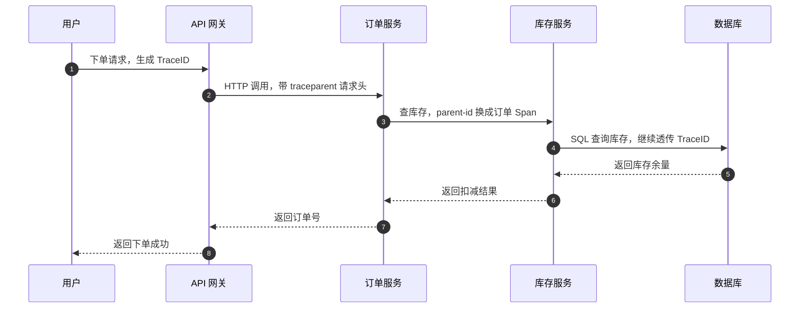
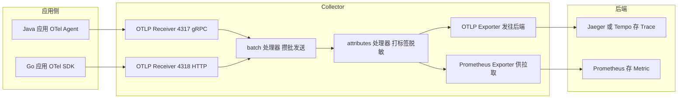

# OpenTelemetry

一句话：OpenTelemetry（简称 OTel）是一套厂商中立的可观测性标准，规定了应用如何产生 Trace、Metric、Log 这三类遥测数据、以及用什么协议把它们送出去。

生活类比：它像快递行业的通用面单标准。以前每家快递公司用自己的面单，包裹一换公司就查不到；有了统一面单，不管包裹经过几家中转站，只凭一个单号就能全程追踪。OTel 就是给分布式系统定的那张“通用面单”。

## 基础知识

### 三大支柱与分工

系统出问题时，你会问三个不同的问题，三大支柱各答一个：

| 支柱 | 回答的问题 | 生活类比 | 典型数据 |
| --- | --- | --- | --- |
| Trace（链路追踪） | 这一次请求经过了哪些服务、每一步花了多久 | 快递单号：一个包裹经过哪些中转站、每站停留多久 | TraceID、Span、耗时 |
| Metric（指标） | 系统整体现在健康吗、趋势如何 | 汽车仪表盘：时速、油量、水温，一眼看整体状态 | QPS、延迟分位数、错误率 |
| Log（日志） | 当时到底发生了什么细节 | 行车记录仪：出事那一刻的画面和声音 | 时间戳、级别、消息、上下文 |

三者分工互补，不是互相替代：仪表盘告诉你车速异常（Metric），行车记录仪告诉你当时发生了什么（Log），快递单号告诉你包裹卡在哪一站（Trace）。只看一种，等于只用一只眼睛开车。

### Trace、Span、Resource 是什么

- **Trace**：一次完整请求的端到端轨迹，比如用户点一次“下单”，从网关到订单服务、库存服务、数据库的全部过程就是一条 Trace。
- **Span**：Trace 里的一段工作，比如“订单服务处理下单”是一个 Span，“查库存”又是另一个 Span。Span 之间是父子关系，拼起来就是一棵调用树。
- **Resource**：产生数据的资源身份，比如服务名 `order-service`、主机名、版本号。没有 Resource，出了问题你不知道是哪台机器、哪个版本在报错。
- **Attribute**：Span 或 Resource 上挂的键值对，比如 `http.method=POST`、`http.status_code=200`。相当于快递单上的收件人、重量、保价等字段。

一个 Span 长这样（简化后）：

```json
{
  "traceId": "4bf92f3577b34da6a3ce929d0e0e4736",
  "spanId": "00f067aa0ba902b7",
  "parentSpanId": "05e3ac9a4f6e8b8a",
  "name": "POST /orders",
  "startTime": "2026-11-16T10:00:00.123Z",
  "endTime": "2026-11-16T10:00:00.456Z",
  "attributes": { "http.status_code": 200 }
}
```

### 为什么需要统一标准

没有 OTel 之前，Java 用一套、Go 用一套、A 公司用 Jaeger、B 公司用 Zipkin，服务一换语言或一换后端，追踪就断了。OTel 把三件事统一了：**API**（各语言产生遥测数据的方式一致）、**SDK**（采样、批处理、导出等公共逻辑不用每个团队重写）、**OTLP 协议**（数据格式与端口全行业一致）。结果是：应用只管按标准产生数据，换后端（Jaeger、Tempo、厂商 SaaS）时改一行导出地址就行，代码不用动。

## 原理剖析

### TraceID 与 SpanID：快递单号是怎么编的

- **TraceID**：128 位，写成 32 个十六进制字符。同一条 Trace 里所有 Span 共用一个 TraceID，就像同一个包裹在所有中转站共用一个单号。
- **SpanID**：64 位，写成 16 个十六进制字符。每个 Span 各有一个唯一的 SpanID，相当于包裹在每个中转站的“本站操作编号”。
- **ParentSpanID**：子 Span 记录父 Span 的 SpanID，父子关系就是这样串起来的。

TraceID 是随机生成的，128 位意味着碰撞概率低到可以忽略：哪怕每秒产生 10 万条 Trace，连续跑 100 年，撞号的概率仍然远低于中一次彩票头奖，实际工程里直接当成全局唯一用。

### 上下文传播：单号怎么跟着包裹走

服务 A 调服务 B 时，要把 TraceID 传过去，否则 B 产生的 Span 就成了一条孤儿链路。OTel 用 W3C 标准 `traceparent` 请求头传递，格式分四段：

```text
00-4bf92f3577b34da6a3ce929d0e0e4736-00f067aa0ba902b7-01
│  │                                │                │
│  │                                │                └─ flags：01 表示已采样，00 表示未采样
│  │                                └─ parent-id：父 Span 的 SpanID（16 个十六进制字符）
│  └─ trace-id：整条链路的 TraceID（32 个十六进制字符）
└─ version：版本号，目前是 00
```

逐步拆解上面这个例子：

1. `00`：版本号，告诉接收方按第 0 版规则解析。
2. `4bf92f3577b34da6a3ce929d0e0e4736`：TraceID，32 个字符，整条链路共用。
3. `00f067aa0ba902b7`：父 SpanID，16 个字符，说明调用方是哪个 Span。
4. `01`：flags，`01` 表示这条 Trace 已被采样、要保留；`00` 表示不保留。

传播过程像接力赛交接棒：网关收到请求时生成 TraceID，调订单服务时把 `traceparent` 放进 HTTP 请求头；订单服务解析出 TraceID，新建一个子 Span，再调库存服务时把更新后的 `traceparent`（parent-id 换成自己的 SpanID）继续往下传。每个服务只做“读出旧棒、写上自己名字、传给下一棒”这三步。

下面这张时序图展示一次下单请求的完整调用链：



图中每一步箭头都带着同一个 TraceID，只是 parent-id 逐级更换——这就是“上下文传播”的全部含义。

### Collector 架构：Receiver / Processor / Exporter 三段式

Collector 是 OTel 的数据中转站，应用不直连后端，先把数据发给 Collector，再由它统一处理、转发。它的内部是三段式流水线：

- **Receiver（收）**：负责接数据。OTLP Receiver 默认监听 4317（gRPC）和 4318（HTTP）两个端口；还能接 Prometheus 拉取、文件日志、主机指标等多种来源。像快递分拣中心的卸货口，不同车队从不同口进。
- **Processor（处理）**：负责加工数据。`batch` 处理器把零散的 Span 攒成一批再发，减少网络请求次数；`attributes` 处理器给数据打标签或脱敏，比如删掉手机号字段；`memory_limiter` 处理器在内存快满时限流，防止 Collector 自己被撑爆。
- **Exporter（送）**：负责发数据。OTLP Exporter 发给 Jaeger、Tempo 等后端；Prometheus Exporter 把指标暴露给 Prometheus 拉取；Logging Exporter 打印到控制台，一般只用来调试。

数据流向是单向的：Receiver → Processor → Exporter，三段之间用管道（pipeline）连接，一类信号（traces、metrics、logs）配一条管道。

下面这张架构图展示数据从应用流进 Collector、再流向后端的完整路径：



一个最简可用的 Collector 配置只要三段各配一个组件：

```yaml
receivers:
  otlp:
    protocols:
      grpc:
        endpoint: 0.0.0.0:4317
      http:
        endpoint: 0.0.0.0:4318
processors:
  batch: {}
exporters:
  otlp:
    endpoint: jaeger:4317
    tls:
      insecure: true
service:
  pipelines:
    traces:
      receivers: [otlp]
      processors: [batch]
      exporters: [otlp]
```

读这份配置只要记住一句话：`service.pipelines.traces` 这一节就是把上面三段用名字串起来，告诉 Collector“Trace 从 otlp 收进来、过 batch 处理、从 otlp 发出去”。

### 部署形态：Agent 还是 Gateway

- **Agent 模式**：每台机器或每个 Pod 旁跑一个 Collector，只收本机数据再转发给中心。优点是本机缓存、断网续传；缺点是数量多、难统一升级。
- **Gateway 模式**：中心部署少数几个 Collector，所有 Agent 先发给它，再由它统一做采样、脱敏、路由后发往后端。优点是集中处理；缺点是多了一跳、要做多副本防单点。常见做法是两者结合：Agent 做轻量接收和重试，Gateway 做尾部采样和统一出口；小型系统可以直接只用 Gateway，省掉一层运维成本。

## 进阶知识

### 采样策略与成本：一笔算清楚的账

Trace 数据量极大，不采样根本存不起。假设一个中等规模系统每秒产生 1 万条 Span，全量保留会发生什么？下面用 Python 复算过的一组数字逐步算给你看。

**第一步：一天产生多少条？** 每秒 10,000 条 × 60 秒 = 每分钟 600,000 条；每分钟 600,000 条 × 60 分钟 = 每小时 36,000,000 条；每小时 36,000,000 条 × 24 小时 = 每天 864,000,000 条。一天 8.64 亿条 Span，全量保留一个月就是约 259 亿条。

**第二步：按 1% 采样后剩多少？** 每秒保留 10,000 × 1% = 100 条；每天保留 100 × 86,400 秒 = 8,640,000 条；每天丢弃 864,000,000 - 8,640,000 = 855,360,000 条。采样后每天只剩 864 万条，是全量的百分之一。

**第三步：换算成存储。按每条 Span 平均 1 KiB（1024 字节）估算：** 全量每天 864,000,000 × 1 KiB ≈ 824 GiB；采样后每天 8,640,000 × 1 KiB ≈ 8.24 GiB；每天省下 824 - 8.24 ≈ 816 GiB；每月全量 824 × 30 ≈ 24,719 GiB，约 24.1 TiB；每月采样后 8.24 × 30 ≈ 247 GiB。

**第四步：换算成钱。按对象存储 0.023 美元/GiB/月估算（只算当月增量）：** 全量月费用 24,719 × 0.023 ≈ 568.54 美元；采样后月费用 247 × 0.023 ≈ 5.69 美元；每月省下约 562.85 美元。

**第五步：换个口径再验证。保留 7 天滚动窗口时：** 全量 7 天窗口 824 × 7 ≈ 5,768 GiB，约 5.63 TiB；采样后 7 天窗口 8.24 × 7 ≈ 57.68 GiB。

结论：1% 采样把每天 824 GiB 的写入压到 8.24 GiB，7 天窗口从 5.63 TiB 压到 57.68 GiB。采样率每翻一档，成本跟着翻一档：10% 采样每天是 86,400,000 条、约 82.4 GiB；5% 采样每天是 43,200,000 条、约 41.2 GiB。

**换算成 Trace 更直观：** 如果平均每条 Trace 由 20 个 Span 组成，每秒 1 万条 Span 就是每秒 500 条 Trace，全量每天 43,200,000 条 Trace，1% 采样后每天剩 432,000 条——排查问题完全够用。

### 头部采样与尾部采样

- **头部采样（Head Sampling）**：请求刚进来就按比例决定留不留，比如 1% 的请求全程记录。优点是简单、开销小；缺点是决定时还不知道这次请求会不会出错，报错的请求可能正好没被采上。
- **尾部采样（Tail Sampling）**：等整条 Trace 跑完再决定留不留，只留出错的、特别慢的、或带特定标签的。优点是“好钢用在刀刃上”，出错的请求一条不落；缺点是 Collector 要先把全量 Trace 攒在内存里再筛选，内存和复杂度都更高。
- **父子一致采样**：一旦父 Span 决定采样，整条链路所有子 Span 都采样；反之全都不采。靠 `traceparent` 里的 flags 位（`01` 或 `00`）实现。这是保证 Trace 完整不断链的关键，缺了它，链路会像被撕碎的快递单一样拼不起来。

生产建议：入口处用 1%～5% 的头部采样兜底，再在 Gateway 层加尾部采样规则——错误 Trace 100% 保留、慢于 1 秒的 Trace 100% 保留。这样既省了 99% 的存储，又不丢任何一次故障现场。

### Metric 的三种类型

- **Counter（计数器）**：只增不减的累计值。超市收银台的累计收款额就是 Counter，今天收了 3 万，明天只会更多，不会倒退。适合统计请求总数、错误总数。
- **Gauge（仪表值）**：可增可减的瞬时值。停车场剩余车位数就是 Gauge，有车进就减、有车出就加。适合统计当前连接数、内存占用、队列深度。
- **Histogram（直方图）**：把数值按区间分桶统计。超市统计“顾客排队时长”时分桶：0～1 分钟多少人、1～3 分钟多少人、3 分钟以上多少人。适合统计请求延迟分布，算 P50、P95、P99 就靠它。

一条铁律：**不要把 userId、订单号这种高基数（取值成千上万）的字段放进 Metric 标签**。每个标签值组合都会生成一条独立的时间序列，10 万个用户就是 10 万条序列，Prometheus 会被撑爆。高基数信息放 Trace 的 Attribute 里查，不要放 Metric 标签里。

### 与 Prometheus 的互补关系

OTel 和 Prometheus 不是二选一，是分工合作：

- **指标归 Prometheus**：QPS、延迟分位数、错误率、资源用量，这些“看趋势、做告警”的数据由 Prometheus 存、由 PromQL 查、由 Grafana 画图。Prometheus 的拉取模型和告警生态在这里是主场。
- **链路归 OTel**：单次请求经过了哪些服务、哪一步慢、哪一步报错，这些“看个案、做定位”的数据由 OTel 的 Trace 负责，存在 Jaeger 或 Tempo 里。
- **两者衔接**：OTel Collector 可以把 Metric 通过 Prometheus Exporter 或 Remote Write 送进 Prometheus；反过来，Grafana 里可以从一张 Prometheus 告警图一键跳到同一时间段的 Trace 做下钻。正确姿势是“Prometheus 看面、OTel 看点”，面有点结合才定位得快。

## 疑难杂症

### Trace 断链：下游的 Span 拼不上来

- **现象与原因**：Jaeger 里一条 Trace 只有网关和订单服务，库存服务的 Span 凭空消失，或者出现两条各只有一半的 Trace。最常见的是中间经过了不透传请求头的环节，比如用了自定义的 HTTP 客户端没注入 `traceparent`，或者走了消息队列、定时任务，上下文没跟着消息走。
- **解法**：先查调用链上每个环节是否透传了 `traceparent` 请求头；消息队列场景用 OTel 的消息生产/消费埋点，把上下文写进消息属性里再透传；定时任务入口手动创建一个根 Span。

### 查不到某次报错的 Trace：采样把它丢了

- **现象与原因**：用户反馈某笔订单失败，拿着订单号去 Jaeger 里搜，什么都没有。头部采样按概率丢弃，报错的那次请求正好落在没被采样的 99% 里。
- **解法**：上尾部采样，错误 Trace 100% 保留；或者在业务代码里对关键操作手动标记——出错时把采样标志改成保留。不要靠“把采样率调到 100%”解决，成本账前面已经算过，撑不住。

### Collector 背压与丢数据：高峰期数据进不来

- **现象与原因**：大促高峰期，Trace 数量不升反降，后端查到的量比应用发出的量少。后端写入变慢，Exporter 发不出去，数据在 Collector 内部队列里越积越多，内存满了就开始丢；或者 `batch` 处理器攒批太大，单次发送超时。
- **解法**：给 Collector 配 `memory_limiter` 处理器，内存到阈值先限流而不是直接 OOM；Exporter 开重试和发送队列；`batch` 的 `send_batch_size` 别设太大，先设 1024 再按需调；Gateway 层做多副本分摊压力。

### 时钟偏差：Span 时间对不上

- **现象与原因**：一条 Trace 里子 Span 的开始时间比父 Span 还早，调用关系图画出来是乱的。各台机器的系统时钟没对齐，差了几百毫秒甚至几秒。
- **解法**：所有机器开 NTP 对时；跨机房部署时尤其要检查，时钟偏差超过 100 毫秒就会让调用时序失真。Span 之间的父子关系靠 SpanID，不靠时间戳，关系不会断，但时序图会难看。

### 属性爆炸：标签打得太多太碎

- **现象与原因**：Collector 内存一路上涨，后端存储增长远超预期。Span 上挂了请求体全文、SQL 完整文本、用户身份证号这类大字段或高基数字段。
- **解法**：Attribute 只保留定位问题需要的字段；敏感字段用 `attributes` 处理器脱敏或删除；SQL 文本只保留模板（把参数替换成问号），不要存完整 SQL。

## 实战案例

### Java 应用接入：两种方式

**方式一：Java Agent 零代码接入。** 不改一行业务代码，启动命令上加一个 `-javaagent` 参数，Agent 会在类加载时自动给 Spring MVC、JDBC、HTTP 客户端等常见框架织入埋点。

```bash
java -javaagent:/opt/otel/opentelemetry-javaagent.jar \
  -Dotel.service.name=order-service \
  -Dotel.exporter.otlp.endpoint=http://localhost:4317 \
  -jar order-service.jar
```

也可以用环境变量代替 `-D` 参数，容器部署时更方便：

```bash
export OTEL_SERVICE_NAME=order-service
export OTEL_EXPORTER_OTLP_ENDPOINT=http://localhost:4317
export OTEL_TRACES_SAMPLER=parentbased_traceidratio
export OTEL_TRACES_SAMPLER_ARG=0.01
java -javaagent:/opt/otel/opentelemetry-javaagent.jar -jar order-service.jar
```

上面两段命令里的 `OTEL_TRACES_SAMPLER_ARG=0.01` 就是前面算账用的 1% 采样率。`parentbased_traceidratio` 的意思是：有父 Span 就跟随父级的采样决定，没有父级就按 1% 概率采样，保证整条链路要么全留、要么全丢。

> 说明：本机没有安装 otelcol 和 Java Agent 环境，上述命令按 OpenTelemetry 官方文档写法给出，未在本地实测；输出示例为按官方文档给出的典型示例。接入后可在 Collector 日志或 Jaeger 界面确认数据是否到达。

**方式二：手动埋点。** Agent 覆盖不到的业务逻辑（比如一段核心计价算法）需要手动创建 Span：

```java
import io.opentelemetry.api.GlobalOpenTelemetry;
import io.opentelemetry.api.trace.Span;
import io.opentelemetry.api.trace.Tracer;
import io.opentelemetry.context.Scope;

public class PricingService {
    private static final Tracer tracer = GlobalOpenTelemetry.getTracer("order-service", "1.0.0");
    public long calculatePrice(Order order) {
        Span span = tracer.spanBuilder("calculatePrice")
            .setAttribute("order.id", order.getId())
            .setAttribute("order.itemCount", order.getItems().size())
            .startSpan();
        try (Scope scope = span.makeCurrent()) {
            long price = doCalculate(order);
            span.setAttribute("order.totalPrice", price);
            return price;
        } catch (Exception e) {
            span.recordException(e);
            span.setStatus(io.opentelemetry.api.trace.StatusCode.ERROR);
            throw e;
        } finally {
            span.end();
        }
    }
}
```

手动埋点记住三件事：`try (Scope scope = span.makeCurrent())` 让子 Span 能找到父 Span；出错时 `recordException` 加 `setStatus(ERROR)`，否则 Jaeger 里看不出这段报错了；`span.end()` 必须在 `finally` 里调，漏调等于这段 Span 永远发不出去。

### 一次慢请求定位：从 Trace 找到慢 SQL

某天订单接口 P99 从 200 毫秒涨到 2 秒，排查过程只用了三步：

1. **Metric 发现异常**：Prometheus 图上 `http.server.request.duration` 的 P99 曲线在 10:00 开始抬头，确认是真实劣化，不是单次抖动。
2. **Trace 定位环节**：在 Jaeger 里按时间段找一条慢 Trace，调用树显示网关 20 毫秒、订单服务 30 毫秒、库存服务 40 毫秒，剩下的 1.9 秒全耗在“查订单明细”这一步的数据库 Span 上。
3. **Log 确认细节**：用这条 Trace 的 TraceID 去日志系统搜同一时间段的日志，看到数据库连接池等待日志刷屏，最终确认是连接池打满导致 SQL 排队。

三步分工正好对应三大支柱：Metric 发现面上的异常，Trace 定位到具体的慢环节，Log 给出当时的细节证据。任何一步缺了，排查都要多绕几个弯。

## 面试与自测

1. Trace、Metric、Log 三大支柱分别回答什么问题？为什么说三者是互补而不是互相替代？
2. TraceID、SpanID、ParentSpanID 各是什么？服务 A 调用服务 B 时，TraceID 是怎么传过去的？
3. 每秒产生 1 万条 Span、按 1% 采样，一天后保留多少条？如果每条 Span 平均 1 KiB，全量和采样后每天各需要多少存储？
4. 一个系统已经接了 Prometheus，为什么还需要接 OpenTelemetry？两者应该怎么分工？

### 参考答案

1. Trace 回答“这一次请求经过了哪些服务、每一步花了多久”，Metric 回答“系统整体现在健康吗、趋势如何”，Log 回答“当时到底发生了什么细节”。三者互补：Metric 发现面上的异常、Trace 定位到具体的慢环节或错环节、Log 给出当时的细节证据；只用一种等于只用一只眼睛开车，排查要多绕弯。
2. TraceID 是 128 位（32 个十六进制字符），整条 Trace 共用；SpanID 是 64 位（16 个十六进制字符），每个 Span 唯一；ParentSpanID 记录父 Span 的 SpanID，用来串起父子关系。跨服务传递靠 W3C `traceparent` 请求头，格式为 `版本-TraceID-父SpanID-flags`，调用方把更新后的请求头放进 HTTP 请求，接收方解析后新建子 Span 并继续往下传。
3. 每秒保留 10,000 × 1% = 100 条，一天保留 100 × 86,400 = 8,640,000 条，丢弃 855,360,000 条。按每条 1 KiB 算，全量每天 864,000,000 × 1 KiB ≈ 824 GiB，采样后每天约 8.24 GiB，每天省约 816 GiB；每月全量约 24.1 TiB、费用约 568.54 美元（按 0.023 美元/GiB/月），采样后每月约 247 GiB、费用约 5.69 美元。
4. Prometheus 擅长指标：QPS、延迟分位数、错误率、资源用量，适合看趋势和做告警；OpenTelemetry 擅长链路：单次请求经过了哪些服务、哪一步慢、哪一步报错，适合做个案定位。正确分工是“指标归 Prometheus、链路归 OTel”：Collector 把 Metric 送进 Prometheus，把 Trace 送进 Jaeger 或 Tempo，Grafana 里从告警图一键下钻到 Trace。

## 小技巧与冷知识

- **TraceID 可以直接当订单号的“影子编号”用**：出问题时让用户报订单号，后台按订单号查到 TraceID，再去 Jaeger 里搜整条链路，比让用户描述“几点几分点的哪个按钮”快得多。做法是在下单成功后把 TraceID 一起写进订单日志。
- **采样率不用一步到位**：先按 1% 跑一周，统计每天保留量和存储占用，再按实际成本反推采样率。前面算过，1% 每天约 8.24 GiB；如果存储预算每天只给 20 GiB，采样率最高可以开到约 2.4%，算式是 20 ÷ 824 ≈ 0.024。
- **给 Span 起名字要像写快递备注**：`POST /orders` 比 `handleRequest` 好一万倍；带上 HTTP 方法和路由模板，不要带真实参数值，`/orders/12345` 这种带 ID 的名字会让同类 Span 无法聚合。
- **OTel 在 2026 年 5 月从 CNCF 毕业**：和 Kubernetes、Prometheus、Envoy 同属毕业项目，意味着它已经是云原生可观测性的事实标准，选型时不用担心它突然没人维护。
- **Collector 自己也能被观测**：Collector 暴露了自身的 Metric（比如接收量、导出失败数、队列深度），把它也接进 Prometheus，就能在 Trace 丢数据时第一时间知道是 Collector 堵了还是后端挂了。
- **日志里带上 TraceID 是成本最低的关联手段**：日志框架的 MDC 里放 `trace_id` 字段，查日志时按 TraceID 一搜，同一请求的所有日志按时间排好，比在海量日志里按时间戳加关键词大海捞针快得多。

## 关联知识

- [监控告警](工程实践/运维/监控告警.md)：Metric 发现异常后靠告警触达值班人，OTel 的 Trace 与 Log 负责接力定位，告警规则与链路下钻配合才算完整闭环。
- [Prometheus与Grafana](工程实践/运维/Prometheus与Grafana.md)：OTel 产生的 Metric 经 Collector 送进 Prometheus，再由 Grafana 画图与告警，两者是“指标归 Prometheus、链路归 OTel”分工的另一半。
- [Linux性能分析](工程实践/运维/Linux性能分析.md)：Trace 定位到某台机器慢之后，用 Linux 的 CPU、内存、IO 分析工具确认是进程问题还是系统资源瓶颈。
- [JVM生产诊断工具链](开发语言/Java/JVM/JVM-生产诊断工具链.md)：Trace 定位到某个 Java 服务慢之后，用 JVM 诊断工具进一步确认是 GC、线程池还是慢方法在拖后腿。
