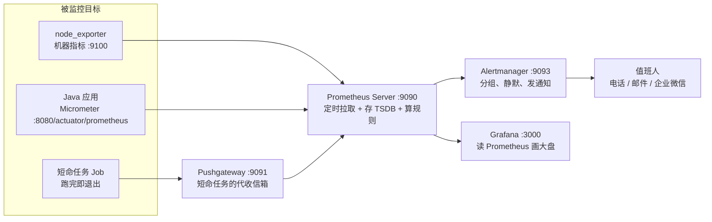
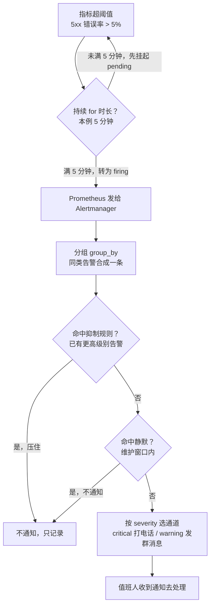

# Prometheus 与 Grafana

> 一句话分工：Prometheus 负责定时采集指标、存起来、算出问题；Grafana 负责把指标画成大盘；Alertmanager 负责把问题喊出来。三者合起来，就是一套不用人盯屏幕也能发现故障的监控体系。

> 适用版本：Prometheus 3.x（当前稳定版 3.16.0，2026 年 11 月 4 日发布；长期支持版为 3.13 LTS）、Grafana 13.x（当前稳定版 13.3.1，2026 年 11 月 10 日发布）。本文配置、PromQL 与界面操作按这两个大版本写。


## 基础知识

### 一个医院的模型，记住它就够了

想象一家医院病房：每个病人床头挂着体温计，随时能读体温；护士站每 15 分钟派护士去各床位抄一次，记在本子上；病房门口挂着大屏，实时显示全病房的体温曲线；一旦有人超过 39 度，值班电话立刻响起来。

这就是 Prometheus + Grafana 的翻版：**体温计 = Exporter**，只负责把“当前能测到的数”亮出来，等别人来读；**护士站定时抄表 = Prometheus Server**，每隔一段时间主动去抄数，存进自己的本子（时序数据库 TSDB）；**病房门口的大屏 = Grafana**，不存数据，只定时问 Prometheus，再画成曲线；**值班电话 = Alertmanager**，收到“谁发烧了”后决定打给谁、多久打一次。

### 拉取（pull）vs 推送（push）

监控数据有两种送达方式。拉取像老师点名：监控系统主动去被监控方取数，点到谁、谁在不在，一目了然。推送像学生课后交作业：被监控方主动把数推给监控系统，交不交全凭自觉。

Prometheus 选拉取，有四个实际理由：第一，**拉不到本身就是健康信号**——抄不到表，就说明目标挂了或网络断了，推送模型里收不到数据时分不清是“没出问题”还是“上报链路断了”；第二，**目标清单集中管理**，所有要监控的机器、服务写在 Prometheus 一份配置里，改一处就生效；第三，**不怕目标重启丢数**，应用重启后 Exporter 重新亮数，下次来抄就有；第四，**调试直观**，怀疑指标不对，直接打开 `http://目标:9100/metrics`，看到什么就是 Prometheus 能抄到什么。

拉取有个天生短板：目标必须“一直在线等着被抄”。每天凌晨跑一次、30 秒就退出的定时任务，护士还没走到床前，它已经出院了。这时补一个 **Pushgateway**：它像病房门口的“代收信箱”，短命任务退出前把指标推到它暂存，Prometheus 再定时去它那里抄。数据流变成 Job → Pushgateway → Prometheus。注意：Pushgateway 只是中转站，不是长期存储；常规服务不要走它，否则指标变成“最后一次上报的旧数”，明明服务挂了，数字还停在昨天，等于体温计坏了还显示 36.5 度。

### 指标四种类型：先看生活例子

**Counter（只增不减的计数器）：** 小区门口“累计进场车辆数”的牌子，进来一辆加一，从不因有车出去而减一，只有断电重启才归零。用途是请求总数、错误总数、订单数。重启归零是正常的，`rate()` / `increase()` 天生会处理归零。

```java
Counter orderCounter = Counter.builder("orders_total")
        .description("累计处理的订单数").register(registry);
orderCounter.increment();
```

**Gauge（可上可下的当前值）：** 水库当前水位、停车场当前空位数、体温计此刻的读数，反映“现在是多少”。用途是当前在线用户数、线程池活跃线程数、JVM 堆内存已用字节数、队列积压数。

```java
AtomicInteger queueSize = new AtomicInteger(0);
Gauge.builder("queue_size", queueSize, AtomicInteger::get)
        .description("当前队列积压任务数").register(registry);
```

**Histogram（延迟分布，分桶数数）：** 食堂打饭排队，门口立块牌子：“5 分钟内打完的 800 人，10 分钟内的 950 人，30 分钟内的 990 人”。它不记每个人的精确等待时间，而是按时间段分桶数数。想知道 P99？看第 990 个人落在哪个桶里。分桶细节见“原理剖析”。

```java
Timer timer = Timer.builder("http_request_duration_seconds")
        .description("接口耗时分布").publishPercentileHistogram(true)
        .serviceLevelObjectives(Duration.ofMillis(100), Duration.ofMillis(250),
                Duration.ofMillis(500), Duration.ofSeconds(1))
        .register(registry);
timer.record(() -> handleRequest());
```

**Summary（客户端自己算分位数）：** 食堂经理每天下班前自己算好“今天 P50 是 3 分钟、P99 是 25 分钟”写在小黑板上。Histogram 把分桶数推给 Prometheus，由它现场算 P99，多个实例的桶可以相加合并；Summary 的分位数是各实例自己算的，合并不了，求全局 P99 会失真。Java 后端优先用 Histogram，除非明确只要单实例分位数。

| 类型 | 生活比喻 | 记什么 | 能算什么 |
| --- | --- | --- | --- |
| Counter | 累计进场车辆数 | 只增不减的总量 | 速率 rate()、增量 increase() |
| Gauge | 水库当前水位 | 此刻的值 | 直接读数、求平均、求最大 |
| Histogram | 食堂排队分桶人数 | 落在各时间桶的请求数 | P50 / P95 / P99、平均耗时 |
| Summary | 经理算好的分位数 | 客户端算好的分位数 | 单实例分位数，不宜跨实例合并 |

## 原理剖析

### 组件架构与数据流



读图顺序就是数据流向：Exporter 亮数（node_exporter 管机器，Micrometer + Spring Boot Actuator 在 `/actuator/prometheus` 上亮 JVM 与业务指标），Prometheus 按 `scrape_interval`（示例配置为 15 秒；官方默认值是 1 分钟）逐个拉取，短命任务先推给 Pushgateway 再被拉；拉回的每条数据都是一条时间序列——指标名 + 一组标签（如 `instance="10.0.0.5:9100"`、`job="node"`）+ 时间戳 + 数值，写进本地 TSDB；同时按规则定时计算，超标就发给 Alertmanager；Grafana 定时向 Prometheus 发 PromQL 查询画大盘，Alertmanager 做分组、去重、静默与抑制后通知值班人。

各组件一句话职责：**Prometheus Server** 拉取、存储、计算、触发告警规则，是唯一存原始指标的地方；**Exporter** 把“本地能测到的数”翻译成 Prometheus 能读的文本格式，一个中间件配一个（mysqld_exporter、redis_exporter 等）；**Pushgateway** 是短命任务的指标暂存处，只当中转；**Alertmanager** 是告警“总机”，Prometheus 只判断“超没超阈值”，“怎么喊人”全归它；**Grafana** 是可视化层，接 Prometheus 当数据源画大盘。

拉取的“查房路线表”写在 `prometheus.yml` 的 `scrape_configs` 里：

```yaml
scrape_configs:
  - job_name: "node"
    scrape_interval: 15s
    static_configs:
      - targets: ["10.0.0.5:9100", "10.0.0.6:9100"]
  - job_name: "spring-app"
    scrape_interval: 15s
    metrics_path: /actuator/prometheus
    static_configs:
      - targets: ["10.0.0.7:8080"]
```

每次拉取，Prometheus 给每条序列自动打上 `job`（来自 `job_name`）和 `instance`（来自目标地址）两个标签，后面 PromQL 的 `sum by (job)`、`topk` 分组主要靠它们。

### Histogram 的分桶：一步步讲清

拿食堂那 1000 个人打饭，桶边界设为 0.1、0.25、0.5、1 秒。Prometheus 存的是**累计值**：

| 桶（le = 小于等于） | 累计人数 | 含义 |
| --- | --- | --- |
| le="0.1" | 800 | 0.1 秒内打完饭的共 800 人 |
| le="0.25" | 950 | 0.25 秒内打完饭的共 950 人 |
| le="0.5" | 990 | 0.5 秒内打完饭的共 990 人 |
| le="1" | 998 | 1 秒内打完饭的共 998 人 |
| le="+Inf" | 1000 | 所有人，即总请求数 |

两点关键：桶是累计的，不是“落在这一段的人数”——0.25 秒桶的 950 人里包含了 0.1 秒桶的 800 人；`+Inf` 桶永远等于总请求数。倒推分段人数也很直观：0.1 到 0.25 秒之间是 950 − 800 = 150 人，0.25 到 0.5 秒之间是 990 − 950 = 40 人，超过 1 秒的是 1000 − 998 = 2 人。

分桶设多少、设多密，决定 P99 能算多准。桶太粗（只有 0.1 秒和 10 秒），P99 只能说“在 0.1 到 10 秒之间”，等于没说；桶太细（每 10 毫秒一个桶排到 10 秒），序列数爆炸，存储与查询都变慢。经验是按业务量级给 6 到 10 个桶，边界按 2 倍、5 倍递进，如 0.005、0.01、0.025、0.05、0.1、0.25、0.5、1、2.5、5、10 秒，覆盖“正常快”到“异常慢”的全程。分桶定下后不要频繁改，改了桶，历史数据的桶对不上，P99 会出现断层。

### PromQL 入门：瞬时向量 vs 区间向量

PromQL 查询返回两种东西：**瞬时向量**是某一时刻每个序列的一个值，如 `http_requests_total` 问的是“现在每个序列的累计值是多少”；**区间向量**是一段时间里每个序列的一串值，如 `http_requests_total[5m]` 问的是“过去 5 分钟里每个序列的值分别是多少”，方括号里写时间范围。

铁律：`rate()`、`increase()`、`avg_over_time()` 只接受区间向量做输入；`rate(http_requests_total)` 会报错，必须写成 `rate(http_requests_total[5m])`。

### rate() 与 increase()：一步步算

假设接口 Counter `http_requests_total{path="/api/order"}` 在 10:00:00 是 12000，到 10:05:00 是 13500。第一步算增量：13500 − 12000 = 1500，这 5 分钟多处理了 1500 个请求，这就是 `increase(http_requests_total[5m])` 的结果；第二步除以时间：5 分钟 = 300 秒，1500 ÷ 300 = 5，平均每秒 5 个请求，这就是 `rate(http_requests_total[5m])` 的结果。`rate()` = `increase()` ÷ 窗口秒数。实际计算中 Prometheus 取窗口内首尾两个采样点算斜率，再把这条斜率外推到窗口的起止边界（extrapolation），所以结果与手算的数量级一致；它不是对全部采样点做拟合，个别采样抖动仍会影响结果，窗口越大越平滑。

窗口怎么选？至少要覆盖 4 个采样点才稳。抓取间隔 15 秒时，`[5m]` 里有 20 个点，够用；`[1m]` 只有 4 个点，稍有抖动结果就乱跳；`[30s]` 只有 2 个点，基本不可信。线上常用 `[5m]` 看实时速率、`[1h]` 看趋势，`[1m]` 以下的 rate 尽量别用。

### histogram_quantile 算 P99：给具体数字逐步算

沿用食堂那 1000 个请求，求 P99 就是找“排在第 990 位的那个人的耗时”。第一步算排名：1000 × 0.99 = 990；第二步找桶：累计到 0.25 秒桶是 950 人，还没到 990，累计到 0.5 秒桶是 990 人，刚好到 990，第 990 个人落在 0.5 秒桶里；第三步取桶上沿：P99 约等于 0.5 秒，`histogram_quantile()` 还会在桶里做一次线性插值，第 990 个人正好落在 0.5 秒桶的顶端，插值后仍约等于 0.5 秒。同理：P50 排名 500，落在 0.1 秒桶里，插值后约 0.06 秒（按桶上沿粗估是 0.1 秒）；P95 排名 950，正好落在 0.25 秒桶的顶端，约 0.25 秒。Histogram 不用存每个请求的耗时，只凭几个桶就能估出各档分位数，这就是它省存储的道理。

```promql
histogram_quantile(0.99,
  sum by (le) (rate(http_request_duration_seconds_bucket[5m]))
)
```

读法：先对每个桶求 5 分钟速率，再按 `le` 分组求和（多个实例的桶要先加起来），最后取 99% 分位。`sum by (le)` 不能丢，丢了它，多个实例的桶混在一起，P99 就算错了。

### 常用 PromQL：5 条直接能用的查询

```promql
# 1. 这条查什么：过去 5 分钟每个接口的平均每秒请求量
sum by (path) (rate(http_requests_total[5m]))

# 2. 这条查什么：过去 5 分钟的接口错误率，超过 5% 就值得看一眼
sum by (path) (rate(http_requests_total{status=~"5.."}[5m]))
  / sum by (path) (rate(http_requests_total[5m]))

# 3. 这条查什么：过去 5 分钟接口耗时的 P99，超过 0.5 秒说明慢请求变多了
histogram_quantile(0.99, sum by (le) (rate(http_request_duration_seconds_bucket[5m])))

# 4. 这条查什么：CPU 使用率最高的 5 台机器，先看谁最烫
topk(5, 100 - avg by (instance) (rate(node_cpu_seconds_total{mode="idle"}[5m])) * 100)

# 5. 这条查什么：内存使用率超过 80% 的机器，顺带看还剩多少可用内存
100 * (1 - node_memory_MemAvailable_bytes / node_memory_MemTotal_bytes)
```


## 进阶知识

### Grafana：从接数据源到画大盘

Grafana 本身不存任何指标，只是一个“会画图的查询客户端”。上手分四步。**第一步配数据源：** 左侧 Connections → Data sources → Add data source → 选 Prometheus，URL 填 `http://prometheus:9090`（docker-compose 里用服务名，单机用 `http://localhost:9090`），点 Save & test，看到绿色成功提示就算通了。一个 Grafana 可以接多个 Prometheus，也可以同时接 Loki、Elasticsearch，面板上按需切换。

**第二步选面板类型：** 新建 Dashboard → Add visualization，选 Prometheus 数据源，写一条 PromQL，再选可视化类型。**时序图（Time series）** 最常用，看指标随时间的变化曲线，如接口 QPS、P99 延迟、CPU 使用率；**Stat** 只显示一个大数字，适合“当前在线用户数”“当前错误率”这种一眼要看到的值；**表格（Table）** 做多实例、多接口的横向对比，如每个实例的内存、每个接口的错误数；**热力图（Heatmap）** 看分布，把 Histogram 的桶画成热力图，一眼看出慢请求集中在哪个时间段、哪个耗时档。

**第三步用变量做模板：** 不要给每个实例硬编码一个面板。Dashboard settings → Variables 新建变量，如 `instance`，取值写成 `label_values(node_cpu_seconds_total, instance)`，面板查询里用 `$instance` 引用。顶部下拉框一切换，全盘跟着变；新加一台机器，大盘不用改一个字。

**第四步理解两套告警的分工：** Grafana 自带 Grafana Alerting，可直接对面板查询配阈值告警；Alertmanager 是 Prometheus 那边的告警总机。建议：已在 Prometheus 里写了规则的告警（服务宕机、错误率超标），走 Alertmanager 统一分组与通知；只在 Grafana 大盘上临时想看的阈值，用 Grafana Alerting 就够了。两套同时开、同一件事告两遍，是最常见的重复告警来源。

### 告警规则怎么写：一个真实的 YAML，逐行讲

```yaml
groups:
  - name: api-alerts                      # 规则组名，一组规则放一起管理
    interval: 30s                         # 这组规则每 30 秒算一次
    rules:
      - alert: HighErrorRate             # 告警名，收到通知时第一眼看到它
        expr: |                          # 触发条件，PromQL 表达式
          sum by (path) (rate(http_requests_total{status=~"5.."}[5m]))
            / sum by (path) (rate(http_requests_total[5m])) > 0.05
        for: 5m                          # 持续 5 分钟都超标才真正触发
        labels:
          severity: critical             # 严重度分级，critical / warning 两档起步
          team: backend
        annotations:
          summary: "接口 {{ $labels.path }} 5xx 错误率超过 5%"
          description: "过去 5 分钟错误率 {{ $value | humanizePercentage }}，请检查日志与下游依赖"
```

`expr` 算 5 分钟窗口的 5xx 错误率，超过 0.05（即 5%）算超标；`for: 5m` 是缓冲，只超标几秒就恢复的毛刺不会触发，只有连续 5 分钟都超标才真正告警；`labels.severity` 是分级，critical 半夜也要叫醒人，warning 只发群消息白天处理；`annotations` 是给值班人看的人话，`{{ $labels.path }}` 自动填上出问题的接口名，`{{ $value }}` 填上当时的错误率。`for` 的时长按业务定：接口错误率给 5 分钟，磁盘使用率给 10 到 30 分钟，CPU 瞬时冲高给 10 分钟以上。没有 `for` 的告警等于体温计刚碰到 37.6 度就打电话，误报多到没人愿意接。

**severity 分级：** critical 是用户已经受影响、或再拖几分钟就会受影响，如 5xx 错误率超 5%、服务实例全挂、磁盘剩余不足 5%，通知方式是电话 + 短信 + 群消息；warning 是有风险但还能撑一阵，如错误率超 1%、磁盘剩余不足 20%、GC 耗时明显变长，只发群消息白天处理。分级决定了“半夜要不要叫醒人”，所有告警都标 critical 的团队，三个月后值班人会把所有通知都静音，这比没有告警更危险。

### 告警风暴怎么防：分组、静默、抑制

一次机房网络抖动，可能同时触发 50 条告警：每台机器“实例失联”、每个接口“错误率超标”、每个服务“延迟升高”。值班人手机一分钟响 50 次，第一反应不是去修，而是把通知关了，这就是告警风暴。防风暴有三招，都在 Alertmanager 里配：**分组（group_by）** 把同一类告警合成一条发，如按 `alertname` 与 `cluster` 分组，10 台机器同时失联只发一条，降噪效果最大；**静默（silence）** 是已知维护、发版的时间段提前设好，这段时间只记录不通知；**抑制（inhibit）** 是高级别告警触发时自动压住低级别的相关告警，如“整台机器失联”触发后，自动抑制这台机器上所有接口的“错误率超标”——机器都挂了，接口报错是必然结果，没必要再喊一遍。三招顺序是：分组先把数量压下来，抑制再把因果重复的去掉，静默处理已知的人为窗口。



### 存储与保留：TSDB 的块、压缩与磁盘估算

Prometheus 的数据存在本地 TSDB 里。**块（block）与压缩：** 每 2 小时把内存里的数据切成一个块落盘，每个块按时间序列分开存、再做压缩——同一条序列相邻两点的值通常差不大，只存“和上一个点差多少”而不是完整数值，时间戳也只存间隔。压缩后单个采样点平均只占 1 到 2 字节；时间越久的块会被进一步合并压缩，查询旧数据时要解压，所以查 15 天前的数据比查 5 分钟前的数据慢，这是正常的。

**保留期（retention）：** `--storage.tsdb.retention.time=15d` 是数据保留 15 天，超过的块自动删除，默认值就是 15 天；`--storage.tsdb.retention.size=10GB` 是磁盘用量超过 10GB 时删最旧的块，哪怕还没到 15 天，两个条件谁先到谁先触发。生产上建议两个都配：时间给业务要的保留期，大小给磁盘留一道保险，避免磁盘被监控数据写满、反过来把被监控的服务拖垮。

**磁盘占用估算，一步步算：** 题目是 1000 条时间序列，每 15 秒抓一次，保留 15 天，大概占多少磁盘？第一步，每条序列每天产生 86400 ÷ 15 = 5760 个点；第二步，15 天每条序列共 5760 × 15 = 86400 个点；第三步，全部序列共 86400 × 1000 = 8640 万个点；第四步乘单点大小，取中间值 1.5 字节，8640 万 × 1.5 字节 ≈ 1.3 亿字节 ≈ 124 MB；第五步加开销，索引、WAL（预写日志）、未压缩的头部块再占一部分，按经验乘 2 到 3 倍，总量约 0.25 到 0.4 GB。结论：1000 条序列、15 秒间隔、15 天保留，磁盘约 0.25 到 0.4 GB，不到 1 GB。反过来推，序列数涨到 10 万条，磁盘约 25 到 40 GB——序列数才是磁盘占用的决定因素，抓取间隔与保留期是乘数。


## 疑难杂症

**Counter 用了 Gauge 的方法取差值。** 症状：拿 Counter 直接做 `http_requests_total - http_requests_total offset 5m`，或把 Counter 直接画成曲线，服务一重启曲线就断崖下跌、速率算出负数。原因：Counter 会归零重启，直接相减得到负数。正确做法永远是用 `rate()` 或 `increase()`，它们内部会检测归零并修正。记住：Counter 只配 `rate()` / `increase()`，不配直接相减、不配直接画图。

**rate() 窗口取太小。** 症状：`rate(http_requests_total[1m])` 画出的曲线像心电图一样上下乱跳。原因：15 秒抓取时 1 分钟窗口只有 4 个采样点，个别点抖动结果就跟着跳。修正：窗口至少取抓取间隔的 4 倍，15 秒抓取就用 `[5m]` 起步，看趋势用 `[15m]` 或 `[1h]`。窗口越大曲线越平滑，但反应越慢——5 分钟窗口的 rate，故障发生后要 2 到 3 分钟才能完全反映出来，这是平滑的代价。

**Histogram 分桶设得太粗或太细。** 太粗（只有 0.1 秒和 10 秒两个桶），P99 永远是 0.1 秒或 10 秒，非此即彼，等于没算；太细（每 10 毫秒一个桶排到 10 秒），一条 Histogram 变成上千条序列，序列数与磁盘占用直线上升。修正：按业务量级给 6 到 10 个桶，边界按 2 倍、5 倍递进，覆盖“正常快”到“异常慢”的全程。

**告警没有 for，直接触发。** 症状：CPU 瞬时冲到 95% 一秒，告警就发出去了，值班人打开大盘一看，CPU 已回落到 30%，一天几十条这种告警，没人再认真看。修正：所有告警都加 `for`，接口错误率 5 分钟，磁盘 10 到 30 分钟，CPU 冲高 10 分钟。`for` 不是拖延，是给系统一个“确认这不是毛刺”的机会。

**Grafana 里把 Counter 直接画成时序图。** 症状：“请求总数”曲线一路向上爬，越爬越高，看不出业务波动；服务一重启，曲线断崖下跌，看着像出了大事。原因：Counter 是累计值，绝对值本身没有业务意义，有意义的是“单位时间增加了多少”。修正：画图时永远对 Counter 用 `rate()` 或 `increase()`，画出来的才是每秒请求量、每分钟新增订单数这种能读出业务波动的曲线。

**抓不到目标：先看 /metrics，再看配置。** Prometheus 页面 Status → Targets 里目标显示 DOWN 时，先用浏览器打开目标的 `/metrics` 地址，能看到文本说明 Exporter 本身没问题，问题在网络或配置；打不开，说明 Exporter 没起来或端口不对，先修 Exporter。再看 `prometheus.yml` 里的地址、端口、`metrics_path` 有没有写错，改完配置要重启 Prometheus 或调 `/-/reload` 热加载。最后看防火墙与安全组，9100、8080 这些端口通不通，`curl` 一下最直接。

## 实战案例

### 从零搭起来的最小可用例子：docker-compose 三件套

目标：一条命令拉起 Prometheus + node_exporter + Grafana，打开浏览器就能看到机器的 CPU 与内存曲线。建一个目录，放两个文件。

`docker-compose.yml`（完整可跑，逐行讲）：

```yaml
services:
  prometheus:                                  # 服务名，容器间用这个名字互相访问
    image: prom/prometheus:v3.16.0             # 镜像版本与核实过的 3.16.0 对齐
    container_name: prometheus
    ports:
      - "9090:9090"                            # 宿主机 9090 映射到容器 9090，浏览器打开 localhost:9090
    volumes:
      - ./prometheus.yml:/etc/prometheus/prometheus.yml   # 本地配置文件挂进容器
      - prometheus_data:/prometheus            # 数据卷，容器删了数据还在
    command:
      - "--config.file=/etc/prometheus/prometheus.yml"
      - "--storage.tsdb.retention.time=15d"    # 保留 15 天，与正文估算一致
      - "--web.enable-lifecycle"               # 允许调 /-/reload 热加载配置
  node-exporter:                               # 机器指标的体温计
    image: prom/node-exporter:v1.11.1
    container_name: node-exporter
    ports:
      - "9100:9100"                            # 浏览器打开 localhost:9100/metrics 能看到原始指标
    volumes:
      - /proc:/host/proc:ro                    # 只读挂载宿主机信息，才能读到真实数据
      - /sys:/host/sys:ro
      - /:/rootfs:ro
    command:
      - "--path.procfs=/host/proc"
      - "--path.sysfs=/host/sys"
      - "--path.rootfs=/rootfs"
  grafana:                                     # 病房门口的大屏
    image: grafana/grafana:13.3.1              # 镜像版本与核实过的 13.3.1 对齐
    container_name: grafana
    ports:
      - "3000:3000"                            # 浏览器打开 localhost:3000
    volumes:
      - grafana_data:/var/lib/grafana          # 大盘配置存在数据卷里，重启不丢
    environment:
      - GF_SECURITY_ADMIN_USER=admin
      - GF_SECURITY_ADMIN_PASSWORD=admin      # 演示密码，上线前务必改掉
    depends_on:
      - prometheus                             # 等 Prometheus 起来再起 Grafana

volumes:
  prometheus_data:
  grafana_data:
```

`prometheus.yml`（与 compose 文件同一目录）：

```yaml
global:
  scrape_interval: 15s                        # 全局默认每 15 秒抄一次
scrape_configs:
  - job_name: "prometheus"                     # 监控 Prometheus 自己
    static_configs:
      - targets: ["localhost:9090"]
  - job_name: "node"                           # 监控宿主机
    static_configs:
      - targets: ["node-exporter:9100"]        # 容器间用服务名访问
```

启动与验证：`docker compose up -d`，再 `docker compose ps`，三个容器都显示 Up 才算起来；`curl localhost:9090/-/healthy` 返回 Healthy 说明 Prometheus 正常；`curl localhost:9100/metrics | head -20` 能看到 `node_cpu_seconds_total` 这类行。打开 `http://localhost:3000`，用 admin / admin 登录，先改密码，再配数据源（URL 填 `http://prometheus:9090`），新建 Time series 面板，查询写 `100 - avg by (instance) (rate(node_cpu_seconds_total{mode="idle"}[5m])) * 100`，就能看到 CPU 使用率曲线；再建一个面板查内存：`100 * (1 - node_memory_MemAvailable_bytes / node_memory_MemTotal_bytes)`。三件套到这里就算跑通了。

### JVM 监控实战：micrometer + Prometheus + Grafana 看 GC 与线程

场景：一个 Spring Boot 订单服务偶尔接口变慢，怀疑是 GC 或线程池打满，目标是搭一条能定位到“GC 还是线程”的监控链路。

**第一步加依赖**（Spring Boot 3.x）：`spring-boot-starter-actuator` 与 `micrometer-registry-prometheus` 两个依赖。**第二步开暴露端点**，`application.yml` 里加：

```yaml
management:
  endpoints:
    web:
      exposure:
        include: health,info,prometheus   # 只开需要的端点，不要全开
  metrics:
    tags:
      application: order-service         # 给所有指标打上应用名标签，好分组
```

启动后打开 `http://localhost:8080/actuator/prometheus`，能看到 `jvm_memory_used_bytes`、`jvm_gc_pause_seconds`、`jvm_threads_live_threads`，说明 Micrometer 已经在亮数了。**第三步让 Prometheus 来抄**，在 `prometheus.yml` 的 `scrape_configs` 里加一组 `job_name: "spring-app"`，`metrics_path: /actuator/prometheus`，目标为应用地址如 `10.0.0.7:8080`。

**第四步在 Grafana 里看三块大盘。** GC 耗时：`sum by (instance) (rate(jvm_gc_pause_seconds_sum[5m]))`，看每秒花在 GC 上的时间，平时接近 0，接口变慢的时间段如果这条线冲高，慢的原因大概率是 GC；堆内存趋势：`jvm_memory_used_bytes{area="heap"}`，锯齿形上下波动是正常的（GC 在回收），只涨不跌、每次 GC 后水位都比上次高，就是缓慢泄漏的信号；线程数：`jvm_threads_live_threads`，长期顶满、同时接口延迟升高，说明线程池是瓶颈，该扩池或查慢调用。**第五步配一条 GC 告警兜底：** 过去 5 分钟 GC 总耗时占比超过 10%，持续 5 分钟，severity 标 warning——GC 占掉一成以上的时间，接口延迟一定已经能被用户感知了。


## 监控数据量与留存定量

> 一句话先说结论：Prometheus 的磁盘占用不由“监控了多少台机器”决定，而由“有多少条时间序列、多久抄一次、留多少天”这三个数相乘决定。扩监控之前先把这笔账算一遍，比磁盘报警之后再删数据便宜得多。

### 默认值先对齐：1 分钟、15 天、无大小上限

动手算账之前，先把三个默认值对准，不然算出来的数从一开始就是错的。

**抓取间隔：官方默认值是 1 分钟，不是 15 秒。** Prometheus 官方配置文档写明，`global.scrape_interval` 不写时默认 `1m`，`scrape_timeout` 默认 `10s`。15 秒是生产环境最常用的显式配置，也是本文前面示例里 `prometheus.yml` 写的值——它是“大家约定俗成这么配”，不是“不写就是 15 秒”。本文后续算例统一按 15 秒算，因为这是示例配置的实际值；如果你自己的 `prometheus.yml` 里没写 `scrape_interval`，实际生效的是 1 分钟，算账时要按 1 分钟算。

**保留期：时间默认 15 天，大小默认不设上限。** 启动参数 `--storage.tsdb.retention.time` 不写时默认 `15d`，超过的块整块删除；`--storage.tsdb.retention.size` 默认是 `0`，即不启用——只配时间不配大小时，磁盘没有第二道保险。两个都配时，谁先到谁先触发。官方文档建议，`retention.size` 至多设为所分配磁盘的 80% 到 85%，给压缩留出余地。

**块与压缩：** 官方存储文档写明，每 2 小时切一个块落盘；压缩后单个采样点平均只占 1 到 2 字节。官方给出的容量公式是：

```text
needed_disk_space = retention_time_seconds × ingested_samples_per_second × bytes_per_sample
```

即：所需磁盘 = 保留秒数 × 每秒摄入样本数 × 每样本字节数。这个公式算的是压缩后样本数据的量级，不含索引、WAL（预写日志）与头部块的开销——本文“进阶知识”节按经验乘 2 到 3 倍估算总量，下面沿用这个口径。

### 核心公式：从序列数算到每秒样本数

抓取是一台“每隔固定时间给每条序列记一个数”的机器，所以：

```text
每秒样本数 = 时间序列数 ÷ 抓取间隔（秒）
每日样本总量 = 时间序列数 × (86400 ÷ 抓取间隔)
每日磁盘增量 = 每日样本总量 × 每样本字节数（取 1 到 2 字节）
保留期磁盘总量 = 每日磁盘增量 × 保留天数
```

四个量环环相扣：序列数翻倍，每秒样本数翻倍；间隔减半，每秒样本数翻倍；保留期翻倍，总磁盘翻倍。三个乘数里，序列数通常是最容易失控的那一个。

### 手算一例：10 万条序列、15 秒间隔、保留 15 天

题目：10 万条时间序列，每 15 秒抓一次，保留 15 天，磁盘占多少？一步步算。

**第一步，每秒样本数：** 100000 ÷ 15 = 6666.67，约 6667 样本/秒。

**第二步，每条序列每天产生多少个点：** 86400 ÷ 15 = 5760 个点。

**第三步，每日样本总量：** 100000 × 5760 = 576000000，即 5.76 亿个样本/天。也可以用第一步验算：6666.67 × 86400 = 576000000，两条路算到同一个数。

**第四步，每日磁盘增量（样本数据部分）：** 取每样本 1.5 字节（1 到 2 字节的中值），576000000 × 1.5 = 864000000 字节，约 864 MB。按 1 字节算是 576 MB，按 2 字节算是 1152 MB，所以每日增量在 576 MB 到 1152 MB 之间，中值约 864 MB。

**第五步，15 天样本数据总量：** 864 MB × 15 = 12960 MB，约 12.96 GB。按 1 到 2 字节的区间算是 8.64 GB 到 17.28 GB。

**第六步，加上索引、WAL 与头部块的开销：** 按本文“进阶知识”节的经验乘 2 到 3 倍，12.96 GB × 2 ≈ 25.9 GB，12.96 GB × 3 ≈ 38.9 GB，总量约 25 到 40 GB。

**交叉验证：** 本文“进阶知识”节算过 1000 条序列、同样 15 秒间隔、15 天保留是 0.25 到 0.4 GB。序列数从 1000 涨到 10 万是 100 倍，磁盘 0.25 GB × 100 = 25 GB，0.4 GB × 100 = 40 GB，和本例的 25 到 40 GB 对得上。结论也一样：序列数才是磁盘占用的决定因素，抓取间隔与保留期只是乘数。

### 抓取间隔是杠杆：改一个数字，磁盘跟着翻倍或减半

同一批 10 万条序列、保留 15 天、每样本按 1.5 字节算，只改抓取间隔：

| 抓取间隔 | 每秒样本数 | 每日样本总量 | 每日磁盘增量 | 15 天样本数据总量 |
| --- | --- | --- | --- | --- |
| 5 秒 | 100000 ÷ 5 = 20000 | 17.28 亿 | 约 2.59 GB | 约 38.88 GB |
| 15 秒 | 100000 ÷ 15 ≈ 6667 | 5.76 亿 | 约 864 MB | 约 12.96 GB |
| 30 秒 | 100000 ÷ 30 ≈ 3333 | 2.88 亿 | 约 432 MB | 约 6.48 GB |
| 60 秒 | 100000 ÷ 60 ≈ 1667 | 1.44 亿 | 约 216 MB | 约 3.24 GB |

验算一行：30 秒间隔时，每天每条序列 86400 ÷ 30 = 2880 个点，10 万条共 2.88 亿个点，乘 1.5 字节是 432 MB，乘 15 天是 6.48 GB。规律很直观：间隔翻倍，样本量与磁盘减半；15 秒改成 60 秒，磁盘只剩原来的四分之一。

但杠杆不能只往一边推：间隔拉长，分辨率跟着下降——60 秒才抄一次，持续 30 秒的毛刺可能根本不会被记录，告警发现故障也要多等一到两个周期。省磁盘的做法是分级：核心接口、错误率这类要快速发现的指标保持 15 秒；机器 CPU、磁盘容量这种变化慢的指标可以放宽到 30 秒或 1 分钟，不同 job 在 `scrape_configs` 里各配各的间隔，不用全库一刀切。

### rate() 窗口与抓取间隔的关系：窗口至少是间隔的 2 到 4 倍

`rate()` 是拿窗口内首尾两个采样点算斜率（本文“原理剖析”节已讲），斜率至少需要 2 个点才能算，点越少，个别点的抖动对结果的影响越大。经验法则是：**窗口至少取抓取间隔的 2 到 4 倍**，本文“原理剖析”节取的是 4 个采样点作为下限口径，两者是一回事。

拿 15 秒间隔算一遍：`[30s]` 窗口里只有 30 ÷ 15 = 2 个点，刚够算斜率的最低门槛，一个点抖动结果就跟着跳，不可用；`[1m]` 窗口里有 60 ÷ 15 = 4 个点，是能用的下限；`[5m]` 窗口里有 300 ÷ 15 = 20 个点，抖动被平均掉了，是线上最常用的取值。

如果用的是官方默认的 1 分钟间隔，账要重算：`[1m]` 窗口里只有 1 个点，`rate()` 连斜率都算不稳；至少要用 `[5m]`（5 个点）起步，看趋势用 `[15m]` 或 `[1h]`。也就是说，窗口下限不是一个固定数字，而是跟着抓取间隔走的——间隔改了，窗口也要跟着改；只改间隔不改窗口，`rate()` 曲线会悄悄变毛刺。

窗口的另一头是延迟：窗口越大曲线越平滑，反应越慢。本文“疑难杂症”节已有结论：5 分钟窗口的 `rate()`，故障发生后要 2 到 3 分钟才能完全反映出来。窗口选多大，是“看得稳”和“发现快”之间的取舍，没有一劳永逸的值。

### 高基数标签：乘法一算就知道会不会炸

一条时间序列由“指标名 + 一组标签值”唯一确定，所以一个指标产生的序列数，等于它各个标签取值数的乘积。乘法是指数级的，一个标签加错，序列数能翻上万倍。

**算例一，正常情况：** `http_requests_total` 带 4 个标签——`method` 4 个值（GET、POST、PUT、DELETE），`status` 5 个值（200、400、404、500、502），`path` 50 个值，`instance` 10 台机器。序列数 = 4 × 5 × 50 × 10 = 10000 条。按上一节的账，1 万条序列、15 秒间隔、15 天保留，样本数据约 1.30 GB（10000 × 5760 × 15 × 1.5 = 1296000000 字节），加开销约 2.6 到 3.9 GB，还在可接受范围。

**算例二，path 失控：** 接口加了带参数的路径，`path` 从 50 个值涨到 500 个值。序列数 = 4 × 5 × 500 × 10 = 100000 条，是原来的 10 倍；磁盘也跟着变成 10 倍，15 天约 25 到 40 GB。这就是上一节手算的那个数。

**算例三，加了一个高基数标签：** 在算例一的基础上再加 `user_id` 标签，取值 10000 个。序列数 = 4 × 5 × 50 × 10 × 10000 = 100000000 条，即 1 亿条。代价跟着算：每秒样本数 = 100000000 ÷ 15 ≈ 667 万；每天样本总量 = 100000000 × 5760 = 5.76 × 10¹¹ 个；每日磁盘增量 = 5.76 × 10¹¹ × 1.5 ≈ 864 GB；15 天样本数据总量 ≈ 12.96 TB，还没算索引、WAL 与头部块的开销。1 万条到 1 亿条，中间只差一个 `user_id` 标签，磁盘从约 1.3 GB 涨到约 13 TB，翻了 10000 倍。

所以本文“小技巧与冷知识”节那条“标签不要带高基数的值”不是风格建议，是算术结论：用户 ID、订单号、请求 ID 这类取值成千上万的字段，一律不要打成标签；要查单笔请求去日志里查，不要放进指标。已经炸了的，先看是哪个指标在涨：Prometheus 自身暴露的 `prometheus_tsdb_head_series` 就是当前内存中活跃序列的总数；再用 `topk(10, count by (__name__)({__name__=~".+"}))` 找出序列数最多的前 10 个指标名，排在第一的通常就是元凶。

### 落地清单：扩监控之前先算这四笔账

1. **先数序列，再谈磁盘。** 新接一个 job 之前，先估它的序列数（标签取值数连乘），再套公式：每秒样本数 = 序列数 ÷ 间隔，每日磁盘 = 序列数 × (86400 ÷ 间隔) × 1.5 字节。序列数翻 10 倍，磁盘就翻 10 倍；间隔翻倍，磁盘减半。
2. **两个保留参数都配。** `--storage.tsdb.retention.time` 给业务要的保留期，`--storage.tsdb.retention.size` 给磁盘留保险（官方建议至多为磁盘的 80% 到 85%）。只配时间不配大小时，序列数一炸，磁盘没有第二道防线。
3. **窗口跟着间隔走。** 改了 `scrape_interval`，同步检查所有 `rate()`、`increase()` 的窗口：窗口至少是间隔的 2 到 4 倍，15 秒间隔用 `[5m]` 起步，1 分钟间隔不要用 `[1m]` 以下的窗口。
4. **给序列数设告警。** 对 `prometheus_tsdb_head_series` 做趋势监控，突然抬升往往对应一次上线带进来的高基数标签；在它把磁盘写满之前发现，比在磁盘报警之后删数据便宜得多。

## 面试与自测

1. Prometheus 为什么选拉取（pull）而不是推送（push）？什么场景必须补一个 Pushgateway？
2. 一个接口的 Counter 指标在 10:00 是 12000，10:05 是 13500，`rate(http_requests_total[5m])` 与 `increase(http_requests_total[5m])` 各是多少？写出计算过程。
3. Histogram 的桶是累计值还是分段值？1000 个请求里，le="0.25" 的桶是 950、le="0.5" 的桶是 990，P99 大约是多少？怎么推出来的？
4. 1000 条时间序列、每 15 秒抓一次、保留 15 天，Prometheus 磁盘大约占多少？写出估算步骤。如果序列数涨到 10 万条，磁盘会变成多少？

5. 10 万条时间序列、每 15 秒抓一次、保留 15 天，每天新增多少个样本？磁盘大约占多少？写出计算过程。如果再给指标加一个取值 10000 的 `user_id` 标签，序列数会变成多少？

### 参考答案

1. 拉取的好处有四点：拉不到本身就是健康信号，目标清单集中管理，目标重启不丢数，调试时直接打开 `/metrics` 就能看到 Prometheus 能抄到什么。推送适合的场景正好反过来：目标短命、等不到下一次拉取就退出了，比如定时任务与批处理 Job，这时要补 Pushgateway 做暂存，再由 Prometheus 去拉。常规长驻服务不要走 Pushgateway，否则指标会变成旧数。
2. 增量 = 13500 − 12000 = 1500，`increase()` 的结果是 1500；5 分钟 = 300 秒，1500 ÷ 300 = 5，`rate()` 的结果是 5，即平均每秒 5 个请求。`rate()` = `increase()` ÷ 窗口秒数。
3. 桶是累计值：le="0.25" 的 950 人里包含了 le="0.1" 桶的 800 人。P99 的排名是 1000 × 0.99 = 990，第 990 个人正好落在累计到 990 的 le="0.5" 桶的顶端，所以 P99 约等于 0.5 秒（`histogram_quantile()` 线性插值后仍约等于 0.5 秒）。
4. 每条序列每天 86400 ÷ 15 = 5760 个点，15 天共 86400 个点，1000 条序列共 8640 万个点；压缩后每点约 1 到 2 字节，取 1.5 字节约 124 MB，再加索引、WAL 与头部块的开销乘 2 到 3 倍，总量约 0.25 到 0.4 GB。序列数涨到 10 万条是原来的 100 倍，磁盘约 25 到 40 GB——序列数是磁盘占用的决定因素。

5. 5. 每条序列每天 86400 ÷ 15 = 5760 个点，10 万条共 100000 × 5760 = 5.76 亿个样本/天；每秒样本数是 100000 ÷ 15 ≈ 6667。按每样本 1.5 字节算，每天磁盘增量约 864 MB，15 天样本数据约 12.96 GB，再加索引、WAL 与头部块开销乘 2 到 3 倍，总量约 25 到 40 GB。加 `user_id` 标签后，以 `http_requests_total` 为例（method 4 × status 5 × path 50 × instance 10 = 10000 条），序列数变成 10000 × 10000 = 1 亿条，是原来的 10000 倍；15 天样本数据约 12.96 TB——所以用户 ID、订单号这类高基数的值不能做标签。

## 小技巧与冷知识

- **Prometheus 自带“体检页”。** 打开 `http://localhost:9090/-/healthy` 看存活，`/-/ready` 看就绪；Status → Targets 看每个目标的拉取状态与最后一次报错，抓不到目标时先看这里，比翻日志快。
- **`/metrics` 是最好的调试入口。** 怀疑某个指标不对，直接用浏览器打开目标的 `/metrics`，搜指标名——看到什么就是 Prometheus 能抄到什么，Exporter 与 Prometheus 之间没有别的环节可甩锅。
- **标签不要带高基数的值。** 用户 ID、订单号、请求 ID 这类每个值只出现几次的字段不要打成标签，一条标签值一多，时间序列数会爆炸，磁盘与查询一起变慢；要查单笔请求去日志里查，不要放进指标。
- **Prometheus 3.x 的 LTS 线值得生产优先考虑。** 常规小版本约六周就不再修 bug，3.13 是 LTS，安全修复支持到 2027 年 7 月 31 日；不想频繁升级的生产环境直接用 LTS 线，追新功能再用最新小版本。

- **扩监控之前先算账，再动手。** 新接一个 job，先拿“标签取值数连乘”估序列数，再套公式：每秒样本数 = 序列数 ÷ 间隔，每日磁盘 = 序列数 × (86400 ÷ 间隔) × 1.5 字节。现成的序列数直接看 Prometheus 自身的 `prometheus_tsdb_head_series`。记住两个倍数关系：序列数翻 10 倍，磁盘翻 10 倍；间隔翻倍，磁盘减半。

## 关联知识

- 前置：[监控告警](工程实践/运维/监控告警.md)——先建立“监控什么、告警什么”的分层思路，再学 Prometheus 具体怎么落地。
- 相关：[OpenTelemetry](工程实践/运维/OpenTelemetry.md)——指标之外，链路追踪与日志的统一采集方案，与 Prometheus 互补。
- 相关：[Linux性能分析](工程实践/运维/Linux性能分析.md)——node_exporter 暴露的 CPU、内存、磁盘、网络指标，对应到 Linux 底层的排查方法。
- 相关：[JVM生产诊断工具链](开发语言/Java/JVM/JVM-生产诊断工具链.md)——JVM 指标出现异常后，深入诊断用的 jstat、jmap、Arthas 等工具链。
