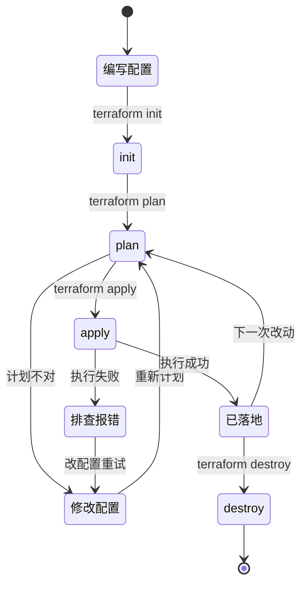
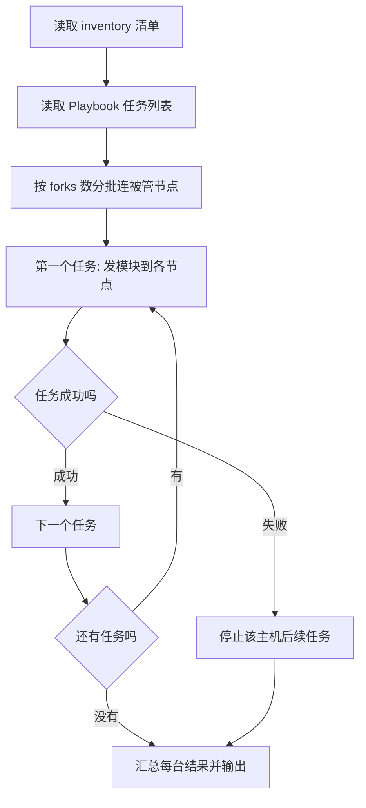

## 基础知识

### 一句话说清两者

Terraform 负责“把房子盖起来”，Ansible 负责“把房子装修好、住进去能用”。Terraform 管基础设施：虚拟机、网络、磁盘、负载均衡长什么样、有几台；Ansible 管配置管理：机器里面装什么软件、配置文件怎么写、服务起不起得来。

### 生活案例：装修图纸 vs 装修队干活

想象你要装修一套房子。装修图纸上写着“客厅 20 平方米、两间卧室、一个厨房”，这就是 Terraform 的声明式写法：你只说“最后要长什么样”，不说“先砌哪面墙”。装修队按步骤干活，先水电、再贴砖、最后装灯，这就是 Ansible 的过程式写法：你一步一步写清楚“先做什么、再做什么”。图纸的好处是结果可预期，图纸不变，盖出来的房子就不变；装修队的好处是灵活，今天想先装灯、明天想先贴砖，都可以调顺序。

### 声明式 vs 过程式

声明式（Terraform）写目标状态：“要 1 台云主机”，工具自己算出“现在 0 台，差 1 台，新建 1 台”。过程式（Ansible）写执行步骤：“先装 Nginx，再写配置，最后启动服务”，工具按顺序跑一遍。打个比方：声明式像点外卖说“我要一份宫保鸡丁”，你不管厨师先切鸡还是先炒花生；过程式像你亲自下厨，菜谱写“第一步切鸡丁，第二步热油，第三步下锅”。

### 各自解决什么问题

Terraform 解决“环境从 0 到 1”的问题：新开一个 VPC、一批云主机，手动在控制台点 50 次，不如写 50 行配置一键建出来。Ansible 解决“机器从裸机到可用”的问题：10 台新机器都要装 Nginx、改同一个配置、起同一个服务，逐台 SSH 登录操作 10 遍，不如写一个 Playbook 一次跑完 10 台。变量与复用也一样：Terraform 用 `variable` 把地域、机型、网段抽出来，Ansible 用 `vars` 和 inventory 变量把包名、端口、域名抽出来，写死 IP 和密码的配置换个环境就要全文改，抽成变量后换环境只改变量文件。

### 分工对比表

| 维度 | Terraform | Ansible |
| --- | --- | --- |
| 管什么 | 基础设施：云主机、VPC、子网、磁盘、负载均衡 | 配置管理：装包、写配置、启服务、改文件 |
| 写法 | 声明式：写目标状态 | 过程式：写执行步骤 |
| 状态 | 有状态文件 state，记录“现在长什么样” | 无状态，不记录机器长什么样，每次现查 |
| 语言 | HCL，专为写基础设施设计 | YAML，Playbook 是任务清单 |
| 连接方式 | 调云厂商 API 建资源 | SSH 连到机器上执行命令 |
| 适用边界 | 建资源、改资源、删资源 | 装软件、改配置、批量运维 |
| 反模式 | 拿它去装软件包、改配置文件 | 拿它去建云主机、建 VPC |

### 适用边界与反模式，一句话记牢

Terraform 建资源，Ansible 配机器，越界用两个都会别扭。用 Ansible 建云资源，每跑一次都可能多建一台，因为它不记“已经建过几台”；用 Terraform 装软件包，每次改个配置都要走一遍“建资源”的流程，又慢又容易误伤已有资源。

## 原理剖析

### Terraform 的核心：配置、状态、现实三者对账

Terraform 手里有三份东西，每次干活都要把三者对上：配置是你写的 HCL，说“应该长什么样”；状态文件 state 是上次执行完记下来的账本，说“上次建完长什么样”；现实是云厂商那边真实存在的资源，说“现在实际长什么样”。执行时它先拿配置和状态比，再拿状态和现实比，算出一个“差值”，只对差值动手。这就是为什么改一行配置，它不会把所有资源推倒重建，只改那一行对应的资源。

### Terraform 工作流状态机

下面这张图是 Terraform 最常用的四个命令走过的状态，先读一句引导：从写配置到资源落地一共四步，每一步都有明确的出口，失败就停在原地，不会悄悄往下走。



`terraform init` 是下载 provider 插件，相当于“把工具箱准备好”，只做准备，不建资源；`terraform plan` 是算差值并打印执行计划，相当于“先出报价单给你看”，只看不建；`terraform apply` 是按计划真正动手建资源，相当于“签字开工”；`terraform destroy` 是按状态文件把资源删干净，相当于“拆掉重来”。

### 数字算一算：plan 为什么值得先看一眼

假设一个配置要建 1 个 VPC、3 个子网、10 台云主机，一共 14 个资源。不看 plan 直接 apply，错一个子网网段，10 台主机可能全建在错网段上，返工要删 14 个、重建 14 个；先看 plan，花 1 分钟看一眼，错网段在 plan 里就能发现，返工成本是 0 个资源。plan 的成本是 1 分钟，返工的成本是 28 次资源操作，这笔账不用多算。

### Ansible 的核心：控制节点 + 被管节点 + 模块

Ansible 只有两个角色：控制节点是你的电脑，上面装 Ansible、放 Playbook 和 inventory；被管节点是要被管理的机器，上面什么都不用装，只要能 SSH 登录、有 Python。控制节点通过 SSH 把“模块”发到被管节点上执行，执行完把结果拿回来。模块是最小执行单元，比如 `apt` 模块装包、`copy` 模块传文件、`service` 模块启服务。

### Ansible 为什么不用装 Agent

很多运维工具要在每台机器上装一个常驻 Agent，Ansible 不用，原因很直接：它走 SSH，机器本来就有 SSH 服务，不用多装东西；它是“推”模式，控制节点主动推任务，被管节点被动接，不用被管节点一直等着。代价是每次执行都要重新建 SSH 连接，机器一多，连接开销就上来了，后面用并行数 forks 来摊薄。

### 数字算一算：SSH 连接开销

假设 1 台机器跑 1 个任务要建 1 次 SSH 连接，每次连接握手约 1 秒。10 台机器、每台 3 个任务，连接次数是 10 × 3 = 30 次，串行握手约 30 秒；改成 5 个并行（forks = 5），10 台分两批跑，握手时间约 30 ÷ 5 = 6 秒。连接次数没变，变的是“同时开几条路”，这就是 forks 的作用。

## 进阶知识

### Terraform 的 state 是什么

state 是一个 JSON 文件，默认叫 `terraform.tfstate`，它是 Terraform 的“账本”：记录每个资源的云厂商 ID，比如云主机 `i-0abc123`；记录每个资源的属性，比如 IP 地址、私网网段；记录资源之间的依赖关系，比如子网属于哪个 VPC。没有 state，Terraform 就不知道“云上那台主机是不是我建的”，下次 apply 就会再建一台一模一样的，造成重复资源。

### state 丢了会怎样

分三种情况，后果一个比一个重。第一，state 丢了，但云上资源还在：Terraform 以为“什么都没建过”，下次 apply 会重新建一套，旧资源变成没人管的“孤儿”，还在计费。第二，state 丢了，又跑了 destroy：Terraform 以为“没什么可删”，删不掉云上的资源，孤儿资源继续计费。第三，state 被两个人同时改：后保存的人会覆盖先保存的人，账本错乱，可能误删别人的资源。所以 state 不能只放本地笔记本，要放远端后端（比如对象存储 + 锁），团队共用一份，改的时候加锁。

### Ansible 的幂等性：跑一次和跑十次，结果一样

幂等的意思是：同一个 Playbook 跑 1 次和跑 10 次，最终状态一样，不会越跑越乱。幂等的写法是用 `apt` 模块装 Nginx，装过了就跳过，不会重复装 10 次；不幂等的写法是用 `shell` 模块跑 `echo xxx >> file`，跑 10 次文件里就多 10 行。生活类比：幂等像“把灯打开”，灯已经亮着，再按一次开关还是亮着；不幂等像“往杯子里倒一杯水”，倒 10 次杯子就满了、溢出来了。

### Ansible 怎么写才幂等

三条规矩，记住就能少踩一半坑：优先用模块，不用 `shell` / `command`，模块自带“先查后改”，`shell` 只会傻跑命令；写文件用 `copy` / `template`，不用 `echo >>`，前者是“写成这个内容”，后者是“追加一行”；启服务用 `service` 模块的 `state: started`，不用 `shell` 跑 `systemctl start`，前者会先查服务是不是已经在跑。

### Ansible 执行流程

下面这张图是 Ansible 跑一个 Playbook 时走过的流程，先读一句引导：从读清单到逐台执行，任务是按顺序、按主机一批一批跑的，哪一步失败就停在哪一步。



inventory 决定“对哪些机器跑”，Playbook 决定“跑哪些任务”。任务是串行的：任务 1 跑完所有机器，才跑任务 2；任务 1 在某台失败，那台就不跑后面的任务。最后汇总每台机器每个任务是 changed、ok 还是 failed，一眼就能看到。

### 数字算一算：changed 和 ok 的区别

假设 Playbook 有 3 个任务，跑 10 台机器，一共是 10 × 3 = 30 次任务执行。第一次跑，30 次里可能有 20 次 changed（真的改了东西）、10 次 ok（本来就是对的）；第二次跑同一份 Playbook，理想情况是 0 次 changed、30 次 ok，说明已经幂等、没有多余改动。如果第二次跑还有很多 changed，说明有任务不幂等，每次都在重复改，要回头修写法。

## 疑难杂症

### 改了配置，apply 却说“没有变化”

先看三个地方：改的是不是当前目录的配置、有没有保存文件、变量是不是被别的值覆盖了。Terraform 只认磁盘上的配置和变量值，编辑器里没保存的改动等于没改。

### apply 到一半失败，留下一堆半成品

不要手动去云控制台一个个删，先跑 `terraform plan` 看它认为“现在缺什么”，再跑一次 `apply` 让它把剩下的补齐。Terraform 的 state 会记下“哪些已经建好、哪些还没建”，补跑一次比手动删更稳。

### state 文件里有敏感信息

state 是明文 JSON，里面可能有数据库密码、密钥。不要把 state 提交到 Git，也不要随手发给别人。远端后端要开加密，访问权限只给需要的人。

### Ansible 连不上机器：先查三件事

第一，SSH 能不能通：手动 `ssh` 一下，看是不是密钥、端口、账号的问题；第二，inventory 写没写对：主机名、IP、分组有没有拼错；第三，Python 在不在：被管节点要有 Python，Ansible 的模块靠它跑。

### Ansible 跑得慢：先看 forks 和 gather_facts

默认 forks 是 5，机器一多就排队，改成 10 或 20 能明显提速，但别一次拉满，控制节点和网络也有上限。`gather_facts` 默认会先收集每台机器的信息，Playbook 里用不到这些信息时可以关掉，省掉一轮 SSH 往返。

### 数字算一算：forks 从 5 改到 20 能省多少

假设 20 台机器，每台跑一个 Playbook 要 2 分钟，串行是 20 × 2 = 40 分钟。forks = 5 时，20 台分 4 批，每批 2 分钟，一共约 4 × 2 = 8 分钟；forks = 20 时，20 台一批跑完，一共约 2 分钟。省下的时间是 8 - 2 = 6 分钟，但控制节点同时要维持 20 条 SSH 连接，内存和网络要扛得住。

## 实战案例

### 场景：给一个小项目搭一套最小可用环境

需求只有三句话：一个 VPC、一个子网、一台能 SSH 登录的云主机，主机上装好 Nginx 并能对外提供网页。分工是 Terraform 建 VPC、子网、云主机，Ansible 在主机上装 Nginx、写配置、启动服务。两步分开跑，各自只干自己擅长的事。

### Terraform 最小配置：VPC + 子网 + 云主机

下面是一份完整可跑的最小配置，按官方文档写法组织，文件都放在同一个目录里。命令输出为按官方文档给出的典型示例，本机没有 terraform 环境，未实测运行。

文件一：`main.tf`，资源本体。

```hcl
terraform {
  required_version = ">= 1.5.0"
  required_providers {
    aws = {
      source  = "hashicorp/aws"
      version = "~> 5.0"
    }
  }
}
provider "aws" {
  region = var.region
}
resource "aws_vpc" "main" {
  cidr_block           = var.vpc_cidr
  enable_dns_hostnames = true
  tags = { Name = "demo-vpc" }
}
resource "aws_subnet" "web" {
  vpc_id                  = aws_vpc.main.id
  cidr_block              = var.subnet_cidr
  map_public_ip_on_launch = true
  tags = { Name = "demo-subnet" }
}
resource "aws_security_group" "web" {
  name   = "demo-web-sg"
  vpc_id = aws_vpc.main.id
  ingress {
    from_port   = 22
    to_port     = 22
    protocol    = "tcp"
    cidr_blocks = ["0.0.0.0/0"]
  }
  ingress {
    from_port   = 80
    to_port     = 80
    protocol    = "tcp"
    cidr_blocks = ["0.0.0.0/0"]
  }
  egress {
    from_port   = 0
    to_port     = 0
    protocol    = "-1"
    cidr_blocks = ["0.0.0.0/0"]
  }
}
resource "aws_instance" "web" {
  ami                    = var.ami_id
  instance_type          = var.instance_type
  subnet_id              = aws_subnet.web.id
  vpc_security_group_ids = [aws_security_group.web.id]
  tags = { Name = "demo-web" }
}
```

逐字段讲：`required_version = ">= 1.5.0"` 要求 Terraform 不低于 1.5.0，版本太低直接报错，不悄悄跑；`required_providers` 声明用 `hashicorp/aws`，版本约 5.0，`~> 5.0` 表示 5.x 都可以、6.0 不行；`provider "aws"` 告诉 Terraform 用哪个云、哪个地域，地域从变量 `var.region` 来；`aws_vpc.main` 建一个 VPC，`cidr_block` 是网段，`enable_dns_hostnames` 让主机能拿到 DNS 名字；`aws_subnet.web` 在 VPC 里建一个子网，`vpc_id` 引用上面 VPC 的 ID，`map_public_ip_on_launch` 让新主机自动拿公网 IP；`aws_security_group.web` 是安全组，就是“门口的保安”，22 端口放 SSH、80 端口放网页，`egress` 是出方向全放行；`aws_instance.web` 建一台云主机，`ami` 是系统镜像，`instance_type` 是机型，`subnet_id` 决定它落在哪个子网。

文件二：`variables.tf`，所有会变的值抽出来。

```hcl
variable "region" {
  type = string
  default = "us-east-1" }
variable "vpc_cidr" {
  type = string
  default = "10.0.0.0/16" }
variable "subnet_cidr" {
  type = string
  default = "10.0.1.0/24" }
variable "ami_id" {
  type = string
  default = "ami-0abcdef1234567890" }
variable "instance_type" {
  type = string
  default = "t3.micro" }
```

文件三：`outputs.tf`，把跑完后要用的值打出来。

```hcl
output "vpc_id" { value = aws_vpc.main.id }
output "subnet_id" { value = aws_subnet.web.id }
output "instance_public_ip" { value = aws_instance.web.public_ip }
```

### 数字算一算：网段到底能装多少地址

VPC 是 `10.0.0.0/16`：地址总数是 2 的（32 - 16）次方，也就是 2 的 16 次方，等于 65536 个。子网是 `10.0.1.0/24`：地址总数是 2 的（32 - 24）次方，也就是 2 的 8 次方，等于 256 个。云厂商习惯预留 5 个地址（网络地址、路由、DNS 等），所以子网实际可用是 256 - 5 = 251 个，占 256 个的 98.0%。一个 `/16` 的 VPC 能切出 65536 ÷ 256 = 256 个 `/24` 子网，3 个子网一共是 3 × 256 = 768 个地址、可用 3 × 251 = 753 个。子网地址范围是 `10.0.1.0` 到 `10.0.1.255`，可用的是 `10.0.1.4` 到 `10.0.1.254`，一数就是 254 - 4 + 1 = 251 个，对得上。

### 成本算一算：这台主机一个月多少钱

按 us-east-1 的示例单价算：`t3.micro` 示例价每小时 0.0104 美元，一个月按 30 天算。一天是 0.0104 × 24 = 0.2496 美元；一个月是 0.2496 × 30 = 7.488 美元，约 7.49 美元；一年是 7.488 × 12 = 89.856 美元，约 89.86 美元。这只是主机的示例价，公网 IP、磁盘、流量要另算，正式上云前要按云厂商当时的定价重算一遍。

### 跑起来的命令顺序

```bash
terraform init
terraform plan
terraform apply
```

按官方文档给出的典型示例，`terraform apply` 完成后会输出类似下面的内容（典型示例，非本机实测输出）：

```text
Apply complete! Resources: 4 added, 0 changed, 0 destroyed.
Outputs:
instance_public_ip = "54.123.45.67"
subnet_id = "subnet-0abc123"
vpc_id = "vpc-0abc123"
```

4 个资源就是 VPC、子网、安全组、云主机各 1 个，一共 4 个。

### Ansible Playbook：装包 + 写配置 + 启服务

下面是一份完整可跑的 Playbook，装 Nginx、写一个简单网页、启动服务。命令输出为按官方文档给出的典型示例，本机没有 ansible 环境，未实测运行。

文件一：`inventory.ini`，清单写法。

```ini
[web]
web-01 ansible_host=54.123.45.67 ansible_user=ubuntu ansible_ssh_private_key_file=~/.ssh/demo.pem

[web:vars]
ansible_python_interpreter=/usr/bin/python3
```

逐行讲：`[web]` 是分组名，下面挂的机器都归这一组；`web-01` 是主机别名，Playbook 里写 `hosts: web` 就是指这一组；`ansible_host` 是真实 IP，就是上面 Terraform 输出的 `instance_public_ip`；`ansible_user` 是 SSH 登录用的账号，Ubuntu 镜像一般是 `ubuntu`；`ansible_ssh_private_key_file` 是 SSH 密钥路径，别把密钥写进 Playbook 正文；`[web:vars]` 给 web 组统一设变量，`ansible_python_interpreter` 指定被管节点的 Python 路径。

文件二：`site.yml`，Playbook 本体。

```yaml
---
- name: 在 web 组上部署 Nginx
  hosts: web
  become: true
  tasks:
    - name: 安装 Nginx
      ansible.builtin.apt:
        name: nginx
        state: present
        update_cache: true
    - name: 写入首页
      ansible.builtin.copy:
        content: "Hello from Ansible!\n"
        dest: /var/www/html/index.html
        mode: "0644"
    - name: 启动 Nginx 并设为开机自启
      ansible.builtin.service:
        name: nginx
        state: started
        enabled: true
```

逐任务讲：`hosts: web` 只对 web 组跑，别跑错机器；`become: true` 提权成 root，装包和写系统文件需要 root 权限；任务 1 装包用 `apt` 模块，`state: present` 表示“装上就行，装过就跳过”，`update_cache: true` 先更新软件源；任务 2 写配置用 `copy` 模块把一句话写进首页文件，`mode: "0644"` 是文件权限，所有人可读、只有主人可写；任务 3 启服务用 `service` 模块，`state: started` 是“正在跑就行”，`enabled: true` 是“下次开机还自动跑”。

### 跑起来的命令与验证

```bash
ansible-playbook -i inventory.ini site.yml
```

按官方文档给出的典型示例，跑完会看到每个任务的汇总（典型示例，非本机实测输出）：

```text
PLAY RECAP
web-01 : ok=3 changed=3 unreachable=0 failed=0
```

`ok=3` 是 3 个任务都跑通，`changed=3` 是第一次跑、3 个任务都真的改了东西。再跑一次同一份 Playbook，理想情况是 `ok=3 changed=0`，这就是幂等的验证方法：第二遍没有 changed，说明写法是对的。验证服务是不是真的起来了，可以直接在浏览器里打开 `http://54.123.45.67`，看到 `Hello from Ansible!` 就说明全链路通了。

### 两者联动：Terraform 建好机器，inventory 交给 Ansible

典型流水线分四步走：第一，Terraform `apply` 建好云主机，输出公网 IP；第二，把输出的 IP 写进 `inventory.ini`，可以手写，也可以让 Terraform 的 `local_file` 资源自动生成；第三，Ansible 拿着新 inventory 跑 Playbook，装软件、写配置、启服务；第四，下次扩容时 Terraform 把主机数从 1 改成 3，inventory 跟着变 3 行，Ansible 再跑一遍，3 台就都配好了。生活类比：Terraform 是“盖楼的”，盖好把钥匙和门牌号交出来；Ansible 是“装修队”，拿着门牌号一家一家去装修。盖楼的不管装修，装修的不管盖楼，交接的东西就是一张门牌号清单。

## 面试与自测

1. Terraform 和 Ansible 的分工是什么？什么场景下必须两个一起用，什么场景下只用一个就够了？
2. Terraform 的 state 文件是干什么的？state 丢了会发生什么？团队共用 state 要注意哪两件事？
3. Ansible 的幂等性是什么意思？请举一个幂等的写法和一个不幂等的写法，并说清第二次跑 Playbook 时 changed 应该是多少。
4. 有人说“用 Ansible 建云主机、用 Terraform 装 Nginx”，错在哪里？如果只能二选一，建 10 台云主机并装好 Nginx，正确的分工应该怎么排？

### 参考答案

1. Terraform 管基础设施（建资源），Ansible 管配置管理（配机器）。新环境从 0 到 1、又要建机器又要装软件时两个一起用；只改机器里的配置、不动资源时只用 Ansible；只建一批空机器、不装软件时只用 Terraform。
2. state 是 Terraform 的账本，记着每个资源的云厂商 ID、属性和依赖关系。丢了会让 Terraform 以为“什么都没建过”，下次 apply 会重复建一套，旧资源变孤儿、继续计费。团队共用要注意两件事：放远端后端、不要只放本地；改的时候加锁，防止两个人同时改把账本写乱。
3. 幂等是同一个 Playbook 跑 1 次和跑 10 次，最终状态一样。幂等写法是用 `apt` 模块装 Nginx，装过就跳过；不幂等写法是用 `shell` 跑 `echo xxx >> file`，跑几次就追加几行。第二次跑同一份 Playbook，理想情况是 changed 为 0，全部是 ok。
4. 错在越界：Ansible 没有状态文件，记不住“已经建过几台”，建云资源容易重复建；Terraform 是声明式建资源的工具，拿它装软件包又慢又容易误伤已有资源。正确分工是 Terraform 先建 10 台云主机并输出 IP，inventory 交给 Ansible，再由 Ansible 在 10 台上装 Nginx、写配置、启服务。

## 小技巧与冷知识

- 先 `plan` 再 `apply`：plan 是免费的报价单，apply 是签字开工，养成“看一眼再签字”的习惯，能省掉大部分返工。
- state 别进 Git：state 是明文 JSON，里面可能有密码和密钥，放远端后端并开加密，比放代码仓库安全得多。
- Ansible 第二遍 `changed=0` 才是好 Playbook：第一次跑 changed 多是正常的，第二次跑还很多 changed，说明有任务不幂等，要回头修写法。
- inventory 是交接单：Terraform 输出的 IP 直接写进 inventory，两个工具的交接就只有这一张清单，清单一错，后面全错。
- `become: true` 别滥用：只有装包、写系统文件这种真要 root 的任务才提权，普通读文件没必要提权，权限越小越安全。
- 小版本也要锁：Terraform 锁 provider 的大版本、Ansible 锁核心版本，升级前先在小环境跑一遍，别直接在生产环境升版本。

## 关联知识

- [Kubernetes基础](工程实践/运维/Kubernetes基础.md)：云主机配好之后，容器编排一般跑在 Kubernetes 上，Terraform 建集群、Ansible 配节点是常见的前置步骤。
- [Linux性能分析](工程实践/运维/Linux性能分析.md)：Ansible 配好的机器跑慢了，先看 CPU、内存、磁盘与网络，再决定是改配置还是加机器。
- [灾备备份与恢复演练](工程实践/运维/灾备备份与恢复演练.md)：state 与 Playbook 都是恢复环境的底稿，丢了 state 或丢了 Playbook，灾备演练时都要从头重建。
- [监控告警](工程实践/运维/监控告警.md)：机器建好、服务起来之后，要接监控看它是不是一直活着，Terraform 与 Ansible 只管“生出来”，监控管“一直活着”。
