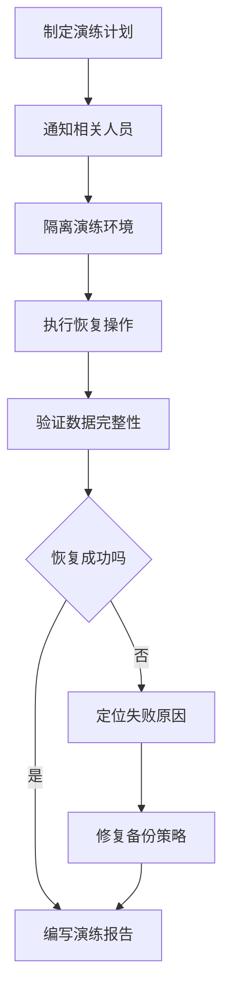

> 分工一句话：本篇讲灾难发生之前的备份、演练与预案，[故障恢复](工程实践/故障恢复.md)讲灾难发生之后的故障定位与恢复操作，两篇互补不重复。

# 灾备备份与恢复演练

## 基础知识

### 灾备是什么：先想想家里着火怎么办

灾备就是灾难备份与恢复，目标只有一个：系统出大事之后，数据不丢、服务能回来。

家里着火是最贴切的类比。平时把房产证、户口本复印三份，一份放家里抽屉，一份放父母家，一份放银行保险柜，这就是备份。着火之后拿着复印件去补办、重新安家，这就是恢复。只复印不分开放，火一烧全没了；只分开放却从没试过补办，真出事才发现复印件字迹模糊，那就等于没备份。

线上系统也一样。数据库被误删、机房断电、磁盘损坏、勒索软件加密文件，这些都是“着火”。灾备要回答两个问题：最多能丢多少数据？最多多久能恢复服务？这两个问题的答案，就是 RPO 和 RTO。

### RPO：最多能丢多少数据

RPO 是恢复点目标，意思是灾难发生时，最多允许丢失多长时间内的数据。换句话说，就是“回到过去的哪个时间点”。

生活例子：你每天晚上 10 点给手机相册做一次云同步。某天中午 12 点手机丢了，最后一次同步是昨天晚上 10 点，从昨天 10 点到今天 12 点新拍的 14 个小时的照片全没了。这 14 个小时，就是这次事故实际丢失的数据量。

逐步算一笔账。假设数据库每小时备份一次，备份时间点是 9:00、10:00、11:00。

- 第一步：确认备份间隔是 60 分钟。
- 第二步：最坏情况是故障正好发生在下一次备份前一刻，比如 10:59 宕机。
- 第三步：最近一次可用备份是 10:00，丢失的数据就是 10:00 到 10:59 这 59 分钟内写入的数据。
- 结论：每小时备份一次，RPO 最多是 60 分钟，也就是 1 小时。

再算一个中间情况：10:50 宕机，最近一次备份是 10:00，丢失 50 分钟的数据。10:05 宕机，只丢失 5 分钟。规律很直观：备份越频繁，RPO 越小。把间隔从 60 分钟缩短到 15 分钟，最坏丢失就从 60 分钟降到 15 分钟，代价是备份次数变成原来的 4 倍。

RPO 不是技术参数，是业务选择。订单系统丢 1 小时订单不可接受，内部 Wiki 丢 1 小时编辑可以接受。先问业务“丢多少能忍”，再定备份频率，不要反过来。

### RTO：最多多久能恢复服务

RTO 是恢复时间目标，意思是灾难发生之后，最多允许用多长时间把服务恢复到可用状态。RPO 管“丢多少”，RTO 管“停多久”。

生活例子：家里停电，RTO 就是从停电到重新来电之间你能忍受的时间。点蜡烛能忍 1 小时，冰箱里的冻肉化了就忍不了 8 小时。忍受时间越短，准备就要越充分，比如备一台发电机。

逐步算一笔账。假设一次恢复要经过 5 个步骤，每一步耗时如下：

- 第一步：发现故障并确认要恢复，花 10 分钟。
- 第二步：负责人决策、拉起恢复流程，花 5 分钟。
- 第三步：从异地把 300GB 备份数据拉回来。按 100MB 每秒的速度算，300GB 是 307200MB，除以 100 得到 3072 秒，再除以 60 得到 51.2 分钟，约 51 分钟。
- 第四步：把数据恢复进数据库，花 45 分钟。
- 第五步：校验数据、检查服务能不能正常访问，花 20 分钟。
- 合计：10 + 5 + 51 + 45 + 20 = 131 分钟，也就是 2 小时 11 分钟。

结论：如果业务要求的 RTO 是 2 小时，这套流程就不达标，差了 11 分钟。想达标要么把传输速度提上去，要么提前把备份数据预热到离机房更近的地方，要么缩短校验步骤。RTO 是五个步骤加起来的总账，优化时要先找到最长的那一步，而不是凭感觉加机器。

RPO 和 RTO 经常一起出现，记住一个口诀：RPO 向后看，丢了多久的数据；RTO 向前看，还要停多久的服务。两个数字都要业务方签字，不能由运维自己拍脑袋定。

### RPO 和 RTO 定下来之后做什么

定下两个数字只是第一步，接下来要把它们翻译成具体的备份动作。

第一步是根据 RPO 定备份频率。RPO 要求 1 小时，就每小时备份一次；要求 15 分钟，就每 15 分钟备份一次，备份次数是每小时的 4 倍。第二步是根据 RTO 定恢复方案。RTO 要求 4 小时，冷备加人工恢复可能够用；要求 30 分钟，就必须准备热备和自动化切换脚本。第三步是把两个数字写进演练目标，每次演练都实测一次，看纸面计算和真实耗时差多少。

生活例子：你跟家人约定“停电后 2 小时内要恢复供电”，接下来就要去买发电机、备好汽油、学会怎么启动，约定本身不会让电自己回来。RPO 和 RTO 也一样，数字只是目标，备份频率和恢复方案才是让目标落地的动作。

### 3-2-1 备份原则：三份、两种介质、一份异地

3-2-1 是备份领域最经典的原则，拆开是三句话：至少保留 3 份数据，使用 2 种不同介质，其中 1 份放在异地。

第一份是正在用的原始数据本身，比如线上数据库。第二份和第三份才是备份。3 份数据的生活例子是家里重要证件：原件放家里，复印件一份放父母家，一份放银行保险柜。原件丢了有复印件，家里着火还有父母家那份，三份同时出事的概率极低。

2 种介质的意思是不要把所有备份放在同一种东西上。生活例子：照片只存在手机里，手机丢了就全没了；照片同时存在手机和移动硬盘里，手机丢了还有硬盘。线上对应的做法是：一份备份放本地磁盘，另一份放对象存储或磁带。磁盘坏了有对象存储，对象存储出问题还有磁盘，两种介质同时坏的概率比一种低得多。

1 份异地的意思是至少有一份备份不在同一个机房、同一个城市，最好不在同一个地区。生活例子：所有证件复印件都放在自家不同抽屉里，一场火灾全烧光；一份放父母家，火灾就烧不到它。线上对应的做法是：本地机房一份，另一个城市的机房或云上一份。机房断电、洪水、地震这些区域性灾难，只能靠异地那份顶上去。

逐步算一笔存储账。假设业务数据是 1TB：

- 第一步：原始数据 1TB。
- 第二步：按 3-2-1 原则，备份至少再存 2 份，也就是 2TB。
- 第三步：总共要准备 1 + 2 = 3TB 的存储空间。
- 结论：1TB 数据做 3-2-1 备份，至少要 3TB 存储，还没算历史版本占的空间。

这笔账要在立项时就跟老板讲清楚：备份不是免费的，存储要花钱。省掉异地那份，等于省掉了应对机房级灾难的能力，省钱的同时也省掉了安全感。

## 原理剖析

### 备份策略长什么样：先看一张架构图

下面的图是一套最小可用的备份策略架构，数据从业务系统流向三个地方，最后由演练闭环验证。

读图顺序是从左到右：业务系统产生数据，备份任务按定时策略把数据分别写到本地磁盘和云端对象存储，异地副本再从这两处同步一份，最后由定期演练验证这些备份是不是真的能恢复。任何一个环节断掉，图上都能一眼看出来。

架构里有三个关键点。第一，备份任务要独立于业务系统，不能和业务跑在同一台机器上，否则机器一坏，业务和备份一起没。第二，本地备份负责快速恢复，云端和异地负责兜底大灾难，分工不同，缺一不可。第三，恢复验证不是可选项，没有演练的备份只能叫“写了数据的硬盘”，不能叫“备份”。

### 全量、增量、差异：三种备份方式的逐步对比

备份有三种基本类型：全量备份、增量备份、差异备份。理解它们最好的办法是算两笔账：每次备份要花多久，恢复时要拼几份。

先定一个场景：数据库总共 500GB，每天新增和修改的数据是 10GB，备份速度是每秒 100MB。

全量备份是每次把 500GB 全部抄一遍。逐步算耗时：500GB 等于 512000MB，除以 100MB 每秒得到 5120 秒，再除以 60 得到 85.3 分钟，约 1 小时 25 分钟。优点是恢复时只要这一份，简单可靠；缺点是每天都花 85 分钟，又慢又占空间。

增量备份是每次只备份自上次备份以来变化的数据。周日做一次全量，之后每天只备份当天变化的 10GB。逐步算耗时：10GB 等于 10240MB，除以 100MB 每秒得到 102.4 秒，再除以 60 得到 1.7 分钟。每天只要 1.7 分钟，快得多。缺点在恢复：周六恢复要先拿周日的全量，再按顺序拼上周一到周六的 6 个增量，一共 1 + 6 = 7 份，少一份或顺序错一份都恢复不出来。

差异备份是每次备份自上次全量备份以来所有变化的数据。周日全量之后，周一备份 10GB，周二备份 20GB，周三备份 30GB，越往后越大。逐步算周六的耗时：第 6 天变化累计是 60GB，等于 61440MB，除以 100MB 每秒得到 614.4 秒，再除以 60 得到 10.2 分钟。恢复时只要两份：周日全量加周六那份差异，一共 1 + 1 = 2 份，比增量简单得多。

三种方式的对比结果如下：

| 备份类型 | 每次备份耗时 | 恢复时要拼几份 | 优点 | 缺点 |
| --- | --- | --- | --- | --- |
| 全量备份 | 约 85.3 分钟 | 1 份 | 恢复最简单 | 最慢、最占空间 |
| 增量备份 | 约 1.7 分钟 | 7 份 | 备份最快、最省空间 | 恢复最复杂、最慢 |
| 差异备份 | 第 6 天约 10.2 分钟 | 2 份 | 折中、恢复较简单 | 越往后备份越大 |

再算一周的总备份量。周日全量 500GB，加上周一到周六 6 天增量每天 10GB，一共是 500 + 6 × 10 = 560GB。用全量每天备份的话，一周是 7 × 500 = 3500GB。增量方案只用了全量方案约六分之一的空间，这就是大多数系统选择“每周全量加每天增量”的原因。

实际选型有个经验组合：每周做一次全量，每天做一次增量，恢复时间能接受的系统用增量，要求恢复简单的系统用差异。没有哪种是全场最优，只有哪种最适合你的 RTO。

### 备份窗口与保留期：两个容易被忽略的数字

备份窗口是指每天留给备份的时间段。生活例子：小区每天凌晨 2 点到 4 点停水检修，你就得在这个时间段之外用水。备份也一样，全量备份要 85.3 分钟，必须放在业务低峰期做，不能在白天高峰期抢磁盘和带宽。

保留期是指备份要留多久。生活例子：工资条留一个月够用，房产合同要留一辈子。备份保留期常见的是 30 天，逐步算一笔账：每周一次全量 500GB，一个月约 4 次，一共是 4 × 500 = 2000GB；每天一次增量 10GB，30 天一共是 30 × 10 = 300GB；合计约 2300GB。这就是 30 天保留期要准备的存储量，定保留期之前要先算这笔账。

保留期太短，出了事发现要恢复的是 40 天前的数据，已经删了；保留期太长，存储成本直线上升。常见做法是分层保留：最近 7 天每天一份，之前 4 周每周一份，再往前每月一份，越久越稀疏。

## 进阶知识

### 分层备份：不是所有数据都值得同等待遇

不是所有数据都一样重要。订单数据丢 1 小时是事故，操作日志丢 1 天可能只是少几行记录。分层备份就是给不同数据定不同的 RPO 和 RTO。

生活例子：家里保险柜放房产证和存折，抽屉放水电费单据，废纸篓放过期传单。三类东西的保管力度完全不同，因为丢了的后果完全不同。

分层做法通常是三档。核心档是订单、支付、用户数据，备份间隔 15 分钟，RPO 最多 15 分钟，恢复优先级最高。重要档是配置、商品信息，每天备份一次，RPO 最多 24 小时。一般档是日志、临时文件，每周备份一次，甚至不备份，丢了可以重新生成。分层之后，备份成本花在刀刃上，恢复时也知道先恢复谁。

### 备份一致性：拍快照时数据库正在写入怎么办

备份最大的技术难点是一致性：备份进行到一半，业务还在写入新数据，抄出来的备份可能一半是旧的一半是新的，恢复出来是一份拼不上的数据。

生活例子：给一本正在被人涂改的账本拍照，拍出来的那页可能上半页是旧数字、下半页是新数字，根本对不上账。

解决办法有三种。第一种是停写备份，备份期间暂停写入，数据静止了再抄，简单可靠但要停业务，只适合半夜低峰期。第二种是快照备份，利用存储或文件系统的快照功能，在某一瞬间冻结一个时间点的视图，再慢慢从快照里抄数据，业务不用停。第三种是日志回放，先抄一份全量，再把备份时间点之后的日志重放一遍，把数据恢复到某个一致的时间点，数据库的增量备份大多是这个思路。

选哪种要看 RTO 和业务容忍度。能停业务的用停写，不能停的用快照加日志回放。无论用哪种，判断标准只有一个：恢复出来的数据能不能通过一致性校验。

### 异地容灾：同城双活与异地冷备的区别

异地容灾有三种常见形态，成本和恢复速度差别很大。

同城双活是两个机房同时跑业务，一个机房出问题，另一个马上接管，RTO 以分钟计。生活例子是家里装了两路供电，一路断了另一路立刻顶上。优点是恢复最快，缺点是成本最高，两个机房都要按满配建设。

异地热备是一个机房跑业务，另一个机房备着，随时能接管，RTO 以小时计。生活例子是备胎，平时不用，爆胎时换上就能走。成本比双活低，但切换需要人工或半自动操作。

异地冷备是只把备份数据放在异地，出事了再现搭环境、现恢复数据，RTO 以天计。生活例子是把重要证件复印件放在父母家，真出事了再去取、再去补办。成本最低，但恢复最慢。

三者的选择只看两个数字：业务能忍受的 RTO 是多少，愿意为这个 RTO 花多少钱。RTO 要求 1 小时就不要指望冷备，预算只够冷备就不要承诺 1 小时恢复。

### 备份加密与权限：备份本身也是攻击目标

备份文件里装的是全量业务数据，泄露一份备份等于泄露整个数据库。勒索软件最喜欢先加密备份再加密线上数据，让你连恢复的路都没有。

做法有三条。第一，备份数据要加密存储，密钥和备份分开保管，不要把钥匙和锁放在同一个抽屉里。第二，备份的访问权限要收紧，只有备份服务账号能写，只有恢复流程能读，平时 nobody 能下载。第三，至少一份异地备份要设为不可篡改模式，写进去之后一段时间内谁也删不掉、改不了，这叫对象锁，是防勒索的最后一道防线。

### 备份自动化：定时、重试与告警

靠人每天手动点备份，迟早有一天会忘。备份一定要自动化，定时任务加失败重试加告警，三件套缺一不可。

生活例子：每天早上 7 点的闹钟就是定时任务，闹钟响了你按掉它、它 10 分钟后再响一次就是重试，连续三次没起来它给你家人发消息就是告警。备份也一样，定时触发、失败自动重试一次、重试还失败就发告警给值班人。

自动化还要管三件小事。第一，备份开始前检查磁盘空间够不够，不够就先告警，不要等写到一半才失败。第二，备份完成后校验文件大小和校验和，确认写进去的数据和读出来的数据一致。第三，备份任务要有执行记录，哪天几点、备份了多少、花了多长时间，出问题时能翻旧账。

## 疑难杂症

### 备份成功了，恢复却失败：最常见的坑

这是灾备领域最常见的事故：备份任务每天都显示成功，真要恢复时才发现恢复不出来。原因通常有三个。

第一个原因是备份文件损坏。备份写了一半磁盘满了，任务却因为退出码没处理好报了成功。第二个原因是备份不完整，只备了数据库文件，漏了配置文件和上传的文件，恢复出来的系统缺胳膊少腿。第三个原因是版本对不上，备份是旧版本数据库的格式，恢复环境已经升级到新版本，读不进去。

解决办法只有一个：定期做恢复演练，用真实流程把备份恢复出来并校验。没有演练过的备份，默认当作不可用。

### 备份越跑越慢，最后超过备份窗口

全量备份一开始 85 分钟，半年后数据涨到 800GB，备份时间跟着涨到约 136 分钟，算法是 800 × 1024 ÷ 100 ÷ 60 = 136.5 分钟。备份窗口只有 2 小时，备份跑不完，第二天业务高峰期还在跑备份，互相拖慢。

处理办法有四步。第一步，确认数据增长是不是正常，删掉过期日志和临时文件能省不少空间。第二步，把全量备份改成每周一次，平时只做增量。第三步，备份任务限速，给业务留够带宽和磁盘。第四步，实在跑不完就扩备份窗口或升级备份链路，不要让备份任务长期超时运行。

### 增量链断了一环，整条链都废了

增量备份像一串链条，周三的增量丢了，周四、周五的增量就算完好也拼不上，因为它们都是基于周三之后的变化。恢复时缺一环，整条链失效。

预防办法有两条。第一，每周做一次全量，把链条截断重起，链越短，断链损失越小。第二，备份完成后立刻校验链的完整性，发现缺失马上补备，不要等到恢复那天才发现。

### 演练发现备份不可用怎么办：先止血，再追责

演练的目的就是提前发现备份不可用，发现了是好事，不是坏事。处理流程分四步。

第一步，立刻评估影响：不可用的是哪份备份、覆盖哪个时间段、有没有其他副本能顶上。第二步，马上补一份新的全量备份，先把“现在有可用备份”这个状态恢复出来。第三步，定位根因，是磁盘问题、权限问题还是备份脚本问题，修掉它。第四步，把这次发现写进演练报告，标明发现人、发现时间、影响范围和修复结果，下次演练重点复查这一项。

最忌讳的是两种反应：一种是瞒下来不写进报告，下次还会在同一个地方摔倒；另一种是只修表面，不找根因，演练通过了，隐患还在。

### 恢复出来的数据是对的，服务却起不来

数据恢复成功只是第一步，服务能不能起来还要看配置、依赖和网络。常见情况是数据库恢复了，但配置文件还是旧的，连不上新地址；或者依赖的缓存、消息队列没有一起恢复，服务启动就报错。

解决办法是把恢复范围扩大到“整个服务”，而不是“数据库一个件”。演练时要按真实恢复清单逐项检查：数据库、配置文件、上传文件、依赖服务、域名解析，缺一项都算演练不通过。

### 备份空间被历史版本占满

备份越攒越多，某天早上发现备份磁盘满了，当晚的备份直接失败。更糟的是，失败可能连续几天都没人发现，因为备份任务失败的告警被淹没在其他告警里了。

处理办法是三步。第一步，给备份磁盘设用量告警，超过 80% 就提醒，不要等到 100% 才处理。第二步，按保留期自动清理过期备份，最近 7 天每天一份，之前 4 周每周一份，再往前每月一份，过期自动删除。第三步，每月对一次账，算一下当前保留策略下个月要占多少空间，提前扩容，不要等磁盘满了再抢时间。

## 实战案例

### 案例一：一家电商的 500GB 数据库备份方案

一家日订单量中等规模的电商，数据库 500GB，每天变化 10GB，业务要求 RPO 不超过 1 小时，RTO 不超过 4 小时。

方案是这样定的。每小时做一次增量备份，RPO 最坏 60 分钟，刚好卡在要求线上。每周日凌晨做一次全量备份，耗时约 85.3 分钟，放在凌晨 2 点到 4 点的低峰窗口里。本地磁盘留一份，云端对象存储留一份，异地机房再留一份，满足 3-2-1 原则。

RTO 的账是这样算的：发现 10 分钟加决策 5 分钟加传输 51 分钟加恢复 45 分钟加验证 20 分钟，一共 131 分钟，约 2 小时 11 分钟，低于 4 小时的要求，留了约 1 小时 49 分钟的余量。这笔余量很重要，真实故障总会比演练慢，有余量才扛得住意外。

这个方案上线三个月后做了一次真实演练，从宣布开始到服务恢复可用一共花了 2 小时 25 分钟，比纸面计算多了 14 分钟，多出来的时间花在等负责人接电话上。演练报告里加了一条：恢复流程里要设两名负责人，一个联系不上就找另一个。

### 案例二：每季度一次的恢复演练是怎么做的

演练不是把备份恢复一遍就完事，要有计划、有记录、有结论。下面这张图是标准演练流程，照着走就不会漏步骤。

读图的关键是那个判断节点：恢复成功就直接写报告，恢复失败要先定位原因、修复备份策略，再写报告。失败的演练比成功的演练更有价值，因为它提前暴露了真实灾难时会遇到的问题。

演练频率建议是每季度一次，一年 4 次。频率太低，备份策略可能已经悄悄失效了还没人知道；频率太高，团队会被演练拖垮。核心系统可以每月一次，一般系统每季度一次，边缘系统每半年一次。

演练报告要写五项内容。第一，演练时间、参与人和演练目标。第二，恢复用了多长时间，RTO 有没有达标。第三，恢复出来的数据丢了多少，RPO 有没有达标。第四，演练中发现的问题，比如备份不可用、配置缺失、负责人联系不上。第五，下一步的修复计划和负责人。报告要存档，下次演练先复查上次的问题修没修。

消防演习是最好的类比：平时演习时发现安全通道被杂物堵了，修掉它，真着火时才能跑出去。恢复演练发现备份不可用，修掉它，真出事时才能恢复。没有演练的备份，和没有演习的消防通道一样，都是摆设。

### 案例三：勒索软件加密了线上数据，靠异地备份翻盘

某天凌晨，运维发现线上数据库被加密，勒索软件还顺手加密了本地备份。本地两份备份全军覆没，能用的只剩云端对象存储里那份设了对象锁的异地备份，勒索软件删不掉它。

恢复过程是这样的：先隔离被感染的机器，防止扩散；再从云端拉回最近一次全量备份加增量备份；然后在隔离环境里恢复并校验数据；最后切换流量到恢复好的环境。整个过程花了约 3 小时，丢失的数据是最近一次备份到出事之间的 40 分钟，落在 RPO 1 小时的要求里。

这个案例说明两件事。第一，异地那份备份不是摆设，是最后一道防线。第二，对象锁不是多余配置，没有它，异地备份也会被一起加密。事后复盘加了两条规则：备份账号平时不登录，恢复时才临时授权；每月做一次勒索场景的专项演练。

## 面试与自测

1. 每小时备份一次，数据库在 10:50 宕机，最近一次备份是 10:00，请问这次事故的 RPO 是多少？最坏情况下 RPO 又是多少？
2. 请解释 3-2-1 备份原则里三个数字分别是什么意思，并各举一个生活中的例子。
3. 全量备份、增量备份、差异备份在恢复时分别要拼几份？为什么增量备份恢复最复杂？
4. 恢复演练发现备份不可用，正确的处理流程是什么？为什么说失败的演练比成功的演练更有价值？

### 参考答案

1. 这次事故丢失的是 10:00 到 10:50 的数据，RPO 是 50 分钟。最坏情况是故障发生在下一次备份前一刻，比如 10:59，丢失 59 分钟，约等于备份间隔 60 分钟。所以每小时备份一次，RPO 最多是 1 小时。
2. 3 是至少保留 3 份数据，生活例子是重要证件原件加两份复印件分开放。2 是使用 2 种不同介质，生活例子是照片同时存在手机和移动硬盘里。1 是其中 1 份放在异地，生活例子是一份证件复印件放父母家，防火灾烧掉全部。
3. 全量备份恢复只要 1 份，差异备份要 2 份，也就是一份全量加一份差异，增量备份要拼 1 份全量加多次增量，比如一周 6 天增量就是 1 + 6 = 7 份。增量恢复最复杂是因为要按顺序拼多份，少一份或顺序错一份都恢复不出来。
4. 正确流程是四步：先评估影响，看不可用的是哪份、有没有其他副本能顶上；马上补一份新的全量备份，先恢复“有可用备份”的状态；再定位根因并修复；最后把发现写进演练报告，下次演练重点复查。失败的演练更有价值，因为它提前暴露了真实灾难时会遇到的问题，修掉之后真出事才能恢复。

## 小技巧与冷知识

- 备份任务的状态不要只看“成功”两个字，要看备份文件的大小和生成时间。某天备份文件突然从 500GB 变成 1MB，任务还显示成功，这种备份一定有问题。
- 给备份文件起名字时把日期和类型写进去，比如全量加日期、增量加日期，恢复时不用打开文件就能知道该拼哪几份，半夜抢修时能少犯错。
- 恢复演练最好挑业务低峰期做，但不要总挑同一个人值班的时间演练，要让每个值班人都亲手恢复过一次，真出事时才不会手忙脚乱。
- 异地备份的密钥不要和备份放在同一个地方，钥匙和锁分开放，备份被盗了没有密钥也打不开。
- 冷知识：世界上第一份系统备份概念来自大型机时代，操作员每天下班前把磁带取下来锁进防火柜，这就是最早的 3-2-1 原则，技术变了，道理一直没变。
- 小技巧：演练报告里除了写花了多长时间，还要写“等人的时间”，比如等负责人接电话花了 14 分钟，这类时间往往是 RTO 超标的真正原因，修起来也最便宜。

## 关联知识

- [故障恢复](工程实践/故障恢复.md)：本篇讲事前备份与演练，那篇讲事后故障定位与恢复操作，两篇配合就是完整的灾难应对流程。
- [监控告警](工程实践/运维/监控告警.md)：备份任务失败、备份空间不足都要靠监控告警第一时间发现，否则备份悄悄失效了也没人知道。
- [Kubernetes基础](工程实践/运维/Kubernetes基础.md)：容器化服务的备份要连应用配置和持久卷一起备，只备数据库是不够的。
- [Linux性能分析](工程实践/运维/Linux性能分析.md)：备份跑得慢、恢复过程卡住时，要用性能分析定位是磁盘、网络还是 CPU 拖了后腿。
