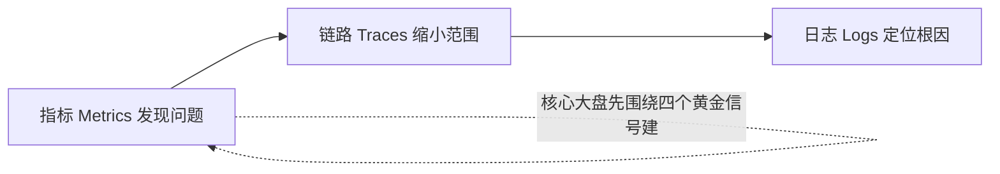
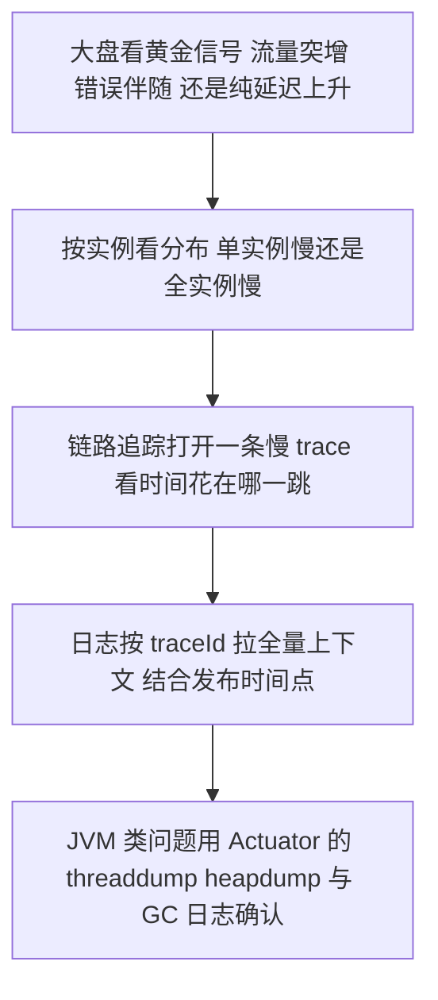

# 监控告警

## 1. 核心概念

可观测性三支柱分工明确：指标发现问题、链路缩小范围、日志定位根因。



可观测性三支柱：

- **指标（Metrics）**：可聚合的数值时间序列（QPS、延迟、错误率、GC 停顿）。便宜、适合告警与大盘，但定位不到单次请求。
- **日志（Logs）**：离散事件记录，信息最全，成本最高，适合事后追溯。
- **链路（Traces）**：一次请求跨服务的完整调用链与耗时分布，解决"慢在哪一跳"。

三者分工：指标发现问题 → 链路缩小范围 → 日志定位根因。监控的目标不是"采全数据"，而是让故障的发现时间（MTTD）和恢复时间（MTTR）变短。

### 四个黄金信号（Google SRE）

延迟（Latency）、流量（Traffic）、错误（Errors）、饱和度（Saturation）。任何服务的核心大盘先围绕这四类指标建，再按业务补充。

## 2. 基础知识

### Prometheus + Grafana 组合

- **Prometheus**：拉模式时序数据库。应用暴露 `/metrics` 端点（文本格式），Prometheus 按间隔 scrape 抓取存储；用 PromQL 查询。
- **Grafana**：可视化与告警面板，数据源接 Prometheus（及 Loki、ES 等）。
- **Alertmanager**：Prometheus 的告警路由组件，负责分组、抑制、静默与转发（邮件/企业微信/电话）。

典型 PromQL：

```promql
# 5 分钟内 HTTP 5xx 错误率
sum(rate(http_server_requests_seconds_count{status=~"5.."}[5m]))
  / sum(rate(http_server_requests_seconds_count[5m]))

# P95 延迟
histogram_quantile(0.95, sum by (le) (rate(http_server_requests_seconds_bucket[5m])))
```

延迟一定要看分位数（P95/P99），平均值会掩盖长尾。

### Spring Boot Actuator + Micrometer

Spring Boot 2.x 用 Micrometer 作为指标门面，Actuator 暴露端点，一份代码可切换输出到 Prometheus、Datadog 等后端。

```yaml
management:
  endpoints:
    web:
      exposure:
        include: health,info,metrics,prometheus
  metrics:
    tags:
      application: ${spring.application.name}
```

访问 `/actuator/prometheus` 得到 Prometheus 格式指标；JVM（堆、GC、线程）、HTTP、数据源连接池（Hikari）、Redis 等常用组件都有自动埋点。自定义业务指标用 `MeterRegistry` 的 Counter/Gauge/Timer，别自己拼日志再解析。

## 3. 进阶知识

### 链路追踪

- 原理：入口生成 traceId，在调用链中透传（HTTP 头 `traceparent`，W3C 标准），每个服务记录一个 span（起止时间、标签），后端（Jaeger、SkyWalking、Tempo）拼成完整链路。
- Spring 侧：Micrometer Tracing + Brave/OTel bridge；日志里把 traceId 打进 MDC，日志与链路可互相跳转。
- 采样：全量成本高，常用头部采样（按比例）+ 尾部采样（慢/错请求必留）。

### 告警分级与降噪

| 级别 | 定义 | 通知方式 | 响应要求 |
|---|---|---|---|
| P0 | 核心服务不可用、大面积错误 | 电话 + 短信 | 立即 |
| P1 | 错误率/延迟显著超阈、容量告急 | 企业微信/钉钉 @值班 | 15 分钟内 |
| P2 | 非核心异常、趋势性风险 | 群消息汇总 | 当天处理 |
| 观察 | 容量预测、证书到期 | 日报 | 排期 |

降噪手段：

- **持续时长**：`for: 5m` 持续超阈才触发，过滤毛刺。
- **分组与抑制**：机房断网时只发一条根因告警，子告警被父告警抑制（Alertmanager inhibit_rules）。
- **静默窗口**：发布/维护期临时静默已知告警，但要有过期时间。
- **告警即工单**：每条告警必须有处理手册（runbook）链接，没有行动项的告警应删除或降级为大盘观察——告警疲劳比没告警更危险。

### 告警阈值怎么定

基于 SLO 而非拍脑袋：如可用性目标 99.9%，用错误预算的消耗速率告警（多窗口 burn rate）；容量类用趋势预测（如磁盘按当前增速 3 天写满才 P2）。

### 告警阈值与误报定量

上一节说阈值要基于 SLO 而非拍脑袋，本节把这句话算出来：错误预算到底是多少分钟、燃尽率的四档阈值怎么换算、Prometheus 存这些数据要多少磁盘。数字全部经本地 Python 复算，复算口径见本节末尾。

#### 错误预算与燃尽率：先定义，再谈阈值

错误预算是 SLO 允许你失败的额度。SLO 是 99.9%、窗口 30 天，允许的错误比例就是 0.1%，换算成时间是 43.2 分钟：0.1% 乘以 30 天乘以 24 小时乘以 60 分钟。这 43.2 分钟可以理解为“一个月里完全不可用的总时长”，也可以理解为等量的错误请求数。

燃尽率是观测错误率除以允许错误率，衡量预算烧得有多快。燃尽率 1 意味着按当前速度，30 天窗口结束时预算刚好烧完；燃尽率 14.4 意味着错误率是允许值的 14.4 倍。两个换算公式贯穿本节：

```text
预算消耗占比 = 燃尽率 × 持续时间 / SLO 窗口（30 天 = 720 小时）
烧完预算所需时间 = SLO 窗口 / 燃尽率
```

#### 多窗口多燃尽率：四档阈值表

Google SRE Workbook 推荐的多窗口多燃尽率告警，对 99.9% 的 SLO、30 天窗口给出以下四档。长窗口证明烧得够多，短窗口证明还在烧，两者同时超阈才触发；短窗口取长窗口的 12 分之 1。

| 档位 | 长窗口 | 短窗口 | 燃尽率 | 错误率阈值 | 烧掉预算 | 动作 |
| --- | --- | --- | --- | --- | --- | --- |
| 快烧 | 1 小时 | 5 分钟 | 14.4 | 1.44% | 2% | 电话叫醒 |
| 中烧 | 6 小时 | 30 分钟 | 6 | 0.6% | 5% | 电话叫醒 |
| 慢烧 | 24 小时 | 2 小时 | 3 | 0.3% | 10% | 工单 |
| 漏损 | 3 天 | 6 小时 | 1 | 0.1% | 10% | 工单 |

表里前两档与最后一档出自 Workbook 表 5-8，3 倍那档出自同章给出的完整规则示例（24 小时窗口配 2 小时短窗口、发工单），预算占比 10% 是按同一公式算出的（3 乘以 24 除以 720），不是表 5-8 的原文行。阈值那一列是燃尽率乘以允许错误率 0.1% 得来的：14.4 倍对应 1.44%，6 倍对应 0.6%，3 倍对应 0.3%，1 倍对应 0.1%。

为什么不用一条规则加持续时长了事：Workbook 明确不建议用持续时长参数做 SLO 告警。持续 1 小时才响的规则，对 100% 中断和 0.2% 错误率的发现时间是一样的 1 小时，而 100% 中断在这 1 小时里已经烧掉约 140% 的整月预算；错误率一抖动回落，计时器还会重置，5 分钟 100% 错误、每 10 分钟来一次的毛刺可能永远不触发，尽管它已经烧掉 35% 的预算。多窗口的长短搭配同时解决了发现时间、精度与复位时间：故障修好后，短窗口几分钟内回落，告警就停，而不是等长窗口慢慢滑出。

#### 手算例子：99.9% 的 SLO，30 天窗口

- 整月错误预算 43.2 分钟，这是 0.1% 乘以 30 天换算来的。
- 错误率 1.44% 持续 1 小时：燃尽率 14.4，烧掉整月预算的 2%（14.4 乘以 1 除以 720）。如果这个速度一直持续，50 小时烧完整月预算（720 除以 14.4），约 2.08 天——这就是它值得半夜电话叫醒的原因。
- 错误率 0.6% 持续 6 小时：燃尽率 6，烧掉 5% 预算；持续下去 5 天烧完。
- 错误率 0.3% 持续 24 小时：燃尽率 3，烧掉 10% 预算；持续下去 10 天烧完。
- 错误率 0.1% 持续 3 天：燃尽率 1，烧掉 10% 预算；这个速度刚好 30 天烧完，说明服务正好踩在 SLO 线上，值得白天跟进，但不用半夜叫醒。
- 对照极端值：完全中断是 1000 倍燃尽率，43.2 分钟烧完整月预算；0.1% 错误率持续 10 分钟只烧 0.02% 预算，写进日报就够了。

落到 Prometheus 规则上，快烧档的写法是长短两个窗口同时超过阈值（示例取自 Workbook 同章，阈值里的 0.001 就是 99.9% SLO 允许的错误比例）：

```promql
job:slo_errors_per_request:ratio_rate1h{job="myjob"} > (14.4 * 0.001)
and
job:slo_errors_per_request:ratio_rate5m{job="myjob"} > (14.4 * 0.001)
```

中烧、慢烧、漏损三档把窗口与倍数换成 6 小时配 30 分钟乘 6、24 小时配 2 小时乘 3、3 天配 6 小时乘 1 即可，结构不变。注意这里的比率序列要先用 recording rule 预聚合出来，直接对原始序列算 3 天窗口的查询成本很高。

#### Prometheus 存储与基数定量

Prometheus 官方文档给的容量公式是：磁盘占用约等于保留秒数乘以每秒样本数乘以每样本字节数；压缩后每样本平均 1 到 2 字节；默认保留 15 天；样本按 2 小时一个 block 组织，WAL 按 128 MB 一个段写入。

先算一笔中等规模的账：100 个抓取目标，每个目标 1000 条序列，共 10 万条序列；按官方示例配置的 15 秒抓取间隔，每条序列每天产生 5760 个样本（86400 除以 15），全量每天 5.76 亿样本。按每样本 1.5 字节算，每天约 0.86 GB，15 天保留约 12.96 GB；按每样本 1 字节算是 8.64 GB，按 2 字节算是 17.28 GB。这个数字只是 blocks 的估算，还没算 WAL 与压实时的临时空间，实盘要另外留余量。

```text
10 万序列 × 5760 样本/序列/天 = 5.76 亿样本/天
5.76 亿 × 1.5 字节 ≈ 0.86 GB/天，15 天 ≈ 12.96 GB
写入速率 = 10 万 / 15 秒 ≈ 6667 样本/秒
```

抓取间隔是线性的调节杆：同样 10 万序列，间隔从 15 秒放宽到 60 秒，每日样本数直接变为 4 分之 1（1.44 亿）。小规模对照：1000 条序列、15 秒抓取，每天 576 万样本，按 1.5 字节算约 8.64 MB，每天不到 10 MB——小服务磁盘根本不是瓶颈，瓶颈在序列数失控。

基数是乘法，不是加法。指标的序列数等于各 label 取值数的乘积：方法 5 个取值、状态码 6 个、接口路径 200 个、实例 50 个，一个指标就是 30 万条序列（5 乘 6 乘 200 乘 50）。如果接口路径换成未收敛的原始 URL，取值涨到 1 万个，同一个指标立刻变成 1500 万条序列；按 15 秒抓取算，每天 864 亿样本、约 129.6 GB，单机直接被拖垮。再看一个常见翻车：给指标加用户 ID label，10 万用户乘 10 个实例，一个指标就多出 100 万条序列。原文第 4 节说的“高基数维度只能放日志和链路”，定量上就是这个意思。

#### 边界条件：以上结论在什么情况下不成立

1. 低流量服务：请求量太小，错误率失去统计意义。每小时只有 10 个请求的服务，单次失败就是 10% 的小时错误率、100 倍燃尽率，占整月预算的 13.9%（月请求 7200 个，预算只允许失败 7.2 次）。一次偶发失败就触发电话叫醒，说明阈值本身没错，是信号太弱。Workbook 的建议是补合成流量、合并同类服务共用 SLO，或者按单次失败的实际影响调低 SLO。
2. SLO 窗口不是 30 天：燃尽率本身与窗口无关，但“烧掉百分之几预算”要按窗口重算。7 天窗口下，14.4 倍烧 1 小时是 14.4 除以 168，约 8.6% 预算，不再是表里的 2%；直接照抄四档的预算占比会低估严重程度。
3. 流量不均匀：预算是按请求数算的，不是按时间算的。“43.2 分钟”这个换算只在流量均匀时成立；夜间低峰期分母小，同样数量的错误在低峰期燃尽率更高；大促时段的错误则按请求数烧得更快。拿时间换算去套流量波峰波谷明显的服务，会误判预算余量。
4. 每样本 1 到 2 字节是压缩后 blocks 的平均值：WAL 写入时还没压缩，标签与索引的开销随基数上升；官方建议保留大小不超过磁盘的 80% 到 85%，压实期间新旧 block 共存还会短暂超限。按公式算出 12.96 GB 就只留 13 GB 磁盘，压实那一刻就可能写满。
5. 燃尽率只对“好坏可分、数量可数”的 SLI 有效：延迟类 SLI 要先定义好坏事件（例如超过 300 毫秒算坏），饱和度、容量类指标没有错误率可言，不能直接套四档阈值；容量类仍按原文说的趋势预测定阈值。

#### 复算口径

```python
# Python 3 本地复算（2026-11-23）：SLO 99.9%，30 天窗口 = 720 小时
allowed = 0.001
window_h = 30 * 24
print(allowed * window_h * 60)  # 错误预算 43.2 分钟
for burn, win in [(14.4, 1), (6, 6), (3, 24), (1, 72)]:
    print(burn, burn * allowed * 100,          # 错误率阈值 %
          round(burn * win / window_h * 100, 1),  # 烧掉预算 %
          window_h / burn)                     # 烧完预算所需小时
print(window_h / 1000 * 60)  # 1000 倍燃尽率烧完预算 43.2 分钟
print(100000 * 86400 // 15,                      # 10 万序列每日样本 5.76 亿
      round(100000 * 86400 / 15 * 1.5 / 1e9, 2))  # 每天约 0.86 GB
print(5 * 6 * 200 * 50, 5 * 6 * 10000 * 50)       # 基数 30 万 / 1500 万
```

#### 来源与核验说明（核验日期 2026-11-23）

- 已验证事实：Google SRE Workbook 第 5 章 Alerting on SLOs，表 5-4（燃尽率与烧完时间：1 倍 30 天、2 倍 15 天、10 倍 3 天、1000 倍 43 分钟）、表 5-6 与表 5-8（14.4 倍 1 小时烧 2%、6 倍 6 小时烧 5%、1 倍 3 天烧 10%）、短窗口取长窗口 12 分之 1、不建议用持续时长参数做 SLO 告警、低流量服务的处理建议。来源链接：https://sre.google/workbook/alerting-on-slos/
- 已验证事实：Prometheus 官方文档 Storage 章，每样本平均 1 到 2 字节、磁盘公式为保留秒数乘以每秒样本数乘以每样本字节数、默认保留 15 天、2 小时一个 block、WAL 段 128 MB、保留大小建议不超过磁盘的 80% 到 85%。来源链接：https://prometheus.io/docs/prometheus/latest/storage/
- 个人推断：3 倍档的预算占比 10% 是按 Workbook 同一公式推导的（3 乘以 24 除以 720），表 5-8 原文只有 14.4、6、1 三行；“实盘留余量”“小服务磁盘不是瓶颈”是基于公式的工程判断。
- 待验证：Workbook 低流量一节对“每小时 10 请求、单次失败”的燃尽率写的是 1000 倍，但按 10% 错误率除以 0.1% 允许值换算应为 100 倍；13.9% 的预算占比与我方复算一致。本节正文采用换算值 100 倍，未采用 1000 倍一说。

## 4. 原理剖析

Prometheus 拉模式的取舍：拉取让服务端不感知监控系统、天然带存活探测；代价是短生命周期任务（如批处理 Job）可能在两次 scrape 之间结束，需 Pushgateway 中转（注意它不是长期方案，易堆积陈旧指标）。

指标基数（cardinality）是头号坑：label 取值集合的笛卡尔积就是序列数。把 userId、orderId 这种高基数值放进 label，序列数爆炸直接拖垮 Prometheus——高基数维度只能放日志和链路，不能放指标 label。

直方图（Histogram）靠预分桶在客户端聚合，所以 P95 是近似值；桶边界要按业务延迟分布设，别用默认桶测毫秒级接口。

## 5. 实战应用

### 一条可用的告警规则

```yaml
groups:
  - name: service
    rules:
      - alert: HighErrorRate
        expr: |
          sum(rate(http_server_requests_seconds_count{status=~"5.."}[5m]))
            / sum(rate(http_server_requests_seconds_count[5m])) > 0.05
        for: 5m
        labels:
          severity: P1
        annotations:
          summary: "{{ $labels.job }} 5xx 错误率超过 5%"
          runbook: "先看发布记录，再看下游依赖与数据库连接池"
```

### 常见排查路径

接口变慢的标准排查顺序：先看大盘、再看实例分布、再打开链路、再拉日志、最后看 JVM。



接口变慢的标准顺序：

1. 大盘看黄金信号：是流量突增、错误伴随，还是纯延迟上升？
2. 按实例看分布：单实例慢 → 机器/GC/连接池问题；全实例慢 → 下游或代码变更。
3. 链路追踪打开一条慢 trace，看时间花在 DB、缓存、外部调用还是自身计算。
4. 日志按 traceId 拉全量上下文，结合发布时间点判断是否变更引入。
5. JVM 类问题配合 Actuator 的 threaddump/heapdump 与 GC 日志确认（对照 JVM 调优篇）。

应用无指标可看：先确认 `/actuator/prometheus` 是否暴露、Prometheus targets 页面里该 job 是否 UP、label 维度写错是最常见的"查不到数据"原因。

## 6. 疑难杂症

- **Prometheus 内存持续涨**：查 `prometheus_tsdb_head_series`，多半是某个 label 基数失控（常见于把 URL 原始路径、异常信息当 label）。
- **Grafana 有图但告警不发**：检查 Alertmanager 路由与静默、表达式的时间窗口数据是否为空（NaN 不触发比较）。
- **指标断点**：应用重启、scrape 超时、端点被鉴权拦截都会造成；先看 targets 与 `up` 指标再怀疑业务。
- **时钟漂移**：机器时间不准让链路 span 顺序错乱，NTP 同步是链路追踪的前置条件。

## 7. 常见误区

- 指标里塞业务明细（订单号、用户 ID），把时序库当日志库用。
- 告警阈值全填固定值且永不复盘：业务量涨十倍后旧阈值要么狂响要么失灵。
- 只监控机器（CPU/内存），不监控业务与黄金信号：机器很闲但服务已不可用的情况真实存在。
- 每个异常都打 ERROR + 告警：告警必须对应"需要人介入的行动"，其余进日志与日报。

## 8. 性能优化

- 采集侧：scrape 间隔按需分级（核心 15s、一般 30–60s），无用指标用 `metric_relabel_configs` 在入库前丢弃。
- 存储侧：高频指标做 recording rules 预聚合，大盘查询走预聚合结果；长期数据降采样或远程存储（Thanos/VictoriaMetrics）。
- 应用侧：Micrometer 指标本身开销很小，但 Timer 分布统计与过多的自定义 Gauge 注册要注意清理失效 registry。

## 9. 版本差异

- Spring Boot 3.x 的 Actuator 与 Micrometer Tracing 整合更完整，观测注解（`@Observed`)` 一次产出指标+链路+日志关联；2.7 项目需手动组合 Sleuth（已停止演进）方案时注意其与 Boot 版本的对应关系。
- Prometheus 3.x 改了部分默认行为（如原生直方图支持完善、UI 更换），升级前核对告警表达式兼容性。

## 实战案例

以下两则只用原文已给出的写法与数字，不引入原文之外的事实。

### 案例一：Grafana 有图但告警不发

现象：大盘曲线正常，HTTP 5xx 错误率超过 5% 持续了 5 分钟，却没收到任何告警。

排查：先查 `up` 指标确认 Prometheus 抓没抓到目标——`up{job="my-service"}` 是 0 说明根本没抓到，先去 targets 页面看是应用没起、端点没暴露，还是 scrape 被鉴权拦了；`up` 是 1 再查 Alertmanager 路由与静默，是不是被静默或路由错了；最后看表达式的时间窗口里数据是否为空——流量跌到 0 时分母 `sum(rate(...[5m]))` 是 0，整个除法结果是空样本，比较运算无从触发，错误率 100% 的时段反而静悄悄。

结论：分母可能归零的表达式后面补 `or vector(0)` 兜底，或者再配一条「流量跌零」告警；只写错误率一条规则，等于默认「没流量就是没问题」。

### 案例二：Prometheus 内存持续涨

现象：Prometheus 内存只涨不跌，重启后又慢慢涨回去，磁盘也跟着吃紧。

排查：查 `prometheus_tsdb_head_series` 看序列数，定位是哪个 label 基数失控——常见翻车是把 URL 原始路径、异常信息、userId、orderId 这类高基数值当 label；指标基数是 label 取值集合的笛卡尔积，就是序列数，序列数爆炸直接拖垮 Prometheus。

结论：高基数维度移出 label，只放日志和链路；指标 label 只留低基数维度。修完后 `prometheus_tsdb_head_series` 回落，内存不再持续上涨。

## 小技巧与冷知识

【小技巧】大盘没数据先查 `up` 指标，别先怀疑业务：`up{job="my-service"}` 是 0 说明 Prometheus 根本没抓到目标，先去 targets 页面看是应用没起、端点没暴露，还是 scrape 被鉴权拦了；`up` 是 1 但业务指标为空，才是埋点或 label 写错的问题。原文第 5 节说的“先看 targets 与 `up` 指标”，落到操作上就是：`up` 先分“抓没抓到”，再分“采没采到”。

【小技巧】错误率表达式分母为 0 时，告警不会响：流量跌到 0，分母 `sum(rate(...[5m]))` 是 0，整个除法结果是空（没有样本），比较运算无从触发，错误率 100% 的时段反而静悄悄。分母可能归零的表达式后面补 `or vector(0)` 兜底，或者再配一条“流量跌零”告警；只写错误率一条规则，等于默认“没流量就是没问题”。

【小技巧】`rate()` 的时间窗口别太小：窗口里采样点太少，算出的速率会跟着每次 scrape 抖动，告警阈值边缘反复横跳。窗口至少要覆盖好几次 scrape——比如 scrape 间隔 15 秒，`[5m]` 里有 20 个点才稳；`[1m]` 只剩 4 个点，一个点丢了速率就变脸。原文的例子都用 `[5m]` 不是随便写的，窗口长度本身就是降噪的一部分。

【小技巧】Counter 命名要以 `_total` 结尾、单位放后缀：`http_requests_total`、`http_request_duration_seconds`，这是 Prometheus 官方的命名约定。名字合规，`rate()`、`increase()` 和 Grafana 的模板变量才能按惯例认出来；自己造个 `http_request_count`，别人接手时得先猜它是不是 Counter、能不能直接 rate，命名不规范就是在给后人埋阅读成本。

【小技巧】recording rule 的名字按 `level:metric:operations` 写：比如 `job:http_requests:rate5m`，一眼看出是 job 层级、什么指标、怎么算出来的。预聚合结果多了以后，命名就是索引——按这个格式起名，大盘和告警里引用时不用翻回去查 rule 文件，名字本身就说明了口径；原文第 8 节只说了“大盘查询走预聚合结果”，命名规范是预聚合能长期维护的前提。

【小技巧】K8s 探针别只用 `/actuator/health`，liveness 和 readiness 要分开配：`/actuator/health/liveness` 只看进程本身活着，`/actuator/health/readiness` 还要等数据库、缓存这些依赖都通了才放行。存活探针失败会重启容器，就绪探针失败只把实例从负载均衡摘掉；两个探针混用一个接口，滚动发布时流量会打到还没连上数据库的新实例，请求进来先报一轮 500。

【小技巧】应用自报健康不等于外部真的能访问：Blackbox exporter 是从监控侧主动去 ping 对外 URL、测端口、验证书，应用的 `/actuator/health` 全绿、域名解析坏了或证书过期了，它先报。内网健康检查和外网可达性是两回事，对外服务的告警里至少留一条黑盒探活，别全靠应用自己说“我很好”。

【小技巧】先算“这一小时烧了百分之几预算”再决定要不要电话叫醒：错误率 1.44% 持续 1 小时就是 14.4 倍燃尽率、烧掉 2% 整月预算，值得半夜叫醒；错误率 0.1% 持续 10 分钟是 1 倍燃尽率、只烧 0.02% 预算，写进日报就够了。判断告警值不值得响的标尺不是错误率本身，是它乘上持续时间后占整月预算的比例。

【冷知识】Prometheus 最早是 SoundCloud 在 2012 年为自家容器化基础设施写的监控，2016 年 5 月成为 CNCF 托管的第二个项目（仅次于 Kubernetes），2018 年 8 月 9 日在 PromCon 上宣布毕业，同样是 CNCF 历史上第二个毕业的项目。它的拉模式、PromQL 和“指标不塞高基数维度”这些设计，都是从那段“StatsD + Graphite 不够用”的经历里长出来的。

【冷知识】Grafana 最初是 Kibana 的一个 fork：2013 年 12 月，Torkel Ödegaard 把 Kibana 3 fork 出来，改成去查 Graphite 这类时序数据源，2014 年 1 月 19 日发布了第一个公开版本。名字 Grafana 本身就是 Graphite + Kibana 的合成词——它一开始就是“借 Kibana 的仪表盘 UI、看 Graphite 的时序数据”，后来才长成今天支持上百种数据源的可视化平台。

## 10. 面试与自测

1. 指标、日志、链路各自解决什么问题？为什么缺一不可？
2. 为什么延迟要用 P99 而不是平均值？
3. 高基数 label 为什么危险？举一个会打爆 Prometheus 的埋点例子。
4. 告警降噪有哪些手段？如何避免告警疲劳？
5. 接口突然变慢，你的排查顺序是什么？
6. SLO 是 99.9%、30 天窗口，错误率 1.44% 持续 1 小时意味着什么？为什么它值得电话叫醒，而 0.1% 持续 10 分钟不值得？

### 参考答案

1. 指标是可聚合的数值时间序列（QPS、延迟、错误率、GC 停顿），便宜、适合告警与大盘，但定位不到单次请求；日志是离散事件记录，信息最全、成本最高，适合事后追溯；链路是一次请求跨服务的完整调用链与耗时分布，解决慢在哪一跳。三者分工是：指标发现问题，链路缩小范围，日志定位根因，缺一不可，目标是让故障发现时间（MTTD）和恢复时间（MTTR）变短。
2. 因为平均值会掩盖长尾：大多数正常请求把平均数拉平，少数慢请求对业务的影响被藏起来。延迟一定要看分位数（P95/P99），直方图靠预分桶在客户端聚合，P95 是近似值，桶边界要按业务延迟分布设，别用默认桶测毫秒级接口。
3. 因为指标基数是 label 取值集合的笛卡尔积，就是序列数：把 userId、orderId 这类高基数值放进 label，序列数直接爆炸拖垮 Prometheus；常见翻车还有把 URL 原始路径、异常信息当 label，排查时查 prometheus_tsdb_head_series 就能看到失控的序列。高基数维度只能放日志和链路，不能放指标 label。
4. 降噪手段：持续时长（for: 5m，持续超阈才触发，过滤毛刺）；分组与抑制（机房断网时只发一条根因告警，子告警被父告警抑制）；静默窗口（发布与维护期临时静默已知告警，但要有过期时间）；告警即工单（每条告警必须有处理手册链接，没有行动项的告警应删除或降级为大盘观察）。阈值要基于 SLO 而非拍脑袋，如用错误预算消耗速率告警；告警疲劳比没告警更危险。
5. 标准顺序：大盘看黄金信号（是流量突增、错误伴随，还是纯延迟上升）；按实例看分布（单实例慢指向机器、GC、连接池问题，全实例慢指向下游或代码变更）；链路追踪打开一条慢 trace，看时间花在 DB、缓存、外部调用还是自身计算；日志按 traceId 拉全量上下文，结合发布时间点判断是否变更引入；JVM 类问题配合 Actuator 的 threaddump/heapdump 与 GC 日志确认。
6. 1.44% 是 14.4 倍燃尽率（1.44% 除以允许值 0.1%），1 小时烧掉整月预算的 2%（14.4 乘以 1 除以 720），按这个速度 50 小时烧完整月预算，所以值得电话叫醒；0.1% 持续 10 分钟是 1 倍燃尽率，只烧 0.02% 预算，不值得叫醒。告警的标尺是预算消耗速度与占比，不是错误率绝对值；多窗口规则要求长短窗口同时超阈，长窗口证明烧得够多、短窗口证明还在烧，修好后短窗口几分钟内回落，告警随即停止。
## 11. 关联知识

- 前置：[[Spring-Boot]]（Actuator 配置）、[[Docker]]（exporter 与 Prometheus 的容器化部署）
- 相关：[[CICD]]（发布后自动验证、金丝雀的放量依据）、JVM GC 调优（饱和度与 GC 指标解读）
- 延伸：SLO/错误预算体系、OpenTelemetry 统一标准、日志体系 ELK/Loki
