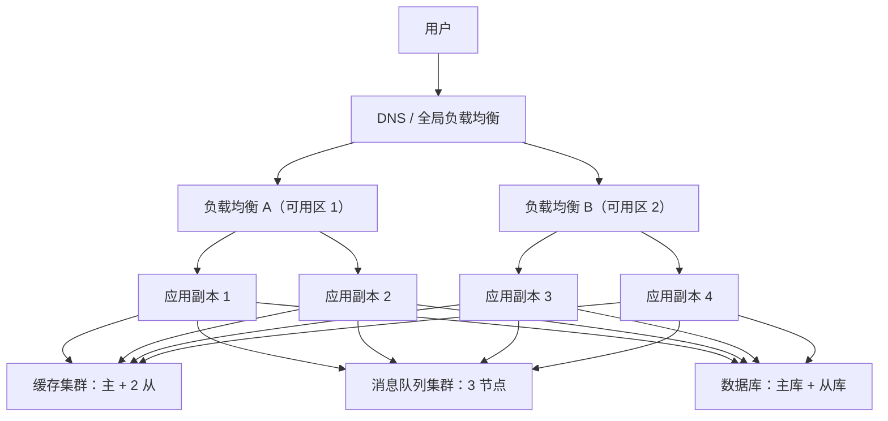
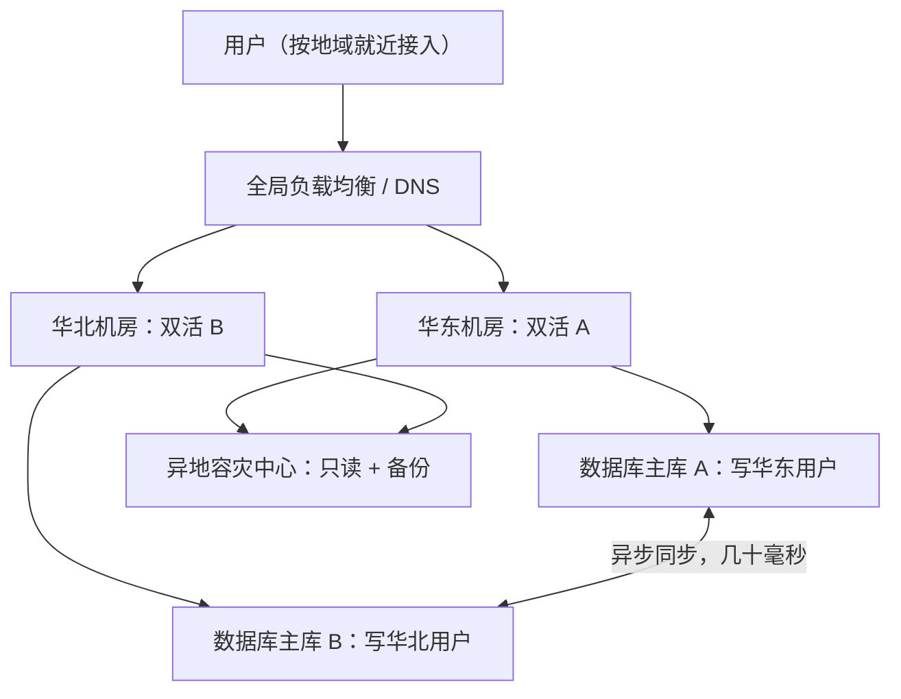
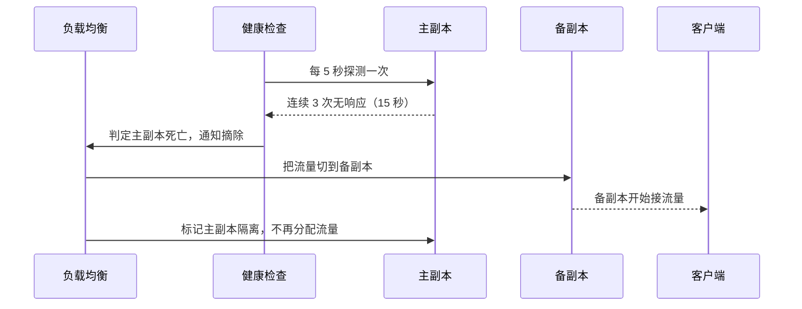
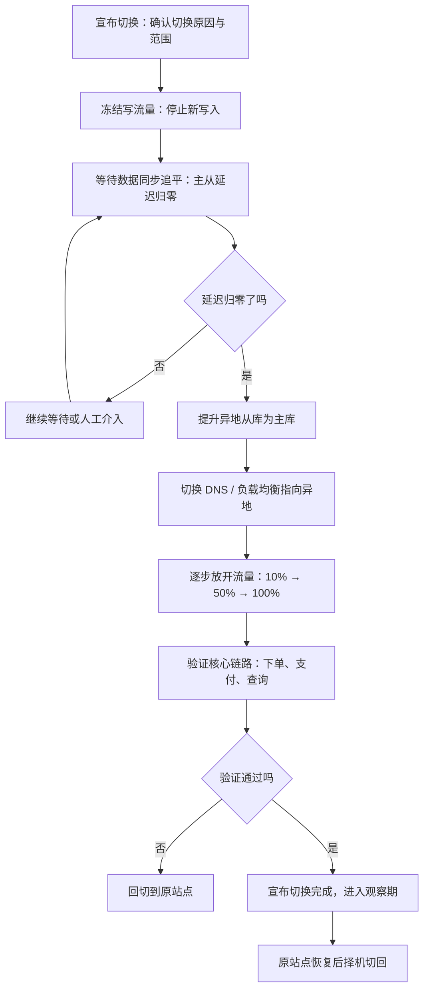

# 高可用与容灾

> 分工一句话：本篇讲系统平时怎么做到不倒、倒了怎么快速接管；备份怎么做、恢复怎么演练，见 [灾备备份与恢复演练](工程实践/运维/灾备备份与恢复演练.md)，本篇不重复那篇的内容。

## 核心概念

### 高可用是什么：先想想家里停电怎么办

高可用（High Availability，HA）就是系统在部分组件出故障时，整体服务还能继续提供。目标不是“永远不出故障”，而是“出了故障用户感觉不到，或者只感觉到很短时间”。

家里停电是最贴切的类比。只接一路市电，停电就全黑；装了 UPS（不间断电源）加一台发电机，市电一断，UPS 先顶几分钟，发电机再接上，冰箱、灯、路由器基本不断。这就是高可用：平时多准备一路，故障时自动换路。线上系统也一样：单台服务器挂了，服务就挂了；准备两台、三台，前面再放一个负载均衡，挂一台就把流量切到剩下的那台，用户最多慢一下，不会看到报错页。

### 容灾是什么：高可用管不住的灾难

高可用管的是单点故障：一台机器坏、一块磁盘坏、一个进程崩。容灾管的是更大范围的灾难：整个机房断电、机房所在城市断网、区域性自然灾害。这时候单机房里再多副本也没用，因为副本全在同一个机房里。生活例子：家里备了发电机，能扛停电；但房子本身着火了，发电机也在房子里，那就得去父母家住。容灾就是“父母家”那套准备：另一个城市、另一个机房，随时能接管。一句话区分：高可用是“同机房内坏了能换”，容灾是“整个机房没了还能换”。两个都要做，缺一个都不完整。

### 什么时候需要高可用：先问业务能忍多久

不是所有系统都要做到 99.99%。内部工具一天停 1 小时没人投诉，支付系统停 1 分钟就是事故。先问业务：停多久能忍？丢多少数据能忍？第一个问题决定高可用的投入，第二个问题属于备份与恢复，见 [灾备备份与恢复演练](工程实践/运维/灾备备份与恢复演练.md)。

判断标准很简单：停机 1 小时的损失（订单、用户、口碑、罚款）如果远大于多做一份副本的成本，就值得做高可用；反过来，内部 Wiki 停 1 小时没什么损失，单机加定期备份就够了，不要为了“好看”堆副本。

## 基础知识

### SLA 的几个 9 是什么意思：先算一笔停机账

SLA（服务等级协议）里常说的“几个 9”，就是一年里允许停机多长时间。一年按 365 天算，一共是 365 × 24 × 60 = 525600 分钟。停机分钟数 = 525600 ×（1 − 可用性），逐项复算如下：

| 可用性 | 每年停机分钟数 | 换算成小时 | 每月停机 | 每天停机 |
| --- | --- | --- | --- | --- |
| 99%（2 个 9） | 525600 × 0.01 = 5256 分钟 | 87.6 小时 | 432 分钟（7.2 小时） | 14.4 分钟 |
| 99.5% | 525600 × 0.005 = 2628 分钟 | 43.8 小时 | 216 分钟（3.6 小时） | 7.2 分钟 |
| 99.9%（3 个 9） | 525600 × 0.001 = 525.6 分钟 | 8.76 小时 | 43.2 分钟 | 1.44 分钟 |
| 99.95% | 525600 × 0.0005 = 262.8 分钟 | 4.38 小时 | 21.6 分钟 | 0.72 分钟 |
| 99.99%（4 个 9） | 525600 × 0.0001 = 52.56 分钟 | 0.88 小时 | 4.32 分钟 | 8.64 秒 |
| 99.999%（5 个 9） | 525600 × 0.00001 = 5.26 分钟 | 0.09 小时 | 0.43 分钟（约 26 秒） | 0.86 秒 |

记住两个锚点：99.9% 一年能停 8.76 小时，99.99% 一年只能停 52.56 分钟。从 3 个 9 升到 4 个 9，停机预算一下子收紧 10 倍，投入却不止涨 10 倍。承诺 SLA 之前，先拿这张表跟业务对一下：4 个 9 听起来好听，但一年 52 分钟的预算，一次稍长的故障就用完了。每月停机按 30 天算：30 × 24 × 60 = 43200 分钟，99.9% 对应 43.2 分钟，99.99% 对应 4.32 分钟。很多云厂商的 SLA 是按月结算的，算账时别把年预算当成月预算。

### MTBF 与 MTTR：可用性的另一副算法

MTBF（平均无故障时间）是两次故障之间平均能正常跑多久，MTTR（平均修复时间）是一次故障平均要修多久。可用性 = MTBF ÷（MTBF + MTTR）。

逐步算两个例子。第一个：系统平均 720 小时（30 天）出一次故障，每次平均 1 小时修好，可用性 = 720 ÷（720 + 1）= 720 ÷ 721 ≈ 99.86%。第二个：系统平均 8760 小时（1 年）出一次故障，每次修 8.76 小时，可用性 = 8760 ÷（8760 + 8.76）≈ 99.90%，正好对应 3 个 9。

这条公式说明两个抓手：要么让故障更少发生（提高 MTBF，靠代码质量、压测、容量规划），要么让故障修得更快（降低 MTTR，靠自动切换、演练、预案）。多数团队把精力全放在前者，其实后者见效更快：把一次 2 小时的手工恢复做成 5 分钟的自动切换，MTTR 直接降 24 倍。

### 副本数与可用性换算：多一份副本值多少钱

多个副本并联时，整体可用性 = 1 −（1 − 单副本可用性）^ 副本数。逐项复算：

- 单副本可用性 99%（0.99），2 个副本并联：1 − 0.01² = 1 − 0.0001 = 99.99%，年停机从 5256 分钟降到 52.56 分钟。
- 单副本 99%，3 个副本并联：1 − 0.01³ = 1 − 0.000001 = 99.9999%，年停机只剩 525600 × 0.000001 = 0.53 分钟，约 31.5 秒。
- 单副本 99.9%（0.999），2 个副本并联：1 − 0.001² = 99.9999%，年停机同样约 31.5 秒。

这个数学成立的前提是两个副本同时坏的概率彼此独立。如果两个副本在同一台物理机、同一个机架、同一个机房，停电一次两个一起坏，公式就失效了。所以副本一定要跨故障域部署，这是下一节的内容。

反过来，串联的组件会拉低整体可用性：负载均衡 99.99% × 应用 99.9% × 数据库 99.95% = 0.9999 × 0.999 × 0.9995 ≈ 99.84%，年停机约 841 分钟（约 14 小时）。链条上每多一个单点，整体可用性就降一档。画架构图时，先把串联的单点一个一个找出来。

### 故障域：副本之间至少要隔多远

故障域是指一次故障能波及的最大范围。常见的分层是：进程 → 机器 → 机架 → 可用区 → 机房 → 城市 → 地域。副本之间的隔离级别，决定了能扛住多大级别的故障。

- 同一台机器两个进程：进程崩了能顶，机器坏了两个一起没。
- 不同机器、同一机架：机器坏了能顶，机架断电两个一起没。
- 不同可用区：机架、网络分区能顶，整个机房断电才一起没。
- 不同城市：机房级灾难能顶，代价是跨城同步延迟和成本。

生活例子：重要证件原件放家里、复印件放父母家，这是跨城市隔离；两份都放自家不同抽屉，只是进程级隔离，一场火灾全没。副本放多远，看你要扛多大的灾：扛机器故障放不同机器就够，扛机房故障必须跨机房。

### 健康检查：怎么知道副本还活着

健康检查是故障转移的前提：不知道谁坏了，就没法切换。分三层：

- 存活探针（liveness）：进程还在不在？死了就重启。只看进程本身，不看依赖。
- 就绪探针（readiness）：能不能接流量？数据库连不上、缓存没预热好，就先不接流量，等准备好了再接。
- 业务探针：能不能正常处理请求？发一条真实的探测请求，走一遍关键链路，比只看端口通不通可靠得多。

一个常见坑是探针太敏感：一次网络抖动就判死刑，副本反复重启，服务反而更不稳定。做法是加“连续失败 N 次才判定”：比如每 5 秒探一次，连续 3 次失败（15 秒）才摘掉，单次抖动不触发切换。

## 进阶知识

### 高可用架构总览：一张图看懂各层怎么配合



读图顺序是从上到下：用户先到 DNS 与全局负载均衡，再到两个可用区的负载均衡，再到 4 个应用副本，最后到缓存、消息队列、数据库三层有状态服务。每一层内部都是多副本，任何一层挂一个节点，流量都能走到同层的其他节点。重点是看“串联的单点”：图里没有单点，DNS 本身是多地部署的，负载均衡、应用、缓存、队列、数据库都有副本。

### 主从切换：谁说了算，谁来接管

主从切换（failover）是数据库、缓存这类有状态服务高可用的核心。主库负责写，从库同步数据，主库坏了，从库升为主库继续写。关键问题有三个：

第一，谁来发现主库坏了。靠哨兵或健康检查组件持续探测，连续多次无响应才判定死亡，不能凭一次超时就动手，否则网络抖动会引发误切换。第二，谁来决定由哪个从库接管。选数据最新、延迟最小的从库；如果两个从库数据一样新，选优先级高的。选错了会丢数据，选慢了会拖长切换时间。第三，旧主库回来怎么办。旧主库恢复后不能直接抢回主位，要先以从库身份同步新主库的数据，确认追平之后再说。否则会出现“双主”：两个主库各写各的，数据再也合不回来。防双主的办法是给旧主库加 fencing：切换后旧主库的写权限被收回，回来先认身份再干活。

### 熔断、降级与限流：故障时先保命，再谈体验

这三者是高可用的“安全气囊”，故障或流量洪峰时先保住核心服务。详细机制与参数见 [限流熔断与降级](开发语言/Java/限流熔断与降级.md)，这里只讲它们在高可用体系里的分工：

- 限流是入口的闸门：流量超过处理能力时，超过的部分直接拒绝或排队，不让系统被压垮。好比电梯限载 10 人，第 11 个人等下一趟，总比超载坠梯强。
- 熔断是依赖的保险丝：下游服务连续失败达到阈值，熔断器打开，后续请求直接快速失败，不再傻等超时。等下游恢复，再半开试探，逐步放流量。
- 降级是体验的取舍：非核心功能先关掉，把资源让给核心链路。比如商品详情页先不显示“猜你喜欢”，保证下单和支付能用。

### 多活与异地容灾体系：同城双活、异地多活怎么选

多活是指多个机房同时对外提供服务，不再分主备。按距离和关系分三档：

- 同城双活：两个机房在同一个城市，网络延迟通常在 1–2 毫秒以内，数据可以同步写，两个机房都能读写。优点是切换最快（分钟级），缺点是扛不住城市级灾难（地震、城市断网），且两个机房都要按满配建设。
- 异地多活：机房分布在不同城市，延迟几十毫秒，数据同步以异步为主，写操作通常只在归属机房做，读可以在各地做。优点是能扛城市级灾难，缺点是跨城写要处理冲突，切换要解决数据追平问题。
- 两地三中心：同城两个机房加异地一个机房，是前两者的组合：同城双活扛机房故障，异地中心扛城市灾难。成本最高，一般是金融级系统在用。

选型只看两个条件：业务能忍受多大的同步延迟，以及愿意为扛城市级灾难花多少钱。同城双活能满足大多数系统，异地多活留给核心交易与支付类系统。



读图要点：华东用户写华东、华北用户写华北，同一条数据只有一个机房能写，从根上避免写冲突；两个机房之间异步同步，延迟几十毫秒；异地容灾中心平时只读，灾难时才接管写流量。写入口收敛、读流量就近，是异地多活最常用的落地形态。

### 多活的数据难题：写冲突与最终一致

多活最难的不是流量切换，而是数据。两个机房同时写同一条记录，谁的算数？常见做法有三档，按业务容忍度选：

- 按用户或地域分片写：华东用户写华东机房，华北用户写华北机房，同一条数据只有一个机房能写，从根上避免冲突。这是最常用、也最稳的做法。
- 冲突检测加业务裁决：允许两地同时写，写时带上版本号或时间戳，同步时发现冲突，按“后写胜出”或业务规则裁决，冲突记录进人工复核队列。
- 只读多活、写入单点：读流量分到各地，写流量只走一个机房。架构最简单，缺点是写机房出问题时要先切换写入口，切换期间写操作会短暂不可用。一致性取舍要跟业务说清楚：跨城同步做不到“处处实时一致”，只能做到“最终一致”，同步延迟通常在几十毫秒到几秒之间。订单、支付这类强一致场景，写入口要收敛到一个机房；商品浏览、推荐这类场景，最终一致完全够用。

### 容灾分级：不是所有系统都要异地多活

容灾按业务重要程度分级，级别越高投入越大：

- 一级（核心交易）：同城双活加异地多活，切换分钟级，数据零丢失目标，全年演练至少 2 次。
- 二级（重要业务）：同城双活或异地热备，切换 30 分钟内，数据丢失控制在分钟级，每年演练 1–2 次。
- 三级（一般业务）：单机房多副本加异地数据备份，切换小时级，每年演练 1 次。
- 四级（边缘系统）：单机房部署，故障后人工恢复，演练随版本发布走。

分级的好处是钱花在刀刃上：给边缘系统上异地多活是浪费，给核心交易只做单机房是冒险。分级结果要业务方签字，写进容灾预案里。至于备份份数、恢复演练的具体做法，见 [灾备备份与恢复演练](工程实践/运维/灾备备份与恢复演练.md)，本篇不再展开。

## 原理剖析

### 故障转移时序：从发现故障到恢复服务要经过几步



切换时间预算逐步算一笔账：发现故障 15 秒（3 次 × 5 秒）+ 通知与摘除 5 秒 + 流量切换 10 秒 + 备副本预热 30 秒 = 60 秒，约 1 分钟。这是无状态应用的典型预算。有状态服务（数据库主从切换）要再加从库追数据与升主的时间，通常是 1–5 分钟。算预算时要把“备副本冷启动要多久”算进去，冷备副本第一次接流量要加载缓存、建连接池，预热时间经常比切换本身还长。

### 负载均衡的原理：流量怎么分到健康副本上

负载均衡有两层：四层按连接分发（快、不看内容），七层按请求内容分发（能按 URL、Header 路由）。常见算法：轮询是请求按顺序分给每个副本，简单公平，适合副本能力相同、无状态的场景；最少连接是新请求分给当前连接数最少的副本，适合请求耗时差异大的场景；一致性哈希是按用户 ID 或请求特征哈希，同一用户总落到同一副本，适合有本地缓存的场景，副本增减时只有少量用户受影响。

负载均衡本身也要高可用：单台负载均衡挂了，后面副本再多也没用。做法是负载均衡也做主备或集群，前面再挂 DNS 或虚拟 IP 做入口切换。

### 数据库主从复制原理：同步、半同步与异步

主从复制是数据库高可用的地基，三种模式按“丢数据风险”与“写延迟”取舍：异步复制是主库写完就返回，不等从库确认，写延迟最低，但主库一坏，刚写的数据可能还没同步到从库，会丢；半同步复制是主库写完至少等一个从库确认收到，再返回，丢数据风险大幅降低，代价是写延迟多一次跨节点往返，通常是几毫秒到几十毫秒；同步复制是主库写完等所有从库确认，数据最安全，但写延迟最高，一个从库慢，全库都慢，一般只用于同城双活。

生产里的常见组合是：同城用半同步，异地用异步。主从延迟要持续监控，延迟超过阈值（比如 5 秒）就告警，因为延迟越大，切换时丢数据的窗口越大。

### 消息队列高可用原理：为什么是 3 节点起步

消息队列高可用的核心是多数派：3 个节点里坏 1 个，剩下 2 个还能组成多数派继续工作；2 个节点坏 1 个，剩下 1 个无法确认自己是不是多数派，只能停写保数据。所以生产环境的消息队列集群通常是 3 节点起步，5 节点更稳。

副本数与可用性的换算同样适用：单个节点可用性 99%，3 节点多数派可用性能到 99.9% 以上，前提是节点跨可用区部署。消息队列还要关注未消费消息的堆积：切换期间消息会积压，切换完成后消费端要能快速追平，否则积压会拖垮下游。

## 实战案例

### Kubernetes 多副本与 Pod 拓扑：让调度器替你跨故障域

Kubernetes 里高可用的基本盘是：副本数 ≥ 2，配合反亲和性让副本不要落在同一台机器、同一个可用区。

```yaml
apiVersion: apps/v1
kind: Deployment
metadata:
  name: order-service
spec:
  replicas: 3
  selector:
    matchLabels:
      app: order-service
  template:
    metadata:
      labels:
        app: order-service
    spec:
      affinity:
        podAntiAffinity:
          requiredDuringSchedulingIgnoredDuringExecution:
            - labelSelector:
                matchLabels:
                  app: order-service
              topologyKey: kubernetes.io/hostname
      containers:
        - name: order-service
          image: order-service:1.4.2
          readinessProbe: {httpGet: {path: /health/ready, port: 8080}, initialDelaySeconds: 10, periodSeconds: 5, failureThreshold: 3}
          livenessProbe: {httpGet: {path: /health/live, port: 8080}, initialDelaySeconds: 15, periodSeconds: 10, failureThreshold: 3}
```

这段配置里有三个关键点。第一，replicas 是 3，按第 2 节的换算，单副本 99% 时 3 副本并联可用性是 99.9999%。第二，podAntiAffinity 用 hostname 做拓扑键，强制 3 个副本落在不同机器上；如果要跨可用区，把 topologyKey 换成 topology.kubernetes.io/zone。第三，就绪探针与存活探针分开：就绪探针失败只摘流量不重启，存活探针失败才重启，failureThreshold 都是 3，避免单次抖动误判。

进阶做法是用 PodTopologySpreadConstraints 代替硬性反亲和：副本尽量均匀分布，节点不够时允许调度（软约束），比硬性反亲和更灵活，适合节点紧张的集群。配合 PodDisruptionBudget（比如 minAvailable: 2），升级、驱逐节点时至少保留 2 个副本在线，避免一次操作把所有副本都下掉。

### 负载均衡落地：入口层怎么做才不单点

- 入口至少两层：外层用云厂商的负载均衡或 DNS 多活入口，内层用 Ingress 或 Service 做服务内分发。
- 会话保持只在不得已时开：有状态会话会让某个副本变成单点，优先用无状态设计加集中式会话存储。
- 超时与重试要配对：上游超时 3 秒、下游重试 3 次，最坏会拖 9 秒；重试次数与超时时间相乘不要超过调用方的容忍上限，否则一次慢依赖会拖垮整条链路。
### 数据库主从与分片：有状态服务的高可用怎么做

数据库高可用分三步走，按业务规模选：第一步，主从复制加自动切换：1 主 2 从，主库写、从库读，哨兵或管控组件做自动升主，读流量分到从库，主库只扛写，单库能扛到几千 QPS 的量级；第二步，读写分离加延迟监控：读请求按权重分到从库，主从延迟超过 5 秒就把读流量切回主库，避免用户刚下单就查不到订单，延迟监控与告警见 [监控告警](工程实践/运维/监控告警.md)；第三步，分片：单库扛不住时按用户 ID 或订单 ID 分片，数据分散到多个库，跨分片事务与跨分片查询会变复杂，要先确认业务能不能接受“跨分片查询走聚合层”这个代价，不要为了提前优化而过早分片，分片一旦上线，回滚成本极高。切换演练要定期做：每月做一次主从切换演练，验证自动升主真的能在 5 分钟内完成。只配了主从、从没切过的主从架构，等于没做高可用。

### 缓存与消息队列高可用：别让中间件先倒

- 缓存：主从加哨兵或集群模式，至少 3 节点；缓存挂了要有降级路径：直接读数据库加限流，而不是让请求全部打到数据库上把库打垮。缓存预热要在切换流程里，冷缓存上线等于半个故障。
- 消息队列：3 节点起步，生产者发送失败要重试加本地暂存，消费者要做幂等（同一条消息重复消费，结果不变），否则切换期间的消息重投会造成重复下单、重复扣款。
- 配置中心与注册中心：它们是所有服务共同的依赖，挂了等于全站挂。配置中心、注册中心本身也要集群部署，客户端要有本地缓存，中心挂了还能用最后一次的配置继续跑。

### 容灾切换实战步骤：从宣布切换到切回来的完整流程



读图要抓住三个检查点：第一，冻结写流量之后必须等延迟归零再升主，否则切过去就丢数据；第二，流量要分阶段放开，不要一次性 100% 切过去，异地机房的容量与缓存都是冷的；第三，验证不通过要有回切路径，回切的前提是原站点的数据没有被新写入污染，否则回切会丢数据。切换演练的记录写法见 [灾备备份与恢复演练](工程实践/运维/灾备备份与恢复演练.md)，本篇不再重复。

### 案例一：一次真实的机房断电，自动切换只停了 47 秒

某电商大促期间，一个可用区机房断电。系统架构是：应用 3 副本跨两个可用区，数据库 1 主 2 从跨可用区，负载均衡双活。

时间线是这样：0 秒断电，健康检查连续 3 次探测失败（15 秒）；15 秒负载均衡摘掉故障可用区的应用副本，流量全部切到另一个可用区；数据库哨兵在 20 秒时判定主库死亡，25 秒完成从库升主；47 秒时核心链路恢复，下单成功率回到 99% 以上。

### 案例二：同城双活上线前的一次压测翻车

某系统上线同城双活，压测时把一个机房的流量全部切到另一个机房，结果目标机房 CPU 瞬间冲到 95%，大量请求超时。根因是容量规划按“平时各扛 50%”算的，没留单机房扛 100% 的余量。正确算法是：每个机房的容量都要按 100% 峰值流量加 20% 余量来配。假设峰值是 10000 QPS，单机房就要能扛 12000 QPS，两个机房平时各扛 5000 QPS，利用率只有约 42%。看着浪费，恰恰是双活的代价：双活买的不是利用率，是故障时不用降级就能接管的能力。修复后复测：单机房扛 12000 QPS 时 CPU 约 70%，留出了突发余量。双活的容量账要在上线前算清楚，写进容量规划文档，不要等压测翻车再补。

## 疑难杂症

### 切换了，但服务还是不可用：先查流量到底去了哪

排查按这个顺序走：第一步，看负载均衡的后端列表：故障副本摘掉了吗？新副本注册上来了吗？很多时候切换命令执行了，但注册中心没更新，流量还在往故障副本上打；第二步，看新副本的就绪状态：就绪探针通过了吗？缓存预热了吗？连接池建好了吗？冷副本第一次接流量，慢是正常的，但如果就绪探针一直失败，说明副本本身有问题；第三步，看依赖：数据库升主成功了吗？缓存集群的节点都在线吗？下游服务有没有被故障拖垮？逐个依赖确认，不要只盯着应用本身；第四步，看日志里的错误分布：是全部请求失败，还是只有写请求失败？只有写失败，大概率是主库切换没完成；全部失败，先查入口层。

### 脑裂：两个主库同时在写，数据合不回来了

脑裂是指网络分区后，两边的节点都以为对方死了，各自升主，各写各的数据，等网络恢复，两份数据合不回来。预防有三招：多数派机制，只有拿到多数节点同意的，才算主库，少数派一方自动停写；fencing，旧主库的写权限在切换后被收回，回来先认身份；租约机制，主库身份带有效期，到期前必须续约，续不上就自动降级。已经脑裂了怎么办：先停掉其中一边的写流量，保留数据更新的那边做主，另一边的数据按业务规则人工合并或丢弃。脑裂之后没有自动合并的银弹，只能靠事先的多数派与 fencing 去预防。

### 切换演练通过了，真实故障还是手忙脚乱

演练通过但实战翻车，通常是演练与真实故障差了三样东西：演练是计划内的，真实故障是半夜发生的；演练时负责人在场，真实故障时负责人可能联系不上；演练只切了计划好的范围，真实故障的影响面经常比预想的大。处理办法是把演练做得更像实战：不定期抽查式演练、值班人轮流主导演练、演练时模拟“负责人联系不上”的场景。演练报告里要记“等人的时间”，等人的时间往往比技术操作更长。

### 跨机房延迟一高，同步就跟不上

异地同步延迟从几十毫秒涨到几秒，主从延迟告警不断。排查顺序是：先看网络带宽是不是打满了，同步流量与业务流量有没有抢带宽；再看从库的写入能力，是不是从库磁盘慢了；最后看主库的写入量是不是突增，比如大促期间批量导入。短期止血是给同步流量单独留带宽、限速业务侧的批量写入；长期办法是按业务分片，让不同业务走不同的同步通道，互不干扰。同步延迟的监控阈值要按业务定：订单库延迟超过 5 秒就告警，日志库延迟 1 分钟也能接受。

## 常见误区

### 误区一：副本越多越好

副本数从 3 加到 4，可用性从 99.9999% 升到 99.999999%，年停机从 31.5 秒降到 0.3 秒，看着很美，但多出来的副本要多花钱、多占机器，还增加了同步与运维复杂度。对大多数系统，3 副本已经够用，4 副本留给核心交易与支付。先算第 2 节那笔账，再决定加不加副本。

### 误区二：做了主从切换，就等于做了容灾

主从切换扛的是单机故障，两个副本在同一个机房，机房断电就一起没。容灾要求副本跨机房、跨城市。检查方法很简单：问一句“这个机房整体断电，服务还能不能用”，回答不了就是没做容灾。

### 误区三：高可用等于不丢数据

高可用保的是“服务不断”，不保“数据不丢”。异步复制下主库一坏，刚写的数据可能还没同步，切换后就丢了。想不丢数据，要用半同步或同步复制，代价是写延迟上升。保服务还是保数据，要按业务定，不能两个都要最高。

### 误区四：云上部署就自动高可用了

云厂商只保证单个云产品的 SLA，比如云数据库 99.95%、负载均衡 99.95%，但你的整体可用性是各层串联相乘的结果，第 2 节算过：99.99% × 99.9% × 99.95% ≈ 99.84%。云上部署只是把单点从自家机房搬到了云上，该做的多副本、跨可用区、健康检查一样都不能少。

## 性能优化

### 切换速度优化：把 MTTR 压到分钟级

切换时间由四段组成：发现、决策、执行、预热。优化按段来：发现段，探测间隔从 10 秒缩到 5 秒，失败阈值保持 3 次，发现时间从 30 秒降到 15 秒，不要只缩间隔不设阈值，否则抖动会误触发；决策段，自动切换代替人工决策，决策时间从几分钟降到几秒，人工决策只留给“要不要切异地”这种重大判断，机房内切换一律自动；执行段，切换脚本预先写好并测试过，不要现写现跑，DNS 切换要留意 TTL：TTL 是 300 秒，切换后最长 5 分钟才全网生效，关键切换用负载均衡层切换，不要只靠 DNS；预热段，备副本平时就保持热状态：缓存提前预热、连接池保持最小连接数、启动后先跑一轮探测流量再接真实流量。

### 容量与同步延迟优化

双活的容量算法在案例二里算过：单机房按 100% 峰值加 20% 余量配。优化方向是让平时利用率别太低：两个机房平时各扛 50%，大促前把单机房容量临时扩到 120%，大促结束再缩回来，云上用弹性伸缩做这件事，成本比常年满配低得多。

同步延迟优化有三招：从库并行回放，单线程回放跟不上主库的写入速度，改成按库或按表并行回放，延迟能从秒级降到百毫秒级；大事务拆小，一个几十万行的批量更新，主库执行 1 秒，从库回放可能要 10 秒，批量写入拆成每批 1000 行，同步延迟会明显下降；同步链路隔离，同步流量走单独的网络通道，不跟业务流量抢带宽，避免业务高峰期把同步拖垮。

## 版本差异

### Kubernetes 版本差异：拓扑分布 API 的变化

PodTopologySpreadConstraints 在 Kubernetes 1.19 进入 Beta、1.24 左右趋于稳定，老版本集群（1.18 及之前）没有这个 API，只能用 podAntiAffinity 做硬性反亲和。topology.kubernetes.io/zone 这个标签在 1.17 之后是标准写法，老版本用 failure-domain.beta.kubernetes.io/zone，升级集群时要注意标签名变了，反亲和规则可能失效。PodDisruptionBudget 的 policy/v1 版本在 1.21 之后是推荐写法，老版本用 policy/v1beta1，1.25 之后 v1beta1 已移除，升级前要先改清单。

### 云厂商 SLA 差异：数字不能跨厂商直接比

各家云厂商对同一类产品的 SLA 数字不一样，比如有的云数据库承诺 99.95%，有的承诺 99.99%，而且 SLA 的计算口径（按月还是按年、不可用怎么定义）也不同。选型时不要只比数字，要看不可用的定义、赔偿条款、以及故障发生时的实际切换能力。云厂商的 SLA 赔偿通常是代金券，不是业务损失，赔偿到账不代表业务没受损。

## 面试与自测

### 问题

1. SLA 99.9% 一年允许停机多长时间？99.99% 呢？从 3 个 9 升到 4 个 9，停机预算收紧了多少倍？
2. 单副本可用性 99%，2 个副本并联后整体可用性是多少？3 个副本呢？这个换算成立的前提是什么？
3. 负载均衡 99.99%、应用 99.9%、数据库 99.95% 串联，整体可用性大约是多少？这说明架构设计时要先找什么？
4. 请解释健康检查里存活探针与就绪探针的区别，并说明为什么探针失败阈值通常设为 3 次而不是 1 次。
5. 同城双活与异地多活在同步延迟、切换速度、能扛的灾难级别上有什么区别？什么业务值得上异地多活？
6. 数据库主从切换时，旧主库恢复后为什么不能直接抢回主位？防双主的办法有哪些？
7. 一次自动故障转移的切换时间预算由哪几段组成？无状态应用的典型预算是多少？备副本预热为什么经常比切换本身还耗时？

### 参考答案

1. 99.9% 一年停机 525600 × 0.001 = 525.6 分钟，约 8.76 小时；99.99% 一年停机 525600 × 0.0001 = 52.56 分钟，约 0.88 小时。从 3 个 9 升到 4 个 9，停机预算从 525.6 分钟降到 52.56 分钟，收紧了 10 倍。
2. 2 个副本并联：1 − 0.01² = 99.99%，年停机 52.56 分钟；3 个副本并联：1 − 0.01³ = 99.9999%，年停机约 0.53 分钟（约 31.5 秒）。前提是副本故障彼此独立，也就是副本要跨故障域部署；同机同架的副本一起坏，公式失效。
3. 整体可用性 ≈ 0.9999 × 0.999 × 0.9995 ≈ 99.84%，年停机约 841 分钟（约 14 小时）。这说明设计时要先找出串联链条上的单点，每多一个单点，整体可用性就降一档。
4. 存活探针看进程还在不在，失败了重启；就绪探针看能不能接流量，失败了只摘流量不重启。失败阈值设为 3 次是为了容忍单次网络抖动，1 次就判定会把健康副本误杀，导致服务反复抖动。
5. 同城双活延迟 1–2 毫秒、可同步写、切换分钟级，扛机房故障，扛不住城市级灾难；异地多活延迟几十毫秒、异步同步为主、切换要等数据追平，能扛城市级灾难。异地多活成本最高，只值得给核心交易、支付这类停不起、丢不起的业务。
6. 旧主库直接抢回主位会造成双主：两个主库各写各的，数据合不回来。防双主的办法是 fencing（收回旧主库写权限）、多数派机制（只有多数节点同意的才算主库）、租约机制（主库身份带有效期，续不上自动降级）。
7. 切换时间由发现、决策、执行、预热四段组成。无状态应用的典型预算是发现 15 秒加通知摘除 5 秒加流量切换 10 秒加预热 30 秒，合计约 60 秒（1 分钟）。备副本预热耗时是因为冷副本第一次接流量要加载缓存、建连接池、跑探测流量，这些都比单纯切流量花时间。

## 小技巧与冷知识

- 承诺 SLA 之前先拿第 2 节那张表跟业务对一遍：99.99% 一年只有 52.56 分钟预算，一次稍长的故障就用完了，承诺 4 个 9 之前先确认团队有没有分钟级切换的能力。
- 切换演练时顺手记下“等人的时间”：等负责人接电话、等业务方拍板的时间，往往比技术操作更长，修起来也最便宜，比如多设一名备份负责人。
- DNS 的 TTL 是切换时最容易踩的坑：TTL 设 300 秒，切换后最长 5 分钟才全网生效，关键切换不要只靠 DNS，要用负载均衡层切换。
- 健康检查的路径要轻：只返回 200 就行，不要在探针里查数据库、调下游，否则下游一慢，健康检查跟着挂，健康副本会被成批摘掉。
- 冷知识：5 个 9（99.999%）一年只允许停 5.26 分钟，约 0.09 小时，这个数字最早来自电信行业的交换机标准，后来才被互联网行业沿用。
- 小技巧：双活容量按“单机房扛 100% 峰值加 20% 余量”来算，平时利用率看着只有四成左右，这不是浪费，是故障时不用降级就能接管的代价。

## 关联知识

- [灾备备份与恢复演练](工程实践/运维/灾备备份与恢复演练.md)：本篇讲平时不倒、倒了快速接管，那篇讲备份策略、恢复演练与 RPO、RTO，两篇配合就是完整的高可用加容灾体系。
- [限流熔断与降级](开发语言/Java/限流熔断与降级.md)：熔断、降级与限流的详细机制与参数配置，本篇只讲它们在高可用体系里的分工。
- [Kubernetes基础](工程实践/运维/Kubernetes基础.md)：容器化部署、多副本、探针与服务发现的基础，本篇的 Kubernetes 落地建立在那篇之上。
- [Linux性能分析](工程实践/运维/Linux性能分析.md)：切换后性能抖动、同步延迟高、副本 CPU 打满时，用性能分析定位是磁盘、网络还是 CPU 的问题。
- [监控告警](工程实践/运维/监控告警.md)：健康检查、主从延迟、切换事件都要靠监控告警第一时间发现，否则故障悄悄发生也没人知道。
