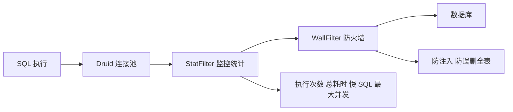
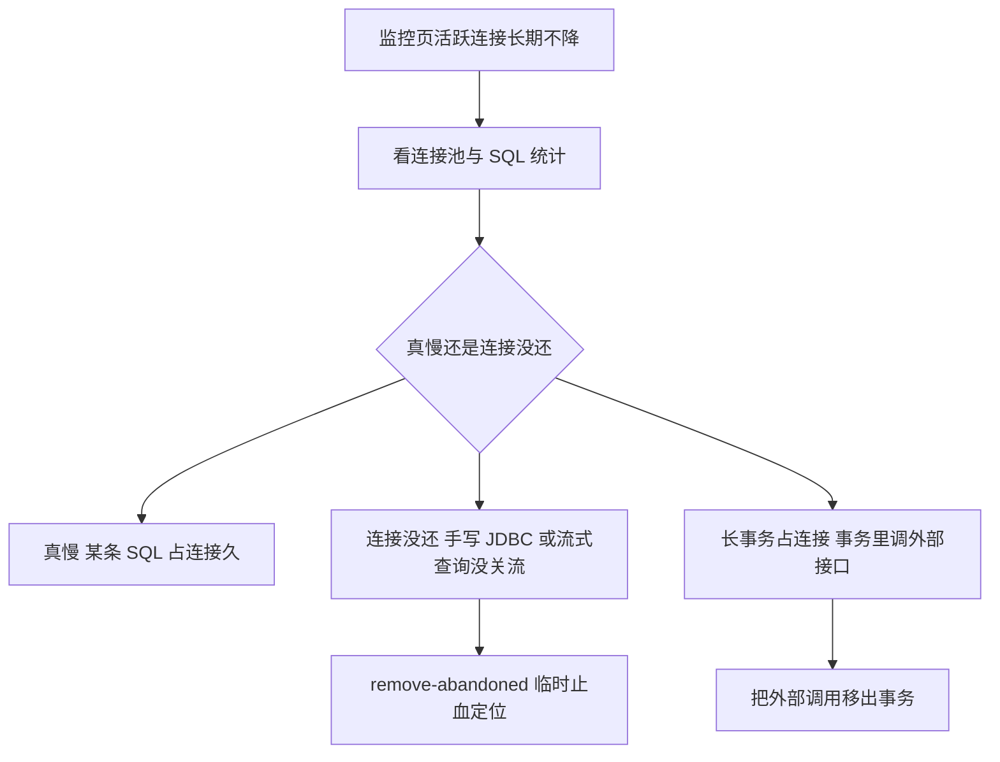

# Druid 监控与慢 SQL 定位

## 📑 目录

- [Druid 监控与慢 SQL 定位](#Druid 监控与慢 SQL 定位)
  - [1. 核心概念](#1. 核心概念)
  - [2. 关键配置](#2. 关键配置)
  - [3. 监控页与慢 SQL 定位](#3. 监控页与慢 SQL 定位)
  - [4. Wall 防火墙的坑](#4. Wall 防火墙的坑)
  - [5. 连接泄漏排查](#5. 连接泄漏排查)
  - [原理剖析](#原理剖析)
    - [StatFilter 的统计机制](#StatFilter 的统计机制)
    - [连接池参数的作用链](#连接池参数的作用链)
    - [Wall 的语义拦截](#Wall 的语义拦截)
    - [泄漏排查的判断链](#泄漏排查的判断链)
  - [实战案例](#实战案例)
    - [案例一：活跃连接长期不降，SQL 却不慢](#案例一：活跃连接长期不降，SQL 却不慢)
    - [案例二：Wall 误杀真实 SQL](#案例二：Wall 误杀真实 SQL)
  - [6. 连接池参数定量：默认值与算账](#6. 连接池参数定量：默认值与算账)
    - [6.1 默认值总表：先看“不配是什么样”](#6.1 默认值总表：先看“不配是什么样”)
    - [6.2 maxWait 的超时语义：-1 与 60000 的差别是一条生死线](#6.2 maxWait 的超时语义：-1 与 60000 的差别是一条生死线)
    - [6.3 驱逐节奏：60 秒一轮、30 分钟才有资格、7 小时一定走](#6.3 驱逐节奏：60 秒一轮、30 分钟才有资格、7 小时一定走)
    - [6.4 连接数估算：200 并发 × 平均占用 50ms，需要多少连接](#6.4 连接数估算：200 并发 × 平均占用 50ms，需要多少连接)
    - [6.5 等待队列排队延迟估算：排第几批，就等几轮](#6.5 等待队列排队延迟估算：排第几批，就等几轮)
    - [6.6 maxActive 设得过大 / 过小的边界后果](#6.6 maxActive 设得过大 / 过小的边界后果)
  - [小技巧与冷知识](#小技巧与冷知识)
  - [7. 面试与自测](#7. 面试与自测)
    - [参考答案](#参考答案)
  - [关联知识](#关联知识)
    - [前置知识](#前置知识)

---


## 1. 核心概念

下图是 Druid 的两件套：StatFilter 做 SQL 监控统计，WallFilter 做防火墙拦截。



Druid 是阿里开源的 JDBC 连接池，自带两样别的池（HikariCP 等）没有的东西：**SQL 监控统计**（StatFilter：每条 SQL 的执行次数、总耗时、慢 SQL、最大并发）和 **Wall 防火墙**（WallFilter：按 SQL 语义防注入、防误删全表）。连接池本身的取舍是「功能全、监控强」对「极致轻量」；在需要线上定位慢 SQL 的企业项目里，监控能力的价值通常压过那点性能差（经验）。

## 2. 关键配置

```yaml
# application.yml
spring:
  datasource:
    druid:
      initial-size: 5          # 初始连接数
      min-idle: 5              # 最小空闲
      max-active: 50           # 最大活跃连接——按库能承受的并发定，不是越大越好
      max-wait: 60000          # 拿不到连接的最大等待(ms)，超时抛 GetConnectionTimeoutException
      validation-query: SELECT 1
      test-while-idle: true    # 空闲时探活，防数据库/防火墙掐掉空闲连接后的"假死连接"
      time-between-eviction-runs-millis: 60000
      filter:
        stat: { enabled: true, slow-sql-millis: 1000, log-slow-sql: true }
        wall: { enabled: true }   # 防火墙：防注入
```

池参数的定法：`max-active` 要和下游 DB 的连接上限、实例数一起算——3 个实例各 50 就是 150 个连接顶到库上，先确认库侧上限再定，别单机拍脑袋。`max-wait` 设有限值是为了让故障时快速失败、暴露问题；设成 -1 无限等会把故障拖成雪崩。

## 3. 监控页与慢 SQL 定位

- 浏览器开 `/druid/index.html` 看 SQL 监控页：执行次数、慢 SQL、max 并发，一目了然（生产记得加账号密码）。
- 慢 SQL 定位链路：druid 慢日志 → `EXPLAIN` 看执行计划 → 索引/分页优化 → 回 druid 验证耗时下降。

下图是原文的慢 SQL 定位链路：从 druid 慢日志出发，优化后回 druid 验证耗时下降。


- 神农这种金融项目：`slow-sql-millis` 设 500ms，定时扫监控页，比等用户投诉强。阈值不是越小越好：太小日志会被正常波动淹没，看自己业务的耗时分布定（经验）。
- 监控页重点看三列：**执行次数**（揪出 N+1 式的高频小查询）、**最大耗时**（揪出偶发大慢查）、**读取行数/更新行数**（扫描行数远大于返回行数 = 没走好索引）。

```java
// 代码里拿慢 SQL TopN（做定时巡检/告警时用）
DruidStatManagerFacade facade = DruidStatManagerFacade.getInstance();
List<Map<String, Object>> stats = facade.getDataSourceStatDataList();
// 每项含 SQL、ExecuteCount、TotalTime、MaxTimespan 等字段，按需排序取 TopN
```

Boot 2.7 集成用 `druid-spring-boot-starter`，监控页账号密码走 `spring.datasource.druid.stat-view-servlet.login-username/login-password` 配置，并用 `reset-enable: false` 关掉页面上的重置统计按钮。

## 4. Wall 防火墙的坑

- Wall 是按语法分析拦截的，误杀真实存在：复杂 SQL（多层嵌套、特殊函数、`ON DUPLICATE KEY`、批量语句）可能被判违规。上线前在测试环境把核心 SQL 跑一遍 Wall，或者先开 `log-violation` 只记录不拦截，观察一段时间再转拦截。
- OceanBase（MySQL 模式）下个别语法与 MySQL 有细微差异，Wall 报错时先确认是真违规还是方言差异，别直接关防火墙了事。
- Wall 拦截抛 `WallFilterCheckException`，全局异常处理里要给它一个明确的错误码，别混进「系统异常」里看不见。

## 5. 连接泄漏排查

下图是连接池打满的排查顺序：先区分真慢还是连接没还，再看长事务，最后才用 remove-abandoned 临时止血。



连接池打满是最常见的 Druid 线上事故：表现是 `max-wait` 超时、监控页活跃连接长期不降。排查顺序：

1. 先看监控页「连接池」与 SQL 统计，确认是真慢（某条 SQL 占着连接久）还是连接没还（业务代码拿了连接不关——多见于手写 JDBC 或流式查询没关流）。
2. 开 `remove-abandoned: true` + `remove-abandoned-timeout` 只能作临时止血和定位手段（它会在日志里打印疑似泄漏的堆栈），根因修掉后建议关掉，自动回收掩盖问题。
3. 事务方法里调了慢的外部接口（HTTP 等待几十秒），事务全程占着连接——这类「长事务占连接」在监控页上看就是活跃连接高、SQL 却不慢，要把外部调用移出事务。

## 原理剖析

本节只把原文已有章节给出的结论拆开讲清机制：不引入新命令/参数，不补新数字，数字一律复用原文已核验的定量算例；凡原文没展开的点，文中明确标注，不作定论。

### StatFilter 的统计机制

Druid 的监控不是事后采样，是 Filter 链拦截每次 SQL 执行后记账：每条 SQL 的执行次数、总耗时、最大耗时、慢 SQL（超过 `slow-sql-millis` 阈值记慢日志）都在 StatFilter 里累计。`druid.stat.mergeSql=true` 时，参数不同的同构 SQL 合并成一条统计——`WHERE id = 1` 和 `WHERE id = 2` 只算一条，执行次数和总耗时是汇总值。想按参数值分开看是哪条具体 SQL 慢，可以把 mergeSql 关掉，但统计条目会随参数值爆炸；平时先看合并后的汇总，锁定某条再关合并下钻。

### 连接池参数的作用链

`max-active` 决定池子最多给出去多少连接，要和下游库的连接上限、实例数一起算——3 个实例各配 50，就是 150 个连接顶到库上。`max-wait` 是拿不到连接时的最长等待，超时抛 `GetConnectionTimeoutException`，设有限值是为了故障时快速失败；设成 -1 无限等会把故障拖成雪崩。`test-while-idle` 只在空闲连接上探活，借出时不校验；想借出时也验一次用 `test-on-borrow: true`，但每次借连接都要多跑一次 `SELECT 1`，高并发下这笔开销不划算。池打满时还要看 `WaitThreadCount`：有线程排队等连接才是「池太小」，没人排队更可能是长事务占连接。

### Wall 的语义拦截

Wall 不是靠正则表达式拦注入的：它是基于 Druid 自带的 SQL Parser 做语义分析后拦截的，先把 SQL 解析成语法树再判断合不合法。所以注释里藏注入、`UNION` 拼接这类靠正则很难拦全的花样它能认出来；反过来，复杂合法 SQL 被误杀也是因为解析器是按语法判的——误杀要从「语法」上找原因，而不是调正则。

### 泄漏排查的判断链

连接池打满的表现是 `max-wait` 超时、监控页活跃连接长期不降。排查顺序是先看监控页「连接池」与 SQL 统计，确认是真慢（某条 SQL 占着连接久）还是连接没还（业务代码拿了连接不关，多见于手写 JDBC 或流式查询没关流）。`remove-abandoned: true` 加 `remove-abandoned-timeout` 只能作临时止血和定位手段（它会在日志里打印疑似泄漏的堆栈），根因修掉后建议关掉，自动回收掩盖问题。

## 实战案例

以下两则只用原文已给出的写法与数字，不引入原文之外的事实。

### 案例一：活跃连接长期不降，SQL 却不慢

现象：监控页活跃连接长期满、又有线程在排队等连接，但 SQL 统计里没有慢 SQL，最大耗时也不高。

排查：先看监控页连接池与 SQL 统计，区分真慢还是连接没还；本例是事务方法里调了慢的外部接口（HTTP 等待几十秒），事务全程占着连接——这类「长事务占连接」在监控页上看就是活跃连接高、SQL 却不慢。

结论：把外部调用移出事务，事务只包数据库操作。`remove-abandoned` 只作临时止血和定位，根因修掉后关掉，不要靠自动回收长期掩盖问题。

### 案例二：Wall 误杀真实 SQL

现象：上线后某条多层嵌套的合法 SQL 被 Wall 拦下，抛 `WallFilterCheckException`，业务报错。

排查：先确认是真违规还是方言差异——OceanBase（MySQL 模式）下个别语法与 MySQL 有细微差异，Wall 报错时先确认这一点；再在测试环境把核心 SQL 跑一遍 Wall，或者先开 `log-violation` 只记录不拦截，观察一段时间再转拦截。

结论：Wall 可以逐项放行，`selectAllow`、`deleteAllow`、`updateAllow`、`insertAllow` 等是分开的开关，某类合法语句被拦先只放开对应的那一项，不要整个关防火墙；全局异常处理里给 `WallFilterCheckException` 一个明确的错误码，别混进「系统异常」里看不见。

## 6. 连接池参数定量：默认值与算账

本节只算三笔账：默认值是多少、不配会发生什么、按并发和占用时长该配多大。所有默认值均指 `DruidDataSource` / `DruidAbstractDataSource` 源码默认值（Druid 1.2.x，见文末来源清单）；`druid-spring-boot-starter` 的属性绑定可能另有默认值，生产上以实际生效配置与 `/druid/datasource.json` 核对为准。

### 6.1 默认值总表：先看“不配是什么样”

| 参数 | 源码默认值 | 换算 | 含义 |
| --- | --- | --- | --- |
| `initialSize` | 0 | 0 个连接 | 池启动时不预热，第一个请求来了才开始建连接 |
| `minIdle` | 0 | 0 个连接 | 空闲连接可以缩到 0，不保留保底空闲 |
| `maxActive` | 8 | 8 个连接 | 同时最多借出 8 个连接 |
| `maxWait` | -1 | 不限时 | 拿不到连接时无限等，直到有连接归还（不抛超时） |
| `timeBetweenEvictionRunsMillis` | 60000 | 60 秒：60000 ms ÷ 1000 = 60 s | 驱逐线程每 60 秒跑一轮 |
| `minEvictableIdleTimeMillis` | 30 分钟 | 1800000 ms：30 × 60 × 1000 = 1800000 ms = 1800 s = 30 min | 空闲满 30 分钟才有资格被驱逐 |
| `maxEvictableIdleTimeMillis` | 7 小时 | 25200000 ms：7 × 60 × 60 × 1000 = 25200000 ms = 25200 s = 7 h | 空闲满 7 小时一定被驱逐 |
| `testWhileIdle` | true | — | 驱逐轮次里顺带探活空闲连接 |
| `testOnBorrow` | false | — | 借出时不校验，省一次 `SELECT 1` |

对照原文第 2 节的配置（`initial-size: 5`、`min-idle: 5`、`max-active: 50`、`max-wait: 60000`、`time-between-eviction-runs-millis: 60000`），能看出原文配置相对默认值的改动幅度：

- `maxActive`：50 ÷ 8 = 6.25，即原文配的是默认值的 6.25 倍。
- `maxWait`：由默认 -1（无限等）改为 60000 ms = 60 s，故障时 60 秒即快速失败、抛 `GetConnectionTimeoutException`，而不是无限排队。
- `initialSize` / `minIdle`：由默认 0 改为 5，启动即预热 5 个连接、低谷时至少保留 5 个空闲，首批请求不用现建连接。
- `timeBetweenEvictionRunsMillis`：原文配的 60000 ms 与源码默认值 60000 ms 相同，写出来是显式确认、不是改动。


### 6.2 maxWait 的超时语义：-1 与 60000 的差别是一条生死线

`maxWait` 是“池满时，一个请求最多等多久”。默认值 -1 表示不限时：池满后新请求一直排队，直到有连接归还；如果占连接的线程本身也在等外部接口（原文第 5 节的长事务），队列只会越排越长，故障被拖成雪崩——这正是原文第 2 节说“设成 -1 无限等会把故障拖成雪崩”的原因。

原文配置 `max-wait: 60000` 把这条线定在 60 秒：

- 60000 ms ÷ 1000 = 60 s。
- 池满后等满 60 秒仍拿不到连接，即抛 `GetConnectionTimeoutException`，调用方快速失败、监控能立刻看到，而不是无声地排队。
- 60 秒不是“SQL 能跑 60 秒”的意思：它只算等连接的时间，不算 SQL 执行时间；SQL 本身跑多久由 `slow-sql-millis` 和业务超时管。

定 `maxWait` 的算法：先按 6.4 节算出正常排队等待（一般是几十到几百毫秒量级），再留出数倍余量；60 秒对常规 Web 请求已是很大的余量——如果正常等待经常逼近 60 秒，问题不在 `maxWait` 太小，而在 `maxActive` 太小或连接被长事务占住（原文第 5 节），应先修后者。

### 6.3 驱逐节奏：60 秒一轮、30 分钟才有资格、7 小时一定走

驱逐由两把尺子共同决定：多久检查一次（`timeBetweenEvictionRunsMillis`），以及空闲多久算“太久”（`minEvictableIdleTimeMillis` / `maxEvictableIdleTimeMillis`）。

- 检查间隔：60000 ms ÷ 1000 = 60 s，即每 60 秒扫一轮空闲连接。
- 驱逐资格线：`minEvictableIdleTimeMillis` = 1800000 ms = 1800 s = 30 min，空闲不满 30 分钟不会被驱逐。
- 强制线：`maxEvictableIdleTimeMillis` = 25200000 ms = 25200 s = 7 h，空闲满 7 小时一定被驱逐。

因为检查是每 60 秒一轮，一个连接实际被关闭的时间不是恰好 30 分钟，而是一个区间：

- 最早：空闲满 30 分钟那一刻正好赶上检查轮次，即 1800 s 后被关闭。
- 最晚：刚错过一轮检查，要再等一轮，即 1800 s + 60 s = 1860 s（31 分钟）后被关闭。
- 结论：空闲连接从“满 30 分钟”到“被关闭”，在 1800 s 至 1860 s 之间，即 30 分钟至 31 分钟。

同理，满 7 小时的强制驱逐发生在 25200 s 至 25260 s（7 小时至 7 小时 1 分钟）之间。`testWhileIdle` 默认就是 `true`，所以这每 60 秒一轮的检查同时也是探活：空闲连接若已是“假死连接”（数据库或防火墙掐掉了空闲连接），会在轮次里被发现并处理，这与原文第 2 节配的 `test-while-idle: true` 是一致的——原文是把默认值显式写了出来。

一个容易踩的边界：驱逐只管“空闲太久”，不管“库侧先掐”。MySQL 默认 8 小时掐掉空闲连接（见来源清单，OceanBase 文档），而 Druid 的强制线是 7 小时：7 h < 8 h，所以按默认值跑，连接一般先被 Druid 自己在 7 小时至 7 小时 1 分钟之间回收，不会等到库侧 8 小时来掐。但如果把 `maxEvictableIdleTimeMillis` 调得比库侧空闲超时还大，顺序就反过来——库先掐、池后知，业务就可能拿到已死的连接，这时要靠 `test-while-idle` 探活或 `test-on-borrow` 兜底。

### 6.4 连接数估算：200 并发 × 平均占用 50ms，需要多少连接

先给公式（利特尔法则 Little's Law 的连接池版），再手算一例。

**公式一（按吞吐算）：所需连接数 = 吞吐量 × 单次平均占用时长**

- 吞吐量 λ：单位时间内到达的数据库请求数（次/秒）。
- 单次平均占用时长 W：一个请求从借出连接到归还连接的平均时间（秒），含 SQL 执行与事务内等待。
- 所需连接数 N = λ × W（单位：次/秒 × 秒 = 个）。

**公式二（按瞬时并发算）：所需连接数 = 同时持有连接的线程数**

- 若 N 个业务线程同一瞬间各持 1 个连接，同一瞬间就需要 N 个连接；这是公式一在“同时到达”下的特例。

**手算一例（任务给定条件：200 并发、平均占用 50ms）：**

- 单个连接每秒能服务的次数：1000 ms ÷ 50 ms = 20 次/秒。
- 200 个连接每秒能服务的次数：200 × 20 次/秒 = 4000 次/秒。
- 反过来，要支撑 4000 次/秒、每次占用 50 ms = 0.05 s，所需连接数：4000 × 0.05 = 200 个。
- 用公式二验算：200 个线程同时各持 1 个连接，同一瞬间需要 200 × 1 = 200 个连接。两种算法结果一致：200 个。

**对照原文配置 `max-active: 50`，这 200 并发会怎样：**

- 50 个连接每秒能服务的次数：50 × 20 次/秒 = 1000 次/秒，远低于 4000 次/秒的需求。
- 同一瞬间 200 个请求到来，只有 50 个能立即拿到连接，其余 200 − 50 = 150 个必须排队等。
- 注意：50 ms 是“平均占用”，不是“SQL 平均耗时”。事务里调外部接口（原文第 5 节的长事务）会把占用时长从 50 ms 拉到几十秒，公式里的 W 要用占用时长、不能只用 SQL 耗时，否则会严重低估。

### 6.5 等待队列排队延迟估算：排第几批，就等几轮

池满后，后到的请求按批等待：每批 `maxActive` 个请求同时占用连接，每批占满一个平均占用时长后才轮到下一批。

**公式：排队等待时间 ≈ （所在批次数 − 1）× 平均占用时长，其中批次数 = ceil（瞬时并发 ÷ maxActive）。**

**手算一例（沿用 6.4 节：200 并发、平均占用 50ms、原文配置 maxActive = 50）：**

- 批次数：ceil（200 ÷ 50）= ceil（4）= 4 批。
- 第 1 批（50 个）：等 0 × 50 ms = 0 ms；第 2 批：等 1 × 50 ms = 50 ms；第 3 批：等 2 × 50 ms = 100 ms；第 4 批：等 3 × 50 ms = 150 ms。
- 最长等待：3 × 50 ms = 150 ms；平均等待：（0 + 50 + 100 + 150）÷ 4 = 300 ÷ 4 = 75 ms。
- 对照 `maxWait` = 60000 ms：最长等待 150 ms 远小于 60 秒，不会超时；这 200 并发下排队只是慢 75 ms（平均），不是故障。

**同一算例换成源码默认值 `maxActive` = 8，差别立刻拉大：**

- 批次数：ceil（200 ÷ 8）= ceil（25）= 25 批。
- 最长等待：（25 − 1）× 50 ms = 24 × 50 ms = 1200 ms。
- 平均等待：（0 + 1200）÷ 2 = 600 ms（等差数列首末平均）。
- 同样 200 并发、同样 50 ms 占用，默认值下的最长等待是原文配置下的 1200 ÷ 150 = 8 倍——这就是“不配 maxActive、只用默认 8”的代价。

**再算一个长事务下的反例（呼应原文第 5 节）：**

- 条件不变，200 并发、`maxActive` = 50，但平均占用被长事务拉到 30 s。
- 最长等待：3 × 30 s = 90 s；对照 `maxWait` = 60 s，90 s > 60 s，最后一批请求在拿到连接前就已超时抛 `GetConnectionTimeoutException`。
- 结论：排队延迟对占用时长是线性敏感的——占用时长翻 600 倍（50 ms → 30 s），等待也翻 600 倍（150 ms → 90 s）。这时调大 `maxWait` 只是让请求等得更久、死得更晚，正确做法是按原文第 5 节把外部调用移出事务、缩短占用时长，或扩 `maxActive`（但要先过 6.6 节的库侧总账）。

排队是否发生的判断信号，沿用原文“小技巧与冷知识”节的办法：监控页看 `WaitThreadCount`——大于 0 说明真有人在排队等连接，是“池太小”；等于 0 但活跃连接满，更可能是长事务占连接。

### 6.6 maxActive 设得过大 / 过小的边界后果

**设得过小（小于 6.4 节算出的需求）：**

- 请求排队，`WaitThreadCount` > 0，排队延迟按 6.5 节的公式线性增长。
- 等待超过 `maxWait`（原文配置 60 秒）即抛 `GetConnectionTimeoutException`，业务快速失败；若 `maxWait` 仍是默认 -1，则无限排队、故障拖成雪崩。
- 极端例子：默认值 `maxActive` = 8 遇上 200 并发，最长等待已算到 1200 ms（6.5 节）；若占用再拉长到秒级，等待很快超过 60 秒。

**设得过大（大于库侧能承受的总数）：**

- 总连接数要按实例数乘：原文第 2 节已给的算法是 3 个实例 × 每个 50 = 150 个连接顶到库上；同理，若把 `maxActive` 调到 200，3 个实例就是 3 × 200 = 600 个连接顶到库上。
- 库侧每个连接都要占资源（线程/内存与锁结构，本文不另给未经核实的单连接内存数字），连接数超过库侧上限后，新连接建连失败，扩池扩不出可用连接，反而把库打满、拖垮正常请求。
- 定 `maxActive` 的正确顺序：先确认库侧连接上限与当前已用连接数，再按“实例数 × maxActive ≤ 库侧上限（留余量）”反推单实例的 `maxActive`，最后用 6.4 节的公式验算它是否覆盖峰值并发；两头都要过，缺一头就是错配。
- 设得过大还有一个隐性代价：空闲连接长期不释放会放大驱逐与探活的负担——`minIdle` 若也跟着设大，低谷时池里常年挂着大量空闲连接，每 60 秒一轮的驱逐与探活都要扫它们；但这笔开销本文不给定量数字，需以实测的监控页数据为准（待验证）。

**一句话收敛：** `maxActive` 的下限由 6.4 节的并发算账定（不够就排队超时），上限由库侧总连接数定（超了就把库打满）；`maxWait` 定的是“等多久算失败”，`timeBetweenEvictionRunsMillis` 与 `minEvictableIdleTimeMillis` 定的是“空闲连接多久被回收”，四者各管一段，不要用调大其中一个去掩盖另一个的错配。

## 小技巧与冷知识

【小技巧】监控页里看到的 SQL 带问号占位符，是 StatFilter 默认把参数不同的同构 SQL 合并成一条统计：`druid.stat.mergeSql=true` 时，`WHERE id = 1` 和 `WHERE id = 2` 只算一条，执行次数和总耗时是汇总值。想按参数值分开看是哪条具体 SQL 慢，可以把 mergeSql 关掉，但统计条目会随参数值爆炸；平时定位慢 SQL 先看合并后的汇总，锁定某条再关合并下钻，别一上来就关。

【小技巧】只看总耗时会误判“最慢的 SQL”：执行次数多的 SQL 总耗时天然大，未必每次都慢。用 `TotalTime / ExecuteCount` 算平均耗时，筛出“每次都慢”的 SQL；再看 `MaxTimespan` 单次最大耗时抓偶发大慢查。原文第 3 节给的三个字段就是这么配合用的——总耗时看总量，平均耗时看稳定性，最大耗时看毛刺。

【小技巧】`test-while-idle` 只在空闲连接上探活，借出时并不校验：想借出时也验一次，用 `test-on-borrow: true`，但每次借连接都要多跑一次 `SELECT 1`，高并发下这笔开销不划算。生产上一般是空闲探活加合理的 eviction 间隔就够了；只有“偶发拿到坏连接、业务又极度敏感”的场景才开 test-on-borrow，权衡点在“每次借连接的成本”上。

【小技巧】池打满时别只看活跃连接数，还要看 `WaitThreadCount`：监控页连接池统计里，有线程在排队等连接时这个数大于 0。活跃连接长期满、又有线程排队，才是“池太小”；活跃连接满但没人排队，更可能是长事务占着连接（原文第 5 节的情况）。两个数一起看，才能分清是扩池还是修代码。

【小技巧】高频同构 SQL 可以开 PSCache 复用预编译语句：`pool-prepared-statements: true` 加 `max-pool-prepared-statement-per-connection-size`，每个连接缓存一批 PreparedStatement，MyBatis 每次执行的 `?` 占位符 SQL 不用反复编译。默认是关的——分库分表场景下 SQL 模板太多，缓存反而占内存；模板少、调用频次高的库开它收益才明显。

【小技巧】Wall 误杀时不用整个关防火墙，它可以逐项放行：Wall 配置里 `selectAllow`、`deleteAllow`、`updateAllow`、`insertAllow` 等是分开的开关，某类合法语句被拦，先只放开对应的那一项。原文第 4 节的 `log-violation` 是先观察再拦截的路子，逐项开关是观察之后的第二步——放行范围越小，防火墙剩下的保护就越多。

【小技巧】监控页除了 HTML，还有 JSON 接口可以直接拿数：`/druid/datasource.json`、`/druid/sql.json` 返回的就是监控数据，巡检脚本用 curl 拉 JSON 做阈值告警，比爬 HTML 监控页稳得多。原文第 3 节的 `DruidStatManagerFacade` 是代码里取数的路子，JSON 接口是脚本和外部监控取数的路子，两个入口按场景选，别只盯着浏览器页面。

【小技巧】filters 里除了 stat、wall，还能再挂一个日志 filter：`filter: stat,wall,slf4j` 这样配，SQL 执行日志会打进应用的 Slf4j 日志里，和慢日志互补——慢日志只记超阈值的，日志 filter 记的是全量执行。生产上全量 SQL 打日志量太大，一般只在排障时临时加上、用完摘掉，别长期挂着。

【冷知识】Wall 不是靠正则表达式拦注入的：它是基于 Druid 自带的 SQL Parser 做语义分析后拦截的，先把 SQL 解析成语法树再判断合不合法。所以注释里藏注入、`UNION` 拼接这类靠正则很难拦全的花样它能认出来；反过来，复杂合法 SQL 被误杀也是因为解析器是按语法判的——知道它是解析器，就明白误杀要从“语法”上找原因，而不是调正则。

【冷知识】Druid 不只是一个连接池，它是三件套：连接池（DruidDataSource）+ Filter 链插件体系 + 手写的 SQL Parser。StatFilter、WallFilter、日志 Filter 都是挂在 Filter 链上的插件，监控和防火墙不是池的附属功能，是同一套扩展机制长出来的；理解这一点就明白，为什么 Druid 能在“池”之外长出这么多监控和安全能力——扩展点本来就在设计里。

算 `maxActive` 前先把占用时长测准再套公式：监控页 SQL 统计的平均耗时只是 SQL 执行耗时，不是连接占用时长——事务里调外部接口、事务未提交期间的等待都算占用，却不体现在 SQL 耗时里。用 6.4 节的公式时，W 要取“借出到归还”的时长（可用 Druid 的连接借用统计或事务耗时估算）；只拿 SQL 平均耗时去算，200 并发 × 50ms 算出来 200 个连接看着够，实际占用 30 秒时 50 个连接都不够用，排队会在 90 秒才轮到最后一批（6.5 节反例）。

Druid 默认 `maxActive` 只有 8、`maxWait` 默认是 -1（无限等）：这是从 DBCP 时代继承来的保守默认值，不是为高并发 Web 服务准备的。不配参数直接上线，8 个连接之外的新请求会无限排队——原文第 2 节把 `max-active` 配到 50、`max-wait` 配到 60000，恰好把这两处默认值都改掉了；只改一处、漏掉另一处，池满时要么排队太长、要么无限等，故障形态完全不同。

## 7. 面试与自测

1. `max-active` 怎么定？为什么不能越大越好？`max-wait` 设成 -1 有什么后果？
2. 监控页活跃连接长期不降、但 SQL 统计并不慢，可能是什么问题？排查顺序是什么？
3. Wall 防火墙误杀真实 SQL 时怎么办？为什么不能直接关防火墙了事？

4. 不配任何参数时，Druid 的 `maxActive`、`maxWait` 默认值各是多少？200 并发、平均占用 50ms 时需要多少连接？为什么原文要把 `maxActive` 配到 50？

### 参考答案

1. `max-active` 要和下游库的连接上限、实例数一起算：3 个实例各配 50，就是 150 个连接顶到库上，先确认库侧上限再定，单机拍脑袋越大越容易把库打满。`max-wait` 设有限值是为了故障时快速失败、暴露问题；设成 -1 无限等，会把故障拖成雪崩。
2. 先怀疑「长事务占连接」而不是慢 SQL：事务方法里调了慢的外部接口（HTTP 等待几十秒），事务全程占着连接，监控页上看就是活跃连接高、SQL 却不慢。排查顺序：监控页确认连接与 SQL 统计 → 区分真慢还是连接没还（手写 JDBC/流式查询没关流）→ 把外部调用移出事务。`remove-abandoned` 只作临时止血和定位（日志里打印疑似泄漏堆栈），根因修掉后建议关掉，自动回收会掩盖问题。
3. 先在测试环境把核心 SQL 跑一遍 Wall，或先开 `log-violation` 只记录不拦截、观察一段时间再转拦截；OceanBase（MySQL 模式）下先确认是真违规还是方言差异。直接关防火墙等于丢掉防注入、防误删全表那层保护。Wall 拦截抛 `WallFilterCheckException`，全局异常处理里要给它一个明确的错误码，别混进「系统异常」里看不见。

4. 1. 源码默认值：`maxActive` = 8，`maxWait` = -1（无限等）；`initialSize` = 0、`minIdle` = 0，启动不预热、空闲可缩到 0；驱逐间隔 `timeBetweenEvictionRunsMillis` = 60000 ms（60 秒），`minEvictableIdleTimeMillis` = 30 分钟。
2. 200 并发 × 平均占用 50ms：单个连接每秒服务 1000 ÷ 50 = 20 次，200 个连接每秒服务 200 × 20 = 4000 次；反推所需连接数 4000 × 0.05 = 200 个（或按瞬时并发算：200 个线程同时各持 1 个连接，即需 200 个）。
3. 原文配 `maxActive` = 50 是默认值 8 的 6.25 倍（50 ÷ 8 = 6.25），但仍不够 200 并发同时用：同一瞬间只有 50 个能拿到连接，其余 200 − 50 = 150 个排队，最长等 3 × 50 ms = 150 ms、平均等 75 ms；同时把 `maxWait` 由默认 -1 改为 60000 ms（60 秒），池满等满 60 秒即抛 `GetConnectionTimeoutException` 快速失败，而不是无限排队拖成雪崩。`maxActive` 再往上调要先过库侧总账：3 个实例 × 50 = 150 个连接已顶到库上，单实例拍脑袋调大可能把库打满。

## 关联知识

### 前置知识

- [MyBatis-Plus](开发语言/Java/MyBatis/MyBatis-Plus.md)：SQL 最终由 MyBatis-Plus 发出，Druid 统计的 SQL 是它执行后的形态，慢 SQL 定位要先知道 SQL 从哪一层来（原文第 1 节与关联列表）。
- [Spring Boot](开发语言/Java/Spring/Spring-Boot.md)：数据源装配与 druid-spring-boot-starter 集成、监控页账号密码配置都在 Spring Boot 侧（原文第 3 节末尾与关联列表）。
- [MySQL-数据库](数据库/MySQL/MySQL-数据库.md)：druid 慢日志定位到 SQL 后，EXPLAIN 看执行计划、索引优化都在这一篇（原文第 3 节慢 SQL 定位链路）。

- [多数据源（dynamic-datasource）](开发语言/Java/多数据源.md)
- [MyBatis-Plus](开发语言/Java/MyBatis/MyBatis-Plus.md)
- [Spring Boot](开发语言/Java/Spring/Spring-Boot.md)
