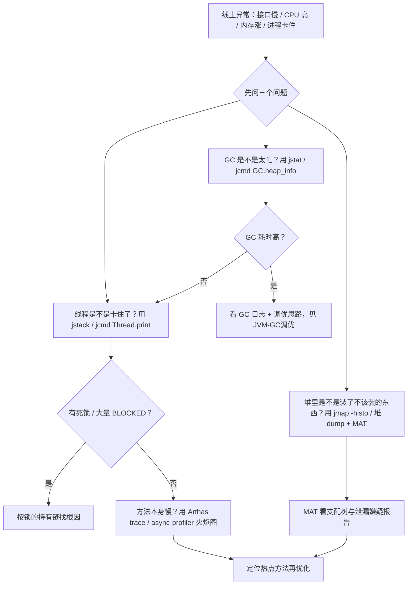
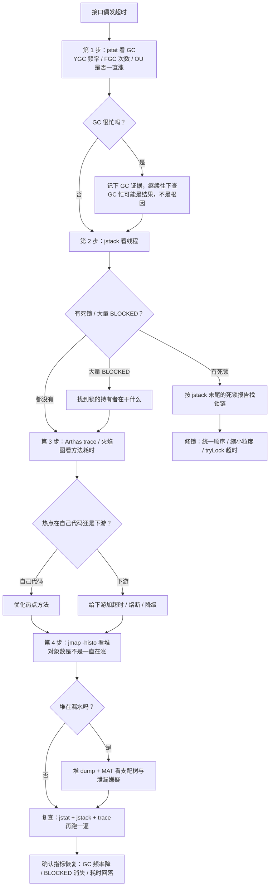

# JVM 生产诊断工具链

> 读者设定：你会写 Java 后端，知道堆、GC、线程这些基本概念，但一到线上出问题就只会看日志、重启碰运气。本篇把生产诊断讲成一套顺手的流程：先认清每件工具是干什么的，再学会读它吐出来的数字，最后按固定顺序走完一次真实排查。
>
> 一句话定位：本篇讲“工具怎么用”。故障怎么定位、GC 参数怎么调，分别在另外两篇里讲，三篇分工不同、互相配合。

## 基础知识

### 先想一个场景：病人进了急诊

生产出问题，就像一个人突然送进急诊。医生不会一上来就开刀，而是先量体温、拍片子、抽血，最后才决定怎么治。JVM 诊断也一样：先看进程活不活、GC 忙不忙、线程卡没卡、堆里装了什么，再下结论。

- **jps 像挂号台**：先问“现在有哪些 Java 进程在跑，进程号是多少”。没有进程号，后面所有工具都无从下手。
- **jstat 像心电图**：不进身体，只在旁边看 GC 的心跳——年轻代、老年代用了多少，回收了多少次，每次花了多久。
- **jmap 像给堆内存拍 X 光**：能看到堆里每种对象占了多大地方，也能把整个堆“冻”成一张 dump 快照，拿回去慢慢分析。
- **jstack 像给所有线程拍一张集体快照**：同一瞬间，谁在跑、谁在等锁、谁卡住了，全都定格在一张纸上。
- **jcmd 像万能遥控器**：一个入口能调出上面好几种信息，新版 JDK 里最推荐先用它。
- **Arthas 像不用停机的听诊器**：不用重启、不用改代码，把探头贴上去就能听方法耗时、看调用链。
- **JFR 像 24 小时心电监护**：一直开着、开销很低，出了问题再回放出事那几分钟的录像。
- **async-profiler 像红外热成像**：哪里 CPU 烧得最烫，火焰图上一眼就能看见。
- **MAT 像病理化验室**：拿着堆 dump 做切片分析，找出是谁把内存吃光的。

### 工具链总览：一张表认全

| 工具 | 定位 | 适用场景 | 是否需要重启 / 挂 agent |
| --- | --- | --- | --- |
| jps | 找进程、看进程号与主类 | 不知道 PID 时的第一步 | 否 |
| jstat | 看 GC 与堆各区使用量 | GC 是不是太频繁、耗时是不是太长 | 否 |
| jmap | 堆直方图、堆 dump | 怀疑内存泄漏、想看对象分布 | 否（dump 时会触发 STW，见下文） |
| jstack | 线程 dump | 线程卡死、死锁、CPU 飙高 | 否 |
| jcmd | 万能入口：堆信息、线程、JVM 参数、手动 GC | 新版首选，一条命令多用途 | 否 |
| VisualVM | 图形化总览：堆、线程、GC、采样 | 本地或能连通时快速摸底 | 否（远程需 JMX） |
| Arthas | 在线诊断：方法耗时、调用链、反编译 | 线上方法慢、想看实时调用而不重启 | 需挂 agent，但不用重启进程 |
| JFR | 持续低开销录制事件 | 事后复盘、偶发问题抓现行 | 否（JDK 11+ 内置，见下文版本说明） |
| async-profiler | CPU / 内存分配火焰图 | CPU 瓶颈定位、热点方法 | 需挂 agent（以 profiler 方式采样） |
| MAT | 堆 dump 离线分析 | dump 已经拿到手，找泄漏根因 | 否（离线分析工具） |

> 怎么记这张表：只看“要不要动进程”就能分两类。jps、jstat、jmap、jstack、jcmd、JFR 是 JDK 自带的“望闻问切”，不动代码；Arthas、async-profiler 是“贴上传感器再测”，要挂 agent，但不用重启。

### 从现象到工具：先分流，再动手



读这张图记住一句话：**不要一上来就 dump 堆**。dump 最重、停顿最长，先用最轻的 jstat、jstack 排除掉 GC 和线程，剩下的才是堆的问题。

### 本机说明

本篇命令与输出格式按 JDK 官方文档核对。本机没有安装 Java，无法现场跑 `jps -l` 实测，下面的输出均为按官方文档格式给出的典型示例，数字是为讲解而构造的、但每一步算术都已复算，读数方法可以直接套用到你自己的真实输出上。

## 原理剖析

### jps + jstat：先找到进程，再看 GC 的心跳

`jps` 是最短的一步：

```bash
jps -l
```

典型输出：

```text
12345 com.example.order.OrderApplication
23456 org.apache.catalina.startup.Bootstrap
```

第一列是进程号（PID），第二列是主类。后面所有命令都要用这个 PID。`-l` 会显示完整主类名，比只看数字好认得多。jps 只能看到同用户的进程，如果只看到一串数字、没有类名，先检查是不是用了不同的用户在跑 Java 进程。

找到 PID 后，看 GC 用 `jstat`：

```bash
jstat -gc 12345 1000 5
```

意思是：每 1000 毫秒（1 秒）采样一次，共采 5 次。先看一次采样的输出，逐列讲清楚。注意单位：下面这组数字单位都是 KB，时间单位是秒。

```text
 S0C    S1C    S0U    S1U      EC       EU        OC         OU       MC     MU   CCSC   CCSU   YGC     YGCT    FGC    FGCT     GCT
17408.0 17408.0  0.0 17408.0 139264.0  98765.0  349525.0   210432.0  65536.0 62800.0 8192.0 7900.0   342    12.654     7    3.421   16.075
```

逐列读数，像读体检表一样，一列一列来：

- **S0C / S1C（Survivor 0/1 容量）**：两个 Survivor 区各 17408 KB，约 17 MB。年轻代里两个 Survivor 永远一个有数据、一个空着，轮流倒手。
- **S0U / S1U（Survivor 已用）**：S0U 是 0，S1U 是 17408 KB，说明这一次采样时 S1 刚装满、S0 是空的——这是正常的轮换状态，不是泄漏。
- **EC / EU（Eden 容量 / 已用）**：Eden 容量 139264 KB（约 136 MB），已用 98765 KB（约 96.4 MB）。Eden 使用率一步步算：98765 ÷ 139264 = 0.709，约 **70.9%**。Eden 快满了，下一次 Young GC 就不远了。
- **OC / OU（老年代容量 / 已用）**：老年代容量 349525 KB（约 341.3 MB），已用 210432 KB（约 205.5 MB）。老年代使用率：210432 ÷ 349525 = 0.602，约 **60.2%**。还没到危险线，但值得盯着它是不是一直在涨。
- **MC / MU（元空间容量 / 已用）**：元空间容量 65536 KB（64 MB），已用 62800 KB（约 61.3 MB），使用率 62800 ÷ 65536 = 0.958，约 **95.8%**。元空间快满了，要留意是不是动态生成了太多类（比如反复生成代理类），而不是只盯着堆。
- **CCSC / CCSU（压缩类空间容量 / 已用）**：8192 KB 容量、7900 KB 已用，同样偏满，和元空间一起看。
- **YGC / YGCT（Young GC 次数 / 总耗时）**：发生了 342 次 Young GC，总共花了 12.654 秒。
- **FGC / FGCT（Full GC 次数 / 总耗时）**：发生了 7 次 Full GC，总共花了 3.421 秒。
- **GCT（GC 总耗时）**：16.075 秒。先验算：12.654 + 3.421 = 16.075，正好对上，说明这张表内部是一致的。

最关键的两个数，要自己动手算，不要只看总数。**一次 Young GC 平均耗时**，一步步算：`YGCT ÷ YGC = 12.654 ÷ 342 = 0.037 秒 = 37 毫秒`。一次 Young GC 平均只停 37 毫秒，这个量级通常可以接受。**一次 Full GC 平均耗时**：`FGCT ÷ FGC = 3.421 ÷ 7 = 0.4887 秒 ≈ 489 毫秒`。一次 Full GC 平均停将近半秒，比 Young GC 贵一个数量级。如果 FGC 次数还在快速增加，就要警惕了。

再算两个“体检总分”：堆总容量 = S0C + S1C + EC + OC = 17408 + 17408 + 139264 + 349525 = 523605 KB ≈ **511.3 MB**（示例进程约 -Xmx512m 的量级）；堆已用量 = S0U + S1U + EU + OU = 0 + 17408 + 98765 + 210432 = 326605 KB ≈ **319.0 MB**；堆使用率 = 326605 ÷ 523605 = 0.624，约 **62.4%**，不算满。再看 GC 时间占运行时间的比例：假设进程已经跑了 1 小时（3600 秒），GC 总共花了 16.075 秒，占比是 16.075 ÷ 3600 = 0.00447，约 **0.45%**。不到 1%，说明 GC 目前还不是瓶颈；如果这个比例超过 5% 甚至 10%，就要认真看 GC 了。

> 读 jstat 的窍门：不要只看一行，要连看几行。如果 OU（老年代已用）每次采样都在涨、YGC 之后也不回落，那就是“老年代在漏水”的信号；如果 YGC 次数几秒钟就涨几十次，说明 Eden 太小、对象生死太快。

### jmap：给堆拍 X 光，也能整张冻起来

先看最轻的用法——堆直方图，不 dump 整堆：

```bash
jmap -histo 12345 | head -20
```

典型输出（已简化）：

```text
 num     #instances         #bytes  class name
----------------------------------------------
   1:        850000      1258291200  [B
   2:        420000       268435456  java.lang.String
   3:        180000       115200000  java.util.HashMap$Node
   4:         95000        45600000  com.example.order.OrderDTO
```

逐行读：`[B` 是字节数组（byte[]），85 万个实例、占了约 1.2 GB；平均每个多大？1258291200 ÷ 850000 ≈ 1480 字节，约 1.4 KB 一个。这个数字本身不可怕，可怕的是“85 万个、还在涨”。如果每次采样 `[B` 的实例数都在涨，而业务量没涨，就要怀疑是不是哪里在缓存字节数组没释放。

再看重的用法——堆 dump：

```bash
jmap -dump:format=b,file=/tmp/heap-20261116.hprof 12345
```

意思是：把 12345 号进程的整个堆，以二进制格式冻成 `/tmp/heap-20261116.hprof` 这个文件，之后用 MAT 离线分析。`format=b` 是固定写法，表示二进制堆转储格式。

**什么时候能 dump，什么时候不能**，记住三条：第一，**磁盘空间够不够**：堆有多大，dump 文件就有多大。一个 -Xmx8g 的进程，堆里活对象有 5 GB，dump 文件大约就是 5–8 GB。dump 之前先跑 `df -h /tmp`，看剩余空间是不是 dump 文件的两倍以上——留一倍给 dump 文件本身，另一倍给分析时的临时文件。第二，**能不能接受一次 STW 停顿**：`jmap -dump` 会让 JVM 停下来（Stop-The-World），把堆完整地“冻”住再写盘。堆越大、停得越久，几 GB 的堆停几秒到几十秒都很常见，业务高峰期不要直接 dump。第三，**进程是不是还活着、能不能连上**：目标进程僵死、或者权限不对（不是同用户、没有加 sudo），jmap 会连不上。这时有人会想到 `jmap -F`（强制模式），它用操作系统的调试接口直接读进程内存——但它更危险：可能让本已不稳定的进程直接崩掉、可能拿到不一致的快照，**只在进程已经没响应、正常模式连不上的最后关头才用**，而且用之前要先和值班负责人打招呼。

### jstack：给所有线程拍集体快照

```bash
jstack 12345 > /tmp/thread-20261116.txt
```

把输出存成文件慢慢看，不要只在屏幕上翻。先认清四种状态，像认四种“人在干什么”：**RUNNABLE（正在跑）**——线程正在 CPU 上干活，或者随时能被调度去干活，像一个正在流水线上拧螺丝的工人，大量 RUNNABLE 本身不是坏事，要看它们是不是都卡在同一个方法上；**BLOCKED（等锁）**——线程想进一个被别人占着的同步块（synchronized），在门口排队等着，像排队等厕所的人，等的人越多，说明占着坑的人越慢；**WAITING（无限期等）**——线程在等别人叫它（比如 `Object.wait()`、没有超时的 `LockSupport.park()`），没有人叫就一直等下去，像坐在候诊室里、不知道什么时候轮到自己的人；**TIMED_WAITING（限时等）**——和 WAITING 差不多，但等一段时间就自己醒来（比如 `Thread.sleep(1000)`、`wait(5000)`），像定了闹钟打盹的人，时间到了自己会醒。单看一个线程的状态意义不大，要看**一群线程是不是同一种姿势卡在同一个地方**，比如几十个线程全是 BLOCKED，都在等同一把锁，锁的持有者又迟迟不放，那就是典型的锁竞争。

### 死锁：怎么从 jstack 输出里一眼认出来

死锁是最容易认的：不用自己数线程，jstack 会在输出末尾直接告诉你。先看一段死锁输出片段，逐行讲：

```text
Found one Java-level deadlock:
=============================
"order-worker-1":
  waiting to lock monitor 0x00007f8a1c002a00 (object 0x00000000d6a0b1c0, a com.example.order.OrderLock),
  which is held by "order-worker-2"
"order-worker-2":
  waiting to lock monitor 0x00007f8a1c002b80 (object 0x00000000d6a0b2a8, a com.example.order.OrderLock),
  which is held by "order-worker-1"
```

逐行读：`Found one Java-level deadlock:`——jstack 自己报出来了，找到一个 Java 层面的死锁，不用你猜，这行就是结论；`"order-worker-1": waiting to lock monitor ...`——1 号线程在等一把锁，这把锁是个 `OrderLock` 对象；`which is held by "order-worker-2"`——这把锁现在在 2 号线程手里，也就是说，1 号在等 2 号；下面一段反过来：2 号在等一把锁，而那把锁在 1 号手里，也就是说，2 号也在等 1 号。两个人互相等对方先松手，谁也不松手——这就是死锁，一眼就能认出来。实际排查时，先翻到输出末尾找 `Found one Java-level deadlock`，再顺着它给出的两个线程名往上翻，看它们各自在等哪把锁、又在哪个方法里拿到的锁。修死锁的思路通常是：统一加锁顺序，或者把两把锁合成一把，或者用带超时的 `tryLock`，不要让两个线程有机会互相等。

### jcmd：一个入口，什么都能问

新版 JDK（JDK 8 起就有，JDK 11 之后更完善）最推荐先用 `jcmd`，因为它一个命令能顶好几个工具：

```bash
jcmd 12345 help
jcmd 12345 GC.heap_info
jcmd 12345 Thread.print
jcmd 12345 VM.flags
jcmd 12345 GC.run
```

逐个讲：`help` 列出这个 JVM 支持的所有诊断命令，先跑它认认路；`GC.heap_info` 看堆各区容量与使用量，是 jstat 的“文字版体检表”；`Thread.print` 等价于 jstack，输出线程 dump，找死锁、找 BLOCKED 都用它；`VM.flags` 看 JVM 启动参数与调优参数（比如 `-Xmx`、`-XX:+UseG1GC` 是不是真的生效了），怀疑“参数没生效”时先跑它；`GC.run` 手动触发一次 Full GC，**只在排查时用，不要写进定时任务**——频繁手动 Full GC 会打乱 GC 自己的节奏。为什么新版推荐 jcmd？第一，它是 JDK 自带的“官方入口”，不同工具不用记五套用法；第二，它走 JVM 内部的诊断通道，比外部工具更稳；第三，很多新功能（比如 JFR 的控制命令 `JFR.start`、`JFR.dump`）都是先挂在 jcmd 下面的。记住：**不知道先用什么时，先用 `jcmd <pid> help`**。

### Arthas：不用重启的听诊器

Arthas 是阿里开源的 Java 在线诊断工具。核心原理是：通过 Java Agent 机制，把自己“贴”到正在运行的 JVM 上，不用重启进程、不用改代码，就能看方法耗时、看调用链、甚至反编译出正在跑的代码。它像医生用的听诊器——病人不用躺下做手术，探头贴上去就能听。挂上去的方法是启动 Arthas 后按提示选进程号：`java -jar arthas-boot.jar`。下面是最常用的 5 个命令，每个都配一个真实场景。

**1. dashboard——先看仪表盘，像看汽车仪表盘一样看 JVM**：`dashboard`。场景：刚接到告警说“接口变慢了”，不知道是 CPU、内存还是线程的问题。先跑 dashboard，一屏看到 CPU 使用率、堆使用量、线程数、GC 次数，再决定下一步是看线程还是看堆。

**2. thread——谁最忙、谁卡住了**：`thread -n 5`。场景：CPU 飙到 90%，不知道是哪个线程在烧。`thread -n 5` 列出 CPU 占用最高的 5 个线程，连同它们的调用栈一起给你。如果看到同一个方法反复出现在栈顶，那个方法就是热点。

**3. trace——方法慢在哪里，一层一层剥开**：`trace com.example.order.OrderService createOrder -n 5`。场景：下单接口偶尔要 2 秒，不知道是查库慢、调下游慢，还是自己算得慢。`trace` 会把 `createOrder` 方法里每一层子调用的耗时都列出来。trace 的输出里，时间数字这样读（示例）：

```text
`---[1250.00ms] com.example.order.OrderService:createOrder()
    +---[62.50ms] com.example.order.OrderService:checkStock()
    +---[1100.00ms] com.example.order.OrderService:callPayment()
    +---[87.50ms] com.example.order.OrderService:saveOrder()
```

一步步算：总耗时 1250 毫秒，其中调支付占了 1100 毫秒，占比是 1100 ÷ 1250 = 0.88，即 **88%**。查库存 62.5 毫秒、保存订单 87.5 毫秒，加起来才 150 毫秒。结论很清楚：慢在调支付那一步，不是自己算得慢。`-n 5` 的意思是只抓 5 次就停，不要一直抓个不停。

**4. watch——看方法的进出，像在门口装个摄像头**：`watch com.example.order.OrderService createOrder '{params, returnObj}' -n 3`。场景：怀疑某个订单的参数传错了，导致下游报错。`watch` 会在方法被调用时，把入参（params）和返回值（returnObj）打印出来。只抓 3 次就够了，不要把全量参数都打到线上日志里——参数里可能有手机号、金额，打多了既占磁盘又有泄漏风险。

**5. jad——反编译，看线上跑的到底是哪份代码**：`jad com.example.order.OrderService`。场景：线上行为和本地代码对不上，怀疑部署的包不是最新编译的。`jad` 会把 JVM 里正在跑的类反编译出来，直接比对——不用再去翻部署包。

> Arthas 的分寸：它很方便，但它毕竟是挂了一个 agent 上去。生产上用之前要确认权限（有没有权限 attach 到目标进程）、要确认版本匹配（Arthas 版本要和 JDK 版本对得上），用完记得 `stop` 退出，不要一直挂着。

### JFR：一直开着的监护仪，出了问题再回放

JFR（Java Flight Recorder）是 JDK 自带的持续事件记录器。它的思路和上面几个工具不一样：前面的是“出问题时现去查”，JFR 是“一直录着，出问题再回放”。开销很低，适合长期开着。启动参数要讲清（JFR 需 JDK 11+，JDK 8 需商业版授权）：

```bash
java -XX:StartFlightRecording=duration=60s,filename=/tmp/app.jfr -jar app.jar
```

逐段讲：`-XX:StartFlightRecording` 是启动时就开始录制；`duration=60s` 是录 60 秒；`filename=/tmp/app.jfr` 是录完存到哪里。如果想一直录、出了问题再手动导出来，可以用 `duration=0`（不限时长）加 `maxsize`、`maxage` 限制文件大小与保留时长，避免把磁盘写满。录下来的 `.jfr` 文件，用 JMC（JDK Mission Control）打开分析。JMC 里能看到：GC 停顿的时间线、方法热点、锁竞争、I/O 等待、异常次数。JFR 的强项是“偶发问题抓现行”——接口一周只超时两次，平时去查什么都正常，靠 JFR 把超时那几分钟的录像留下来，事后一帧一帧看。

### async-profiler：火焰图是什么、怎么读

async-profiler 是采样型性能分析器，最出名的产出就是火焰图。先跑一个采样（示例）：`./profiler.sh -d 30 -f /tmp/cpu.html 12345`，意思是：对 12345 号进程采样 30 秒，把结果画成火焰图存到 `/tmp/cpu.html`，用浏览器打开就能看。火焰图的读法，记住三句话：**横轴是采样数，不是时间**——横轴越宽，说明这个方法被采样到的次数越多、CPU 占用越高，不要把横轴当成时间轴来读；**纵轴是调用栈**——越往上，调用层次越深，最底下是入口方法，越往上越是被它调用的子方法，像一座塔，塔尖是正在干活的最里层方法；**颜色没有固定含义**——不同工具配色不一样，不要按颜色猜“红色就是坏的”，只看宽度。**CPU 瓶颈在火焰图上长什么样**：找图里最宽的那座“高原”。比如总共采了 10000 次，其中 `OrderService.calculatePrice()` 这一块占了 4200 次，占比是 4200 ÷ 10000 = 0.42，即 **42%**。一块 42% 宽的“平顶山”杵在图中间，说明近一半的 CPU 都烧在这里，先优化它，收益最大。反过来，如果图顶上是碎碎的很多小块、没有一块特别宽，说明 CPU 是均匀消耗的，没有单一热点，要换个思路（比如是不是 GC 太频繁、是不是线程太多）。

### MAT：拿着 dump 做病理分析

MAT（Memory Analyzer Tool）是分析堆 dump 的离线工具。jmap 负责把堆“冻”成文件，MAT 负责把文件切开看。打开 `.hprof` 文件后，先看两样东西：**支配树（dominator tree）**——像一棵家谱树，树根是 GC Roots，谁“支配”谁一目了然。如果 A 对象被回收的前提是 B 对象先被回收，就说 B 支配 A。顺着支配树往下找，retained heap（保留堆，意思是“如果这个对象被回收，能顺带回收掉多少内存”）最大的那几棵子树，就是内存的大头，先看 retained heap 最大的前几名，再往下钻；**内存泄漏嫌疑报告（Leak Suspects）**——MAT 会自动出一份报告，列出它怀疑的泄漏点，比如“某个 HashMap 占了堆的 68%，里面装了 120 万个 OrderDTO，而且还在涨”。报告是线索，不是判决——要结合业务判断：这个缓存是不是本来就该这么大、是不是过期清理没生效，再下结论。MAT 的使用习惯：dump 文件不要直接在生产机器上分析，拷回本地或分析机再打开；分析时给 MAT 自己多留点内存（它自己也是 Java 程序，堆太小会分析到一半内存溢出）。

> 安全提醒：堆 dump 里可能躺着明文密码、token、手机号这些敏感信息，不要随手发给别人、不要上传到公共网盘，分析完及时删掉，截图或发报告时先打码。生产 dump 之前先确认磁盘空间、确认低峰期、确认操作权限，这三件事缺一不可。

## 进阶知识

### 各工具的开销与取舍：轻的先用，重的后用

把工具按“对业务的影响”排个序，心里有杆秤：**最轻**是 jps、jstat、jcmd 的只读命令（`GC.heap_info`、`Thread.print`、`VM.flags`），基本不影响业务，随时可以跑；**较轻**是 jstack、jmap -histo、Arthas 的 dashboard / thread，会有短暂的停顿或采样开销，但通常在毫秒到百毫秒级；**较重**是 jmap -dump（整堆冻结写盘）、JFR 长时间高频录制、async-profiler 长时间采样，堆越大、采样越密，影响越大，要挑低峰期；**最重也最危险**是 `jmap -F` 强制 dump，只在进程已经没响应时用，见前文。

### VisualVM：图形化摸底，适合本地环境

VisualVM 是 JDK 自带的图形化工具（JDK 8 自带，JDK 11 之后需单独下载）。打开后能看到堆曲线、线程状态、GC 活动，还能做 CPU 采样。它的定位是“快速摸底”：本地复现问题时，打开 VisualVM 看一眼堆曲线是不是在爬坡、线程数是不是在涨，比敲一堆命令直观。但在生产上，远程连 VisualVM 需要配 JMX、开端口，网络与权限成本高，所以生产排查还是以命令行工具为主，VisualVM 留给本地环境。

### GC 日志与诊断工具怎么配合

只看 jstat 的一瞬间不够，要看 GC 日志里的时间线。GC 日志里每一行都记着：这次是什么 GC、花了多久、回收前后堆用了多少。把 jstat 的“当前快照”和 GC 日志的“历史曲线”拼起来看：如果 jstat 显示 FGC 平均 489 毫秒，而 GC 日志里最近一小时 FGC 越来越密，两个证据互相印证，就能确定 GC 是真忙，而不是采样那一秒的偶然。

### 工具链的组合习惯

老手排查时，手里通常是三件套一起用：jstat 看 GC 是不是忙、jstack 看线程是不是卡、Arthas 看方法是不是慢。三个工具的结论互相印证，再决定要不要上 jmap dump 堆、要不要开 JFR 录像。不要只信一个工具的单一结论——比如只看到 CPU 高就断定是热点方法，可能是 GC 线程在烧 CPU，也可能是死循环线程在烧 CPU，jstack 和火焰图会给出不同的答案。

## 疑难杂症

### “jstat 显示 GC 正常，但接口还是慢”怎么办

GC 正常，只排除了“GC 太忙”这一种可能。下一步按顺序查：先看线程（是不是大量 BLOCKED 在等锁、是不是线程池满了）、再看方法（Arthas trace 看下游调用耗时）、最后看堆（是不是对象创建太快、Eden 频繁满）。不要在 GC 正常的情况下还反复调 GC 参数，那是走错了方向。

### “jstack 里全是 RUNNABLE，但 CPU 不高”是怎么回事

RUNNABLE 只表示线程“能跑”，不代表“正在跑”。如果大量线程是 RUNNABLE、但 CPU 不高，很可能是线程在等 CPU 调度——线程数远远超过 CPU 核数，大家在排队等上 CPU。这时要看线程数是不是失控（比如每次请求都新建线程、线程池越配越大），而不是去找热点方法。

### “dump 文件比堆还大”正常吗

正常，而且要预留空间。dump 文件里除了活对象，还有对象头、引用关系、类元数据这些“包装”，所以文件通常和堆差不多大、甚至略大。前面算过：-Xmx8g 的进程，dump 文件大约 5–8 GB。分析 MAT 时还要再留一份解压与索引的空间，所以磁盘至少要留 dump 文件的两倍。

### “Arthas 挂不上去”先查什么

先查三点：第一，目标进程是不是你当前用户启动的，不同用户 attach 会被拒绝；第二，JDK 版本和 Arthas 版本是不是匹配；第三，目标进程是不是加了 `-XX:+DisableAttachMechanism` 禁用了 attach 机制。如果这三点都没问题，再看 Arthas 的报错日志，不要反复重试挂 agent——反复 attach 本身也会打扰目标进程。

### “JFR 录了，但 JMC 里看不到想要的事件”

先查启动参数：是不是只录了 60 秒、而问题发生在 60 秒之外；是不是事件级别设得太低，有些事件默认不录。再查文件大小与保留策略：`maxage`、`maxsize` 是不是把关键时间段的录像轮转掉了。JFR 是“录像机”，录像机没开着的那几分钟，事后是找不回来的。

### “MAT 打开 dump 就内存溢出”怎么办

MAT 自己也是 Java 程序，分析大 dump 时自己也需要大堆。启动 MAT 时调大它的 `-Xmx`（比如分析 8 GB 的 dump，给 MAT 4 GB 以上的堆），或者先在 MAT 里用“只看泄漏嫌疑报告”的轻量模式，不要一上来就展开整棵支配树。

## 实战案例

### 综合排查案例：接口偶发超时，按“先 GC、再线程、最后堆”的顺序走

**背景**：订单查询接口平时 80 毫秒，最近每天下午 3 点左右偶发超时到 3 秒以上，超时持续几分钟后自己恢复。日志里没有异常，只有超时。按“先看 GC、再看线程、最后看堆”的顺序走完工具链。

**第 1 步：先看 GC——是不是 GC 在捣乱**：`jps -l`；`jstat -gc 12345 1000 5`。假设这时的输出里，YGC 次数在 5 秒内涨了 40 多次，FGC 也涨了 2 次，GCT 在涨。算一下：如果 5 秒内 YGCT 涨了 1.85 秒，平均每次 Young GC 是 1850 ÷ 40 ≈ 46 毫秒，单次不算离谱，但频率太高——5 秒 40 次，说明 Eden 一直在满、一直在回收。再看 OU（老年代已用）：每次 Young GC 之后只回落一点点，整体还在往上爬。这一步的结论是：GC 很忙，但还不能定罪——GC 忙可能是原因，也可能是“对象产生太快”这个结果，要继续往下看。

**第 2 步：再看线程——是不是线程卡住了**：`jstack 12345 > /tmp/thread-1500.txt`；`jcmd 12345 Thread.print | grep -c BLOCKED`。假设输出里没有 `Found one Java-level deadlock`，死锁先排除。但有 60 多个线程是 BLOCKED，都在等同一把 `OrderLock`，锁的持有者是一个正在调下游支付的线程。再看 RUNNABLE 的线程，大多卡在 `calculatePrice()` 这个方法上。这一步的结论是：线程层面有两个线索——锁竞争和一个热点方法。锁竞争可能是超时的直接原因，热点方法可能是锁持有者迟迟不放锁的原因。

**第 3 步：用 Arthas 看方法——慢到底慢在哪一层**：`trace com.example.order.OrderService createOrder -n 5`。假设 trace 输出和前面一样：总耗时 1250 毫秒，调支付占了 1100 毫秒（88%）。锁的持有者就是在等支付返回，所以它一直占着锁，后面 60 多个线程都在门口排队。这一步把第 2 步的线索串起来了：超时的根因不在自己算得慢，而在下游支付偶尔变慢，导致锁被长时间占用。

**第 4 步：最后看堆——是不是堆也在漏水**：`jmap -histo 12345 | head -20`。假设直方图里 `[B`（字节数组）和 `OrderDTO` 的实例数比早上多了 3 倍，而且每次采样都在涨。结合第 1 步“老年代一直在涨”，可以判断：每次超时重试时，订单对象和响应字节数组被缓存起来没释放，堆也在慢慢漏水。这一步不是超时的直接原因，但它是“下午 3 点越来越严重”的帮凶——堆越满，GC 越忙，接口越容易超时。

**第 5 步：收尾——按根因修，不要只修表面**：下游支付加超时时间（比如 800 毫秒超时就返回，不无限等），锁就不会被长时间占用；锁的粒度收小：不要把“调支付”包在同步块里，查库存、算价格这些能并行的先并行，最后只在写订单的那一小段加锁；重试时清理缓存：超时重试不要重复缓存同一份订单响应，缓存加过期时间。修完之后再跑一遍第 1 步到第 3 步：jstat 看 YGC 频率是不是降下来了，jstack 看 BLOCKED 是不是没了，trace 看调支付的耗时占比是不是降下来了。

### 综合排查流程图



读这张图记住顺序：**先 GC、再线程、最后堆**。GC 最轻、先排除；线程次之、看卡住没有；堆最重、最后才 dump。每一步的结论都要写下来，不要只凭感觉往下一步跳。

## 面试与自测

1. 线上接口偶发超时，你手里有 jstat、jstack、jmap 三个工具，按什么顺序用？为什么不要一上来就 dump 堆？
2. 下面是一行 jstat -gc 输出（单位 KB、时间秒）：YGC=342、YGCT=12.654、FGC=7、FGCT=3.421。请算出一次 Young GC 与一次 Full GC 的平均耗时，并判断 GC 是不是瓶颈（假设进程已运行 1 小时）。
3. jstack 输出末尾出现 `Found one Java-level deadlock`，下面两段分别写着 A 线程在等 B 线程持有的锁、B 线程在等 A 线程持有的锁。这说明了什么？你会先怎么修？
4. 火焰图里有一块占了 42% 宽度的“平顶山”，横轴是采样数、纵轴是调用栈。这块“平顶山”说明了什么？应该先优化它，还是先去调 GC 参数？

### 参考答案

1. 顺序是先 jstat 看 GC、再 jstack 看线程、最后 jmap 看堆。jstat 和 jstack 最轻、基本不影响业务，先用它们排除 GC 太忙与线程卡死这两种常见原因；jmap -dump 会触发 STW 停顿、写出几 GB 的文件，堆越大停得越久，放在高峰期做会加重故障，所以只在前两步排除了 GC 与线程、确认要看堆时才 dump。
2. 一次 Young GC 平均耗时是 12.654 ÷ 342 = 0.037 秒，即 37 毫秒；一次 Full GC 平均耗时是 3.421 ÷ 7 ≈ 0.489 秒，即约 489 毫秒。GC 总耗时是 12.654 + 3.421 = 16.075 秒，占 1 小时（3600 秒）的比例是 16.075 ÷ 3600 ≈ 0.45%，不到 1%，说明 GC 目前还不是瓶颈；如果这个比例超过 5% 甚至 10%，才要认真看 GC。
3. 说明发生了 Java 层面的死锁：A 在等 B 手里的锁，B 又在等 A 手里的锁，两个人互相等、谁也不松手。先按 jstack 给出的两个线程名往上翻，看它们各自在哪个方法里拿到的锁；修的方向是统一加锁顺序，或者把两把锁合成一把，或者用带超时的 tryLock，不要让两个线程有机会互相等。
4. 说明这个方法（或它下面的调用栈）占了约 42% 的 CPU 采样，是当前最明显的 CPU 热点。应该先优化它，因为火焰图的横轴是采样数、宽度直接对应 CPU 占比，一块 42% 的“平顶山”就是近一半 CPU 的去向；调 GC 参数解决不了“某个方法本身算得慢”的问题，只有确认热点是 GC 线程在烧 CPU 时，才回头看 GC。

## 小技巧与冷知识

- **jstat 先看 OU，再看 YGC**：很多人只盯着 YGC 次数涨没涨，其实更要盯 OU（老年代已用）——YGC 之后 OU 还一直往上爬，才是内存泄漏的早期信号；YGC 涨得快但 OU 能回落，通常只是业务量大了。
- **jstack 要连打两次**：一次快照可能正好抓到线程在切换状态，连打两次、间隔 5 秒，对比两次里是不是同一批线程卡在同一个地方——两次都卡在同一处，才是真卡住了。
- **jmap -histo:live 只算活对象**：`jmap -histo:live 12345` 会先触发一次 Full GC、只统计还活着的对象，能过滤掉“等着被回收的垃圾”造成的误判；但它会触发 Full GC，高峰期慎用。
- **Arthas 的 trace 别忘了 -n**：不加 `-n` 次数限制，trace 会一直抓下去，输出刷屏不说，还会给业务方法加额外的记录开销。先抓 5 次看个大概，够了就停。
- **火焰图要采够 30 秒**：采样时间太短（比如只采 3 秒），火焰图会被一两次偶然的调用带偏；采 30 秒以上，热点才站得稳。偶发问题则要靠 JFR 长期录制，而不是靠一次短采样。
- **dump 文件名带上日期与进程号**：比如 `heap-20261116-12345.hprof`，不要都叫 `heap.hprof`——同一个目录里攒了几个同名 dump，事后根本分不清哪个是出问题那次的。

## 关联知识

- 前置：[JVM-内存模型](开发语言/Java/JVM/JVM-内存模型.md)——先弄清堆、栈、元空间各放什么，再看诊断工具的数字才有落点。
- 相关：[JVM-故障排查](开发语言/Java/JVM/JVM-故障排查.md)——本篇讲工具怎么用，那篇讲故障怎么定位，两篇配合走完一次真实排查。
- 相关：[JVM-GC调优](开发语言/Java/JVM/JVM-GC调优.md)——jstat 告诉你 GC 很忙之后，参数到底怎么调，去那篇找答案。
- 相关：[Linux性能分析](工程实践/运维/Linux性能分析.md)——JVM 之外的 CPU、内存、磁盘、网络瓶颈，用 Linux 工具再看一层。
