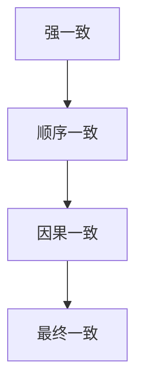
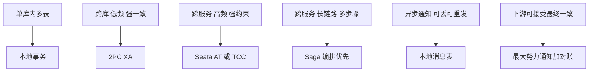

# 事务一致性模型与选型

分布式事务的难点不在“怎么写代码”，而在“先选对一致性模型”：模型定错，后面换什么框架都救不回来。本篇只讲模型与选型——ACID 与隔离级别的细节见《MySQL-事务与MVCC》，2PC、Seata AT、TCC、本地消息表、最大努力通知的机制见《分布式事务》，本篇不再重复抄机制，只在选型矩阵里指回它们。

## 1. ACID 与隔离级别：一句话回顾

ACID（原子性、一致性、隔离性、持久性）是单机事务的承诺；隔离级别（读未提交、读已提交、可重复读、串行化）是“隔离性打几折”的档位，档位越高并发越低。快照读、当前读、行锁、间隙锁的完整讲法见《MySQL-事务与MVCC》，本篇只用一个结论：隔离级别是单库内的事，跨库、跨服务的一致性问题不在它的射程内，那是本篇后面模型的活。

## 2. CAP 与 BASE：先接受取舍

- CAP：分布式系统在一致性（C）、可用性（A）、分区容忍性（P）三者中，分区发生时只能保两个；分区是客观存在的（网络一定会断），所以实际选择是在 C 与 A 之间取舍，不是三选二的口号。
- BASE：对 ACID 的柔化——基本可用（BA，降级也要能服务）、柔性状态（S，允许中间态存在）、最终一致（E，给足时间后数据收敛）。BASE 不是“不要一致性”，而是把“立刻一致”换成“约定时间内一致”。
- 工程翻译：强一致适合钱与库存的扣减口，BASE 适合通知、统计、非核心链路；把 BASE 用在扣钱口、把强一致用在点赞数上，都是选型错误。

## 3. 一致性级别谱：从强到弱

下图是一致性级别谱，从强到弱。

| 级别 | 定义 | 典型场景 | 代价 |
|---|---|---|---|
| 强一致（线性一致） | 读到的永远是最新一次写的结果 | 扣款、库存扣减、唯一号段 | 延迟最高、分区时不可用 |
| 顺序一致 | 所有人看到的操作顺序一致，但不一定是实时最新 | 配置下发、协同编辑的粗粒度顺序 | 低于强一致，高于因果 |
| 因果一致 | 有因果关系的操作按因果顺序可见，无关操作可乱序 | 社交动态、评论盖楼（先有帖子后有回复） | 中等，需追踪因果依赖 |
| 最终一致 | 不再有新写后，经过一段时间所有副本收敛 | 点赞数、搜索索引、缓存、统计报表 | 最低，但要接受“暂时不一致”窗口 |

选级别的判断题只有一个：业务能不能接受“读到旧数据”？不能接受 → 强一致；能接受几秒旧数据 → 最终一致；介于中间 → 看因果关系是否必须保序。

## 4. Saga 模式：长事务的补偿路线

Saga 把一个跨服务的长事务拆成一串本地事务，每步配一个补偿操作；某步失败时按反方向依次执行前面各步的补偿，把系统“滚回”业务上可接受的状态。

- 编排（Orchestration）：一个中央协调器按流程图指挥各步，流程可视、易排障，协调器本身是单点，要自身高可用。
- 协同（Choreography）：各服务监听事件、自主决定下一步，没有中心节点，扩展灵活，但流程散落在各服务的事件处理里，排障要靠链路追踪拼全图。
- 补偿设计四原则：补偿必须幂等（补偿自己也可能被重试）；补偿必须可重试（补偿失败要有兜底通道，不能卡在中间态）；补偿是语义逆操作（不是数据库回滚，如“取消订单”不是删行，是把状态置为已取消）；警惕悬挂与空补偿（补偿先于正向操作到达、或正向根本没执行时，补偿要能识别并空转，不能把别人的数据冲掉）。
- 与 TCC 的区别：一句话——TCC 是“预留-确认-取消”的三段式强约束，Saga 是“正向-补偿”的两段式柔性路线；TCC 适合资金类强约束场景，Saga 适合长链路、多步骤的业务流程。

## 5. 选型矩阵：场景 → 方案

| 业务场景 | 首选方案 | 机制指回 | 代价与注意 |
|---|---|---|---|
| 单库内多表 | 本地事务 | 《MySQL-事务与MVCC》 | 无跨库问题，别为了“分布式”而分布式 |
| 跨库、低频、强一致 | 2PC / XA | 《分布式事务》第 2 节 | 同步阻塞、协调者单点，不适合高频核心链路 |
| 跨服务、高频、强约束 | Seata AT 或 TCC | 《分布式事务》第 3、4 节 | AT 靠代理与快照，侵入小；TCC 要业务写三段，侵入大但可控 |
| 跨服务、长链路、多步骤 | Saga（编排优先） | 本篇第 4 节 | 补偿覆盖率是生命线，漏一个补偿就是脏数据 |
| 异步通知、可丢可重发 | 本地消息表 | 《分布式事务》第 5 节 | 要求消费端幂等（见幂等篇第 7 节） |
| 下游可接受最终一致 | 最大努力通知 + 对账 | 《分布式事务》第 5 节 | 必须配对账与人工干预通道，否则丢消息无人知 |

选型时先问三个问题：能不能接受最终一致？链路有多长？失败时有没有业务上可接受的“回滚态”？三个答案一出来，矩阵里基本只剩一到两个选项。

下图是选型矩阵的场景到方案对照。

## 6. 落地检查：补偿与对账

- 补偿覆盖率：每个正向步骤都有补偿吗？补偿都经过“补偿被重试、补偿先于正向到达”两种异常测试吗？
- 超时与悬挂：每一步都有超时时间吗？超时后是重试、补偿还是转人工？超时时间要小于调用方的整体超时，否则上游先断了、下游还在跑。
- 对账：跨服务必有对账任务（定时比对关键状态），对账差异要有人工干预通道；没有对账的最终一致等于“丢了也不知道”。
- 幂等打底：Saga 的每一步、每个补偿都必须是幂等的，否则重试与补偿重放会把数据写乱——幂等是选型矩阵的地基，不是可选项。

## 7. 常见误区

- “用了 Seata 就是强一致”：AT 模式本质是“最终一致 + 隔离性保障”，不是 2PC 的强一致；选型前先看清模式的承诺。
- “Saga 不用写补偿也能跑”：没有补偿的 Saga 等于没有刹车的车，失败时只能人工擦数据。
- “最终一致等于不用管”：最终一致要求对账、监控收敛延迟、人工干预通道三件套，缺一件就是裸奔。
- “隔离级别调高能解决跨服务一致性”：隔离级别只管单库内并发，跨服务问题要靠本篇的模型选型。

## 实战案例

### 案例一：Saga 补偿后 30 秒仍未收敛，告警转人工

- **现象**：订单服务下单成功，库存服务扣减失败走了 Saga 补偿，补偿执行完 30 秒后订单与库存的状态仍对不上，监控没有告警，客服先接到用户投诉才发现。
- **排查**：按本篇第 6 节落地检查逐项对：第一，补偿覆盖率——补偿是否经过"补偿被重试、补偿先于正向到达"两种异常测试；第二，超时与悬挂——每一步是否有超时时间，超时后是重试、补偿还是转人工；第三，对账——跨服务对账任务是否在跑，对账差异有没有人工干预通道；第四，收敛 SLA——本篇小技巧节给的数字是"正常 5 秒内收敛，超过 30 秒未收敛就告警转人工"，30 秒减 5 秒等于 25 秒，系统在收敛窗口之外又多等了 25 秒才被人工发现，说明 SLA 只写在需求里、没有接进监控告警。
- **结论**：最终一致不是"不用管"，本篇第 7 节误区原话是"最终一致要求对账、监控收敛延迟、人工干预通道三件套，缺一件就是裸奔"。把"5 秒内收敛、超过 30 秒告警转人工"写进监控规则，对账任务比对业务状态（订单状态加库存状态）而不是行数，补偿先写测试再写正向步骤，漏补偿在测试阶段就暴露。

### 案例二：支付扣款用了最终一致，扣款与余额短暂不一致

- **现象**：支付链路用 Saga 做跨服务扣款，扣款成功后用户立刻查余额，余额还是扣款前的数字，客诉认为是重复扣款；查日志确认只扣了一次，余额是几秒后才追上的。
- **排查**：对照本篇第 3 节的判断题——"业务能不能接受读到旧数据"。扣款读到旧余额会造成钱错，不能接受；本篇第 3 节选型表里扣款、库存扣减、唯一号段都在强一致一档。再对照第 5 节选型矩阵 6 行场景：跨服务、高频、强约束的首选是 Seata AT 或 TCC，不是 Saga；Saga 在矩阵里对应的是"跨服务、长链路、多步骤"，且本篇第 2 节工程翻译原话是"把 BASE 用在扣钱口、把强一致用在点赞数上，都是选型错误"。
- **结论**：支付类场景改强一致：按矩阵选 Seata AT（侵入小）或 TCC（业务写预留-确认-取消三段，侵入大但可控）；Saga 留给长链路、多步骤、能接受最终一致的业务流程。选型会之前先列一张"失败时业务可接受的状态"清单，连"回滚到哪"都说不清，选 Saga 还是 TCC 无从谈起。

## 小技巧与冷知识

【小技巧】判断“要不要强一致”别问“要不要实时”，问“读到旧值会不会造成钱错”：点赞数读旧了只是数字晚几秒变，扣款读旧了会重复扣钱。把判断题从“实时性”翻译成“旧数据的代价”，产品和开发对选型的分歧立刻收敛——前者是体验问题，后者是资金事故。

【小技巧】最终一致必须给“收敛时间”定一个数字，否则监控没法告警：比如“正常情况下 5 秒内收敛，超过 30 秒未收敛就告警转人工”。原文说最终一致要配对账与监控，落地时先把这个 SLA 写进需求里；没有数字的“最终一致”，出问题时谁也说不清现在是“还没收敛”还是“已经丢了”。

【小技巧】Saga 的补偿先写测试再写正向步骤：给每一步先写“正向成功后补偿能把它滚回”的测试用例，再写正向逻辑本身。补偿覆盖率是原文说的生命线，但靠事后补测试很难补全——补偿写在正向步骤后面时，赶工期最先被砍的就是它；测试先行能让“漏补偿”在编译期就暴露。

【小技巧】选型会之前先列一张“失败时业务可接受的状态”清单：每个步骤失败后，系统停在哪个业务状态是可以接受的（订单已取消、库存已释放、券已退回），列不出来的步骤就是补偿没设计好的步骤。这张清单比选型矩阵更先有——连“回滚到哪”都说不清，选 Saga 还是 TCC 无从谈起。

【小技巧】“最终一致”有个隐藏前提：不再有新写：收敛的前提是写操作停下来，旧数据才有机会追上新数据。如果业务持续不断地写，副本可能永远追不上，窗口就不是“几秒”而是“一直落后”。评估最终一致时先看写流量——高频持续写的场景，收敛延迟要按峰值写流量测，而不是按空闲时测。

【小技巧】因果一致落地时先确认“因果”怎么追踪：实现因果一致通常要给每个操作带上因果依赖（比如向量时钟或 Lamport 时间戳），而不是只靠时间戳排序。评论盖楼“先有帖子后有回复”这个例子里，回复要带上它回复的帖子 ID 作为依赖；只按写入时间排序，时钟一偏就会出现“回复比帖子先出现”。

【小技巧】顺序一致和线性一致差在“实时性”三个字：顺序一致只要求所有人看到的操作顺序一致，不要求读到的是实时最新值；线性一致还要求读到的必须是最新一次写的结果。选型时说“要顺序一致就够了”，等于承认可以读到几秒前的值——先跟业务确认这个“几秒前”能不能接受，别把顺序一致当成强一致的便宜版。

【小技巧】对账要比对“业务状态”而不是“数据库行数”：两边行数一致不等于一致，订单在 A 服务是“已取消”、在 B 服务还是“待支付”，行数对得上、状态对不上。对账任务的比对键应该是业务主键加状态机状态，行数只是第一层粗筛；原文说“没有对账的最终一致等于丢了也不知道”，对账对错字段等于白对。

【小技巧】补偿操作要用业务语义命名，不要叫 rollback：写 `cancelOrder`、`releaseStock`、`refundCoupon`，而不是 `rollbackStep1`。补偿是业务上的逆操作（原文第 4 节已强调），名字里带业务语义后，排障时一眼能看出“这一步在干什么”，监控告警里出现 `cancelOrder 失败` 也比 `rollback 失败` 更容易定位到业务影响。

【小技巧】强一致的代价不只是延迟，还有分区时的不可用：选强一致等于接受“网络分区时读和写都可能直接失败”。上线前先准备好分区时的降级页面或提示文案，而不是等分区发生了才发现前端一直在转圈——强一致场景的降级方案要在选型时一起定，而不是事后补。

【小技巧】调 quorum 先算“坏几个还能跑”，再算“等几个才返回”：`N - W` 是写能坏几个，`N - R` 是读能坏几个，`R + W - N` 是读写交叠几个。三组数算完再决定 `R` 和 `W` 各取几——先定 `N` 再定 `R`、`W` 的顺序反了，先问业务“读能坏几个、写能坏几个”，答案直接框出 `R` 和 `W` 的取值范围；只盯着 `R + W > N` 一个不等式，容易调出“满足公式但写一坏就全停”的组合，比如 `N=3, R=1, W=3`，写坏 1 个就停摆。

【冷知识】CAP 定理是 2000 年 Eric Brewer 在 PODC 会议上提出的猜想，2002 年才由 Seth Gilbert 和 Nancy Lynch 给出形式化证明：Brewer 当年讲的是“设计分布式系统时三者只能取其二”的经验观察，证明补上之后才变成定理。原文第 2 节说“分区是客观存在的”，正是这个证明的推论——P 不是可选项，真正能选的只有 C 和 A。

【冷知识】Saga 这个名字来自 1987 年的一篇论文：Hector Garcia-Molina 和 Kenneth Salem 在论文《Sagas》里提出把长事务拆成一串带补偿的本地事务。Saga 在英文里本是“长篇传奇故事”的意思，用来形容“一步步推进、失败了就按原路补偿回去”的长事务很贴切——这个模式比微服务早了二十多年，最初是为大型数据库系统里的长事务设计的。

【冷知识】BASE 这个缩写是 eBay 的架构师 Dan Pritchett 在 2008 年提出的：他在 ACM Queue 的文章《BASE: An Acid Alternative》里把它作为 ACID 的对立面总结出来，基本可用、柔性状态、最终一致三个词都是他先定下来的。BASE 不是某个数据库的官方模型，而是 eBay 这类大规模系统在实践中总结出的取舍框架。

【冷知识】线性一致性（linearizability）这个词是 1990 年 Maurice Herlihy 和 Jeannette Wing 定义的：它要求每个操作看起来都在某个瞬间原子地生效，读到的永远是最新一次写的结果。原文第 3 节把强一致等同于线性一致，这个定义就是出处——比线性一致弱的顺序一致则是 Leslie Lamport 在 1979 年先提出来的，两者差了十一年。

【冷知识】ACID 这个缩写本身也是 1983 年才定下来的：Andreas Reuter 和 Theo Härder 在论文《Principles of Transaction-Oriented Database Recovery》里首次把原子性、一致性、隔离性、持久性并列成 ACID。也就是说 ACID 比关系数据库的理论晚了十多年才有了这个名字，之前人们只说“事务要满足这四条性质”，没有一个统一的缩写。

【冷知识】向量时钟是 1978 年 Leslie Lamport 提出逻辑时钟之后、由 Colin Fidge 和 Friedemann Mattern 在 1988 年各自独立发明的：逻辑时钟只能判断“谁先谁后”，向量时钟才能判断“两个操作有没有因果关系”。原文第 3 节的因果一致要真正落地，靠的就是向量时钟这类机制，而不是墙上的时间。

## Quorum 定量：R + W > N 到底在算什么

原文第 3 节说强一致“延迟最高”、最终一致“要接受暂时不一致窗口”，但没算过账：这个“最高”高多少、“窗口”宽多久，本节用三组数字手算出来。先定符号，一共三个数：

- `N`：同一份数据的副本总数
- `W`：一次写成功要等到几个副本确认
- `R`：一次读成功要等到几个副本返回

写操作同时发给 `N` 个副本，等够 `W` 个确认就返回；读操作同时发给 `N` 个副本，等够 `R` 个返回就返回。读写都不是等全部副本，而是“等够数就走”，这是 quorum 的全部花样。

### 先算公式：R + W > N 是怎么推出来的

结论先摆出来：只要 `R + W > N`，任意一次读集合与任意一次写集合至少有一个副本重合，读就一定能碰到最新一次已提交的写。

推导只用一步鸽巢原理。读集合有 `R` 个副本，写集合有 `W` 个副本，两集合都取自同一个 `N` 个副本的全集。两个集合并起来最多是 `N` 个不同副本，即 `R + W - 交叠数 <= N`，移项得 `交叠数 >= R + W - N`。当 `R + W > N` 时，`R + W - N >= 1`，交叠至少 1 个副本。这个重合的副本既参加了写、又参加了读，所以它手里有最新写的值，读操作取 `R` 个返回里最新的一个，就读到了最新已提交的写。

反过来验算边界：`R + W = N` 时交叠数可以是 0，读写集合可能完全错开，读就可能只拿到旧值。所以 `R + W > N` 里的“大于”是硬条件，等于 `N` 不够。

注意这个推导只保证“读到最新已提交写”，不保证线性一致，原因见后面边界条件第 1 条。

### N=3 手算：三种组合的对照表

`N = 3` 时，读写放大 = 一次操作要等几个副本；容忍故障数 = 坏几个副本操作还能成功，算法是 `N - 等待数`（坏的副本数不能超过不用等的副本数）。

| 组合 | 读放大 | 写放大 | 读容忍故障 | 写容忍故障 | 交叠副本数 | 适用场景 |
|---|---|---|---|---|---|---|
| `R=2, W=2` | 2 | 2 | 1（`3 - 2 = 1`） | 1（`3 - 2 = 1`） | 1（`2 + 2 - 3 = 1`） | 通用默认，读写均衡 |
| `R=1, W=3` | 1 | 3 | 2（`3 - 1 = 2`） | 0（`3 - 3 = 0`） | 1（`1 + 3 - 3 = 1`） | 读多写少，读要快、写可以慢 |
| `R=3, W=1` | 3 | 1 | 0（`3 - 3 = 0`） | 2（`3 - 1 = 2`） | 1（`3 + 1 - 3 = 1`） | 写多读少，写要快、写不能丢 |

三行逐行算：

- `R=2, W=2`：`2 + 2 = 4 > 3`，满足 quorum 条件；读写各等 2 个副本，坏 1 个副本还剩 2 个，读写都能成功；坏 2 个只剩 1 个，读写都失败。这是 Dynamo 论文里说的常用配置 `(3,2,2)`，Cassandra 里复制因子为 3 时读写都用 `QUORUM`（`QUORUM = floor(3 / 2) + 1 = 2`）就是这组数。
- `R=1, W=3`：`1 + 3 = 4 > 3`，同样满足条件；读只等 1 个副本，坏 2 个还能读；但写要等全部 3 个副本确认，坏 1 个写就失败。读快、写脆，适合读多写少、写失败可重试的场景。
- `R=3, W=1`：`3 + 1 = 4 > 3`，同样满足条件；写只等 1 个副本确认，坏 2 个还能写；但读要等全部 3 个副本，坏 1 个读就失败。写快、读脆，适合写多读少、且能接受读偶尔失败的场景。

三组交叠都是 1，说明 quorum 条件只要求“至少交叠 1 个”，交叠数本身不是越大越好——交叠 1 个已经够读到最新写，多出来的等待数只换来更高的延迟和更低的容错。

### N=5 手算：R=3/W=3 与 R=2/W=4 的取舍

`N = 5` 时多数派是 3（`floor(5 / 2) + 1 = 3`），两组候选都满足条件：

| 组合 | 读放大 | 写放大 | 读容忍故障 | 写容忍故障 | 交叠副本数 |
|---|---|---|---|---|---|
| `R=3, W=3` | 3 | 3 | 2（`5 - 3 = 2`） | 2（`5 - 3 = 2`） | 1（`3 + 3 - 5 = 1`） |
| `R=2, W=4` | 2 | 4 | 3（`5 - 2 = 3`） | 1（`5 - 4 = 1`） | 1（`2 + 4 - 5 = 1`） |

取舍不在“谁更一致”，两组交叠都是 1，一致性承诺相同，差在另外两笔账：

- 延迟账：读写是并行发给多个副本、等够数就返回，延迟由等到的最慢那个副本决定，不是把各副本延迟加起来。`R=3` 的读要等第 3 个返回的副本，比 `R=2` 的读多等一个副本，尾延迟更高；`W=4` 的写要等第 4 个确认，比 `W=3` 的写更容易被一个慢副本拖住。
- 容错账：`R=3, W=3` 读写各能坏 2 个副本，均衡；`R=2, W=4` 读能坏 3 个、写只能坏 1 个，等于把容错额度从写挪到了读。

选法就一句话：读写都重要、都不能常坏，选 `R=3, W=3`；读多且读不能断、写慢一点能接受，选 `R=2, W=4`。反过来如果写多且写不能断，`R=4, W=2` 是对称的另一组，算法相同，不再展开。

### 一致性代价手算：强一致读到底贵多少

先说清一个容易算错的点：quorum 读写是并行发、等够数返回，延迟不是“副本数乘以单次延迟”，而是“等到的最慢那个副本的延迟”。所以强一致读贵在两处：等更多的副本，以及等到更慢的那个。

下面是一组同机房场景的示例量级（示例数字，用于算量级对比，非实测基准；单次往返取约 1 毫秒量级）：

- 单副本读（`R=1`）：发给最近的 1 个副本，等 1 个返回，1 次往返，约 1 毫秒量级。
- quorum 读（`N=3, R=2`）：同时发给 3 个副本，等最先返回的 2 个，第 2 个返回的副本通常比第 1 个慢，1 次往返但要等第 2 名，约 1 至 2 毫秒量级。
- 全副本读（`R=3`）：等最慢的 1 个副本回来，1 次往返但要等最后 1 名，约 2 至 5 毫秒量级，慢副本一抖就拖全场。

写侧同理：`W=1` 约 1 毫秒量级，`W=2` 约 1 至 2 毫秒量级，`W=3` 约 2 至 5 毫秒量级。数字本身不重要，重要的是比例关系：从 `R=1` 升到 `R=2`，延迟大约翻 1 至 2 倍；升到 `R=3`，延迟由最慢副本决定，上限不可控。

跨机房时这笔账会换主角：同机房往返约 1 毫秒量级，跨机房往返约 30 毫秒量级（示例）。`W=2` 里如果第 2 个确认必须跨机房，写延迟就从 1 毫秒量级跳到 30 毫秒量级，主导项不再是副本数，而是“最远的那个确认要走多远”。这就是跨机房部署时常把 quorum 收进本机房（例如 Cassandra 的 `LOCAL_QUORUM`，只在本数据中心内数多数派）的原因：跨机房的确认只留给异步复制，不挡在写路径上。

### 最终一致的收敛窗口：旧数据能活多久

最终一致不承诺“立刻读到最新写”，只承诺“不再有新写之后，副本最终收敛”。收敛窗口的下界是复制延迟：写确认后，最新值还要花一次复制时间才能到达其余副本，在这段时间里读到旧值是正常现象，不是故障。

窗口能不能合上，取决于写流量与复制速度的比较：

- 写停下来或写速低于复制速度时，落后副本能追上，窗口是“复制延迟”这个量级，读到旧数据的概率随等待时间拉长而下降。
- 写速持续高于复制速度时，落后副本越落越远，窗口合不上，读到旧数据从“偶尔”变成“经常”，最终一致退化成“一直不一致”。

这里不给精确概率，因为概率取决于三组无法事先确定的量：写到达的速率、复制延迟的分布、读发生在写后多久。能给的是边界分析：最坏情况下，读到的数据落后写操作数等于窗口期内发生的写次数；窗口期内写了 100 次，读到的就可能是 100 次之前的值。评估最终一致时，先问写流量峰值，再问复制延迟分布，最后才问“窗口几秒”——只问窗口不问写流量，等于只算了一半。

### 边界条件

1. quorum 只保证“读到最新已提交写”，不保证线性一致的实时序。线性一致（Herlihy 与 Wing，1990 年定义）要求每个操作看起来在调用与返回之间的某个瞬间原子生效，且顺序符合真实时间的先后；顺序一致（Lamport，1979 年定义）只要求所有人看到同一个操作顺序，不要求符合真实时间。quorum 交叠能保证读到已提交的最新写，但两个并发写同时到达不同副本时，quorum 本身不裁决谁先谁后——最后写入获胜（last-write-wins）的系统可能悄悄丢掉其中一个写。要线性一致，需要共识协议（Paxos、Raft）或带写回的读协议，光靠 `R + W > N` 不够。
2. `N` 为偶数时 quorum 取值与脑裂风险。`N = 4` 的多数派是 3（`floor(4 / 2) + 1 = 3`），只能容忍 1 个故障，和 `N = 3` 的多数派 2 能容忍的故障数相同——第 4 个副本白加了，只加了成本没加容错。更糟的是网络分成 2 与 2 两半时，两边都凑不够 3，读写双双停摆。所以生产上副本数取奇数（3 或 5）是惯例，偶数 `N` 除非有仲裁节点（witness）补多数派，否则不划算。
3. 跨机房部署时，`W` 里的跨机房往返主导延迟。`W` 要求几个副本确认，就有几个确认要走网络；其中最远的那个确认决定写延迟。同机房约 1 毫秒量级的写，跨机房确认一加进来就变成约 30 毫秒量级（示例），延迟涨 30 倍，代价不在副本数上，在距离上。做法是分层：写路径的 quorum 只数本机房多数派，跨机房复制走异步；代价是机房级故障时可能丢未复制的写，这笔账要在选型时明说，不能只报“强一致”三个字。

### 与 ao 的 OceanBase 背景呼应

OceanBase 是同一笔 quorum 账的工程版：官方文档的说法是，事务提交前，redo 日志必须持久化到 Paxos 多数派副本，3 副本部署时 2 个副本落盘才返回提交成功，5 副本时 3 个落盘才返回。换成本节的符号，就是 `N=3, W=2` 或 `N=5, W=3` 的多数派写；读强一致时走主副本，读到的是已多数派确认的最新提交值。所以 OceanBase 的“强一致”不是凭空来的，是每笔写都付了“等多数派确认”这笔延迟换来的，和本节手算的 `W=2` 那一行是同一组数。

> 来源与核查日期：本节外部结论核查于 2026-11-20，来源见本节末尾“来源”小节。

### 来源

- DeCandia 等，Dynamo: Amazon's Highly Available Key-value Store，SOSP 2007：quorum 原文为 `Setting R and W such that R + W > N yields a quorum-like system`；常用配置 `(N,R,W) = (3,2,2)`；读或写操作的延迟由 `R`（或 `W`）个副本中最慢的那个决定。
- DataStax / Apache Cassandra 文档：一致性级别 `QUORUM` 为全部副本的多数派，`QUORUM = floor(RF / 2) + 1`；`W + R > RF` 时可达到强一致；`LOCAL_QUORUM` 只数本数据中心内的多数派。
- Herlihy 与 Wing，Linearizability: A Correctness Condition for Concurrent Objects，ACM TOPLAS 1990：线性一致要求每个操作在调用与返回之间的某个瞬间原子生效；Lamport 1979 年提出顺序一致，只要求单一全序、不要求符合真实时间。
- OceanBase 官方文档 Database High Availability：每个分区表的 redo 日志须持久化到 Paxos 多数派副本后才返回提交确认；3 或 5 副本部署，少数节点故障不丢已提交事务、不降写可用性。

## 面试与自测

1. 强一致、因果一致、最终一致的判断题是什么？点赞数和扣款分别该选哪个级别？
2. Saga 的编排与协同各有什么优缺点？补偿设计最容易漏掉哪两种异常？
3. 跨服务、高频、强约束的场景为什么不选 2PC？Seata AT 和 TCC 各适合什么情况？
4. `N=3` 时 `R=2, W=2` 与 `R=1, W=3` 两组配置都满足 `R + W > N`，为什么实际选型中前者是默认、后者只用在特定场景？`N=4` 为什么不比 `N=3` 更能容错？

### 参考答案

1. 判断题是“业务能不能接受读到旧数据”。不能接受 → 强一致（扣款、库存扣减）；能接受几秒旧数据 → 最终一致（点赞数、搜索索引、统计报表）；因果关系必须保序时选因果一致（如先有帖子后有回复）。
2. 编排是中央协调器指挥流程，可视易排障但协调器本身是单点；协同是各服务监听事件自主推进，扩展灵活但流程散落、排障靠链路追踪。补偿最容易漏掉的两种异常是补偿被重试（补偿必须幂等）和补偿先于正向操作到达（悬挂与空补偿，补偿要能识别并空转）。
3. 因为 2PC 同步阻塞且协调者是单点，不适合高频核心链路。Seata AT 靠代理与快照、业务侵入小，适合想快速落地的强约束场景；TCC 要业务写预留-确认-取消三段，侵入大但控制力强，适合资金类场景。
4. 两组交叠都是 1（`2 + 2 - 3 = 1`，`1 + 3 - 3 = 1`），一致性承诺相同，差别在容错与延迟：`R=2, W=2` 读写各能坏 1 个副本（`3 - 2 = 1`），均衡；`R=1, W=3` 读能坏 2 个、写 1 个都不能坏（`3 - 3 = 0`），写路径没有容错余量，写还得等全部 3 个副本确认、延迟由最慢副本决定，所以只适合读多写少、写失败可重试的场景。`N=4` 的多数派是 3（`floor(4 / 2) + 1 = 3`），只能容忍 1 个故障（`4 - 3 = 1`），与 `N=3` 相同，第 4 个副本只加成本不加容错；且网络分成 2 与 2 两半时两边都凑不够多数派，读写双双停摆，所以生产上副本数取奇数。

## 关联知识

### 前置知识

- [分布式事务](数据库/分布式事务.md)：本篇第 5 节选型矩阵指回的 2PC、Seata AT、TCC、本地消息表、最大努力通知的机制出处。
- [MySQL-事务与MVCC](数据库/MySQL/MySQL-事务与MVCC.md)：本篇第 1 节一句话回顾的 ACID、隔离级别、快照读与当前读的完整讲法。
- [幂等设计与接口防重](开发语言/Java/幂等设计与接口防重.md)：本篇第 6 节点名的地基——Saga 的每一步与每个补偿都必须是幂等的。
- [接口设计与文档](工程实践/接口设计与文档.md)：补偿是业务状态机的逆操作，状态机校验的基础形态见该篇。
- [Kafka-消息队列](消息队列/Kafka-消息队列.md)：本篇第 4 节协同模式靠各服务监听事件自主推进，事件的投递与消费语义见该篇。

- [分布式事务](数据库/分布式事务.md)：2PC、Seata AT、TCC、本地消息表、最大努力通知的机制。
- [MySQL-事务与MVCC](数据库/MySQL/MySQL-事务与MVCC.md)：ACID、隔离级别、快照读与当前读。
- [幂等设计与接口防重](开发语言/Java/幂等设计与接口防重.md)：Saga 每一步与补偿的幂等地基。
- [接口设计与文档](工程实践/接口设计与文档.md)：状态机校验的基础形态。
