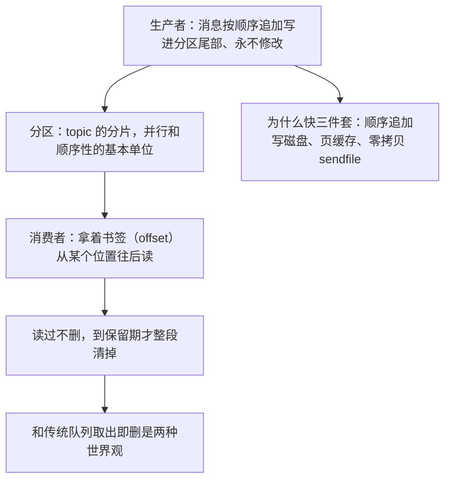
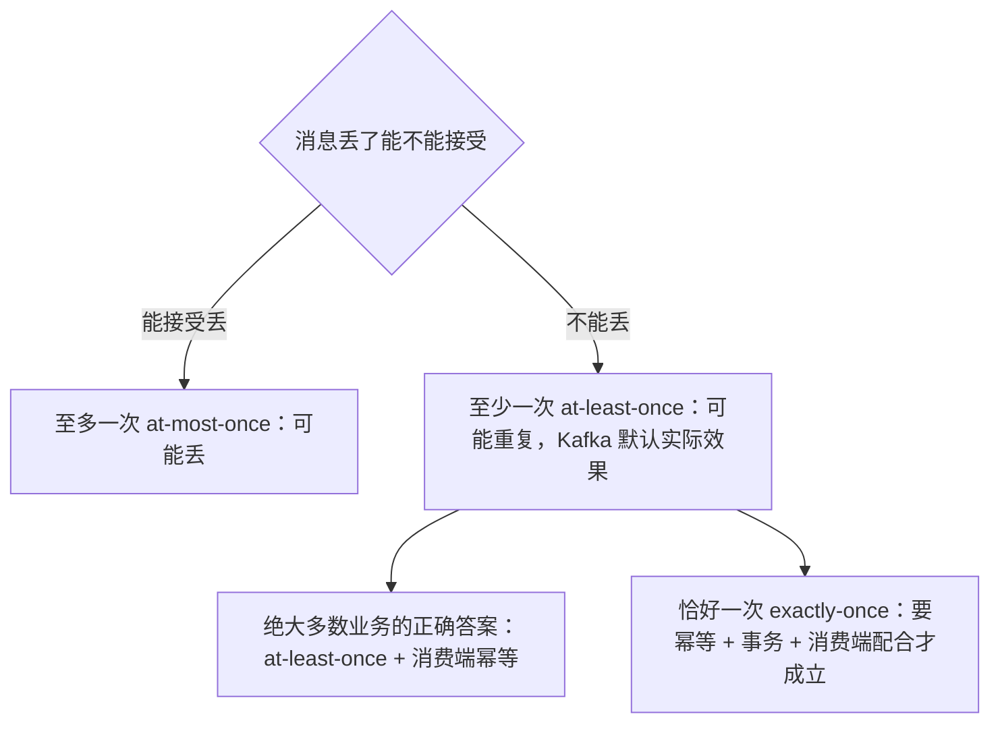
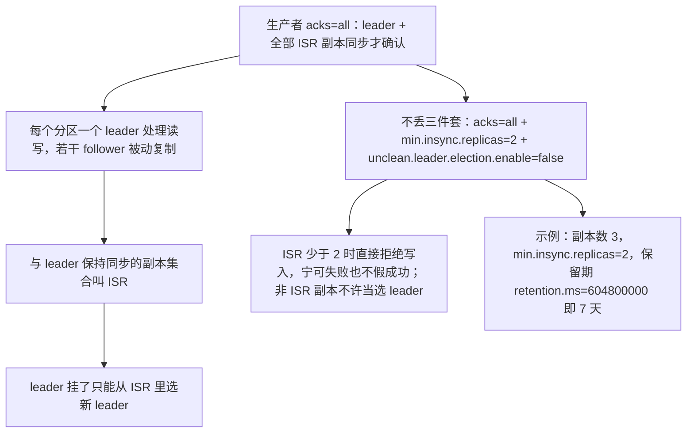

# Kafka 消息队列

> 本篇是 Kafka 的汇总与索引：全景、核心概念、选型与服务端要点留在本篇；生产端、消费端的细节已拆为独立篇（见下方索引），正文不再重复。时效性以 Apache Kafka 官方为准（2026 年主线 4.x，已彻底去掉 ZooKeeper，全面 KRaft）。

### 前置知识

- [消息可靠性](消息队列/消息可靠性.md)：先懂三档投递语义的边界与消费端幂等，再读原文 §1 全景导读的语义三档与“绝大多数业务的正确答案是 at-least-once + 消费端幂等”一句；原文 §1 与原文 §4 相关专题已直接指向本篇。
- [分布式系统理论](计算机基础/分布式系统理论.md)：先懂副本复制、leader 选举与共识的基本概念，再读原文 §2 核心概念的副本与 ISR、KRaft 与原文 §7 的 leader 选举配置；没有这层概念，“leader 挂了只能从 ISR 里选新 leader”无从理解。
- [编码-字符集-内存-文件系统](计算机基础/编码-字符集-内存-文件系统.md)：先懂内存与文件系统的基本概念，再读原文 §1 全景导读“为什么快”的顺序写与页缓存、原文 §2 核心概念的日志段；原文“内存比 CPU 更重要，堆别调太大，留给页缓存”的推论直接依赖这层概念。

## 全景导读

下图是 Kafka「分布式提交日志」的心智模型：消息追加写进分区尾部，消费靠 offset 书签往后读。



- **心智模型**：Kafka 是「分布式提交日志」——消息按顺序追加写进分区尾部、永不修改，消费就是拿着书签（offset）从某个位置往后读，读过不删，到保留期才整段清掉。和传统队列「取出即删」是两种世界观。
- **为什么快**，三件套：顺序追加写磁盘（避开随机 IO）+ 页缓存（读写走 OS cache，不吃 JVM 堆）+ 零拷贝 sendfile（文件直接进网卡）。推论：给 Kafka 的机器内存比 CPU 更重要，堆别调太大，留给页缓存。
- **投递语义三档**（记定义，别只记名字）：at-most-once（可能丢）、at-least-once（可能重复，Kafka 默认实际效果）、exactly-once（要幂等 + 事务 + 消费端配合才成立）。绝大多数业务的正确答案是 at-least-once + 消费端幂等，机制对比与选型清单见 [消息可靠性](消息队列/消息可靠性.md)。

下图是投递语义三档的取舍：能接受丢选至多一次，不能丢选至少一次加幂等，恰好一次只在三项条件齐全时成立。


- **拉模式（pull）**：消费者按自己的节奏 poll，天然削峰；poll 本身是长轮询，没数据时不用再 sleep 忙等。

## 核心概念一句话

- **Topic**：消息的逻辑分类；**Partition**：topic 的分片，并行和顺序性的基本单位。
- **Offset**：partition 内的消息序号，消费进度就是 offset，存在内部 topic `__consumer_offsets`。
- **Consumer Group**：一组消费者共同消费一个 topic，一个 partition 同一时刻只被组内一个消费者消费。
- **Broker**：Kafka 服务节点；**KRaft**：4.x 的元数据共识机制（替代 ZooKeeper）。
- **记录（record）结构**：key（决定进哪个分区，可为空）+ value（正文）+ timestamp + headers（附带元数据，如 traceId）；业务数据放 value，链路信息放 header，别把正文塞进 key。
- **副本与 ISR**：每个分区一个 leader 处理读写，若干 follower 被动复制；与 leader 保持同步的副本集合叫 ISR，leader 挂了只能从 ISR 里选新 leader。
- **日志段（segment）与清理策略**：分区在磁盘上按段滚动存文件，清理按段整段删（delete 策略，流水型消息默认）或按 key 压缩只保留最新值（compact 策略，配置/状态类 topic 用）。

## 子篇索引

- [Kafka 生产者可靠性](消息队列/Kafka-生产者可靠性.md)：不丢、不重、不乱序分别靠什么——`acks` 与 `min.insync.replicas` 配套、重试的重复与乱序副作用、幂等生产者的原理与边界、事务消息的概念与成本、发送回调与异常分类。
- [Kafka 消费者组与 Rebalance](消息队列/Kafka-消费者组与Rebalance.md)：分区分配策略（Range / RoundRobin / Sticky / CooperativeSticky）、rebalance 的触发条件与风暴成因、心跳与 poll 间隔参数关系、位点提交的正确姿势、消费失败进死信队列（DLT）的标准做法。

## 相关专题

- [消息可靠性](消息队列/消息可靠性.md)：三档语义边界、Kafka/RocketMQ 机制对比、消费端幂等三种模式、选型决策清单。
- [Kafka 与 RocketMQ 对比](消息队列/Kafka与RocketMQ对比.md)：与 [RocketMQ](消息队列/RocketMQ.md) 的系统性对照。

## 选型要点（vs RocketMQ）

|  | RocketMQ | Kafka |
|---|---|---|
| 出身 | 阿里，双十一 | LinkedIn，日志流 |
| 顺序消息 | 原生支持（顺序队列） | key 分区保序 |
| 事务消息 | 原生（half message+回查） | 事务 API（偏重 exactly-once） |
| 延迟消息 | 原生 18 级延迟 | 要自己实现/4.2+ share group |
| 运维 | NameServer 轻量 | KRaft（4.0+ 去 ZK） |
| 生态 | 国内金融/电商多 | 大数据生态（Flink 等） |

- 神农 e 贷选 RocketMQ 是对的：金融要事务消息 + 延迟消息，开箱即用。
- 日志/埋点/流计算选 Kafka：和 Flink/Spark 一家。

## 分区 key 设计

```java
// 按业务主键分区：同一用户的消息永远进同一分区 → 分区内有序
producer.send(new ProducerRecord<>("orders", userId, orderJson));
```

- **key 选谁**：需要保序的维度就是 key（用户 ID、订单 ID）；不需要保序就别设 key（null key 走轮询/粘性分配打散），还指望有序是最常见的误会。
- **分区数**：`分区数 >= 消费线程数`，不然加机器也白加；但别一上来 100 个分区，controller 负担重。分区数是「只增不减」的决策，调大后 key 的归属会变，保序要求高的业务扩分区前先评估 key 重映射影响，必要时停机迁移。

## Topic 创建与服务端关键参数

```bash
# 建 topic：分区数 >= 消费线程数，副本数 >= 3 的集群用 3
kafka-topics.sh --bootstrap-server localhost:9092 --create \
  --topic orders --partitions 12 --replication-factor 3 \
  --config min.insync.replicas=2 \
  --config retention.ms=604800000        # 7 天，显式写出来防"默认"背刺

kafka-topics.sh --bootstrap-server localhost:9092 --describe --topic orders
kafka-topics.sh --bootstrap-server localhost:9092 --alter --topic orders --partitions 24  # 只能调大
```

```properties
# broker server.properties：生产必改
unclean.leader.election.enable=false  # 宁可短暂不可用，不丢数据
min.insync.replicas=2                 # 和生产者 acks=all 配套
auto.create.topics.enable=false       # 生产关掉，topic 走评审建，防打字错误建出一堆 topic
log.retention.ms=604800000
```

- 读图法：`--describe` 输出里 `Leader` 是当前干活的副本，`Replicas` 是全部副本，`Isr` 是跟上进度的副本；Replicas 比 Isr 多，说明有副本掉队，先查那台 broker。
- `__consumer_offsets` 膨胀是正常现象，别手贱去删。

## 命令行四件套（排障基本功）

```bash
# 造数据（带 key 要加 parse.key 并用分隔符）
kafka-console-producer.sh --bootstrap-server localhost:9092 --topic orders
# 看数据：不加 --from-beginning 只读启动后的新消息，新手最常在这里以为"丢消息"
kafka-console-consumer.sh --bootstrap-server localhost:9092 --topic orders --from-beginning
# 查消费进度（lag 看这一列）
kafka-consumer-groups.sh --bootstrap-server localhost:9092 --describe --group g1
# 重置位移（危险操作：先停消费者，先 --dry-run 预览）
kafka-consumer-groups.sh --bootstrap-server localhost:9092 --group g1 \
  --reset-offsets --to-earliest --topic orders --dry-run
```

- `bootstrap.servers` 只是初始入口名单，写 2~3 个 broker 地址防单点；只写一个、那台恰好宕机时新客户端连不上集群。

## 4.x 值得知道的变化

- **KRaft**：4.0（2025-03）起移除 ZooKeeper，只有 KRaft 一种模式；老集群升级路径是 3.x(ZK) → 3.9(KRaft) → 4.x。broker 需要 Java 17+，太老的客户端（旧 wire protocol）连不上 4.x。
- **Share Groups（4.2 起生产可用）**：队列语义——多消费者可协作消费同一 partition，带单条 ack；适合「既用 Kafka 又要队列语义」的场景，不必为此单独搭 RabbitMQ。4.1 为预览。
- **新 rebalance 协议（KIP-848）**：分配移到 broker 侧、增量协调，rebalance 更快，细节见 [Kafka 消费者组与 Rebalance](消息队列/Kafka-消费者组与Rebalance.md)。

## 监控关键指标

| 指标 | 含义 | 告警线 |
|---|---|---|
| UnderReplicatedPartitions | 副本没跟上的分区数 | >0 就查 |
| Consumer Lag | 消费落后 | 持续增长告警 |
| RequestHandlerAvgIdlePercent | broker 空闲率 | <0.3 说明 broker 快顶不住了 |
| LogEndOffset 增速 | 写入速率 | 突增查生产者 |

- JMX Exporter + Prometheus + Grafana 是官方推荐链路；Lag 告警配「持续 5 分钟增长」而不是绝对值，避免正常波动误报。lag 本身的排查链路在 [Kafka 消费者组与 Rebalance](消息队列/Kafka-消费者组与Rebalance.md) 的疑难杂症里。

## 本地单机 KRaft

```yaml
# docker-compose.yml（开发够用；生产 broker 与 controller 要拆开部署）
services:
  kafka:
    image: apache/kafka:4.3.1
    ports: ["9092:9092"]
    environment:
      KAFKA_NODE_ID: 1
      KAFKA_PROCESS_ROLES: broker,controller
      KAFKA_LISTENERS: PLAINTEXT://:9092,CONTROLLER://:9093
      KAFKA_CONTROLLER_QUORUM_VOTERS: 1@localhost:9093
      KAFKA_AUTO_CREATE_TOPICS_ENABLE: "true"
```

```bash
KAFKA_CLUSTER_ID=$(docker exec kafka /opt/kafka/bin/kafka-storage.sh random-uuid)
docker exec kafka /opt/kafka/bin/kafka-storage.sh format -t $KAFKA_CLUSTER_ID -c /opt/kafka/config/server.properties
docker compose up -d
```

## 实战案例（项目沉淀）

- [翼安反诈平台](项目沉淀/翼安反诈平台.md)：Kafka 在反诈数据管道中的使用

## 原理剖析

本节只把原文已有章节给出的结论拆开讲清机制：不引入新概念，不补新数字，数字一律复用原文 §6、§7 已核验的定量算例；凡原文没展开的点，文中明确标注，不作定论。

### 为什么快：顺序写、页缓存与零拷贝如何分工

原文 §1 全景导读给出的结论是三件套：顺序追加写磁盘、页缓存、零拷贝 sendfile。拆开看，三者分工不同。顺序追加写磁盘针对的是写路径：原文 §2 核心概念说消息按顺序追加写进分区尾部、永不修改，写操作只往尾部追加，不改写旧数据、不做随机定位，磁盘写因此是连续的，避开了随机 IO 的定位开销。页缓存针对的是读写路径：原文 §1 说读写走 OS cache，不吃 JVM 堆，写进来的数据留在操作系统缓存里，读的时候先走缓存；由此才有原文 §1 的推论——给 Kafka 的机器内存比 CPU 更重要，堆别调太大，留给页缓存，堆占多了，留给页缓存的内存就少了。零拷贝 sendfile 针对的是发送路径：原文 §1 说文件直接进网卡，段文件不经过 JVM 堆再拷贝一次就送出，省掉了一轮经由 JVM 堆的拷贝。

原文未展开：顺序写相对随机写的定量对比、页缓存命中高低对读延迟的具体影响，原文 §1 没给数字，不作定论。

### 投递语义三档：为什么默认是至少一次

原文 §1 全景导读给出三档定义：at-most-once 可能丢，at-least-once 可能重复、Kafka 默认实际效果，exactly-once 要幂等加事务加消费端配合才成立。拆开看，三档是“丢”与“重复”之间的一次取舍：at-most-once 允许丢、换取不重复，at-least-once 允许重复、换取不丢，exactly-once 两者都不允许。原文 §1 的选型结论“绝大多数业务的正确答案是 at-least-once + 消费端幂等”正是按这个取舍拆开的：选了 at-least-once，就等于接受了“可能重复”这一面，重复的处理责任随之移到消费端，由消费端幂等兜底；而 exactly-once 是三项条件的合取，幂等、事务、消费端配合缺任何一项都不成立，所以原文 §1 不把它当作默认答案，只当作需要三方配合才成立的档位。原文 §4 相关专题把机制对比与选型清单指向消息可靠性篇，本篇正文只给定义与选型结论。

原文未展开：重复具体由哪一步造成、消费端幂等的具体做法，原文正文没展开，不作定论。

### 分区与 key：保序的边界与分区数只增不减

原文 §2 核心概念定下两条规则：分区是并行和顺序性的基本单位；一个 partition 同一时刻只被组内一个消费者消费。原文 §6 分区 key 设计把保序机制说成一条链：需要保序的维度就是 key，同一用户的消息永远进同一分区，分区内有序。拆开看，保序的边界就在这里：同一分区内消息按追加顺序排列，所以同一 key 的消息落在同一分区才能保序；不同分区之间没有全局顺序，跨分区谈保序没有依据。不需要保序就别设 key，原文 §6 说 null key 走轮询或粘性分配打散，正是把“打散”与“保序”分开处理。

分区数与消费线程数的关系也由原文 §2 的规则推出：一个分区同一时刻只被组内一个消费者消费，分区数少于消费线程数时，多出来的线程没有可认领的分区，所以原文 §6 说分区数大于等于消费线程数，不然加机器也白加。分区数只增不减的机制在原文 §6 与原文 §7：原文 §7 的改分区命令只能调大，示例是分区数从 12 调到 24；调大后 key 的归属会变，保序要求高的业务扩分区前先评估 key 重映射影响，必要时停机迁移——分区数一旦调大，原有 key 与分区的对应关系就变了，保序承诺要重新评估，这就是它被称为“只增不减的决策”的原因。

原文未展开：key 到分区的具体映射算法、扩分区后 key 重映射影响的定量评估方法，原文正文没展开，不作定论。

### 副本与 ISR：不丢数据的确认链

下图是 acks=all 的确认链：等 ISR 同步才确认，ISR 不足直接拒写，掉队副本不能靠当选 leader 把已确认的数据丢掉。



原文 §2 核心概念给出副本模型：每个分区一个 leader 处理读写，若干 follower 被动复制；与 leader 保持同步的副本集合叫 ISR，leader 挂了只能从 ISR 里选新 leader。拆开看，“只能从 ISR 里选”是这条链的第一环：只有跟上进度的副本才有资格接任，掉队副本不在可选范围内。原文 §7 的两条服务端配置是同一条链的后两环：`unclean.leader.election.enable=false`，原文 §7 的注释是宁可短暂不可用，不丢数据，即可用性让位于不丢数据；`min.insync.replicas=2`，原文 §7 注明和生产者 acks=all 配套。数字只复用原文 §7 建 topic 的示例：副本数 3，`min.insync.replicas=2`，保留期 `retention.ms=604800000` 即 7 天。副本数 3 与 `min.insync.replicas=2` 配在一起的意思是：确认写入时至少要有 2 个同步中的副本持有这条消息，单台 broker 挂掉后仍有同步中的副本在 ISR 里，可接任的 leader 仍在。

原文未展开：follower 复制的追赶判定细节、leader 选举的具体步骤，原文正文没展开，不作定论。

## 分区数、副本与存储定量：分区规划、ISR 与留存算一算

本节所有数字均为手算，Python 3 本地复算（见节末「复算口径」）。【官方】指 Apache Kafka 官方文档事实，附来源链接与核验日期 2026-11-22；【估算】指按简化假设手算的结果，不是官方数字、不是实测值，换一组假设数字会变、结论方向不变。

### 1. 分区数规划：并行度天花板与分区过多的代价

结论先行：分区数是组内消费并行度的天花板，分区数也是每台 broker 的真实成本——每个分区都是一组段文件、一份元数据，分区数翻 10 倍，副本数、文件句柄、待重选 leader 数、controller 要跟踪的分配条数全部翻 10 倍。

**并行度天花板**：有效并行度取消费者数与分区数两者中的较小值（消费篇 §8.3 已核验的公式，此处只引用、不重复其追赶时间表）。规划算式：分区数 ≥ 目标消费线程数，再按扩容预留翻 1 倍。目标 12 个消费线程时，12 × 2 = 24，即起步 24 个分区。

**默认值提醒**：`num.partitions` 默认 1、 `default.replication.factor` 默认 1。自动建 topic 时分区数 1、副本数 1，既无并行、也无备份；生产必须显式建 topic（主篇 §7 已要求关掉自动建 topic，此处只点一句）。

**100 分区 vs 1000 分区量级对照**（副本因子 3、3 台 broker、分区均匀分布、只计活跃段的 3 个文件）：

| 指标 | 100 分区 | 1000 分区 | 倍数 |
|---|---|---|---|
| 副本总数（分区数 × 副本因子） | 100 × 3 = 300 | 1000 × 3 = 3000 | 10 倍 |
| 每台 broker 副本数 | 300 ÷ 3 = 100 | 3000 ÷ 3 = 1000 | 10 倍 |
| 每台 broker 活跃段文件句柄 | 100 × 3 = 300 | 1000 × 3 = 3000 | 10 倍 |
| 单台 broker 宕机待重选 leader 数 | 100 ÷ 3 ≈ 33 | 1000 ÷ 3 ≈ 333 | 10 倍 |
| controller 需跟踪的副本分配条数 | 300 | 3000 | 10 倍 |

读法：每项都是线性关系，分区数翻 10 倍，每项代价翻 10 倍。句柄只计活跃段的 3 个文件（段日志、offset 索引、时间戳索引），历史段、快照与 leader epoch 文件另计，真实句柄数只会更多。页缓存压力同理：每个分区副本都是一组段文件，热数据要进页缓存才快（主篇 §1 与冷知识已讲页缓存），分区越多、段文件越多，页缓存被摊得越薄——这是定性结论，未核实到官方口径的每分区内存占用，本节不给内存数字。

规划建议（经验口径，非官方数字）：先按「目标并行度 × 2」起步，单 topic 别一上来就几百上千分区；分区数只能调大（主篇 §6），调大前评估 key 重映射影响。

### 2. 副本因子与 ISR：组合数视角的可用性边界

结论先行：副本因子 3、`min.insync.replicas` 为 2 时，允许 1 个副本掉线仍可写，2 个掉线写不可用。换成组合数数一遍：可写组合 4 种、拒写组合 4 种，各占一半。

**组合数换算**（副本因子 3，掉线台数从 0 数到 3）：

| 掉线台数 | 组合数 | ISR | 可写？ |
|---|---|---|---|
| 0 | 组合数 1 | 3 | 是 |
| 1 | 组合数 3 | 2 | 是（ISR 为 2，满足下限 2） |
| 2 | 组合数 3 | 1 | 否（ISR 为 1，小于下限 2，报 `NotEnoughReplicas`） |
| 3 | 组合数 1 | 0 | 否（无 leader） |

可写组合 = 1 + 3 = 4 种；全部组合 = 2 的 3 次方 = 8 种；可写占比 = 4 ÷ 8 = 50%。

**改一个参数，边界跟着变**（组合数口径）：

| 配置 | 允许坏几台 | 可写组合 | 占比 |
|---|---|---|---|
| 副本因子 3，下限 1 | 2 | 7 / 8 | 87.5% |
| 副本因子 3，下限 2 | 1 | 4 / 8 | 50% |
| 副本因子 2，下限 1 | 1 | 3 / 4 | 75% |
| 副本因子 2，下限 2 | 0 | 1 / 4 | 25% |

读法：下限从 1 提到 2，可写组合从 7 种掉到 4 种——换来的是「宁可拒写也不假成功」的底线。关键提醒：组合数占比不是可用性概率，「坏 2 台」这个组合比「坏 1 台」罕见得多，各组合发生概率不等；按每台独立宕机概率 1% 的概率换算见生产者篇 §8.2（拒写概率约 0.0298%），本节不重复其算式。

**ISR 收缩的时钟**：`replica.lag.time.max.ms` 默认 30 秒——follower 超过 30 秒没追上 leader 的 log end offset 即被踢出 ISR。ISR 从 3 缩到 2 仍可写（下限是 2），再掉一个就拒写。主篇小技巧已有「副本掉出 ISR 先看 `replica.lag.time.max.ms`」一句，此处只补 30 秒与可用性边界的换算。

**默认值提醒**：`min.insync.replicas` 默认 1。不显式配下限 2 时，`acks=all` 只要 1 个 ISR 副本确认就算成功，等于「一个磁盘」的耐久；生产必须显式配 2（与主篇 §7 一致）。

### 3. 存储与留存定量：单分区日增量到磁盘占用算一算

默认值先摆出来：`segment.bytes` 默认 1 GiB（1073741824 字节）；`log.retention.ms` 默认 7 天（604800000 毫秒）；`log.retention.bytes` 默认 -1（不限大小）；清理检查间隔 `log.retention.check.interval.ms` 默认 5 分钟（300000 毫秒）。

公式只有三条：单分区保留量 = 日增量 × 保留天数；段数 = 保留量 ÷ 1 GiB（向上取整）；topic 总量 = 单分区保留量 × 分区数 × 副本因子。

**场景 A（小 topic）**：单分区日增 10 GiB，12 分区，副本因子 3，保留 7 天。

- 单分区保留量 = 10 × 7 = 70 GiB
- 单分区段数 = 70 ÷ 1 = 70 段（含正在写的活跃段）
- topic 单副本总量 = 70 × 12 = 840 GiB
- topic 三副本总量 = 840 × 3 = 2520 GiB = 2520 ÷ 1024 ≈ 2.46 TiB
- 3 台 broker 均摊，每台 2520 ÷ 3 = 840 GiB

**场景 B（大 topic）**：单分区日增 100 GiB，24 分区，副本因子 3，保留 7 天。

- 单分区保留量 = 100 × 7 = 700 GiB
- 单分区段数 = 700 ÷ 1 = 700 段
- topic 单副本总量 = 700 × 24 = 16800 GiB
- topic 三副本总量 = 16800 × 3 = 50400 GiB = 50400 ÷ 1024 ≈ 49.2 TiB
- 3 台 broker 均摊，每台 50400 ÷ 3 = 16800 GiB ≈ 16.4 TiB

读法：日增量翻 10 倍、分区数翻 1 倍，三副本总量从约 2.46 TiB 翻到约 49.2 TiB，约 20 倍——日增量与分区数是乘积关系，两个同时涨，磁盘占用是指数级体感。

**`retention.bytes` 的截断**：若 topic 级 `retention.bytes` 配成 50 GiB（每分区），日增 10 GiB 时 50 ÷ 10 = 5 天即触发大小清理，实际保留只有 5 天而不是 7 天。`retention.ms` 与 `retention.bytes` 是「先到先清」（主篇小技巧已讲），实际保留 = 两者上限中的较小值 = 70 GiB 与 50 GiB 中的较小值 = 50 GiB。默认 `retention.bytes` 为 -1 时只按时间清，流量突增可能打满磁盘——大小上限要显式配。

**两个尾巴**：清理按整段删（主篇 §2），实际保留量会在「保留量」到「保留量 + 1 段」之间浮动，最多多留 1 个段（1 GiB 每分区）；清理检查每 5 分钟跑一次，过期段最晚 5 分钟后被发现删除——「到期即删」不成立，「到期后 5 分钟内删」才准确。

### 4. 端到端延迟分段：四段求和，哪段是大头

公式：端到端 ≈ T1 攒批 + T2 发送确认 + T3 拉取等待 + T4 消费处理。

- T1 生产端攒批：`linger.ms` 默认 5 毫秒（4.0 起由 0 改为 5，生产者篇已核验）。低到达率下攒不满、等满 5 毫秒；高到达率下攒满即发（生产者篇 §8.4：10000 条每秒时攒满 16 条只需 1.6 毫秒）。
- T2 发送加确认：`acks=all` 时 4.0 毫秒（引生产者篇 §8.1，同机房假设：单向 0.5 毫秒、leader 写 1 毫秒、follower 复制往返 2.0 毫秒）。
- T3 消费端拉取等待：`fetch.max.wait.ms` 默认 500 毫秒、`fetch.min.bytes` 默认 1 字节。有数据时 1 字节即返，T3 约 1 毫秒（一次往返，量级估算）；分区空闲无数据时 T3 顶到 500 毫秒上限。
- T4 单条消费处理：取 10 毫秒每条为示例取值（非官方、非实测）。

**示例 1（有数据、低到达率）**：5 + 4 + 1 + 10 = 20 毫秒。T4 占 10 ÷ 20 = 50%，是大头；T1 占 5 ÷ 20 = 25%。

**示例 2（分区空闲）**：5 + 4 + 500 + 10 = 519 毫秒。T3 占 500 ÷ 519 ≈ 96.3%，大头变成 fetch 等待。

结论：哪段是大头取决于流量状态——有数据时消费处理是大头，空闲时 fetch 等待是大头；`linger.ms` 只在低到达率时占到四分之一，高到达率下被攒批摊薄（与生产者篇 §8.4 结论一致：低到达率下 linger 占单条延迟 56%，即 9 毫秒中的 5 毫秒）。

批处理补充：批量消费时单条端到端还要加「排队等前面同批消息处理完」的时间，整批耗时 = 批大小 × 单条耗时（消费篇 §8.2 已核验的算式，此处只引用：500 条 × 10 毫秒 = 5000 毫秒 = 5 秒）。

### 5. 边界条件

- 全部手算按「同机房、低延迟、流量均匀、无倾斜、无宕机」假设；跨机房时单向时延从 0.5 毫秒变几十毫秒，T2、T3 的绝对值要重算（生产者篇 §8.5 同款边界）。
- 「每台 broker 均摊」假设分区均匀分布；实际分配受机架、broker 容量影响，单台 broker 的副本数、句柄数以 `--describe` 实查为准。
- 组合数占比不是可用性概率（本节第 2 小节已讲）；概率换算见生产者篇 §8.2，换一组宕机概率，概率变、组合数不变。
- 存储估算按 delete 清理策略、消息大小均匀、日增量恒定；compact 策略、消息大小波动、流量突增都会让段数与磁盘占用偏离估算；`retention.bytes` 默认 -1，磁盘只受时间约束。
- T3 只在分区空闲时取到 500 毫秒上限；`fetch.min.bytes` 默认 1 字节，有数据即返；改大 `fetch.min.bytes` 后低流量下 T3 同样会顶到 500 毫秒上限。
- 句柄数只计活跃段的 3 个文件，历史段、快照、leader epoch 文件另计；页缓存压力是定性结论，未核实到官方口径的每分区内存占用，不给内存数字。

### 复算口径

```python
# Python 3 本地复算（与正文数字一一对应；假设见各节，均非官方、非实测）
from math import comb, ceil

# 1. 分区数代价：RF=3，3 台 broker，每副本活跃段 3 个文件句柄
for n in (100, 1000):
    total_replicas = n * 3
    per_broker = total_replicas // 3
    handles = per_broker * 3
    leaders = n // 3
    assert (total_replicas, per_broker, handles, leaders) == (n * 3, n, n * 3, n // 3)
assert 12 * 2 == 24 # 目标 12 线程，预留 1 倍 -> 24 分区

# 2. 组合数：RF=3, min=2，可写组合 4 种，占 8 种组合的一半
RF, MIN = 3, 2
writable = sum(comb(RF, k) for k in range(0, RF - MIN + 1)) # 坏 0 或 1 台
assert writable == 4 and writable / 2**RF == 0.5
for rf, mn, exp in ((3, 1, 7), (3, 2, 4), (2, 1, 3), (2, 2, 1)):
    assert sum(comb(rf, k) for k in range(0, rf - mn + 1)) == exp

# 3. 存储：场景 A 日增 10 GiB、12 分区；场景 B 日增 100 GiB、24 分区；保留 7 天，段 1 GiB，RF=3
for daily, parts, per_part, segs, topic, total in (
        (10, 12, 70, 70, 840, 2520), (100, 24, 700, 700, 16800, 50400)):
    assert daily * 7 == per_part
    assert ceil(per_part / 1) == segs
    assert per_part * parts == topic and topic * 3 == total
assert round(2520 / 1024, 2) == 2.46 and round(50400 / 1024, 2) == 49.22
assert 50400 // 3 == 16800 and round(16800 / 1024, 2) == 16.41
assert 50 // 10 == 5 and min(70, 50) == 50 # retention.bytes=50 GiB 时 5 天即触发大小清理
assert 7 * 24 * 3600 * 1000 == 604800000 # 7 天换算毫秒

# 4. 延迟分段：示例 1 有数据 20 ms，示例 2 空闲 519 ms
t1, t2, t3, t4 = 5.0, 4.0, 1.0, 10.0
assert t1 + t2 + t3 + t4 == 20.0 and t4 / 20.0 == 0.5 and t1 / 20.0 == 0.25
assert t1 + t2 + 500.0 + t4 == 519.0 and round(500.0 / 519.0, 3) == 0.963
assert 500 * 10 == 5000 # 500 条 x 10 毫秒 = 5 秒整批耗时
print("复算全部通过")
```

来源（核验日期 2026-11-22）：

- Broker 配置（`num.partitions` 默认 1、`default.replication.factor` 默认 1、`log.segment.bytes` 默认 1073741824、`log.retention.ms` 默认 604800000、`log.retention.bytes` 默认 -1、`log.retention.check.interval.ms` 默认 300000、`replica.lag.time.max.ms` 默认 30000、`min.insync.replicas` 默认 1，Kafka 4.1）：https://kafka.apache.org/41/configuration/_print/
- Apache Kafka 源码默认配置（`num.partitions=1`、`log.segment.bytes=1073741824`、`log.retention.hours=168`）：https://apache.googlesource.com/kafka/+/272e0114643bcf7aa203173e8b9b971770d7ad59/config/server.properties
- 消费者配置（`fetch.max.wait.ms` 默认 500、`fetch.min.bytes` 默认 1）：https://docs.redhat.com/en/documentation/red_hat_streams_for_apache_kafka/3.0/html/kafka_configuration_properties/consumer-configuration-properties-str
- Broker 配置参考（`replica.lag.time.max.ms` 默认 30000，即 30 秒；`default.replication.factor` 默认 1）：https://docs.confluent.io/platform/8.0/installation/configuration/broker-configs.html
- 生产者配置（`linger.ms` 默认 5、`batch.size` 默认 16384，Kafka 4.1；2026-11-08 已核验，本节复用）：https://kafka.apache.org/41/generated/producer_config.html

## 小技巧与冷知识

【小技巧】key 为 null 的消息不是随机进分区，默认走粘性分区器：Kafka 2.4 起默认分区器对 null key 用 StickyPartitioner，一段时间内粘在同一个分区攒批，攒满一批再换下一个分区。这样既打散了数据，又比逐条轮询少了大量小批次；如果你在压测里看到 null key 消息成批落在同一分区，不用怀疑是分区器坏了，这是刻意为之的优化。

【小技巧】排障时让 console-consumer 把 key 和时间戳一起打出来：`kafka-console-consumer.sh --property print.key=true --property print.timestamp=true --property key.separator="|"`，一眼就能看出这条消息进了哪个分区键、时间戳是生产者写入时间（CreateTime）还是 broker 落盘时间（LogAppendTime）。只看 value 的排障等于蒙着一半眼睛，尤其是怀疑“同一用户消息进了不同分区”时，key 必须可见。

【小技巧】compact 策略的 topic 里，value 为 null 的消息是墓碑：log compaction 保留每个 key 的最新值，但 value 为 null 的记录表示“删除这个 key”，清理线程会在 `delete.retention.ms`（默认 24 小时）后把墓碑和旧值一起清掉。往 compact topic 里写 null value 不是写了条空消息，是在删数据；想保留“空值”这个状态本身，别用 compact topic。

【小技巧】segment 文件可以直接用 `kafka-dump-log.sh` 看，不用猜：`kafka-dump-log.sh --files /data/kafka/orders-0/00000000000000000000.log --print-data-log` 能看到段里每条记录的 offset、时间戳、key 和 value。怀疑“消息到底写没写进磁盘”时，直接看段文件比在客户端层面反复收发更可信；段文件配套的 `.index` 和 `.timeindex` 分别是 offset 索引和时间戳索引，查旧消息先走索引、不用全段扫描。

【小技巧】改 topic 的保留期不用重建，用 `kafka-configs.sh` 动态改：`kafka-configs.sh --bootstrap-server localhost:9092 --alter --entity-type topics --entity-name orders --add-config retention.ms=259200000`，改完立即生效，新段按新保留期清理。`retention.ms` 和 `retention.bytes` 是“先到先清”的关系，时间到了整段删、大小超了也整段删，两个都设时以先触发的为准。

【小技巧】副本掉出 ISR 先看 `replica.lag.time.max.ms`，而不是先加机器：副本超过这个时间（默认 30 秒）没跟上 leader 的写入就会被踢出 ISR，`--describe` 里 Isr 变少往往是这个原因。网络抖动、GC 停顿都可能让副本短暂落后，被踢出后它追上进度会自动回 ISR；反复被踢再查磁盘 IO 和网络，而不是一上来就扩副本数。

【小技巧】新客户端连老 broker 一般能跑，老客户端连新 broker 未必行：Kafka 的兼容策略是“新客户端兼容老 broker”，协议向前兼容；但 4.x 的 KRaft 集群要求客户端支持较新的 wire protocol，太老的客户端直接连不上。升级顺序永远是先升客户端、再升 broker，原文 4.x 变化里说的“太老的客户端连不上 4.x”就是这个规则的落地。

【小技巧】KRaft 集群的元数据可以用 `kafka-metadata-shell.sh` 直接看：`kafka-metadata-shell.sh --snapshot /data/kafka/__cluster_metadata-0/00000000000000000000.log` 能读出 controller quorum 里存的 topic、分区和副本分配，不用等集群起来再 `--describe`。集群起不来、怀疑元数据损坏时，这是第一手证据；但它读的是快照文件，看到的只是某个时间点的元数据状态。

【小技巧】`kafka-storage.sh format` 的 cluster id 一台机器只能格式化一次：格式化后 cluster id 写进数据目录，换一个新 id 再 format 会报错，必须先清空数据目录。本地单机换个干净环境重建时，删数据目录和换 cluster id 要一起做，只换 id 不清目录等于白换。

【小技巧】扩副本、搬分区用 `kafka-reassign-partitions.sh`，跟进度用 `--verify`：生成重分配 JSON 后执行，再用 `--verify` 反复看每个分区的搬迁状态，全部完成前别重启 broker。搬分区期间 leader 选举会短暂抖动，业务高峰别做；`kafka-leader-election.sh --election-type preferred` 可以在搬完后手动把 leader 触发回首选副本，恢复读写均衡。

【小技巧】`auto.commit.interval.ms` 默认 5 秒，位移提交是“定期”不是“每条”：自动提交下消费者每 5 秒批量提交一次已 poll 的 offset，中间崩了会从上次提交点重读，最多重复 5 秒的量。把这个值调小能缩小重复窗口，但提交本身也是写 `__consumer_offsets` 的开销；`__consumer_offsets` 默认 50 个分区，消费组一多它就是高频写入的内部 topic，原文说的“别手贱去删”之外，还要知道它本身也会成为写入热点。

【冷知识】Kafka 的名字来自作家弗兰兹·卡夫卡：LinkedIn 的 Jay Kreps 觉得 Kafka 的写作风格（荒诞、系统性的官僚）很像分布式系统，就借了这个名字。项目 2011 年在 LinkedIn 开源、2012 年成为 Apache 顶级项目，最初只是 LinkedIn 内部的日志管道，后来才长成今天的流平台。

【冷知识】KRaft 的全名来自 KIP-500 的 “Kafka Raft Metadata mode”：它不是把 ZooKeeper 的功能原样搬进 Kafka，而是把元数据事件本身也写成一条日志（`__cluster_metadata`），controller quorum 用 Raft 协议对这条日志达成共识。也就是说 Kafka 用“自己的日志”管“自己的元数据”，元数据和业务消息第一次用上了同一套存储思想。

【冷知识】Kafka 快的秘密有一半在操作系统不在自己手里：顺序写 + 页缓存的意思是，写进来的数据大概率还留在 OS 的 page cache 里，读的时候根本不用碰磁盘。所谓“磁盘顺序写比随机读内存快”只在页缓存命中时成立，内存给少了、页缓存装不下热数据，Kafka 也会慢下来——原文“内存比 CPU 更重要”的推论，根子就在这里。

【冷知识】零拷贝 `sendfile` 在 Linux 上才真正零拷贝：Kafka 用 `FileChannel.transferTo` 把段文件直接送进 socket，数据不经过 JVM 堆；在 macOS、Windows 等系统上它会退化成普通的读 + 写拷贝，性能优势打折。所以同一套压测数字换了操作系统就不能直接套用，基准测试的机器环境本身就是变量之一。

【冷知识】分区数“只增不减”还有一层原因在 segment 文件上：分区数翻倍后，broker 上每个分区的 segment 文件、索引文件和文件句柄也跟着翻倍，`__consumer_offsets` 里每个消费组要跟踪的 offset 也翻倍。原文说 controller 负担重，落到磁盘上就是“每个分区都是一组真实文件”，分区不是逻辑数字，是实打实的 IO 与句柄成本。

【小技巧】扩分区前先算「新分区数 ÷ broker 数」：扩到 24 分区、3 台 broker 时每台新增 8 个副本、约 24 个活跃段文件句柄；扩到 240 分区时每台新增 80 个副本、约 240 个句柄。扩分区是「只增不减」的决策（主篇 §6），先算句柄账再动手，别等 broker 句柄打满才发现分区给多了。

【冷知识】segment 文件名就是段内第一条消息的 offset：文件名 `00000000000000000000.log` 表示这个段从 offset 0 开始，下一个段的文件名是上一段最后一条 offset 加 1。所以只看文件名就能推算段里消息的 offset 范围，不用打开文件；`kafka-dump-log.sh` 看段内容时（主篇小技巧已有），文件名本身就是第一条线索。

## 面试与自测

1. 为什么说 Kafka 的消费是“拿着书签往后读”，和传统队列“取出即删”有什么根本不同？
2. 分区数定多少合适？为什么说分区数是“只增不减”的决策？
3. `--describe` 输出里 Replicas 比 Isr 多说明什么？应该先查什么？

4. 一个 topic 有 12 个分区、副本因子 3、`min.insync.replicas` 为 2，单分区日增 10 GiB、保留 7 天：(1) 坏 1 台 broker 还能写吗？坏 2 台呢？(2) 这个 topic 在磁盘上占多少？(3) 单分区有多少个 segment 文件？

### 参考答案

1. Kafka 是分布式提交日志：消息按顺序追加写进分区尾部、永不修改，消费就是拿着书签（offset）从某个位置往后读，消费进度存在内部 topic `__consumer_offsets` 里；读过不删，到保留期才整段清掉。和传统队列“取出即删”是两种世界观。
2. 分区数 ≥ 消费线程数，不然加机器也白加；但别一上来就 100 个分区，controller 负担重。分区数只能调大，调大后 key 的归属会变，保序要求高的业务扩分区前先评估 key 重映射影响，必要时停机迁移。
3. 说明有副本掉队：`Leader` 是当前干活的副本，`Replicas` 是全部副本，`Isr` 是跟上进度的副本；Replicas 比 Isr 多时先查那台掉队的 broker。

4. (1) 坏 1 台：ISR 从 3 掉到 2，仍满足下限 2，可写；坏 2 台：ISR 只剩 1，小于 2，`acks=all` 写被拒绝（报 `NotEnoughReplicas`）。组合数口径：可写组合 4 种（坏 0 台 1 种、坏 1 台 3 种），占 8 种组合的一半。(2) 单分区保留 10 × 7 = 70 GiB；topic 单副本 70 × 12 = 840 GiB；三副本 840 × 3 = 2520 GiB，约 2.46 TiB；3 台 broker 均摊每台 840 GiB。(3) 70 GiB ÷ 1 GiB 每段 = 70 个段文件（含正在写的活跃段）。
