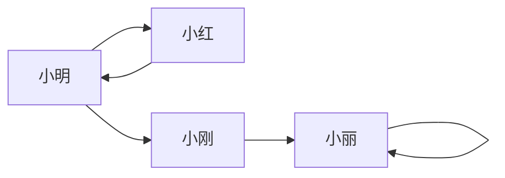
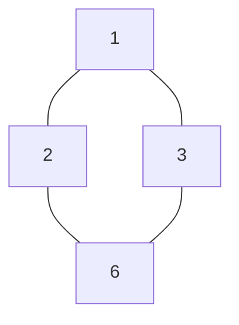

# 关系与函数

关系和函数是程序员每天都在用的东西，只是平时没人点破：数据库里的一张关联表、一个 `Map<K, V>`、一次“先修课没修完就不能选这门课”的校验，背后都是关系与函数。这篇不用教材腔，全部用生活例子讲，每一步都算给你看。

## 基础知识

### 关系是什么：先从“序偶”说起

**序偶**就是一个“有顺序的两个人一组”，写成 `(a, b)`。顺序很重要：`(小明, 数学)` 和 `(数学, 小明)` 不是一回事，就像 `(出发站, 到达站)` 和 `(到达站, 出发站)` 是两条相反的线路。

**从集合 A 到集合 B 的关系**，就是 A 里的元素和 B 里的元素之间“有联系”的那些序偶，全部收集起来形成的一个集合。记作 `R ⊆ A × B`，其中 `A × B` 是 A 和 B 的笛卡尔积，也就是所有可能配对的集合。

生活例子：3 个学生选 2 门课。

- 学生集合 `A = {小明, 小红, 小刚}`，课程集合 `B = {数学, 英语}`。
- 选课情况：小明选了数学和英语，小红只选了数学，小刚只选了英语。
- 所有可能的配对一共 `3 × 2 = 6` 个：`(小明, 数学)`、`(小明, 英语)`、`(小红, 数学)`、`(小红, 英语)`、`(小刚, 数学)`、`(小刚, 英语)`。
- 真正发生的选课关系只有 4 个序偶：

```
R = {(小明, 数学), (小明, 英语), (小红, 数学), (小刚, 英语)}
```

数一数：6 个可能里只出现了 4 个，`(小红, 英语)` 和 `(小刚, 数学)` 不在关系里，因为这两人没选那门课。关系就是“从所有可能配对中挑出真实存在的那一部分”。数据库里的选课表其实就是这个关系的一张表，每一行就是一个序偶。

### 关系的三种表示法

同一个关系，有三种写法，写代码时三种都用得上。

**1. 集合列举法**：直接把所有序偶列出来，适合关系很小的时候。

```
R = {(1, 2), (2, 1), (2, 3)}
```

**2. 关系矩阵**：行是 A 的元素，列是 B 的元素，有关系就填 1，没关系填 0。

小例子：`A = {1, 2}`，`B = {a, b}`，`R = {(1, a), (2, a), (2, b)}`。

|     | a   | b   |
| --- | --- | --- |
| 1   | 1   | 0   |
| 2   | 1   | 1   |

一行一行读：第一行 `(1, a)` 在、`(1, b)` 不在，所以是 `1, 0`；第二行两个都在，所以是 `1, 1`。矩阵里 1 的个数正好等于关系里序偶的个数，这里是 3 个。写代码时这就是邻接矩阵，`matrix[i][j] == 1` 就是“i 和 j 有关系”。

**3. 有向图**：画点、画箭头。每个元素是一个节点，`(a, b)` 在关系里就画一条从 a 指向 b 的箭头。

下面是一个具体的有向图例子。集合 `A = {小明, 小红, 小刚, 小丽}`，关系是“谁给谁发过消息”：



读图方法：箭头从谁出发、指向谁，就表示序偶 `(出发点, 指向点)`。这张图对应的关系是：

```
R = {(小明, 小红), (小明, 小刚), (小红, 小明), (小刚, 小丽), (小丽, 小丽)}
```

一共 5 条边、5 个序偶。注意 `(小丽, 小丽)` 是画在自己身上的一个圈，叫自环，表示小丽给自己发过消息（比如文件传输助手那种）。有向图一眼就能看出谁是“消息中心”：小明的出边最多，是最活跃的发送者。

## 原理剖析

### 自反、对称、反对称、传递：四个性质

设关系 R 定义在同一个集合 A 上（也就是 A 到 A 的关系），有四个最常见的性质。每个性质都先给生活例子，再给一个反例。

**1. 自反：每个人和自己都有关系。**

定义：对 A 里每一个元素 a，`(a, a)` 都在 R 里。

- 生活例子：“和自己同龄”。每个人和自己当然同龄，所以 `(小明, 小明)`、`(小红, 小红)`……全在关系里，自反成立。
- 反例：“是……的同班同学，但不算自己”。小明和小明不能算“同班同学”里的两个人，`(小明, 小明)` 不在关系里，所以不自反。

**2. 对称：关系是双向的。**

定义：只要 `(a, b)` 在 R 里，`(b, a)` 也一定在 R 里。

- 生活例子：微信“互为好友”。小明是小红的好友，小红就一定是小明的好友，双向成立，对称。
- 反例：微信“关注”。你关注了阿强，阿强不一定关注你，`(你, 阿强)` 在而 `(阿强, 你)` 不在，所以关注关系不对称。

**3. 反对称：双向成立时，两边必须是同一个人。**

定义：只要 `(a, b)` 和 `(b, a)` 都在 R 里，就一定有 `a = b`。

- 生活例子：“年龄小于等于”。小明的年龄 ≤ 小红的年龄，同时小红的年龄 ≤ 小明的年龄，那两人年龄一定相等。推广到集合元素本身就是 `a = b`。注意反对称不要求 `(a, b)` 存在，它只管“如果双向都存在会怎样”。
- 反例：“互为好友”。小明和小红互为好友，`(小明, 小红)` 和 `(小红, 小明)` 都在，但小明 ≠ 小红，所以互为好友不是反对称的。

**4. 传递：关系可以“接力”。**

定义：只要 `(a, b)` 和 `(b, c)` 都在 R 里，`(a, c)` 也一定在 R 里。

- 生活例子：“年龄小于”。小明比小红小，小红比小刚小，那小明一定比小刚小，传递成立。
- 反例：“是……的父亲”。小明是小红的父亲，小红是小刚的父亲，但小明是小刚的爷爷不是父亲，`(小明, 小刚)` 不在“父亲”关系里，所以不传递。

### 一个小集合，逐条判定四个性质

取 `A = {1, 2, 3}`，关系：

```
R = {(1, 1), (2, 2), (3, 3), (1, 2), (2, 1)}
```

一步一步判定：

**自反？** 需要 `(1, 1)`、`(2, 2)`、`(3, 3)` 全在。查表：三个都在。结论：自反，成立。

**对称？** 需要每个序偶反过来也在。`(1, 1)` 反过来还是 `(1, 1)`，在；`(2, 2)`、`(3, 3)` 同理；`(1, 2)` 反过来是 `(2, 1)`，在；`(2, 1)` 反过来是 `(1, 2)`，在。全部通过。结论：对称，成立。

**反对称？** 需要“双向都在 ⇒ 两边相等”。`(1, 2)` 和 `(2, 1)` 都在，但 `1 ≠ 2`，违反了要求。结论：反对称，不成立。

**传递？** 需要所有能接力的组合都接得上。逐个检查：

- `(1, 2)` 接 `(2, 1)`，需要 `(1, 1)`：在。
- `(1, 2)` 接 `(2, 2)`，需要 `(1, 2)`：在。
- `(2, 1)` 接 `(1, 2)`，需要 `(2, 2)`：在。
- `(2, 1)` 接 `(1, 1)`，需要 `(2, 1)`：在。
- 其余组合都以 `(a, a)` 开头或结尾，接力后还是原来的序偶，全部在。

没有一处断链。结论：传递，成立。

### 关系的运算：逆关系与复合

**逆关系**就是把所有序偶反过来。`R = {(1, a), (2, b)}` 的逆关系是 `R⁻¹ = {(a, 1), (b, 2)}`。生活里：选课关系的逆关系就是“这门课被谁选了”。有向图上就是把所有箭头反向。

**关系的复合**是“接力”：先走 R，再走 S。记作 `S ∘ R`，读作“S 复合 R”，注意顺序是先 R 后 S，就像先坐第一班车、再换乘第二班车。

小例子，逐步算。快递中转：

- `R`：包裹从仓库到中转站，`R = {(包裹1, 站A), (包裹2, 站B)}`。
- `S`：从中转站到目的地，`S = {(站A, 北京), (站B, 上海)}`。
- 求 `S ∘ R`：找中间能对上的。
  - 第 1 步：`(包裹1, 站A)` 在 R 里，`(站A, 北京)` 在 S 里，中间 `站A` 对上了，得到 `(包裹1, 北京)`。
  - 第 2 步：`(包裹2, 站B)` 在 R 里，`(站B, 上海)` 在 S 里，中间 `站B` 对上了，得到 `(包裹2, 上海)`。
  - 第 3 步：没有其他能对上的组合了。
- 结果：`S ∘ R = {(包裹1, 北京), (包裹2, 上海)}`。

## 进阶知识

### 等价关系与划分：把东西分成不重不漏的几堆

同时满足**自反、对称、传递**三个性质的关系，叫**等价关系**。等价关系的作用就是“分组”：互相等价的元素分到同一组。

**等价类**：和某个元素 a 等价的所有元素，组成 a 的等价类，记作 `[a]`。**商集**就是所有等价类组成的集合，记作 `A/R`。

生活例子一：按年级分班。集合是全校学生，关系是“同年级”。小明和小红同年级就分到一组，一年级、二年级、三年级……每个年级就是一个等价类，所有年级合起来就是商集。每个学生恰好属于一个年级，不多不少。

生活例子二：按血型分组。关系是“血型相同”。A 型血的同学一组，B 型一组，O 型一组，AB 型一组。血型相同满足自反（自己和自己同血型）、对称（你和我同血型，我和你也同）、传递（你和我同，我和他同，则你和他同），所以是等价关系。

具体算一个。取 `A = {1, 2, 3, 4, 5, 6}`，关系是“除以 3 余数相同”，即 `a ~ b` 当且仅当 `a - b` 能被 3 整除。先算每个数的余数：

| 元素 | 1 | 2 | 3 | 4 | 5 | 6 |
| --- | --- | --- | --- | --- | --- | --- |
| 除以 3 的余数 | 1 | 2 | 0 | 1 | 2 | 0 |

余数相同的分到一组：

- `[1] = {1, 4}`（余数都是 1）
- `[2] = {2, 5}`（余数都是 2）
- `[3] = {3, 6}`（余数都是 0）

商集 `A/R = {{1, 4}, {2, 5}, {3, 6}}`。验算三点：三组加起来 `2 + 2 + 2 = 6`，正好是 A 的元素个数；任意两组没有公共元素；没有元素被漏掉。这就是**划分**的三个要求：每组非空、组与组不相交、所有组并起来等于全集。等价关系和划分是一一对应的：给一个等价关系就得到一种划分，给一种划分也能反过来定义一个等价关系（同一组里的元素互相等价）。

### 偏序关系与哈斯图

同时满足**自反、反对称、传递**三个性质的关系，叫**偏序关系**，记作 `≤`。注意偏序要求的是反对称，不是等价关系里的对称，两者不要混。

生活例子：课程先修关系。“学完 A 才能学 B”就是一种偏序：每门课自己先修自己（自反，形式上成立）、A 先修 B 且 B 先修 A 时 A 和 B 是同一门课（反对称）、A 先修 B、B 先修 C 则 A 先修 C（传递）。再比如“年龄小于等于”“集合的包含关系 ⊆”，都是偏序。

**哈斯图**是偏序的可视化画法，规则三条：

1. 只画“直接盖住”的边：`a < b` 且中间没有别的元素时才连线，间接的边省略。
2. 下面小、上面大：位置越靠上，元素越大。
3. 不画自环和箭头：自反的 `(a, a)` 不画，方向默认自下而上。

现在在集合 `{1, 2, 3, 6}` 上画“整除关系”的哈斯图。先把全部 9 个序偶列出来：

```
(1,1), (1,2), (1,3), (1,6), (2,2), (2,6), (3,3), (3,6), (6,6)
```

数法：1 能整除 4 个数（1、2、3、6），2 能整除 2 个（2、6），3 能整除 2 个（3、6），6 只能整除自己，`4 + 2 + 2 + 1 = 9`。

再找“直接盖住”的边：`1 → 2`（中间没别人）、`1 → 3`、`2 → 6`、`3 → 6`。`(1, 6)` 不画，因为中间隔着 2 和 3，已经能通过接力到达。哈斯图如下：



读图：1 在最底层，2 和 3 并排在中间层，6 在最顶层。2 和 3 之间没有线，说明它们互相整除不了。

### 极大/极小元、最大/最小元、上界/下界

还在 `{1, 2, 3, 6}` 这个整除偏序里找，先说清四个概念的区别：

- **极大元**：没有比它更大的元素（不要求它比所有元素都大）。
- **最大元**：比所有元素都大，全集里最多一个。
- **极小元**：没有比它更小的元素。
- **最小元**：比所有元素都小，全集里最多一个。
- **上界**：某个子集里所有元素的“天花板”，不一定在子集里。
- **下界**：某个子集里所有元素的“地板”，不一定在子集里。

对整个集合 `{1, 2, 3, 6}`：

- 最大元是 6：`1 | 6`、`2 | 6`、`3 | 6`、`6 | 6`，6 比所有人都大。极大元也是 {6}，只有它头顶没人。
- 最小元是 1：1 整除所有人，1 比所有人都小。极小元也是 {1}。

再看子集 `{2, 3}`（注意子集里只有 2 和 3）：

- 上界：找能整除 2 又能整除 3 的元素。6 可以（`2 | 6` 且 `3 | 6`），所以上界是 {6}。2 不行，因为 2 整除不了 3；3 也不行。
- 下界：找能被 2 和 3 同时整除的“约数”。1 可以（`1 | 2` 且 `1 | 3`），所以下界是 {1}。
- 子集 `{2, 3}` 里没有最大元、也没有最小元：2 和 3 谁也整除不了谁。但极大元是 {2, 3} 两个（都没人比它们大），极小元也是 {2, 3} 两个。

### 函数：一种特殊的关系

**函数**是特殊的关系：每个输入恰好对应一个输出。形式化地说，`f: A → B` 是函数，当且仅当对 A 里的每个 a，都有唯一的 b 使得 `(a, b)` 在 f 里。

- **定义域**：所有输入的集合，也就是 A。
- **值域**：所有真正被输出到的值的集合，是 B 的子集，不一定等于 B。
- **陪域**：B 本身，值域 ⊆ 陪域。

生活例子：电影评分。输入是观众，输出是 1 到 5 星的评分。每个观众只能给一部电影打一个分数（不能同时打 3 星又打 5 星），这就是函数。定义域是所有打分观众，值域是实际出现过的星级（比如 {3, 4, 5}，没人打 1 星和 2 星，值域就不含它们）。

反例：选课关系不是函数。小明选了数学和英语，一个输入对应两个输出，违反了“恰好一个输出”的要求。关系是“多对多也可以”，函数是“每个输入只能有一个输出”。

### 单射、满射、双射

**单射**（一对一）：不同的输入，输出一定不同。**满射**（映上）：值域等于陪域，每个输出都有人对应。**双射**：既单射又满射。

生活例子一：座位号。电影院每张票对应一个座位号，不同的票座位号不同（单射）；但如果有空座位没卖出去，就有座位号没人对应，不是满射。

生活例子二：身份证号。每个中国公民恰好一个身份证号，不同的人身份证号不同（单射）；但并不是每个 18 位数字串都是某个人的身份证号（满射不成立）。

生活例子三：学号。学校给每个学生发一个学号，学号从 001 编到 100，恰好 100 个学生：不同学生学号不同（单射），每个学号都有学生（满射），所以是双射。

逐个验证一个小例子。设 `A = {1, 2, 3}`，`B = {a, b, c}`，`f = {(1, a), (2, b), (3, c)}`：

- 单射？输出 a、b、c 各出现一次，没有重复，成立。
- 满射？B 里的 a、b、c 都有人对应，值域 `{a, b, c} = B`，成立。
- 所以 f 是双射。

再看 `g = {(1, a), (2, a), (3, b)}`，`B = {a, b, c}`：

- 单射？1 和 2 都输出 a，重复了，不成立。
- 满射？c 没人对应，值域 `{a, b} ≠ B`，不成立。
- 所以 g 既不是单射也不是满射。

### 函数的复合与逆函数

**函数的复合**就是“流水线”：先算 f，再把结果喂给 g，记作 `g ∘ f`。

小例子逐步算。`f(x) = x + 1`，`g(x) = 2x`，求 `(g ∘ f)(3)`：

- 第 1 步：先算 f，`f(3) = 3 + 1 = 4`。
- 第 2 步：把 4 喂给 g，`g(4) = 2 × 4 = 8`。
- 结果：`(g ∘ f)(3) = 8`。

注意顺序不能反：`(f ∘ g)(3)` 是先 `g(3) = 6`，再 `f(6) = 7`，结果是 7，不是 8。复合一般不满足交换律，就像“先穿袜子再穿鞋”和“先穿鞋再穿袜子”完全是两回事。

**逆函数**存在的条件：函数必须是**双射**。只有双射才能把输出唯一地倒推回输入。

- 双射的例子：`f(x) = x + 1`，逆函数是 `f⁻¹(x) = x - 1`，因为每个输出都恰好来自一个输入。
- 不是双射就没逆函数：`f(x) = x²` 在全体实数上不是单射（`2` 和 `-2` 都输出 4），收到输出 4 时不知道输入是 2 还是 -2，倒推不唯一，所以没有逆函数。把定义域限制在 `x ≥ 0` 上，它变成双射了，逆函数才存在，`f⁻¹(x) = √x`。

## 疑难杂症

### 误区一：关系与函数混淆

函数是特殊的关系，不是关系的同义词。关系允许一个输入对应多个输出（小明选两门课），函数不允许。判断时只问一句：“每个输入的输出唯一吗？”唯一就是函数，不唯一就只是关系。`Map<K, V>` 是函数，`Map<K, List<V>>` 本质上是关系。

### 误区二：对称与反对称不是非此即彼

很多人以为一个关系要么对称、要么反对称，错。两者可以同时成立，也可以同时不成立：

- 同时成立：相等关系 `=`。`(a, b)` 在当且仅当 `a = b`，反过来也在（对称）；双向都在时 `a = b`（反对称）。
- 同时不成立：取 `A = {1, 2, 3}`，`R = {(1, 2), (2, 3)}`。对称吗？`(1, 2)` 在但 `(2, 1)` 不在，不对称。反对称吗？没有双向都存在的序偶，咋一看好像没违反……换一个更直接的反例：`R = {(1, 2), (2, 1), (2, 3)}`。对称不成立（缺 `(3, 2)`），反对称也不成立（`(1, 2)` 和 `(2, 1)` 都在但 `1 ≠ 2`）。所以“不对称”不等于“反对称”，判定要分开算。

### 误区三：偏序里的“可比”不是任意两个元素都可比

偏序只要求“部分”元素能比大小，名字里的“偏”就是这个意思。`{1, 2, 3, 6}` 的整除偏序里，2 和 3 就是不可比的：`2 ∤ 3` 且 `3 ∤ 2`。只有当任意两个元素都可比时，才叫**全序**（比如数字的大小关系）。哈斯图里同一层、没有连线的两个节点，就是不可比的典型样子。写排序逻辑时要小心：偏序只能做拓扑排序，不能直接丢给比较器当全序用。

## 实战案例

### 案例一：用关系矩阵查“谁关注了谁”

一个 3 人小群，关注关系矩阵如下（行是关注者，列是被关注者）：

|     | 小明 | 小红 | 小刚 |
| --- | ---- | ---- | ---- |
| 小明 | 0    | 1    | 1    |
| 小红 | 1    | 0    | 0    |
| 小刚 | 0    | 0    | 0    |

读法：小明关注了小红和小刚（第一行 `0, 1, 1`）；小红只关注了小明；小刚谁也没关注。互关的判断：看矩阵是否沿对角线对称。`(小明, 小红) = 1` 且 `(小红, 小明) = 1`，两人互关；`(小明, 小刚) = 1` 但 `(小刚, 小明) = 0`，单向关注。写代码时这就是“互关检测”：`matrix[i][j] == 1 && matrix[j][i] == 1`。

### 案例二：课程先修关系的拓扑排序

四门课的先修关系：学《数据结构》前要先学《编程基础》，学《算法》前要先学《数据结构》，学《数据库》前要先学《编程基础》。《数据库》和《数据结构》之间没有先修要求，两者不可比。

画成哈斯图（下层是先修课）：《编程基础》在最底层，《数据结构》和《数据库》在中间层，《算法》在最顶层。拓扑排序就是从下往上排：先《编程基础》，然后《数据结构》和《数据库》顺序任意，最后《算法》。一种合法顺序是：编程基础 → 数据结构 → 数据库 → 算法；另一种是：编程基础 → 数据库 → 数据结构 → 算法。两种都合法，因为不可比的课顺序可以换。排课系统、构建工具的任务依赖，算的都是这个。

### 案例三：用等价类给用户分组做灰度发布

要给 6 个用户按“注册年份的奇偶”分组做灰度：用户编号 1 到 6，关系是“注册年份奇偶相同”。算余数：奇数年用户 {1, 3, 5}，偶数年用户 {2, 4, 6}。两个等价类就是两个灰度组，先给奇数组推新功能，观察一周没问题再推偶数组。等价类的好处是分组不重不漏：每个用户恰好在一个组里，不会有人被推两次，也不会有人被漏掉。

## 面试与自测

1. 设 `A = {1, 2}`，`B = {x, y}`，关系 `R = {(1, x), (2, x), (2, y)}`。请写出 R 的关系矩阵，并判断 R 是不是从 A 到 B 的函数，说明理由。
2. 设集合 `A = {1, 2, 3}` 上的关系 `R = {(1, 1), (2, 2), (1, 2)}`。请逐条判定 R 是否自反、对称、反对称、传递。
3. 把 `{1, 2, 3, 4, 5, 6}` 按“除以 3 的余数相同”划分，写出全部等价类和商集，并验证三组的元素个数之和等于 6。
4. 在 `{1, 2, 3, 6}` 的整除偏序中，子集 `{2, 3}` 的上界、下界、极大元、极小元各是什么？它有没有最大元和最小元？

### 参考答案

1. 矩阵（行是 1、2，列是 x、y）：第一行 `1, 0`，第二行 `1, 1`，即 `[[1, 0], [1, 1]]`。R 不是函数：输入 2 同时对应 x 和 y 两个输出，违反了“每个输入恰好一个输出”的要求。
2. 自反：不成立，缺 `(3, 3)`。对称：不成立，`(1, 2)` 在但 `(2, 1)` 不在。反对称：成立，没有“双向都在但两边不同”的情况（只有 `(1, 2)` 单向存在）。传递：成立，能接力的只有 `(1, 1)` 接 `(1, 2)` 得到 `(1, 2)`（在）、`(1, 2)` 接 `(2, 2)` 得到 `(1, 2)`（在），没有断链。
3. 等价类：`[1] = {1, 4}`，`[2] = {2, 5}`，`[3] = {3, 6}`；商集 `{{1, 4}, {2, 5}, {3, 6}}`。验证：`2 + 2 + 2 = 6`，等于原集合元素个数，且三组互不相交、并起来是全集。
4. 上界是 {6}，下界是 {1}，极大元是 {2, 3}，极小元是 {2, 3}；没有最大元（2 和 3 谁也整除不了谁），也没有最小元（同理）。

## 小技巧与冷知识

- **画图先于算数**：判定性质或算复合之前，先把有向图画出来。自反看有没有自环，对称看箭头是不是成双成对，传递看能不能顺着箭头走两步到达，图上看一眼比对着序偶表硬算快得多。
- **复合的顺序口诀是“先右后左”**：`S ∘ R` 先走 R 再走 S，写代码时对应 `s(r(x))`，函数调用的嵌套顺序和复合符号的书写顺序正好相反，记住这一点能少踩一半的坑。
- **等价关系 = 分组神器**：凡是“把东西分成不重不漏的几堆”的需求（按年级分班、按血型分组、按奇偶灰度），背后都是等价关系。先验证自反、对称、传递，再分组，分组结果一定干净。
- **哈斯图省略的三样东西**：自环（自反）、间接边（传递能推出来的）、箭头（默认向上）。记住这三条，哈斯图就不会画多余的线。
- **冷知识**：空关系（一个序偶都没有）在任何集合上都是对称、反对称、传递的，但只要集合非空它就不是自反的——因为 `(a, a)` 一个都没有。对称和反对称能同时成立，最极端的例子就是空关系和相等关系。

## 关联知识

- [集合论基础](计算机基础/数学/集合论基础.md)
- [数理逻辑基础](计算机基础/数学/数理逻辑基础.md)
- [图论基础](计算机基础/数学/图论基础.md)
- [数据结构与算法](计算机基础/算法/数据结构与算法.md)
