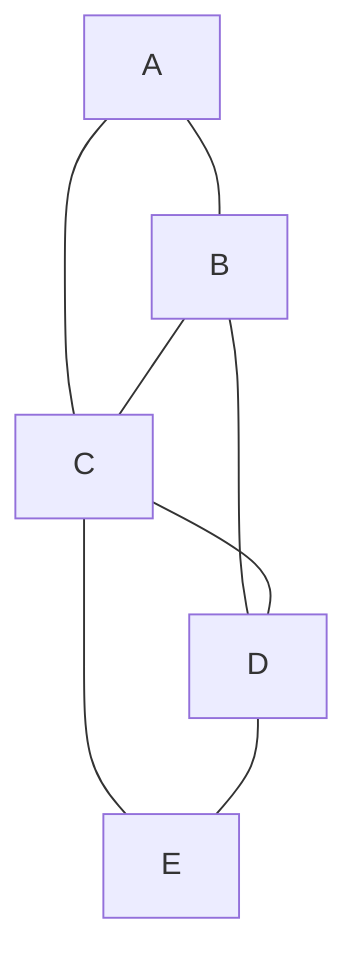
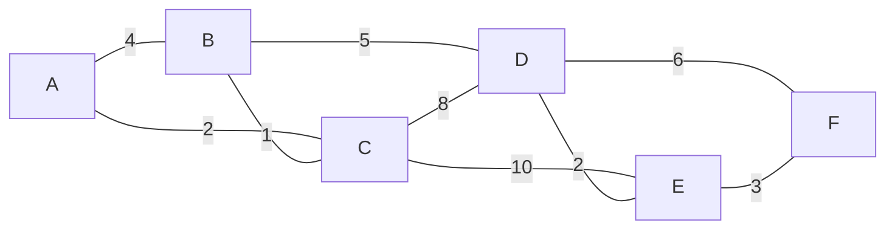
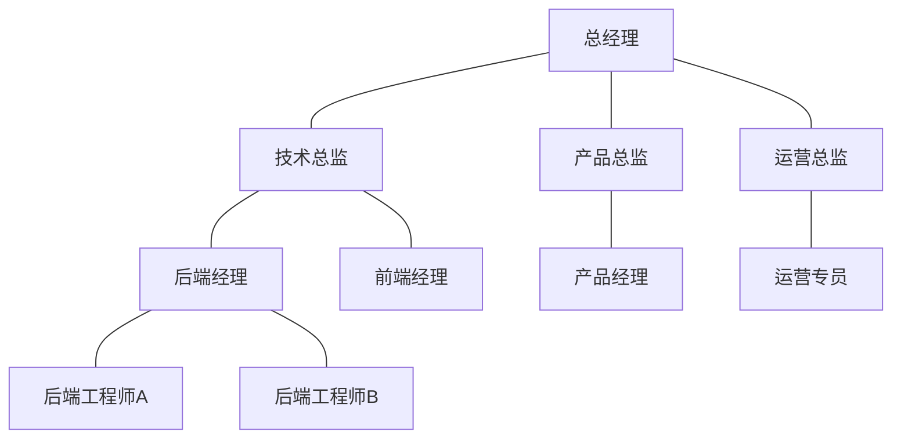

# 图论基础

<!-- TOC -->
- [基础知识](#基础知识)
  - [图是什么：顶点和边](#图是什么顶点和边)
  - [无向图与有向图](#无向图与有向图)
  - [权重：边上的数字](#权重边上的数字)
  - [度：一个顶点连了几条边](#度一个顶点连了几条边)
  - [握手定理：度数之和等于边数的 2 倍](#握手定理度数之和等于边数的-2-倍)
  - [路径、回路、连通](#路径回路连通)
  - [连通分支：图被分成了几块](#连通分支图被分成了几块)
- [原理剖析](#原理剖析)
  - [欧拉路径与欧拉回路：七桥问题](#欧拉路径与欧拉回路七桥问题)
  - [两个小图，逐个判定能不能一笔画](#两个小图逐个判定能不能一笔画)
  - [哈密顿路径：每个站点只经过一次](#哈密顿路径每个站点只经过一次)
  - [树：没有回路的连通图](#树没有回路的连通图)
  - [树的关键数字：n 个顶点恰好 n-1 条边](#树的关键数字n-个顶点恰好-n-1-条边)
  - [生成树：从图里挑一棵树出来](#生成树从图里挑一棵树出来)
- [进阶知识](#进阶知识)
  - [最短路径：Dijkstra 算法](#最短路径dijkstra-算法)
  - [图的表示：邻接矩阵与邻接表](#图的表示邻接矩阵与邻接表)
  - [一棵树的样子：公司组织架构](#一棵树的样子公司组织架构)
- [疑难杂症](#疑难杂症)
  - [边数与度数混淆](#边数与度数混淆)
  - [欧拉与哈密顿混淆](#欧拉与哈密顿混淆)
  - [树不一定是“长得像树”的图](#树不一定是长得像树的图)
  - [有向图的度数要分开数](#有向图的度数要分开数)
- [实战案例](#实战案例)
  - [社交网络好友推荐：共同好友](#社交网络好友推荐共同好友)
  - [地图导航：最短路径](#地图导航最短路径)
  - [地铁换乘：最少换乘与最短时间](#地铁换乘最少换乘与最短时间)
  - [快递配送路线：哈密顿路径的影子](#快递配送路线哈密顿路径的影子)
- [面试与自测](#面试与自测)
  - [参考答案](#参考答案)
- [小技巧与冷知识](#小技巧与冷知识)
- [关联知识](#关联知识)
<!-- /TOC -->

图论听起来像数学课，其实你每天都在用它：查地铁换乘、看微信好友、点外卖等骑手、寄快递查路线，背后都是一张图。这一篇不用高等数学的讲法，只用生活案例和一步步的算数，把图讲清楚。读者只需要会四则运算。

## 基础知识

### 图是什么：顶点和边

一张图由两样东西组成：**顶点**和**边**。
- **顶点（Vertex）**：图里的一个点，代表一个东西，比如一个地铁站、一个人、一个快递站点。
- **边（Edge）**：连接两个顶点的线，代表它们之间的关系，比如两个地铁站之间有直达车、两个人是好友、两个站点之间有路。
生活例子：地铁线路图就是一张图。每个地铁站是一个顶点，相邻两个站之间的一段轨道是一条边。你在地铁图上找换乘路线，本质上就是在图上找一条从起点到终点的路。

### 无向图与有向图
- **无向图**：边没有方向。微信好友就是无向图：你和朋友互为好友，这条边从哪边看都一样。地铁相邻两站之间也可以双向坐车，同样是无向边。
- **有向图**：边有方向，只能单向走。微博的关注就是有向图：你关注了某个人，不代表那个人关注了你。单行道也是有向边：这条路只能从 A 开到 B，不能反向开。

一句话区分：关系能不能反过来？能反过来就是无向，不能就是有向。

### 权重：边上的数字
**权重（Weight）** 是边上的一个数字，表示这条边的代价：距离、时间、费用都可以。
生活例子：外卖骑手取餐，地图上有三条路到商家，分别是 800 米、1200 米、1500 米。这三个数字就是三条边的权重。骑手当然选 800 米那条。没有权重的图只关心“能不能到”，有权重的图还要关心“哪条路最省”。
再比如地铁图：如果只画站和站之间的连线，就是无权图；如果在每段轨道上标出“坐 2 分钟”“坐 3 分钟”，就是带权图。导航软件算最快路线，算的就是带权图。

### 度：一个顶点连了几条边

**度（Degree）** 是一个顶点连了多少条边。数一数从这个顶点伸出去几条线，就是它的度。
生活例子：微信好友网络里，你的好友数就是你的度。你有 120 个好友，你的度就是 120。地铁站里，一个站连了几条线路、能通向几个方向，就是这个站的度。换乘大站度大，普通小站度小。
有向图里度要分开数：
- **出度**：从这个顶点出去的边有几条。比如你关注了 80 个人，你的出度是 80。
- **入度**：指向这个顶点的边有几条。比如有 200 个人关注你，你的入度是 200。
出度是你主动连出去的，入度是别人连向你的。一个顶点的总度数等于入度加出度。

### 握手定理：度数之和等于边数的 2 倍

**握手定理**：一张图里，所有顶点的度数加起来，等于边数的 2 倍。
为什么？因为每条边有两个端点，数度数的时候这条边会被数两次：起点数一次，终点数一次。所以总度数一定是边数的 2 倍。
生活例子：5 个人互相握手，每握一次手就产生一条边。如果一共握了 7 次手，5 个人的握手次数加起来一定是 14 次，不可能是 13 次或 15 次。
下面用一个 5 个顶点、7 条边的小图一步步验证。顶点是 A、B、C、D、E，边是 A-B、A-C、B-C、B-D、C-D、C-E、D-E。

逐个顶点数度数：
- A 连了 A-B、A-C，共 2 条，度是 2。
- B 连了 A-B、B-C、B-D，共 3 条，度是 3。
- C 连了 A-C、B-C、C-D、C-E，共 4 条，度是 4。
- D 连了 B-D、C-D、D-E，共 3 条，度是 3。
- E 连了 C-E、D-E，共 2 条，度是 2。

求和：2 + 3 + 4 + 3 + 2 = 14。
边数是 7，2 × 7 = 14。两边相等，握手定理验证通过。这个定理以后可以用来快速检查：你数出来的度数之和如果是奇数，一定数错了，因为 2 倍边数永远是偶数。

### 路径、回路、连通
- **路径（Path）**：从一个顶点出发，沿着边走到另一个顶点，经过的顶点和边的序列。比如地铁从 A 站坐到 D 站，中间经过 B 站、C 站，A → B → C → D 就是一条路径。
- **回路（Cycle）**：起点和终点是同一个顶点的路径，走了一圈回到原地。比如你从家出发，路过超市、公园，最后又回到家，这就是一条回路。
- **连通（Connected）**：无向图里任意两个顶点之间都有路可走，这张图就是连通的。地铁网如果任意两站之间都能换乘到达，就是连通的。

生活例子：微信好友链。你想认识一个陌生人，常常是“我朋友的朋友认识他”。你 → 朋友甲 → 朋友乙 → 陌生人，这就是一条长度为 3 的路径。好友网络越大，这样的链越容易接上。

### 连通分支：图被分成了几块
如果一张图不是连通的，它会被分成几个互不相连的部分，每个部分叫一个**连通分支**。
生活例子：一个城市的地铁网如果分成了两块，中间没有任何换乘站连接，那它就有 2 个连通分支，乘客没法从一块坐到另一块，只能出站换交通工具。微信里如果有两个完全没有共同好友的圈子，各自内部能互相找到，圈子之间找不到，这就是 2 个连通分支。
连通分支数是 1，就是整张图连通；大于 1，就是图被分成了几块。

## 原理剖析

### 欧拉路径与欧拉回路：七桥问题

欧拉路径的故事要从 1736 年的七桥问题说起。哥尼斯堡城里有一条河，河上有两座小岛，河岸和岛之间一共有 7 座桥。当地人问：能不能走一条路线，每座桥只走一次，最后回到出发点？很多人试了很久都没走通。
数学家欧拉把陆地看成顶点，把桥看成边，画出了一张图。他发现，问题能不能走通，只看一种特殊的顶点：**奇点**，也就是度数为奇数的顶点。
判定条件很简单，只有两句话：

- **欧拉回路**：每条边恰好走一次，最后回到起点。条件是奇点个数为 0，也就是所有顶点的度数都是偶数。
- **欧拉路径**：每条边恰好走一次，不要求回到起点。条件是奇点个数为 2，这两个奇点一个是起点，一个是终点。
合起来说：奇点个数是 0 或 2，就能一笔画；奇点个数是其他数字，就不能一笔画。
为什么？走进一个顶点就要走出来，进来一条边、出去一条边，中间经过的顶点度数一定是偶数。只有起点（只出去）和终点（只进来）可以是奇数。所以奇点最多只能有 2 个。
七桥问题里，4 块陆地的度数分别是 3、3、3、5，全是奇数，奇点个数是 4。4 既不是 0 也不是 2，所以每座桥只走一次的路线不存在。当地人走不通，不是因为没找到窍门，而是根本不存在这样的路线。

### 两个小图，逐个判定能不能一笔画

**图一：正方形加一条对角线。** 顶点 A、B、C、D，边是 A-B、B-C、C-D、D-A、A-C，共 5 条边。
逐个算度数：

- A 连了 A-B、D-A、A-C，度是 3，奇点。
- B 连了 A-B、B-C，度是 2，偶点。
- C 连了 B-C、C-D、A-C，度是 3，奇点。
- D 连了 C-D、D-A，度是 2，偶点。

奇点是 A 和 C，共 2 个。结论：有欧拉路径，可以一笔画，但没有欧拉回路。必须从 A 出发到 C 结束，或者从 C 出发到 A 结束。
**图二：正方形加两条对角线。** 顶点 A、B、C、D，边是 A-B、B-C、C-D、D-A、A-C、B-D，共 6 条边。
逐个算度数：

- A 连了 A-B、D-A、A-C，度是 3，奇点。
- B 连了 A-B、B-C、B-D，度是 3，奇点。
- C 连了 B-C、C-D、A-C，度是 3，奇点。
- D 连了 C-D、D-A、B-D，度是 3，奇点。
奇点共 4 个。结论：既没有欧拉路径，也没有欧拉回路，不能一笔画。画到最后一定会有一条边重复走，或者有一条边走不到。

### 哈密顿路径：每个站点只经过一次

**哈密顿路径**：经过图中每个顶点恰好一次的路径。
生活例子：快递员一天要送 6 个站点。公司要求他每个站点只去一次，不要重复跑，也不要漏掉。他的路线就是一条哈密顿路径：6 个站点每个恰好出现一次。
外卖骑手取餐也是同理：一次要去 3 家店取餐，3 家店每家只去一次，走一条不重复的路线，就是哈密顿路径。
注意哈密顿路径只讲概念，这里不讲判定算法。它和欧拉路径容易混淆，但要求完全不同：

- 欧拉路径要求每条**边**恰好走一次，顶点可以重复经过。
- 哈密顿路径要求每个**顶点**恰好经过一次，边不用全部走完。

一个管边，一个管顶点。这是后面疑难杂症里要重点辨析的一对概念。

### 树：没有回路的连通图
**树（Tree）** 是满足两个条件的图：连通，而且没有回路。没有回路的意思是，任意两个顶点之间只有一条路可走，没有第二条路可以绕回来。
生活例子：公司组织架构就是一棵树。总经理下面有 3 个总监，每个总监下面有几个经理，经理下面是员工。从总经理到任何一个员工，只有唯一一条汇报线，没有第二条线。如果你发现一个员工同时向两个经理汇报，那就不是树，因为出现了第二条路。
文件目录也是一棵树。根目录下面有文件夹，文件夹下面有子文件夹和文件。从根目录到任何一个文件，路径只有一条。你不会在文件目录里绕一圈又回到原地，因为没有回路。

### 树的关键数字：n 个顶点恰好 n-1 条边

树有一个很好记的数字规律：**n 个顶点的树，恰好有 n-1 条边**。
用 n = 5 的小例子验证。5 个顶点，树应该有 5 - 1 = 4 条边。
取 5 个顶点 A、B、C、D、E，边是 A-B、A-C、C-D、C-E，共 4 条边。检查两个条件：

- 连通吗？A 能到 B、C，C 能到 D、E，所以任意两点之间都有路，是连通的。
- 有回路吗？从 A 出发到 D 只有 A → C → D 一条路，没有第二条路绕回来，没有回路。
所以这是一棵树，边数正好是 4。反过来也可以想：再加一条边，比如加 B-D，就会多出一条路 A → B → D 和 A → C → D，出现回路，就不是树了；少一条边，比如去掉 C-E，E 就断开了，图不连通，也不是树了。

### 生成树：从图里挑一棵树出来

**生成树（Spanning Tree）** 是从一张连通图里挑出来的树，它包含原图的全部顶点，但只保留一部分边，刚好够把所有顶点连起来，不多也不少。
生活例子：一个小区有 6 栋楼，楼与楼之间本来有很多条小路。物业想铺设光纤，要求每栋楼都能连通，但铺的线越少越省钱。挑出来的最省线的连通方案，就是这张图的生成树：6 个顶点，恰好 5 条边。
地铁网里也可以挑生成树：保留最核心的换乘连接，砍掉重复的绕行线路，剩下的骨架就是一棵生成树。它保证所有站都连通，但没有一条多余的边。

## 进阶知识

### 最短路径：Dijkstra 算法
最短路径问题是：带权图里，从起点出发，到每个顶点最便宜、最短的路是多少？地图导航算的就是这个。
**Dijkstra 算法**的思想很朴素：一轮一轮地确定“已经找到最短距离”的顶点。每一轮，从还没确定的顶点里挑当前距离最小的那个，把它定下来；然后用它去更新它邻居的距离，看看经过它走会不会更近。重复这个过程，直到所有顶点都定下来。
下面用一个 6 个节点的带权小图完整算一遍。顶点是 A、B、C、D、E、F，起点是 A。边和权重如下：

- A-B 是 4，A-C 是 2。
- B-C 是 1，B-D 是 5。
- C-D 是 8，C-E 是 10。
- D-E 是 2，D-F 是 6。
- E-F 是 3。

可以把这张图想成 6 个快递站点，数字是站点之间的公里数，A 是仓库，要算仓库到每个站点的最短距离。

逐步计算。记 S 为已确定最短距离的节点集合，dist 为各节点当前最短距离。
**第 0 步，初始化：** S 是空集。dist(A) = 0，其他都是无穷大（还没走到）。

| 节点 | A | B | C | D | E | F |
| --- | --- | --- | --- | --- | --- | --- |
| 当前距离 | 0 | ∞ | ∞ | ∞ | ∞ | ∞ |

**第 1 步，确定 A：** 还没确定的顶点里 A 的距离最小，是 0。把 A 加入 S，S = {A}。用 A 更新邻居：B 变成 0 + 4 = 4，C 变成 0 + 2 = 2。

| S | A | B | C | D | E | F |
| --- | --- | --- | --- | --- | --- | --- |
| {A} | 0 | 4 | 2 | ∞ | ∞ | ∞ |
**第 2 步，确定 C：** 还没确定的顶点里 C 的距离最小，是 2。把 C 加入 S，S = {A, C}。用 C 更新邻居：B 可以走 A → C → B，是 2 + 1 = 3，比原来的 4 小，更新为 3；D 变成 2 + 8 = 10；E 变成 2 + 10 = 12。

| S | A | B | C | D | E | F |
| --- | --- | --- | --- | --- | --- | --- |
| {A, C} | 0 | 3 | 2 | 10 | 12 | ∞ |

**第 3 步，确定 B：** 还没确定的顶点里 B 的距离最小，是 3。把 B 加入 S，S = {A, B, C}。用 B 更新邻居：D 可以走 A → C → B → D，是 3 + 5 = 8，比原来的 10 小，更新为 8。

| S | A | B | C | D | E | F |
| --- | --- | --- | --- | --- | --- | --- |
| {A, B, C} | 0 | 3 | 2 | 8 | 12 | ∞ |
**第 4 步，确定 D：** 还没确定的顶点里 D 的距离最小，是 8。把 D 加入 S，S = {A, B, C, D}。用 D 更新邻居：E 可以走 A → C → B → D → E，是 8 + 2 = 10，比原来的 12 小，更新为 10；F 变成 8 + 6 = 14。

| S | A | B | C | D | E | F |
| --- | --- | --- | --- | --- | --- | --- |
| {A, B, C, D} | 0 | 3 | 2 | 8 | 10 | 14 |

**第 5 步，确定 E：** 还没确定的顶点里 E 的距离最小，是 10。把 E 加入 S，S = {A, B, C, D, E}。用 E 更新邻居：F 可以走 A → C → B → D → E → F，是 10 + 3 = 13，比原来的 14 小，更新为 13。

| S | A | B | C | D | E | F |
| --- | --- | --- | --- | --- | --- | --- |
| {A, B, C, D, E} | 0 | 3 | 2 | 8 | 10 | 13 |
**第 6 步，确定 F：** 只剩 F，距离是 13。把 F 加入 S，S = {A, B, C, D, E, F}。F 没有还没确定的邻居，计算结束。
最终结果，从起点 A 出发的最短距离：

- 到 A：0。
- 到 B：3，路线是 A → C → B，2 + 1 = 3。
- 到 C：2，路线是 A → C。
- 到 D：8，路线是 A → C → B → D，2 + 1 + 5 = 8。
- 到 E：10，路线是 A → C → B → D → E，2 + 1 + 5 + 2 = 10。
- 到 F：13，路线是 A → C → B → D → E → F，2 + 1 + 5 + 2 + 3 = 13。
注意一个容易算错的点：第 1 步里 B 的直达距离是 4，但第 2 步经过 C 中转后变成 3。直达不一定最短，绕一下可能更近，这正是 Dijkstra 算法要一轮轮更新的原因。
Dijkstra 算法要求权重不能是负数。如果边上有负权重，比如一条路能“倒贴钱”，这个算法就不适用了。地图导航、快递路线的距离和时间都是正数，所以 Dijkstra 算法正好能用。

### 图的表示：邻接矩阵与邻接表
同一张图在程序里有两种常见存法：**邻接矩阵**和**邻接表**。
用前面握手定理那个小图做例子。顶点是 A、B、C、D、E，边是 A-B、A-C、B-C、B-D、C-D、C-E、D-E，共 7 条边。
**邻接矩阵**：一个 n × n 的表格，第 i 行第 j 列是 1 表示顶点 i 和顶点 j 之间有边，是 0 表示没有边。

|  | A | B | C | D | E |
| --- | --- | --- | --- | --- | --- |
| A | 0 | 1 | 1 | 0 | 0 |
| B | 1 | 0 | 1 | 1 | 0 |
| C | 1 | 1 | 0 | 1 | 1 |
| D | 0 | 1 | 1 | 0 | 1 |
| E | 0 | 0 | 1 | 1 | 0 |

读法：A 这一行是 0、1、1、0、0，说明 A 连了 B 和 C，没连 D 和 E。对角线全是 0，因为顶点不连自己。
**邻接表**：每个顶点后面挂一个链表，列出它直接连着哪些顶点。

- A：B、C。
- B：A、C、D。
- C：A、B、D、E。
- D：B、C、E。
- E：C、D。

两种表示的对比：

| 对比项 | 邻接矩阵 | 邻接表 |
| --- | --- | --- |
| 存法 | n × n 的表格 | 每个顶点挂一个邻居列表 |
| 判断两个顶点是否相连 | 查表格一个格子，O(1) | 要遍历邻居列表 |
| 找一个顶点的全部邻居 | 扫一整行，O(n) | 直接读它的列表 |
| 占多少空间 | n² 个格子，顶点多时很占地方 | 只存实际存在的边，边少时很省 |
| 适合什么样的图 | 顶点少、边很多的稠密图 | 顶点多、边很少的稀疏图 |
生活类比：邻接矩阵像一张全班同学的座位表，不管两个人认不认识，格子都占着；邻接表像每个人的微信好友列表，只列真正的好友，没加好友的人不占位置。微信好友网络顶点上亿、每人只有几百个好友，用邻接矩阵根本存不下，必须用邻接表。地铁图顶点只有几百个、边也不多，两种都能存，但邻接表更省。

### 一棵树的样子：公司组织架构

下面用 Mermaid 画一棵组织架构树。总经理是根，下面有 3 个总监，每个总监下面有经理，经理下面是员工。从总经理到任何一个员工只有一条汇报线，没有回路，这就是树。

数一数：顶点是总经理、技术总监、产品总监、运营总监、后端经理、前端经理、后端工程师 A、后端工程师 B、产品经理、运营专员，共 10 个。边是 9 条，正好是 10 - 1 = 9，符合树的 n-1 规律。

## 疑难杂症

### 边数与度数混淆
最常见的错误是把“边数”和“度数之和”当成一回事。记住：一条边会被两个端点各数一次，所以度数之和是边数的 2 倍，不是边数本身。
检查方法：前面 5 个顶点、7 条边的例子，度数之和是 14，不是 7。如果你数出来的度数之和正好等于边数，一定是漏数了一半。反过来，如果度数之和是奇数，也一定数错了，因为 2 倍边数永远是偶数。

### 欧拉与哈密顿混淆
欧拉路径管的是**边**：每条边恰好走一次，顶点可以重复。哈密顿路径管的是**顶点**：每个顶点恰好经过一次，边不用走完。
一句话区分：欧拉问“每条路都走一遍行不行”，哈密顿问“每个地方都只去一次行不行”。七桥问题是欧拉问题，快递员每个站点只去一次是哈密顿问题。把“边”和“顶点”两个字换掉，整个问题就变了。

### 树不一定是“长得像树”的图
很多人以为树就是画出来像一棵大树、有树干树枝的图。其实树的定义只看两个条件：连通，没有回路。画成什么形状都可以。
公司组织架构画出来像树，文件目录画出来像树，但一条直线、一个星形也都是树。5 个顶点排成一条线 A-B-C-D-E，没有回路、全部连通，就是一棵树。一个中心点连着 4 个点，像个星星，也是树。反过来，画得像棵树的图如果里面藏了一个回路，那就不是树。
判断树不要看长相，要数边：n 个顶点、n-1 条边、连通，这三条凑齐就是树。

### 有向图的度数要分开数

有向图里只说“度”是不够的，要分入度和出度。微博上一个人关注了 80 个人、被 200 个人关注，出度是 80，入度是 200，总度数是 280。如果只数一个方向，就会把 80 或 200 当成全部，算错。
握手定理在有向图里也有对应的版本：所有顶点的入度之和等于所有顶点的出度之和，都等于边数。因为每条有向边贡献一个出度、一个入度。

## 实战案例

### 社交网络好友推荐：共同好友

好友推荐是图上最常见的应用。微信里“可能认识的人”，很多就是共同好友多的那个人。
做法：把你和你的好友画成图，你的好友之间如果也是好友，就连一条边。找到和你有最多共同好友、但还没加你好友的人，推荐给他。共同好友越多，说明你们在同一个圈子里，认识的可能性越大。
比如你有好友甲、乙、丙，陌生人丁和甲、乙、丙都是好友，共同好友是 3 个；陌生人戊只和甲是好友，共同好友是 1 个。推荐顺序上，丁排在戊前面。
这就是图算法篇里会讲到的思路：先把关系建成图，再在图上算共同邻居、算距离。

### 地图导航：最短路径

地图导航就是 Dijkstra 算法的日常版。把每个路口看成顶点，把每段路看成边，权重是这段路要开几分钟。起点是你现在的位置，终点是目的地，导航算出来的最快路线，就是从起点到终点的最短路径。
堵车的时候，权重的数字会变：原来 5 分钟的路现在要 20 分钟，导航重新算一遍，就会换一条路。这就是带权图上最短路径的实时版。

### 地铁换乘：最少换乘与最短时间

地铁换乘有两种算目标：

- **最少换乘**：把每个站看成顶点，相邻站之间连边，找经过边最少的路径。边数最少，换乘次数通常也最少。
- **最短时间**：把每段路的坐车时间、每次换乘的步行时间都写成权重，找权重之和最小的路径。可能换乘多一次，但总时间反而更短。
两种目标对应两种图：无权图算最少站数，带权图算最短时间。导航软件会把两种结果都给你选。

### 快递配送路线：哈密顿路径的影子

快递员一天要去 6 个站点，每个站点只去一次，还想让总路程最短。这个问题比哈密顿路径更进一步：不光要求每个顶点只经过一次，还要求总权重最小。
实际配送里，站点多了以后精确最优解很难算，常用近似方法：先按距离排个大概顺序，再局部调整。但思路的起点是一样的：把站点画成顶点，把路画成边，权重是距离，然后在图上找路线。

## 面试与自测

1. 一张无向图有 6 个顶点、9 条边，所有顶点的度数之和是多少？如果有人数出来度数之和是 17，他一定数错了吗？为什么？
2. 一张图里奇点个数是 4，能不能一笔画？如果奇点个数是 2 呢？这两种情况分别对应欧拉路径还是欧拉回路？
3. 一棵树有 8 个顶点，它有多少条边？如果一张图有 8 个顶点、7 条边，它一定是树吗？为什么？
4. 从起点 A 出发，边是 A-B 权重 5、A-C 权重 2、C-B 权重 2。A 到 B 的最短距离是多少？走哪条路线？为什么直达不一定最短？

### 参考答案

1. 度数之和是 2 × 9 = 18。数出来 17 一定错了，因为度数之和等于边数的 2 倍，一定是偶数，17 是奇数，不可能是度数之和。
2. 奇点个数是 4，不能一笔画，既没有欧拉路径，也没有欧拉回路。奇点个数是 2，可以一笔画，有欧拉路径，没有欧拉回路，必须从一个奇点出发、到另一个奇点结束。
3. 8 个顶点的树有 8 - 1 = 7 条边。8 个顶点、7 条边的图不一定是树，还要看它是不是连通、有没有回路。如果图被分成两块，或者里面藏了一个回路，就不是树。边数对了只是必要条件，不是充分条件。
4. A 到 B 的最短距离是 4，路线是 A → C → B，2 + 2 = 4。直达 A → B 是 5，比中转多 1。直达不一定最短，绕一下可能更近，这正是 Dijkstra 算法要一轮轮比较、更新距离的原因。

## 小技巧与冷知识

- 快速验算度数：数完所有顶点的度数先求和，如果是奇数，不用再往下算，一定数错了，因为度数之和永远是偶数。
- 握手定理的另一个说法：任何一张图里，度数为奇数的顶点个数一定是偶数个。奇点不会落单，总是成对出现。
- 欧拉本人在 1736 年解决七桥问题时，画的图就是今天图论的起点。图论这门学科，就是从“能不能一次走完七座桥”这个问题长出来的。
- 地铁图是最好的图论练习本：数一个换乘站的度、找两站之间的最短路径、看整张网有几个连通分支，都能在真实地铁图上练。
- 树和链表的关系：链表其实是一棵退化成一条线的树。n 个节点的链表有 n-1 条边，和树的规律一模一样。
- 邻接表是社交网络的标配：微信、微博这种顶点上亿、每人只有几百个邻居的图，用邻接矩阵存不下，只能用邻接表。

## 关联知识

- [集合论基础](计算机基础/数学/集合论基础.md)
- [关系与函数](计算机基础/数学/关系与函数.md)
- [图算法深篇](计算机基础/算法/图算法深篇.md)
- [数据结构与算法](计算机基础/算法/数据结构与算法.md)
