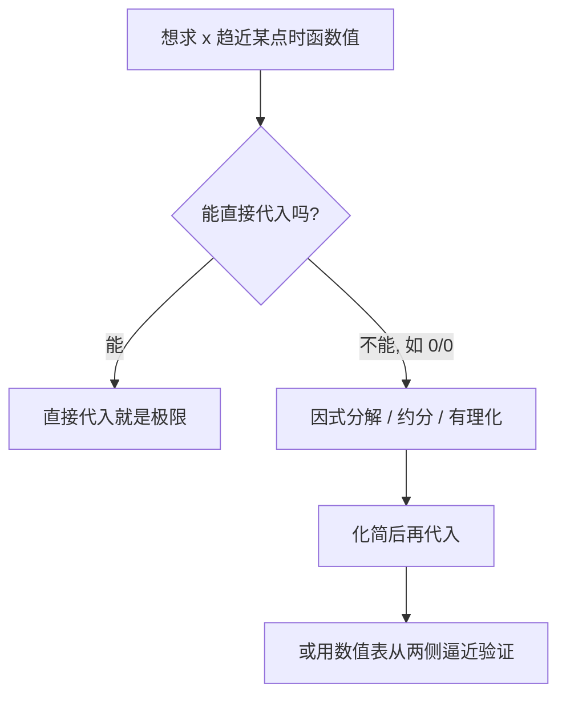
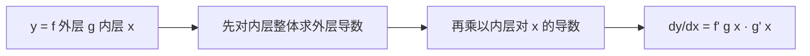
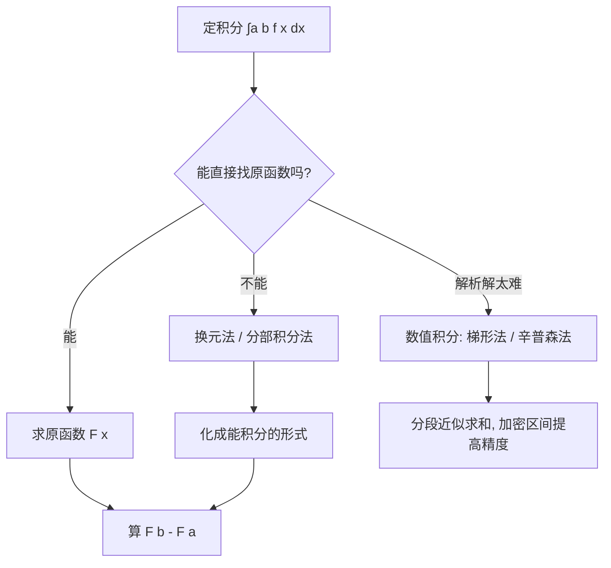
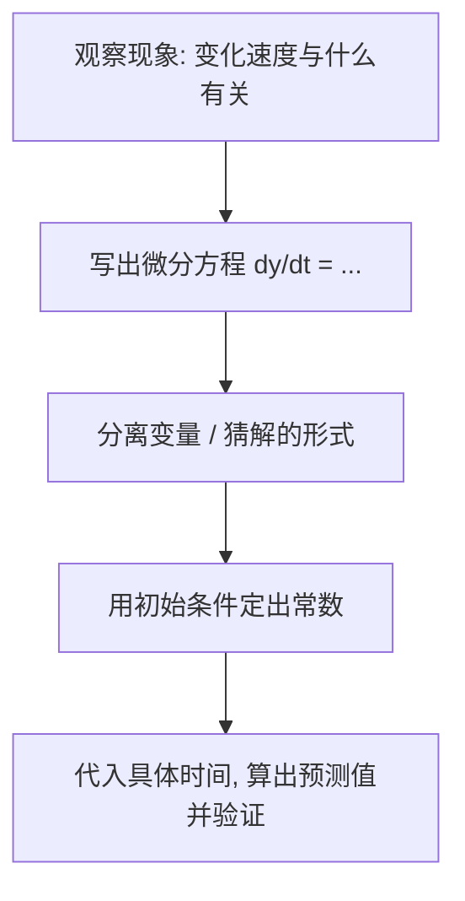

# 微积分

微积分是研究“变化”和“累积”的数学工具：一句话，导数回答“这一刻变化有多快”，积分回答“一段时间内一共累积了多少”。学编程、做数据分析、理解机器学习里的梯度下降，都绕不开它。本篇不用教材式定义堆砌，用分蛋糕、车速表、水箱这些生活场景，把极限、导数、积分、微分方程一步步算清楚。

## 核心概念

微积分由三块拼成：极限是地基，导数是“瞬时变化率”，积分是“累积求和”。三者不是孤立的知识点，而是一条链：没有极限就讲不清瞬时速度，没有导数就画不出变化曲线，没有积分就算不出总量。

先建立一张总览图：

- **极限**：一个量无限靠近某个值，但不一定等于它。分蛋糕每次分一半，剩下的越来越少，趋近于 0；分出去的总量越来越接近一整块，趋近于 1。
- **导数**：函数在某一点的瞬时变化率。汽车仪表盘上的时速就是位置对时间的导数；房价“这个月每平方米涨了 200 元”就是价格对时间的导数。
- **积分**：把无数个微小量加起来。油耗是瞬时油耗率对时间的积分；水箱里的水量是进水速率对时间的积分。
- **微分方程**：用导数写出来的规律，如“增长速度正比于当前数量”，解它就能预测复利、人口、冷却过程。

适用场景：变化率分析（速度、增长率、边际成本）、总量计算（面积、体积、总消耗）、最优化（求最大值最小值）、建模预测（增长、衰减、振动），以及机器学习中的梯度下降、数值计算中的近似求解。

## 基础知识

### 2.1 极限：无限逼近

分蛋糕的例子最直观：一块蛋糕，第一天吃一半，第二天吃剩下的一半，第三天再吃剩下的一半……每天吃掉的是：

$$\frac{1}{2},\ \frac{1}{4},\ \frac{1}{8},\ \frac{1}{16},\ \cdots$$

前几项的部分和一步步算：

- 吃 1 天：$S_1 = \frac{1}{2} = 0.5$
- 吃 2 天：$S_2 = \frac{1}{2}+\frac{1}{4} = 0.75$
- 吃 3 天：$S_3 = 0.75+\frac{1}{8} = 0.875$
- 吃 4 天：$S_4 = 0.875+\frac{1}{16} = 0.9375$
- 吃 10 天：$S_{10} = 1-\frac{1}{2^{10}} = 1-\frac{1}{1024} \approx 0.9990$

越吃越接近 1，但永远差一点点。用极限的语言写就是：

$$\lim_{n\to\infty}\left(\frac12+\frac14+\cdots+\frac1{2^n}\right)=1$$

龟兔赛跑式的逼近也一样：每次把剩余距离缩短一半，剩余距离是 $1,\ \frac12,\ \frac14,\ \cdots$，趋近于 0，但有限步内永远到不了 0。极限关心的正是“无限进行下去会趋向哪里”，而不是“第几步等于多少”。

另一个经典极限，用数值逼近来感受：

$$\lim_{x\to 0}\frac{\sin x}{x}=1$$

取 $x=0.1$（弧度制）：$\sin 0.1 \approx 0.0998334$，比值 $\approx 0.0998334 / 0.1 = 0.99833$；取 $x=0.01$：比值 $\approx 0.99998$。$x$ 越靠近 0，比值越靠近 1。

还有一个可以直接因式分解算出来的极限：

$$\lim_{x\to 2}\frac{x^2-4}{x-2}$$

$x=2$ 时分子分母都是 0，不能直接代入。先分解：$x^2-4=(x-2)(x+2)$，约掉 $(x-2)$（$x\neq 2$ 时合法），剩下 $x+2$，再让 $x\to 2$，得 $4$。数值验证：$x=1.9$ 时原式 $=3.9$；$x=1.99$ 时 $=3.99$；$x=2.01$ 时 $=4.01$——从两侧都逼近 4。

一个和复利有关的著名极限：

$$\lim_{n\to\infty}\left(1+\frac{1}{n}\right)^n = e \approx 2.71828$$

$n=1000$ 时，$(1+1/1000)^{1000}\approx 2.7169$，已经很接近 $e$。这个 $e$ 就是自然对数的底，后面讲指数增长时还会遇到它。

### 2.2 导数：瞬时速度

平均速度好算：100 米跑 10 秒，平均速度 $100/10=10$ 米/秒。但冲刺那一刻到底多快？把时间间隔越缩越小，平均速度就越接近瞬时速度，这就是导数的定义：

$$f'(x)=\lim_{h\to 0}\frac{f(x+h)-f(x)}{h}$$

拿 $f(x)=x^2$ 在 $x=3$ 处一步步算：

- 分子：$f(3+h)-f(3)=(3+h)^2-9=9+6h+h^2-9=6h+h^2$
- 比值：$\dfrac{6h+h^2}{h}=6+h$（$h\neq 0$）
- 令 $h\to 0$：$6+h\to 6$

所以 $f'(3)=6$。一般地，$f(x)=x^2$ 的导数是 $f'(x)=2x$，在 $x=3$ 处正是 $2\times 3=6$。

车速表的例子：设汽车位置（米）随时间（秒）变化为 $s(t)=2t^2$，则速度 $v(t)=s'(t)=4t$。$t=5$ 秒时，$v=4\times 5=20$ 米/秒，换算成时速是 $20\times 3.6=72$ 千米/小时——这就是那一刻仪表盘上的读数。

常用导数公式（先记住，再理解推导）：

| 函数 | 导数 | 记忆点 |
| --- | --- | --- |
| $x^n$ | $nx^{n-1}$ | 指数落下来，指数减 1 |
| $e^x$ | $e^x$ | 求导后还是自己 |
| $\ln x$ | $1/x$ | 对数求导变倒数 |
| $\sin x$ | $\cos x$ | 正弦变余弦 |
| $\cos x$ | $-\sin x$ | 余弦变负正弦 |
| $\sqrt{x}$ | $1/(2\sqrt{x})$ | 在 $x=4$ 处导数 $=1/(2\times 2)=0.25$ |

### 2.3 积分：面积累加

定积分 $\int_a^b f(x)\,dx$ 的几何意义，是曲线 $y=f(x)$ 与 $x$ 轴在 $[a,b]$ 之间围成的面积（曲线在轴上方时为正）。计算它不需要数格子，用“原函数”一步到位：先找一个导数等于 $f(x)$ 的函数 $F(x)$，再算 $F(b)-F(a)$。

最简单的例子，一步步算：

$$\int_0^1 x^2\,dx$$

- 找原函数：谁的导数是 $x^2$？$x^3/3$ 的导数是 $3x^2/3=x^2$，所以 $F(x)=x^3/3$。
- 代入上下限：$F(1)-F(0)=\frac{1}{3}-0=\frac{1}{3}\approx 0.3333$。

再算一个：

$$\int_0^2 (2x+1)\,dx=\left[x^2+x\right]_0^2=(4+2)-(0+0)=6$$

不定积分就是“求导的逆运算”，结果要加任意常数 $C$：

$$\int x^2\,dx=\frac{x^3}{3}+C,\quad \int \frac{1}{x}\,dx=\ln|x|+C$$

因为常数的导数是 0，$x^3/3+5$ 和 $x^3/3-7$ 求导都是 $x^2$，所以不定积分的答案永远带一个 $C$。

## 进阶知识

### 3.1 链式法则：复合函数求导

函数套函数时，要一层层往外剥。法则：外层导数乘以内层导数。

例 1：$y=(3x+1)^5$。

- 外层是 $(\cdot)^5$，导数是 $5(\cdot)^4$；内层 $3x+1$ 的导数是 $3$。
- $y'=5(3x+1)^4\times 3=15(3x+1)^4$。
- 在 $x=1$ 处：$15\times 4^4=15\times 256=3840$。

例 2：$y=\sin(x^2)$。

- 外层 $\sin u$ 的导数是 $\cos u$；内层 $x^2$ 的导数是 $2x$。
- $y'=2x\cos(x^2)$。在 $x=1$ 处：$2\cos 1\approx 2\times 0.5403=1.0806$（角度用弧度）。

链式法则的直觉是“放大倍数相乘”：内层每变 1，外层变多少，两者相乘就是总的变化率。神经网络的反向传播，本质上就是链式法则的大规模应用。

### 3.2 乘积法则与商法则

- 乘积：$(uv)'=u'v+uv'$。如 $(x^2\sin x)'=2x\sin x+x^2\cos x$。
- 商：$\left(\frac{u}{v}\right)'=\frac{u'v-uv'}{v^2}$。如 $\left(\frac{x}{x+1}\right)'=\frac{1\times(x+1)-x\times 1}{(x+1)^2}=\frac{1}{(x+1)^2}$。

### 3.3 级数与收敛

无穷多个数相加，结果可能是有限数，也可能发散到无穷大，关键看通项衰减得够不够快。

- 等比级数：$|r|<1$ 时，$\sum_{n=0}^{\infty} ar^n=\frac{a}{1-r}$。如首项 $100$、公比 $0.9$：和 $=100/(1-0.9)=100/0.9=1000$。公比越接近 1，和越大；$|r|\geq 1$ 时发散。
- 调和级数：$1+\frac12+\frac13+\cdots$ 发散，虽然每一项都在变小，但加得太慢。前 10 项和约为 $2.929$，前 100 项约 $5.187$，增长极慢却永不停歇。
- $p$ 级数：$\sum 1/n^p$ 在 $p>1$ 时收敛，$p\leq 1$ 时发散。$p=2$ 时和为 $\pi^2/6\approx 1.6449$。

### 3.4 多元微积分一眼

现实问题常有多个变量，如房价同时取决于面积、地段、楼层。偏导数就是“固定其他变量，只让一个变量动”的导数；梯度是所有偏导数组成的向量，指向函数增长最快的方向——梯度下降就是沿着梯度的反方向一步步走下山找最小值。

## 原理剖析

### 4.1 微积分基本定理：导数与积分互为逆运算

这是全书最重要的一座桥，分两部分：

1. 若 $F(x)=\int_a^x f(t)\,dt$，则 $F'(x)=f(x)$——对累积量求导，得到瞬时变化率。
2. 若 $F'(x)=f(x)$，则 $\int_a^b f(x)\,dx=F(b)-F(a)$——算面积只需算原函数在两端的值之差。

生活类比：水箱水量是进水速率的积分，对水量求导就回到进水速率；反过来，已知进水速率，想知道一共进了多少水，只需看水量在开始和结束时的差值。

用定积分验证一个漂亮结果：

$$\int_0^{\pi}\sin x\,dx=\left[-\cos x\right]_0^{\pi}=(-\cos\pi)-(-\cos 0)=-(-1)-(-1)=1+1=2$$

正弦曲线在 $0$ 到 $\pi$ 之间与 $x$ 轴围成的面积恰好是 2。

### 4.2 积分的计算步骤

换元法示例：$\int 2x\cos(x^2)\,dx$。令 $u=x^2$，则 $du=2x\,dx$，原式化为 $\int\cos u\,du=\sin u+C=\sin(x^2)+C$。求导验证：$\sin(x^2)$ 的导数正是 $2x\cos(x^2)$，与被积函数一致。

分部积分法：$\int u\,dv=uv-\int v\,du$。例：$\int x e^x\,dx$，取 $u=x$、$dv=e^x dx$，则 $du=dx$、$v=e^x$，结果 $=xe^x-\int e^x dx=xe^x-e^x+C=(x-1)e^x+C$。求导验证：$(x-1)e^x$ 的导数是 $e^x+(x-1)e^x=xe^x$，正确。

### 4.3 数值积分：算不出来时怎么办

很多函数的原函数写不出来（如 $e^{-x^2}$），这时用数值近似。以 $\int_0^1 x^2 dx=\frac13\approx 0.3333$ 为基准（真实值已知，正好用来验算方法）：

- 梯形法，分 4 段（步长 $h=0.25$，节点值 $0,\ 0.0625,\ 0.25,\ 0.5625,\ 1$）：
  $0.25\times(0.5\times 0+0.0625+0.25+0.5625+0.5\times 1)=0.25\times 1.375=0.34375$，误差约 $+0.0104$。
- 中点法，分 4 段（中点 $0.125,\ 0.375,\ 0.625,\ 0.875$，平方和为 $0.015625+0.140625+0.390625+0.765625=1.3125$）：
  $0.25\times 1.3125=0.328125$，误差约 $-0.0052$，比同段数的梯形法更准。

一般规律：区间分得越细误差越小；中点法和辛普森法在同样段数下通常比梯形法准。数值积分的误差分析与 [数值稳定性](计算机基础/数学/数值稳定性.md) 直接相关：步长太小会放大浮点舍入误差，步长太大则截断误差占主导。

## 实战案例

### 5.1 水箱蓄水：积分算总量

水龙头进水速率随时间变化，$r(t)=2t$ 升/分钟（越开越大）。前 10 分钟一共进了多少水？

$$\int_0^{10} 2t\,dt=\left[t^2\right]_0^{10}=100-0=100\ \text{升}$$

平均速率是 $100/10=10$ 升/分钟，正好是第 5 分钟时的瞬时速率 $2\times 5=10$——对线性增长的速率，平均值就是中点值。这个思路可以搬到任何“速率已知、求总量”的问题：总里程是速度的积分，总电量是功率的积分，总收入是边际收入的积分。

### 5.2 房价涨速与最优化

设某小区房价（万元/平方米）随月份变化为 $P(t)=2+0.3t-0.02t^2$，求第 5 个月的涨速，并判断房价何时见顶。

- 求导：$P'(t)=0.3-0.04t$。
- 第 5 个月：$P'(5)=0.3-0.04\times 5=0.3-0.2=0.1$ 万元/平方米/月，即每月每平方米还涨 1000 元，但涨速已从最初的 0.3 放缓。
- 见顶：令 $P'(t)=0$，得 $0.3-0.04t=0$，$t=7.5$ 个月。此后导数为负，房价开始下跌。最高价 $P(7.5)=2+0.3\times 7.5-0.02\times 7.5^2=2+2.25-1.125=3.125$ 万元/平方米。

这就是“导数为零找极值”的标准流程：求导、令导数为零、判断符号变化。机器学习里找损失函数最小值，思路完全相同，只是变量更多、不能直接解方程，改用梯度下降迭代逼近。

### 5.3 复利：指数增长模型

本金 10000 元，年利率 5%，按年复利，10 年后：

$$10000\times(1+0.05)^{10}=10000\times 1.6288946\approx 16288.95\ \text{元}$$

利息共 $16288.95-10000=6288.95$ 元。若改成连续复利，公式变为 $10000e^{0.05\times 10}=10000e^{0.5}\approx 10000\times 1.648721=16487.21$ 元，比按年复利多约 198 元——复利次数越多，越接近连续复利的上限。

### 5.4 微分方程：冷却与人口增长

微分方程建模的通用流程：

**冷却模型（牛顿冷却定律）**：一杯 80℃ 的热水放在 20℃ 的房间里，降温速度正比于温差：$\frac{dT}{dt}=-k(T-20)$，取 $k=0.1$/分钟。解为 $T(t)=20+60e^{-0.1t}$。

- $t=10$ 分钟：$T=20+60e^{-1}\approx 20+60\times 0.3679=20+22.07=42.07$℃。
- $t=20$ 分钟：$T=20+60e^{-2}\approx 20+60\times 0.1353=20+8.12=28.12$℃。
- $t=30$ 分钟：$T=20+60e^{-3}\approx 20+60\times 0.0498=20+2.99=22.99$℃。

降温越来越慢，因为温差越来越小——指数衰减的典型特征。

**人口增长模型**：人口增长率正比于现有人口，$\frac{dy}{dt}=ky$，解为 $y=Ce^{kt}$。若年增长率 $k=0.07$（7%），翻倍时间满足 $e^{0.07t}=2$，即 $t=\ln 2/0.07\approx 0.6931/0.07\approx 9.90$ 年。约 10 年翻一番，这就是“70 法则”的来源：翻倍年数约等于 $70/$增长率百分比（$70/7=10$，与精确值 9.90 很接近）。

### 5.5 曲线下面积：从油耗到收入

汽车瞬时油耗率（升/小时）已知，跑 2 小时的总油耗就是油耗率对时间的积分；同理，$\int_1^2 \frac{1}{x}\,dx=\ln 2-\ln 1=\ln 2\approx 0.6931$，这个面积在信息论、概率论里反复出现。把“总量 = 速率的积分”这个对应关系记牢，遇到新场景直接套用。

## 疑难杂症

- **极限算出 0/0 怎么办**：先别慌，0/0 是“未定式”，不是答案。先因式分解、约分或有理化；还不行就用洛必达法则（分子分母同时求导再取极限）或等价无穷小替换。例：$\lim_{x\to 0}\frac{e^x-1}{x}$，分子分母求导得 $e^x/1\to 1$。
- **积分找不到原函数**：先确认是不是换元或分部积分能解决的；若被积函数本身就没有初等原函数（如 $e^{-x^2}$、$\sin x/x$），改用数值积分，别硬凑。
- **链式法则漏乘内层导数**：求 $(3x+1)^5$ 的导数时，只写 $5(3x+1)^4$ 是最常见的错，漏了内层导数 3，正确答案是 $15(3x+1)^4$。每求一次导就问自己一句：里面还有没有 $x$？
- **定积分上下限代反**：$\int_a^b$ 与 $\int_b^a$ 差一个负号。算面积时先画图确认谁大谁小，必要时加绝对值。
- **微分方程解出常数后不验证**：把解代回原方程和初始条件验算一遍。冷却模型里 $t=0$ 时 $T=20+60=80$℃，正好是初始水温，对上了才放心。

## 常见误区

- **“极限就是约等于”**：不对。极限是精确的数学对象，$S_n\to 1$ 的意思是“想多接近就能多接近”，极限值 1 本身是确定的数，不是模糊估计。
- **“导数等于 0 的点一定是极值点”**：不对。$y=x^3$ 在 $x=0$ 处导数为 0，但函数单调递增，0 不是极值点。导数为零只是必要条件，还要看导数是否变号。
- **“积分就是求面积，所以结果不能为负”**：不对。定积分是“带符号的面积”：曲线在 $x$ 轴下方的部分算负面积。$\int_0^{2\pi}\sin x\,dx=0$，因为上下两块面积正负抵消。
- **“$\int 1/x\,dx=\ln x+C$”**：不完整。$x$ 为负时 $\ln x$ 无定义，正确写法是 $\ln|x|+C$。
- **“连续就一定可导”**：不对。$y=|x|$ 在 $x=0$ 处连续，但左右导数一个是 $-1$、一个是 $+1$，尖点处不可导。连续是可导的必要条件，不是充分条件。
- **“级数通项趋于 0 就收敛”**：不对。调和级数通项 $1/n\to 0$，级数却发散。通项趋于 0 只是收敛的必要条件。
- **“微分方程的解只有一个”**：不对。通解带任意常数，代入初始条件才能定出特解；没有初始条件，解是一族曲线。

## 性能优化

这里的“性能”指计算成本：解析解算不出或太贵时，怎么用更少的计算量拿到足够准的答案。

- **选对数值积分方法**：同样分 4 段算 $\int_0^1 x^2 dx$，梯形法得 $0.34375$（误差 $0.0104$），中点法得 $0.328125$（误差约 $-0.0052$），辛普森法用抛物线拟合，4 段时误差更小。一般规律：光滑函数优先辛普森法；函数不光滑、有尖点时先分段再积分。
- **步长不是越小越好**：步长减半，截断误差大约降为 $1/4$（梯形法）或 $1/16$（辛普森法），但计算量翻倍，且浮点舍入误差会累积。做法是先粗算、再加密一倍，对比两次结果：变化小于容忍误差就停。
- **解析化简优先于暴力数值算**：能因式分解、换元、对称性化简的先化简。$\int_{-a}^{a}$ 上的奇函数积分直接为 0，一行结论省掉全部数值计算。
- **复杂度视角**：梯形法算 $n$ 段是 $O(n)$；高维积分（多重积分）用蒙特卡洛方法，误差约 $O(1/\sqrt{n})$，与维度无关，适合高维场景。这与 [复杂度分析基础](计算机基础/算法/复杂度分析基础.md) 里“先估量级再动手”的思路一致。

## 版本差异

微积分本身是经典数学，没有“版本迭代”，差异主要在记号、工具和教学侧重点上：

- **记号**：牛顿用 $\dot{y}$（点记号，物理常用）、莱布尼茨用 $\frac{dy}{dx}$（微分记号，数学常用），两者含义相同；偏导数记号 $\partial$ 是后来为多元函数引入的。
- **计算工具**：手算适合理解概念；实际工程中用 Python 的 SymPy 做符号求导积分、用 NumPy/SciPy 做数值积分（如 `scipy.integrate.quad`），用 WolframAlpha 验证手算结果。工具算出的答案要回代验证，不能直接抄。
- **浮点注意**：数值微分用差商 $(f(x+h)-f(x))/h$ 时，$h$ 太小会因相近数相减丢失精度（灾难性抵消），$h$ 太大则截断误差大；实践中常用中心差商 $(f(x+h)-f(x-h))/(2h)$，精度更高。相关细节见 [数值稳定性](计算机基础/数学/数值稳定性.md)。
- **教材侧重**：国内教材常从极限的 $\epsilon$-$\delta$ 定义起步，偏重严谨性；国外教材（如 Stewart）常先从切线斜率与面积直观引入，偏重几何直觉。两种路径终点相同，入门建议先走直觉路线再补严谨定义。

## 面试与自测

### 问题

1. 用分蛋糕的例子解释什么是极限，并写出 $\lim_{n\to\infty}(1/2+1/4+\cdots+1/2^n)$ 的值。
2. 用导数定义一步步算 $f(x)=x^2$ 在 $x=3$ 处的导数。
3. 车速表显示的是平均速度还是瞬时速度？它与位置函数是什么关系？
4. 计算 $\int_0^1 x^2\,dx$，并说明为什么不定积分要加常数 $C$。
5. 求 $y=(3x+1)^5$ 的导数，并算出 $x=1$ 处的导数值。
6. 水龙头进水速率 $r(t)=2t$ 升/分钟，前 10 分钟一共进了多少水？写出计算过程。
7. 本金 10000 元、年利率 5%、按年复利，10 年后本息共多少？连续复利会更多还是更少？
8. 一杯 80℃ 的水放在 20℃ 的房间里，冷却模型 $T(t)=20+60e^{-0.1t}$，求 10 分钟后水温。
9. 判断正误并说明理由：调和级数 $1+1/2+1/3+\cdots$ 的通项趋于 0，所以它收敛。
10. $y=|x|$ 在 $x=0$ 处连续吗？可导吗？为什么？

### 参考答案

1. 每次吃剩下的一半，吃掉的总量是 $1/2, 3/4, 7/8, \cdots$，无限进行下去趋近于 1，但有限步内永远差 $1/2^n$。极限值是 1：$\lim_{n\to\infty}(1-1/2^n)=1$。
2. $\frac{(3+h)^2-9}{h}=\frac{6h+h^2}{h}=6+h$，令 $h\to 0$ 得 6。所以 $f'(3)=6$，与公式 $f'(x)=2x$ 在 $x=3$ 处的值一致。
3. 瞬时速度。它是位置函数对时间的导数：$v(t)=s'(t)$。如 $s(t)=2t^2$，则 $v(t)=4t$，$t=5$ 时为 20 米/秒（72 千米/小时）。
4. 原函数是 $x^3/3$，$\int_0^1 x^2 dx=[x^3/3]_0^1=1/3\approx 0.3333$。不定积分加 $C$ 是因为常数的导数为 0，$x^3/3+C$（$C$ 为任意常数）求导都是 $x^2$。
5. 链式法则：外层导数 $5(3x+1)^4$ 乘以内层导数 3，得 $y'=15(3x+1)^4$；$x=1$ 时 $15\times 4^4=15\times 256=3840$。
6. 总量 $=\int_0^{10} 2t\,dt=[t^2]_0^{10}=100$ 升。平均速率 10 升/分钟，等于第 5 分钟的瞬时速率。
7. 按年复利：$10000\times 1.05^{10}\approx 16288.95$ 元。连续复利：$10000e^{0.5}\approx 16487.21$ 元，更多，因为复利次数越多越接近连续复利的上限。
8. $T(10)=20+60e^{-1}\approx 20+60\times 0.3679=42.07$℃。降温越来越慢，符合指数衰减。
9. 错误。通项趋于 0 只是级数收敛的必要条件，不是充分条件；调和级数发散，前 10 项和约 2.929，且随项数增加无界增长。
10. 连续，不可导。$x=0$ 处左右极限都是 0，函数连续；但左导数为 $-1$、右导数为 $+1$，左右导数不相等，尖点处没有唯一切线，所以不可导。

## 小技巧与冷知识

- **70 法则**：年增长率 $r\%$ 时，本金翻倍大约需要 $70/r$ 年。年利率 7% 约 10 年翻倍（精确值 $\ln 2/0.07\approx 9.90$ 年），心算投资翻倍时间很好用。
- **导数速查口诀**：$x^n$ 求导是“指数落下来，指数减 1”；$e^x$ 求导还是自己，是唯一求导不变的函数（不计常数倍）；$\ln x$ 求导是 $1/x$，把乘法变加法是它最大的用处。
- **积分验算技巧**：算完不定积分立刻求导，看能不能回到被积函数。$\int 2x\cos(x^2)dx=\sin(x^2)+C$，求导得 $2x\cos(x^2)$，对上了才算完。
- **冷知识：微积分是谁发明的**：牛顿和莱布尼茨各自独立发明了微积分，两人为优先权争论多年；今天通用的 $\frac{dy}{dx}$、$\int$ 记号来自莱布尼茨，$\int$ 其实是拉长的字母 S，代表 Sum（求和）。
- **冷知识：$\pi^2/6$ 的由来**：$\sum_{n=1}^{\infty} 1/n^2=\pi^2/6\approx 1.6449$，一个全是整数倒数平方的和，答案里居然冒出圆周率 $\pi$，这是数学里著名的巴塞尔问题，欧拉 1735 年解决。
- **冷知识：处处连续却处处不可导**：魏尔斯特拉斯函数处处连续，但每一点都不可导，图像“全是尖点”，直觉上很难想象，却真实存在——连续和可导之间隔着很远。
- **生活冷应用**：导航软件预估到达时间，本质上是对“速度—时间”曲线做积分；信用卡分期、房贷等额本息的月供公式里藏着等比数列求和；天气预报的数值模式每天都在求解微分方程组。

## 关联知识

- 前置知识：[集合论基础](计算机基础/数学/集合论基础.md)（函数、区间、数集的语言）；初中代数（因式分解、指数与对数运算）是极限与导数计算的基本功。
- 相关知识点：[数值稳定性](计算机基础/数学/数值稳定性.md)（数值微分与数值积分的误差来源）；[复杂度分析基础](计算机基础/算法/复杂度分析基础.md)（数值方法的计算量量级，如梯形法 $O(n)$、蒙特卡洛 $O(1/\sqrt{n})$ 误差）。
- 延伸方向：线性代数（多元微积分、梯度与雅可比矩阵）、概率论（连续型随机变量的期望就是积分）、数值计算（数值积分、常微分方程数值解）、机器学习（梯度下降、反向传播本质上是链式法则）。
- 学习路径建议：极限直觉 → 导数定义与公式 → 积分与微积分基本定理 → 链式法则与换元积分 → 微分方程建模 → 数值方法。每一步都配一个生活算例，算对了再往下一步走。
