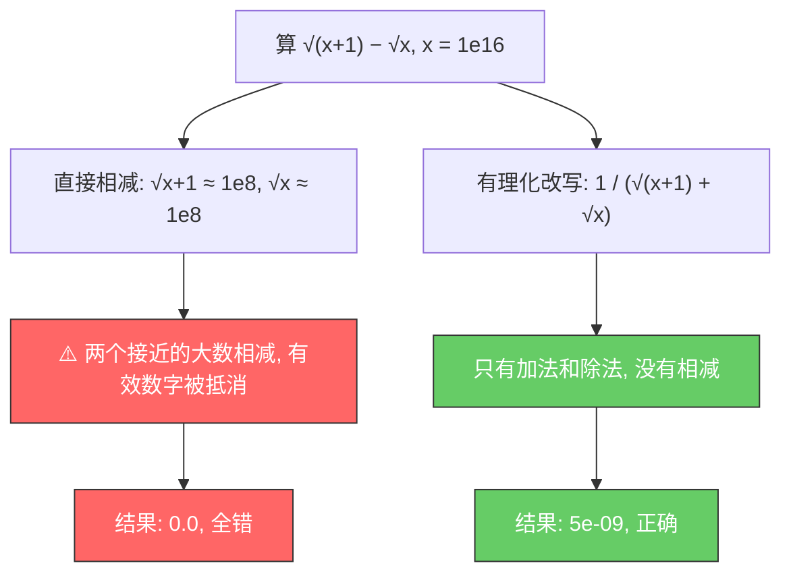

# 数值稳定性

<!-- TOC -->
- [基础知识](#基础知识)
  - [先看一个让人吓一跳的例子](#先看一个让人吓一跳的例子)
  - [数值稳定性是什么](#数值稳定性是什么)
- [原理剖析](#原理剖析)
  - [原理一：浮点数只有有限的有效数字](#原理一浮点数只有有限的有效数字)
  - [原理二：灾难性抵消——相减会“吃掉”有效数字](#原理二灾难性抵消相减会吃掉有效数字)
  - [原理三：大数吃小数——加法也会丢东西](#原理三大数吃小数加法也会丢东西)
  - [原理四：求和顺序会影响结果](#原理四求和顺序会影响结果)
  - [原理五：Kahan 求和算法——把被吃掉的零头记下来](#原理五kahan-求和算法把被吃掉的零头记下来)
  - [原理六：条件数入门——输入变一点点，输出变很多](#原理六条件数入门输入变一点点输出变很多)
- [进阶知识](#进阶知识)
  - [均值计算的两种算法对比](#均值计算的两种算法对比)
  - [二次方程求根的稳定算法](#二次方程求根的稳定算法)
  - [(1 − cos x) / x² 在 x 很小时](#1--cos-x--x-在-x-很小时)
- [疑难杂症](#疑难杂症)
  - [症状一：程序在小数上算得好好的，换成大数就错了](#症状一程序在小数上算得好好的换成大数就错了)
  - [症状二：同样的公式，换个写法结果不一样](#症状二同样的公式换个写法结果不一样)
  - [症状三：累加很多小数，最后总和比预期小](#症状三累加很多小数最后总和比预期小)
  - [症状四：均值算出来和手工算的不一样](#症状四均值算出来和手工算的不一样)
  - [症状五：二次方程一个根对、一个根错](#症状五二次方程一个根对一个根错)
  - [症状六：换成 double 还是错](#症状六换成-double-还是错)
- [实战案例](#实战案例)
  - [案例一：银行利息逐月累加，12 元利息“蒸发”了](#案例一银行利息逐月累加12-元利息蒸发了)
  - [案例二：考试成绩求平均分，少算了 0.75 分](#案例二考试成绩求平均分少算了-075-分)
  - [案例三：科学计算里的开方差，改写一行代码救回精度](#案例三科学计算里的开方差改写一行代码救回精度)
  - [案例四：二次方程求根，验算乘积发现小根错了 25%](#案例四二次方程求根验算乘积发现小根错了-25)
- [面试与自测](#面试与自测)
  - [参考答案](#参考答案)
- [小技巧与冷知识](#小技巧与冷知识)
- [关联知识](#关联知识)
<!-- /TOC -->

## 基础知识

### 先看一个让人吓一跳的例子

算 `√(x+1) − √x`，取 `x = 10^16`（1 后面跟 16 个 0）。数学上这个值约等于 `1 / (2√x) = 5 × 10^-9`，很小，但绝不是零。

用 Python 直接算，两种写法结果天差地别：

```python
import math
x = 1e16
print(math.sqrt(x + 1) - math.sqrt(x))        # 直接算: 0.0
print(1 / (math.sqrt(x + 1) + math.sqrt(x)))  # 改写后算: 5e-09
```

直接算得到 `0.0`，改写后得到 `5e-09`。同一个数学公式，只是写法不同，一个答案全错，一个答案正确。这就是数值稳定性要研究的事。

### 数值稳定性是什么

一句话：**同样的数学公式，用不同的计算顺序或写法，在计算机里算出来的精度可能天差地别。**

数学里 `√(x+1) − √x` 和 `1/(√(x+1)+√x)` 是同一个东西，计算机里却不是。原因不在数学，而在浮点数只有有限的有效数字：double 大约 15 到 17 位十进制数字，再多就存不下，只能四舍五入扔掉。

打个比方：菜市场找零。你买菜花了 9999.99 元，老板找你 0.01 元。如果老板的计算器只能显示 4 位有效数字，9999.99 先被存成 10000，那 10000 − 10000 = 0，你的 1 分钱就没了。数值不稳定，就是计算器在中间步骤里把关键的“零头”先扔掉了，后面再怎么算也找不回来。

本篇要讲：灾难性抵消、大数吃小数、求和顺序的影响、均值计算的两种算法、二次方程求根的稳定算法、条件数入门，以及“换成 double 就万事大吉”这类常见误区。

阅读前提：会加减乘除，会一点 Python 或 Java，能看懂 `1e16` 这种科学计数法（`1e16` 就是 1 后面跟 16 个 0）。不需要任何高等数学。

## 原理剖析

### 原理一：浮点数只有有限的有效数字

double 类型大约能存 15 到 17 位有效十进制数字。`1e16` 本身就要占 17 位（1 后面 16 个 0），再加 1，第 17 位已经排到小数点后，存不下，只能扔掉。

```python
print(1e16 + 1.0)  # 1e+16, 1 被吃掉了
print(1e16 + 2.0)  # 1.0000000000000002e+16, 2 刚好能挤进去
```

在 `1e16` 这个量级上，double 能分辨的最小间隔是 2。所以加 1 等于没加，加 2 才有变化。这不是 bug，这是浮点数的本性。想彻底搞懂浮点数怎么存数字，可以看 [浮点数](计算机基础/数学/浮点数.md) 和 [精度误差](计算机基础/数学/精度误差.md)。

### 原理二：灾难性抵消——相减会“吃掉”有效数字

两个很接近的大数相减，结果是一个很小的数。问题是：这两个大数本身存的时候就已经四舍五入过，误差被带进了相减。

生活例子：体温计量体温。体温计只能读到 0.1 度。昨天真实体温 36.44 度，读出来是 36.4 度；今天真实体温 36.46 度，读出来是 36.5 度。两次读数相减是 0.1 度，可真实的体温变化只有 36.46 − 36.44 = 0.02 度。读数误差 0.04 度，经过相减被放大成了 0.08 度的结果误差。数字越大、越接近，相减丢得越狠。

上面 `√(x+1) − √x` 的例子就是这样：`x = 1e16` 时，`√(x+1)` 和 `√x` 都约等于 `1e8`，前 16 位数字几乎一模一样，相减之后剩下的有效数字所剩无几，最后直接变成 0。

实测对比（Python，double 运算）：

| x | 直接算 `√(x+1) − √x` | 改写后 `1/(√(x+1)+√x)` | 真值约 `1/(2√x)` |
|---|---|---|---|
| `1e8` | `5.000000055588316e-05` | `4.9999999874999996e-05` | `5e-05` |
| `1e12` | `5.00003807246685e-07` | `4.999999999998749e-07` | `5e-07` |
| `1e16` | `0.0` | `5e-09` | `5e-09` |

看 `x = 1e8` 这一行：直接算的结果是 `5.000000055588316e-05`，从第 8 位有效数字起就错了；改写后是 `4.9999999874999996e-05`，几乎全对。`x` 越大，直接算错得越离谱，到 `1e16` 直接归零。

为什么改写后就好了？改写用的是初中数学的有理化：`√(x+1) − √x` 分子分母同乘 `√(x+1) + √x`，等于 `1 / (√(x+1) + √x)`。新公式里只有加法和除法，没有“两个接近的大数相减”，误差就没地方放大。



### 原理三：大数吃小数——加法也会丢东西

一个很大的数加一个很小的数，小数可能被直接“吃掉”，因为加完之后小数点后的那几位超出了浮点数的有效位数。

生活例子：银行利息逐月累加。你的存款是 10000000000000000 元（1e16 元，假设你是首富），每月利息 1 元。一个月后银行系统用 double 算：`1e16 + 1 = 1e16`，利息凭空消失了。12 个月后还是 `1e16`，一年 12 元利息全没了。不是银行黑你，是 double 在 `1e16` 这个量级上根本存不下“加 1”这个变化。

再看 float（单精度，只有约 7 位有效数字），吃得更狠：

```python
import numpy as np
print(int(np.float32(1e8) + np.float32(1)))  # 100000000, 1 被吃掉
print(int(np.float32(1e8) + np.float32(8)))  # 100000008, 加 8 才留得住
```

float 在 `1e8` 这个量级上，最小间隔是 8，加 1、加 2 都等于没加，加 8 才能被看见。Java 里也一样：`1e8f + 1f` 还是 `1e8f`。

### 原理四：求和顺序会影响结果

加法在数学里满足交换律，`a + b = b + a`，三个数相加先加谁都一样。但在浮点数里，加法的顺序会改变结果，因为每一步都可能四舍五入。

生活例子：考试平均分。全班 3 个人，成绩是 10000000000000000 分（开玩笑的量级）、1 分、1 分。先加 1e16 再加两个 1 分：

```python
s = 0.0
for v in [1e16, 1.0, 1.0]:
    s += v
print(s)  # 1e+16, 两个 1 分全被吃了
```

先加两个 1 分，再加 1e16：

```python
s = 0.0
for v in [1.0, 1.0, 1e16]:
    s += v
print(s)  # 1.0000000000000002e+16, 两个 1 分保住了
```

同样三个数，先加大数结果是 `1e16`（丢了 2），先加小数结果是 `1.0000000000000002e16`（保住了 2）。再看 10 个 1 分：大数先加是 `1e16`，10 分全丢；小数先加是 `1.000000000000001e16`，10 分保住了。

实用的经验法则：**一堆数求和，先加绝对值小的，再加绝对值大的**。小数先抱团，抱成一个够大的数，再去和大数相加，就不容易被吃掉。

### 原理五：Kahan 求和算法——把被吃掉的零头记下来

如果数很多、量级差得很大，光调整顺序还不够。Kahan 求和算法的思路很朴素：**每一步算完，记下这一步被四舍五入扔掉了多少，下一步加回来。**

生活例子：菜市场找零。老板每次找零都少找你 1 毛，你不吭声，攒个小本本记下来：“欠我 1 毛、欠我 1 毛……”攒到 1 块钱就找老板要回来。Kahan 算法里的补偿变量 `c` 就是这个小本本。

伪代码：

```
s = 0.0      # 累加和
c = 0.0      # 小本本: 上一步丢掉的零头
for x in 数字列表:
    y = x - c    # 先把上一步欠的零头补给 x
    t = s + y    # 正常加
    c = (t - s) - y  # 算出这一步新丢掉的零头, 记到小本本上
    s = t
return s
```

Java 代码：

```java
public static double kahanSum(double[] xs) {
    double s = 0.0; // 累加和
    double c = 0.0; // 补偿量: 上一步丢掉的零头
    for (double x : xs) {
        double y = x - c;
        double t = s + y;
        c = (t - s) - y;
        s = t;
    }
    return s;
}
```

实测：`[1e16, 1, 1]` 用 Kahan 算，结果是 `1.0000000000000002e16`，两个 1 分都保住了；普通逐个加的结果是 `1e16`。Kahan 算法多花一点计算量，但精度明显更好，适合“很多小数加一个大数”的场景，比如累加交易流水、累加传感器读数。

### 原理六：条件数入门——输入变一点点，输出变很多

条件数是衡量“问题本身有多敏感”的直觉概念，不需要记公式，记住感觉就行：

- **输入变一点点，输出只变一点点**：问题是良态的，好算。
- **输入变一点点，输出变很多**：问题是病态的，难算，再好的算法也救不了多少。

生活例子：体温计差 0.1 度，36.5 度和 36.6 度都是正常体温，没人会因为 0.1 度去吃药；体重秤差 0.1 公斤，50 公斤的人称出来 50.1 公斤，也是小事。但一台称黄金的秤差 0.1 克，按 500 元一克算就是 50 元，相对误差很小，绝对损失却很大。

关键不是误差本身有多大，而是**误差经过计算之后被放大了多少倍**。条件数就是这个放大倍数的直觉版：条件数越大，输入里一点点小误差，输出里就可能变成大误差。

一个经典例子：解方程组时，如果两条直线几乎平行，交点位置对系数极其敏感，系数变 0.001，交点能跑出去几十米。这不是算法的错，是问题本身就是病态的。遇到病态问题，正确的态度是换个问法、换个模型，而不是换个更贵的浮点类型。

## 进阶知识

### 均值计算的两种算法对比

算平均分有两种办法。假设你是老师，要算全班平均分。

**方法一：naive 两遍法（先求和再除）**：平均分 =（所有分数加起来）/ 人数。

**方法二：递推法（逐个更新均值）**：来一个学生，更新一次平均分：新平均分 = 旧平均分 +（新分数 − 旧平均分）/ 人数（含新来的）。

小例子，三个分数 98、99、100，逐步算：

- naive 法：98 + 99 + 100 = 297，297 / 3 = 99。
- 递推法：第 1 步平均分是 98；第 2 步是 98 + (99 − 98) / 2 = 98.5；第 3 步是 98.5 + (100 − 98.5) / 3 = 99。两种方法都是 99。

小数字时两者没区别。区别在数字很大、个数很多的时候：naive 法要先把所有数加起来，求和本身可能溢出，也可能在累加中吃掉小数；递推法手里永远只拿着一个“当前平均分”，每一步加的都是“新分数和平均分的差”，这个差通常很小，不容易溢出，也不太会被吃掉。

实测一组大数据：10 个数，第一个是 `1e16`，后面 9 个都是 1。真值是 `(1e16 + 9) / 10 = 1000000000000000.9`。

```python
data = [1e16] + [1.0] * 9
s = 0.0
for v in data:
    s += v
naive = s / len(data)   # 1000000000000000.0, 误差约 -0.9

m = 0.0
for i, v in enumerate(data, 1):
    m += (v - m) / i
print(m)                # 1000000000000001.2, 误差约 +0.4
```

naive 法在求和那一步就把 9 个 1 全吃掉了（`1e16 + 1 = 1e16`），平均分少了约 0.9；递推法虽然也不完美（误差约 +0.4），但保住了更多信息。再测 10 万个随机数（`random.seed(0)`，`1e8` 加上 0 到 1 之间的小数），以 `math.fsum` 的精确结果为真值参考：naive 法误差约 `−9.7e-07`，递推法误差约 `−4.5e-08`，这一组里递推法比 naive 法准约 20 倍。递推法不是在所有情况下都碾压 naive 法，它的真正优势是**不保存巨大的中间和**：数据流式到来、不知道总数、数大到求和会溢出时，递推法是唯一能用的办法。

Java 里的递推均值：

```java
public static double runningMean(double[] xs) {
    double mean = 0.0;
    for (int i = 0; i < xs.length; i++) {
        mean += (xs[i] - mean) / (i + 1);
    }
    return mean;
}
```

### 二次方程求根的稳定算法

解一元二次方程 `ax² + bx + c = 0`，标准公式是 `x = (−b ± √(b² − 4ac)) / 2a`。数学上没错，计算机里却可能算错一个根。取一组具体系数：`a = 1, b = 10^8, c = 1`，也就是解 `x² + 10^8·x + 1 = 0`。

先算判别式：`b² = 10^16`，`b² − 4ac = 9999999999999996`，`√(b² − 4ac) = 99999999.99999999`。注意这个数和 `b = 100000000` 只差 `1.49e-08`，前 8 位数字一模一样。

标准公式算小根：`x = (−10^8 + 99999999.99999999) / 2`，这是两个几乎相等的数相减——灾难性抵消的老地方。实测（Python）：

```python
import math
a, b, c = 1.0, 1e8, 1.0
disc = math.sqrt(b * b - 4 * a * c)   # 99999999.99999999
r1 = (-b + disc) / (2 * a)           # -7.450580596923828e-09
r2 = (-b - disc) / (2 * a)           # -100000000.0
print(r1 * r2)                        # 0.7450580596923828, 应该是 1
```

真的小根约等于 `−1e-08`，标准公式算出来是 `−7.45e-09`，差了约 25%。验算一下：两个根的乘积应该等于 `c / a = 1`（韦达定理），标准公式算出来的乘积却是 `0.745`，明显错了。大根 `−100000000.0` 是对的，因为它用的是 `−b − √(…)`，两个负数相加，没有抵消。

稳定算法的思路：**先算那个不会抵消的大根，再用韦达定理“两根之积等于 c/a”反推小根**。

```
q = −(b + sign(b)·√(b² − 4ac)) / 2   # 大根的分子, 两个同号数相加, 不抵消
大根 = q / a
小根 = c / q                          # 韦达定理: 两根之积 = c/a
```

实测：

```python
q = -(b + math.copysign(disc, b)) / 2  # -100000000.0
r1 = q / a                              # -100000000.0
r2 = c / q                              # -1e-08
print(r1 * r2)                          # 1.0, 验算通过
```

小根 `−1e-08` 和真值一致，乘积验算正好是 1。记住这个套路：**公式里出现“两个接近的数相减”时，换个写法绕过去**——要么像开方例子一样有理化，要么像这里一样用韦达定理反推。

### (1 − cos x) / x² 在 x 很小时

再补一个同类例子。`x` 很小时，`cos x` 非常接近 1，`1 − cos x` 是两个接近 1 的数相减，同样会抵消。改写成 `2·sin²(x/2) / x²`（半角公式），就没有相减了。实测：

| x | 直接算 `(1 − cos x) / x²` | 改写后 `2·sin²(x/2) / x²` | 真值约 0.5 |
|---|---|---|---|
| `1e-4` | `0.4999999969612645` | `0.4999999995833334` | `0.5` |
| `1e-8` | `0.0` | `0.5` | `0.5` |

`x = 1e-8` 时直接算得到 `0.0`，全错；改写后得到 `0.5`，正确。

## 疑难杂症
### 症状一：程序在小数上算得好好的，换成大数就错了

小数阶段浮点数有足够的相对精度，数字变大后绝对间隔变大，小的增量被吃掉。排查办法：把输入按量级分组测一遍，重点测 `1e8`、`1e12`、`1e16` 附近的值，看结果是不是突然变 0、突然不变了。
### 症状二：同样的公式，换个写法结果不一样

这不是“哪个写法对”的问题，是“哪个写法在浮点数里更稳定”的问题。数学上等价的公式，在计算机里不一定等价。排查办法：找一个已知真值的例子（比如 `√(x+1) − √x` 在 `x = 1e16` 时真值约 `5e-09`），两种写法都算一遍，差得多的那个就是不稳定的。
### 症状三：累加很多小数，最后总和比预期小

大数吃小数，求和时小数被一个个吃掉，总和越加越“瘦”。排查办法：把求和顺序改成“先加小数、后加大数”，或者换 Kahan 求和算法；如果求和的数来自文件或数据库，先按绝对值从小到大排个序再加，效果往往立竿见影。
### 症状四：均值算出来和手工算的不一样

naive 法的中间和太大，累加过程丢了精度；也可能是数据本身量级跨度大。排查办法：用递推法重算一遍对比；如果数据是流式到来的，本来就该用递推法。
### 症状五：二次方程一个根对、一个根错

标准公式里 `−b + √(b² − 4ac)` 在 `b` 很大时是灾难性抵消，小根算错，大根没事。排查办法：用韦达定理验算两根之积是不是等于 `c/a`，不等于就是算错了；改用“先算大根、再用乘积反推小根”的稳定算法。
### 症状六：换成 double 还是错

double 只是把“吃掉”的门槛从 `1e8` 推迟到 `1e16` 附近，门槛还在。算法本身不稳定，换什么精度都只是晚点出错。排查办法：先改算法，再考虑精度；不要用精度升级代替算法修正。

## 实战案例
### 案例一：银行利息逐月累加，12 元利息“蒸发”了

账户余额 `1e16` 元，每月利息 1 元，存 12 个月。用 double 直接累加：

```python
balance = 1e16
for _ in range(12):
    balance += 1.0
print(balance)  # 1e+16, 12 元利息一分都没加上
```

每次 `1e16 + 1` 都等于 `1e16`，12 个月下来利息全丢。修法有两种：一是把利息先攒起来，攒够一个能被存下的量再加；二是用 Kahan 求和攒零头。真实的银行系统不会用 double 存钱，而是用整数分、或者用 `BigDecimal`（Java）存金额——这正是“钱不能用浮点数算”这条铁律的来源。
### 案例二：考试成绩求平均分，少算了 0.75 分

10 个学生，第一个成绩是 `1e16` 分（极端例子，用来放大效果），其余 9 个都是 1 分，真值平均分是 `1000000000000000.9`。naive 法先求和，`1e16 + 1 + 1 + …` 把 9 个 1 全吃掉，平均分 `1000000000000000.0`，误差约 `−0.9`；递推法逐个更新平均分，结果是 `1000000000000001.2`，误差约 `+0.4`。真实考试分数都在 0 到 100 之间，这里的量级差是故意放大的，目的是让你看清机制：**求和那一步的精度，决定了平均分的精度**。
### 案例三：科学计算里的开方差，改写一行代码救回精度

物理模拟里要反复算 `√(x+1) − √x`，`x` 最大到 `1e16`。直接算在 `x = 1e12` 时已经错到第 6 位有效数字（`5.00003807246685e-07`，真值约 `5e-07`），到 `1e16` 直接归零，模拟结果全错。修法：把公式改写成 `1 / (√(x+1) + √x)`，一行代码的事。改完后 `x = 1e16` 时结果是 `5e-09`，和真值一致。教训：**先检查公式里有没有“两个接近的数相减”，有就想办法消掉它**，不要等结果错了再去调精度。
### 案例四：二次方程求根，验算乘积发现小根错了 25%

解 `x² + 10^8·x + 1 = 0`。标准公式算出的小根是 `−7.450580596923828e-09`，真值约 `−1e-08`，误差约 25%，后面再参与计算误差还会放大。修法：先用 `q = −(b + sign(b)·√(b²−4ac)) / 2` 算大根 `−100000000.0`，再用韦达定理 `小根 = c / q` 得到 `−1e-08`，两根乘积验算正好是 1。以后写求根代码，顺手加一行验算：`r1 * r2` 是不是约等于 `c / a`，`r1 + r2` 是不是约等于 `−b / a`，不等于就说明算法需要换。

## 面试与自测

1. 计算 `√(x+1) − √x`，当 `x = 1e16` 时直接算得到什么结果？为什么？应该怎么改写公式？
2. 在 double 类型里，`1e16 + 1` 等于多少？为什么加 1 等于没加，但加 2 却有变化？如果改成 float 类型，在 `1e8` 附近加几才能被看见？
3. 三个数 `1e16`、`1`、`1` 求和，先加大数和先加小数结果有什么不同？请写出 Kahan 求和算法的核心思路，并说明补偿变量 `c` 是干什么用的。
4. 解方程 `x² + 10^8·x + 1 = 0`，标准公式算出的小根误差约 25%，问题出在哪一步？请说出稳定算法的两个步骤，并说明怎么用韦达定理验算结果。

### 参考答案
1. 直接算得到 `0.0`。因为 `√(1e16+1)` 和 `√(1e16)` 都约等于 `1e8`，两个很接近的大数相减，有效数字被灾难性抵消，最后归零。改写成 `1 / (√(x+1) + √x)`，新公式只有加法和除法，没有相减，`x = 1e16` 时算出 `5e-09`，与真值一致。
2. `1e16 + 1` 等于 `1e16`，1 被吃掉了；`1e16 + 2` 等于 `1.0000000000000002e16`。因为 double 在 `1e16` 量级上的最小间隔是 2，加 1 小于间隔，存不下；加 2 刚好等于间隔，能被存下。float 在 `1e8` 附近的最小间隔是 8，加 1、加 2 都等于没加，加 8 才能被看见（`1e8 + 8 = 100000008`）。
3. 先加大数：`1e16 + 1 + 1 = 1e16`，两个 1 都被吃掉；先加小数：`1 + 1 + 1e16 = 1.0000000000000002e16`，两个 1 保住了。Kahan 求和的核心思路是每一步记下被四舍五入扔掉的零头，下一步加回来；补偿变量 `c` 就是记零头的“小本本”，`y = x − c` 是把上一步欠的零头补给当前这个数。
4. 问题出在 `−b + √(b² − 4ac)` 这一步：`b = 10^8`，`√(b² − 4ac) = 99999999.99999999`，两个几乎相等的数相减，灾难性抵消。稳定算法两步：先算大根，`q = −(b + sign(b)·√(b²−4ac)) / 2`，大根 = `q / a`；再用韦达定理反推小根，小根 = `c / q`。验算：两根之积应等于 `c / a`，两根之和应等于 `−b / a`；标准公式算出的乘积是 `0.745`，不等于 1，说明算错了，稳定算法算出的乘积正好是 1。

## 小技巧与冷知识

- 浮点数加法不满足结合律：`(a + b) + c` 和 `a + (b + c)` 结果可能不一样，所以“先加谁”是个正经问题，不是强迫症。
- Python 3.12 起，内置的 `sum()` 对浮点数用了补偿求和，所以 `sum([1e16, 1.0, 1.0])` 会得到 `1.0000000000000002e16`，而不是 `1e16`。想复现“大数吃小数”的效果，要用手动 `for` 循环逐个加，或者用 NumPy 的 float32。
- 钱不能用浮点数算：银行、支付系统存金额用整数分或者 `BigDecimal`，就是因为 `1e16 + 1 = 1e16` 这种事在真实账本上绝不能发生。
- 验算比换精度更管用：二次方程算完根，顺手验算 `r1 * r2 == c / a`；均值算完，顺手拿递推法重算一遍对比。验算一行代码，顶得上把 float 换成 double 再换成 long double。
- 相对误差比绝对误差更诚实：体温计差 0.1 度没什么，称黄金的秤差 0.1 克就是 50 元。判断误差要不要命，看的是误差相对被测量的比例，不是误差本身的大小。
- “数学上等价”不等于“计算机上等价”：`√(x+1) − √x` 和 `1/(√(x+1)+√x)` 在数学课本里是同一个公式，在计算机里一个算出 0.0，一个算出 5e-09。写数值代码时，公式要按计算机的脾气挑写法。

## 关联知识

前置知识：
- [精度误差](计算机基础/数学/精度误差.md)：浮点数为什么会有误差，误差从哪来
- [浮点数](计算机基础/数学/浮点数.md)：float 和 double 在计算机里是怎么存数字的，有效数字有几位

相关知识：
- [统计学与概率论](计算机基础/统计/统计学与概率论.md)：均值、方差这些统计量的定义，递推法算均值的背景
- [复杂度分析基础](计算机基础/算法/复杂度分析基础.md)：Kahan 求和、递推均值这些算法多花的计算量怎么衡量
