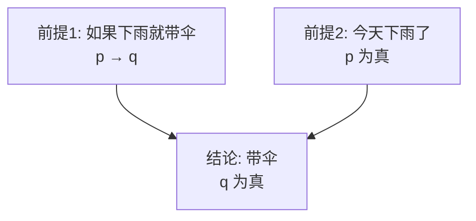

# 数理逻辑基础

<!-- TOC -->
- [基础知识](#基础知识)
  - [命题是什么：能判真假的句子](#命题是什么能判真假的句子)
  - [命题变元：给句子起个名字](#命题变元给句子起个名字)
  - [五个联结词：把简单句拼成复杂句](#五个联结词把简单句拼成复杂句)
    - [1. 非（¬）：否定](#1-非否定)
    - [2. 与（∧）：两个都要真](#2-与两个都要真)
    - [3. 或（∨）：至少一个真](#3-或至少一个真)
    - [4. 蕴含（→）：如果……那么……](#4-蕴含如果那么)
    - [5. 等价（↔）：同真同假](#5-等价同真同假)
- [原理剖析](#原理剖析)
  - [真值表：把所有可能一行行算出来](#真值表把所有可能一行行算出来)
    - [1 个命题变元：2 行](#1-个命题变元2-行)
    - [2 个命题变元：4 行](#2-个命题变元4-行)
    - [3 个命题变元：8 行](#3-个命题变元8-行)
  - [蕴含最难懂：前件假时，整个蕴含为什么算真](#蕴含最难懂前件假时整个蕴含为什么算真)
  - [蕴含与程序 if 的类比与区别](#蕴含与程序-if-的类比与区别)
  - [德摩根律：否定的分配](#德摩根律否定的分配)
  - [分配律：乘法分配律的逻辑版](#分配律乘法分配律的逻辑版)
  - [蕴含等价式：p → q ≡ ¬p ∨ q](#蕴含等价式p--q--p--q)
- [进阶知识](#进阶知识)
  - [量词：从一个到全部](#量词从一个到全部)
  - [量词否定规则：一步步推](#量词否定规则一步步推)
  - [谓词与论域：量词管的是谁](#谓词与论域量词管的是谁)
  - [推理规则：从已知推出未知](#推理规则从已知推出未知)
    - [肯定前件（MP）：p → q，p 成立，所以 q 成立](#肯定前件mpp--qp-成立所以-q-成立)
    - [否定后件（MT）：p → q，q 不成立，所以 p 不成立](#否定后件mtp--qq-不成立所以-p-不成立)
    - [假言三段论：p → q，q → r，所以 p → r](#假言三段论p--qq--r所以-p--r)
- [疑难杂症](#疑难杂症)
  - [肯定后件为什么错：无效推理的反例](#肯定后件为什么错无效推理的反例)
  - [把“或”当成“异或”：可兼或与不可兼或](#把或当成异或可兼或与不可兼或)
  - [把蕴含当成因果：→ 不是“因为……所以……”](#把蕴含当成因果-不是因为所以)
  - [量词顺序换了，意思就变了](#量词顺序换了意思就变了)
  - [真值表行数总对不上？先数变元](#真值表行数总对不上先数变元)
- [实战案例](#实战案例)
  - [案例一：外卖满减条件，用真值表算清到底减不减](#案例一外卖满减条件用真值表算清到底减不减)
  - [案例二：真实 if 条件化简](#案例二真实-if-条件化简)
  - [案例三：短路求值，别让它坑了你](#案例三短路求值别让它坑了你)
  - [案例四：卫语句，把嵌套 if 拍平](#案例四卫语句把嵌套-if-拍平)
- [面试与自测](#面试与自测)
  - [参考答案](#参考答案)
- [小技巧与冷知识](#小技巧与冷知识)
- [关联知识](#关联知识)
<!-- /TOC -->

## 基础知识

### 命题是什么：能判真假的句子

命题就是一句话，要么真、要么假，二选一，没有中间状态。这个“真或假”叫真值，记作真（T）或假（F）。

- “3 + 2 = 5。”算一下：3 + 2 = 5，算对了，是真命题。
- “3 + 2 = 6。”算一下：3 + 2 = 5，不是 6，是假命题。假的也是命题，只要能定真假就行。
- “今天是星期一。”能判断，要么是、要么不是，是命题。

什么不是命题？不能定真假的句子就不是命题。

- 疑问句：“你吃饭了吗？”是在问人，没法说它真还是假，不是命题。
- 感叹句：“这奶茶也太好喝了吧！”是感受，标准因人而异，没法统一判真假，不是命题。
- 祈使句：“请把门关上。”是命令，不是陈述，也不是命题。

程序员可以这样记：命题就像一个 `boolean` 变量，只能是 `true` 或 `false`。`boolean isMonday = true;` 是命题的影子；`System.out.println("你好吗？");` 只是输出一句话，不是命题。

### 命题变元：给句子起个名字

为方便计算，给命题起个字母名字，叫命题变元。例如 p：明天下雨；q：我带伞；r：外卖满 30 元。p 今天不知道真假，但它一定是真或假其中之一。逻辑就是研究 p、q、r 怎么组合、怎么算真假的学问。

### 五个联结词：把简单句拼成复杂句

#### 1. 非（¬）：否定

¬p 的意思是“p 不成立”，真值正好反过来：p 真，¬p 就假；p 假，¬p 就真。例子：p 是“明天下雨”，¬p 就是“明天不下雨”。如果明天下雨是真的，“明天不下雨”就是假的。程序里的 `!` 就是非：`!isRain` 表示“没下雨”。

#### 2. 与（∧）：两个都要真

p ∧ q 只有 p 和 q 同时为真时才为真，其余全是假。例子：门禁规则“刷卡并且人脸识别通过，才能进门”。设 p：刷了卡；q：人脸通过。只有两个都做到，门才开。只刷卡没刷脸进不去，只刷脸没刷卡也进不去。逐步算：真、真 → 真；真、假 → 假；假、真 → 假；假、假 → 假。口诀：与是“严格的”，一个假就全假。程序里的 `&&` 就是与：`if (hasCard && facePassed)`。

#### 3. 或（∨）：至少一个真

p ∨ q 只要 p、q 里至少一个为真，就是真；只有两个都假时才是假。例子：奶茶店“凭学生证或者凭会员卡，可以打九折”。设 p：有学生证；q：有会员卡。有其中任意一张就能打折，两张都有当然也能打折，两张都没有才打不了。逐步算：真、真 → 真；真、假 → 真；假、真 → 真；假、假 → 假。口诀：或是“宽容的”，一个真就够了。注意这里的“或”是可兼或，两个都真也算真，和“二选一”的异或不一样，后面会讲。程序里的 `||` 就是或：`if (hasStudentCard || hasMemberCard)`。

#### 4. 蕴含（→）：如果……那么……

p → q 读作“如果 p，那么 q”。p 叫前件，q 叫后件。这是最难的一个，下面原理剖析会重点讲透。先给例子：p：明天下雨；q：我请你吃饭。p → q 就是“如果明天下雨，我就请你吃饭”。它的真值表只有一种情况为假：p 真、q 假，也就是“下雨了却没请吃饭”，说话不算话。其余三种情况都是真，包括 p 假的两种情况。程序里的 `if (p) { q; }` 和它很像，但不完全一样，区别后面专门讲。

#### 5. 等价（↔）：同真同假

p ↔ q 只有 p 和 q 真值相同时才为真：同真为真，同假为真，一真一假为假。例子：外卖“满 30 元减 5 元”。设 p：订单满 30 元；q：减 5 元。正常情况下满了就减，没满就不减，两边同真同假，p ↔ q 为真。如果满了 30 却没减，或者没满 30 却减了，那就对不上，p ↔ q 为假。逐步算：真、真 → 真；真、假 → 假；假、真 → 假；假、假 → 真。口诀：等价看“是否一致”，一致就真，不一致就假。程序里没有直接的 ↔，但 `p == q`（两个 boolean 相等）就是等价的意思。

## 原理剖析

### 真值表：把所有可能一行行算出来

真值表就是把命题变元所有真假组合列出来，再算出复合命题的真值。行数规律：n 个变元，就有 2 的 n 次方行。因为每个变元有 2 种取值（真/假），n 个变元互相独立，组合数就是 2 × 2 × … × 2（n 个 2 相乘）= 2^n。

#### 1 个命题变元：2 行

| p | ¬p |
|---|----|
| 真 | 假 |
| 假 | 真 |

一共 2 行，2^1 = 2，对得上。

#### 2 个命题变元：4 行

| p | q | p ∧ q | p ∨ q | p → q | p ↔ q |
|---|---|-------|-------|-------|-------|
| 真 | 真 | 真 | 真 | 真 | 真 |
| 真 | 假 | 假 | 真 | 假 | 假 |
| 假 | 真 | 假 | 真 | 真 | 假 |
| 假 | 假 | 假 | 假 | 真 | 真 |

一共 4 行，2^2 = 4，对得上。逐行核对：第 1 行 p 真、q 真，与、或、蕴含、等价全是真；第 2 行 p 真、q 假，与假、或真、蕴含假（食言了）、等价假；第 3 行 p 假、q 真，与假、或真、蕴含真（前件假，下面细讲）、等价假；第 4 行 p 假、q 假，与假、或假、蕴含真、等价真（同假）。

#### 3 个命题变元：8 行

以 p ∧ q ∧ r 为例：

| p | q | r | p ∧ q ∧ r |
|---|---|---|-----------|
| 真 | 真 | 真 | 真 |
| 真 | 真 | 假 | 假 |
| 真 | 假 | 真 | 假 |
| 真 | 假 | 假 | 假 |
| 假 | 真 | 真 | 假 |
| 假 | 真 | 假 | 假 |
| 假 | 假 | 真 | 假 |
| 假 | 假 | 假 | 假 |

一共 8 行，2^3 = 8，对得上。三个与连在一起，只有三个全真时结果才真，有一个假就全假。写表小技巧：最后一列真假交替，倒数第二列两个真两个假交替，倒数第三列四个真四个假交替，这样不会漏行。

### 蕴含最难懂：前件假时，整个蕴含为什么算真

用“如果明天下雨，我就请你吃饭”逐行讲清。设 p：明天下雨；q：我请你吃饭。

- 第 1 种：下雨了（p 真），请吃饭了（q 真）。说到做到，承诺是真的。
- 第 2 种：下雨了（p 真），没请吃饭（q 假）。说到没做到，承诺是假的。这是唯一为假的情况。
- 第 3 种：没下雨（p 假），请吃饭了（q 真）。我只承诺“下雨就请”，没下雨主动请了，这不算食言，承诺没有被违反，判真。
- 第 4 种：没下雨（p 假），也没请吃饭（q 假）。没下雨，我当然不用请，也没违反承诺，判真。

关键在第 3、第 4 种：当前件是假时，这句话根本没有被“触发”，也就谈不上违反。逻辑上规定：没有违反，就判为真。这叫“空真”，前件假时蕴含恒真。换个门禁例子：规则是“如果刷卡，就开门”。一个人根本没刷卡，门没开，你能说这条规则错了吗？不能。规则只管“刷卡了会怎样”，没刷卡的情况不在管辖范围内，所以算真。

### 蕴含与程序 if 的类比与区别

类比：Java 的 `if (isRain) { treatDinner(); }` 和 p → q 很像。`isRain` 为真时执行请吃饭，为假时跳过。区别有两点：第一，程序的 if 是“动作”，条件真就执行一段代码，条件假就什么都不做，没有真假值；逻辑的 → 是“命题”，整个 p → q 本身有真值，非真即假，可以继续参与运算。第二，程序的 if 只关心“条件真时做不做”，条件假时直接跳过，不讨论对错；逻辑的 → 要给所有四种情况都定真假，前件假时明确判为真，而不是“没定义”。一句话记：程序 if 是“遇到条件才行动”，逻辑蕴含是“对所有情况都打分，食言才判假”。

### 德摩根律：否定的分配

德摩根律有两条，口诀：“否定进括号，与或要互换”。

- ¬(p ∧ q) ≡ ¬p ∨ ¬q：不是“两个都真”，等于“至少一个假”。
- ¬(p ∨ q) ≡ ¬p ∧ ¬q：不是“至少一个真”，等于“两个都假”。

生活例子：“不是（第二杯半价并且满 30 减 5）”，意思是“要么第二杯不半价，要么没满 30 减 5”，至少一个不满足。“不是（有学生证或者有会员卡）”，意思是“既没有学生证，也没有会员卡”，两个都没有。

用真值表逐行验证第一条，一共 4 行：

| p | q | p ∧ q | ¬(p ∧ q) | ¬p | ¬q | ¬p ∨ ¬q |
|---|---|-------|----------|----|----|---------|
| 真 | 真 | 真 | 假 | 假 | 假 | 假 |
| 真 | 假 | 假 | 真 | 假 | 真 | 真 |
| 假 | 真 | 假 | 真 | 真 | 假 | 真 |
| 假 | 假 | 假 | 真 | 真 | 真 | 真 |

第 4 列 ¬(p ∧ q) 和第 7 列 ¬p ∨ ¬q 逐行相等（假、真、真、真），等价成立。行数 4 行，2 个变元，2^2 = 4，对得上。第二条 ¬(p ∨ q) ≡ ¬p ∧ ¬q 验证也是 4 行：p、q 为真、真时两边都是假；真、假时两边都是假；假、真时两边都是假；假、假时两边都是真。第 4 列和第 7 列逐行相等，等价成立。

### 分配律：乘法分配律的逻辑版

分配律有两条，和小学数学的乘法分配律长得很像：p ∧ (q ∨ r) ≡ (p ∧ q) ∨ (p ∧ r)，以及 p ∨ (q ∧ r) ≡ (p ∨ q) ∧ (p ∨ r)。生活例子：设 p：今天发工资；q：奶茶第二杯半价；r：外卖满减。“发工资并且（半价或者满减）”等于“（发工资并且半价）或者（发工资并且满减）”，两种说法算出来的结果一样。验证第一条要 3 个变元，一共 8 行，2^3 = 8：

| p | q | r | q ∨ r | p ∧ (q ∨ r) | p ∧ q | p ∧ r | (p ∧ q) ∨ (p ∧ r) |
|---|---|---|-------|-------------|-------|-------|-------------------|
| 真 | 真 | 真 | 真 | 真 | 真 | 真 | 真 |
| 真 | 真 | 假 | 真 | 真 | 真 | 假 | 真 |
| 真 | 假 | 真 | 真 | 真 | 假 | 真 | 真 |
| 真 | 假 | 假 | 假 | 假 | 假 | 假 | 假 |
| 假 | 真 | 真 | 真 | 假 | 假 | 假 | 假 |
| 假 | 真 | 假 | 真 | 假 | 假 | 假 | 假 |
| 假 | 假 | 真 | 真 | 假 | 假 | 假 | 假 |
| 假 | 假 | 假 | 假 | 假 | 假 | 假 | 假 |

第 5 列和第 8 列逐行相等（真、真、真、假、假、假、假、假），等价成立，8 行数过了，对得上。

### 蕴含等价式：p → q ≡ ¬p ∨ q

这是最常用的一条等价式：蕴含可以换成“或”。“如果 p，那么 q”等价于“p 不成立，或者 q 成立”。生活例子：还是“如果明天下雨，我就请你吃饭”，换个说法就是“明天不下雨，或者我请你吃饭”。要么没下雨（不用请），要么我请了（说到做到），两种情况都说明我没食言。反过来，如果“下雨了并且没请”，两种说法都判假，意思完全一样。用真值表逐行验证，一共 4 行：

| p | q | p → q | ¬p | ¬p ∨ q |
|---|---|-------|----|--------|
| 真 | 真 | 真 | 假 | 真 |
| 真 | 假 | 假 | 假 | 假 |
| 假 | 真 | 真 | 真 | 真 |
| 假 | 假 | 真 | 真 | 真 |

第 3 列和第 5 列逐行相等（真、假、真、真），等价成立。行数 4 行，2 个变元，2^2 = 4，对得上。这条等价式在编程里很实用：`if (p) { q; }` 的条件判断，本质上可以写成 `!p || q`，后面实战案例会用它化简真实的 if 条件。

## 进阶知识

### 量词：从一个到全部

命题逻辑只能讲单个句子，量词让我们讲“一群人、一组数据”。全称量词 ∀ 读作“对所有”：∀x P(x) 表示“所有 x 都满足 P”。存在量词 ∃ 读作“存在”：∃x P(x) 表示“至少有一个 x 满足 P”。生活例子：班里 30 个学生，P(x) 表示“x 交了作业”。∀x P(x) 是“所有学生都交了作业”，要 30 个人全交了才算真，有一个人没交就是假。∃x P(x) 是“有学生交了作业”，只要至少有一个交了就是真，一个都没交才是假。程序员的例子：一个 `List<User>`，P(x) 表示“x 已实名”。∀x P(x) 对应 `users.stream().allMatch(User::isVerified)`，全部实名才真；∃x P(x) 对应 `users.stream().anyMatch(User::isVerified)`，至少一个实名就真。

### 量词否定规则：一步步推

全称和存在的否定是一对“互为否定”，口诀：“否定进量词，全称变存在，存在变全称，里面的命题再取反”。¬∀x P(x) ≡ ∃x ¬P(x)：不是“所有人都交了”，等于“有学生没交”。¬∃x P(x) ≡ ∀x ¬P(x)：不是“有人交了”，等于“所有人都没交”。一步步推第一条：原句是 ∀x P(x)，所有学生都交了作业；否定它，¬∀x P(x)，不是所有学生都交了作业；什么时候“不是所有人都交了”？只要找到一个没交的就行；所以等价于 ∃x ¬P(x)，有学生没交作业。验证：30 个人里 29 个交了、1 个没交，原句为假，否定后为真；等价句“有学生没交”是真，两边一致。再推第二条：原句 ∃x P(x)，有学生交了作业；否定它就是“没有学生交作业”；“一个都没交”换个说法，就是“每个人都没交”；所以等价于 ∀x ¬P(x)，所有学生都没交作业。程序员可以这样记：`!allMatch(...)` 等于 `anyMatch(x -> !...)`；`!anyMatch(...)` 等于 `allMatch(x -> !...)`。写卫语句、写校验逻辑时，这条规则天天用得上。

### 谓词与论域：量词管的是谁

P(x) 里的 P 叫谓词，是一句话里“……怎么样”的部分，比如“x 交了作业”里的“交了作业”。
x 的取值范围叫论域，也就是量词管的是谁。
同一个 ∀x P(x)，论域是“全班 30 人”和论域是“全校 3000 人”，意思完全不同。
第一步先问论域是谁，再看量词是 ∀ 还是 ∃，最后才看谓词 P 是什么。
程序类比：论域就是 Stream 的数据源，`users` 换成 `allUsers`，`allMatch` 的结果可能就变了。
写校验逻辑时，先确认集合有没有过滤错，再谈全称还是存在，否则结论全错。
量词 + 谓词 + 论域三件套齐了，一句带量词的话才算讲完整。

### 推理规则：从已知推出未知

推理就是拿几个真的前提，推出一个结论。常用三条规则如下。

#### 肯定前件（MP）：p → q，p 成立，所以 q 成立

已知 p → q 为真，又已知 p 为真，就可以推出 q 为真。生活例子：规则是“如果下雨就带伞”（p → q），今天真的下雨了（p 真），所以我带伞（q 真）。这一步很稳：前件真了，后件必须真，否则蕴含就成假的了。

#### 否定后件（MT）：p → q，q 不成立，所以 p 不成立

已知 p → q 为真，又已知 q 为假，就可以推出 p 为假。生活例子：规则还是“如果下雨就带伞”，今天我没带伞（q 假），那今天一定没下雨（p 假）。为什么？如果下雨了，按规则我就该带伞，可我没带，矛盾了，所以只能是没下雨。逐步推：假设 p 为真（下雨了），由 p → q 得 q 为真（带伞），但实际 q 为假，矛盾，所以假设错了，p 为假。

#### 假言三段论：p → q，q → r，所以 p → r

两条蕴含接起来，头尾可以连成一条。生活例子：p：下雨；q：地面湿；r：路滑。已知“如果下雨，地面就湿”（p → q），又已知“如果地面湿，路就滑”（q → r），那么可以直接说“如果下雨，路就滑”（p → r）。中间的“地面湿”像一座桥，搭过去就不用重复讲了。逐步推：假设 p 真，由第一条得 q 真；q 真，由第二条得 r 真。所以 p 真时 r 真，p → r 成立；前件假时 p → r 本来就按空真判真，所以整条蕴含成立。

## 疑难杂症

### 肯定后件为什么错：无效推理的反例

肯定后件的形式是：已知 p → q，又已知 q 为真，就推出 p 为真。这是错的，是最常见的无效推理。生活反例：规则是“如果下雨，地面就湿”（p → q），今天地面湿了（q 真），能推出今天下雨了吗？不能。地面湿还可能是洒水车洒过、有人拖地、下水道漏水。下雨只是让地面湿的原因之一，不是唯一原因。用真值表看错在哪：p 假、q 真时，p → q 为真，q 也为真，但 p 是假的。前提都真，结论却假，这就是无效推理。程序里的同款错误：`if (isRain) { groundWet = true; }`，看到 `groundWet == true` 就断言 `isRain == true`，这是错的。记住：肯定前件有效，否定后件有效，肯定后件无效，否定前件也无效（已知 p → q，p 假，不能推出 q 假；没下雨也可能请吃饭）。

### 把“或”当成“异或”：可兼或与不可兼或

逻辑里的 ∨ 是可兼或：两个都真也算真。生活里的“或”常常是二选一，只能选一个，这叫异或（⊕），p ⊕ q 只有一真一假时才为真。例子：奶茶店“凭学生证或者凭会员卡打九折”，两张卡都有当然能打折，这是可兼或 ∨。但菜单上写“加珍珠或者加椰果（二选一）”，两样都加就要加钱，不能都选，这是异或 ⊕。逐步算异或：真、真 → 假；真、假 → 真；假、真 → 真；假、假 → 假。只有第 1 行和 ∨ 不一样。程序里要分清：`a || b` 是可兼或；`(a || b) && !(a && b)` 或 `a ^ b`（boolean 异或）才是二选一。把菜单的二选一写成 `||`，用户两样都选也能通过，逻辑就错了。

### 把蕴含当成因果：→ 不是“因为……所以……”

p → q 只讲真值关系，不讲因果。生活里“如果……那么……”常常带因果，但逻辑里不是。例子：“如果 3 + 2 = 5，那么太阳从东边升起。”前件真，后件真，蕴含为真，但 3 + 2 = 5 和太阳升起之间没有任何因果关系。逻辑只看真值：前件真、后件真，蕴含就真，不管它们有没有关系。再比如：“如果今天是星期一，那么 1 + 1 = 2。”后件恒真，蕴含恒真，哪怕两件事八竿子打不着。程序员要记住：写 `if (a) { b; }` 时，a 和 b 之间是你设计的因果；但逻辑上 p → q 成立，不等于 p 导致了 q。不要看到蕴含为真就去找因果，也不要因为没因果就说蕴含为假。

### 量词顺序换了，意思就变了

∀x∃y 和 ∃y∀x 看起来只换了个顺序，意思完全不同。例子：设 P(x, y) 表示“x 喜欢 y”，x、y 都是班里的学生。∀x∃y P(x, y) 是“每个人都有喜欢的人”，对每个 x 都能找到一个 y（可以不同），让 x 喜欢 y。小明喜欢小红，小红喜欢小刚，都可以。∃y∀x P(x, y) 是“有一个人，被所有人喜欢”，存在一个 y，让所有 x 都喜欢这个 y，比如全班都喜欢班长。前者只要求“每人有心上人”，后者要求“有一个万人迷”。前者真，后者未必真，顺序一换，约束强度完全不同。程序类比：`allMatch(u -> anyMatch(o -> o属于u))`（每人至少有一单）和 `anyMatch(o -> allMatch(u -> o属于u))`（有一单属于所有人，后者基本不可能），意思天差地别。

### 真值表行数总对不上？先数变元

常见错误是漏行或重复行。检查方法：先数有几个不同的命题变元，n 个就是 2^n 行。2 个变元 4 行，3 个变元 8 行，4 个变元 16 行。写表时按“二进制计数”的顺序写：把真当 1、假当 0，从全真开始依次减 1，写到全假，正好 2^n 行，不会漏也不会重。

## 实战案例

### 案例一：外卖满减条件，用真值表算清到底减不减

外卖规则：满 30 元减 5 元，并且会员再减 3 元。设 p：订单满 30 元；q：是会员。算四种情况：订单 35 元、会员（p 真、q 真），满 30 减 5，会员再减 3，一共减 8 元，实付 27 元；订单 35 元、非会员（p 真、q 假），只减 5 元，实付 30 元；订单 20 元、会员（p 假、q 真），没满 30 不减 5，会员的 3 元也要满 30 才触发，也不减，实付 20 元；订单 20 元、非会员（p 假、q 假），什么都不减，实付 20 元。第 3 种最容易算错：只看“是会员”就以为能减 3 元，忘了会员减免也要先满足 p。写成逻辑式就是 (p ∧ q)，p 假则整个与为假，一分不减。

### 案例二：真实 if 条件化简

下面是一段业务代码里常见的条件，判断用户能不能领新人券：`if (isNewUser && (hasCoupon || isFirstOrder)) { grantCoupon(); }`。原式是 p ∧ (q ∨ r)，用分配律展开得 (p ∧ q) ∨ (p ∧ r)，即 `(isNewUser && hasCoupon) || (isNewUser && isFirstOrder)`，展开后反而更长了。再看一个能真正化简的例子：`if ((isVip && isActive) || (isVip && !isActive)) { allowEntry(); }`。一步步化简：第一步提取公因子 isVip，得 `isVip && (isActive || !isActive)`；第二步括号里是“或者取反”，恒真，`isActive || !isActive ≡ 真`；第三步原式 ≡ `isVip && 真 ≡ isVip`；化简后就是 `if (isVip) { allowEntry(); }`，不管活不活跃，只要是会员就能进。这个化简用到了分配律的逆向（提取公因子）和排中律（p ∨ ¬p 恒真），是布尔表达式化简最常见的两步。再看蕴含等价式：`if (isRain) { takeUmbrella(); }` 按 p → q ≡ ¬p ∨ q，可以写成 `!isRain || takeUmbrella` 的判断形式。写卫语句时，`if (!isRain) return; takeUmbrella();` 就是先把 ¬p 的情况排除，剩下的就是 p 真、q 必须真的分支，代码更直白。

### 案例三：短路求值，别让它坑了你

Java 的 `&&` 和 `||` 是短路的：前面的结果能决定整体结果时，后面就不算了。`if (user != null && user.isVip())`：如果 `user` 是 null，`user != null` 为假，`&&` 只要一个假就全假，后面的 `user.isVip()` 根本不会执行，也就不会空指针。反过来如果写成 `user.isVip() && user != null`，`user` 为 null 时第一步就抛空指针。`||` 也一样：`if (isVip || checkRemoteVip(user))`，`isVip` 为真时，`||` 已定为真，后面的远程调用不会执行，省一次网络请求。但如果 `checkRemoteVip` 里有记日志、扣次数的副作用，短路会让它不执行，副作用就丢了。记住：短路求值是性能优化，也是逻辑陷阱，带副作用的表达式别放进 `&&`、`||` 的后半段。

### 案例四：卫语句，把嵌套 if 拍平

新手常写多层嵌套：`if (order != null) { if (order.getAmount() >= 30) { if (user.isVip()) { applyDiscount(); } } }`。三层 if 是 p ∧ q ∧ r，只有三个全真才执行。改成卫语句，一步步排除假的情况：`if (order == null) return; if (order.getAmount() < 30) return; if (!user.isVip()) return; applyDiscount();`。每一条卫语句都是 ¬p 时提前返回，剩下的就是 p ∧ q ∧ r 全真的分支，逻辑上完全等价，可读性好得多。德摩根律在这里也用得上：想把“不是（订单存在并且满 30 并且是会员）”写成卫语句，就是“订单不存在，或者不满 30，或者不是会员”，¬(p ∧ q ∧ r) ≡ ¬p ∨ ¬q ∨ ¬r，一一对应三条 return。

## 面试与自测

1. 判断题：句子“你今天加班吗？”是不是命题？再判断“2 + 2 = 5”是不是命题？分别说明理由。
2. 真值表题：设 p 为真、q 为假，算出 ¬p、p ∧ q、p ∨ q、p → q、p ↔ q 的真值，每一步写出依据。
3. 等价式验证题：用真值表验证 p → q ≡ ¬p ∨ q，列出完整的 4 行真值表，并指出哪两列逐行相等。
4. 推理判断题：已知“如果系统宕机，监控就会告警”（p → q），现在监控告警了（q 为真），能不能推出系统宕机了（p 为真）？如果不能，给一个反例；如果监控没告警（q 为假），能推出什么？

### 参考答案

1. “你今天加班吗？”不是命题，因为它是疑问句，不能判断真假。“2 + 2 = 5”是命题，因为它能判断真假：2 + 2 = 4，不是 5，所以是假命题。假的也是命题，只要能定真假就行。
2. p 真、q 假时：¬p 为假（p 真取反为假）；p ∧ q 为假（q 假，与要求全真）；p ∨ q 为真（p 真，或要求至少一个真）；p → q 为假（前件真、后件假，食言了）；p ↔ q 为假（一真一假，不一致）。答案依次是假、假、真、假、假。
3. 完整真值表共 4 行：p 真、q 真时 p → q 真、¬p ∨ q 真；p 真、q 假时 p → q 假、¬p ∨ q 假；p 假、q 真时 p → q 真、¬p ∨ q 真；p 假、q 假时 p → q 真、¬p ∨ q 真。第 3 列 p → q 与第 5 列 ¬p ∨ q 逐行相等（真、假、真、真），所以等价成立。
4. 监控告警了不能推出系统宕机了，这是肯定后件，是无效推理。反例：监控告警还可能是磁盘满了、CPU 打满、网络抖动，不一定是宕机。如果监控没告警（q 为假），用否定后件（MT）可以推出系统没宕机（p 为假）：如果宕机了，按规则监控一定会告警，既然没告警，说明没宕机。

## 小技巧与冷知识

- 背真值表不用死记硬背：与是“全真才真”，或是“全假才假”，蕴含是“只有真变假才假”，等价是“一致才真”。四句话背下来，五张表全能推出来。
- 写真值表时按二进制数数：把真当 1、假当 0，从 11…1 写到 00…0，2 个变元写 4 行，3 个变元写 8 行，既不会漏行，也不会重复。
- 德摩根律是代码重构的利器：`!(a && b)` 直接改写成 `!a || !b`，`!(a || b)` 改写成 `!a && !b`，IDE 的自动重构用的就是这条规则。
- `p → q` 在代码里没有直接对应的运算符，但 `!p || q` 就是它。写复杂条件时，先把“如果……那么……”翻译成 `!p || q`，再化简，往往能少一层嵌套。
- 全称量词 ∀ 对应 `allMatch`，存在量词 ∃ 对应 `anyMatch`。`!allMatch(...)` 等于 `anyMatch(x -> !...)`，这就是量词否定规则在 Stream API 里的样子。
- 逻辑学家把“前件假时蕴含为真”叫作空真。日常语言里“如果……那么……”带因果和语气，逻辑里只看真值，所以会觉得反直觉，这是正常的，记住“没违反就算真”就够了。

## 关联知识

- [集合论基础](计算机基础/数学/集合论基础.md)：命题的真值集合 {真, 假}、并交补运算与逻辑的与或非一一对应，学集合时可以对照着看。
- [关系与函数](计算机基础/数学/关系与函数.md)：蕴含与等价可以看作真值之间的关系，量词里的谓词本质上是定义在论域上的函数。
- [图论基础](计算机基础/数学/图论基础.md)：推理链可以画成有向图，前提是起点、结论是终点，三段论就是图上的一条路径。
- [统计推断与应用](计算机基础/统计/统计推断与应用.md)：概率里的条件概率 P(q|p) 与逻辑蕴含 p → q 形似而义不同，一个讲频率，一个讲真值，对照着学不容易混淆。
