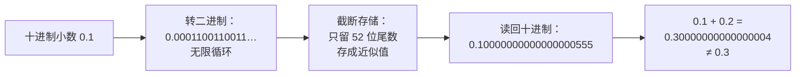

# 浮点数

打开科学计算器，输入 `0.1 + 0.2`，它会老老实实显示 `0.3`。但在 Java 里写下同样的算式，答案却可能让你怀疑人生。这篇笔记不讲高等数学，只用超市价签、银行账单、游戏血条这些每天见到的东西，一步步算给你看：浮点数到底是什么、它为什么会“算错”、以及写 Java 代码时该怎么避开这些坑。

读者只需要会四则运算。所有关键数字都用 Python 实测过，照着敲就能复现。

## 基础知识
### 浮点数就是“科学记数法的计算机版”

先从一个生活场景说起。超市里一袋米标价 12.5 元，一瓶水 2.35 元，收银系统要把它们加起来、打折、找零，全是带小数点的数。计算机里存整数很容易：`12` 就是二进制的 `1100`。但 `12.5` 这种带小数点的数怎么存？

办法和科学记数法一模一样。科学记数法把 `1250` 写成 `1.25 × 10³`，把 `0.0025` 写成 `2.5 × 10⁻³`。计算机把小数写成类似的形式，只不过底数从 10 换成了 2：

> 一个浮点数 = 符号 × 尾数 × 2 的某次方

其中“尾数”决定这个数能精确到第几位，“指数”决定这个数能大到多少、能小到多少。`float` 和 `double` 就是这套写法的两种规格，后面会细讲。

### 先看一个“灵异事件”：0.1 + 0.2 ≠ 0.3

打开 Python，敲三行：

```python
print(0.1 + 0.2)        # 输出：0.30000000000000004
print(0.1 + 0.2 == 0.3) # 输出：False
print(0.3)              # 输出：0.3
```

实测结果就是这样：`0.1 + 0.2` 等于 `0.30000000000000004`，而不是 `0.3`，和 `0.3` 比较的结果是 `False`。这不是 Python 的 bug，Java 里一模一样：

```java
System.out.println(0.1 + 0.2); // 输出：0.30000000000000004
System.out.println(0.1 + 0.2 == 0.3); // 输出：false
```

为什么会这样？因为计算机存 `0.1` 的时候，存的根本不是 `0.1` 本身，而是一个和 `0.1` 非常接近的近似值。下面一步步算给你看。

### 0.1 转成二进制，是一个无限循环小数

我们平时用十进制，二进制只有 `0` 和 `1` 两个数字。整数转二进制很简单：`5` 是 `101`。小数转二进制也有固定方法：把小数部分不断乘以 2，每次取整数部分作为下一位二进制数字，剩下的小数部分继续乘 2。

拿 `0.1` 开刀，一步步算：

| 步骤 | 计算 | 取整数（这一位二进制） | 剩下 |
| --- | --- | --- | --- |
| 第 1 步 | 0.1 × 2 = 0.2 | 0 | 0.2 |
| 第 2 步 | 0.2 × 2 = 0.4 | 0 | 0.4 |
| 第 3 步 | 0.4 × 2 = 0.8 | 0 | 0.8 |
| 第 4 步 | 0.8 × 2 = 1.6 | 1 | 0.6 |
| 第 5 步 | 0.6 × 2 = 1.2 | 1 | 0.2 |
| 第 6 步 | 0.2 × 2 = 0.4 | 0 | 0.4 |
| 第 7 步 | 0.4 × 2 = 0.8 | 0 | 0.8 |
| 第 8 步 | 0.8 × 2 = 1.6 | 1 | 0.6 |
| 第 9 步 | 0.6 × 2 = 1.2 | 1 | 0.2 |
| 第 10 步 | 0.2 × 2 = 0.4 | 0 | 0.4 |

注意第 5 步：剩下的又是 `0.2`，和第 1 步之后的状态一模一样。也就是说，从这里开始，`0011` 这四位会永远循环下去：

> 0.1（十进制）= 0.00011001100110011…（二进制），其中 `0011` 无限循环

这就和十进制里的 `1 ÷ 3 = 0.3333…` 一模一样：`1/3` 在十进制里写不完，`0.1` 在二进制里也写不完。只不过我们平时用十进制，`1/3` 写不完是常识；计算机用二进制，`0.1` 写不完就成了容易踩的坑。

### 存不下，就只能截断：近似值从这里来

`double` 只有 64 位，不可能存无限循环的二进制。办法只有一个：截断。就像把 `1/3` 写成 `0.333333` 一样，计算机把 `0.1` 的二进制截断到 52 位尾数，存进去的其实是：

```python
print(format(0.1, '.20f'))  # 输出：0.10000000000000000555
print(format(0.2, '.20f'))  # 输出：0.20000000000000001110
print(format(0.3, '.20f'))  # 输出：0.29999999999999998890
```

看清楚了：计算机里的 `0.1` 其实是 `0.10000000000000000555`，比 `0.1` 大了一点点；`0.2` 其实是 `0.20000000000000001110`，也大了一点点。两个“大了一点点”的数相加：

> 0.10000000000000000555 + 0.20000000000000001110 = 0.30000000000000001665

这个结果离它最近的、能存进 `double` 的数，就是 `0.30000000000000004`。而 `0.3` 本身在计算机里存的是 `0.29999999999999998890`，两者不是同一个数，所以 `0.1 + 0.2 == 0.3` 是 `False`。

一句话总结：**`0.1 + 0.2 ≠ 0.3` 不是加法算错了，而是 `0.1`、`0.2`、`0.3` 这三个数在存进去的那一刻就已经不是它们自己了。**



### 游戏血条：浮点数每天都在你眼前

玩游戏时角色血条显示 `87.5 / 100`，扣血后变成 `62.35 / 100`，这些带小数点的血量、伤害数字，游戏里基本都是 `float` 在算。血条差 `0.0000001` 你根本看不出来，所以游戏用 `float` 完全够用。但银行账单差 `0.0000001`，乘以一亿笔交易就是真金白银——这就是后面要讲的“什么时候 float 够用、什么时候必须 double、什么时候两个都不能用”。

## 原理剖析
### IEEE 754：全世界通用的浮点数存法

1985 年定下来的 IEEE 754 标准，规定了浮点数在内存里到底怎么摆。今天几乎所有语言、所有 CPU 都按它来，Java 的 `float` 和 `double` 也不例外。

它把一个浮点数切成三段：

| 类型 | 符号位 | 指数位 | 尾数位 | 总共 |
| --- | --- | --- | --- | --- |
| float（32 位） | 1 位 | 8 位 | 23 位 | 32 位 |
| double（64 位） | 1 位 | 11 位 | 52 位 | 64 位 |

- **符号位**：`0` 表示正数，`1` 表示负数。
- **指数位**：存 `2` 的几次方。但它存的不是直接的指数，而是指数加上一个偏移量（float 加 127，double 加 1023），这样指数位全是正数，比较大小时直接按二进制比就行，不用管正负。
- **尾数位**：存小数点后面的二进制数字。省略了一个默认的 `1.`——因为二进制科学记数法里小数点前永远是 `1`，所以这个 `1` 不用存，省出一位，白赚一位精度。

### 手算一遍：5.25 在 float32 里长什么样

拿 `5.25` 做例子，一步步拆。

**第 1 步：转成二进制。** 整数部分 `5` 是 `101`，小数部分 `0.25 × 2 = 0.5` 取 `0`，`0.5 × 2 = 1.0` 取 `1`，所以 `0.25` 是 `0.01`。合起来：

> 5.25（十进制）= 101.01（二进制）

**第 2 步：写成科学记数法。** 小数点左移两位：

> 101.01 = 1.0101 × 2²

**第 3 步：拆三段。**

- 符号位：`5.25` 是正数，符号位是 `0`。
- 指数：真正的指数是 `2`，加上偏移量 127，得到 `129`。`129` 的 8 位二进制是 `10000001`。
- 尾数：`1.0101` 里小数点前的 `1` 不存，只存小数点后的 `0101`，后面补 0 凑满 23 位：`01010000000000000000000`。

**第 4 步：拼起来，验算。** 三段拼成 32 位：

> `0` `10000001` `01010000000000000000000`

手算结果是 `01000000101010000000000000000000`，再倒推验算一次：指数位 `10000001` 是 129，129 − 127 = 2；尾数 `0101` 表示 `0×1/2 + 1×1/4 + 0×1/8 + 1×1/16 = 0.3125`，加上省略的 `1` 就是 `1.3125`；`1.3125 × 2² = 1.3125 × 4 = 5.25`。严丝合缝。

同一个数在 `double` 里也一样拆，只是指数偏移量变成 1023、尾数 52 位：符号 `0`，指数 `1025`（即 2 + 1023），尾数 `0101` 后面补 48 个 0。

### 为什么尾数位数决定精度

尾数 23 位，意味着 `float` 能区分的最小相对间隔大约是 `2⁻²³ ≈ 0.00000012`，换算成十进制大约是 7 位有效数字。`double` 的尾数 52 位，最小相对间隔约 `2⁻⁵² ≈ 2.2 × 10⁻¹⁶`，大约是 15–16 位有效数字。这就是“float 约 7 位、double 约 15–16 位”的来历，不是凭空规定的，是位数算出来的。

## 进阶知识
### float 与 double 的精度：7 位和 15 位到底是什么意思

“约 7 位有效数字”的意思是：一个 `float` 存 `1234567.8` 这种 8 位有效数字的数，最后一位基本就靠不住了；存 `3.1415926`（8 位）也会丢最后一位。而 `double` 存 15 位有效数字才开始丢。

拿超市价签打比方：价签 `9.99` 只有 3 位有效数字，`float` 存它绰绰有余；银行账单 `123456.78` 是 8 位有效数字，`float` 存它就已经在悬崖边上了。

### 实测：累加 100 万次 0.1，float 和 double 差多少

一个经典场景：系统每天累加一笔笔 `0.1` 元的流水，一天下来 100 万笔，理论上应该是 `100000.0`。用 Python 实测两种精度的结果（`float` 用 32 位模拟，每步都按 32 位截断）：

```python
import struct

def f32(x):
    return struct.unpack('f', struct.pack('f', x))[0]

s32 = 0.0
for i in range(1000000):
    s32 = f32(s32 + f32(0.1))
print("float32 累加 100 万次 0.1 =", s32)   # 输出：100958.34375

s64 = 0.0
for i in range(1000000):
    s64 += 0.1
print("float64 累加 100 万次 0.1 =", s64)   # 输出：100000.00000133288
```

结果很直观：

| 类型 | 累加 100 万次 0.1 | 和 100000.0 的误差 |
| --- | --- | --- |
| float32 | 100958.34375 | 约 958.34（多了 958 块多） |
| float64 | 100000.00000133288 | 约 0.00000133（多了不到一分钱的一百万分之一） |

`float` 的误差已经大到离谱：100 万笔 `0.1` 元，账上凭空多出 958 元。`double` 的误差只有 `0.00000133`，对绝大多数场景可以忽略，但它依然不是零——如果累加次数再翻 1000 倍，`double` 也会露出马脚。

### 什么时候 float 就够，什么时候必须 double

- **float 就够**：游戏血条、伤害数字、粒子特效坐标、传感器读数。这些场景差个 `0.0001` 没人察觉，而且 `float` 省一半内存、显卡算得更快。
- **必须 double**：科学计算、工程仿真、统计汇总、经纬度计算。经度差 `0.0000001` 度在地面上就是 1 厘米左右，`float` 的 7 位精度在经纬度这种“整数部分 3 位、小数部分还要 6 位”的场景下捉襟见肘。
- **两个都不能用**：钱。货币计算不用 `float` 也不用 `double`，用 `BigDecimal`，后面实战案例会讲。

一条经验法则：**Java 里没有特别理由时，默认用 `double`；只有明确知道精度要求低、且内存或性能敏感时才用 `float`。** 现代服务器内存不差那一半，`float` 省下来的内存远不如它埋的坑贵。

## 疑难杂症
### 浮点数比较：永远不要用 `a == b` 直接比

前面已经看到 `0.1 + 0.2 == 0.3` 是 `false`。更隐蔽的坑在循环里：

```java
// 千万别这么写：循环可能多跑一次，也可能少跑一次
for (double x = 0.0; x != 1.0; x += 0.1) {
    // ...
}
```

`x` 每次加 `0.1`，由于每次加的都是近似值，`x` 永远精确等于 `1.0` 的概率很低，循环次数不可控。正确做法是和一个很小的容差（epsilon）比较：

```java
double a = 0.1 + 0.2;
double b = 0.3;
double eps = 1e-9; // 容差：十亿分之一

if (Math.abs(a - b) < eps) {
    System.out.println("在误差允许范围内，两者相等"); // 会输出这一行
}
```

`Math.abs(a - b)` 是两个数的差的绝对值。`0.1 + 0.2` 和 `0.3` 的差大约是 `5.55 × 10⁻¹⁷`，远小于 `1e-9`，所以判定为相等。容差取多大要看业务：游戏里 `1e-6` 够了，科学计算可能要 `1e-12`，钱则根本不该走到这一步——直接上 `BigDecimal`。

### 特殊值：NaN、正无穷、负无穷、-0.0

浮点数有几个整数没有的“特殊居民”，各有各的产生场景：

**NaN（Not a Number，不是数）**：`0.0 / 0.0` 的结果。0 除以 0 在数学上没有定义，Java 不抛异常，而是给你一个 NaN：

```java
double nan = 0.0 / 0.0;
System.out.println(nan);              // 输出：NaN
System.out.println(Double.isNaN(nan)); // 输出：true
```

最反直觉的一点：**NaN 不等于它自己**。`Double.NaN == Double.NaN` 是 `false`，连 `nan != nan` 都是 `true`。所以判断一个数是不是 NaN，绝不能写 `x == Double.NaN`（永远是 `false`），必须用 `Double.isNaN(x)`。这个设计是 IEEE 754 故意定的：NaN 表示“算不出来”，两个“算不出来”没法说它们相等。

**正无穷 / 负无穷**：非零数除以 `0.0` 的结果：

```java
System.out.println(1.0 / 0.0);   // 输出：Infinity
System.out.println(-1.0 / 0.0);  // 输出：-Infinity
System.out.println(Double.isInfinite(1.0 / 0.0)); // 输出：true
```

注意和整数区分：Java 里整数 `1 / 0` 会抛 `ArithmeticException`，但浮点数 `1.0 / 0.0` 不抛异常，给你 `Infinity`。产生场景很常见：算平均值时除数是 `0.0`、算斜率时分母是 `0.0`。用 `Double.isInfinite(x)` 判断。

**-0.0（负零）**：`0.0` 也有正负之分。`-1.0 / 0.0` 是负无穷，而 `1.0 / -0.0` 也是负无穷。`-0.0 == 0.0` 是 `true`，两者判相等时没区别，区别只在除法结果的符号上：`1.0 / 0.0` 是 `Infinity`，`1.0 / -0.0` 是 `-Infinity`。日常开发里几乎碰不到负零，知道有这么回事、看到 `-0.0` 别以为是 bug 就行。

### 浮点数的舍入与显示：2.675 的陷阱

银行账单上 `2.675` 元，保留两位小数应该是 `2.68`（四舍五入）。但在 `double` 里，`2.675` 存的其实是：

```python
print(format(2.675, '.20f'))  # 输出：2.67499999999999982236
print(format(2.675, '.2f'))    # 输出：2.67
```

存进去的 `2.675` 比真实值小了一点点，是 `2.67499999…`。格式化保留两位小数时，计算机看到的是 `2.674999…`，第三位是 `4`，于是舍掉，得到 `2.67`，而不是你以为的 `2.68`。这不是格式化函数的 bug，是存进去的那个数本身就比 `2.675` 小。

Java 里一样：

```java
System.out.printf("%.2f%n", 2.675); // 输出：2.67
```

记住这个结论：**对 `double` 做“保留两位小数”再四舍五入，个位数的零头可能在存入时就已经丢了，显示结果会和你手算的不一致。** 涉及钱的舍入（例如“分”以下的四舍五入），用 `BigDecimal` 的 `setScale(2, RoundingMode.HALF_UP)`，它按十进制舍入，不走二进制近似。

### 浮点数没有结合律

实数里 `(a + b) + c = a + (b + c)` 恒成立，浮点数不成立，因为每一步加法都会单独舍入一次，舍入顺序不同结果就可能不同。Python 实测：

```python
a, b, c = 1e16, 1.0, 1.0
print((a + b) + c)  # 输出：1e+16
print(a + (b + c))  # 输出：1.0000000000000002e+16
```

道理很直观：`1e16` 太大了，加 `1.0` 时 `1.0` 小于它能分辨的最小间隔，直接被舍入“吃”掉了，所以 `(a + b) + c` 还是 `1e16`；而先算 `b + c = 2.0`，再加到 `1e16` 上，`2.0` 刚好够得上最小间隔，就留下来了。并行计算里把求和顺序打乱，结果每次都可能不一样，这不是 bug，是浮点数的固有性质。

## 实战案例

### 案例一：0.1 元累加 10 次，账上少了 1 分钱的零头

超市收银系统，一件商品 `0.1` 元（别较真价格，这里是算术演示），顾客买了 10 件，理论上是 `1.0` 元。Python 实测：

```python
s = 0.0
for i in range(10):
    s += 0.1
print(s)  # 输出：0.9999999999999999
```

10 个 `0.1` 加起来是 `0.9999999999999999`，不是 `1.0`。差 `0.0000000000000001`，单笔看微不足道，但如果系统用 `x == 1.0` 判断“是否满 1 元减免”，这笔订单就永远触发不了优惠；如果每天有几百万笔这样的累加，误差会越滚越大——前面 100 万次累加的实测已经展示了 `float` 能滚出 958 元的误差。

### 案例二：货币计算的正确写法——BigDecimal

Java 里算钱的标准答案是 `BigDecimal`，它按十进制精确算，不走二进制近似。但 `BigDecimal` 有一个新手必踩的坑：两种构造方式天差地别。

```java
import java.math.BigDecimal;

public class MoneyDemo {
    public static void main(String[] args) {
        // 正确：用字符串构造，0.1 就是精确的 0.1
        BigDecimal a = new BigDecimal("0.1");
        BigDecimal total = BigDecimal.ZERO;
        for (int i = 0; i < 10; i++) {
            total = total.add(a);
        }
        System.out.println(total); // 输出：1.0

        // 错误示范：用 double 构造，二进制误差被原样带进来
        BigDecimal b = new BigDecimal(0.1);
        System.out.println(b); // 输出：0.1000000000000000055511151231257827021181583404541015625

        // 正确做法的另一种：先算再定小数位
        BigDecimal price = new BigDecimal("2.675");
        System.out.println(price.setScale(2, java.math.RoundingMode.HALF_UP)); // 输出：2.68
    }
}
```

逐行解释：

- `new BigDecimal("0.1")`：传字符串 `"0.1"`，`BigDecimal` 直接按十进制理解，存的就是精确的 `0.1`。10 次累加得到精确的 `1.0`。
- `new BigDecimal(0.1)`：传 `double` 类型的 `0.1`，而这个 `double` 本身就是 `0.10000000000000000555…`，`BigDecimal` 忠实地把这串误差全搬进来，输出一长串 `0.1000000000000000055511151231257827021181583404541015625`。错不在 `BigDecimal`，错在传入的 `double` 早就“脏”了。
- `setScale(2, RoundingMode.HALF_UP)`：保留两位小数、四舍五入。`2.675` 用 `BigDecimal` 存是精确的 `2.675`，所以四舍五入得到正确的 `2.68`，而前面 `double` 的 `2.675` 只能得到 `2.67`。

记住一条铁律：**`BigDecimal` 只用字符串构造（`new BigDecimal("0.1")`），或者用 `BigDecimal.valueOf(0.1)`（它内部先转字符串再构造）；永远不要用 `new BigDecimal(0.1)` 这种 `double` 构造。**

## 面试与自测

1. 在 Python 或 Java 里，`0.1 + 0.2 == 0.3` 的结果是什么？为什么？请用“0.1 的二进制是无限循环小数”来解释。
2. 把 `5.25` 按 IEEE 754 存成 float32，符号位、指数位、尾数位分别是什么？指数位为什么是 `10000001` 而不是 `00000010`？
3. 一段 Java 代码用 `float` 累加 100 万次 `0.1`，结果和 `100000.0` 差了约 958；换成 `double` 后误差只剩约 `0.00000133`。请解释误差变小的原因，并说出货币累加应该用什么类型。
4. `double x = 0.0 / 0.0;` 执行后，`x == x` 的结果是什么？应该用什么方法判断 `x` 是 NaN？另外，`new BigDecimal(0.1)` 和 `new BigDecimal("0.1")` 的结果有什么不同，哪种是对的？

### 参考答案

1. 结果是 `False`（Java 里是 `false`）。因为 `0.1` 转成二进制是 `0.0001100110011…`，其中 `0011` 无限循环，`double` 只能截断存近似值（实际存的是 `0.10000000000000000555`），`0.2` 同理存的是 `0.20000000000000001110`。两者相加得 `0.30000000000000004`，而 `0.3` 存的是 `0.29999999999999998890`，不是同一个数，所以 `a == b` 比较为假。不是加法错了，是三个数存进去时就已经是近似值。
2. 符号位 `0`（正数）；指数位 `10000001`（十进制 129）；尾数位 `01010000000000000000000`。指数位是 `10000001` 是因为 IEEE 754 存指数要加偏移量 127：真实指数是 2（`5.25 = 1.0101 × 2²`），2 + 127 = 129，129 的 8 位二进制就是 `10000001`。尾数只存 `1.0101` 小数点后的 `0101`，省略的 `1` 不存，后面补 0 凑满 23 位。
3. 误差变小是因为 `double` 的尾数有 52 位、`float` 只有 23 位，`double` 存 `0.1` 的近似值离真实值更近（`0.10000000000000000555` 对 `0.10000000149011611938`），每次累加带入的误差更小，100 万次累加后总误差分别是约 `0.00000133` 和约 `958.34`。货币累加既不用 `float` 也不用 `double`，要用 `BigDecimal`（字符串构造），按十进制精确计算。
4. `x == x` 的结果是 `false`。因为 `0.0 / 0.0` 得到 NaN，而按 IEEE 754 的规定 NaN 不等于任何值，包括它自己，所以 `x == x` 为假。判断 NaN 必须用 `Double.isNaN(x)`，不能用 `a == b`。`new BigDecimal(0.1)` 会把 `double` 的二进制误差原样带进来，得到 `0.1000000000000000055511151231257827021181583404541015625`；`new BigDecimal("0.1")` 按字符串精确构造，得到精确的 `0.1`。后者是对的，货币计算只用字符串构造。

## 小技巧与冷知识

- **打印浮点数看到的不是存的值**：Python 的 `print(0.1)` 显示 `0.1`，Java 的 `println(0.1)` 也显示 `0.1`，但这只是“最短的、能区分出这个数的十进制写法”，不是内存里真实的二进制值。想看到真相，用 `format(0.1, '.20f')`（Python）或 `new BigDecimal(0.1)`（Java）把 20 位全打出来。
- **整数也有“浮点数存不下”的时候**：`double` 的 52 位尾数能精确表示的最大连续整数是 `2⁵³ = 9007199254740992`。超过这个数，相邻两个整数之间就插不进新的 `double` 了，`9007199254740992 + 1 == 9007199254740992` 会变成 `true`。雪花 ID、数据库自增主键一旦超过 9007199254740992，就不能再用 `double` 传了，前端 JavaScript 的 `Number` 同样是 `double`，也是这个上限。
- **0.5、0.25、0.75 是“干净”的小数**：`0.5 = 1/2`、`0.25 = 1/4`、`0.75 = 3/4`，分母是 2 的次方，二进制能精确表示，存进去分毫不差。所以 `0.5 + 0.25 == 0.75` 是 `true`。只有分母含 2 以外的质因数的小数（`0.1 = 1/10`、`0.2 = 1/5`、`0.3 = 3/10`）才会在二进制里无限循环。
- **科学计算器也在“骗”你**：计算器显示 `0.1 + 0.2 = 0.3`，不是因为它算得比计算机准，而是因为它内部用十进制算、或者显示时做了四舍五入。它的芯片里同样跑的是二进制，只是显示层帮你把 `0.30000000000000004` 修饰成了 `0.3`。理解这一点，就理解了为什么“显示 0.3”和“存的是 0.3”是两回事。

## 关联知识

- [精度误差](计算机基础/数学/精度误差.md)：浮点数只是误差的来源之一，这篇讲误差在计算中如何产生、传播和放大。
- [数值稳定性](计算机基础/数学/数值稳定性.md)：同样的数学公式，换一种写法误差可能差出几个数量级，这篇讲怎么写出数值稳定的算法。
- [统计学与概率论](计算机基础/统计/统计学与概率论.md)：均值、方差这些统计量在大样本下累加时，浮点误差同样会捣乱，这篇讲统计量的正确算式。
- [编码-字符集-内存-文件系统](计算机基础/编码-字符集-内存-文件系统.md)：浮点数的位布局只是内存编码的一种，这篇讲数据在内存和文件里到底是怎么摆的。
