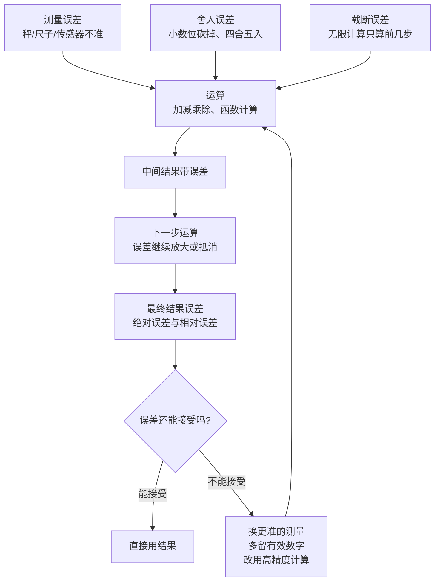

# 精度误差

<!-- TOC -->
- [基础知识](#基础知识)
  - [误差是什么：真值与近似值](#误差是什么真值与近似值)
  - [绝对误差：差了多少](#绝对误差差了多少)
  - [相对误差：差的比例有多大](#相对误差差的比例有多大)
  - [绝对误差 vs 相对误差：什么时候看哪个](#绝对误差-vs-相对误差什么时候看哪个)
- [原理剖析](#原理剖析)
  - [误差的三个来源](#误差的三个来源)
  - [误差从哪里来、到哪里去](#误差从哪里来到哪里去)
- [进阶知识](#进阶知识)
  - [有效数字：这个数到底有几位是可信的](#有效数字这个数到底有几位是可信的)
  - [误差传播：误差是怎样在运算里长大的](#误差传播误差是怎样在运算里长大的)
  - [舍入规则：四舍五入和银行家舍入](#舍入规则四舍五入和银行家舍入)
- [疑难杂症](#疑难杂症)
  - [误差在编程里的落地](#误差在编程里的落地)
  - [常见误区](#常见误区)
- [实战案例](#实战案例)
  - [案例：给一次购物结算算一笔“误差账”](#案例给一次购物结算算一笔误差账)
- [面试与自测](#面试与自测)
  - [参考答案](#参考答案)
- [小技巧与冷知识](#小技巧与冷知识)
  - [写在最后：记住这六句话](#写在最后记住这六句话)
- [关联知识](#关联知识)
<!-- /TOC -->

> 一句话：误差不是“你算错了”，而是“你手里的数”和“真实的数”之间必然存在的那一点点差距。菜市场称菜、银行算利息、程序里用 `double` 加 0.1，处处都有它。这篇只用生活例子和一步步的算术讲明白，零数学基础也能读懂。

## 基础知识

### 误差是什么：真值与近似值

- **真值**：事物真实的值，往往不知道、也没法百分之百量出来。比如一袋米真实重量是 5.00 千克，这就是真值。
- **近似值**：我们量出来、算出来的值。比如秤显示 5.02 千克，这就是近似值。
- **误差**：近似值和真值之间的差距。差距越小，越接近真实。秤、尺子、手机电量显示，没有一个是百分之百准的，它们给出的都是近似值。误差不是例外，而是常态。

### 绝对误差：差了多少

公式只有一个：`绝对误差 = |近似值 - 真值|`。竖线的意思是取绝对值，只看差距大小，不看方向。比真值大 0.02 还是小 0.02，绝对误差都是 0.02。

**例子 1：菜市场称米。** 真值 5.00 千克，秤显示 5.02 千克。第 1 步：5.02 - 5.00 = 0.02；第 2 步：取绝对值，|0.02| = 0.02。结论：绝对误差是 **0.02 千克**，也就是 20 克。

**例子 2：量身高。** 真实身高 175 厘米，卷尺量出 174.5 厘米。第 1 步：174.5 - 175 = -0.5；第 2 步：|-0.5| = 0.5。结论：绝对误差是 **0.5 厘米**。

**例子 3：手机电量百分比。** 电池真实剩余 87%，屏幕显示 85%。第 1 步：85 - 87 = -2；第 2 步：|-2| = 2。结论：绝对误差是 **2 个百分点**。注意这里说“百分点”，不是“2%”，后面讲相对误差时会再算一次。

### 相对误差：差的比例有多大

只看“差了多少”有时候不够，还要看“相对于真值差了多少”。公式：`相对误差 = 绝对误差 / |真值|`。算出来是小数，乘以 100% 就变成百分数。

**例子 1：接着算那袋米。** 绝对误差 0.02 千克，真值 5.00 千克。第 1 步：0.02 / 5.00 = 0.004；第 2 步：0.004 × 100% = 0.4%。结论：相对误差是 **0.4%**，每 1000 克里只差 4 克，不算大。

**例子 2：接着算身高。** 绝对误差 0.5 厘米，真值 175 厘米。第 1 步：0.5 / 175 = 0.002857……；第 2 步：约 0.29%。结论：相对误差约 **0.29%**。

**例子 3：接着算手机电量。** 绝对误差 2 个百分点，真值 87%。第 1 步：2 / 87 = 0.022988……；第 2 步：约 2.30%。结论：相对误差约 **2.30%**，比称米那 0.4% 大得多。

**再看一个容易混的点：百分点和百分比不是一回事。** 手机电量从 87% 掉到 85%，差了 2 个百分点，这是绝对误差的说法；换成相对误差的说法，是 2 / 87 ≈ 2.30%。再举一个：银行存款利率从 2% 涨到 3%，涨了 1 个百分点，但相对涨幅是 1 / 2 = 50%。说话时先想清楚自己在说“差了几个点”还是“差了百分之几”，两个数字差得很远。
**例子 4：体重秤。** 早上称 70.0 千克，晚上称 70.4 千克，体重不可能一天涨 0.4 千克，多半是秤的误差、吃饭喝水、衣服重量造成的。假设真实体重是 70.0 千克，晚上那次的绝对误差就是 |70.4 - 70.0| = 0.4 千克，相对误差是 0.4 / 70.0 ≈ 0.57%。一次测量说明不了什么，多测几次取平均才靠谱，后面关联的统计学篇会讲这个办法。

### 绝对误差 vs 相对误差：什么时候看哪个

先记结论：**绝对误差回答“差了多少”，适合比较同一类、同一个量级的东西；相对误差回答“差的比例有多大”，适合比较不同量级的东西，或者判断这个误差到底严不严重。**

**例子：同样是差 10 克，买菜和买金子完全是两回事。** 买菜：真值 500 克，秤少给 10 克，实际 490 克。绝对误差 |490 - 500| = **10 克**；相对误差 10 / 500 = 0.02 = **2%**。少了 2%，一斤菜少了一小把，不高兴，但还能接受。买金子：真值 50 克，秤少给 10 克，实际 40 克。绝对误差 |40 - 50| = **10 克**；相对误差 10 / 50 = 0.2 = **20%**。少了整整 20%，五分之一没了，这是大事。绝对误差都是 10 克，一模一样；相对误差一个 2%，一个 20%，差了 10 倍。**所以只看绝对误差会骗人：东西越贵、量越小，同样的绝对误差就越严重。** 判断“这个误差要不要紧”，一般要看相对误差。

反过来也有只看绝对误差就够的时候。快递称重：包裹限重 20 千克，超了 0.1 千克就是超了，不管相对误差只有 0.5%，快递公司只认绝对的公斤数。银行利息：少算 1 分钱就是少算 1 分钱，对账时按绝对金额补，不会说“相对误差才 0.0001%，算了”。一句话总结：**问“差多少”看绝对误差，问“严重不严重”看相对误差。**

## 原理剖析

### 误差的三个来源

误差主要有三个来源，记住这三个词，后面所有误差问题都能往里套。

**来源 1：测量误差——量具本身就不完美。** 只要动手量，就有测量误差。尺子有刻度、秤有精度、人的眼睛也有读数偏差。**例子：快递称重。** 包裹真实重量 3.00 千克，快递秤最小刻度是 0.01 千克，显示 3.02 千克。绝对误差 |3.02 - 3.00| = 0.02 千克。原因：秤的传感器、摆放位置、风吹一下，都会让读数漂一点。换一把更准的秤可以减小，但永远消不到零。再如量身高：早上量 175.2 厘米，晚上量 174.8 厘米，人其实没变，是站姿、尺子贴合程度变了，两次结果差 0.4 厘米，这就是测量误差。

**来源 2：舍入误差——数太长，只好砍掉。** 很多数是无限长的，或者小数位太多，存不下、用不上，只能四舍五入砍掉，砍掉的那部分就是舍入误差。**例子：银行利息。** 本金 10000 元，年利率 2.5%，一年利息是 10000 × 0.025 = 250.00 元，正好不用舍入。换一个数：本金 3333 元，利息是 3333 × 0.025 = 83.325 元。钱只到“分”，83.325 元要舍入成 83.33 元，83.33 - 83.325 = 0.005 元，这 0.005 元就是舍入误差。一次只有半分钱，可是一万笔、一亿笔加起来就不是小钱了，银行系统里这叫“尾差”，要专门处理。再如手机电量：电池真实剩余 87.4%，屏幕只能显示整数 87%，舍掉的 0.4 个百分点就是舍入误差。显示位数越少，舍入误差越大。

**来源 3：截断误差——算式本身被“截断”了。** 有些计算在数学上要无限步才能算完，程序只能算前几步，后面的直接不要了，丢掉的部分就是截断误差。**例子：圆周率 π。** π 的真实值是 3.14159265……，小数点后面没完没了。程序里写 3.14，就是把后面的 0.00159265…… 截掉了，截断误差约 **0.0016**。多留一位写 3.1416，误差就小到约 0.000007，代价是多算、多存。**例子：1 除以 3。** 1 / 3 = 0.333333……，永远除不尽。写成 0.333 就是截断，误差约 **0.00033**。截断和舍入很像，区别是舍入是“四舍五入砍掉”，截断是“后面直接不要了”。写代码时取近似公式、循环只算前 N 项，都会产生截断误差。

**舍入误差和截断误差怎么分？一句话：舍入是“看最后一位决定进还是舍”，截断是“看都不看直接砍掉”。** 比如 3.149 要留两位小数，四舍五入看第三位 9，进 1 得 3.15，舍入误差是 |3.15 - 3.149| = 0.001；截断是直接砍成 3.14，截断误差是 |3.14 - 3.149| = 0.009，比舍入误差大 9 倍。所以能四舍五入的时候别直接截断，截断的误差通常更大。写代码时 `int(x)`、`Math.floor()` 都是截断思维，`(int) Math.round(x)` 才是舍入思维，选错了误差能差一个数量级。
**再看一个截断误差的例子：算 1 + 1/2 + 1/4 + 1/8 + ……** 这一串加到无穷大，结果是 2。程序只能加前 4 项：1 + 0.5 + 0.25 + 0.125 = 1.875，离 2 还差 0.125，这 0.125 就是截断误差。再加一项 1/16，结果是 1.9375，误差缩小到 0.0625。规律很清楚：算得越多，截断误差越小；算得越少，误差越大。循环次数和精度之间，就是在做这笔买卖。

### 误差从哪里来、到哪里去

三个来源的误差不会老实待着，一旦参与运算，就会一路传下去、越传越大。下面这张图就是整篇的骨架：



读图的方法：从左到右看来源，从上到下看传播。最关键的一点是，**误差在运算里一般是越传越大，不会自己消失**。下一节就一步步算，加减法和乘除法分别是怎样把误差传下去的。

## 进阶知识

### 有效数字：这个数到底有几位是可信的

**有效数字**就是一个数里真正可信、有意义的数字位数，从第一个不是 0 的数字开始数，一直数到最后一位。数有效数字只看三条规则：（1）数字中间的 0 都算，比如 1002 是 4 位；（2）小数点前面、第一个非零数字前面的 0 不算，它们只是用来定位小数点的，比如 0.0012 里的两个 0 不算；（3）小数点后面的 0 要算，因为它表示“量到了这一位”，比如 1.20 里的 0 算，1.2 里没有这个 0。

**一步步数：为什么 0.00120 是 3 位有效数字。** 写出这个数：0.00120。第 1 步：从左往右找第一个不是 0 的数字，是 1，从这里开始数；第 2 步：前面的 0.00 只是定位小数点，不算；第 3 步：从 1 开始往后数：1 是第 1 位，2 是第 2 位，0 是第 3 位。结论：**0.00120 有 3 位有效数字**，分别是 1、2、0。最后那个 0 不是凑数的：它表示量到了千分位后第三位，如果只量到 0.0012，写出来就是 0.0012，只有 2 位。

**一步步数：为什么 1200 可能是 2 位、3 位，也可能是 4 位。** 写出这个数：1200。情况一：如果只量到百位，1200 的意思是“大约 1200”，末尾两个 0 只是占位，有效数字是 1 和 2，共 **2 位**。情况二：如果量到了十位，有效数字是 1、2、0，共 **3 位**。情况三：如果量到了个位，每一位都量过，有效数字是 1、2、0、0，共 **4 位**。结论：**光写 1200 是说不清的**，想说清就要写成科学记数法：1.2 × 10³ 是 2 位，1.20 × 10³ 是 3 位，1.200 × 10³ 是 4 位。教训：写代码、写文档、写接口返回时，数字该留几位要想清楚，多写一个 0 或者少写一个 0，意思完全不一样。再数两个练手感：1002 从 1 数到 2，中间两个 0 都算，共 **4 位**；0.0205 前面的 0.0 不算，从 2 开始数，2、0、5，共 **3 位**。

**再练三组，数有效数字要形成肌肉记忆。** 第一组：0.00450，从 4 开始数，4、5、0，共 3 位，前面的 0.00 都不算；第二组：20.0，小数点后的 0 要算，共 3 位，它表示量到了十分位；第三组：10000，如果是“大约一万”，只有 1 位有效数字，如果是数出来的 10000 个，写成 10000. 才表示 5 位都量过。面试时最常考的就是 0.00120 和 1200 这两个，记住口诀：**前面的 0 不算，中间的 0 都算，后面的 0 看有没有小数点**。
**有效数字和误差是一枚硬币的两面。** 一个数写了 3 位有效数字，意思就是它的相对误差大约在 0.1% 到 1% 这个量级；写了 4 位，相对误差大约在 0.01% 到 0.1% 这个量级。位数越多，隐含的误差越小。所以看到别人给你的数，先数它的有效数字，就能大概判断它有多可信，不用等对方把误差分析写出来。

### 误差传播：误差是怎样在运算里长大的

规则分两种，记住口诀就行：**加减法：绝对误差相加；乘除法：相对误差相加。** 下面两个例子，每一步都算给你看，Python 复算结果附在后面。

**加减法：绝对误差相加。例子：两次测量相加。** 第一段 12.3 厘米，绝对误差 ±0.1 厘米（真实值在 12.2 到 12.4 之间）；第二段 7.8 厘米，绝对误差 ±0.1 厘米（真实值在 7.7 到 7.9 之间）。加法：第 1 步：近似值相加，12.3 + 7.8 = 20.1 厘米；第 2 步：绝对误差相加，0.1 + 0.1 = 0.2 厘米；第 3 步：最坏的情况是第一段多量 0.1，第二段也多量 0.1，合计多量 0.2，反过来都少量 0.1，合计少量 0.2。结论：结果是 **20.1 ± 0.2 厘米**，真实值在 19.9 到 20.3 之间。减法也一样：第 1 步：12.3 - 7.8 = 4.5 厘米；第 2 步：绝对误差还是相加，0.1 + 0.1 = 0.2 厘米。结论：**4.5 ± 0.2 厘米**。注意减法里误差也是相加，不是相减。两个数都带误差，相减不会把误差减没，只会让相对误差显得更大，因为 4.5 比 20.1 小得多，0.2 / 4.5 ≈ 4.4%，而 0.2 / 20.1 ≈ 1.0%。

```python
# 加减法误差传播，Python 复算
a, da = 12.3, 0.1
b, db = 7.8, 0.1
print(a + b, da + db)  # 20.1 0.2
print(a - b, da + db)  # 4.5 0.2（浮点显示可能是 4.500000000000001）
print(0.2 / 4.5)       # 约 0.0444，即 4.4%
print(0.2 / 20.1)      # 约 0.00995，即 1.0%
```

**乘除法：相对误差相加。例子：长方形面积。** 长 5.0 米，绝对误差 ±0.1 米；宽 3.0 米，绝对误差 ±0.1 米。先把各自的相对误差算出来：第 1 步：长的相对误差 = 0.1 / 5.0 = 0.02，也就是 2%；第 2 步：宽的相对误差 = 0.1 / 3.0 = 0.03333……，约 3.33%；第 3 步：面积 = 5.0 × 3.0 = 15.0 平方米；第 4 步：面积的相对误差 = 2% + 3.33% = **5.33%**；第 5 步：面积的绝对误差 = 15.0 × 0.05333…… = **0.8 平方米**。结论：面积是 **15.0 ± 0.8 平方米**，真实值大约在 14.2 到 15.8 之间。

除法也一样，相对误差相加。**例子：算速度，路程除以时间。** 路程 100 千米，绝对误差 ±1 千米，相对误差 1 / 100 = 1%；时间 2 小时，绝对误差 ±0.05 小时，相对误差 0.05 / 2 = 2.5%。第 1 步：速度 = 100 / 2 = 50 千米/小时；第 2 步：速度的相对误差 = 1% + 2.5% = **3.5%**；第 3 步：速度的绝对误差 = 50 × 0.035 = **1.75 千米/小时**。结论：速度是 **50 ± 1.75 千米/小时**。

```python
# 乘除法误差传播，Python 复算
L, dL, W, dW = 5.0, 0.1, 3.0, 0.1
area = L * W
rel = dL / L + dW / W
print(area, rel, area * rel)  # 15.0 0.05333... 0.8
print(100 / 2, 1 / 100 + 0.05 / 2, 50 * 0.035)  # 50.0 0.035 1.75
```

口诀再说一遍：**加减看绝对，乘除看相对。** 做加减先把绝对误差加起来，做乘除先把相对误差加起来，最后再换算回你想要的那一种。

**误差传播还有两个容易踩的坑。** 第一，误差传播算出来的是“最坏情况的上限”，不是“一定会差这么多”。比如两段长度的误差都是 ±0.1，合计误差上限是 ±0.2，但真实误差经常比 0.2 小，因为两个误差可能一正一负互相抵消一部分。第二，减法里要特别小心“相近的数相减”：12.3 - 12.2 = 0.1，两个数各带 ±0.1 的误差，结果的绝对误差还是 ±0.2，相对误差却变成 0.2 / 0.1 = 200%。两个差不多的数一减，有效数字全丢光了，这叫“灾难性抵消”，数值稳定性那篇会专门讲它。

### 舍入规则：四舍五入和银行家舍入

**四舍五入：从小用到大的规则。** 要舍掉的那一位小于 5，舍掉；大于等于 5，进 1。比如 83.325 元要留到“分”，看千分位是 5，进 1，变成 83.33 元；2.344 留两位小数，看第三位是 4，舍掉，变成 2.34；2.345 留两位小数，看第三位是 5，进 1，变成 2.35。问题：碰到正好是 5 的时候，永远进 1，长期下来结果会系统性偏大。一万笔都进 1，就多出一万个“半分”，这就是银行不喜欢纯四舍五入的原因之一。

**银行家舍入：round half to even，四舍六入五成双。** 碰到正好是 5 的时候，看前一位：前一位是偶数，舍掉，凑成偶数；前一位是奇数，进 1，凑成偶数。名字里的 “half to even” 就是“把一半凑成偶数”的意思。这样一来，进 1 和舍掉各占一半，长期下来偏差互相抵消，不会系统性偏大。

**Python 的例子，一步步看。** Python 内置的 `round()` 用的就是银行家舍入：

```python
print(round(2.5))  # 2：前一位 2 是偶数，舍掉，凑成 2
print(round(3.5))  # 4：前一位 3 是奇数，进 1，凑成 4
print(round(4.5))  # 4：前一位 4 是偶数，舍掉，凑成 4
print(round(1.5))  # 2：前一位 1 是奇数，进 1，凑成 2
print(round(-2.5)) # -2：前一位 2 是偶数，舍掉，凑成 -2
```

`round(2.5) = 2`，不是 3，很多人第一次看到会以为是 Bug，其实是银行家舍入在起作用；`round(3.5) = 4`，前一位 3 是奇数，进 1 凑成偶数 4；`round(4.5) = 4`，前一位 4 已经是偶数，直接舍掉。记住：**Python 的 `round()` 不是我们在学校学的四舍五入。** Java 里 `Math.round()` 是另一套规则（2.5 会变成 3），跨语言搬代码时别直接照抄。还有一个坑：`round(2.675, 2)` 在 Python 里得到的是 2.67，不是 2.68。这不是舍入规则错了，而是 2.675 在二进制浮点数里存不下，实际存的是比 2.675 略小一点的数，约 2.674999……，所以按规则舍掉，变成 2.67。金额计算千万别踩这个坑，下一节就讲金额该怎么写。

## 疑难杂症

### 误差在编程里的落地

**double 累加的误差：0.1 加 10 次不是 1。** 0.1 这个数在十进制里很简单，在二进制里却是无限循环小数，`double` 只能存一个近似值。每次加 0.1，都是在近似值上再加，误差一点点攒起来。

```python
s = 0.0
for _ in range(10):
    s += 0.1
print(s)        # 0.9999999999999999，不是 1.0
print(s - 1.0)  # -1.1102230246251565e-16
print(0.1 + 0.2)  # 0.30000000000000004，不是 0.3
```

第 1 步：0.1 存进 `double`，已经不是精确的 0.1，而是一个非常接近 0.1 的二进制近似值；第 2 步：加 10 次，每次都在近似值上加，误差跟着走；第 3 步：结果是 0.9999999999999999，和 1.0 差了约 1.11 × 10⁻¹⁶。结论：**`double` 累加 0.1 十次，得不到精确的 1。** 循环次数越多、金额越大，误差越明显。判断 `s == 1.0` 会得到 `False`，这是新手最常踩的坑。

**金额计算为什么不用 float / double。** 直接算一笔账就明白了：每件商品 0.1 元，买 10 件，应付 1.0 元。用 `double` 算，0.1 加 10 次 = 0.9999999999999999 元，差了约 1.11 × 10⁻¹⁶ 元，一次看不出来。但乘以每天几百万笔订单、再乘以 365 天，尾差会累积，对账会对不上，还会出现“应付 1 元实收 0.99 元”这种说不清的账。更糟的是 `0.1 + 0.2 = 0.30000000000000004`，前端显示 0.30000000000000004 元，用户会以为系统出 Bug 了。

正确做法，Java 后端要记住三条：（1）**金额用 `BigDecimal`，不要用 `float` / `double`。** `BigDecimal` 是十进制精确计算，`new BigDecimal("0.1")` 就是精确的 0.1。注意要用字符串构造，`new BigDecimal(0.1)` 还是会把 `double` 的误差带进来。（2）**除法一定要指定舍入规则。** `BigDecimal.divide()` 不给舍入模式、除不尽时会抛异常；用 `divide(divisor, 2, RoundingMode.HALF_EVEN)` 这类写法，明确留几位、按什么规则舍。（3）**只在最后一步转成“分”或者格式化输出。** 中间过程别反复四舍五入，每舍一次就多一次舍入误差。

```python
# 同样的账，用十进制精确算就是 1
from decimal import Decimal
print(Decimal("0.1") * 10)  # 1.0，精确
print(Decimal("0.1") + Decimal("0.2"))  # 0.3，精确
```

Python 的 `Decimal` 和 Java 的 `BigDecimal` 是一个思路：钱的事，别交给二进制浮点数。


**Java 版的写法，照抄就能用。** 金额计算的标准姿势是：

```java
import java.math.BigDecimal;
import java.math.RoundingMode;

BigDecimal price = new BigDecimal("0.1");      // 字符串构造，精确的 0.1
BigDecimal total = price.multiply(new BigDecimal("10")); // 1.0，精确
BigDecimal avg = new BigDecimal("10")
        .divide(new BigDecimal("3"), 2, RoundingMode.HALF_EVEN); // 3.33
System.out.println(total); // 1.0
System.out.println(avg);   // 3.33
```

第 1 行用字符串 `"0.1"` 构造，第 2 行乘 10 得到精确的 1.0，第 3 行除法指定留 2 位、按银行家舍入。反面例子是 `new BigDecimal(0.1)`，它先把 0.1 存成 `double` 的近似值，再转成 `BigDecimal`，误差已经被带进来了，等于没换。记住：**字符串进，精确出；`double` 进，误差出。**

### 常见误区

**误区 1：误差小就是准——精度 vs 准确度。** 误差小不等于准，精度和准确度是两回事，打靶最能说明白。**精度高、准确度低**：5 发子弹全打在一个点上，但这个点离靶心有 10 厘米远。每次结果都很一致，说明精度高；但都偏离靶心，说明不准确。对应到测量上，就是系统误差没去掉：秤本身偏了 10 克，每次称都偏 10 克，结果很稳定，但全是错的。**精度低、准确度高**：5 发子弹散落在靶心周围，平均位置正好是靶心，单发都不太准，但平均下来是对的。**精度高、准确度也高**：5 发全打在靶心附近，这才是真正的好结果。**精度低、准确度也低**：5 发散得到处都是，离靶心还远，这是最差的情况。结论：**只看“几次结果差得小”只能证明精度高，不能证明准确。** 要判断准不准，还要看和真值差多少，也就是绝对误差和相对误差。

**误区 2：相对误差能超过 100% 吗？能。** 相对误差没有 100% 的上限。例子：真实价格是 20 元，你估成 50 元。第 1 步：绝对误差 = |50 - 20| = 30 元；第 2 步：相对误差 = 30 / 20 = 1.5；第 3 步：1.5 × 100% = **150%**。结论：相对误差 150%，意思就是“误差本身比真值还大一半”。什么时候容易超过 100%：真值很小、估计值差得很远的时候。比如真实值是 1，估成 3，相对误差就是 200%。相对误差超过 100% 不代表公式错了，它只是在告诉你“这次估计错得离谱”。

**误区 3：有效数字越多越好吗？不是。** 有效数字越多，只说明“写出来的位数多”，不说明“量得准”。例子：快递秤的精度是 10 克，你称出包裹 500 克，却在单子上写 500.123 克。问题：秤根本量不到 0.001 克，后面那 123 是编出来的，写得再多也是假精确。正确做法：秤的精度是多少位，就写多少位。精度 10 克就写 500 克，或者 0.50 千克；想写更多位，先换一把更准的秤。再想一层：有效数字太多还会误导别人。看到 500.123 克，别人会以为你用的是实验室天平，实际上你用的只是快递秤。结论：**有效数字要和测量精度匹配，多了是假精确，少了是浪费精度。**

## 实战案例

### 案例：给一次购物结算算一笔“误差账”

把前面所有概念串起来，算一笔完整的账。场景：去菜市场买两样菜，回家再算总价。

**第 1 步：称重，算绝对误差和相对误差。** 土豆：真值 2.00 千克，秤显示 2.02 千克。绝对误差 = |2.02 - 2.00| = 0.02 千克；相对误差 = 0.02 / 2.00 = 0.01 = 1%。青菜：真值 1.00 千克，秤显示 0.98 千克。绝对误差 = |0.98 - 1.00| = 0.02 千克；相对误差 = 0.02 / 1.00 = 0.02 = 2%。对比：两次绝对误差都是 0.02 千克，但青菜的相对误差是土豆的两倍，因为青菜本身更轻。

**第 2 步：加法，算总重量的误差传播。** 总重量 = 2.02 + 0.98 = 3.00 千克。绝对误差相加：0.02 + 0.02 = 0.04 千克。结论：总重量是 3.00 ± 0.04 千克，真实总重量在 2.96 到 3.04 千克之间。

**第 3 步：乘法，算总价的误差传播。** 假设土豆和青菜都是 5.0 元/千克，这个单价是标价，没有误差。总价 = 3.00 × 5.0 = 15.0 元。总重量的相对误差 = 0.04 / 3.00 = 0.01333……，约 1.33%。总价的相对误差也是约 1.33%，因为单价没有误差。总价的绝对误差 = 15.0 × 0.01333…… = 0.2 元。结论：总价是 15.0 ± 0.2 元，真实总价在 14.8 到 15.2 元之间。

**第 4 步：舍入，算找零的误差。** 应付 15.0 元，你付了 20 元，应找 5.0 元。如果总价按银行家舍入留到“分”，15.0 元不用舍入，没有新误差。如果总价是 15.005 元，留到“分”要看舍入规则：四舍五入变成 15.01 元，多收 0.005 元；银行家舍入看前一位 0 是偶数，舍掉，变成 15.00 元，不多收也不少收。结论：一次舍入只有半分钱，但规则选错了，长期下来就是系统性多收或者少收。

**第 5 步：复盘，这笔账里三种误差全出现了。** 测量误差：秤不准，两次称重各差 0.02 千克。舍入误差：总价留到“分”，0.005 元被舍入。截断误差：如果单价本身是 5.0 元/千克没截断，这里没有；但如果单价是 1/3 元这种除不尽的数，写成 0.33 元就有截断误差。误差传播：加法让绝对误差从 0.02 变成 0.04，乘法让相对误差传到总价上，最后变成 ±0.2 元。落地提醒：如果这是程序里的结算代码，总价要用 `BigDecimal` 算，不要用 `double` 累加，否则 0.1 元加 10 次那种误差会混进这笔账里，到月底对账就对不上了。

```python
# 本案例 Python 复算
print(abs(2.02 - 2.00), abs(2.02 - 2.00) / 2.00)  # 土豆：0.02，1%
print(abs(0.98 - 1.00), abs(0.98 - 1.00) / 1.00)  # 青菜：0.02，2%
print(2.02 + 0.98, 0.02 + 0.02)                    # 总重 3.0，误差 0.04
print(3.00 * 5.0, 0.04 / 3.00, 15.0 * (0.04 / 3.00))  # 总价 15.0，约 0.2
```

**如果上面这笔账用 `double` 算，会发生什么？** 土豆 2.02 千克、青菜 0.98 千克，总重 3.00 千克，`double` 算出来可能是 2.9999999999999996 或者 3.0000000000000004，取决于二进制怎么存。总价 15.0 元也可能变成 14.999999999999998 元。打印出来给用户看，用户会以为算错了；存进数据库再取出来，对账时 14.999999999999998 和 15.00 对不上，财务会找你。所以这笔账的正确顺序是：称重读数进 `BigDecimal`，加法乘法全用 `BigDecimal`，最后一步再按银行家舍入留到“分”，只舍一次。
**再想一步：如果秤本身每天漂 0.02 千克怎么办？** 这就是系统误差，不是随机误差，多测几次取平均去不掉它，只能定期校准秤。程序里对应的做法是：定期对账、定期校准汇率和单价，别以为多算几次就能把系统误差算没。随机误差靠平均，系统误差靠校准，分不清这两者，调优方向就全错了。

**第 6 步：把这笔账写成一张检查表，下次直接照着对。** 拿到任何一个带数字的需求，先问四个问题：真值是什么？近似值是什么？绝对误差是多少？相对误差是多少？再问三个问题：误差从哪里来，是测量、舍入还是截断？运算是加减还是乘除，该加绝对误差还是相对误差？最后一步的舍入规则是什么，四舍五入还是银行家舍入？七个问题答完，这笔账的误差就全在掌控里了。反过来，如果一个需求连真值都说不清，那它的误差分析就是空谈，先把真值和测量方法定下来再写代码。
**第 7 步：把“误差预算”写进注释里。** 比如在结算代码旁边写一行注释：本接口总价误差不超过 ±0.2 元，来源是秤的精度 ±0.02 千克 × 2 次称重，舍入按银行家舍入留到分。以后有人改秤的精度、改舍入规则、改单价来源，看到这行注释就知道误差预算要重算。误差分析不是写给考试看的，是写给下一个维护这段代码的人看的，而那个人很可能就是三个月后的你。
**最后提醒一句：误差分析不用每次都写满一页。** 日常开发里，90% 的情况只需要两句话：这个数的误差来源是什么，这个误差传到结果上有多大。能把这两句话说清楚，就已经超过大多数开发者了。剩下的 10%，比如金额结算、科学计算、传感器数据处理，才需要像本篇这样一步步算到底。先养成“看到数字就问误差”的习惯，再慢慢练“一步步算误差”的手艺，顺序别反了。

## 面试与自测

1. 菜市场买米，真值 5.00 千克，秤显示 5.02 千克。绝对误差是多少？相对误差是多少？请一步步算出来。
2. 同样是少称 10 克，为什么买菜时相对误差是 2%，买金子时相对误差是 20%？这说明判断误差严不严重时应该看绝对误差还是相对误差？
3. 长 5.0 米（±0.1 米）、宽 3.0 米（±0.1 米）的长方形，面积是多少？面积的相对误差和绝对误差各是多少？请按“乘除法相对误差相加”的规则一步步算。
4. Python 里 `round(2.5)` 的结果是 2 还是 3？为什么？`round(3.5)` 呢？金额计算能不能用 `float` / `double` 累加 0.1？为什么？

### 参考答案

1. 绝对误差 = |5.02 - 5.00| = 0.02 千克。相对误差 = 0.02 / 5.00 = 0.004 = 0.4%。
2. 因为相对误差是绝对误差除以真值。买菜真值 500 克，10 / 500 = 2%；买金子真值 50 克，10 / 50 = 20%。绝对误差都是 10 克，但真值不同，严重程度完全不同。所以判断误差严不严重时应该看相对误差。
3. 面积 = 5.0 × 3.0 = 15.0 平方米。长的相对误差 = 0.1 / 5.0 = 2%，宽的相对误差 = 0.1 / 3.0 ≈ 3.33%，面积的相对误差 = 2% + 3.33% = 5.33%，面积的绝对误差 = 15.0 × 0.0533…… = 0.8 平方米，面积是 15.0 ± 0.8 平方米。
4. `round(2.5)` 的结果是 2，`round(3.5)` 的结果是 4。因为 Python 的 `round()` 用的是银行家舍入（round half to even），碰到正好是 5 时凑成偶数：2.5 的前一位 2 已经是偶数，舍掉得 2；3.5 的前一位 3 是奇数，进 1 凑成偶数 4。金额计算不能用 `float` / `double` 累加 0.1，因为 0.1 在二进制浮点数里存不精确，0.1 加 10 次得到的是 0.9999999999999999 而不是 1.0，金额要用 `BigDecimal`（Python 里用 `Decimal`）。

## 小技巧与冷知识

- **先问“真值是多少”，再谈误差。** 没有真值，绝对误差和相对误差都无从谈起。面试时先把真值和近似值分清，公式就不会写反。
- **加减看绝对，乘除看相对。** 这是误差传播唯一的口诀，考前默写三遍，做题时先判断运算类型再套公式。
- **相对误差超过 100% 不奇怪。** 真值很小、估得又很离谱时，相对误差 150%、200% 都很正常，它只是在说“错得离谱”。
- **Python 的 `round()` 不是四舍五入。** `round(2.5)` 是 2，`round(3.5)` 是 4，记住“五成双”就能一次答对。
- **金额只用 `BigDecimal`，不要用 `double`。** 0.1 加 10 次得不到 1.0，这是二进制浮点数的天生缺陷，不是 Bug，换类型才能根治。
- **有效数字要和测量精度匹配。** 快递秤精度 10 克就别写 500.123 克，多写的位数是假精确，反而会误导别人。

### 写在最后：记住这六句话

- 没有测量就没有误差分析，先定真值，再谈误差。
- 差多少看绝对误差，严不严重看相对误差。
- 加减把绝对误差相加，乘除把相对误差相加。
- 碰到 5 凑成偶数，是银行家舍入；钱的事，只用 BigDecimal。
- 有效数字要和测量精度匹配，多写是假精确，少写是浪费精度。
- 下次看到一个数字，先问一句：它准吗？误差从哪里来？传到结果上有多大？
- 能答出这三问，这篇就没有白读。

## 关联知识

- 前置：[集合论基础](计算机基础/数学/集合论基础.md)——误差讨论里的“取值范围”“区间”概念，底层是集合的语言。
- 相关：[浮点数](计算机基础/数学/浮点数.md)——`double` 为什么存不下精确的 0.1，误差在计算机里的第一来源。
- 相关：[数值稳定性](计算机基础/数学/数值稳定性.md)——误差在多步运算里怎样放大、怎样控制，和本篇的误差传播直接衔接。
- 相关：[统计学与概率论](计算机基础/统计/统计学与概率论.md)——多次测量的平均值、方差，是把随机测量误差“平均掉”的工具。
