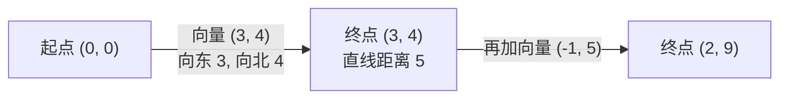
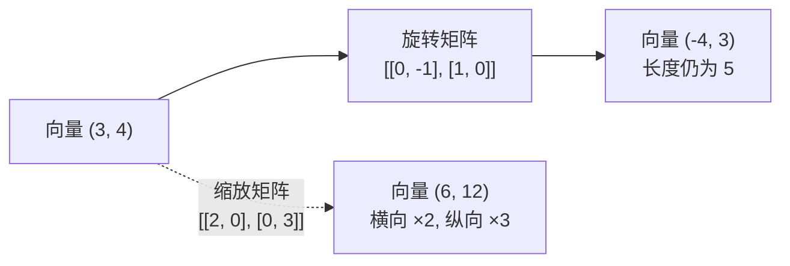
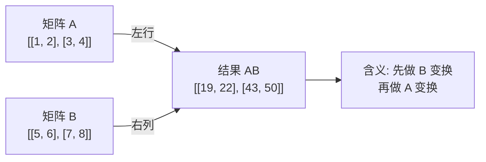
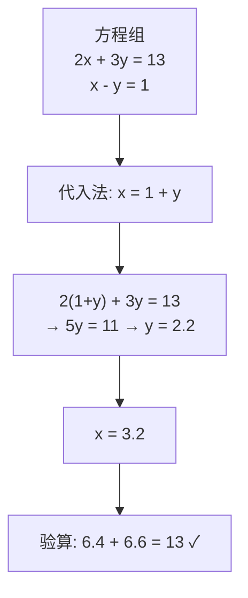
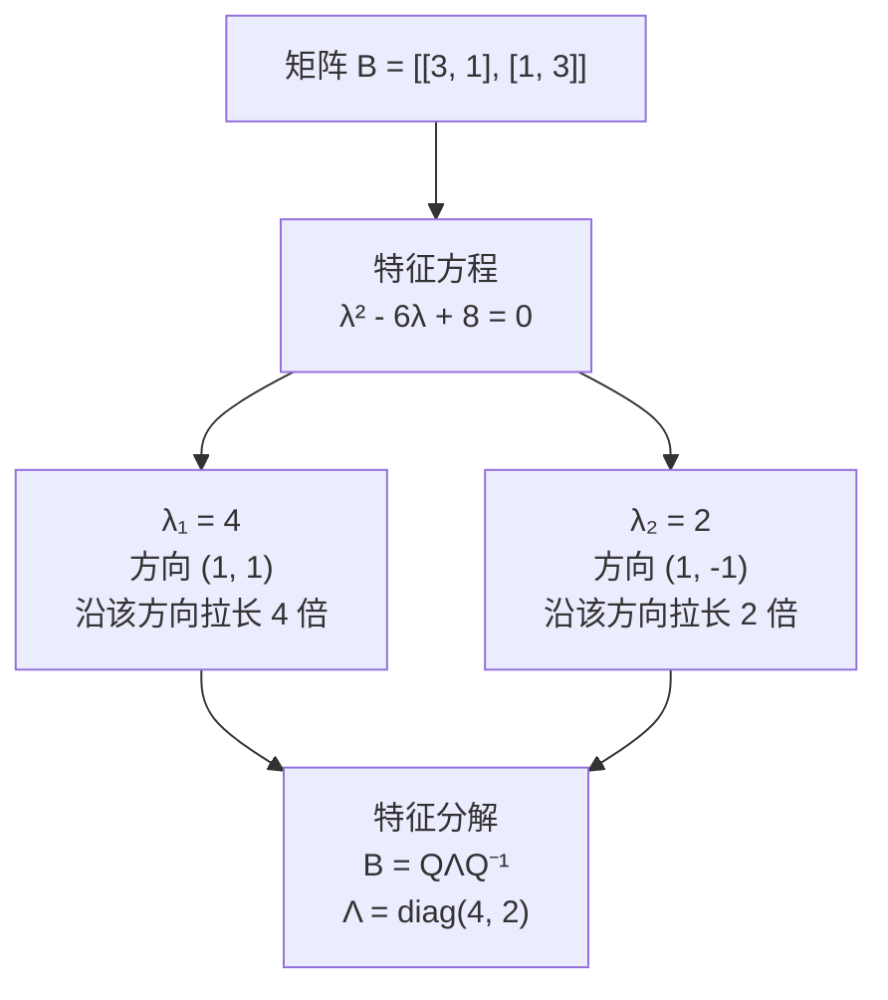
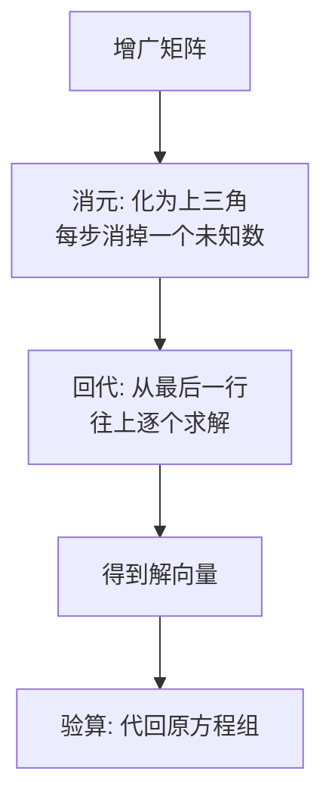

# 线性代数

线性代数是研究向量、矩阵和线性变换的数学分支。它看起来抽象，实际上每天都在你身边工作：手机导航算路线、图片缩放旋转、短视频推荐、搜索引擎排序，背后都是向量和矩阵在算数。本篇不用教材式定义堆砌，而是用生活案例、图形和一步步的计算，把每个概念讲到能动手算出来。

## 核心概念

线性代数回答三个问题：

- **东西怎么表示？** 一个地点、一张图片、一组评分，都可以写成一串数字，也就是向量或矩阵。
- **东西怎么变？** 旋转、缩放、投影、换个角度看，都对应一次矩阵乘法。
- **方程怎么解？** 多个未知数、多个条件联立求解，就是解线性方程组。

适用场景非常广：计算机图形学（旋转缩放）、机器学习（特征向量就是数据点）、推荐系统（用户—物品打分表）、搜索引擎（网页排序）、物理仿真（振动、受力）、经济学（投入产出表）。学后端开发也会遇到：向量数据库的相似度检索、Embedding 的余弦相似度，本质都是点积。

一句话记住：**向量是“一串数”，矩阵是“一张数表”，线性代数就是研究这两样东西怎么加、怎么乘、怎么解方程的学问。**

## 基础知识

### 2.1 向量：带方向的位移

向量就是一串有序的数字，比如 $(3, 4)$。生活里的对应物是导航：从家出发，向东走 3 公里、向北走 4 公里，你的位置就是向量 $(3, 4)$。

向量的长度（模）用勾股定理算：

$$|(3, 4)| = \sqrt{3^2 + 4^2} = \sqrt{9 + 16} = \sqrt{25} = 5$$

这就是经典的 3-4-5 直角三角形。导航上走 3 公里再走 4 公里，直线距离是 5 公里，不是 7 公里——因为方向不同，不能直接相加。

向量加法是“先走一段，再走一段”：

$$(2, 3) + (-1, 5) = (2 - 1, 3 + 5) = (1, 8)$$

先向东 2、向北 3，再向西 1、向北 5，合起来就是向东 1、向北 8。数乘是“走几倍”：$2 \times (3, 4) = (6, 8)$，方向不变，距离翻倍。



### 2.2 点积：两个向量有多“同向”

点积把两个向量“对位相乘再相加”：

$$(2, 3) \cdot (4, -1) = 2 \times 4 + 3 \times (-1) = 8 - 3 = 5$$

点积的几何意义是“一个向量在另一个方向上的投影，再乘以另一个的长度”。它能判断方向是否一致：点积大于 0 说明夹角小于 90°（大体同向），等于 0 说明垂直，小于 0 说明反向。

算一下上面两个向量的夹角。先算各自长度：

$$|(2, 3)| = \sqrt{4 + 9} = \sqrt{13} \approx 3.606$$
$$|(4, -1)| = \sqrt{16 + 1} = \sqrt{17} \approx 4.123$$

再用公式 $\cos\theta = \dfrac{a \cdot b}{|a||b|}$：

$$\cos\theta = \frac{5}{\sqrt{13} \times \sqrt{17}} = \frac{5}{\sqrt{221}} \approx \frac{5}{14.866} \approx 0.336$$

$$\theta \approx 70.35°$$

点积最常见的应用是推荐系统和搜索：把用户喜好和物品特征都写成向量，点积越大说明越匹配；余弦相似度就是点积除以两个长度，只看方向、不看长短。

### 2.3 矩阵：会做变换的数表

矩阵是一张长方形的数表，比如：

$$A = \begin{pmatrix} 1 & 2 \\ 3 & 4 \end{pmatrix}$$

矩阵乘向量，就是“对向量做一次变换”。拿缩放矩阵举例：

$$\begin{pmatrix} 2 & 0 \\ 0 & 3 \end{pmatrix} \begin{pmatrix} 1 \\ 2 \end{pmatrix} = \begin{pmatrix} 2 \times 1 + 0 \times 2 \\ 0 \times 1 + 3 \times 2 \end{pmatrix} = \begin{pmatrix} 2 \\ 6 \end{pmatrix}$$

横向拉长 2 倍、纵向拉长 3 倍，一张图片就这样被拉伸了。旋转 90°（逆时针）的矩阵是 $\begin{pmatrix} 0 & -1 \\ 1 & 0 \end{pmatrix}$：

$$\begin{pmatrix} 0 & -1 \\ 1 & 0 \end{pmatrix} \begin{pmatrix} 3 \\ 4 \end{pmatrix} = \begin{pmatrix} 0 \times 3 + (-1) \times 4 \\ 1 \times 3 + 0 \times 4 \end{pmatrix} = \begin{pmatrix} -4 \\ 3 \end{pmatrix}$$

点 $(3, 4)$ 转到了 $(-4, 3)$。验证一下长度：转之前 $\sqrt{9+16}=5$，转之后 $\sqrt{16+9}=5$，旋转不改变长度，只改变方向。



### 2.4 矩阵乘法：先做一个变换，再做一个

矩阵乘矩阵，相当于把两个变换串起来。算例：

$$A = \begin{pmatrix} 1 & 2 \\ 3 & 4 \end{pmatrix}, \quad B = \begin{pmatrix} 5 & 6 \\ 7 & 8 \end{pmatrix}$$

$$AB = \begin{pmatrix} 1 \times 5 + 2 \times 7 & 1 \times 6 + 2 \times 8 \\ 3 \times 5 + 4 \times 7 & 3 \times 6 + 4 \times 8 \end{pmatrix} = \begin{pmatrix} 5 + 14 & 6 + 16 \\ 15 + 28 & 18 + 32 \end{pmatrix} = \begin{pmatrix} 19 & 22 \\ 43 & 50 \end{pmatrix}$$

口诀是“左行乘右列”：结果第 $i$ 行第 $j$ 列的元素，等于左矩阵第 $i$ 行与右矩阵第 $j$ 列对应相乘再相加。



注意：矩阵乘法一般**不满足交换律**，$AB \neq BA$。先旋转再平移，和先平移再旋转，结果不一样——作图软件里调换两个变换的顺序，图形落点真的会变。

### 2.5 行列式：面积和体积被放大了几倍

行列式是一个数，告诉你这个变换把面积（二维）或体积（三维）放大了几倍。

二阶行列式公式：$\det\begin{pmatrix} a & b \\ c & d \end{pmatrix} = ad - bc$。

$$A = \begin{pmatrix} 1 & 2 \\ 3 & 4 \end{pmatrix}, \quad \det(A) = 1 \times 4 - 2 \times 3 = 4 - 6 = -2$$

绝对值 2 说明面积被放大 2 倍，负号说明图形被“翻面”了（像照镜子，左右颠倒）。

再算一个：

$$\det\begin{pmatrix} 3 & 1 \\ 2 & 4 \end{pmatrix} = 3 \times 4 - 1 \times 2 = 12 - 2 = 10$$

面积放大 10 倍，方向不变。

三阶行列式按第一行展开。以 $\begin{pmatrix} 2 & 1 & 0 \\ 1 & 3 & 1 \\ 0 & 1 & 2 \end{pmatrix}$ 为例：

$$\det = 2 \times \det\begin{pmatrix} 3 & 1 \\ 1 & 2 \end{pmatrix} - 1 \times \det\begin{pmatrix} 1 & 1 \\ 0 & 2 \end{pmatrix} + 0 \times \det\begin{pmatrix} 1 & 3 \\ 0 & 1 \end{pmatrix}$$

先算两个二阶行列式：$3 \times 2 - 1 \times 1 = 5$，$1 \times 2 - 1 \times 0 = 2$。代回：

$$\det = 2 \times 5 - 1 \times 2 + 0 = 10 - 2 = 8$$

体积被放大 8 倍。行列式为 0 意味着变换把图形“压扁”了：面积变成 0，信息丢失，这个矩阵不可逆。

### 2.6 逆矩阵：变换的“撤销键”

逆矩阵 $A^{-1}$ 满足 $A A^{-1} = I$（单位矩阵，像乘法里的 1）。二阶矩阵的逆有公式：

$$A = \begin{pmatrix} a & b \\ c & d \end{pmatrix}, \quad A^{-1} = \frac{1}{ad-bc}\begin{pmatrix} d & -b \\ -c & a \end{pmatrix}$$

对 $A = \begin{pmatrix} 1 & 2 \\ 3 & 4 \end{pmatrix}$，行列式是 $-2$：

$$A^{-1} = \frac{1}{-2}\begin{pmatrix} 4 & -2 \\ -3 & 1 \end{pmatrix} = \begin{pmatrix} -2 & 1 \\ 1.5 & -0.5 \end{pmatrix}$$

验证 $A A^{-1}$ 是不是单位矩阵：

$$\begin{pmatrix} 1 & 2 \\ 3 & 4 \end{pmatrix}\begin{pmatrix} -2 & 1 \\ 1.5 & -0.5 \end{pmatrix} = \begin{pmatrix} -2 + 3 & 1 - 1 \\ -6 + 6 & 3 - 2 \end{pmatrix} = \begin{pmatrix} 1 & 0 \\ 0 & 1 \end{pmatrix}$$

确实是单位矩阵。生活类比：图片放大 2 倍后，再缩小一半就回来了；逆矩阵就是那个“缩小一半”的操作。行列式为 0 的矩阵没有逆矩阵——压扁的图形无法复原。

### 2.7 线性方程组：配料问题联立求解

线性方程组就是“几个未知数、几条线索一起解”。例子：奶茶店调配两种原料，$x$ 是 A 原料克数，$y$ 是 B 原料克数：

$$\begin{cases} 2x + 3y = 13 \\ x - y = 1 \end{cases}$$

用代入法：由第二式得 $x = 1 + y$，代入第一式：

$$2(1 + y) + 3y = 13 \Rightarrow 2 + 2y + 3y = 13 \Rightarrow 5y = 11 \Rightarrow y = 2.2$$

$$x = 1 + 2.2 = 3.2$$

验算：$2 \times 3.2 + 3 \times 2.2 = 6.4 + 6.6 = 13$ ✓；$3.2 - 2.2 = 1$ ✓。

也可以用克拉默法则复核。系数行列式 $D = 2 \times (-1) - 3 \times 1 = -5$；把常数列换到第一列，$D_x = 13 \times (-1) - 3 \times 1 = -16$，$x = \dfrac{-16}{-5} = 3.2$；换到第二列，$D_y = 2 \times 1 - 13 \times 1 = -11$，$y = \dfrac{-11}{-5} = 2.2$。两种方法结果一致。



三元方程组同样可以逐步消元。例：三种配料 $x, y, z$ 满足

$$\begin{cases} x + y + z = 6 \\ 2x - y + z = 3 \\ x + 2y - z = 2 \end{cases}$$

第二式减第一式：$x - 2y = -3$；第三式加第一式：$2x + 3y = 8$。由前者得 $x = 2y - 3$，代入后者：

$$2(2y - 3) + 3y = 8 \Rightarrow 4y - 6 + 3y = 8 \Rightarrow 7y = 14 \Rightarrow y = 2$$

$$x = 2 \times 2 - 3 = 1, \quad z = 6 - 1 - 2 = 3$$

验算第二式：$2 - 2 + 3 = 3$ ✓；第三式：$1 + 4 - 3 = 2$ ✓。解是 $(1, 2, 3)$。

## 进阶知识

### 3.1 线性相关与线性无关

一组向量如果其中一个能由其他几个拼出来（加减、数乘），它们就是线性相关的；拼不出来，就是线性无关的。$(1, 0)$ 和 $(0, 1)$ 线性无关——横向和纵向互相拼不出来；$(1, 2)$ 和 $(2, 4)$ 线性相关——后者是前者的 2 倍。平面上最多 2 个线性无关的向量，第三个一定能由前两个拼出来。

### 3.2 秩：矩阵真正的信息量

秩是矩阵中线性无关的行（或列）的最大个数。满秩矩阵信息完整、可逆；秩亏（行列式为 0）意味着有的行是其他行的组合，信息有冗余。数据表里如果某一列完全由其他列算出来，这张表的秩就小于列数，建模时这列就是多余的。

### 3.3 特征值与特征向量：变换的“主方向”

对矩阵 $A$，如果存在非零向量 $v$ 和数 $\lambda$，使得 $Av = \lambda v$，那么 $\lambda$ 是特征值，$v$ 是特征向量。意思是：这个方向上的向量经过变换后，方向不变，只被拉长或缩短 $\lambda$ 倍。

算例：$B = \begin{pmatrix} 3 & 1 \\ 1 & 3 \end{pmatrix}$。特征方程是 $\det(B - \lambda I) = 0$：

$$(3 - \lambda)^2 - 1 \times 1 = 0 \Rightarrow \lambda^2 - 6\lambda + 9 - 1 = 0 \Rightarrow \lambda^2 - 6\lambda + 8 = 0$$

$$(\lambda - 2)(\lambda - 4) = 0 \Rightarrow \lambda_1 = 4, \quad \lambda_2 = 2$$

求 $\lambda = 4$ 的特征向量：解 $(B - 4I)v = 0$，即 $\begin{pmatrix} -1 & 1 \\ 1 & -1 \end{pmatrix}\begin{pmatrix} x \\ y \end{pmatrix} = 0$，得 $-x + y = 0$，即 $x = y$，特征向量是 $(1, 1)$ 的任意倍数。

求 $\lambda = 2$ 的特征向量：$\begin{pmatrix} 1 & 1 \\ 1 & 1 \end{pmatrix}\begin{pmatrix} x \\ y \end{pmatrix} = 0$，得 $x + y = 0$，特征向量是 $(1, -1)$ 的任意倍数。

验算：$B(1, 1)^T = (4, 4)^T = 4(1, 1)^T$ ✓；$B(1, -1)^T = (2, -2)^T = 2(1, -1)^T$ ✓。

再算一个：$C = \begin{pmatrix} 4 & 1 \\ 2 & 3 \end{pmatrix}$，迹为 7，行列式为 $12 - 2 = 10$，特征方程 $\lambda^2 - 7\lambda + 10 = 0$，即 $(\lambda - 5)(\lambda - 2) = 0$，特征值是 5 和 2。$\lambda = 5$ 时，$(C - 5I) = \begin{pmatrix} -1 & 1 \\ 2 & -2 \end{pmatrix}$，得 $x = y$，特征向量 $(1, 1)$；$\lambda = 2$ 时，$(C - 2I) = \begin{pmatrix} 2 & 1 \\ 2 & 1 \end{pmatrix}$，得 $2x + y = 0$，特征向量 $(1, -2)$。



### 3.4 特征分解与对角化

如果矩阵有足够多线性无关的特征向量，它可以写成 $A = Q\Lambda Q^{-1}$，其中 $\Lambda$ 是特征值排在对角线上的对角矩阵，$Q$ 的列是特征向量。对角化之后，矩阵的幂变得很好算：$A^n = Q\Lambda^n Q^{-1}$，而对角矩阵的幂就是对角元素各自求幂。这是很多快速算法（比如马尔可夫链长期状态、振动分析）的基础。

### 3.5 叉积与投影

三维向量的叉积 $(1, 2, 3) \times (4, 5, 6)$：

$$\begin{pmatrix} 2 \times 6 - 3 \times 5 \\ 3 \times 4 - 1 \times 6 \\ 1 \times 5 - 2 \times 4 \end{pmatrix} = \begin{pmatrix} 12 - 15 \\ 12 - 6 \\ 5 - 8 \end{pmatrix} = \begin{pmatrix} -3 \\ 6 \\ -3 \end{pmatrix}$$

结果向量同时垂直于原来两个向量，长度等于两者张成的平行四边形面积。投影则是“影子”：向量 $(3, 4)$ 投影到 $x$ 轴 $(1, 0)$ 方向上，结果是 $(3, 0)$——只保留横向分量。

## 原理剖析

### 4.1 为什么矩阵乘法是“左行乘右列”

矩阵的每一列可以看成一个基向量的变换结果。$AB$ 的第 $j$ 列，就是 $A$ 作用在 $B$ 的第 $j$ 列上。展开成坐标计算，自然就是左矩阵的行与右矩阵的列逐项相乘再相加。理解了这一点，就明白为什么矩阵乘法满足结合律 $(AB)C = A(BC)$（变换串联的顺序分组不影响最终效果），却不满足交换律（变换的先后顺序影响结果）。

### 4.2 高斯消元：解方程组的通用流程

高斯消元就是系统化的“消元法”：把方程组写成增广矩阵，用行变换（交换两行、某行乘非零数、某行加到另一行）把系数矩阵化成上三角，再从最后一行往回代。前面三元方程组的求解，走的就是这条路。计算机解大规模方程组（比如天气预报的数值模型）用的也是高斯消元的优化版本。



### 4.3 最小二乘：方程太多解不出来时怎么办

实际数据里方程个数经常多于未知数，严格解不存在。最小二乘找的是“误差平方和最小”的近似解：解正规方程 $A^TAx = A^Tb$。拟合一条直线 $y = ax + b$ 穿过一堆散点，用的就是这个原理——它不追求穿过每一个点，而是让所有点的偏差总体最小。

### 4.4 奇异值分解（SVD）

SVD 把任意矩阵写成 $A = U\Sigma V^T$，其中 $\Sigma$ 对角线上的奇异值按从大到小排列。它的威力在于：只保留最大的几个奇异值，就能用很少的数据近似还原整个矩阵。图片压缩、推荐系统降维、去噪，背后都是 SVD。特征分解要求方阵，SVD 对任意形状的矩阵都适用，这是它更通用的原因。

## 实战案例

### 5.1 图片变换：旋转、缩放、错切一次搞定

修图软件里旋转一张图，本质是每个像素坐标乘一个旋转矩阵；缩放是乘缩放矩阵；把多个变换矩阵先乘成一个，再一次性作用到所有像素上，比逐个变换快得多。齐次坐标（给二维坐标补一个 1 变成三维）还能把平移也写进矩阵乘法，旋转、缩放、平移从此可以统一串联。

### 5.2 推荐系统：打分表就是矩阵

用户—物品打分表是一个矩阵：行是用户，列是电影，格子是评分。矩阵分解把这张大表拆成“用户特征 × 物品特征”两个小矩阵的乘积，空着的格子（用户没看过的电影）就能用乘积预测出来。点积在这里再次出场：用户向量与物品向量的点积，就是预测评分。

### 5.3 搜索引擎：PageRank 是特征向量

PageRank 把网页之间的链接关系写成矩阵，网页的重要性就是这个矩阵最大特征值对应的特征向量。反复迭代“把分数按链接分出去”，分数分布会收敛到这个特征向量上——这就是为什么它叫“特征”向量：它刻画了整个链接网络最稳定的结构。

### 5.4 人脸识别与振动分析：主方向的威力

一张人脸照片可以拉平成一个高维向量；对大量人脸做主成分分析（PCA），最大的几个特征向量就是“特征脸”，它们张成的方向最能区分不同的人。同样，一座桥振动时，最大的特征值对应最主要的振动模态，工程师先看它会不会共振。

### 5.5 代码里算一算

Python 用 NumPy 不到十行就能复现本篇的算例：

```python
import numpy as np

A = np.array([[1, 2], [3, 4]])
B = np.array([[5, 6], [7, 8]])
print(A @ B)              # [[19 22] [43 50]]
print(np.linalg.det(A))   # -2.0
print(np.linalg.inv(A))   # [[-2. 1.] [1.5 -0.5]]
print(np.linalg.eigvals(np.array([[3, 1], [1, 3]])))  # [4. 2.]
print(np.linalg.solve(np.array([[2, 3], [1, -1]]), [13, 1]))  # [3.2 2.2]
```

手算一遍再用代码验算，是学线性代数最有效的办法：手算建立直觉，代码负责大规模计算。

## 疑难杂症

- **矩阵乘法维数对不上**：$m \times n$ 矩阵只能乘 $n \times p$ 矩阵，中间的 $n$ 必须相等。报错 `shapes not aligned` 时，先打印两个矩阵的 `shape`，看中间维度是否一致。
- **奇异矩阵求逆报错**：`LinAlgError: Singular matrix` 说明行列式为 0，矩阵不可逆。检查数据是不是有完全相关的两列，或者用伪逆 `np.linalg.pinv` 求最小二乘解。
- **特征值算出来是复数**：非对称矩阵的特征值可能是复数，这是正常的；只有对称矩阵的特征值保证全是实数，且特征向量互相正交。
- **方程组无解或无穷多解**：系数矩阵的秩小于增广矩阵的秩时无解（线索自相矛盾）；秩小于未知数个数时有无穷多解（线索不够）。先算秩，再决定是补数据还是接受多解。
- **浮点误差让行列式“几乎为 0”**：接近奇异的矩阵数值上很不稳定，解会随输入微小扰动剧烈变化。详见 [数值稳定性](计算机基础/数学/数值稳定性.md)，实战中优先用 SVD 或 QR 分解代替直接求逆。

## 常见误区

- **向量就是“一串数”，跟方向没关系**：错。同样是 $(3, 4)$，写成坐标是位置，写成位移是方向和距离；点积、叉积、投影全都依赖方向的含义。
- **矩阵乘法可以交换**：错。$AB \neq BA$ 是常态，先旋转后平移与先平移后旋转结果不同。
- **行列式为负就是出错了**：错。负号只表示图形被翻面（定向反转），面积缩放倍数看绝对值。
- **特征值越大越重要**：只对了一半。特征值大说明沿该方向拉伸得多，但在 PCA 里“重要”还要看数据在这个方向上的方差占比，单个特征值不能直接当重要性排序。
- **有逆矩阵就能随便解方程**：理论上对，但数值上不划算。解 $Ax = b$ 直接用消元或 `np.linalg.solve`，比先算 $A^{-1}$ 再乘 $b$ 更快、更稳定。
- **零向量能做特征向量**：错。特征向量定义要求非零；零向量乘任何矩阵都是零向量，无法提供方向信息。

## 性能优化

- **能用矩阵乘法就别写循环**：NumPy 的矩阵乘法底层是高度优化的 BLAS，一次 `A @ B` 比 Python 双重循环快几十到几百倍。向量化是数值计算的第一优化。
- **解方程别先求逆**：求逆是 $O(n^3)$ 且数值稳定性差；`np.linalg.solve` 用 LU 分解，同量级但常数更小、误差更小。
- **稀疏矩阵别当稠密矩阵存**：大部分元素是 0 的矩阵（如社交网络邻接矩阵）用 `scipy.sparse` 存储，只存非零元，内存和乘法速度都省一个量级。
- **大矩阵降维先做 SVD 截断**：只保留前 $k$ 个奇异值，计算量从 $O(mn \cdot \min(m,n))$ 降到 $O(mnk)$，推荐系统和图片压缩都靠这招。
- **重复用同一矩阵解多个右端项**：先做一次 LU/QR 分解，再对每个右端项回代，比每次从头解快得多。

## 版本差异

线性代数本身是经典数学，内容不随软件版本变化；变化的是计算工具：

- **NumPy**：`np.linalg` 是标准入口；`np.matrix` 类已被废弃，一律用 `ndarray` 加 `@` 运算符。
- **SciPy**：`scipy.linalg` 提供更全的分解（Schur、极分解等），大规模稀疏问题用 `scipy.sparse.linalg`。
- **PyTorch / JAX**：张量上的线性代数支持自动微分和 GPU 加速，`torch.linalg` 与 NumPy 接口基本对应；注意默认 float32 精度低于 NumPy 的 float64，特征值这类敏感计算建议显式用 float64。
- **教材符号差异**：有的书写列向量为 $(x, y)^T$，有的直接写竖排；有的把矩阵乘法记作 $AB$，代码里是 `A @ B` 或 `np.matmul(A, B)`。符号不同，含义一致。

## 面试与自测

### 问题

1. 向量 $(3, 4)$ 的长度是多少？向量 $(2, 3)$ 与 $(4, -1)$ 的点积是多少？点积的正负说明什么？
2. 计算 $A = \begin{pmatrix} 1 & 2 \\ 3 & 4 \end{pmatrix}$ 与 $B = \begin{pmatrix} 5 & 6 \\ 7 & 8 \end{pmatrix}$ 的乘积 $AB$，并说明为什么矩阵乘法一般不满足交换律。
3. 矩阵 $A = \begin{pmatrix} 1 & 2 \\ 3 & 4 \end{pmatrix}$ 的行列式是多少？它把单位正方形的面积变成多少？这个矩阵可逆吗？
4. 求矩阵 $A = \begin{pmatrix} 1 & 2 \\ 3 & 4 \end{pmatrix}$ 的逆矩阵，并验证 $AA^{-1} = I$。
5. 解方程组 $\begin{cases} 2x + 3y = 13 \\ x - y = 1 \end{cases}$，并用克拉默法则复核。
6. 求矩阵 $B = \begin{pmatrix} 3 & 1 \\ 1 & 3 \end{pmatrix}$ 的特征值和特征向量，并解释特征值 4 和 2 的几何意义。
7. 什么时候线性方程组无解？什么时候有无穷多解？用秩来回答。
8. 推荐系统里，用户向量与物品向量的点积代表什么？为什么常用余弦相似度而不是直接用点积？

### 参考答案

1. 长度 $\sqrt{3^2+4^2} = 5$。点积 $2 \times 4 + 3 \times (-1) = 5$。点积大于 0 说明两向量夹角小于 90°，大体同向；等于 0 垂直；小于 0 反向。本例夹角约 70.35°。
2. $AB = \begin{pmatrix} 19 & 22 \\ 43 & 50 \end{pmatrix}$，计算过程：左行乘右列，如 $1 \times 5 + 2 \times 7 = 19$。不满足交换律是因为矩阵乘法对应变换的串联，变换的先后顺序影响结果；一般 $AB \neq BA$。
3. 行列式 $1 \times 4 - 2 \times 3 = -2$。单位正方形面积 1 被放大到 $|-2| = 2$，负号表示图形被翻面。行列式非零，所以矩阵可逆。
4. $A^{-1} = \dfrac{1}{-2}\begin{pmatrix} 4 & -2 \\ -3 & 1 \end{pmatrix} = \begin{pmatrix} -2 & 1 \\ 1.5 & -0.5 \end{pmatrix}$。验证：$AA^{-1} = \begin{pmatrix} -2+3 & 1-1 \\ -6+6 & 3-2 \end{pmatrix} = \begin{pmatrix} 1 & 0 \\ 0 & 1 \end{pmatrix}$。
5. 由第二式 $x = 1 + y$，代入得 $5y = 11$，$y = 2.2$，$x = 3.2$。克拉默法则：$D = -5$，$D_x = -16$，$D_y = -11$，$x = 3.2$，$y = 2.2$，一致。
6. 特征方程 $\lambda^2 - 6\lambda + 8 = 0$，特征值 $\lambda_1 = 4$（特征向量 $(1, 1)$ 方向）、$\lambda_2 = 2$（特征向量 $(1, -1)$ 方向）。几何意义：沿 $(1, 1)$ 方向的向量被拉长 4 倍，沿 $(1, -1)$ 方向的被拉长 2 倍，方向不变。
7. 系数矩阵的秩小于增广矩阵的秩时无解；系数矩阵的秩等于增广矩阵的秩、但小于未知数个数时有无穷多解；秩等于未知数个数时有唯一解。
8. 点积是预测评分：越大说明用户越可能喜欢该物品。余弦相似度是点积除以两个向量的长度，只比较方向、不比较长短，可以避免“打分普遍偏高（向量长）的用户天然占优”的偏差。

## 小技巧与冷知识

- **3-4-5 是最有名的勾股数**：向量 $(3, 4)$ 长度恰好是 5，考试和面试里出现频率极高；记住它，长度题可以秒答。
- **行列式速算口诀**：二阶就是“主对角线乘积减副对角线乘积”，即 $ad - bc$；三阶可以按任意一行或一列展开，选 0 最多的那一行展开最省事。
- **旋转矩阵的列就是旋转后的基向量**：旋转 90° 的矩阵 $\begin{pmatrix} 0 & -1 \\ 1 & 0 \end{pmatrix}$，第一列 $(0, 1)$ 是 $(1, 0)$ 转 90° 后的位置，第二列 $(-1, 0)$ 是 $(0, 1)$ 转 90° 后的位置。想通这一点，任何旋转、反射矩阵都能自己写出来。
- **特征值之和等于迹，之积等于行列式**：矩阵 $\begin{pmatrix} 3 & 1 \\ 1 & 3 \end{pmatrix}$ 迹是 6，特征值 4 和 2 之和是 6；行列式是 8，特征值之积 $4 \times 2 = 8$。这是快速验算特征值是否算对的办法。
- **冷知识：PageRank 最初是特征向量问题**：谷歌两位创始人在 1998 年的论文里，网页排序归结为求一个矩阵的主特征向量；这个数学工具后来撑起了整个搜索引擎行业。
- **冷知识：线性代数曾叫“矩阵论”**：19 世纪凯莱系统研究矩阵时，它还只是行列式的附属品；直到 20 世纪，向量空间的观点确立，线性代数才成为今天的样子——现代教材先讲向量、再讲矩阵，正是这个历史顺序的倒置。
- **面试小技巧**：被问到“矩阵乘法为什么这样定义”时，别背公式，答“因为它对应线性变换的复合”——这是面试官最想听到的回答。
- **调试小技巧**：手算矩阵乘法时，先在草稿纸上标出结果矩阵每个位置对应“左矩阵第几行、右矩阵第几列”，逐项打勾，能避开绝大多数抄错数的低级错误。

## 关联知识

- **前置知识**：[集合论基础](计算机基础/数学/集合论基础.md)（集合、映射的语言是理解向量空间的基础）；初中平面几何（勾股定理、三角函数是向量长度和夹角的来源）。
- **相关知识点**：[数值稳定性](计算机基础/数学/数值稳定性.md)（病态矩阵、浮点误差、为什么解方程别先求逆）；[复杂度分析基础](计算机基础/算法/复杂度分析基础.md)（矩阵乘法、求逆、高斯消元的时间复杂度）；[数据结构与算法](计算机基础/算法/数据结构与算法.md)（稀疏矩阵存储、图算法里的邻接矩阵）。
- **延伸方向**：数值线性代数（LU、QR、SVD 分解的算法实现）；主成分分析 PCA（特征分解在降维中的应用）；向量数据库与 Embedding 检索（余弦相似度在大规模数据上的工程实现）；图论中的谱方法（拉普拉斯矩阵的特征值与图聚类）。
