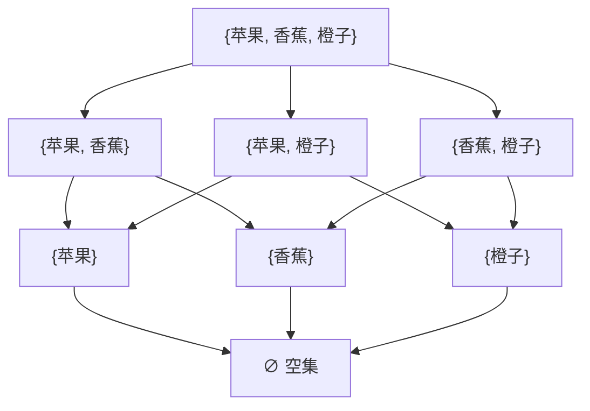
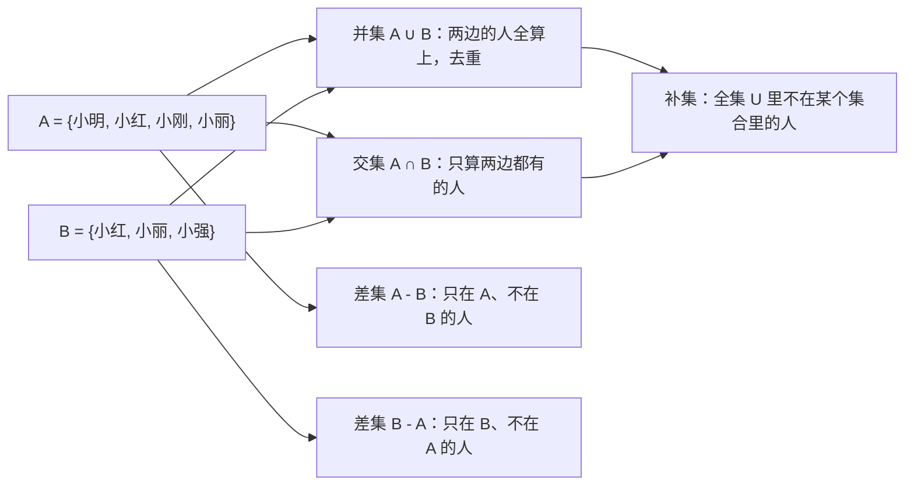

# 集合论基础

<!-- TOC -->
- [基础知识](#基础知识)
  - [集合是什么](#集合是什么)
  - [元素与属于：∈ 和 ∉](#元素与属于-和-)
  - [列举法与描述法](#列举法与描述法)
  - [空集与全集](#空集与全集)
- [原理剖析](#原理剖析)
  - [子集、真子集、幂集](#子集真子集幂集)
  - [并集、交集、差集、补集](#并集交集差集补集)
  - [容斥原理](#容斥原理)
  - [德摩根律](#德摩根律)
  - [笛卡尔积与序偶](#笛卡尔积与序偶)
- [进阶知识](#进阶知识)
  - [有限 vs 无限、可数无限的直觉](#有限-vs-无限可数无限的直觉)
  - [集合运算的常用性质](#集合运算的常用性质)
- [疑难杂症](#疑难杂症)
  - [误区一：把“属于”与“包含”混淆](#误区一把属于与包含混淆)
  - [误区二：空集是任何集合的子集](#误区二空集是任何集合的子集)
  - [误区三：补集依赖全集](#误区三补集依赖全集)
  - [误区四：以为“不属于”就是“补集里的元素”](#误区四以为不属于就是补集里的元素)
- [实战案例](#实战案例)
  - [案例一：奶茶店点单去重——并集与交集](#案例一奶茶店点单去重并集与交集)
  - [案例二：选课冲突检查——差集](#案例二选课冲突检查差集)
  - [案例三：微信群发通知——容斥原理防重复](#案例三微信群发通知容斥原理防重复)
  - [案例四：用户标签组合——笛卡尔积](#案例四用户标签组合笛卡尔积)
  - [案例五：订单去重统计——并集计数](#案例五订单去重统计并集计数)
  - [案例六：权限检查——子集](#案例六权限检查子集)
- [面试与自测](#面试与自测)
  - [参考答案](#参考答案)
- [小技巧与冷知识](#小技巧与冷知识)
- [关联知识](#关联知识)
<!-- /TOC -->

> 一句话：集合就是“一堆东西放在一起”。`HashSet`、去重后的列表、用户标签、权限列表，背后全是集合。会四则运算、会写 Java 的 `Set<String>` 就能读懂这篇。

## 基础知识

### 集合是什么

集合（Set）是把一些确定的、互不相同的东西放在一起形成的整体。

生活案例：超市购物清单 `{苹果, 牛奶, 面包}`。清单里每一项叫**元素**。集合有三个脾气：只认“有没有”，不认“有几次”，也不认“谁先谁后”——写两遍“苹果”，清单还是只有一份苹果要买；苹果先写还是牛奶先写，清单还是那张清单。

Java 里你天天在用它：`new HashSet<>()` 再 `add("苹果")` 两次，`size()` 还是 3，不是 4。再如微信群 `家人群 = {爸爸, 妈妈, 我, 妹妹}`，4 个人就是一个 4 元集合，有人进群就多一个元素，有人退群就少一个。

再一步步数给你看。清单 {苹果, 牛奶, 面包}：先数苹果是第 1 个，牛奶是第 2 个，面包是第 3 个，一共 3 个元素。
现在把清单改写成 {牛奶, 面包, 苹果}：顺序全换了，数一遍还是牛奶、面包、苹果，一共 3 个，还是同一个集合。
再把清单写成 {苹果, 苹果, 牛奶, 面包}：苹果出现了两次，但“有没有苹果”这个问题的答案没变，
去重后还是 {苹果, 牛奶, 面包}，一共 3 个元素。
所以判断两个集合是不是同一个，不看顺序、不看重复次数，只看“都有哪些不同的元素”。
这正是 `HashSet` 去重的原理：它只记录“出现过没有”，不记录“出现过几次”。

生活里还有很多集合：你手机通讯录里的联系人是一个集合，奶茶店今天的全部订单是一个集合，
你这学期选的所有课也是一个集合。只要能说清“谁在里面、谁不在里面”，它就是一个集合。

### 元素与属于：∈ 和 ∉

“属于”就是“在不在里面”。苹果在清单里，记作苹果 ∈ {苹果, 牛奶, 面包}；鸡蛋不在清单里，记作鸡蛋 ∉ {苹果, 牛奶, 面包}。微信群同理：妈妈 ∈ 家人群，表哥 ∉ 家人群。

Java 对照：`shoppingList.contains("苹果")` 是 `true`，就是 ∈；`contains("鸡蛋")` 是 `false`，就是 ∉。记住：**“属于”左边是单个东西，右边是一堆东西**。

### 列举法与描述法

列举法是把元素一个一个列出来，适合数得清的情况：`一周的奶茶口味 = {珍珠奶茶, 椰果奶茶, 红豆奶茶, 布丁奶茶}`，`选课结果 = {Java, 数据库, 计算机网络}`。元素太多就列不完，没法把“所有正整数”一个一个写出来。

描述法不列元素，只写一条入选规则：`{ x | x 是偶数，且 0 < x < 10 }`，读作“所有满足‘是偶数、且在 0 到 10 之间’的 x 组成的集合”。一步步算：0 到 10 之间的整数是 1–9，其中偶数是 2、4、6、8，所以这个集合就是 {2, 4, 6, 8}，共 4 个元素。奶茶店的例子：`{ 一杯奶茶 | 这杯奶茶加了珍珠 }`，店里所有加了珍珠的奶茶都在这个集合里。

编程对照：描述法很像 Stream 过滤，`numbers.stream().filter(x -> x % 2 == 0)`，条件就是入选规则；列举法像直接写死一个 `List.of(...)`。

再算一个描述法例子：`{ x | x 是 3 的倍数，且 0 < x < 20 }`。
一步步算：0 到 20 之间的整数是 1–19；其中是 3 的倍数的是 3、6、9、12、15、18，一共 6 个。
所以这个集合就是 {3, 6, 9, 12, 15, 18}。
选课的例子也可以写成描述法：`{ 一门课 | 这门课是这学期开的，而且我选了它 }`，结果就是你的选课结果。
描述法的好处是：哪怕元素有几千个，只要规则一句话能说清，集合就写完了。

### 空集与全集

空集记作 ∅，里面一个元素也没有，个数是 0。例如“超市里名字叫‘月亮牌牛奶’的商品”——根本没进过这个牌子，就是空集；“微信群里名字叫‘奥特曼’的成员”——没这个人，也是空集。Java 对照：`new HashSet<>()` 的 `size()` 是 0，`isEmpty()` 是 `true`。

注意：**空集不是“没有集合”，而是一个“装了 0 个东西的集合”**，像一个空购物车——购物车还在，只是里面没东西。`null` 是连购物车都没有，和空集是两回事。

全集记作 U，是当前话题下所有可能元素的总和。**全集不是固定的，取决于你在讨论什么**：讨论“今天奶茶店的订单”，全集就是今天所有订单；讨论“这个微信群的成员”，全集就是这个群的所有成员。例如奶茶店今天一共卖 5 种饮品，`U = {珍珠奶茶, 椰果奶茶, 红豆奶茶, 布丁奶茶, 柠檬水}`，在这个话题下它就是全集。后面算补集时必须先说清 U 是什么，否则“不在 A 里的东西”就没边了。

## 原理剖析

### 子集、真子集、幂集

子集记作 A ⊆ B，意思是 **A 里的每一个元素都在 B 里**。选课的例子：`这学期开的课 = {Java, 数据库, 计算机网络, 操作系统, 英语}`，`我选的课 = {Java, 数据库}`，我选的每门课都在开课表里，所以 `{Java, 数据库} ⊆ {Java, 数据库, 计算机网络, 操作系统, 英语}`。超市同理：`已买到的 = {苹果, 牛奶}` 是 `购物清单 = {苹果, 牛奶, 面包}` 的子集。Java 对照就是 `all.containsAll(mine)` 返回 `true`。一个集合一定是它自己的子集。

真子集记作 A ⊂ B，意思是 A 是 B 的子集，**而且 A 和 B 不完全相等**，B 里至少多一个 A 没有的元素。`{Java, 数据库} ⊂ {Java, 数据库, 计算机网络}` 是真子集，因为后者多了“计算机网络”；`{Java, 数据库} ⊂ {Java, 数据库}` 不是真子集，因为两者完全相等。口诀：子集允许“相等”，真子集要求“严格更小”。

幂集就是“一个集合的全部子集组成的集合”，记作 P(A)。关键公式：**A 有 n 个元素，幂集就有 2ⁿ 个元素**。为什么？对每个元素都有两种选择——放进子集或不放，n 个元素就是 2 × 2 × … × 2（n 次）= 2ⁿ 种组合。

拿 n = 3 的水果篮 A = {苹果, 香蕉, 橙子} 逐个列出，2³ = 2 × 2 × 2 = 8 个子集：选 0 个有 1 个——∅；选 1 个有 3 个——{苹果}、{香蕉}、{橙子}；选 2 个有 3 个——{苹果, 香蕉}、{苹果, 橙子}、{香蕉, 橙子}；选 3 个有 1 个——{苹果, 香蕉, 橙子}。数一数：1 + 3 + 3 + 1 = 8，一个不多，一个不少，和 2³ = 8 对上了。

这 8 个子集的包含关系画成子集格，越往上元素越多，线连着的就是“只差一个元素”的包含关系：

从图里能看到：最顶上是 A 自己，最底下是空集 ∅，每一层比下一层恰好多一个元素，空集是所有子集的“起点”。幂集在编程里对应“所有组合”：3 个开关各开或关，一共 2³ = 8 种状态；n = 10 时是 1024 个子集，n = 20 时是 1048576 个——指数增长就是这么不讲道理。

把 2ⁿ 算成一张小表，感受一下增长有多快：

| n | 2ⁿ | 子集个数 |
|---|---|---|
| 0 | 2⁰ = 1 | 1（只有空集） |
| 1 | 2¹ = 2 | 2 |
| 2 | 2² = 4 | 4 |
| 3 | 2³ = 8 | 8 |
| 4 | 2⁴ = 16 | 16 |
| 5 | 2⁵ = 32 | 32 |

n 每加 1，子集个数就翻一倍。n = 0 时集合是空集 ∅，它的幂集只有 1 个元素，就是 {∅}——
一个装着“空集”这个子集的集合，别和空集本身搞混：∅ 里有 0 个元素，{∅} 里有 1 个元素。

### 并集、交集、差集、补集

先定好两个微信群，用同一组数字把四个运算都算一遍：`A 群（大学同学群）= {小明, 小红, 小刚, 小丽}`，4 人；`B 群（公司同事群）= {小红, 小丽, 小强}`，3 人；小红、小丽同时在两个群里。

四个运算的关系总览：

并集 A ∪ B 是在 A 里“或”在 B 里的元素，全都算进来，重复的只算一次。生活案例：给两个群的所有人发通知，合起来发给几个人？A 群 4 人加 B 群 3 人是 7 人次，小红、小丽被数了两次，去重后是 5 人：A ∪ B = {小明, 小红, 小刚, 小丽, 小强}。验算：4 + 3 - 2 = 5，对上了。Java 对照：`new HashSet<>(A)` 再 `addAll(B)`，`size()` 是 5。

交集 A ∩ B 是同时在 A 里“和”在 B 里的元素。生活案例：只请“既是大学同学又是公司同事”的人吃饭，请谁？两边都有的只有小红、小丽，所以 A ∩ B = {小红, 小丽}，共 2 人。Java 对照：`new HashSet<>(A)` 再 `retainAll(B)`，`size()` 是 2。

差集 A - B 是在 A 里、但不在 B 里的元素，**有方向**，A - B 和 B - A 一般不一样。生活案例：同学群里、不在同事群里的人是谁？A 群划掉小红、小丽，剩下小明、小刚，所以 A - B = {小明, 小刚}，共 2 人。反过来 B - A：B 群划掉小红、小丽，剩下小强，所以 B - A = {小强}，共 1 人。2 ≠ 1，方向真的不一样。Java 对照：`new HashSet<>(A)` 再 `removeAll(B)`，`size()` 是 2。

补集是全集 U 里、不在 A 里的元素。生活案例：奶茶店今天全集 U 是 5 种饮品，`A = 今天卖完了的 = {珍珠奶茶, 布丁奶茶}`，今天还能点到的就是 A 的补集：5 种划掉卖完的 2 种，剩下 {椰果奶茶, 红豆奶茶, 柠檬水}，共 3 种。验算：5 - 2 = 3，对上了。记住：**补集一定要先说清全集 U 是什么**。

把四个运算的数字再汇总验算一次，用同一组微信群数据：

| 运算 | 结果 | 个数 | 验算 |
|---|---|---|---|
| A ∪ B | {小明, 小红, 小刚, 小丽, 小强} | 5 | 4 + 3 - 2 = 5 |
| A ∩ B | {小红, 小丽} | 2 | 两边都有的只有 2 人 |
| A - B | {小明, 小刚} | 2 | 4 - 2 = 2 |
| B - A | {小强} | 1 | 3 - 2 = 1 |

注意一个关系：|A ∪ B| = |A - B| + |B - A| + |A ∩ B|，也就是 5 = 2 + 1 + 2。
并集可以拆成三块互不重叠的部分：只在 A 的、只在 B 的、两边都有的，三块加起来就是并集。
这个拆分在画 Venn 图、做用户分群统计时特别好用。

### 容斥原理

容斥原理就一句话：**数“至少满足一个条件”的人数时，先把各组人数加起来，再把重复数的部分减掉**。

两集合容斥，公式 |A ∪ B| = |A| + |B| - |A ∩ B|。生活案例：一个 50 人的班级，喜欢咖啡的 30 人，喜欢茶的 25 人，两种都喜欢的 12 人。至少喜欢一种的有多少人？两种都不喜欢的有多少人？一步步算：先加起来 30 + 25 = 55；“两种都喜欢”的 12 人被数了两次，减掉多数的 1 次，55 - 12 = 43；所以至少喜欢一种的是 43 人；两种都不喜欢的是 50 - 43 = 7 人。验算：只喜欢咖啡的 30 - 12 = 18 人，只喜欢茶的 25 - 12 = 13 人，两种都喜欢的 12 人，18 + 13 + 12 = 43，对上了。

三集合容斥，公式 |A ∪ B ∪ C| = |A| + |B| + |C| - |A∩B| - |A∩C| - |B∩C| + |A∩B∩C|，口诀是“加单、减双、加三”。为什么最后要加回来？三者都喜欢的人在“加单”时被数了 3 次，在“减双”时被减了 3 次，净效果是 0 次，相当于没数，所以要补加 1 次。

生活案例：100 人调查喜欢咖啡、茶、奶茶的情况。已知：喜欢咖啡 55 人，喜欢茶 48 人，喜欢奶茶 40 人；咖啡和茶都喜欢 20 人，咖啡和奶茶都喜欢 18 人，茶和奶茶都喜欢 15 人；三种都喜欢 8 人。问：至少喜欢一种的有多少人？三种都不喜欢的有多少人？

一步步算（Python 复算过）：1) 单集合相加：55 + 48 + 40 = 143；2) 两两交集相加：20 + 18 + 15 = 53；3) 143 - 53 = 90；4) 加回三者交集：90 + 8 = 98，所以至少喜欢一种的是 98 人；5) 三种都不喜欢的：100 - 98 = 2 人。再验算合理性：98 ≤ 100，没超过总人数，合理；三种都不喜欢的只有 2 人，说明几乎人人都至少喜欢一种饮品，也合理。

编程里容斥原理很常见：统计“满足条件 A 或条件 B 的用户数”，直接把两组人数相加会把重叠用户多算一次，必须减掉交集。SQL 里 `COUNT(DISTINCT user_id)` 做的就是去重后的并集计数，和容斥原理算的是同一个数。

换个角度再理解一次两集合容斥。50 人班级的例子可以拆成四块：
只喜欢咖啡的 18 人，只喜欢茶的 13 人，两种都喜欢的 12 人，两种都不喜欢的 7 人。
四块加起来：18 + 13 + 12 + 7 = 50，正好是全班人数，一块不多，一块不少。
至少喜欢一种的就是前三块之和：18 + 13 + 12 = 43，和容斥公式 30 + 25 - 12 = 43 是同一个答案。
两种算法互相印证，说明容斥公式没有算错。

### 德摩根律

德摩根律有两条：(A ∪ B) 的补集 = (A 的补集) ∩ (B 的补集)；(A ∩ B) 的补集 = (A 的补集) ∪ (B 的补集)。用人话说：**“不在‘A 或 B’里的”等价于“既不在 A 里、也不在 B 里”；“不在‘A 和 B’里的”等价于“不在 A 里、或者不在 B 里”**。

用具体小集合逐元素验证。设全集 U = {1, 2, 3, 4, 5}，A = {1, 2, 3}（加了珍珠的），B = {2, 3, 4}（加了椰果的）。

验证第一条：左边，A ∪ B = {1, 2, 3, 4}，全集划掉 1、2、3、4，剩下 {5}；右边，A 的补集 = {4, 5}，B 的补集 = {1, 5}，两者交集是 {5}。左边 {5} = 右边 {5}，第一条通过。

验证第二条：左边，A ∩ B = {2, 3}，全集划掉 2、3，剩下 {1, 4, 5}；右边，A 的补集 {4, 5} 与 B 的补集 {1, 5} 的并集是 {1, 4, 5}。左边 {1, 4, 5} = 右边 {1, 4, 5}，第二条通过。

编程里德摩根律就是布尔表达式的变形，你天天在写：`!(a || b)` 等价于 `!a && !b`，`!(a && b)` 等价于 `!a || !b`。写复杂 `if` 条件时，用德摩根律拆开往往更易读。

用生活语言再说一遍第一条。奶茶店说“今天没有珍珠奶茶也没有椰果奶茶”，
等价于说“今天既没有加珍珠的，也没有加椰果的”——前一句是否定了一个“或”，后一句是两个否定的“且”。
第二条同理：“今天不是既加珍珠又加椰果的”，等价于“今天要么没加珍珠，要么没加椰果（或者都没加）”。
把“不是……或者……”翻成“既不……也不……”，把“不是……并且……”翻成“要么不……要么不……”，
这就是德摩根律在日常语言里的样子，写代码、写 SQL 的 `NOT (A OR B)` 时都能直接套用。

### 笛卡尔积与序偶

序偶记作 (a, b)，就是“先 a、后 b”的一对，**顺序不同就是不同的序偶**：(苹果, 香蕉) 和 (香蕉, 苹果) 是两个不同的序偶。奶茶点单写成（口味，甜度）：（珍珠奶茶，七分糖）和（珍珠奶茶，五分糖）是两杯不同的奶茶。

笛卡尔积 A × B 是从 A 里取一个元素、从 B 里取一个元素组成的所有可能的序偶。生活案例：T 恤尺码 S = {S, M, L} 有 3 种，颜色 C = {黑色, 白色, 蓝色} 有 3 种，一件 T 恤由“一个尺码 + 一个颜色”决定，一共有多少种？画一张 3 行 × 3 列的表：(S, 黑色)、(S, 白色)、(S, 蓝色)、(M, 黑色)、(M, 白色)、(M, 蓝色)、(L, 黑色)、(L, 白色)、(L, 蓝色)，数一数是 9 种。公式 |A × B| = |A| × |B|，这里 3 × 3 = 9，对上了。

编程对照：笛卡尔积就是两层嵌套循环，外层遍历尺码、内层遍历颜色，一共打印 9 行。数据库里的 `CROSS JOIN`、前端筛选项“尺码 × 颜色”的组合数、测试用例的参数组合，背后都是笛卡尔积。组合数是乘法，所以选项一多就爆炸：5 个尺码 × 4 个颜色 × 3 种面料 = 60 种 SKU，库存管理马上就复杂起来。

## 进阶知识

### 有限 vs 无限、可数无限的直觉

有限集合是元素个数数得完的，如 {苹果, 牛奶, 面包} 有 3 个元素；无限集合是数不完的，如所有正整数 {1, 2, 3, 4, …}，永远数不到头。

可数无限的意思是：**虽然有无限多个，但能一个一个排上号**——第 1 个、第 2 个、第 3 个……每个元素都有自己的编号，谁也不会被漏掉。经典类比是“希尔伯特旅馆”：一家有无限多个房间的旅馆，房间号 1、2、3、4……一直排下去。旅馆住满了，又来一位新客人怎么办？让 1 号房的客人搬到 2 号房，2 号房的搬到 3 号房……每个客人都往后挪一间，1 号房就空出来了，新客人住进去。无限多个房间，永远能再挤进一个人。

这个类比只想建立一个直觉：**无限集合可以和它自己的“一部分”一样大**——全体正整数和全体偶数“一样多”（都能排上号），这在有限集合里是不可能的。直觉到这里就够了，严格的证明（如一一对应、康托尔对角线）这篇不展开，你知道有这回事、以后遇到“可数”“不可数”这两个词不陌生就行。

对 Java 后端来说，真正要记住的只有一句：**有限集合能 `size()`，无限集合不能**。代码里处理的永远是有限集合——数据库查回来的结果集、内存里的 `Set` 都是有限的。无限集合是数学里的概念，帮你理解“数据规模”，而不是让你在代码里造一个无限大的 `HashSet`。

### 集合运算的常用性质

交换律：A ∪ B = B ∪ A，A ∩ B = B ∩ A，并集和交集不讲顺序。结合律：(A ∪ B) ∪ C = A ∪ (B ∪ C)，交集同理。分配律：A ∩ (B ∪ C) = (A ∩ B) ∪ (A ∩ C)，和乘法分配律长得很像。幂等律：A ∪ A = A，A ∩ A = A，自己和自己合并还是自己。这些性质不用背证明，记住“集合运算和直觉里的加减法很像，但去重这个脾气一直在”就够了。

再补一个直觉：有限集合的子集一定比它自己“小”（元素更少或相等），
无限集合却可以和自己的真子集“一样大”。全体正整数 {1, 2, 3, …} 和全体偶数 {2, 4, 6, …}，
把正整数 n 对应到偶数 2n，第 1 个对应 2，第 2 个对应 4，第 3 个对应 6……谁也不会被漏掉。
所以“无限”不是一个很大的数字，而是一种“数不完、排得上号”的状态。
这篇只要求建立这个直觉，考试和面试里遇到“可数无限”能说出旅馆类比就够了。

## 疑难杂症

### 误区一：把“属于”与“包含”混淆

这是最容易踩的坑。**属于（∈）**是一个**元素**和一个**集合**的关系，左边是单个东西；**包含（⊆）**是一个**集合**和一个**集合**的关系，左边是一堆东西。对照 A = {苹果, 香蕉, 橙子}：苹果 ∈ A，对；{苹果} ⊆ A，对；{苹果} ∈ A，错——A 里只有苹果、香蕉、橙子这三个水果，没有“装着一个苹果的小袋子”；苹果 ⊆ A，错——苹果是一个水果，不是一个集合。Java 对照最直观：`A.contains("苹果")` 是 ∈，`A.containsAll(Set.of("苹果"))` 是 ⊆。口诀：**看左边有没有花括号，有花括号的是集合，用 ⊆；没花括号的是单个元素，用 ∈**。

### 误区二：空集是任何集合的子集

空集 ∅ 是任何集合的子集：对任何集合 A，都有 ∅ ⊆ A。为什么？子集的定义是“A 里的每个元素都在 B 里”，空集里一个元素也没有，“空集里的每个元素都在 A 里”这句话是空洞地成立的——没有反例能推翻它。就像“这个空教室里的所有学生都及格了”——教室里没人，这句话没法被证伪，只能算成立。生活案例：没选任何课的同学，他的选课结果是开课表的子集——什么都没选，当然不会选到开课表之外的课。Java 对照：`any.containsAll(Set.of())` 永远是 `true`。顺带记住：空集也是它自己的子集（∅ ⊆ ∅），但不是它自己的真子集，因为真子集要求“严格更小”。

### 误区三：补集依赖全集

补集不是一个集合“天生自带”的属性，它依赖你先定好全集 U。同一个 A，换一个 U，补集完全不同：U 是“今天奶茶店的 5 种饮品”，A = {珍珠奶茶, 布丁奶茶}，补集是 {椰果奶茶, 红豆奶茶, 柠檬水}，3 种；U 换成“全世界所有饮品”，补集就是“全世界除了珍珠奶茶和布丁奶茶之外的所有饮品”，多得数不清。所以每次算补集，先问一句：**全集 U 是什么？** 不说全集就直接算补集，相当于不说“在哪个群里”就问“谁不在群里”——没法回答。SQL 里 `NOT IN` 也一样，结果依赖你查的是哪张表（哪张表就是你的全集 U）。

### 误区四：以为“不属于”就是“补集里的元素”

“x ∉ A”只说了 x 不在 A 里，没说 x 在哪里。如果 x 根本不在全集 U 里，它既不在 A 里，也不在 A 的补集里。例如 U = {1, 2, 3, 4, 5}，A = {1, 2, 3}，数字 6 满足 6 ∉ A，但 6 也不在 A 的补集 {4, 5} 里——因为 6 根本不在讨论范围 U 里。

## 实战案例

### 案例一：奶茶店点单去重——并集与交集

奶茶店上午收到两批外卖订单：美团口味 M = {珍珠奶茶, 椰果奶茶, 红豆奶茶}，3 种；饿了么口味 E = {椰果奶茶, 红豆奶茶, 布丁奶茶}，3 种。上午一共卖出了几种口味？两种平台都卖出的有几种？一步步算：并集 M ∪ E = {珍珠奶茶, 椰果奶茶, 红豆奶茶, 布丁奶茶}，共 4 种，验算 3 + 3 - 2 = 4；交集 M ∩ E = {椰果奶茶, 红豆奶茶}，共 2 种。店长要备货看并集（4 种都要备），要推“双平台热销”看交集（2 种是双平台都受欢迎的）。

### 案例二：选课冲突检查——差集

开课表 O = {Java, 数据库, 计算机网络, 操作系统, 英语}，5 门；你已选 S = {Java, 数据库}，2 门。还剩几门可选？差集 O - S = {计算机网络, 操作系统, 英语}，共 3 门，验算 5 - 2 = 3。选课系统后台就是这么算的：可选课程 = 开课表 - 已选课程，差集算错了，学生就会看到已经选过的课还挂在“可选”里。

### 案例三：微信群发通知——容斥原理防重复

给两个微信群发同一条通知：大学同学群 40 人，公司同事群 30 人，其中 10 人同时在两个群里。合起来要发给多少人？一步步算：40 + 30 - 10 = 60 人。不减这 10 人，你会以为要发 70 人次，多算了 10 个重复的人。群发工具按“人”去重就是按并集计数，按“人次”统计就是直接相加，两个数字差的正是交集。

### 案例四：用户标签组合——笛卡尔积

一个 App 给用户打标签：城市 {北京, 上海, 深圳} 有 3 个，会员等级 {普通, VIP} 有 2 种。用户分群一共有多少种组合？笛卡尔积 3 × 2 = 6 种，分别是（北京，普通）、（北京，VIP）、（上海，普通）、（上海，VIP）、（深圳，普通）、（深圳，VIP）。运营要给每个分群推不同的活动，6 个分群就要准备 6 套文案。标签维度一多，组合数就是乘法往上翻——这也是为什么用户分群不能无限制加维度。

### 案例五：订单去重统计——并集计数

电商后台要统计“今天下过单的用户数”，App 端下单用户集合 P 有 1200 人，小程序端下单用户集合 Q 有 900 人，其中 300 人两个端都下过单。今天到底有多少个不同的用户下过单？

一步步算：1200 + 900 = 2100 人次；两个端都下单的 300 人被数了两次，减掉一次，2100 - 300 = 1800 人。
所以今天下过单的不同用户是 1800 人，不是 2100 人。只看人次会虚增 300 人，汇报 GMV、算转化率时必须用去重后的 1800。

### 案例六：权限检查——子集

某个接口要求的权限 R = {读, 写}，某个用户的权限 U = {读, 写, 删}。能不能调这个接口，就是判断 R ⊆ U：读 ∈ U，对；写 ∈ U，对；R 里的每个权限都在 U 里，所以 R ⊆ U，可以调用。如果用户只有 {读}，R ⊄ U，接口就该返回 403。这就是后端权限校验最常见的集合判断：**所需权限是用户权限的子集，才能放行**。

## 面试与自测

1. 超市购物清单是 {苹果, 牛奶, 面包}，你又往清单上加了一次“苹果”，清单里现在有几个元素？为什么？
2. A = {1, 2, 3}，B = {2, 3, 4}，全集 U = {1, 2, 3, 4, 5}。请算出 A ∪ B、A ∩ B、A - B，以及 A 的补集，并写出每一步。
3. 100 人调查：喜欢咖啡的 55 人，喜欢茶的 48 人，喜欢奶茶的 40 人；咖啡和茶都喜欢的 20 人，咖啡和奶茶都喜欢的 18 人，茶和奶茶都喜欢的 15 人；三种都喜欢的 8 人。至少喜欢一种的有多少人？三种都不喜欢的有多少人？请用三集合容斥公式一步步算。
4. 判断正误并说明理由：(a) 苹果 ∈ {苹果, 香蕉}；(b) {苹果} ∈ {苹果, 香蕉}；(c) {苹果} ⊆ {苹果, 香蕉}；(d) ∅ ⊆ {苹果, 香蕉}。

### 参考答案

**第 1 题答案：还是 3 个元素。** 集合的元素互不相同，重复添加不产生新元素。清单还是 {苹果, 牛奶, 面包}。Java 的 `HashSet.add("苹果")` 第二次调用会返回 `false`，`size()` 仍然是 3。

**第 2 题答案：** A ∪ B = {1, 2, 3, 4}，共 4 个元素，两边合起来去重；A ∩ B = {2, 3}，共 2 个元素，两边都有的才是交集；A - B = {1}，共 1 个元素，在 A 里、不在 B 里的只有 1；A 的补集 = {4, 5}，共 2 个元素，全集 {1, 2, 3, 4, 5} 里划掉 A 的 1、2、3，剩下 4、5，验算 5 - 3 = 2。

**第 3 题答案：至少喜欢一种的有 98 人，三种都不喜欢的有 2 人。** 按公式 |A ∪ B ∪ C| = |A| + |B| + |C| - |A∩B| - |A∩C| - |B∩C| + |A∩B∩C|：1) 单集合相加 55 + 48 + 40 = 143；2) 两两交集相加 20 + 18 + 15 = 53；3) 143 - 53 = 90；4) 90 + 8 = 98，至少喜欢一种的有 98 人；5) 三种都不喜欢的 100 - 98 = 2 人。

**第 4 题答案：(a) 对，(b) 错，(c) 对，(d) 对。** (a) 对：苹果是一个元素，在集合 {苹果, 香蕉} 里，所以用 ∈；(b) 错：{苹果} 是一个集合，不是 {苹果, 香蕉} 里的元素，集合里只有苹果、香蕉两个水果，没有“装着苹果的小袋子”；(c) 对：{苹果} 里的每个元素都在 {苹果, 香蕉} 里，所以是子集，用 ⊆；(d) 对：空集是任何集合的子集，∅ ⊆ {苹果, 香蕉} 恒成立。

## 小技巧与冷知识

- **去重先想集合**：Java 里要对 `List` 去重，最省事的就是 `new HashSet<>(list)`。集合“元素不重复”这个脾气就是现成的去重工具，不用自己写循环比对。
- **权限校验就是子集判断**：接口要求权限 R，用户拥有权限 U，放行条件就是 `R ⊆ U`，代码里就是 `userPermissions.containsAll(requiredPermissions)`。把权限想成集合，校验逻辑一眼就能看懂。
- **容斥原理是 SQL 去重的数学版**：`COUNT(DISTINCT user_id)` 和容斥公式算的是同一个数——“至少满足一个条件、不重复数的人数”。下次看到 DISTINCT，就能想起这篇的容斥。
- **德摩根律就是 `!` 的拆分术**：`!(a || b)` 等价于 `!a && !b`，`!(a && b)` 等价于 `!a || !b`。写复杂 `if` 条件时，用德摩根律拆开往往比一长串否定更易读。
- **笛卡尔积是组合爆炸的源头**：3 个尺码 × 3 个颜色 = 9 种组合，维度每加一个，总数就乘一次。做商品 SKU、测试用例组合、用户分群时，先算一下乘积，别让组合数悄悄爆炸。
- **冷知识：集合论差点“翻车”过**：一百多年前，数学家发现“所有不包含自己的集合组成的集合”会导致自相矛盾（罗素悖论），整个集合论差点地基不稳，后来立了更严格的规矩才修好。你在代码里不用担心这个——编程里的集合都是有限、具体的，不会遇到这种悖论。

## 关联知识

- 前置：[数理逻辑基础](计算机基础/数学/数理逻辑基础.md)——集合运算背后的“且”“或”“非”，就是逻辑联结词的集合版；先懂逻辑，再看德摩根律会更顺。
- 相关：[关系与函数](计算机基础/数学/关系与函数.md)——关系就是笛卡尔积的子集，函数是特殊的关系；集合是关系的地基。
- 相关：[数据结构与算法](计算机基础/算法/数据结构与算法.md)——`HashSet`、`HashMap` 的去重与查找、并查集的合并，都是集合运算在代码里的落地。
- 相关：[统计学与概率论](计算机基础/统计/统计学与概率论.md)——概率里的样本空间就是全集，事件就是样本空间的子集，容斥原理直接对应“至少发生一个事件”的概率计算。
