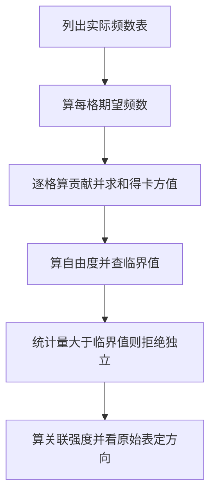

# 卡方检验

> 前置知识：进阶篇的假设检验与 p 值。卡方检验处理的是类别数据（个数、频数），不是均值。

## 一句话理解

卡方检验是“数个数”的检验：把实际数到的个数（O）与假设成立时该有的个数（E）逐项比较，差得越大，假设越可疑。

## 为什么需要：均值检验管不了类别问题

“骰子是不是均匀的？”“性别和饮品偏好有没有关系？”——这些问题没有均值可比，只有“每个类别里有多少人”。卡方检验就是为类别数据准备的，两种用途：

- 拟合优度：实际分布与某个理论分布（如均匀）是否相符。
- 独立性：两个类别变量（如性别与偏好）是否相互独立。

## 公式拆解

χ² = Σ (O − E)² / E，χ 读作“卡”，Σ 表示对所有类别求和：

- O（Observed）：实际观测到的频数。
- E（Expected）：假设成立时理论上该有的频数。
- 为什么平方：差有正有负，直接加会抵消，平方后只剩“差多大”。
- 为什么除以 E：差 5 个人，在期望 10 人里是大事，在期望 1000 人里是小事；除以 E 是把差异换算成相对大小。
- χ² 越大，实际与假设偏离越远；χ² 接近 0，说明实际与假设吻合。

## 例 1：拟合优度——骰子均匀吗

骰子掷 60 次，各点数出现次数：1 点 8 次、2 点 12 次、3 点 11 次、4 点 9 次、5 点 10 次、6 点 10 次。均匀假设下每面期望 E = 60 / 6 = 10 次。

χ² = (8−10)²/10 + (12−10)²/10 + (11−10)²/10 + (9−10)²/10 + (10−10)²/10 + (10−10)²/10 = 0.4 + 0.4 + 0.1 + 0.1 + 0 + 0 = 1.0。

自由度 = 类别数 − 1 − 估计的参数个数 = 6 − 1 − 0 = 5（期望 10 是直接由总数定的，没额外估计参数）。查卡方表（自由度 5、显著性 0.05）：临界值约 11.07。1.0 远小于 11.07，p 值远大于 0.05，不拒绝均匀假设：这颗骰子可以认为是均匀的。

## 例 2：独立性——性别与饮品偏好有关吗

100 人调查（行：性别；列：偏好）：

|  | 咖啡 | 茶 | 行合计 |
|---|---|---|---|
| 男 | 30 | 10 | 40 |
| 女 | 20 | 40 | 60 |
| 列合计 | 50 | 50 | 100 |

独立假设下期望频数 = 行合计 × 列合计 / 总数：男-咖啡 40×50/100 = 20，男-茶 20，女-咖啡 30，女-茶 30。

χ² = (30−20)²/20 + (10−20)²/20 + (20−30)²/30 + (40−30)²/30 = 5 + 5 + 3.33 + 3.33 ≈ 16.67。

自由度 = (行数 − 1)(列数 − 1) = 1×1 = 1，临界值 3.84。16.67 远大于 3.84，拒绝独立：性别与饮品偏好有关联。

## 关联强度：显著不等于强

卡方显著只说明“有关联”，不说明关联多强。看强度用 Cramér's V：V = √(χ² / (N × (min(行数, 列数) − 1)))。上例 V = √(16.67 / 100) ≈ 0.41，属于中等关联（0.1 弱、0.3 中等、0.5 强，粗略参考）。

## 期望频数过小的处理

某格期望频数小于 5 时，卡方近似会失真。处理办法：合并类别（把稀有类别并进相邻类别），或对 2×2 表改用 Fisher 精确检验（直接算精确概率，不依赖近似）。

## 公式精讲与练习：2×2 独立性手算全程

原篇公式拆解讲了 χ² 的每一部分是什么意思，本节把一个 2×2 独立性检验从头算到尾：建表、算期望、算统计量、查表判定、算关联强度，每一步的数字都摆出来。

### 符号再过一遍：这张表里每个字母指什么

| 符号 | 含义 | 本节例中的值 |
|---|---|---|
| O | 实际观测频数（格子里真实数到的人数） | 如试喝组购买 42 人 |
| E | 独立假设下该格的期望频数，E = 行合计 × 列合计 / 总数 | 如试喝组购买 33 人 |
| χ² | 卡方统计量，χ² = Σ(O−E)²/E，对全部格子求和 | 本节算得约 10.91 |
| df | 自由度，2×2 表为 (行数−1)(列数−1) = 1 | 1 |
| N | 总样本量 | 120 |
| Cramér's V | 关联强度，V = √(χ² / (N × (min(行数, 列数) − 1))) | 本节约 0.30 |

### 主例：新品试喝与购买有没有关联

某奶茶店推新品，调查 120 人（行：是否试喝；列：是否购买）：

|  | 购买 | 未购买 | 行合计 |
|---|---|---|---|
| 试喝组 | 42 | 18 | 60 |
| 未试喝组 | 24 | 36 | 60 |
| 列合计 | 66 | 54 | 120 |

**第 1 步：算期望频数。** 独立假设下，期望频数 = 行合计 × 列合计 / 总数：

- 试喝组-购买：60 × 66 / 120 = 33
- 试喝组-未购买：60 × 54 / 120 = 27
- 未试喝组-购买：60 × 66 / 120 = 33
- 未试喝组-未购买：60 × 54 / 120 = 27

**第 2 步：逐格算贡献再求和。** 每一格的贡献是 (O−E)²/E：

| 格子 | O | E | (O−E)²/E |
|---|---|---|---|
| 试喝组-购买 | 42 | 33 | 81/33 ≈ 2.45 |
| 试喝组-未购买 | 18 | 27 | 81/27 = 3.00 |
| 未试喝组-购买 | 24 | 33 | 81/33 ≈ 2.45 |
| 未试喝组-未购买 | 36 | 27 | 81/27 = 3.00 |

χ² ≈ 2.45 + 3.00 + 2.45 + 3.00 = 10.91。

**第 3 步：查表判定。** 自由度 df = (2−1)(2−1) = 1，显著性 0.05 的临界值是 3.84（查卡方表）。10.91 > 3.84，拒绝“试喝与购买相互独立”：两者有关联。p 值的正确读法是：在独立假设成立的前提下，观察到当前或更极端偏离的概率小于 0.05。

**第 4 步：算强度，别只报显著。** Cramér's V = √(10.91 / 120) ≈ √0.0909 ≈ 0.30，按原篇粗略参考（0.1 弱、0.3 中等、0.5 强）属于中等关联的下沿：有关联，但不算很强。

**第 5 步：方向与因果各归各。** 方向看原始表：试喝组购买率 42/60 = 70%，未试喝组 24/60 = 40%，偏离的方向是“试喝组更倾向于购买”。但关联不等于因果：可能是本来就对新品感兴趣的人更愿意试喝，不能直接说“试喝导致购买”。

### 判定流程图：每次按这个顺序走

### 练习题

1. 拟合优度：某 App 四种启动页 80 次点击分布为 A 26 次、B 18 次、C 20 次、D 16 次。均匀假设下 χ² 是多少？自由度是多少？查表（临界值 7.81）后结论是什么？
2. 独立性：某课程参与讨论组 50 人中通过 38 人，未参与组 50 人中通过 26 人。列出 2×2 表，算出 χ² 与 Cramér's V，查表（自由度 1、临界值 3.84）后给结论。
3. 期望频数过小：一个 2×2 表里某格期望频数只有 3.2，能直接用卡方近似吗？应该怎么办？判断标准看的是期望频数还是观测频数？
4. 概念题：某 2×2 表算得 χ² = 0.5，自由度 1，临界值 3.84。结论是什么？用规范措辞写出 p 值的含义，并说明显著与否能不能推出因果。

### 参考答案

1. 均匀假设下每种期望 E = 80 / 4 = 20。χ² = (26−20)²/20 + (18−20)²/20 + (20−20)²/20 + (16−20)²/20 = 1.8 + 0.2 + 0 + 0.8 = 2.8。自由度 = 4 − 1 = 3，2.8 < 7.81，不拒绝均匀假设：四种启动页的点击分布与均匀无显著偏离。
2. 表：讨论组通过 38、未通过 12；未讨论组通过 26、未通过 24；列合计 64、36。期望频数：讨论组-通过 50×64/100 = 32，讨论组-未通过 18，未讨论组-通过 32，未讨论组-未通过 18。χ² = 36/32 + 36/18 + 36/32 + 36/18 = 1.125 + 2 + 1.125 + 2 = 6.25。6.25 > 3.84，拒绝独立：参与讨论与通过有关联。V = √(6.25 / 100) = 0.25，弱到中等。方向看原始表：讨论组通过率 76%，未讨论组 52%。
3. 不能直接用卡方近似：期望频数小于 5 时近似会失真。处理：合并类别（把稀有类别并进相邻类别），或对 2×2 表改用 Fisher 精确检验。判断标准看的是期望频数 E，不是观测频数 O——观测到的格子再小，只要期望够大，近似就成立。
4. 0.5 < 3.84，不拒绝独立假设。p 值含义：在独立假设成立的前提下，观察到当前或更极端偏离的概率大于 0.05。显著与否都不能推出因果：卡方只检验两个类别变量是否独立，偏离的方向看原始表，因果要靠实验设计与混杂控制来回答。

## 容易混淆与常见误区

- 卡方显著不能说明因果：性别与偏好有关联，不等于性别导致偏好（可能是年龄、文化等混杂因素）。
- 卡方不说明方向：它只告诉你“有偏离”，偏离朝哪个方向要看原始表格。
- 拟合优度与独立性别混：前者是一个变量的分布 vs 理论分布，后者是两个变量是否独立，期望频数的算法不同。

## 实际应用

问卷选项分布是否均匀、AB 测试中转化人数与分组是否独立、产品缺陷类型分布是否符合历史比例——只要问题是“个数对不对得上”，先想卡方。

## 小技巧与冷知识

【小技巧】2×2 表不用逐格算期望再求和，有一条快捷公式：χ² = N(ad−bc)² / ((a+b)(c+d)(a+c)(b+d))，其中 a、b 是第一行的两格，c、d 是第二行的两格，N 是总数。拿原文主例验算：a=42、b=18、c=24、d=36、N=120，(42×36−18×24) = 1080，代入得 10.91，和逐格求和的结果完全一致；手算或面试白板上用它快得多。

【小技巧】2×2 表可以做 Yates 连续性校正：每格的贡献改成 (|O−E|−0.5)²/E，相当于把离散的频数往连续的卡方分布上"贴"得更紧一点。原文主例校正后 χ² 从 10.91 降到约 9.73，结论不变但更保守；不过现在更主流的做法是样本小时直接用 Fisher 精确检验，校正只是"手边没有精确检验"时的退路。

【小技巧】卡方显著后想知道是哪一格在"捣乱"，看标准化残差 (O−E)/√E：绝对值超过 2 的格子就是偏离的主要来源。原文例 2 里男-咖啡格的残差是 (30−20)/√20 ≈ 2.24，女-茶格同样是 2.24，这两格撑起了大部分 χ²；只看总统计量不知道偏离藏在哪，残差能把位置指出来。

【小技巧】样本量翻倍，χ² 也翻倍：同样的比例结构，把表里每个数都乘 2，χ² 正好变成 2 倍（原文主例 10.91 乘 2 后是 21.82）。所以"显著" partly 是样本量堆出来的，大样本下一丁点关联也能显著；报结果时一定把 Cramér's V 贴在旁边，显著性与强度各说各的。

【小技巧】2×2 表显著后，顺手算一个比值比 OR = ad/bc，比 Cramér's V 更直观：原文例 2 里 OR = (30×40)/(10×20) = 6，意思是男性选咖啡的 odds（选咖啡人数÷选茶人数）是女性的 6 倍。V 只告诉你关联有多强，OR 还告诉你方向和倍数，业务方一听就懂。

【小技巧】同一批人前后测的配对数据，别用独立性卡方：独立性检验要求两组样本相互独立，前后测是同一批人，配对结构会被当成独立样本误算。配对的 2×2 表用 McNemar 检验，只看"变了"的两格：χ² = (b−c)²/(b+c)。比如原来不买、后来买了 12 人，原来买、后来不买了 4 人，(12−4)²/16 = 4.0，刚过自由度 1 的临界值 3.84。

【小技巧】期望频数不够、表又太大、Fisher 精确检验算不动时，可以用蒙特卡洛模拟 p 值：按"独立"假设随机生成大量同边际的表，看其中多大比例的 χ² 不小于观测值。R 语言的 chisq.test(simulate.p.value = TRUE) 就是这个做法；卡方近似失效不等于无路可走，模拟是第三条路。

【小技巧】G 检验是卡方的"亲戚"：G = 2ΣO·ln(O/E)，大样本下和 χ² 非常接近，优点是不同模型的 G 值可以直接相减做比较（似然比检验的思路）。Python 里 scipy.stats.chi2_contingency(lambda_="log-likelihood") 算的就是 G 检验；面试被问"卡方之外还有什么"时，这是现成的答案。

【小技巧】期望频数不够要合并类别时，合并要按业务含义并，别为了凑够 5 把毫不相关的类别硬拼在一起：比如把"非常不满意"并进"不满意"合理，把"非常不满意"并进"非常满意"就荒唐。合并后类别数变了，自由度也要跟着重算（拟合优度是类别数−1−估计参数个数），别拿旧自由度去查表。

【小技巧】连续变量别硬分箱做卡方：把年龄、收入切成几段再检验，分箱边界一动结论可能跟着变，而且分箱会丢掉组内差异的信息。连续数据优先用 t 检验、回归这类为连续量设计的工具；卡方是"数个数"的检验，只接类别数据。

【冷知识】卡方检验是 Karl Pearson 在 1900 年提出的，论文发表在《Philosophical Magazine》上，标题讲的是"判断一组偏离是否可合理地认为来自随机抽样"。χ² 分布的名字也来自 Pearson——这套用了 120 多年的检验，比 t 检验（1908 年）还要早 8 年。

【冷知识】χ 读作"kai"，近似中文"凯"的音，"卡方"是音译。还有一个冷门联系：自由度为 1 时，χ² 就是标准正态变量 Z 的平方，所以自由度 1 的临界值 3.84 正好是 1.96²——卡方表和正态表在这一点上是通的。

【冷知识】Fisher 精确检验源于一场品茶赌局：1935 年 Fisher 在《实验设计》里记载，Muriel Bristol 声称能尝出茶里是先加奶还是先加茶，Fisher 为此设计了 8 杯茶的盲测实验，精确检验就是为这种小样本算"纯靠猜有多大概率全对"而生的。

【冷知识】卡方检验在遗传学里有个名场面：孟德尔豌豆实验的 3:1 分离比，经典的拟合优度检验素材。但 Fisher 在 1936 年复算后指出，孟德尔的数据拟合得"好过头了"——p 值异常地高，好到不像随机抽样该有的样子。卡方不只能发现"偏离太大"，也能发现"吻合得可疑"。

【冷知识】Yates 连续性校正出自 Frank Yates 在 1934 年的论文，针对的正是 2×2 表自由度为 1 时离散频数与连续卡方分布之间的错位。它和 Fisher 精确检验几乎同时期出现，一个走"修正近似"路线，一个走"直接算精确概率"路线，两种思路至今还在教科书里并排出现。

【冷知识】Cramér's V 是瑞典统计学家 Harald Cramér 在 1946 年提出的，原文 0.1 弱、0.3 中等、0.5 强的粗略参考正是出自他对 V 取值范围的讨论。V 的分母里 min(行数, 列数)−1 这一项，就是为了让它在不同大小的表之间可以横向比较。

## 面试与自测

1. 骰子掷 60 次，某面出现 20 次，期望是 10 次，这一项对 χ² 贡献多少？
2. 2×2 表卡方显著后，为什么还要算 Cramér's V？
3. 某格期望频数只有 3，该怎么办？

### 参考答案

1. (20−10)²/10 = 100/10 = 10。单这一项就接近自由度 5 的临界值 11.07，说明偏离已经很大。
2. 因为卡方显著只说明有关联，不说明关联强度；样本量大时，一点点关联也能显著，V 才能告诉你关联实际有多强。
3. 合并类别（把稀有类别并进相邻类别），或对 2×2 表改用 Fisher 精确检验。
