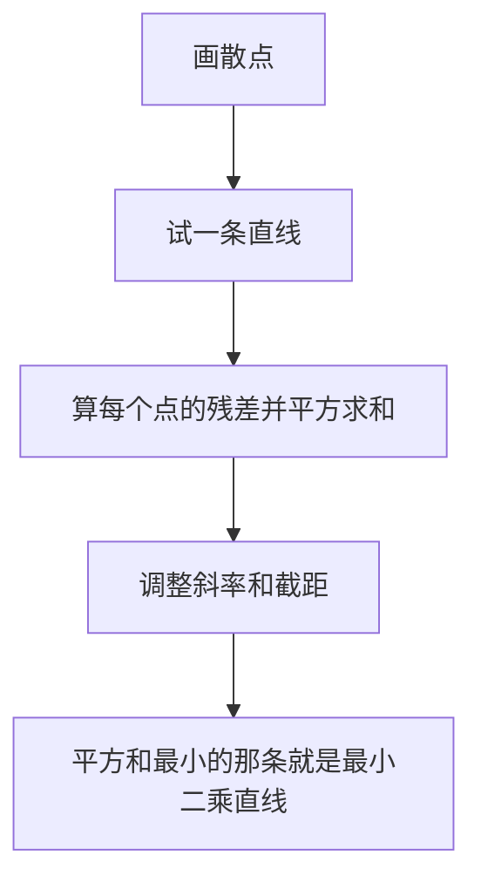

# 回归分析

> 本篇是[计算机基础/统计/统计推断与应用.md](计算机基础/统计/统计推断与应用.md)的进阶篇。
> 一元线性回归（一条直线 ŷ = a + bx、R²、残差图）已在该篇 5.2 讲过，本篇不再重复计算，
> 只向四个方向展开：多变量、分类结果、残差诊断、过拟合。
> 符号沿用主篇：总体均值 μ、样本均值 x̄、标准差 s、相关系数 r。

## 1. 多元线性回归：不止一个自变量

### 1.1 生活案例：房租由什么决定

一句话理解：多元回归是“一元回归的升级版”——预测房租时，
不只看面积，还同时看离地铁的距离，两个因素一起算。

为什么需要：现实里结果很少只由一个因素决定。只看面积预测房租，
离地铁 100 米和离地铁 5 公里的同面积房子会被算成一个价，
显然不对。把两个因素一起放进模型，才能分开看各自的影响。

模型长这样：ŷ = b0 + b1·x1 + b2·x2。

- ŷ：预测的房租（单位：千元），头上的尖帽读作“预测值”。
- b0：截距，面积和距离都为 0 时的基准租金（实际中常无意义，只是个起点）。
- b1：面积的系数；b2：距离的系数。
- x1：面积（单位：10 平方米）；x2：离地铁的距离（单位：公里）。

### 1.2 系数含义：关键在“其他变量不变”

正式定义：b1 的意思是“在其他变量保持不变的情况下，
x1 每增加 1 个单位，y 平均变化 b1 个单位”。

“其他变量不变”这六个字是多元回归的全部精髓。
一元回归里面积的系数，混进了“大房子往往离地铁近”这层关系；
多元回归把距离固定住，面积的系数才更接近“面积本身”的作用。
注意措辞：这里说的是“平均趋势”，不是因果承诺——
面积大不一定“导致”租金高，还可能有装修、地段等没放进模型的因素。

逐步代入（小例子，特意挑的干净数字，只为演示算术）：

| 面积 x1（10㎡） | 距地铁 x2（km） | 实际租金 y（千元） |
|---|---|---|
| 5 | 3 | 3.0 |
| 6 | 2 | 3.8 |
| 7 | 2 | 4.2 |
| 8 | 1 | 5.0 |
| 9 | 1 | 5.5 |

拟合结果是：ŷ = 1.727 + 0.453·x1 − 0.333·x2。

- 系数解读：面积每多 10 平方米，租金平均高约 0.45 千元（450 元），距离不变的前提下；
  离地铁每远 1 公里，租金平均低约 0.33 千元（330 元），面积不变的前提下。
- 预测新房：75 平方米、离地铁 1.5 公里，x1 = 7.5，x2 = 1.5，
  代入得 ŷ = 1.727 + 0.453 × 7.5 − 0.333 × 1.5 = 1.727 + 3.398 − 0.500 ≈ 4.63 千元。
- 残差（实际减预测，约）：0.01、0.02、−0.03、−0.02、0.03，全在 0.04 以内。
  先说明：这组数是特意挑的干净小例子，残差才这么小；
  真实数据的残差通常大得多，看残差图正是为了发现这一点（见第 3 节）。

### 1.3 共线性直觉：两个变量太像，系数就站不稳

一句话理解：共线性是“两个自变量几乎在说同一件事”，
模型分不清功劳该算给谁，系数估计就会抖动。

生活案例：把“面积”和“房间数”一起放进房租模型。
大房子房间往往多，两者高度相关。结果可能是：面积系数变正、
房间数系数变负，或者两个都不显著——但合起来预测租金还挺准。
这时单看某一个系数下结论（比如“房间越多租金越低”）一定会错。

判断方法（不用背公式，记住三条直觉）：

- 两个变量的相关系数很高（比如超过 0.8），先警惕。
- 去掉其中一个，另一个的系数大幅变化，说明功劳分不开。
- 经验指标 VIF = 1 / (1 − R²ⱼ)，其中 R²ⱼ 是该变量被其他变量解释的比例；
  VIF 大于 5 或 10 是经验法则上的警戒线，不是铁律。

处理思路：两个变量只能留一个时，留业务上更直接的那个；
或者把两者合成一个指标（比如“人均面积”）；不要同时报告两个抖动的系数。

## 2. 逻辑回归：结果是 0 或 1 时怎么办

### 2.1 生活案例：复习几小时能通过考试

一句话理解：逻辑回归预测的是“概率”，而不是具体的数值——
结果只有两种（通过/不通过、流失/留存、患病/健康）时用它。

为什么直线不行：用直线 ŷ = a + bx 预测概率，
x 很大时预测值会超过 1，x 很小时会小于 0，
而概率不可能超出 0 到 1 之间。逻辑回归换了一条“S 形曲线”，
把预测值永远压在 0 到 1 之间。

### 2.2 几率与 logit：逐项拆解

- 概率 p：事件发生的可能性，比如通过概率 0.5。
- 几率 odds：p / (1 − p)，即“发生与不发生的比”。
  p = 0.5 时几率是 0.5 / 0.5 = 1，读作“一比一”；
  p = 0.668 时几率是 0.668 / 0.332 ≈ 2.01，读作“约二比一”。
- logit：ln(odds)，即几率取自然对数。几率只能大于 0，
  取对数后就可以取任何实数，正好能接上一条直线。
- 模型：ln(p / (1 − p)) = b0 + b1·x。等式左边是 logit，右边是直线。
  反过来由 logit 求概率：p = 1 / (1 + e^(−logit))。

逐步代入：设模型是 logit = −3.5 + 0.7·x，x 是复习小时数。

- x = 4：logit = −3.5 + 2.8 = −0.7，p = 1 / (1 + e^0.7) ≈ 0.332，几率 ≈ 0.497。
- x = 5：logit = −3.5 + 3.5 = 0，p = 1 / (1 + 1) = 0.5，几率 = 1。
- x = 6：logit = −3.5 + 4.2 = 0.7，p = 1 / (1 + e^(−0.7)) ≈ 0.668，几率 ≈ 2.014。

### 2.3 系数解读：几率乘几倍，不是概率乘几倍

系数 b1 = 0.7 的正确解读：x 每增加 1，几率乘以 e^0.7 ≈ 2.01 倍。

对照上面三行：x 从 5 到 6，几率从 1.0 变成 2.014，确实翻了一倍；
但概率只从 0.50 升到 0.668，没有翻倍。
这是逻辑回归最常见的误读：系数说的是“几率的变化倍数”，
不是“概率的变化倍数”，更不是“概率增加了多少个百分点”。

阈值补充：算出概率后，要不要判为“通过”，需要一条分界线。
p > 0.5 判为 1 只是惯例，不是定律：如果漏判的代价更大（比如疾病筛查），
阈值可以调低；如果误判的代价更大，阈值可以调高。

## 3. 残差诊断：残差图看什么

承接[计算机基础/统计/统计推断与应用.md](计算机基础/统计/统计推断与应用.md) 5.2 的残差图，
这里把“看什么”说全。横轴是预测值（或某个自变量），纵轴是残差（实际减预测）：

- 随机散布在 0 上下：拟合基本到位，模型形态没大问题。
- 呈弯曲（U 形或倒 U 形）：漏了非线性关系，比如真实关系是曲线却用了直线，
  要加平方项或换模型，而不是硬解释系数。
- 呈漏斗形（左边窄、右边宽，或反过来）：方差不齐，预测值越大残差越散，
  区间估计和检验都会失真，要处理（比如对 y 取对数）。
- 个别点离群很远：强影响点，先核查是不是录入错误；
  确认是真实数据再决定是保留、单独说明还是换稳健方法，不要悄悄删点。

诊断顺序：先看图，再谈系数。图有问题时，系数再显著也不能直接用。

## 4. 过拟合直觉：变量越多不一定越好

生活案例：5 个点，4 次多项式（5 个参数）可以穿过所有点，
训练集上的残差是 0，R² 是 1——但第 6 个新点一来，预测大概率离谱。
模型把这 5 个点的“噪声”也背下来了，而不是学到了规律。

关键结论：训练集上的 R² 只升不降——加变量永远不会让训练集拟合变差，
所以“R² 高”不能证明模型好。真正要看的是新数据上的表现。

对策直觉（记住三条就够）：

- 留出验证集：训练集拟合，验证集选模型，不在同一批数据上既拟合又评判。
- 变量宁少勿多：每加一个变量都要问一句“业务上说得通吗”。
- 交叉验证一句话：轮流留出一部分数据做验证，多轮结果平均着看，比一次划分更稳。

## 公式精讲与练习：最小二乘、R² 与逻辑回归优势比

本篇 §1 讲了多元回归的系数解读、§2 讲了逻辑回归的 logit 与几率倍数，但有三块只给了结论没给算术：最小二乘的斜率截距公式、R² 的分解算法、逻辑回归的 2×2 表优势比。本节把这三块拆开讲透：每个符号是什么意思、数字怎么一步步代入、结果怎么读。

### 1. 最小二乘：斜率与截距是怎么来的

一元回归要找一条直线 ŷ = a + b·x，让它离所有散点“总体最近”。“最近”的标准是残差平方和最小：每个点的残差是实际 y 减预测 ŷ，平方后加起来，选 a、b 让这个和最小——这就是“最小二乘”的名字来源。

| 符号 | 含义 |
|---|---|
| x、y | 自变量、因变量的一组观测值 |
| x̄、ȳ | x、y 的样本均值 |
| Sxx = Σ(x − x̄)² | x 自身的离散程度（分母） |
| Sxy = Σ(x − x̄)(y − ȳ) | x 与 y 同向变动的程度（分子） |
| b = Sxy / Sxx | 斜率：x 每增加 1，y 平均变化多少 |
| a = ȳ − b·x̄ | 截距：x = 0 时的预测值 |

两个要点：第一，斜率是“共变程度除以 x 自身的波动”——x 波动越大，分母越大，斜率越不容易被个别点带跑；第二，直线一定经过均值点 (x̄, ȳ)，因为截距公式就是从这个点反推的。

逐步代入（小店广告投入与销售额，5 周数据，全程手算）：

| 周 | 广告投入 x（千元） | 销售额 y（万元） | x − x̄ | y − ȳ | (x − x̄)² | (x − x̄)(y − ȳ) |
|---|---|---|---|---|---|---|
| 1 | 1 | 3 | −2 | −3.2 | 4 | 6.4 |
| 2 | 2 | 5 | −1 | −1.2 | 1 | 1.2 |
| 3 | 3 | 6 | 0 | −0.2 | 0 | 0 |
| 4 | 4 | 8 | 1 | 1.8 | 1 | 1.8 |
| 5 | 5 | 9 | 2 | 2.8 | 4 | 5.6 |
| 均值 | x̄ = 3 | ȳ = 6.2 | | | Sxx = 10 | Sxy = 15.0 |

- 斜率 b = 15.0 / 10 = 1.5：广告投入每多 1 千元，销售额平均高 1.5 万元（平均趋势，不是因果承诺——销售额还可能受季节、促销等没放进模型的因素影响）。
- 截距 a = 6.2 − 1.5 × 3 = 1.7：直线是 ŷ = 1.7 + 1.5x。
- 预测与残差：x = 1 时 ŷ = 3.2（残差 −0.2），x = 2 时 ŷ = 4.7（残差 0.3），x = 3 时 ŷ = 6.2（残差 −0.2），x = 4 时 ŷ = 7.7（残差 0.3），x = 5 时 ŷ = 9.2（残差 −0.2）。残差之和为 0，这是最小二乘直线的内在性质，可用来验算。
- 预测新一周：广告投 6 千元，ŷ = 1.7 + 1.5 × 6 = 10.7 万元——这是外推，超出观测范围（1–5 千元）的预测要谨慎，见 §4 过拟合的提醒。

### 2. R²：直线解释了多少波动

接上例。y 本身的波动是 SST = Σ(y − ȳ)² = 10.24 + 1.44 + 0.04 + 3.24 + 7.84 = 22.8；直线没解释掉的剩余波动是 SSE = Σ残差² = 0.04 + 0.09 + 0.04 + 0.09 + 0.04 = 0.30。R² = 1 − SSE / SST = 1 − 0.30 / 22.8 ≈ 0.987。

| 符号 | 含义 |
|---|---|
| SST | y 围绕均值的总波动 |
| SSE | 直线拟合后剩下的残差波动 |
| R² = 1 − SSE / SST | 直线解释掉的波动占比，0 到 1 之间 |

读法：R² ≈ 0.987 的意思是，这 5 周销售额波动的约 98.7% 能被“广告投入的线性关系”解释掉，只剩约 1.3% 是直线没解释的。但三点提醒缺一不可：第一，R² 说的是线性伴随程度，不是因果——广告与销售额一起变，不等于广告导致了销售额；第二，5 个点算出的 R² 再高也不能说明新数据上预测准，点少时直线很容易“恰好”贴合（本篇 §4 的过拟合直觉）；第三，R² 高不代表直线形态就对，仍要先看残差图（本篇 §3）。

### 3. 逻辑回归优势比：2×2 表算法

本篇 §2 讲了 logit 与“几率乘 e^b 倍”，但实际做 2×2 表时更常用优势比（Odds Ratio，OR）：OR = (a·d) / (b·c)，即两组几率之比。

| | 通过 | 未通过 | 该组通过几率 |
|---|---|---|---|
| 参加模拟考 | 36（a） | 12（b） | 36/12 = 3 |
| 未参加模拟考 | 18（c） | 30（d） | 18/30 = 0.6 |

- OR = (36 × 30) / (12 × 18) = 1080 / 216 = 5.0：参加组的通过几率是未参加组的 5 倍。
- 对照相对风险 RR = (36/48) / (18/48) = 0.75 / 0.375 = 2.0：参加组的通过“概率”是未参加组的 2 倍。
- 为什么 OR（5.0）比 RR（2.0）大得多？因为通过这件事本身很常见（总体通过率 54/96 ≈ 56%），结局越常见，OR 离 RR 越远。把 OR = 5 直接读成“通过风险是 5 倍”是常见误读——OR 说的是几率比，不是概率比。
- 因果提醒：这张表是观察数据，不是随机分组。参加模拟考的学生可能本身更用功，OR = 5 只说明伴随关系，不能读成“模拟考导致通过率提高 5 倍”。

### 练习题

1. 斜率截距手算：某商品 4 个月的投放量 x（万元）与销量 y（千件）为 (2, 5)、(4, 9)、(6, 11)、(8, 15)。求最小二乘直线 ŷ = a + bx，并预测 x = 10 时的销量。
2. R² 解释：某模型 SSE = 12、SST = 200。求 R² 并用一句话解释；再问：R² = 0.94 能不能说 x 导致 y？
3. 优势比：运动组高血压 20 人、正常 80 人；不运动组高血压 45 人、正常 55 人。求 OR 并解释；再问：能不能说“运动使高血压风险降为 0.31 倍”？
4. logit 系数：模型 logit = −2 + 0.5x，x 从 4 增加到 5，概率和几率分别怎么变？系数 0.5 能说成“概率乘 1.65 倍”吗？

### 参考答案

1. x̄ = 5，ȳ = 10；Sxx = 9 + 1 + 1 + 9 = 20；Sxy = (−3)(−5) + (−1)(−1) + (1)(1) + (3)(5) = 15 + 1 + 1 + 15 = 32；b = 32 / 20 = 1.6；a = 10 − 1.6 × 5 = 2；直线 ŷ = 2 + 1.6x；x = 10 时 ŷ = 18 千件（外推，需谨慎）。
2. R² = 1 − 12 / 200 = 0.94：y 波动的 94% 能被 x 的线性关系解释。不能说 x 导致 y：R² 只量线性伴随程度，因果要看研究设计与混杂因素是否排除。
3. OR = (20 × 55) / (80 × 45) = 1100 / 3600 ≈ 0.31：运动组患高血压的几率约是不运动组的 0.31 倍。不能说“风险降为 0.31 倍”：第一，OR 是几率比不是风险比（RR = 0.20 / 0.45 ≈ 0.44）；第二，这是观察数据，年龄、饮食等混杂没排除，不能读因果。
4. x = 4 时 logit = 0，p = 0.5，几率 = 1；x = 5 时 logit = 0.5，p = 1 / (1 + e^(−0.5)) ≈ 0.622，几率 ≈ 1.649。几率乘了 e^0.5 ≈ 1.65 倍，概率只从 0.5 升到 0.622（升了 0.122），不能说成“概率乘 1.65 倍”。

## 易混淆对比表

| 容易混淆的一对 | 区别 | 一句话记忆 |
|---|---|---|
| 一元回归系数 vs 多元回归系数 | 一元系数混进了其他变量的影响；多元系数是“其他变量不变”下的作用 | 多元系数多了“控制住其他变量”这个前提 |
| 概率 vs 几率 vs logit | 概率在 0 到 1 之间；几率是 p/(1−p)，大于 0；logit 是几率的对数，可取任何实数 | 概率是直觉，几率是比值，logit 是接直线的桥梁 |
| 训练集 R² 高 vs 预测准 | 训练集 R² 只反映对旧数据的拟合；预测准要看新数据 | 旧题全对不等于新题会做 |
| 共线性时系数不显著 vs 变量没用 | 系数抖动大、标准误大导致不显著；变量合起来可能仍有预测力 | 单个不显著不等于一对没用 |

## 常见误区

- 系数大等于原因强：错。系数说的是平均趋势，不是因果；
  没放进模型的因素（装修、地段）随时可能才是真正的原因。
- R² 越高模型越好：错。训练集 R² 加变量只升不降，过拟合时 R² 最高、预测最差。
- 逻辑回归系数当概率变化：错。系数说的是几率乘 e^b 倍；
  概率从 0.5 升到 0.668，几率翻了一倍，概率没有。
- 共线性时单看 p 值删变量：错。两个高度相关的变量可能都不显著，
  删掉一个，另一个立刻显著——删之前先看相关性和业务含义。
- 残差图不看直接报系数：错。弯曲或漏斗形的残差图说明模型形态有问题，
  系数再显著也不能直接用。

## 面试与自测

1. 多元回归里“面积系数 0.45”完整含义是什么？为什么必须带上“其他变量不变”？
2. 逻辑回归模型 logit = −3.5 + 0.7x，x 从 5 增加到 6，概率和几率分别怎么变？系数 0.7 能说成“概率翻倍”吗？
3. 训练集 R² = 0.99 的模型，为什么不能直接说它好？至少说出两种验证方法。

### 参考答案

1. 完整含义：在距离等其他变量保持不变的情况下，面积每多 10 平方米，
   租金平均高 0.45 千元。必须带上前提，因为一元回归的面积系数混进了距离的影响；
   不控制距离，系数反映的是“面积 + 与面积相关的其他因素”的混合作用。
2. x = 5 时概率 0.5、几率 1；x = 6 时概率约 0.668、几率约 2.014。
   概率只从 0.5 升到 0.668，几率翻了一倍。不能说成“概率翻倍”，
   系数 0.7 对应的是几率乘以 e^0.7 ≈ 2.01 倍。
3. 不能。训练集 R² 加变量只升不降，过拟合的模型训练集 R² 也能到 0.99，
   但新数据上预测很差。验证方法：留出验证集（训练集拟合、验证集评判）；
   交叉验证（轮流留出一部分做验证，多轮平均）。
