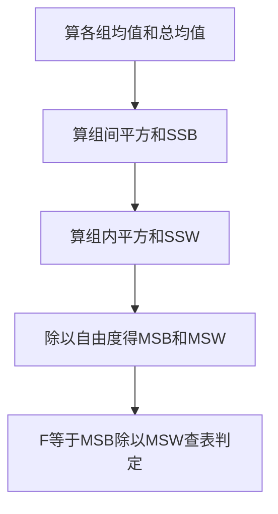

# 方差分析

> 前置知识：主篇的均值、方差概念，进阶篇的假设检验与 p 值。不熟先回[计算机基础/统计/统计学与概率论.md](计算机基础/统计/统计学与概率论.md)与[计算机基础/统计/统计推断与应用.md](计算机基础/统计/统计推断与应用.md)复习。

## 一句话理解

方差分析是“一口气比较三组以上均值”的方法：它不直接比均值，而是比“组和组之间的差别”与“组内部的随机波动”谁更大。

## 为什么需要：连做 t 检验会失控

三组数据（A、B、C）要两两比较，得做 3 次 t 检验。每次都按 5% 犯错算，至少错一次的概率是 1 − 0.95³ ≈ 14.3%，远高于你以为的 5%。组越多，失控越严重：5 组要比 10 次，至少错一次的概率高达约 40%。

方差分析只做一次检验就回答“这几组均值是不是全相等”，把犯错概率牢牢按在 5%。

## 生活案例：三种教学法有效果差别吗

三个班各 5 名学生，期末成绩如下：

| 班 | 成绩 | 班均值 |
|---|---|---|
| A 法 | 78、82、80、85、75 | 80 |
| B 法 | 88、90、85、92、85 | 88 |
| C 法 | 70、72、68、75、65 | 70 |

直观看 B 法最高、C 法最低，但班里学生成绩本身就有波动：B 法高，是教学法真有效，还是碰巧这 5 个人本来就强？方差分析就是来裁决这个问题的。

## 正式定义

原假设 H0：μ1 = μ2 = μ3（各组总体均值全相等）；备择假设 H1：至少有一组均值不同。注意 H1 只说“至少一组不同”，不说是哪一组、哪两组不同。

## 核心思想：两种方差打擂台

- 组间方差：各组均值围绕总均值的散布，反映“教学法带来的差别 + 随机波动”。
- 组内方差：每组内部学生围绕本组均值的散布，反映“纯随机波动”。
- 如果教学法没用，两种方差应该差不多大；如果组间方差远大于组内方差，说明组间差别不是随机波动能解释的。

## 公式拆解

总平方和分解（SST = SSB + SSW，总波动 = 组间波动 + 组内波动）：

- SSB（组间平方和）= Σ nᵢ(x̄ᵢ − x̄)²：nᵢ 是第 i 组人数，x̄ᵢ 是第 i 组均值，x̄ 是总均值。意思是“每组均值离总均值多远，加权求和”。
- SSW（组内平方和）= Σ Σ (xᵢⱼ − x̄ᵢ)²：每个学生成绩离本组均值多远，全部加起来。
- MSB = SSB / (k − 1)：k 是组数，k − 1 是组间自由度（3 组 → 2）。
- MSW = SSW / (N − k)：N 是总人数，N − k 是组内自由度（15 人、3 组 → 12）。
- F = MSB / MSW：组间均方除以组内均方。F 接近 1 说明没差别，F 远大于 1 说明有差别。

## 完整手算

总均值 x̄ = (400 + 440 + 350) / 15 = 1190 / 15 ≈ 79.33。

组间 SSB：5×(80 − 79.33)² + 5×(88 − 79.33)² + 5×(70 − 79.33)² = 5×0.44 + 5×75.11 + 5×87.11 ≈ 2.22 + 375.56 + 435.56 = 813.33。

组内 SSW：A 组 (78−80)² + (82−80)² + (80−80)² + (85−80)² + (75−80)² = 4 + 4 + 0 + 25 + 25 = 58；B 组 0 + 4 + 9 + 16 + 9 = 38；C 组 0 + 4 + 4 + 25 + 25 = 58。SSW = 58 + 38 + 58 = 154。

验证：SST = 813.33 + 154 = 967.33，与直接算全部 15 个数围绕总均值的平方和一致，分解没漏没重。

MSB = 813.33 / 2 ≈ 406.67；MSW = 154 / 12 ≈ 12.83；F = 406.67 / 12.83 ≈ 31.69。

查 F 表（自由度 2 和 12、显著性 0.05）：临界值约 3.89。31.69 远大于 3.89，p 值远小于 0.05，拒绝 H0：三种教学法的成绩均值不全相等。

## 使用条件（不满足时结论不可靠）

- 独立性：各组样本互不干扰（同一批学生不能既在 A 组又在 B 组）。
- 正态性：每组数据近似正态分布（小样本时可用正态图粗看）。
- 方差齐性：各组总体方差大致相等（组内标准差差太多时，F 值会失真）。

## 容易混淆与常见误区

- 显著只说明“至少一组不同”，不说明是哪两组不同。想知道具体哪两组不同，要做事后检验（如 Tukey HSD），不能直接拿最大的两组均值相减下结论。
- F 大不等于效应大：样本量很大时，一点点均值差别也能显著；要同时看各组均值实际差了多少分。
- 方差分析不是“分析方差本身”：方差只是工具，检验对象始终是均值。

## 实际应用

新药三剂量疗效比较、三种广告文案转化率比较、不同施肥方案产量比较——只要是“一因素多组比均值”，先想方差分析而不是连做 t 检验。

## 公式精讲与练习：平方和分解、F 统计量与显著之后

原篇给了 SSB、SSW、MSB、MSW、F 的公式和一组完整手算，但有两块值得再拆开：一是每一步“为什么这样算”（自由度为什么是 k−1 与 N−k），二是 F 显著之后到底还能说什么、不能说什么。本节换一组全新数据全程重算，再把显著后的下一步讲透。

### 1. 平方和分解再讲透

| 符号 | 含义 |
|---|---|
| SSB = Σ nᵢ(x̄ᵢ − x̄)² | 组间平方和：各组均值离总均值多远，加权求和 |
| SSW = Σ Σ (xᵢⱼ − x̄ᵢ)² | 组内平方和：每个人离本组均值多远，全部加起来 |
| SST = SSB + SSW | 总平方和：每个人离总均值多远，全部加起来 |
| MSB = SSB / (k − 1) | 组间均方：k 是组数 |
| MSW = SSW / (N − k) | 组内均方：N 是总人数 |
| F = MSB / MSW | 组间平均波动除以组内平均波动 |

自由度为什么这样定：组间有 k 个组均值，但它们受总均值约束（k 个组均值的加权平均就是总均值），少一个自由活动空间，所以是 k − 1；组内每组的人数受本组均值约束，每组少 1 个自由度，k 组共少 k 个，所以是 N − k。除以自由度得到的是“平均下来的波动”，这样组间与组内才有可比性——否则组数多、人多的组天然平方和就大。

逐步代入（三种培训方式下，新员工首周独立处理工单数，单位：单/天，全程手算）：

| 组 | 数据 | 组均值 |
|---|---|---|
| A：传统带教 | 12、14、13、15 | 13.5 |
| B：视频课程 | 18、20、19、21 | 19.5 |
| C：师徒 + 视频混合 | 15、17、16、16 | 16.0 |

- 总均值：三组总和 54 + 78 + 64 = 196，总人数 12，x̄ = 196 / 12 ≈ 16.33。
- 组间 SSB = 4×(13.5 − 16.33)² + 4×(19.5 − 16.33)² + 4×(16 − 16.33)² ≈ 4×8.03 + 4×10.03 + 4×0.11 ≈ 32.11 + 40.11 + 0.44 = 72.67。
- 组内 SSW：A 组 (−1.5)² + 0.5² + (−0.5)² + 1.5² = 2.25 + 0.25 + 0.25 + 2.25 = 5；B 组同样模式 = 5；C 组 (−1)² + 1² + 0² + 0² = 2。SSW = 5 + 5 + 2 = 12。
- 验证分解：SST = SSB + SSW = 72.67 + 12 = 84.67，与直接算 12 个数围绕总均值的平方和一致，分解没漏没重。
- MSB = 72.67 / 2 = 36.33（k − 1 = 2）；MSW = 12 / 9 ≈ 1.33（N − k = 9）；F = 36.33 / 1.33 ≈ 27.25。
- 查 F 表（自由度 2 和 9、显著性 0.05）：临界值约 4.26。27.25 远大于 4.26，拒绝 H0：三种培训方式的首周处理量均值不全相等。

### 2. F 显著之后：只知道“不全相等”

原篇误区节已有结论，这里展开成操作步骤：

- **先做事后检验，再点名**：F 显著只说明至少一组不同。本例 B 组均值 19.5 最高，但不能直接说“B 优于 A、B 优于 C”——要做事后检验（如 Tukey HSD），它在控制整体犯错概率的前提下逐对比较，过了这一关才能点名哪两组真不同。
- **同时看实际均值差**：B − A = 6.0 单/天，B − C = 3.5 单/天，C − A = 2.5 单/天。即使事后检验确认 B 与 A 不同，也要问一句：每天多 6 单值不值得推广成本？统计显著不等于业务上重要。
- **F 大不等于效应大**：F 是比值，样本量很大时，一点点均值差别也能显著；反过来小样本时均值差很大也可能不显著。报 F 时要同时报各组均值与组内波动，不能只报一个 F 值。
- **不显著也不是“证明全相等”**：F 没过临界值，结论只是“没有足够证据说均值不同”，不是“证明了三种方式效果一样”——可能是样本太小、组内波动太大，把真实差别淹没了。

### 练习题

1. F 手算：三种复习资料的模拟考分数，每组 3 人——A：6、8、7；B：10、12、11；C：8、9、10。求 SSB、SSW、F，并对照临界值 F(2, 6) ≈ 5.14 判定。
2. 显著后：某实验 F 显著，能不能直接说“最高组优于最低组”？应该怎么办？还要看什么？
3. 不显著解读：某实验 F = 1.2，临界值 3.89。结论是什么？能不能说“三组均值相等”？F 接近 1 说明了什么？
4. 自由度与条件：k = 4 组、N = 20，组间自由度与组内自由度各是多少？若各组方差差别很大、数据明显偏态，F 的结论还可靠吗？

### 参考答案

1. 组均值 A = 7、B = 11、C = 9，总均值 = 81 / 9 = 9。SSB = 3×(7 − 9)² + 3×(11 − 9)² + 3×(9 − 9)² = 12 + 12 + 0 = 24；SSW：A 组 1 + 1 + 0 = 2，B 组 2，C 组 1 + 0 + 1 = 2，合计 6；MSB = 24 / 2 = 12，MSW = 6 / 6 = 1，F = 12。12 > 5.14，拒绝 H0：三组均值不全相等。
2. 不能。显著只说明至少一组不同，具体哪两组不同要做事后检验（如 Tukey HSD），不能直接拿最高组与最低组相减下结论；同时要看实际均值差，判断业务上是否重要。
3. F = 1.2 < 3.89，不拒绝 H0：没有足够证据说三组均值不同。不能说“三组均值相等”——不拒绝不等于证明相等，可能是样本小或组内波动大淹没了真实差别。F 接近 1 说明组间差别与组内波动差不多大，组间均值散布没有超出随机波动的范围。
4. 组间自由度 = k − 1 = 3，组内自由度 = N − k = 16。不可靠：方差齐性与正态性是方差分析的前提，条件明显不满足时 F 值会失真；可考虑非参数方法，如 [Kruskal-Wallis 检验](计算机基础/统计/非参数检验.md)。

## 小技巧与冷知识

【小技巧】只有两组要比较时，方差分析和 t 检验是同一回事：F = t²。拿原文主例的 A、B 两组单独算，t = −3.65，t² = 13.33，正好等于两组方差分析的 F = 13.33（已用 Python 复算）。所以方差分析是 t 检验向多组的推广，两组时用哪个都一样，不用纠结。

【小技巧】报 F 值时顺手报效应量 η² = SSB / SST：F 只说“显不显著”，η² 说“组间差别占总波动的几成”。原文主例 η² = 813.33 / 967.33 ≈ 0.84，意味着 84% 的总波动来自组间差别，效应非常大。Cohen 给的经验标尺是 0.01 小、0.06 中、0.14 大，但和 p 值一样，最终要由业务判断。

【小技巧】方差齐性不满足时别硬做经典方差分析，改用 Welch's ANOVA：它不要求各组方差相等，对方差不齐稳健得多。R 里 oneway.test 默认就是 var.equal = TRUE，改成 FALSE 即是 Welch 版；Python 的 scipy.stats.f_oneway 只有经典版，要 Welch 得用 pingouin 的 welch_anova。先拿 Levene 检验看方差齐不齐，再决定用哪个版本。

【小技巧】事后检验要按“比什么”选，不是一律 Tukey HSD：全部两两比用 Tukey HSD；只比“每组 vs 对照组”用 Dunnett 检验；实验前就只计划了少数几对比较，用 Bonferroni 校正的 t 检验反而功效更高。先想清楚要回答哪个问题，再挑工具，别上来就默认 Tukey。

【小技巧】同一批人反复测量的数据别用单因素方差分析：比如同一批学生三种教学法轮流测，组间不再独立，要用重复测量方差分析（repeated measures ANOVA）。它把“人本身的差异”从组内波动里单独剥出来，组内波动变小、检验更灵敏；拿独立样本的方法分析配对数据，等于把真实差别淹没在个体差异里。

【小技巧】正态性明显不满足时，Kruskal-Wallis 检验是现成的非参数替代：它不比较均值，而是把所有数据排秩、比较各组的平均秩，不要求正态分布，只要求各组分布形状大致相同。原文练习题答案里已经提到它；小样本、偏态明显、有极端值时，先想它，再想变换数据。

【小技巧】样本量不相等时单因素方差分析照样能做，但双因素不平衡设计要当心：单因素里各组人数不同只影响每组的权重，公式本身不用改；到了双因素、每格人数不等时，平方和有 I、II、III 型三种算法，结果会不一样。做双因素方差分析前，先确认软件用的是哪种类型，默认常常是 III 型。

【小技巧】双因素方差分析的真正价值是看“交互作用”：两个因素单独做两次单因素方差分析，只能看到各自的主效应，看不到“因素 A 的效果是否依赖因素 B 的水平”。比如教学法在男生组有效、在女生组无效，交互作用显著就是在报这件事；交互显著时，单独谈主效应容易误导。

【小技巧】有事先假设时用计划对比（planned contrasts），别等显著了再事后检验：比如实验前就想验证“B 法优于 A 法”，直接写一个对比系数（如 A −1、B +1、C 0）去检验，功效比事后逐对比较更高。事后检验是“不知道哪组不同才逐对翻”，计划对比是“早就瞄准了只测那一处”，两者定位不同。

【小技巧】F 不显著时先别急着下“没差别”的结论，检查组内波动是不是太大：组内标准差一大，MSW 就大，F 就被压下来。看看是不是混进了异常值、分组里藏着没控制的变量，或者样本量太小；原文“公式精讲”节也提醒过，不显著可能是真实差别被组内波动淹没了。

【冷知识】方差分析是 Ronald Fisher 在 1920 年代为农业田间试验发明的：他在洛桑实验站研究不同施肥方案对小麦产量的影响时，提出了把总波动拆成组间与组内、再拿比值做检验的思路。A/B 测试、实验设计的源头和它一样，都是 Fisher 从农田里长出来的统计学。

【冷知识】F 分布的“F”就是为了纪念 Fisher：分布本身由 Fisher 和 George Snedecor 先后给出，Snedecor 在 1934 年的书里正式把它命名为 F 分布，取 Fisher 姓氏的首字母。t 分布以 Student（Gosset 的笔名）命名，F 分布以 Fisher 命名，统计学里两大检验分布的名字都是人名。

【冷知识】Tukey HSD 是 John Tukey 在 1949 年提出的：论文《Comparing Individual Means in the Analysis of Variance》发表于《Biometrics》。Tukey 还是“bit”（比特）一词的提出者，一个人既给计算机科学起了词，又给统计学留了检验方法。

【冷知识】η² 会系统性高估真实效应，ω²（omega-squared）是更不偏的替代：η² 用样本平方和直接算，样本越小越容易把随机波动也算进“组间差别”；Hays 在 1963 年提出的 ω² 对自由度做了修正，数值通常比 η² 小一点。论文里同时报 F、p 值和效应量时，ω² 是更严谨的选择。

【冷知识】方差分析的“方差”这个名字本身就容易误导：它检验的是均值是否相等，方差只是用来度量的工具。Fisher 当年取名 analysis of variance（方差的分析），说的是“把总方差拆开分析”，不是“分析方差本身”——原文误区节这句话，背后是 Fisher 起的名字就带歧义。

【冷知识】方差分析表（SS、df、MS、F 四列）这套固定格式也是 Fisher 定下来的：1925 年《Statistical Methods for Research Workers》里第一次系统地用这张表呈现结果，近一百年过去，R、SPSS、Python 的 statsmodels 输出的 ANOVA 表还是这四列。格式没变过，因为拆分逻辑本身没变过。

## 面试与自测

1. 4 组数据两两做 t 检验要做几次？至少错一次的概率约多少？
2. 上例中 F = 31.69 说明了什么？能不能据此说 B 法一定优于 A 法？
3. 方差分析显著后，想知道具体哪两组不同应该怎么办？

### 参考答案

1. 4 组两两组合是 6 次；至少错一次的概率约 1 − 0.95⁶ ≈ 26.5%，远超 5%，所以不能连做 t 检验。
2. 说明三组均值不全相等（在 0.05 水平下拒绝 H0）。不能直接说 B 优于 A：显著只说明至少一组不同，具体 pairwise 差异要做事后检验。
3. 做事后检验，如 Tukey HSD，它在控制整体犯错概率的前提下逐对比较。
