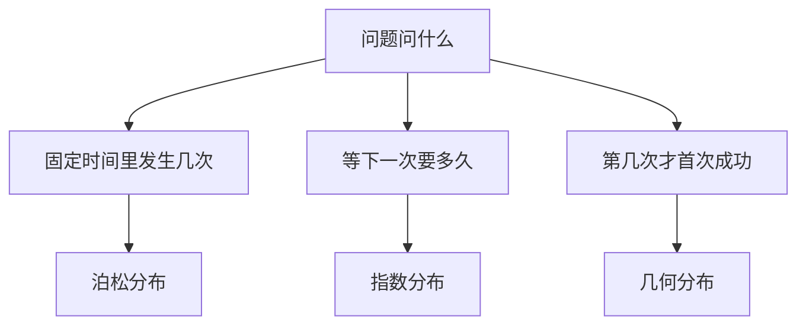

# 概率分布深篇

> 本篇是[计算机基础/统计/统计推断与应用.md](计算机基础/统计/统计推断与应用.md)的进阶篇。
> 正态分布、二项分布已在该篇 4.3、4.4 讲过，本篇不再重复，
> 只补四个同样常用的分布：泊松、指数、均匀、几何。
> 符号沿用主篇：期望 E[X]、方差 Var(X)、均值 μ、标准差 σ。

## 1. 泊松分布：稀有事件数一数

### 1.1 生活案例：客服中心每小时接几个电话

一句话理解：泊松分布回答“一段固定时间（或空间）里，稀有事件发生了几次”。
客服中心平均每小时接 3 通电话，问“某一小时恰好接 2 通”的概率，就是泊松问题。

为什么需要：这类事件单次发生概率小、机会很多（每小时无数个瞬间都可能来电话），
数“几次”比数“每次成不成”更自然。二项分布要先定 n 次试验，
这里 n 说不清，泊松分布直接以“平均发生次数” λ 为参数。

正式定义：P(X = k) = λ^k · e^(−λ) / k!。

- λ（读作 lambda）：平均发生次数，本例 λ = 3，即平均每小时 3 通。
- k：实际发生的次数，取 0、1、2、……。
- e：自然常数约 2.718；k! 是阶乘，0! 按约定等于 1。
- 均值 = λ，方差 = λ（这是泊松分布的标志性性质，后面还会用它粗检数据）。

逐步代入（λ = 3）：

- P(X = 0) = 3^0 · e^(−3) / 0! = 1 × 0.0498 / 1 ≈ 0.0498。
  意思是：约 5% 的小时一通电话都没有。
- P(X = 2) = 3^2 · e^(−3) / 2! = 9 × 0.0498 / 2 ≈ 0.224。
- P(X = 5) = 3^5 · e^(−3) / 5! = 243 × 0.0498 / 120 ≈ 0.1008。

适用条件：事件在不重叠的时间段里独立发生，平均速率稳定。
电话量早晚高峰差异巨大时，一整天的 λ 就不稳定，要分时段分别算。

## 2. 指数分布：等下一个事件要多久

### 2.1 生活案例：下一通电话还要等多久

一句话理解：泊松分布数“发生了几次”，指数分布量“等了多久”——
两者是同一枚硬币的两面：泊松过程里相邻两次事件的间隔服从指数分布。

正式定义：密度函数 f(x) = λ·e^(−λx)，x ≥ 0；
均值 = 1/λ。λ 还是那个平均速率：每小时平均 3 通电话，
平均等待时间就是 1/3 小时，即 20 分钟。

逐步代入（λ = 3/小时）：

- 等待超过 30 分钟（0.5 小时）的概率：P(T > 0.5) = e^(−λ·0.5) = e^(−1.5) ≈ 0.223。
  意思是：约 22% 的情况下，半小时内一通电话都没有。
- 无记忆性：已经等了 10 分钟，接下来再等超过 5 分钟的概率，
  等于刚开始时等超过 5 分钟的概率，都是 e^(−3×5/60) = e^(−0.25) ≈ 0.779。
  直觉：电话不会因为“你已经等了很久”就来得更快——
  指数分布描述的过程没有“攒人品”这回事。
  注意：无记忆性说的是“等待时间分布不变”，不是“运气会补偿”，
  更不是“等久了下一通一定快来”（那是赌徒谬误）。

### 2.2 泊松与指数的关系（一句话记住）

同一 λ 的泊松过程：数次数用泊松分布，量间隔用指数分布。
看到“每小时平均几次”先问一句：题目问的是“几次”还是“等多久”，
前者套泊松，后者套指数。

## 3. 均匀分布：区间里等可能

### 3.1 生活案例：等公交要等多久

一句话理解：均匀分布是“区间里每个点机会均等”——
公交每 10 分钟一班，你随机到达车站，等待时间在 0 到 10 分钟之间等可能。

正式定义：X 在 [a, b] 上均匀分布，密度是常数 1/(b − a)；
均值 = (a + b) / 2，方差 = (b − a)² / 12。

逐步代入（a = 0，b = 10 分钟）：

- 均值 = (0 + 10) / 2 = 5 分钟。意思是：长期平均下来等 5 分钟。
- 方差 = (10 − 0)² / 12 = 100 / 12 ≈ 8.33，标准差 ≈ 2.89 分钟。
  意思是：典型的一次等待离平均数差约 2.9 分钟。
- 等超过 8 分钟的概率：有利区间长度是 10 − 8 = 2，总区间长度是 10，
  概率 = 2 / 10 = 0.2。均匀分布的概率就是“长度之比”，不用积分也能算。

适用提醒：均匀分布要求“真的等可能”。公交发车间隔不固定、
你总是掐点到站，等待时间就不是均匀的——先核对“等可能”这个前提再套公式。

## 4. 几何分布：第几次才首次成功

### 4.1 生活案例：投简历第几次拿到第一个 offer

一句话理解：几何分布回答“第几次试验才第一次成功”。
每次面试成功率都是 20%，问“第 3 次才首次成功”的概率，就是几何问题。

正式定义：P(X = k) = (1 − p)^(k−1) · p。

- p：每次试验的成功概率，本例 p = 0.2。
- k：第几次首次成功，取 1、2、3、……。
- (1 − p)^(k−1)：前面 k − 1 次都失败；最后乘 p：第 k 次成功。
- 均值 = 1/p：平均要试 1 / 0.2 = 5 次才首次成功。

逐步代入（p = 0.2）：

- P(第 3 次首次成功) = 0.8² × 0.2 = 0.64 × 0.2 = 0.128。
- P(前 3 次内成功) = 1 − P(前 3 次全失败) = 1 − 0.8³ = 1 − 0.512 = 0.488。
  意思是：即使每次成功率只有 20%，试 3 次后也将近一半的概率至少成功一次。
- 适用条件：每次试验独立、成功概率不变。面试越面越有经验（p 在涨），
  就不能直接套几何分布。

## 四分布公式精讲与练习

原篇每分布已有生活案例与逐步代入，本节把四个分布的 PMF/PDF 与期望公式收拢重算一遍：符号逐项解释、换一组新场景数字完整代入、配直观图示，最后是 4 道练习题。四分布原篇各已有 1 个案例，故不另堆案例小节，每节的算例本身就是新生活场景。

### 泊松分布：P(X = k) = λ^k · e^(−λ) / k!，期望 E[X] = λ

| 符号 | 含义 |
|---|---|
| λ | 平均发生次数（本节算例 λ = 4，即平均每小时 4 位顾客） |
| k | 实际发生的次数，取 0、1、2、…… |
| e | 自然常数，约 2.718 |
| k! | 阶乘，0! 按约定等于 1 |
| E[X] = λ | 期望就是 λ；方差也是 λ（原篇已讲的标志性性质） |

逐步代入：某便利店平均每小时进店 4 位顾客（λ = 4），求某一小时恰好进店 3 位的概率。

- P(X = 3) = 4³ × e^(−4) / 3! = 64 × 0.0183 / 6 ≈ 0.195。
- 意思是：约 19.5% 的小时恰好进店 3 位。
- 期望 E[X] = 4：长期平均下来每小时 4 位。

直观图示（λ = 4 时各 k 的概率，峰值出现在 λ 附近）：

| k | 0 | 1 | 2 | 3 | 4 | 5 | 6 |
|---|---|---|---|---|---|---|---|
| P(X = k) | 0.018 | 0.073 | 0.147 | 0.195 | 0.195 | 0.156 | 0.104 |

表中概率合计约 0.888，余下约 0.112 分布在 k ≥ 7。概率先升后降、在 3–4 处最高——这就是“平均 4 次”的形状。

### 指数分布：f(x) = λ · e^(−λx)，期望 E[T] = 1/λ，P(T > t) = e^(−λt)

| 符号 | 含义 |
|---|---|
| λ | 平均速率（本节算例：平均每 2 小时出 1 次故障，即 λ = 0.5/小时） |
| x、t | 等待时间，x ≥ 0 |
| f(x) | 密度函数；单点概率是 0，概率是曲线下面积 |
| E[T] = 1/λ | 平均等待时间 |

逐步代入：某网站平均每 2 小时出 1 次故障（λ = 0.5/小时）。

- 平均等待时间 E[T] = 1 / 0.5 = 2（小时）。
- 未来 3 小时内不出故障的概率：P(T > 3) = e^(−0.5 × 3) = e^(−1.5) ≈ 0.223。
  意思是：约 22% 的情况下，3 小时内一次故障都没有。
- 1 小时内出故障的概率：1 − P(T > 1) = 1 − e^(−0.5) ≈ 1 − 0.607 = 0.393。
- 无记忆性只提一句：已经平稳运行多久，不改变接下来等待时间的分布（原篇 2.1 已展开，这里不重复）。

### 均匀分布：f(x) = 1 / (b − a)，期望 E[X] = (a + b) / 2，方差 Var(X) = (b − a)² / 12

| 符号 | 含义 |
|---|---|
| a、b | 区间的左右端点，本节算例 a = 5、b = 15（分钟） |
| f(x) | 密度函数，在区间内是常数，区间外是 0 |
| (a + b) / 2 | 区间中点，就是均值 |
| (b − a)² / 12 | 方差；区间越宽，方差越大 |

逐步代入：打印店取件，等待时间在 5 到 15 分钟之间等可能。

- 均值 = (5 + 15) / 2 = 10（分钟）：长期平均下来等 10 分钟。
- 方差 = (15 − 5)² / 12 = 100 / 12 ≈ 8.33，标准差 ≈ 2.89（分钟）。
- 等超过 12 分钟的概率：有利区间长度是 15 − 12 = 3，总区间长度是 10，概率 = 3 / 10 = 0.3。
- 前提提醒：只有“真的等可能”才能套这个公式（原篇 3.1 的适用提醒）。

直观图示：密度是一条平顶矩形——高 = 1 / (15 − 5) = 0.1，宽 = 10，面积 = 0.1 × 10 = 1。
概率就是矩形下的一段面积：等超过 12 分钟对应 12 到 15 这一段，面积 = 0.1 × 3 = 0.3，与上面“长度之比”一致。

### 几何分布：P(X = k) = (1 − p)^(k−1) · p，期望 E[X] = 1/p

| 符号 | 含义 |
|---|---|
| p | 每次试验的成功概率，本节算例 p = 0.1 |
| k | 第几次首次成功，取 1、2、3、…… |
| (1 − p)^(k−1) | 前面 k − 1 次都失败 |
| 最后乘 p | 第 k 次成功 |
| E[X] = 1/p | 平均要试几次才首次成功 |

逐步代入：抽奖每次中奖率 10%（p = 0.1）。

- 第 5 次才首次中奖：P(X = 5) = 0.9⁴ × 0.1 = 0.6561 × 0.1 ≈ 0.066。
- 前 5 次内至少中奖一次：1 − P(前 5 次全失败) = 1 − 0.9⁵ = 1 − 0.59049 ≈ 0.410。
- 期望次数 = 1 / 0.1 = 10（次）：平均要抽 10 次才首次中奖。
- 适用条件：每次独立、p 不变（原篇 §4 已讲，抽奖规则中途改了就不能套）。

### 选型图：先问问题类型，再套分布

均匀分布不在这张图里：它回答的不是“几次/多久/第几次”，而是“区间里等可能取到哪”——
等公交、等电梯这类“随机到达、等可能等待”才用它。

### 练习题

1. 某路口平均每天发生 6 起违停（λ = 6）。求某天恰好发生 4 起的概率，以及期望值。
2. 灯泡平均寿命 1000 小时（λ = 1/1000 每小时）。求一只灯泡用超过 1500 小时的概率；如果它已经用了 500 小时，再用超过 500 小时的概率是多少？为什么两个答案不一样/一样？
3. 每次面试成功率 25%（p = 0.25）。求第 2 次才首次成功的概率、前 3 次内至少成功一次的概率、平均要面试几次。
4. 电梯等待时间在 0 到 6 分钟之间均匀分布。求平均等待时间、方差、标准差，以及等超过 4 分钟的概率。

### 参考答案

1. P(X = 4) = 6⁴ × e^(−6) / 4! = 1296 × 0.00248 / 24 ≈ 0.134。
   约 13.4% 的天恰好发生 4 起；期望 E[X] = λ = 6。
2. 用超过 1500 小时的概率：P(T > 1500) = e^(−1500/1000) = e^(−1.5) ≈ 0.223。
   已用 500 小时、再用超过 500 小时的概率：P(T > 1000 | T > 500) = P(T > 500) = e^(−0.5) ≈ 0.607。
   两个答案不一样是正常的：前者是从 0 开始算“活过 1500 小时”，后者是已知活过 500 小时再算“续活 500 小时”；
   无记忆性的意思是后者等于“从头算活过 500 小时”（都是 e^(−0.5)），而不是“用越久越快坏”——指数分布没有“攒损耗”这回事。
3. 第 2 次首次成功：P = 0.75 × 0.25 = 0.1875。
   前 3 次内至少一次：1 − 0.75³ = 1 − 0.421875 ≈ 0.578。
   期望次数 = 1 / 0.25 = 4（次）。
4. 均值 = (0 + 6) / 2 = 3（分钟）；方差 = (6 − 0)² / 12 = 36 / 12 = 3；标准差 = √3 ≈ 1.73（分钟）。
   等超过 4 分钟的概率 = (6 − 4) / 6 = 1/3 ≈ 0.333。

## 四者对照表

| 分布 | 回答的问题 | 取值类型 | 均值 | 方差 | 与正态、二项的关系 |
|---|---|---|---|---|---|
| 泊松 | 固定时间里发生几次 | 离散（0、1、2、……） | λ | λ | 二项分布 n 很大、p 很小时的极限 |
| 指数 | 等下一次要多久 | 连续（≥ 0） | 1/λ | 1/λ² | 泊松过程里两次事件的间隔 |
| 均匀 | 区间里等可能取到哪 | 连续（[a, b]） | (a+b)/2 | (b−a)²/12 | 最简单的连续分布，常作“无信息”时的起点 |
| 几何 | 第几次才首次成功 | 离散（1、2、3、……） | 1/p | (1−p)/p² | 二项分布问“n 次中成功几次”，几何问“第几次首次成功” |
| 正态（已讲） | 大量小因素叠加的结果 | 连续 | μ | σ² | 中心极限定理：很多独立小影响加起来近似正态 |
| 二项（已讲） | n 次里成功几次 | 离散 | np | np(1−p) | n 很大、p 很小时近似泊松；n 很大时近似正态 |

## 易混淆对比表

| 容易混淆的一对 | 区别 | 一句话记忆 |
|---|---|---|
| 泊松 vs 指数 | 泊松数“几次”，指数量“等多久”，同一 λ 的两面 | 问几次用泊松，问多久用指数 |
| 几何 vs 二项 | 几何问“第几次首次成功”（试验次数不固定）；二项问“n 次里成功几次”（n 固定） | 一个数到第几次，一个数 n 次里几次 |
| 离散概率 vs 连续密度 | 离散分布直接给 P(X = k)；连续分布单点概率是 0，概率是密度曲线下的面积 | 离散查表，连续算面积 |
| 均匀分布 vs “什么都一样” | 均匀只说区间内等可能；区间外概率是 0 | 等可能只在区间内成立 |

## 常见误区

- 泊松“均值等于方差”当定义用：错。它是泊松分布的性质，
  可以用来粗检数据（样本均值和方差差很远时，泊松假设可能不成立），
  但不能反过来“因为均值等于方差所以是泊松”。
- 无记忆性等于“运气会补偿”：错。无记忆性是说等待时间的分布不变，
  等了 10 分钟不会让下一通电话来得更快；觉得“该来了”是赌徒谬误。
- 均匀分布不看前提直接套：错。发车间隔不固定、到达时间有规律时，
  等待时间根本不是均匀的，先核对“等可能”再算。
- 几何分布忽略“p 不变”：错。面试越面越熟练、p 在变化时，
  均值 1/p 的结论就不成立。

## 面试与自测

1. 某路口平均每小时发生 2 起事故（λ = 2）。求某一小时恰好发生 1 起事故的概率，以及一小时都没有事故的概率。
2. 客服电话平均每小时 3 通。已经等了 10 分钟还没来电话，接下来 5 分钟内来电话的概率是多少？为什么不是“等越久越快来”？
3. 每次投篮命中率 30%。求第 4 次才首次命中的概率，以及前 4 次内至少命中一次的概率。

### 参考答案

1. P(X = 1) = 2¹ · e^(−2) / 1! = 2 × 0.1353 ≈ 0.271；
   P(X = 0) = e^(−2) ≈ 0.135。约 27% 的小时恰好 1 起，约 13.5% 的小时 0 起。
2. 接下来 5 分钟内来电话的概率 = 1 − e^(−3×5/60) = 1 − e^(−0.25) ≈ 1 − 0.779 = 0.221。
   不是“等越久越快来”，因为指数分布无记忆性：等了 10 分钟这个条件不改变
   接下来等待时间的分布，接下来 5 分钟的概率和刚开始时完全一样。
3. P(第 4 次首次命中) = 0.7³ × 0.3 = 0.343 × 0.3 ≈ 0.103；
   P(前 4 次内至少一次) = 1 − 0.7⁴ = 1 − 0.2401 ≈ 0.760。
