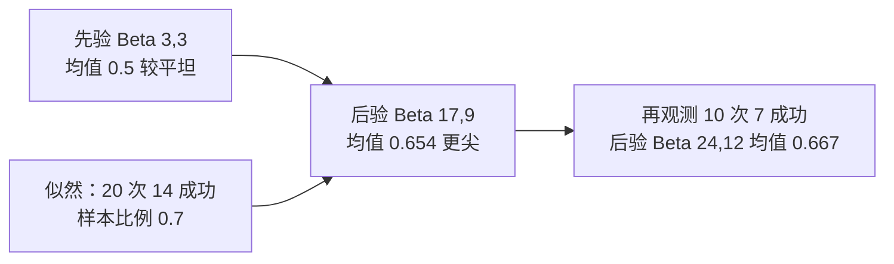

# 贝叶斯推断进阶

> 前置知识：进阶篇的贝叶斯公式与条件概率。本篇把贝叶斯从“算一次后验概率”推进到“用分布做推断”。

## 一句话理解

贝叶斯推断进阶是：不再只给参数一个点估计（如“转化率是 30%”），而是给出参数整条可能的分布（“转化率最可能是 30%，但 25%–35% 都有可能”），并且数据越多，这条分布越收窄。

## 为什么需要：点估计会骗人

新功能上线 10 个用户里 8 个转化，样本比例是 80%。你敢说真实转化率就是 80% 吗？10 个人的样本抖动极大，真实值可能是 60%，也可能是 90%。点估计只给一个数，藏起了不确定性；贝叶斯推断把不确定性本身算出来给你看。

## 从点估计到分布估计

贝叶斯公式 P(θ|D) ∝ P(D|θ) × P(θ) 里，θ 是待估参数（如真实转化率），D 是观测数据：

- 先验 P(θ)：动手前你对参数的判断，表示成一条分布，不是拍脑袋一个数。
- 似然 P(D|θ)：在某个参数值下，观测到这批数据的可能性。
- 后验 P(θ|D)：结合先验与数据后，参数的更新分布。数据越多，后验越集中在真值附近。

## 共轭先验 Beta-二项：先验与后验是同一家人

估计成功率这类 0–1 之间的比例时，Beta 分布是二项似然的共轭先验：先验 Beta(α, β) 遇到数据后，后验仍然是 Beta 分布，只是参数变了：

后验 = Beta(α + 成功次数, β + 失败次数)。

α、β 可以理解成“先验里虚拟的成功与失败次数”：Beta(2, 2) 相当于动手前先看过 4 次试验、2 胜 2 负，温和地倾向 50%，但态度不坚决。

## 完整数字案例

先验 Beta(2, 2)，先验均值 = 2 / (2 + 2) = 0.5。观测到 10 次试验、8 次成功：

后验 = Beta(2 + 8, 2 + 2) = Beta(10, 4)。后验均值 = 10 / (10 + 4) ≈ 0.714。

注意：样本比例是 0.8，后验均值 0.714 比它低——先验把估计往 0.5 方向拉了一把。这就是“收缩”：小样本时先验话语权大，防止你被 10 个人的抖动带偏。

95% 可信区间（后验分布中间 95% 的范围）约 [0.462, 0.909]：区间很宽，诚实地告诉你“10 个样本真说明不了太多”。

数据量上去后先验就被冲淡了：100 次试验、80 次成功，后验 = Beta(82, 22)，均值 ≈ 0.788，95% 可信区间约 [0.705, 0.861]——明显收窄，且越来越接近样本比例 0.8。

## 可信区间 vs 置信区间：本质区别

- 可信区间（贝叶斯）：“在先验与数据下，参数有 95% 的概率落在这个区间里。”可以直接这样说。
- 置信区间（频率学派）：“重复抽样 100 次，约 95 次算出的区间会盖住真值。”不能说“这次算出的区间有 95% 概率盖住真值”——对频率学派来说，参数是固定值，盖住或没盖住没有概率可言。

两者数字可能接近，含义完全不同，汇报时不要混用说法。

## MCMC 一句话定位

先验与似然不共轭时，后验没有现成公式。这时用 MCMC（马尔可夫链蒙特卡洛）：让计算机按后验分布的形状大量采样，用样本近似后验。原理是采样算法，本篇不展开推导，知道“后验算不出来时用采样近似”就够了。

## 容易混淆与常见误区

- 先验不是瞎猜：它是可以检验、可更新的假设。正确做法是做敏感性分析——换几个合理的先验重算一遍，看结论变不变；结论随先验大幅摇摆时，要如实报告，而不是藏起先验。
- 后验均值不等于样本比例：小样本时先验会收缩估计，这是优点不是 bug；样本量大后两者自然趋同。
- 可信区间不等于置信区间：数字相近也不等于可以互换说法。

## 实际应用

新功能小流量实验的转化率估计、A/B 测试的贝叶斯版（直接算“B 优于 A 的概率”）、医疗诊断中结合 base rate 更新判断——凡是“样本不大、又想直接谈概率”的地方，贝叶斯推断都比只报一个点估计诚实。

## 公式精讲与练习：贝叶斯公式与 Beta-二项后验更新

原篇讲了“后验 = 先验 × 似然”的方向和 Beta-二项的更新规则，本节把两个核心公式拆开讲透：每个符号是什么意思、数字怎么一步步代入、分布形状怎么变，再配两个新生活案例和 4 道练习题。

### 1. 贝叶斯公式：符号逐项解释

$$P(\theta|D) = \frac{P(D|\theta) \times P(\theta)}{P(D)}$$

| 符号 | 含义 | 读法注意 |
|---|---|---|
| θ | 待估参数，如真实转化率、真实合格率 | 它不是一个固定数，而是一条分布上的取值 |
| D | 观测数据，如“20 次试验 14 次成功” | 数据一旦观测到就是固定的，不再是随机量 |
| P(θ) | 先验：动手前对参数的判断，写成一条分布 | 不是拍脑袋一个数；α、β 越大，先验态度越坚决 |
| P(D\|θ) | 似然：在参数为 θ 时，观测到这批数据的可能性 | 它是 θ 的函数，不是 D 的概率 |
| P(θ\|D) | 后验：结合先验与数据后，参数的更新分布 | 本节的主角：推断的结论就是这条分布 |
| P(D) | 证据：归一化常数，保证后验在全部 θ 上积分为 1 | 只比较同一批数据下的不同 θ 时可以不算，原篇写成 ∝ 就是省略了它 |

一句话：先验是你动手前的判断，似然是数据在不同参数下的“支持度”，后验是两者相乘再归一化后的更新判断。

### 2. Beta-二项后验更新：参数怎么变，均值怎么算

估计 0–1 之间的比例时，先验取 Beta(α, β)，观测到 n 次试验、s 次成功后：

- 后验 = Beta(α + s, β + (n − s))：成功数加到 α 上，失败数加到 β 上。
- 后验均值 = (α + s) / (α + β + n)：分母是“先验虚拟次数 + 真实试验次数”。

α、β 的直观含义不变：Beta(3, 3) 相当于动手前先看过 6 次试验、3 胜 3 负，均值 3 / 6 = 0.5，态度温和。

### 3. 完整数字推导（新算例，与原篇数字不重复）

先验 Beta(3, 3)，先验均值 = 3 / (3 + 3) = 0.5。观测到 20 次试验、14 次成功：

- 后验 = Beta(3 + 14, 3 + 6) = Beta(17, 9)。
- 后验均值 = 17 / (17 + 9) = 17 / 26 ≈ 0.654。
- 对照：样本比例是 14 / 20 = 0.7，后验均值 0.654 比它低——先验把估计往 0.5 方向拉了一把，即原篇说的“收缩”。先验虚拟次数 6 次占总权重 6 / 26 ≈ 23%，话语权不小。

数据继续来，再观测 10 次试验、7 次成功（把上一步的后验当新先验）：

- 后验 = Beta(17 + 7, 9 + 3) = Beta(24, 12)。
- 后验均值 = 24 / (24 + 12) = 24 / 36 ≈ 0.667。
- 对照：累计样本比例是 21 / 30 = 0.7，后验 0.667 仍低于它，但先验权重已降到 6 / 36 ≈ 17%。这就是序贯更新：每批新数据进来，后验滚动前进一步，先验权重一路被稀释。

### 4. 直观图示：先验 → 似然 → 后验，分布越变越尖

| 阶段 | 分布 | 均值 | 形状直观 |
|---|---|---|---|
| 先验 | Beta(3, 3) | 0.5 | 居中对称、较平坦：态度温和，不坚决 |
| 20 次数据后 | Beta(17, 9) | 0.654 | 右移、变尖：数据把分布往样本比例 0.7 方向拉 |
| 再 10 次数据后 | Beta(24, 12) | 0.667 | 更尖：数据越多，分布越集中，不确定性越小 |

形状变化的规律：数据量越大，后验越尖、越靠近样本比例；小样本时后验形状受先验拖拽明显，大样本时先验几乎看不出痕迹。

### 5. 生活案例一：疾病筛查——阳性不等于患病

某病在人群中的患病率是 1%，检测灵敏度 99%（患者测出阳性的概率），假阳性率 5%（健康人测出阳性的概率）。一个人测出阳性，他真正患病的概率是多少？

用贝叶斯公式算，θ 取“患病 / 健康”两种情形：

- 分子（患病且阳性）：0.01 × 0.99 = 0.0099。
- 分母（所有阳性）：0.0099 + 0.99 × 0.05 = 0.0099 + 0.0495 = 0.0594。
- 后验概率 = 0.0099 / 0.0594 ≈ 0.167，即约 16.7%。

直觉：阳性结果确实把概率从 1% 抬到了 16.7%，但远不到“基本确诊”。原因是健康人基数太大：99 个健康人里 5% 假阳性，绝对数量（0.0495）压过了 1 个患者里的真阳性（0.0099）。忽略患病率这个先验、只看“检测准确率 99%”，就会严重高估。下一步通常是复检，而不是直接下结论。

### 6. 生活案例二：产品合格率——小样本别急着报喜

某批零件抽检前，工程师的先验是 Beta(5, 5)：相当于先看过 10 件、5 合格 5 不合格，均值 0.5，态度中性。抽检 50 件，46 件合格、4 件不合格：

- 后验 = Beta(5 + 46, 5 + 4) = Beta(51, 9)。
- 后验均值 = 51 / (51 + 9) = 51 / 60 = 0.85。
- 对照：样本合格率是 46 / 50 = 0.92，后验 0.85 比它低——先验 10 次虚拟试验把估计往 0.5 拉了一把。

汇报时报 0.85（附后验分布）比直接报 0.92 诚实：50 件样本还不足以把先验完全冲淡，尤其当这批货的合格率关系到是否放行时，收缩后的估计留出了安全余量。等抽检量累计到几百件，后验均值自然会贴近样本合格率。

### 练习题

1. 先验 Beta(4, 4)，观测到 30 次试验、21 次成功。求后验分布与后验均值，并与样本比例比较，说明收缩方向。
2. 疾病筛查变式：某病患病率 0.5%，检测灵敏度 99%，假阳性率 2%。一个人测出阳性，他真正患病的概率是多少？（列出分子、分母再算）
3. 概念题：为什么数据量越大，先验的影响越小？用后验均值公式 (α + s) / (α + β + n) 说明，并算出先验 Beta(2, 2) 在 10 次试验和 1000 次试验下先验虚拟次数占总权重的比例。
4. 先验 Beta(2, 2)，观测到 40 次试验、30 次成功。求后验分布与后验均值；与原篇 10 次样本的后验相比，95% 可信区间会变宽还是变窄？为什么？（区间方向定性回答即可，精确端点需查 Beta 分位数表或用软件计算）

### 参考答案

1. 后验 = Beta(4 + 21, 4 + 9) = Beta(25, 13)，均值 = 25 / (25 + 13) = 25 / 38 ≈ 0.658。样本比例是 21 / 30 = 0.7，后验 0.658 低于它：先验 Beta(4, 4) 把估计往 0.5 方向收缩。
2. 分子（患病且阳性）= 0.005 × 0.99 = 0.00495；分母（所有阳性）= 0.00495 + 0.995 × 0.02 = 0.00495 + 0.0199 = 0.02485；后验概率 = 0.00495 / 0.02485 ≈ 0.199，即约 19.9%。患病率越低，阳性结果的含金量越受假阳性拖累。
3. 后验均值公式的分母是 α + β + n：先验虚拟次数 α + β 固定，n 增大后分母中 n 占主导，先验权重 (α + β) / (α + β + n) 随之缩小。Beta(2, 2) 时先验虚拟次数是 4 次：10 次试验下占 4 / 14 ≈ 28.6%；1000 次试验下占 4 / 1004 ≈ 0.4%，几乎可以忽略。
4. 后验 = Beta(2 + 30, 2 + 10) = Beta(32, 12)，均值 = 32 / 44 ≈ 0.727。区间变窄：数据量从 10 次涨到 40 次，后验分布更集中，不确定性更小。均值 0.727 仍低于样本比例 30 / 40 = 0.75，但收缩幅度已小于 10 次样本时——数据越多，先验拖拽越弱。

## 面试与自测

1. 先验 Beta(2, 2)，观测到 10 次试验 8 次成功，后验是什么？后验均值是多少？为什么低于样本比例 0.8？
2. 95% 可信区间和 95% 置信区间说法上有什么本质区别？
3. 数据量从 10 次涨到 100 次，后验区间发生了什么变化？说明了什么？

### 参考答案

1. 后验 Beta(10, 4)，均值 10/14 ≈ 0.714。低于 0.8 是因为先验 Beta(2, 2) 把估计往 0.5 方向收缩，小样本时先验话语权大，防止被抖动带偏。
2. 可信区间可以直接说“参数有 95% 概率落在这个区间里”（贝叶斯语境，先验+数据下）；置信区间只能说“重复抽样下约 95% 的区间会盖住真值”，不能说这次的区间有 95% 概率盖住。
3. 区间从约 [0.462, 0.909] 收窄到约 [0.705, 0.861]，且均值更接近样本比例。说明数据量越大，先验影响越小、后验越集中，估计越可信。
