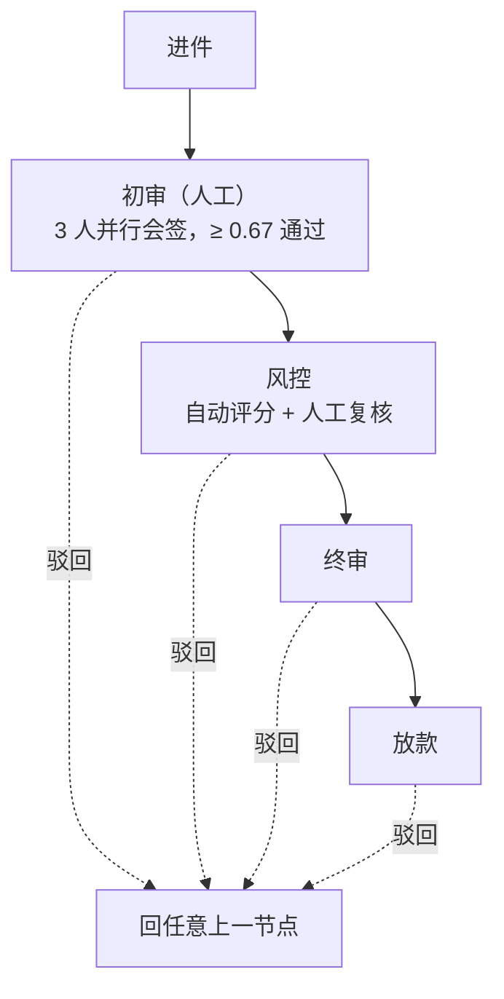
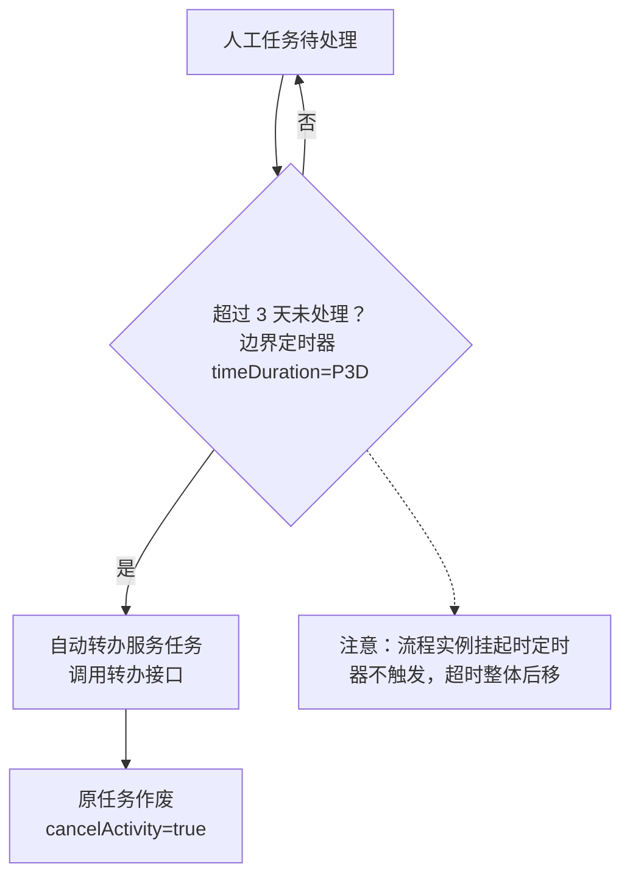
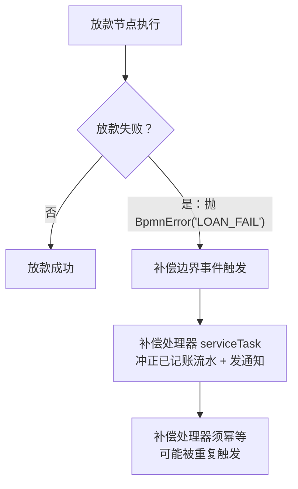

# 神农 e 贷审批流案例

> 项目记录与通用技术知识分开存放，互相链接。
> 通用 Flowable 用法见 [工程实践/Flowable.md](工程实践/Flowable.md)；这篇只记神农项目的真实沉淀。
> 下面是可直接讲的实战配置（BPMN 片段基于 Flowable 6.7.2；人数、天数阈值按产品要求调）。

## 流程

下图是神农 e 贷的审批主链路，驳回可回任意上一节点。

进件 → 初审（人工）→ 风控（自动评分 + 人工复核）→ 终审 → 放款；驳回可回任意上一节点。

## 技术点

### 会签：多人并行，多数决通过

- 初审节点挂多实例并行：`multiInstanceLoopCharacteristics`，`nrOfInstances=3`。
- `completionCondition` 用比值写法：`${nrOfCompletedInstances/nrOfInstances >= 0.67}` —— 三分之二通过即过，避免一人请假卡死全流程。
- 注意：完成条件里别用 `nrOfActiveInstances`，实例完成后 active 计数归零，写错会提前结束。

### 超时：N 天未处理自动转办

下图是人工任务超时自动转办的逻辑。

- 人工任务挂边界定时器（`boundaryTimerEvent`），`timeDuration=P3D`（ISO-8601，3 天）。
- 定时器分支走"自动转办"服务任务（expression 委托调用转办接口）；转办后原任务作废 → `cancelActivity=true`。
- 边界定时器在流程实例被挂起（suspend）时不触发：批量暂停流程做数据修复时，超时逻辑会整体后移，上线前要对账。

### 补偿：放款失败回滚

下图是放款失败时补偿回滚的触发链。

- 放款节点挂补偿边界事件（`boundaryCompensateEvent`），放款失败抛 `BpmnError("LOAN_FAIL")` 触发补偿处理器：冲正已记账流水 + 发通知。
- 补偿处理器必须是 serviceTask 且幂等——补偿可能被重复触发。

### 驳回：回任意上一节点

- 用 `ChangeActivityStateBuilder`（Flowable 6.7+）做动态跳转，比画满返回线干净。
- 跳转后历史任务的 assignee 要手动清理，否则待办列表里有幽灵任务。

## 坑

- 会签完成条件写成 `${nrOfCompletedInstances == nrOfInstances}` 会变成"必须全票通过"——想做多数决必须用比值。
- 所有自动节点（风控评分、放款）包 try-catch 转 BpmnError：未捕获异常会把 job 卡进死信表 `ACT_RU_DEADLETTER_JOB`，定期要有人看。
- 边界定时器的 `timeDuration` 写 `P3D` 不是 `3d`，格式写错流程部署时不报错、运行时不触发，最难查。

## 经验

- 审批流的"业务状态"和"流程状态"分两张表：流程实例 id 挂业务单上，业务单自己维护 `PENDING/APPROVED/REJECTED`，别全靠 `RuntimeService` 查——列表页查询性能差一个数量级。
- 上线前用流程模拟跑 100 单：会签各种通过/拒绝组合 + 超时 + 补偿，纸上画的流程和跑起来的流程是两回事。
- 流程定义版本升级用"新实例走新版、老实例跑完老版"的自然过渡，别做运行中实例迁移，除非你真的想加班。
