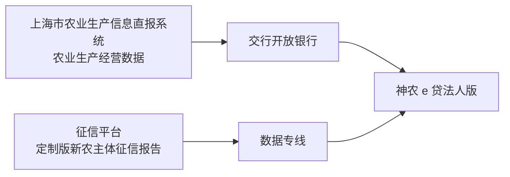
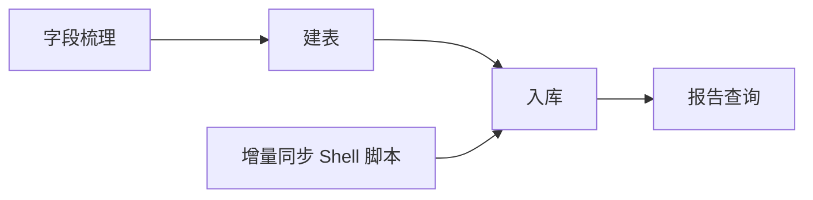

# 神农 e 贷法人版（交通银行上海市分行）

<!-- TOC -->
- [项目概述](#项目概述)
- [软件环境](#软件环境)
- [本人职责](#本人职责)
- [核心工作与技术点](#核心工作与技术点)
- [关联知识](#关联知识)
<!-- /TOC -->

## 项目概述

下图是神农 e 贷法人版的两条外部数据对接链路。

「神农 e 贷」于 2023 年中首发，是交行上海市分行在上海市农委指导下首创的全线上贷款产品，也是针对农业合作社客群的无押、无保纯信用线上贷款的新尝试。该产品作为上海农业大数据在金融领域的应用，借助交行开放银行对接上海市农业生产信息直报系统，获取农户真实可靠的农业生产经营数据；同时通过数据专线对接征信平台，获取定制版新农主体征信报告，完善信贷评价，跨越信息鸿沟。

任职：深圳市法本信息技术股份有限公司（2024/4 至今期间项目，现主力项目）。

## 软件环境

- 后端：JUMP + OceanBase + MyBatis
- 开发工具：IDEA + Git
- 相关技术栈（项目实际使用）：Spring Boot 2.7.3、MyBatis-Plus 3.5.3.2、Flowable 6.7.2、Redis、Quartz、Docker、TongWeb

## 本人职责

1. 负责法人版业务逻辑梳理
2. 负责征信数据字段收集整理及数据库表创建，征信数据入库及征信报告查询的业务代码实现
3. 预核额、预审、正式审批、放款通知的功能代码实现
4. 第三方接口对接与联调，及征信增量数据的同步 Shell 脚本
5. 参与项目需求讨论、项目测试及需求发版上线
6. 其他业务流程逻辑代码的修改与优化

## 核心工作与技术点

- 征信数据链路：字段梳理 → 建表 → 入库 → 报告查询，及增量同步脚本

下图是征信数据链路的四个环节。

- 审批主链路：预核额 → 预审 → 正式审批 → 放款通知

下图是审批主链路的四个环节。

- 审批流实现细节（会签、驳回、超时、补偿等）单独沉淀在 [[神农-e贷-审批流]]

## 关联知识

- [[神农-e贷-审批流]]：本项目审批流的专题深挖
- [[Flowable]]：流程引擎通用方法
- [[MySQL-数据库]]：OceanBase MySQL 模式注意点
